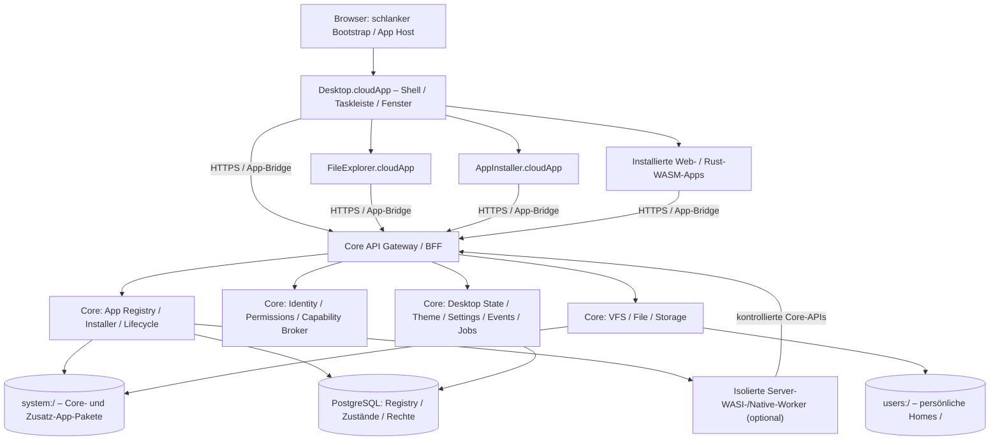
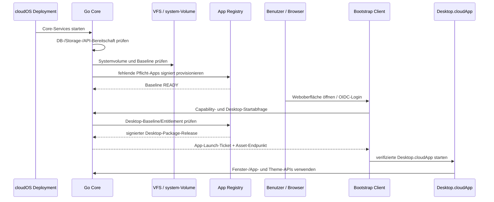
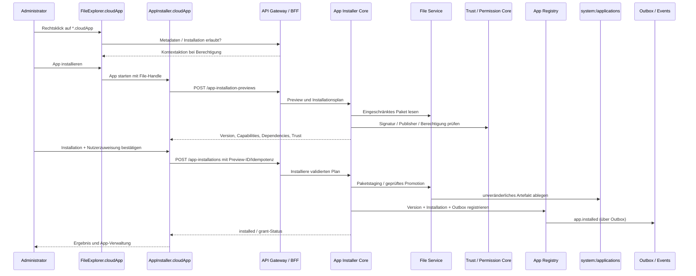
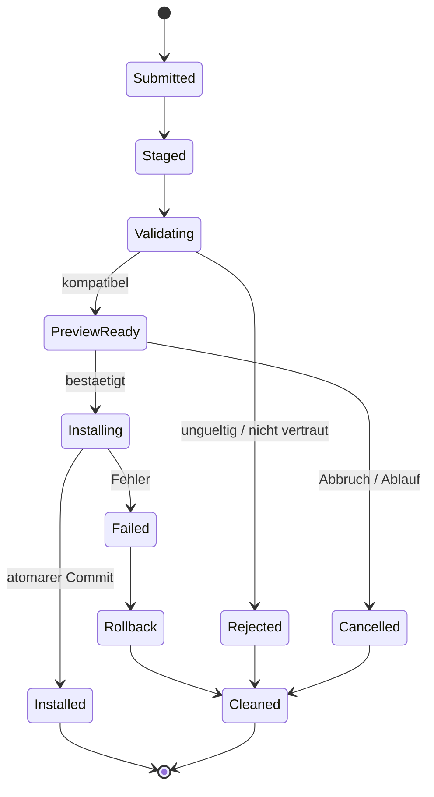

# cloudOS – Anwendungsarchitektur und `.cloudApp`-Paketformat

> **Dokument:** `docs/APPLICATION_SYSTEM.md`  
> **Version:** 0.1 – Architekturentwurf / verbindliches App-first-Zielbild  
> **Stand:** 15.11.2026  
> **Repository:** [Drezael/cloudOS](https://github.com/Drezael/cloudOS), Ausgangsbasis `main` bei `efa3c237d07f6acf0b0358f999e3bfe76b21b116`  
> **Übergeordnete Dokumente:** `docs/CONCEPT.md`, `docs/SYSTEM_ARCHITECTURE.md`, `docs/VIRTUAL_FILESYSTEM.md`  
> **Geltungsbereich:** CloudOS-Core, Core-Apps, installierbare Apps, Paketformat, Installation, Laufzeit, Berechtigungen, UI-Integration und Wartung

## 1. Ziel und verbindliche Produktentscheidung

cloudOS wird als **App-first-Plattform** entwickelt. Der **cloudOS Core** stellt sämtliche Systemfunktionen und das technische Framework über versionierte APIs bereit. **Alle von Benutzern gestarteten Anwendungen und alle sichtbaren Desktop-Systemfunktionen sind Anwendungen im einheitlichen `.cloudApp`-Format**. Es gibt keine parallel implementierten, fest in das Browser-Frontend einkompilierten Dateimanager, Einstellungen, App-Launcher oder Desktop-Sonderanwendungen.

Eine Anwendung muss im cloudOS-App-Register **ordnungsgemäß installiert** und für den jeweiligen Benutzer **freigegeben** sein, bevor sie gestartet werden darf. Das bloße Vorhandensein einer `.cloudApp`-Datei im Benutzer-Home führt **nie** automatisch zur Ausführung.

Ein Teil dieser Anwendungen sind **Core-Apps**: Sie werden bei jeder unterstützten Installation mit cloudOS ausgeliefert, automatisch provisioniert und stehen ab dem ersten Start bereit. Dazu gehören mindestens `Desktop`, `File Explorer`, `Settings` und `App Installer`. Ein Administrator kann zusätzliche `.cloudApp`-Pakete bequem im File Explorer per **Rechtsklick → App installieren** installieren.

> **Begriffliche Abgrenzung:** Interne Go-Core-Dienste, Nginx, PostgreSQL, NATS, ein OIDC-Provider und isolierte Runtime-Worker sind **Infrastrukturprozesse**, keine vom Benutzer gestarteten Anwendungen. Sie benötigen kein `.cloudApp`-Paket. Eine Authentifizierungs-/Notfalloberfläche vor dem App-Bootstrap darf als minimale, geprüfte Plattform-Oberfläche existieren; sie ist kein allgemeiner App-Ersatz. Alle regulären sichtbaren cloudOS-Funktionen müssen über Core-Apps realisiert werden.

### 1.1 Verbindliche Invarianten

1. **Core = Funktion + Framework, App = Oberfläche/Workflow.** Der Core implementiert APIs, Policy, Datenzugriff, App-Lebenszyklus, Runtime-Verwaltung und Servicekommunikation. Sichtbare Anwendungen liegen in `.cloudApp`-Paketen.
2. **Jede Benutzeranwendung ist zuerst installiert.** Eine einzelne `.cloudApp`-Datei im Dateisystem ist kein ausführbares Programm und kein automatisch registriertes App-Modul.
3. **Gleiches Paketformat für Core- und Drittanbieter-Apps.** Core-App-Status entsteht nur aus einer geschützten, signierten cloudOS-Release-Zuordnung – nie aus einem beliebigen Manifestfeld einer fremden App.
4. **Core-Apps sind verpflichtend.** Kritische Core-Apps können im normalen Administrationsbetrieb nicht deinstalliert oder deaktiviert werden.
5. **Keine ungeprüfte Installation.** Die Installation prüft Paketformat, Signatur, Publisher-Vertrauen, Kompatibilität, Capabilities, Abhängigkeiten und Ressourcenlimits.
6. **Admins installieren im MVP.** Das Kontextmenü macht die Installation bequem; der Go-Core erzwingt die Adminberechtigung serverseitig. Das spätere Delegieren einer Nutzerinstallation ist eine gesonderte Entscheidung.
7. **Installation ist nicht Freigabe.** Ein zusätzliches Paket kann global installiert sein, ohne für alle Benutzer startbar zu sein. Zugriff wird separat per Rollen-/Gruppen-/Benutzerzuordnung erteilt.
8. **Installieren ist nicht Starten.** Installation kopiert und registriert unveränderliche Artefakte. Eine Instanz startet erst nach einer autorisierten Launch-Anfrage.
9. **Daten bleiben im Benutzer-Home.** Systemweite App-Pakete gehören auf `system:/`; die persönlichen Dateien und anwendungsspezifischen Daten eines Benutzers gehören auf die zweite virtuelle Festplatte.
10. **Keine App umgeht den Core.** Keine direkte Browser-/App-Verbindung zu PostgreSQL, Blob-Schlüsseln, internen gRPC-Diensten oder dem Linux-Host.
11. **Themes sind Pflicht für cloudOS-eigene Apps.** Alle von cloudOS kontrollierten Elemente einschließlich der Core-Apps unterstützen das Designsystem und den Theme Service.
12. **API-/ABI-Kompatibilität ist explizit.** Paketformat, Manifest, SDK, App-Bridge, Core-API und Runtime-Profil werden unabhängig versioniert.
13. **Reproduzierbarer Systemstart.** Eine signierte, versionsgebundene Core-App-Baseline darf durch Drittanbieter-Apps weder überschrieben noch entfernt werden.
14. **Wiederherstellbarkeit.** Fehlerhafte Installationen, Updates und App-Abstürze dürfen cloudOS nicht unbootbar machen; ein minimaler Recovery-Pfad bleibt erhalten.

### 1.2 Nichtziele der ersten Version

- Ein öffentlich betriebener App Store oder automatischer Download beliebiger Software.
- Ausführen eines `.cloudApp`-Archivs durch Doppelklick ohne Installation.
- Ausführen beliebiger nativer `.exe`-, ELF- oder Rust-Binärdateien innerhalb des privilegierten Core-Prozesses.
- Garantiertes Umstylen der inneren Oberfläche von fremden Canvas-/Rust-/WASM-Anwendungen ohne deren Theme-Unterstützung.
- Ungeprüfte Selbstaktualisierung von Apps, Update-Skripte mit Hostrechten oder dynamisch nachladbarer unsignierter Code.
- Gemeinsamer, unkontrollierter Zugriff aller Apps auf das gesamte Benutzer-Home.

## 2. Terminologie und Schichten

| Begriff | Bedeutung |
|---|---|
| **Core Service** | Logischer Go-Systemdienst mit stabiler API und eigener fachlicher Verantwortung |
| **Core App** | Von cloudOS ausgeliefertes und zwingend installiertes `.cloudApp`-Paket für eine benötigte sichtbare Systemfunktion |
| **Optional mitgelieferte App** | Vorinstalliertes, aber nicht zwingend laufendes `.cloudApp`-Paket (z. B. Terminal) |
| **Drittanbieter-App** | Extern signiertes, nach Prüfung vom Administrator installiertes `.cloudApp`-Paket |
| **App-Paket** | Unveränderliches, geprüftes Archiv mit exakter Endung `.cloudApp` und definiertem Inhalt |
| **App-Version** | Eine konkrete Kombination aus App-ID, Versionskennung und Paketdigest |
| **Installation** | Serverseitige Registrierung einer App-Version samt geprüften Artefakten |
| **Zuweisung** | Festlegung, welchen Benutzern/Gruppen eine installierte App angeboten werden darf |
| **App-Instanz** | Konkrete, authentifizierte laufende Anwendung, mit Instanz-ID, Owner, Runtime und Lifecycle |
| **Capability Grant** | Geprüfte, begrenzte Berechtigung einer App-Instanz für eine bestimmte Operation/Ressource |
| **App Host** | Vom Desktop gestarteter, kontrollierter Browser-Container für eine App-Oberfläche |
| **Runtime** | Technik, mit der eine App ausgeführt wird: Web, Rust-WASM, Server-WASI oder später native Isolation |
| **Preinstall Baseline** | Signierte Liste aller für eine cloudOS-Version verpflichtenden Core-App-Versionen |
| **Recovery Shell** | Minimale, privilegierte Wartungsoberfläche außerhalb regulärer Apps zur Wiederherstellung der Baseline |

Die technische *Installation* in cloudOS ist nicht identisch mit der physischen Docker-Installation. Ein App-Paket ist eine cloudOS-Ressource, kein Host-Paket und kein Docker-Image.

## 3. Architekturübersicht



Das Diagramm zeigt *fachliche* Verbindungen. Physisch dürfen alle Go-Dienste zunächst in wenigen Prozessen zusammengefasst sein. Sicherheitsgrenzen zwischen dem vertrauenswürdigen Core, privilegierten Core-Apps und Drittanbieter-Apps gelten dennoch von Anfang an.

### 3.1 Benutzeroberfläche ohne fest einkompilierte Apps

Der Bootstrap-Client ist bewusst klein. Er lädt nach Anmeldung die registrierte, geprüfte `Desktop.cloudApp`-Version über die App API und startet sie als **Shell-App**. Diese stellt Startmenü, Taskleiste, Fenstercontainer und App-Launcher bereit. Die Core-Services sind unabhängig davon erreichbar und verwalten weiter Sitzung, Berechtigungen, Registry und Dateisystem.

Ein `FileExplorer.cloudApp`-Paket implementiert den Dateimanager. Es fragt Dateiknoten und Volumes beim File Service ab. Eine `Settings.cloudApp`-Instanz nutzt Settings-/Theme-APIs. Der `AppInstaller.cloudApp`-Workflow ruft ausschließlich den App Installer Service auf.

Die Darstellung des Fensters und seiner Bedienelemente ist eine **Desktop-App-Aufgabe**; die autoritative Instanzregistrierung, die persistenten Fensterzustände und die Rechteprüfung liegen im Core.

### 3.2 Bootstrap-Ausnahme eng begrenzen

Vor dem ersten Start einer Desktop-App sind die Anmeldung über OIDC, das Laden des Core-App-Katalogs und eine minimale Fehlermeldung möglich, obwohl dafür noch kein benutzerseitiges `.cloudApp` läuft. Dieser Bootstrap besitzt keine allgemeine Dateiverwaltung, keinen alternativen App-Store und keine reguläre Desktop-Oberfläche. Recovery ist nur über autorisierte Administration möglich und wird auditiert.

## 4. Core Service-Katalog für Anwendungen

| Core-Dienst | Fachliche Verantwortung | Darf UI rendern? |
|---|---|---|
| **App Package Service** | Paketeingang, Checksums, Formatprüfung, Signatur/Publisher, sichere Staging- und Paketablage | Nein |
| **App Registry Service** | Installierte App-Versionen, Metadaten, Dateizuordnungen, Startfähigkeit | Nein |
| **App Installer Service** | Install-/Update-/Rollback-/Uninstall-Transaktionen und Dependency Resolver | Nein |
| **App Assignment Service** | Freigabe installierter Apps für Benutzer, Gruppen und Rollen | Nein |
| **App Lifecycle Service** | App-Start, Stop, Suspend, Restore, Zustandsübergänge und Idempotenz | Nein |
| **Runtime Manager** | Auswahl, Konfiguration und Überwachung zulässiger Runtime-Profile | Nein |
| **Process Registry** | Instanz-/Job-IDs, Owner, Status, Ressourcenlimits und Wiederanlaufstatus | Nein |
| **App Capability Broker** | App-Berechtigungen, ausgewählte Datei-Handles, Revocation, Session-Bindung | Nein |
| **File Service** | VFS, beide Volumes, persistente Benutzerdateien, systeminterne Paketablage | Nein |
| **Permission Service** | Systemrollen, Ressourcen-ACLs, Recht auf Installation, Paketfreigabe und App-Operationen | Nein |
| **Desktop State Service** | Persistente Desktop-, Fenster- und Launcher-Zustände | Nein |
| **Theme Service** | Theme-Pakete, Design-Tokens und Benutzer-/Systemtheme | Nein |
| **Settings Service** | Einstellungswerte und Policies; Core-Apps zeigen sie an | Nein |
| **Realtime / Event Service** | Zustandsänderungen an autorisierte Clients weitergeben | Nein |
| **Audit Service** | Installation, Publisher-/Rechteänderung, Updates und Recovery protokollieren | Nein |

**Eigentümerregel:** Jeder Dienst besitzt seine Daten und API. Die App Installer-App darf z. B. nicht unmittelbar die Registry-Tabellen ändern; sie sendet eine autorisierte Install-Anfrage. Beim MVP können Package, Registry und Installer in einem logischen Go-App-Subsystem zusammengefasst sein, müssen aber klare interne Modulgrenzen behalten.

### 4.1 Core-Funktionen sind nicht automatisch Core-Apps

Dateisystem, Authentifizierung, ACLs, Suche, Shell-Befehle und Theme-Auflösung sind Kernfunktionen. Nur ihre interaktiven Benutzeroberflächen werden als `.cloudApp` bereitgestellt. Damit kann später ein CLI-Client oder ein anderer Desktop dieselben APIs nutzen.

## 5. Mitgelieferte Core-Apps

### 5.1 Verbindliche Core-App-Baseline

| Paket-ID (Entwurf) | Anzeigename | Rolle | Status |
|---|---|---|---|
| `io.cloudos.desktop` | Desktop | Desktop-Shell, Fenster, Taskleiste, Launcher, Kontextmenüs | **Pflicht / Autostart** |
| `io.cloudos.file-explorer` | File Explorer | Zugriff auf das sichtbare VFS, Dateioperationen und Dateizuordnungen | **Pflicht / vorinstalliert** |
| `io.cloudos.settings` | Settings | Benutzer-, Theme- und erlaubte Systemeinstellungen | **Pflicht / vorinstalliert** |
| `io.cloudos.app-installer` | App Installer | Installationsvorschau, Bestätigung, Fortschritt und Ergebnis | **Pflicht / vorinstalliert** |
| `io.cloudos.system-dialogs` | System Dialogs | Datei-Picker, Bestätigungen, Berechtigungen und Fehlerdialoge | **Pflicht / vorinstalliert** |
| `io.cloudos.notifications` | Notification Center | System- und App-Meldungen anzeigen | **Pflicht / vorinstalliert** |

Die Namen/IDs sind **Entwürfe**, die in einem eigenen Contract festgeschrieben werden. Zusätzliche notwendige Core-Apps können auf dieselbe Weise Bestandteil der Baseline werden. **Nicht jede Core-App wird bei Login automatisch als sichtbares Fenster geöffnet**: Desktop startet als Shell-App; File Explorer, Settings und Installer starten bei Bedarf. System Dialogs und Notification Center dürfen von der Desktop-App als kontrollierte, registrierte Komponenten gestartet oder eingebettet werden.

### 5.2 Vorinstallierte optionale Anwendungen

Beispiele sind Terminal, Texteditor, Bildbetrachter, Mediaplayer und Dokumentbetrachter. Sie werden ebenfalls als `.cloudApp` ausgeliefert und bei einem Release als **optionale Bundled Apps** registriert. Anders als Pflicht-Core-Apps dürfen sie später administrativ deaktiviert werden, sofern ihre Abhängigkeiten dies erlauben.

### 5.3 Spezialrechte von Core-Apps

Core-Apps erhalten nur die zur jeweiligen Aufgabe benötigten Rechte, z. B. `desktop.shell`, `apps.install.request`, `files.picker.open` oder `notifications.render`. Ihre Herkunft wird anhand des signierten Release-Manifests geprüft. Ein beliebiges Drittanbieter-Paket kann keine Core-App werden, nur weil es in `cloudos.app.json` den Wert `core` einträgt oder eine bekannte App-ID verwendet.

Auch eine vertrauenswürdige Core-App darf keine Sicherheitsprüfung im Go-Core überspringen. **Core-App-Vertrauen legitimiert die benötigte API, nicht uneingeschränkte Host-, Datenbank- oder Benutzerdateirechte.**

## 6. Das `.cloudApp`-Paketformat

### 6.1 Dateiendung und Dateityp

- **Verbindliche Endung:** `.cloudApp` (exakte Schreibweise bei der Erstellung; bei Dateierkennung kann die Oberfläche abweichende Groß-/Kleinschreibung erkennen, akzeptiert wird das valide Paket).
- **Vorgeschlagener MIME-Typ:** `application/vnd.cloudos.app+zip` (projektinterner Typ; keine Behauptung einer registrierten IANA-Zuordnung).
- **Containerformat v1:** ZIP-Archiv mit unveränderlicher, dokumentierter Verzeichnisstruktur.
- **Manifest:** `cloudos.app.json` im Archivstamm.
- **Inhaltsverifikation:** kryptografische Digest-Liste jedes relevanten Archiveintrags.
- **Authentizität:** signierter Paketindex, Prüfung gegen eine freigegebene Publisher-Identität.
- **Spezifikation:** eigenständige `package_format_version`, unabhängig von `app_version` und `core_api_version`.

Das Archivformat ist eine **Architekturvorgabe**, keine bereits implementierte Dateiendung. Ein Archiv darf nicht als einfaches `.zip` umbenannt und ohne Integritäts-/Signaturprüfung installiert werden.

### 6.2 Vorgeschlagene Archivstruktur

```text
ExampleEditor-1.0.0.cloudApp
├── cloudos.app.json
├── META-INF/
│   ├── package-index.json
│   ├── package-index.sig
│   └── publisher.json
├── web/
│   ├── index.html
│   ├── main.js
│   └── assets/
├── wasm/
│   ├── app.wasm
│   └── bootstrap.js
├── resources/
│   ├── icons/
│   └── translations/
└── licenses/
    └── LICENSE.txt
```

Die Inhalte richten sich nach dem Runtime-Profil: Eine reine Web-App benötigt keine `wasm/`-Dateien; eine reine serverseitige WASI-Komponente hat ggf. keinen `web/`-Einstiegspunkt. Die Archivstruktur ist bewusst **offen für mehrere Assets**, die Liste im signierten Paketindex muss jedoch alle tatsächlich vorhandenen Dateien abdecken. Nicht referenzierte oder unerwartete ausführbare Payloads führen standardmäßig zur Ablehnung.

### 6.3 Beispielmanifest einer Drittanbieter-Web-App

```json
{
  "package_format_version": "1.0",
  "id": "org.example.editor",
  "name": "Example Editor",
  "version": "1.0.0",
  "publisher_id": "org.example",
  "description": "Ein einfacher Texteditor für cloudOS",
  "core_api": ">=1.0.0 <2.0.0",
  "runtime": {
    "type": "web",
    "entrypoint": "web/index.html"
  },
  "ui": {
    "window": { "default_width": 900, "default_height": 640 },
    "theme_bridge": "1"
  },
  "capabilities_requested": [
    "files.open:selected",
    "files.save:selected",
    "notifications.show"
  ],
  "file_associations": [
    { "mime": "text/plain", "extensions": [".txt"], "action": "open" }
  ],
  "dependencies": [],
  "minimum_platform": { "browser_features": [] }
}
```

Dies ist ein **illustrativer Contract-Entwurf**. Schreibweisen, Constraints, IDs und Felder werden erst durch `contracts/apps/package/v1/` verbindlich. `publisher_id` ist eine Aussage des Pakets und wird durch die Signaturkette bestätigt; der Manifestwert allein beweist die Herkunft nicht. Angeforderte Capabilities sind **keine erteilten Berechtigungen**.

### 6.4 Beispielmanifest einer Core-App

Die gleichen Manifestregeln gelten für die Desktop-App:

```json
{
  "package_format_version": "1.0",
  "id": "io.cloudos.desktop",
  "name": "Desktop",
  "version": "0.1.0",
  "publisher_id": "io.cloudos",
  "core_api": ">=1.0.0 <2.0.0",
  "runtime": { "type": "web", "entrypoint": "web/index.html" },
  "ui": { "role": "desktop-shell", "theme_bridge": "1" },
  "capabilities_requested": [
    "desktop.shell",
    "windows.manage",
    "apps.launch",
    "system.dialogs.request"
  ],
  "dependencies": [
    { "id": "io.cloudos.system-dialogs", "version": ">=0.1.0 <1.0.0" }
  ]
}
```

**Wichtig:** Das Manifest enthält kein vom Installer vertrautes `is_core: true`. Ob eine App verpflichtend ist, ergibt sich ausschließlich aus der geschützten Release-Baseline, Publisher-Prüfung und Policy.

### 6.5 Paketindex und Signaturmodell

Der Paketindex listet kanonische relative Pfade, Dateigrößen, SHA-256-Digests, Paketformat und eindeutige Paketidentität. Der signierte Anteil enthält **alle** sicherheitsrelevanten Felder. Die Signatur (vorgesehen: Ed25519) wird über eine genau festgelegte kanonische Bytefolge geprüft, nicht über uneinheitlich serialisierte JSON-Objekte.

Regeln:

1. Die Signatur schützt sämtliche Payload-Dateien, Manifest, Publisher-Bindung und Versionsinformationen.
2. Die Hash-/Signaturdateien sind nach einer festgeschriebenen, selbstreferenzfreien Regel aus dem signierten Index ausgeschlossen; diese Ausnahme wird im Schema exakt spezifiziert.
3. Vor der Installation werden die **dekomprimierten** Bytes einzeln und gegen den Paketindex geprüft. Die Archivkompression ist keine Sicherheitsfunktion.
4. Ein gültiger SHA-256-Wert ohne vertrauenswürdige Signatur reicht für eine Drittanbieterinstallation nicht aus.
5. Publisher-Schlüssel sind mit Vertrauensstatus, Gültigkeits-/Widerrufsregeln und Auditspur verwaltet.
6. Release-gebundene Core-Apps verwenden die von cloudOS ausdrücklich akzeptierten Schlüssel und Paketdigests.
7. Dynamische Code-Nachladungen aus nicht freigegebenen fremden Quellen sind für App-Pakete standardmäßig gesperrt.

### 6.6 Sichere Archivverarbeitung

Der Installer verwirft Archive mit Zip Slip (`../`, absolute Pfade, Backslashes zur Umgehung), Symlinks/Special Files, mehrfachen oder Unicode-kollidierenden Dateinamen, ZIP-Bombs, zu vielen Einträgen, übergroßen Einzeldateien, nicht passenden Digests, unbekannten kritischen Manifestfeldern oder unzulässigen Runtime-Typen.

Entpackt wird **nur in ein isoliertes Staging-Verzeichnis mit begrenztem Speicher und ohne Ausführung**. Die endgültige Ablage wird über atomare/kompensierbare Übergänge aktiviert; das VFS und Storage-Backend behalten ihre bisherigen Sicherheitsgrenzen bei. Limits werden in einer Systempolicy konfiguriert und automatisiert getestet.

## 7. Core-App-Auslieferung und Systemstart

### 7.1 Signierte Release-Baseline

Jeder cloudOS-Release enthält einen fest definierten Satz von Core-App-Paketen und ein signiertes, versionsgebundenes Baseline-Manifest. Das Manifest definiert die erforderlichen App-IDs, akzeptierten Digests, Versionen, Abhängigkeiten, Autostart-Rollen, erlaubten Publisher und die kompatible Core-API. Es ist **nicht** vom Dateimanager oder fremden Apps beschreibbar.

Die Go-Binaries, VFS-Metadaten, das Release-Manifest und `.cloudApp`-Pakete müssen über ein gemeinsames Release-/Migrationskonzept miteinander kompatibel bleiben. Baseline-Pakete können beim initialen Deployment aus signierten Release-Artefakten importiert werden; sie müssen nicht vor der allerersten Core-Initialisierung bereits in einem verfügbaren VFS liegen.

### 7.2 Startreihenfolge



### 7.3 Fehlende oder defekte Core-App

- **Keine stillschweigende Umgehung:** Der Core meldet einen definierten `core_apps_degraded`-Status und ersetzt die Anwendung nicht durch beliebigen untrusted Code.
- **Reparatur:** Der Recovery-Modus importiert das bekannte signierte Paket oder rollt auf eine kompatible, zuvor getestete Core-App-Version zurück.
- **Recovery UI:** Nur eine minimale Verwaltungsoberfläche plus Admin-CLI/API darf ohne `Desktop.cloudApp` weiterarbeiten.
- **Transaktionale Baseline:** Eine Core-App-Aktualisierung aktiviert einen konsistenten Satz kompatibler Versionen oder lässt den bisherigen Satz aktiv.
- **Core-App-Schutz:** Normale `DELETE`-/Disable-Requests für Pflicht-Apps werden vom Server verweigert, auch für Administratoren.
- **Keine öffentliche Ausführung des Staging-Codes:** Fehlgeschlagene Imports sind bis zur Bereinigung quarantänisiert.

## 8. Installation per Rechtsklick – Administrator-Workflow

### 8.1 Benutzererlebnis

Ein Administrator lädt `ExampleEditor-1.0.0.cloudApp` beispielsweise nach `/Downloads/` hoch. Der File Explorer erkennt Dateiendung, validen Dateityp und die Installer-Verfügbarkeit. Im Kontextmenü erscheint **App installieren**. Die Aktion öffnet den vorinstallierten App Installer über den Core App-Lifecycle; es wird **nicht** die Datei als Skript gestartet.

Die Installer-Oberfläche zeigt Anzeigename, App-ID, Version, Publisher/Signaturstatus, benötigte Core-Version, Runtime, benötigte Abhängigkeiten, angeforderte Capabilities, Paketgröße und vorhandene Installation. Anschließend bestätigt der Administrator die Installation und legt die erlaubten Benutzer/Gruppen fest.

**Standardpolitik MVP:** Installation ist ausschließlich eine administrative, systemweite Aktion. Nach Installation ist die App **nicht automatisch für alle Nutzer freigegeben**. Nur ausdrücklich zugewiesene Nutzer/Gruppen können sie in ihrer App-Liste sehen und starten. Core-Apps sind durch die Baseline von dieser optionalen Zuweisung ausgenommen und für berechtigte cloudOS-Nutzer verfügbar.

### 8.2 Kontextmenü-Matrix

| Situation | Kontextmenü | Serverergebnis |
|---|---|---|
| Admin, gültige `.cloudApp`, noch nicht installiert | `App installieren` | Installationsvorschau / Adminprüfung |
| Admin, gültige `.cloudApp`, ältere Version vorhanden | `App aktualisieren` | Versions- und Kompatibilitätsprüfung |
| Admin, dieselbe Version mit gleichem Digest installiert | `App verwalten` | Vorhandene Installation, kein Doppelimport |
| Admin, unsigniertes / defektes Paket | `Paketinformationen` / Fehler | Installation verweigert |
| Standardbenutzer, `.cloudApp` in eigenem Home | Keine Installationsaktion; `Paketinformationen` optional | `403` bei eigenmächtigem API-Aufruf |
| Beliebiger Benutzer, Doppelklick auf nicht installiertes Paket | Paketinformation; beim Admin optional Installationsdialog | **Keine Ausführung** |
| Core-App im Systemvolume | `App-Informationen` / administrativer Updatepfad | Geschützte Baseline, kein normales Uninstall |

Die Sichtbarkeit des Menüeintrags ist Komfort, **kein Sicherheitsmechanismus**. API-Requests ohne `apps.install` scheitern selbst bei manipuliertem Browser oder direktem `curl`-Aufruf.

### 8.3 Technischer Installationsablauf



### 8.4 Installationssicherheit

- Der File-Handle gehört zur angemeldeten Administratorsitzung, nicht zu einer frei gewählten Hostdatei.
- Installation arbeitet mit einem **unveränderlichen Snapshot** des Pakets. Wird das Original im Home zwischen Vorschau und Bestätigung geändert, wird ein anderer Digest erkannt und eine neue Vorschau verlangt.
- Installation nutzt einen gebundenen, kurzlebigen `preview_id` beziehungsweise `plan_hash`; Bestätigung akzeptiert keine heimlich veränderten Capabilities oder Abhängigkeiten.
- Bereits installierte Versionen sind bei gleichem App-ID/Version/Digest idempotent; bei unterschiedlichem Digest trotz gleicher ID/Version wird nicht still überschrieben.
- Installationen und ihre Freigaben sind getrennte transaktionale/kompensierbare Schritte mit Audit und Wiederholungsregeln.
- Der File Explorer darf die Installation nicht direkt im Browser entpacken oder Dateien in `system:/` schreiben.
- Eine Installation darf ohne explizite, vom Core kontrollierte Freigabe keine neuen Publisher-Vertrauensanker importieren.

## 9. App-Berechtigungen, Zuweisungen und Sichtbarkeit

### 9.1 Rollen und Operationen

| Operation | Standardbenutzer | Administrator | Core-Baseline-Manager |
|---|---|---|---|
| Vorinstallierte, freigegebene App starten | Ja | Ja | Kein UI-Benutzer |
| Eigenes Home über freigegebene Dateidialoge nutzen | Nach Capability | Nach Capability | Nicht erforderlich |
| `.cloudApp`-Paket im eigenen Home ablegen | Ja, wie gewöhnliche Datei | Ja | Nicht erforderlich |
| `.cloudApp` als System-App installieren | Nein | Ja, mit `apps.install` | Nur signierte Release-Baseline |
| App aktualisieren/entfernen | Nein | Ja, sofern nicht Baseline-geschützt | Core-Release-Verfahren |
| Nutzer/Gruppen für Drittanbieter-App freigeben | Nein | Ja, mit `apps.assign` | Nicht erforderlich |
| Pflicht-Core-App deaktivieren/deinstallieren | Nein | **Nein** | Nur Release-/Recovery-Prozess |
| Apps fremder Benutzer auf dem Home-Laufwerk lesen | Nein | Nur separate geprüfte Adminaktion | Nicht erforderlich |
| App-Berechtigungen für eigenen App-Start bestätigen | Nur im Rahmen definierter Policies | Ja | Kein pauschaler Bypass |

### 9.2 Capability-Entscheidung

Eine App kann eine Aktion nur ausführen, wenn **alle** Bedingungen erfüllt sind: authentifizierte Sitzung, installierte aktive App-Version, Benutzerzuweisung, gültige Instanz, passende deklarierte Capability, tatsächlich erteilter Grant, Ressourcen-ACL und aktuelle Policy. Ein Admin mit Installationsrecht darf dem Paket **nicht** heimlich beliebige Laufzeit-Dateirechte anderer Benutzer zuweisen.

File Picker liefern opake, zeitlich begrenzte Handles, gebunden an Benutzer, App-Instanz, Ressource und Operation. Kenntnis einer Datei-ID, eines Namens oder eines Handle-Tokens aus einer anderen Instanz reicht nicht aus.

### 9.3 Verzeichnis- und Dateisicht

Nicht zugewiesene Apps erscheinen nicht in Startmenü, Suchergebnissen, Dateizuordnungen oder App-Auflistungen des normalen Benutzers. Ihre Paketdateien im `system`-Volume werden nicht über die VFS-Laufwerksliste offenbart. Für zugewiesene Apps dürfen veröffentlichte, **nicht geheime** App-Assets über kontrollierte Asset-Endpunkte geladen werden, ohne das Systemvolume sichtbar zu machen.

## 10. Zwei virtuelle Festplatten und App-Daten

Das VFS-Dokument definiert exakt **zwei** virtuelle Festplatten. Die neue App-Architektur ändert diese Zahl nicht.

### 10.1 Festplatte `system` – Installierte Anwendungen

```text
system:/
└── applications/
    ├── packages/
    │   └── <app-id>/<version>/<digest>/      # unveränderlicher geprüfter Paketinhalt
    ├── manifests/                             # freigegebene Metadaten/Indizes
    └── assets/                                # kontrolliert ausgelieferte Icons/Assets
```

Die Installations-Metadaten liegen primär in den App-Service-Tabellen von PostgreSQL; die logischen Systemdateien enthalten signierte bzw. geprüfte Paketartefakte. Core-Apps sind normale registrierte `.cloudApp`-Pakete mit zusätzlichem **Baseline-Schutz**, keine unregistrierten Dateien.

Das Systemvolume bleibt im Dateimanager nur für Administratoren sichtbar. **Admins dürfen den Paketstore nicht als gewöhnliches Verzeichnis manuell editieren**: Änderungen an installierten Versionen erfolgen ausschließlich über den Installer-/Release-Pfad und geschützte Systemoperationen. Die Administrator-Sichtbarkeit ist kein Freibrief zur Manipulation signierter App-Dateien.

### 10.2 Festplatte `users` – Home und App-Daten

Jeder Benutzer sieht sein eigenes Home weiterhin als `/`. Ein mögliches internes Profil (Entwurf) ist:

```text
/                             # Home-Root des angemeldeten Nutzers
├── Desktop/
├── Documents/
├── Downloads/
│   └── ExampleEditor-1.0.0.cloudApp   # Installationsquelle, nicht ausführbar
├── .config/
│   └── cloudos/apps/<app-id>/         # Nutzereinstellungen
└── .local/
    └── share/cloudos/apps/<app-id>/   # persistente App-Daten
```

Installationsquelle und aktive Paketdatei sind strikt verschieden. Die Quelldatei darf nach erfolgreicher Installation gelöscht werden, ohne die installierte App zu zerstören. Umgekehrt installiert ein Benutzer nichts dadurch, dass er ein Paket in `~/Downloads` kopiert.

**Datenisolierung:** Die App-API gibt nur den ihr zustehenden privaten App-Datenbereich und ausdrücklich ausgewählte andere Dateien frei. Ein Paket erhält niemals automatisch den vollständigen Home-Root. Der Benutzer selbst kann weiterhin über autorisierte File-Explorer-Funktionen seine eigenen Daten verwalten; für versteckte App-Daten können Warnungen/Schutzregeln gelten.

### 10.3 Core-Apps und App-Daten

Der Desktop speichert Layout und Fensterstatus weiterhin über den Core Desktop State Service. `FileExplorer.cloudApp` hält keine zweite globale Dateidatenbank. Einstellungen werden über Settings-/Theme-APIs persistiert. Private App-Daten im Benutzer-Home dienen nur solchen Zuständen, die nicht bereits einem fachlichen Core-Service gehören.

## 11. Unterstützte Runtime-Profile

| Profil | Startziel | GUI im cloudOS-Fenster? | MVP-Plan |
|---|---|---|---|
| `web` | Isolierte Browser-Origin / iframe | Ja | Zuerst |
| `web-wasm` | WebAssembly + JS-Bindings innerhalb isolierter Browser-Origin | Ja | Früher Integrationsmeilenstein |
| `wasi-component` | Isolierter serverseitiger Worker / Wasmtime | Nur über separate Web-UI oder kontrollierte Ausgabe | Nach MVP |
| `native-isolated` | Stark isolierter Server-Runner/microVM | Nicht automatisch; Web-UI erforderlich | Später / experimentell |

Alle Profile werden über `.cloudApp` installiert und erhalten im Manifest eindeutige Einstiegs- und Kompatibilitätsangaben. **Rust ist eine Implementierungssprache, nicht automatisch ein Runtime-Profil.** Ein nativer Rust-Build ist nicht ohne Weiteres im Browser ausführbar; Rust-WebAssembly muss gezielt für den Web-Target gebaut sein. WASI-Module sind keine Ersatz-WebGUI.

### 11.1 ArtCraft-Referenz

Ein browserfähiges ArtCraft-/PhotoCraft-/CADCraft-Build kann als `web-wasm`-App **paketiert** werden, wenn Lizenz, Buildartefakte, Abhängigkeiten, Ressourcen und Browser-Header kompatibel sind. cloudOS startet die geprüften Assets im App Host, nicht eine beliebige fremde Webseite als privilegiertes Fenster. Datei-Import und -Export erfolgen über definierte App-Bridge-Adapter und File-Service-Handles. Ggf. erfordert das einen eigenen Build oder einen Integrationsadapter.

## 12. App Host, Window Manager und UI

### 12.1 Desktop als Core-App

`Desktop.cloudApp` ist die **Desktop-Shell**. Sie enthält die visuellen Komponenten und interaktiven Workflows für Desktop, Taskleiste, Launcher, Fensterrahmen, Startmenü, Kontextmenüs und App-Hosting. Sie verwendet den Go-Core zum Registrieren, Starten, Beenden, Persistieren und Berechtigen der App-Instanzen.

**Wichtige Trennung:** Eine Anzeige innerhalb des Desktops ist nicht automatisch eine ausführbare App. Dekorative UI-Komponenten sind Bestandteile der installierten Desktop-App. Jede separat gestartete Funktion (z. B. File Explorer, Settings, Installer, Terminal) hat dagegen eine eigene registrierte `.cloudApp`-Identität und einen eigenen Lebenszyklus.

### 12.2 App-zu-App-Kommunikation

Apps kommunizieren untereinander nur über dokumentierte Core-APIs, adressierte Nachrichten/RPCs mit Capabilities oder sichere App-Bridge-Events. Kein globales Browser-Objekt darf unkontrolliert allen Apps VFS- oder Admin-Funktionen freischalten.

App-Verfügbarkeit wird über die Registry abgefragt. Der Launcher verwendet App-IDs und Installations-/Zuweisungsstatus, **keine hartcodierte Liste** von eingebauten Sonderfällen.

### 12.3 Kontextmenü-Erweiterung für `.cloudApp`

Die App Installer-Core-App registriert die Aktion `App installieren` für den Dateityp `.cloudApp` über die zentrale Kontextaktions-/Dateitypregistrierung. Der File Explorer fragt diesen Katalog dynamisch ab. Eine zusätzliche Server-Policy filtert die Aktion nach Administratorrecht, Dateityp und Betriebszustand. Dadurch müssen weder der File Explorer noch das Desktop-UI Installationslogik duplizieren.

## 13. Theming und UI-Architektur

Die bisher festgelegte Pflicht zur vollständigen Anpassbarkeit aller cloudOS-eigenen visuellen Elemente gilt **auch für jede mitgelieferte Core-App**. Desktop, File Explorer, Settings, Installer, System Dialogs und Notification Center verwenden dieselben Design-Tokens, semantischen Komponenten, Icon-/Schrift-/Layout-Varianten und die Theme Bridge.

Der Theme Service verwaltet die autoritative Theme-Auswahl, während die Apps über ihr SDK signalisierte Theme-Änderungen übernehmen. Nicht jede Anwendung muss dieselbe Widget-Bibliothek verwenden, aber **cloudOS-eigene UI muss die versionierten Theme-Verträge vollständig implementieren**.

Fremde Rust-/WASM-Apps mit eigener Canvas-/egui-Oberfläche können weiterhin ihren Fensterrahmen aus dem cloudOS-Theme erhalten. Ihre internen Farben/Schriften/Layoutvarianten müssen per Adapter/Theme SDK ausdrücklich unterstützt sein; cloudOS manipuliert fremden App-Code nicht durch unautorisierte CSS-Injektion.

### 13.1 Zusätzliche UI-Integrationsregel

Eine Drittanbieter-App darf das visuelle Erscheinungsbild der cloudOS-Shell nicht global verändern; Theme-Änderungen an der Shell benötigen die autorisierte Theme-API. App-eigene Styles werden durch Origin-/iframe-Isolation begrenzt. App-Dialoge, die Systemberechtigungen vergeben, werden **immer von einer vertrauenswürdigen Core-App** gezeichnet, nie von einer fremden App mit frei nachbaubarem Sicherheitsdialog.

## 14. Öffentliche REST-API – vorgeschlagener Katalog

Alle Ressourcen liegen unter `/api/v1/` und werden vor der Implementierung in OpenAPI spezifiziert.

| Methode | Pfad | Zweck | Berechtigung |
|---|---|---|---|
| `GET` | `/api/v1/apps/available` | Sichtbare, zugewiesene Apps | Login |
| `GET` | `/api/v1/apps/{id}` | Berechtigte App-Informationen | Login + Zuweisung |
| `POST` | `/api/v1/apps/{id}/launches` | App-Instanz starten | `apps.launch` + Zuweisung |
| `GET` | `/api/v1/app-instances/{id}` | Instanzstatus | Owner / Policy |
| `POST` | `/api/v1/app-instances/{id}/stop` | App beenden | Owner / Policy |
| `POST` | `/api/v1/app-installation-previews` | Paket prüfen; signierten Installationsplan erstellen | `apps.install` |
| `POST` | `/api/v1/app-installations` | Geprüften Plan installieren | `apps.install` |
| `GET` | `/api/v1/app-installations` | Installierte Apps administrieren | `apps.manage` |
| `GET` | `/api/v1/app-installations/{id}` | Installationsstatus | `apps.manage` |
| `PATCH` | `/api/v1/app-installations/{id}/assignments` | Nutzer-/Gruppenzuweisung | `apps.assign` |
| `POST` | `/api/v1/app-installations/{id}/updates` | Neue Paketversion aktivieren | `apps.update` |
| `DELETE` | `/api/v1/app-installations/{id}` | Nicht geschützte App entfernen | `apps.uninstall` |
| `GET` | `/api/v1/app-packages/{digest}/assets/{path}` | Nur freigegebene App-Assets liefern | Installiert + Zuweisung + Ticket |
| `GET` | `/api/v1/core-apps/status` | Baseline-/Recovery-Status | `system.health` |

**API-Stil:** `POST /app-installation-previews` bekommt eine begrenzte `source_file_handle`-Referenz, *keinen* frei wählbaren VFS- oder Hostpfad. `POST /app-installations` bindet `preview_id`, `plan_hash`, Installationsziel und Zuweisungen. Alle schreibenden Endpunkte verwenden geeignete Idempotenzschlüssel. Die hier skizzierten Routen sind noch nicht freigegebene Contracts.

### 14.1 Beispiel: Vorschauanfrage

```json
{
  "source_file_handle": "handle_7c73...",
  "target_scope": "system",
  "requested_assignments": [
    { "type": "group", "id": "group-editors" }
  ]
}
```

### 14.2 Beispiel: Vorschauantwort

```json
{
  "preview_id": "prv_68de...",
  "plan_hash": "sha256:example-not-a-real-digest",
  "expires_at": "2026-11-15T12:00:00Z",
  "app": {
    "id": "org.example.editor",
    "version": "1.0.0",
    "publisher_id": "org.example",
    "runtime": "web"
  },
  "verification": {
    "format": "valid",
    "signature": "trusted",
    "compatibility": "compatible"
  },
  "capabilities_requested": ["files.open:selected", "files.save:selected"],
  "dependencies": [],
  "requires_confirmation": true
}
```

Alle Werte in den Beispielen sind demonstrativ. Ein `plan_hash` wird vom Core berechnet und serverseitig geprüft. Eine Vorschau verleiht **keine** Rechte und installiert noch nichts.

## 15. Interne gRPC- und Event-Verträge

### 15.1 Beispielhafte gRPC-Services

```protobuf
syntax = "proto3";
package cloudos.app.v1;
option go_package = "cloudos/gen/app/v1;appv1";

service AppRegistryService {
  rpc ResolveLaunch(ResolveLaunchRequest) returns (ResolveLaunchResponse);
}

service AppInstallerService {
  rpc CreatePreview(CreatePreviewRequest) returns (CreatePreviewResponse);
  rpc CommitInstall(CommitInstallRequest) returns (CommitInstallResponse);
}

message ResolveLaunchRequest { string app_id = 1; string actor_id = 2; }
message ResolveLaunchResponse { string app_version_id = 1; string runtime_type = 2; }
message CreatePreviewRequest { string source_file_handle = 1; }
message CreatePreviewResponse { string preview_id = 1; string plan_hash = 2; }
message CommitInstallRequest { string preview_id = 1; string plan_hash = 2; }
message CommitInstallResponse { string installation_id = 1; string status = 2; }
```

Diese Beispiele illustrieren nur **Verantwortlichkeiten**, keine vollständigen endgültigen Protobuf-Verträge. Eine reale Implementierung benötigt authentifizierte Request-Kontexte, Versionierungsregeln, Idempotenz, strukturierte Fehler, konkrete Ressourcenscopes und sichere Service-Identitäten.

### 15.2 Vorgeschlagene Events

```text
apps.package.verified
apps.installation.started
apps.installed
apps.installation.failed
apps.updated
apps.uninstalled
apps.assignment.changed
apps.instance.started
apps.instance.stopped
apps.instance.failed
core_apps.baseline.reconciled
core_apps.baseline.degraded
```

Events werden in der Owner-Datenbank mit einer Outbox erzeugt und über NATS JetStream verteilt. Empfänger müssen idempotent sein und Event-Replay unterstützen. Die Event-Payload darf keinen privaten Paketinhalt, keine unbegrenzten Dateihandles und keine Hostpfade enthalten.

## 16. Persistentes Datenmodell

### 16.1 Vorgesehene Entitäten

| Entität | Wichtige Attribute | Owner |
|---|---|---|
| `app_packages` | `digest`, `format_version`, `size`, `publisher_id`, `signature_state`, `storage_ref` | Package Service |
| `app_versions` | `id`, `app_id`, `version`, `package_digest`, `runtime`, `manifest_digest`, `core_api_range` | Registry Service |
| `app_installations` | `id`, `app_id`, `active_version_id`, `scope`, `state`, `installed_by`, `installed_at` | Installer Service |
| `app_assignments` | `installation_id`, `subject_type`, `subject_id`, `enabled` | Assignment Service |
| `app_dependencies` | `app_version_id`, `required_app_id`, `required_range` | Registry Service |
| `app_capability_declarations` | `app_version_id`, `capability`, `scope` | Package Service |
| `app_capability_grants` | `instance_id`, `actor_id`, `capability`, `resource_id`, `expiry`, `revoked` | Permission Service |
| `app_instances` | `id`, `installation_id`, `version_id`, `user_id`, `session_id`, `runtime`, `state`, `started_at` | Lifecycle Service |
| `app_file_associations` | `app_version_id`, `mime`, `extension`, `verb`, `priority` | Registry Service |
| `core_app_baseline` | `cloudos_release`, `app_id`, `required_digest`, `required`, `autostart`, `status` | Release Manager |
| `installation_operations` | `id`, `preview_digest`, `stage`, `idempotency_key`, `error_code`, `audit_ref` | Installer Service |

Eine konkrete SQL-Struktur folgt erst nach Entscheidung der Ownership und Transaktionsgrenzen. Diese Entitäten liegen vorzugsweise im Schema `applications`, Berechtigungen im Schema `permissions`, Benutzerdateimetadaten im Schema `files`. Owner-Dienste umgehen die Fachdaten anderer Dienste nicht per SQL-Querzugriff.

### 16.2 Konsistenz und Versionierung

Eine App-Version ist nach Installation **unveränderlich**. Updates erzeugen neue Versionen mit neuen Paketdigests und aktivieren sie atomar beziehungsweise über ein zustandsbehaftetes Commit-Protokoll. Laufende Instanzen können gemäß Policy kontrolliert weiterlaufen oder neu gestartet werden. Backups enthalten **Registry/Installationszustand, Core-Baseline und alle referenzierten Paket-Bytes**, sonst ist eine Wiederherstellung unvollständig.

## 17. Installations-, Update- und Uninstall-Lebenszyklus

### 17.1 Paketinstallation



Ein Installer darf in keinem der Vor-Commit-Zustände ausführbare Assets an Benutzer ausliefern. `Installed` bedeutet noch nicht `Assigned` oder `Running`.

### 17.2 App-Instanz-Lifecycle

```text
registered -> authorized -> starting -> running -> stopping -> stopped
                           |            |
                           +-> failed <-+
```

Eine Installation kann **mehrere Instanzen bei verschiedenen Benutzern** haben. Eine App darf keine fremde laufende Instanz auflisten, beenden oder deren Dateihandles wiederverwenden. Autorisierung und Identität werden bei jeder neuen Instanz geprüft.

### 17.3 Updates und Rollback

- Core-App-Updates sind an einen kompatiblen Core-Release beziehungsweise eine freigegebene Baseline gebunden.
- Drittanbieter-Updates durchlaufen denselben vollständigen Prüfpfad wie Erstinstallationen.
- Ein Update darf keine neuen Capabilities ohne erneute administrative Prüfung erhalten.
- Bei fehlgeschlagenem Install-/Health-Check bleibt die vorherige aktive Version verfügbar.
- Datenmigrationen der App müssen versioniert, gesichert und – wo möglich – rückwärtskompatibel beziehungsweise wiederherstellbar sein.
- Paketdateien alter Versionen werden erst nach festgelegter Retention und Referenzprüfung per Garbage Collection entfernt.

### 17.4 Uninstall

Vor dem Entfernen werden Abhängigkeiten, aktive Instanzen, Zuweisungen und Datenaufbewahrung geprüft. Das Löschen einer App deinstalliert nicht automatisch persönliche Nutzerdateien. Datenbereinigung ist eine **separate, ausdrückliche Entscheidung** und unterliegt Quotas, Datenschutz und Audit. Pflicht-Core-Apps sind gesperrt; optionale Apps und Drittanbieter-Apps können gemäß Policy entfernt werden.

## 18. Entwicklungs-SDK, App-APIs und Vertragsversionierung

### 18.1 Vorgesehene SDKs

- **TypeScript SDK:** App-Start, Fenster, Dateipicker, Einstellungen, Benachrichtigungen, Theme-Bridge, Events und App-zu-App-Nachrichten.
- **Rust/WASM SDK:** Entsprechende erlaubte Core-Funktionen über JS-/WASM-Bindings, sichere Datei-Handles und optional Theme-Adapter für egui/eframe.
- **Go SDK:** Für vertrauenswürdige serverseitige Komponenten beziehungsweise API-Clients, ohne undokumentierten Direktzugriff auf Go-Implementierungen anderer Core-Dienste.
- **WASI Host Bindings:** Versionierte WIT-/Component-Model-Imports für genau die benötigten Funktionen; kein pauschales POSIX-Host-Filesystem.

### 18.2 App SDK (konzeptionell)

```typescript
const context = await cloudOS.context.current();

const source = await cloudOS.files.pick({
  purpose: "open",
  acceptedMimeTypes: ["text/plain"]
});

const contents = await cloudOS.files.readText(source.handle);

await cloudOS.windows.setTitle(context.windowId, "Example Editor");
await cloudOS.notifications.show({
  title: "Datei geladen",
  message: "Der Text kann bearbeitet werden."
});
```

Diese Aufrufe sind **SDK-Entwürfe**, keine bereits existierenden APIs. Implementiert wird erst nach Freigabe eines versionierten App-SDK-Vertrags. Bridge-Nachrichten werden validiert, dürfen keine Host-Credentials enthalten und müssen die App-Instanz kryptografisch/transportseitig eindeutig zuordnen.

### 18.3 Kompatibilitätsdimensionen

| Vertrag | Unabhängige Version |
|---|---|
| `.cloudApp`-Paket | `package_format_version` |
| App-Manifest | Schema-ID + Schema-Version |
| Öffentliche Core-API | `/api/v1` / OpenAPI |
| App-Bridge | `bridge_version` |
| TypeScript-/Rust-SDK | SDK-SemVer |
| Runtime | Web, WASM-Features, WASI Component Model, Runner-ABI |
| Theme-System | `theme_bridge` / `token_schema_version` |
| Core-App-Baseline | cloudOS-Release und Paketdigests |

Kompatibilitätsprüfungen passieren **vor der Installation** und erneut vor dem App-Start, wenn sich Core-/Browser-/Runtime-Fähigkeiten verändert haben.

## 19. Repository- und Build-Organisation

```text
cloudOS/
├── contracts/
│   ├── apps/package/v1/              # Manifest, Paketindex, Signatur-Vertrag
│   ├── apps/api/v1/                  # REST/OpenAPI + gRPC
│   ├── apps/bridge/v1/               # App Host Messaging
│   └── apps/events/v1/               # Event-Schemas
├── core/
│   ├── applications/                # Go Package/Registry/Installer/Lifecycle
│   ├── runtimes/                    # Go Runtime/Process Ports
│   ├── permissions/
│   └── files/
├── applications/
│   ├── core/
│   │   ├── desktop/
│   │   ├── file-explorer/
│   │   ├── settings/
│   │   ├── app-installer/
│   │   ├── system-dialogs/
│   │   └── notifications/
│   └── bundled/
│       ├── terminal/
│       └── text-editor/
├── sdk/
│   ├── typescript/
│   └── rust/
├── tools/
│   ├── cloudapp-packager/
│   ├── cloudapp-validator/
│   └── cloudapp-signer/
├── deploy/
│   └── core-app-baselines/
│       └── baseline.json
└── docs/
    ├── APPLICATION_SYSTEM.md
    ├── CONCEPT.md
    ├── SYSTEM_ARCHITECTURE.md
    └── VIRTUAL_FILESYSTEM.md
```

**Hinweis:** Dies ist eine schematische Zielstruktur. Die bestehende Repository-Struktur wird nicht ungeprüft ersetzt. Das Architektur-Dokument definiert bereits eine übergreifende Core-Gliederung; die konkreten Modulpfade werden durch ADR und erste Implementierung harmonisiert.

### 19.1 Build- und Release-Pipeline

1. Core-API- und App-SDK-Verträge generieren.
2. Core-Apps und optionale Bundled Apps bauen.
3. Pakete reproduzierbar und deterministisch als `.cloudApp` erzeugen.
4. Manifeste, Assets und Abhängigkeiten validieren.
5. Paketindex/Hashliste erzeugen und Pakete signieren.
6. Core-App-Baseline für konkreten cloudOS-Release signieren.
7. Pakete und Baseline mit vollständiger Versions- und Herkunftsinformation ausliefern.
8. End-to-End-Installation, Baseline-Repair und App-Start automatisiert testen.

## 20. Sicherheits- und Bedrohungsmodell

| Bedrohung | Gegenmaßnahme |
|---|---|
| Unerwarteter Code startet nach Datei-Upload | Keine Ausführung; gesonderte Admininstallation, Verifizierung und Launch-Gate |
| Gefälschtes Core-App-Manifest | Core-Status nur aus signierter Baseline + freigegebenem Publisher |
| Geänderte App zwischen Preview und Install | Snapshot + Digest + plan_hash prüfen |
| Unsichere ZIP-Datei | Limits, Zip Slip-/Symlink-/Deduplikat-/Digest-Prüfung, Staging |
| Manipulierter Paketstore | Immutable Artefakte, getrennte Schreibrechte, Signatur-/Digestprüfung beim Launch |
| App liest alle Homes | Benutzergebundene Session + File-Handles + ACLs und Capabilities |
| Installation durch nicht autorisierten Nutzer | API-seitige `apps.install`-Prüfung |
| App beansprucht ohne Freigabe Adminfunktionen | Capability-Matrix und serverseitige Operationserlaubnis |
| Drittanbieter-App im privilegierten Browserkontext | Separate Origin, sandboxed iframe, CSP, COOP/COEP nach Bedarf |
| Cross-App-Nachrichtenmissbrauch | Validierte Bridge, Origin-/Instanz-Bindung, keine geheimen Tokens im Message-Bus |
| App-Update erweitert stillschweigend Rechte | Capabilities-Diff, erneute Bestätigung, signiertes neues Artefakt |
| Core-App-Update macht Desktop unstartbar | Geschützte Baseline + kompatibler Rollback + Recovery |
| WASI-/native Runner erreicht Host | Isolation, Rechte-Minimum, explizite Limits/Netzrechte, kein Docker-Socket |
| Benutzer erhält Installationsartefakt via App-API | Auslieferung nur erlaubter, nicht geheimer App-Assets; VFS-Laufwerk bleibt unsichtbar |
| Gefälschte Berechtigungsdialoge | Vertrauenswürdige System-Dialog-App, klar definierte UI-Vertrauensgrenze |
| Abhängigkeiten installieren heimlich weitere Rechte | Dependency-Resolver, Publisher-Checks, Policies und explizite Vorschau |

Eine Signatur ist **keine Sicherheitsanalyse des Codes**. Apps und Updates benötigen zusätzlich definierte Prüfungen (statische Analyse, Lizenz-/Abhängigkeitsprüfung, Laufzeitsandbox, ggf. manuelle Review). Die Tiefe richtet sich nach Vertrauensklasse und Deploymentpolicy.

## 21. Fehlerbehandlung, Audit und Observability

### 21.1 Zustandsbeispiele

| Fehler | Verhalten |
|---|---|
| Datei heißt `.cloudApp`, Inhalt aber kein Paket | Keine Installationsaktion / Fehlermeldung |
| Paketformat unbekannt | Vor Installation abgelehnt; Core bleibt betriebsbereit |
| Signatur ungültig | Installation gesperrt, Audit-Eintrag |
| Signatur gültig, Publisher nicht vertraut | Abgelehnt, bis separater Admin-Trust-Workflow abgeschlossen ist |
| Dependency fehlt | Installationsplan mit Abhängigkeit oder klare Ablehnung |
| Paket benötigt neuere Core-API | Keine Installation/Aktivierung ohne kompatibles Core-Upgrade |
| Paket bereits installiert | Status anzeigen; kein blindes Überschreiben |
| Installationsvorschau abgelaufen | Neuer Scan und erneute Bestätigung erforderlich |
| Browser/WASM-Fähigkeit fehlt | App als inkompatibel markieren, kein fehlerhafter Start |
| Installer-Core-App defekt | Admin-Recovery über gesicherte CLI/API |
| Drittanbieter-App stürzt ab | Nur Instanz beenden; Core-Services und Desktop bleiben verfügbar |
| VFS-/DB-Ausfall mitten im Install | Staging markieren und rekonzilieren; nicht partiell freigeben |

### 21.2 Audit-Ereignisse

Mindestens: Installationsinitiator, Quelle/Dateihandle-Referenz (datensparsam), Paketdigest, Publisher, Prüfergebnis, Capabilities-Diff, Dependency-Entscheidung, Zuweisungen, Zeit, App-ID, Version, Request-/Trace-ID, Update/Uninstall/Recovery und Fehlercode. Private Dateiinhalte, Zugangstokens und komplette ZIP-Dateien werden **nicht** ins Audit geschrieben.

### 21.3 Messwerte

Installationsdauer (p50/p95), Paketprüffehler, Signaturfehler, Installations-Rollbacks, aktive Versionen, Lifecycle-Fehler, App-Startlatenz, Runtime-Ressourcen, Anzahl fehlerhafter Core-App-Baselines, Quarantäne-Rückstand und Speicherverbrauch installierter Pakete.

## 22. Teststrategie und Abnahmematrix

### 22.1 Core-App- und Installations-Tests

| ID | Test | Erwartung |
|---|---|---|
| APP-001 | Frisches cloudOS booten | Pflicht-Core-Apps signiert installiert |
| APP-002 | Standardbenutzer anmelden | Desktop startet automatisch als installierte `.cloudApp` |
| APP-003 | File Explorer über Startmenü öffnen | Registrierte Core-App startet, keine eingebaute Sonder-App |
| APP-004 | Standardbenutzer ohne Installerrecht | Kein Installationsmenü; direkte API liefert `403` |
| APP-005 | Admin rechtsklickt auf gültige `.cloudApp` | Installer-App startet mit kontrolliertem File-Handle |
| APP-006 | Admin bestätigt Installationsvorschau | Signierte App wird versioniert im Systemvolume installiert |
| APP-007 | Installation nicht freigegeben | App ist für Standardbenutzer nicht startbar |
| APP-008 | Zuweisung für Gruppe | Nur Mitglieder sehen/starten App |
| APP-009 | Doppelklick auf unregistrierte `.cloudApp` | Keine direkte Ausführung |
| APP-010 | Gewöhnliche ZIP in `.cloudApp` umbenennen | Installation wird abgelehnt |
| APP-011 | Digest im Paket manipulieren | Signatur-/Integritätsprüfung schlägt fehl |
| APP-012 | Core-App-ID in Fremdpaket behaupten | Keine Core-Registrierung, Paket abgelehnt |
| APP-013 | Pflicht-Core-App deaktivieren | Serverseitig verweigert |
| APP-014 | Desktop-Paket korrupt machen | Recovery aktiviert letzte signierte Baseline |
| APP-015 | Installer-App fehlt | Nur Recovery-Adminpfad verfügbar |
| APP-016 | App-Paketdatei nach Install löschen | Installierte App bleibt startbar |
| APP-017 | App-Version mit gleichem Digest erneut installieren | Idempotent, keine doppelte Installation |
| APP-018 | Gleiche App-ID/Version mit neuem Digest | Konflikt, kein stilles Überschreiben |
| APP-019 | Update fordert zusätzliche Berechtigung | Admin sieht Unterschied, keine stille Grant-Erweiterung |
| APP-020 | Uninstall mit noch laufender Instanz | Policy-gerechter Stop/Drain oder Ablehnung |

### 22.2 VFS-, Rust- und Sicherheitstests

| ID | Test | Erwartung |
|---|---|---|
| APP-021 | App liest `/Documents` ohne ausgewählten Handle | Zugriff verweigert |
| APP-022 | App mit gültigem Handle liest ausgewählte Datei | Zugriff ausschließlich innerhalb des Grants |
| APP-023 | App nutzt fremde Benutzer-ID oder Datei-ID | Serverseitig verweigert |
| APP-024 | App versucht `system:/` aufzulisten | Kein Systemmount, verweigert |
| APP-025 | App lädt öffentliche Icon-Assets | Freigegebener Asset-Endpunkt erlaubt |
| APP-026 | Rust-WASM-App als `.cloudApp` paketieren | Installation und Start im App Host erfolgreich |
| APP-027 | Rust-WASM öffnet/speichert Datei | Datei-Picker und Capability Broker eingehalten |
| APP-028 | WASI-Job ohne Dateifreigabe | Kein Host-Dateisystemzugriff |
| APP-029 | ZIP mit `../` oder Symlink | Installer lehnt Paket ab |
| APP-030 | ZIP-Bomb-/Dekompressionslimit | Ressourcenschonende Ablehnung |
| APP-031 | Abbruch im Paketeintrag-Staging | Kein ausführbares Teilpaket registriert |
| APP-032 | App-Bridge-Nachricht von anderer Origin | Abgelehnt |
| APP-033 | Theme-Wechsel bei Core-Apps | Desktop, File Explorer, Installer und Dialoge passen sich an |
| APP-034 | Externe Rust-App ohne Theme-Adapter | Fensterrahmen themefähig; innere UI unverändert dokumentiert |
| APP-035 | Mehrere gleichzeitige Benutzerinstanzen | Isolierte Daten, Fensterzustände und Grants |
| APP-036 | App stürzt ab | Core und Desktop bleiben funktionsfähig |
| APP-037 | Backup/Restore mit installierten Apps | Paketbytes, aktive Versionen, Grants und Zuweisungen konsistent |
| APP-038 | Browser nach Unterbrechung neu verbinden | Registry-/Instanzzustand wird sicher synchronisiert |
| APP-039 | Direkte API für nicht installierte App | Launch wird verweigert |
| APP-040 | Manipuliertes System-App-Paket im Paketstore | Digest-/Baseline-Check blockiert Start und meldet Recovery-Bedarf |

## 23. Anpassungen des Entwicklungsplans

Die bisherige Phasenfolge 0–18 bleibt erhalten, wird jedoch fachlich umsortiert:

| Zeitpunkt | Zusätzliche Vorgabe | Nachweis |
|---|---|---|
| **Phase 0** | App-first als Invariante; Core-/Core-App-Grenze; Paketformat, Rollen und Bootstrap-ADR | Freigegebene Architektur/ADRs |
| **Phase 1** | Manifest-/Index-/Signatur-Contracts; App Registry REST/gRPC; SDK-Bridge-Verträge | Schemavalidierung und generierte Clients |
| **Phase 2** | Geschützter Systemvolume-Storage, Paket-Staging, Core-App-Baseline-Verteilung | Reproduzierbarer Start mit Baseline-Check |
| **Phase 3–4** | `apps.install`, `apps.assign`, `apps.launch`, Admin-/User-Policy | Tests gegen unberechtigte Installation/Launch |
| **Phase 5** | Desktop als `Desktop.cloudApp`, nicht hardcodierter Web-Desktop | Start aus Registry; Recovery möglich |
| **Phase 6** | File Service liefert beiden Volumes und kontrollierte Paket-Storage-Operationen | Node-/Handle-/App-Package-Rechte bestehen |
| **Phase 7** | File Explorer als `.cloudApp`; Dateitypregeln und Install-Kontextmenü | Admin kann im File Explorer Install-Preview öffnen |
| **Phase 8** | Install-/Update-/Launch-Events über Core und Realtime | Zweite Sitzung erhält autorisierte Updates |
| **Phase 9** | App Installer, Registry, Installation, Zuweisung, Lifecycle, SDK und Web-/Rust-WASM-Test-App | **App-first-MVP** abgeschlossen |
| **Phasen 10–14** | Alle Systemanwendungen und Integrationen als installierte Apps | Keine versteckten UI-Sonderfälle |
| **Phasen 15–18** | Signatur-/Publisher-Policies, Security Review, Recovery, Release und SDK-Stabilität | Sicherer Betrieb und dokumentierte Drittanbieterentwicklung |

**Abhängigkeitskorrektur:** Core-App-Baseline, Minimal-Package-Registry, Launcher und Runtime müssen **vor dem regulären Desktop** verfügbar sein. Der File Explorer kann erst als App starten, nachdem das App-Registry-/Bootstrap-Vertikalstück funktioniert. Der vollständige Administrator-Installationsworkflow folgt nach diesen Grundlagen. So entsteht kein Henne-Ei-Problem.

### 23.1 Erster End-to-End-Vertikalschnitt

1. Go-Core startet und provisioniert das signierte Paket `io.cloudos.desktop`.
2. OIDC-Login liefert die Benutzeridentität.
3. Der Bootstrap lädt über die Registry die erlaubte Desktop-App.
4. `Desktop.cloudApp` startet als autorisierte App-Instanz und registriert seine Shell-Rolle.
5. Der Desktop fragt nach installierten, dem Benutzer zugewiesenen Apps.
6. `FileExplorer.cloudApp` wird aus der Registry gestartet.
7. Ein Administrator wählt im Dateimanager eine `.cloudApp` und öffnet die Installationsvorschau.
8. Der Go-Core prüft Format, Signatur, Rechte, Abhängigkeiten und Digest.
9. Nach Bestätigung wird die App in den Systempaketstore übernommen und einem Testbenutzer zugewiesen.
10. Der Testbenutzer kann die App starten, aber nur mit seinen erteilten Datei-/Capability-Rechten.

Damit validieren wir Core/API, Bootstrap, Core-Apps, File Service, Installer, Zuweisungen, Runtime, Sicherheit und Persistenz in einem nachvollziehbaren Ablauf.

## 24. Offene Entscheidungen / ADR-Backlog

| ADR | Thema | Vorschlag |
|---|---|---|
| **ADR-025** | CloudOS App-first und Core-/App-Grenze | Übernehmen und verbindlich festhalten |
| **ADR-026** | `.cloudApp` v1, deterministischer ZIP-Container und Manifest | Präzise Schema- und Archive-Contract-Version |
| **ADR-027** | App-Signaturen, Publisher-Vertrauen und Schlüsselrotation | Signierte Indizes, Ed25519, geschützte Trust-Registry |
| **ADR-028** | Pflicht-Core-App-Baseline und Recovery-Strategie | Geschützte Release-Baseline; CLI-/Notfall-Reparatur |
| **ADR-029** | Administrative Installation über File Explorer | Preview/Confirm mit handle-basiertem Workflow |
| **ADR-030** | Installations-/Zuweisungsmodell | MVP nur systemweit durch Admin; explizite Nutzergruppen |
| **ADR-031** | App-Host-, Sandbox-, Browser-Origin- und Messaging-Modell | Stabile, versionierte Bridge und Herkunftsprüfung |
| **ADR-032** | App-Update, Migration, Rollback und Garbage Collection | Unveränderliche Versionen und geprüfte Releaseaktivierung |
| **ADR-033** | Core-App-Theme-Compliance und Systemdialog-Vertrauen | Pflicht-Theme-SDK und vertrauenswürdige Dialoge |
| **ADR-034** | Rust-/WASM-, WASI- und native App-Package-Matrix | Runtime-spezifische Payload-/Kompatibilitätsregeln |

Bis zum Abschluss dieser ADRs sind genaue JSON-/Protobuf-Feldnamen, Runtime-Grenzen, Paketlimitwerte und Signatur-Byteformate Entwürfe. Die **fachlichen Entscheidungen** aus Abschnitt 1 gelten bereits als verbindliches Ziel.

## 25. Dokumentabgleich

Dieses Dokument konkretisiert und ersetzt ab seiner Übernahme die bisherigen allgemeinen Annahmen zum Anwendungssystem:

1. `docs/CONCEPT.md`: Alle benutzerseitig gestarteten Systemanwendungen sind `.cloudApp`-Pakete; Core-Apps sind vorinstalliert; Installationen sind admin-gesteuert.
2. `docs/SYSTEM_ARCHITECTURE.md`: Die logische Trennung Core vs. App gilt auch für Desktop/Window-UI, App-Paket-Registry, Installer, Startvorgang und Recovery.
3. `docs/VIRTUAL_FILESYSTEM.md`: Systempakete liegen unter `system:/applications`, persönliche Anwendungsdaten im Benutzer-Home; kein zusätzlicher virtueller Datenträger; Dateizugriff ausschließlich über Core-APIs.
4. Alle Beispiel-Pfade und IDs sind auf der richtigen Ebene zu interpretieren: Paketquelle im User-Home, unveränderliches installiertes Artefakt auf dem Systemvolume, App-Daten im Benutzer-Home.

Dieses Dokument ist für den **App-Lebenszyklus** fachlich führend; `SYSTEM_ARCHITECTURE.md` bleibt führend für die übergreifende Service-/Vertrauensarchitektur und `VIRTUAL_FILESYSTEM.md` für Pfad-/Mount-/Dateirechte.

## 26. Zusammenfassung der verbindlichen Regeln

- **Jede regulär gestartete UI-Funktion ist eine installierte `.cloudApp`.**
- **Core-Dienste sind Go-Systemfunktionen und Infrastruktur, keine Apps.**
- **Desktop, File Explorer, Settings, App Installer, System Dialogs und Notification Center werden als Core-Apps mitgeliefert.**
- **Core-Apps sind von Beginn an installiert und geschützte, signierte Releases.**
- **Drittanbieter-Apps sind im MVP nur durch Administratoren installierbar.**
- **Rechtsklick auf eine `.cloudApp` öffnet die kontrollierte Installationsvorschau.**
- **Keine Ausführung direkt aus dem Dateisystem ohne Installation.**
- **Installation, Zuweisung, Berechtigung und Start sind separate Schritte.**
- **Das VFS behält genau zwei virtuelle Festplatten.**
- **System-App-Pakete werden im nur für Admins sichtbaren Systemvolume verwaltet.**
- **Jeder Benutzer sieht weiter sein eigenes Home als `/` und erhält keine globalen App-Datenrechte.**
- **Rust-/WASM-Apps verwenden dieselbe Paket-, Installer- und API-Plattform.**
- **Core-Apps erfüllen die vollständigen Theme-/Accessibility-Anforderungen.**
- **Recovery und Rollback schützen den Systemstart vor fehlerhaften App-Updates.**

**Implementierungsstatus:** Architekturentwurf. Noch keine der beschriebenen cloudOS-App-APIs, Pakete oder Runtimes ist im geprüften Repository implementiert.
