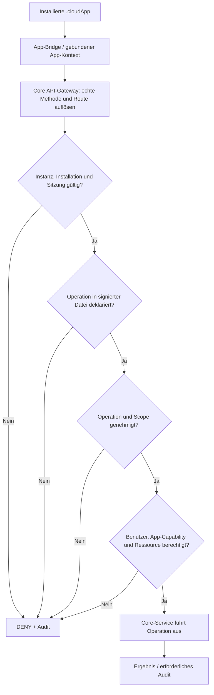

# cloudOS – App-API-Berechtigungen, Endpoint-Allowlist und Installationsfreigaben

> **Pfad:** `docs/APP_API_ACCESS.md`  
> **Dokumentversion:** 0.1 (verbindliches Sicherheits- und Architekturziel)  
> **Stand:** 15.11.2026  
> **Repository:** [Drezael/cloudOS](https://github.com/Drezael/cloudOS)  
> **Ausgangsbasis:** `main`, Commit `3846c80af27a8dcf4b9029dec8fee4f3859a769c`  
> **Fachlich führend für:** deklarierte cloudOS-API-Zugriffe aus `.cloudApp`-Paketen, Installationsfreigabe, API-Enforcement, Updates und Audit  
> **Abhängige Dokumente:** [APPLICATION_SYSTEM.md](APPLICATION_SYSTEM.md), [APP_SIGNING.md](APP_SIGNING.md), [SYSTEM_ARCHITECTURE.md](SYSTEM_ARCHITECTURE.md), [VIRTUAL_FILESYSTEM.md](VIRTUAL_FILESYSTEM.md), [CONCEPT.md](CONCEPT.md)

## 1. Zweck und verbindliche Anforderungen

Jede `.cloudApp` muss **vor der Installation** eine eigene maschinenlesbare Datei mit allen cloudOS-APIs deklarieren, die ihre Laufzeit verwenden darf. Diese Datei gehört unveränderlich zum signierten App-Paket. **Alle nicht explizit deklarierten oder nicht wirksam genehmigten App-API-Aufrufe werden auf der Serverseite abgelehnt.**

Die regulären `.cloudApp`-Oberflächen und Rust/WebAssembly-Module werden **vom Server bereitgestellt, aber im Browser des Benutzers ausgeführt**. Der Go-Core speichert Pakete und setzt Zugriffe durch, führt die regulären App-UIs jedoch nicht aus. Spätere ausdrücklich zugelassene WASI-/Native-Jobs sind getrennte, isolierte Backend-Arbeitslasten und keine implizite Eigenschaft jeder `.cloudApp`.

Der Administrator sieht **bei jeder Installation und jedem Update alle deklarierten API-Endpunkte**, einschließlich HTTP-Methode, Pfad, Zweck, betroffener Daten, Ressourcenumfang und sicherheitlicher Auswirkung. Ohne eine vollständige, bestätigte Vorschau wird keine App aktiviert. Das gilt auch für vertrauenswürdig signierte Drittanbieter-Apps. Die automatisch mit dem System ausgelieferten Core-Apps erhalten eine signierte, in der Administration vollständig einsehbare Release-Vorabgenehmigung statt eines interaktiven Dialogs beim Bootstrap. Eine Selbstsignatur löst **zusätzlich** die bereits definierte separate Herausgeberwarnung aus.

Dieses Prinzip gilt für alle regulär gestarteten `.cloudApp`-Anwendungen, einschließlich vorinstallierter Core-Apps. Auch Rust/WebAssembly-, Web-, WASI- und später native Rust-Anwendungen verwenden dieselbe Autorisierungsentscheidung. Das Core-Backend ist dagegen die vertrauenswürdige Infrastruktur, welche die APIs implementiert; seine internen Services sind keine `.cloudApp`-Instanzen.

### 1.1 Unverhandelbare Invarianten

1. **Default deny:** Eine nicht gelistete Operation ist niemals implizit erlaubt.
2. **Signierte Deklaration:** Eine App darf die Zugriffsdatei nach Installation nicht ohne neues signiertes Paket verändern.
3. **Installation vor Aufruf:** Nicht installierte, deaktivierte oder nicht zugewiesene Apps erhalten keine App-API-Berechtigung.
4. **Server-Enforcement:** Der Go-Core entscheidet bei jeder geschützten App-Operation; JavaScript-, WASM- und UI-Prüfungen dienen lediglich der Bedienbarkeit.
5. **Unveränderliche Versionsbindung:** Die Freigabe bezieht sich auf App-ID, Version, Paketdigest, Deklarationsdigest, Installations-ID und Policy-Revision.
6. **Kein Privilegiengewinn durch Anmeldung:** Ein Administrator, der eine App startet, verleiht ihr nicht automatisch seine vollständigen API-Rechte.
7. **Kein Privilegiengewinn durch Signierung:** Eine gültige Publisher- oder Core-App-Signatur ersetzt keine Endpoint-Freigabe.
8. **Keine Umgehung via direkten HTTP-Aufruf:** Gleiche Sicherheitsprüfung für SDK, Bridge, REST, WebSocket und erlaubte serverseitige App-Adapter.
9. **Genaue API-Bindung:** Zulassung erfolgt über registrierte Operation-IDs und die vom Core validierte HTTP-Methode und Route, nicht über vom Client frei erfundene URL-Muster.
10. **Rechteänderung bei Updates sichtbar:** Neue oder erweiterte API-Rechte können nicht stillschweigend übernommen werden.
11. **Ressourcensicherheit zusätzlich:** Die Freigabe für eine API ist niemals ein Freibrief, alle durch diese API ansprechbaren Objekte zu lesen oder zu ändern.
12. **Auditierbarkeit:** Genehmigung, Widerruf, Update-Differenz und verweigerte sicherheitsrelevante Aufrufe sind nachvollziehbar.

## 2. Begriffe und Unterscheidungen

| Begriff | Definition |
|---|---|
| **API Endpoint** | Öffentliche Core-Route mit konkreter HTTP-Methode, etwa `GET /api/v1/files/{id}`. |
| **Operation-ID** | Vom cloudOS-OpenAPI-Vertrag vergebener, stabiler eindeutiger Schlüssel für einen API-Vorgang. |
| **API-Deklaration** | Signierte Liste der von genau dieser App-Version angeforderten Operationen in `permissions/api-access.json`. |
| **API-Allowlist** | Durch den Core aus gültiger Deklaration, API-Registry und Installationsfreigabe berechnete erlaubte Operationenmenge. |
| **API-Freigabe** | Administrativ genehmigter Teil der angeforderten Operationen und Scopes für diese Installation. |
| **Capability** | Fachliche Fähigkeit, beispielsweise `files.read:selected`, die zusätzlich erforderlich sein kann. |
| **Ressourcen-ACL** | Individuelle Berechtigung des handelnden Benutzers an einer konkreten Datei oder anderen Ressource. |
| **App-Kontext** | Unfälschbar gebundene Identität aus App-Instanz, Benutzer, Sitzung, installierter Version und Policy-Revision. |
| **Endpoint-Risiko** | Vom **vertrauenswürdigen Core-API-Katalog** definierte Einstufung und Sicherheitserläuterung, nicht frei vom Herausgeber bestimmbar. |
| **Host-/Bootstrap-Operation** | Core-interne notwendige Funktion wie die Bereitstellung freigegebener App-Assets; keine allgemeine App-API-Berechtigung. |
| **Externes Netzwerk** | Ziele außerhalb der cloudOS-Core-API; benötigt ein gesondertes Egress-Konzept und ist nicht automatisch durch interne API-Allowlisten abgedeckt. |

**Drei verschiedene Prüfungen:** Ein Endpoint kann im Manifest *deklariert*, vom Administrator *genehmigt* und für eine konkrete Benutzerressource trotzdem *verboten* sein. Alle Ebenen werden gemeinsam ausgewertet.

## 3. Paketformat: verpflichtende, separat signierte API-Datei

Jedes Paket der Formatversion mit aktiviertem API-Allowlist-Vertrag enthält:

```text
ExampleEditor-1.0.0.cloudApp
├── cloudos.app.json
├── permissions/
│   └── api-access.json          # Pflichtdatei, auch bei leerer Endpoint-Liste
├── META-INF/
│   ├── package-index.json       # SHA-512-Digests der Payload-Dateien
│   ├── signature.json           # X.509-gebundene Signatur über den Index
│   └── publisher.json
├── web/
├── wasm/
├── resources/
└── licenses/
```

`cloudos.app.json` referenziert die Berechtigungsdatei explizit:

```json
{
  "package_format_version": "1.0",
  "id": "org.example.editor",
  "name": "Example Editor",
  "version": "1.0.0",
  "publisher_id": "org.example",
  "core_api": ">=1.0.0 <2.0.0",
  "runtime": { "type": "web-wasm", "entrypoint": "web/index.html" },
  "api_access": {
    "schema_version": "1.0",
    "file": "permissions/api-access.json"
  },
  "capabilities_requested": [
    "files.open:selected",
    "files.save:selected",
    "notifications.show"
  ]
}
```

Das Beispiel illustriert die neue Manifestreferenz. Exakte Runtime-IDs, JSON-Schemas und Feldnamen werden in der späteren Contract-Phase fixiert; die **Pflicht einer separaten signierten Zugriffsdatei** ist bereits Architekturvorgabe.

### 3.1 Signaturbindung

- `permissions/api-access.json` ist eine reguläre **signierte Payload-Datei** und muss im `META-INF/package-index.json` mit dem SHA-512-Hash ihres exakten Byteinhalts stehen.
- Der signierte Index ist, wie in `APP_SIGNING.md` definiert, an App-ID, Version, Publisher und Paketformat gebunden.
- Fehlende Datei, zusätzlicher nicht aufgeführter Berechtigungsinhalt, Hashabweichung, manipulierte Manifestreferenz oder ungültige Signatur führen zur **harten Paketablehnung**.
- Die Zugriffsdatei wird niemals beim Installieren direkt im `system:/`-Paketstore nachbearbeitet. Genehmigungen werden **außerhalb des signierten Pakets** als Core-Policy-Datensätze gespeichert.
- Eine App, die keine cloudOS-Core-APIs benötigt, enthält dennoch `"endpoints": []` und nutzt nur die geprüften minimalen Bootstrap-Mechanismen des App Host.
- Alt-Pakete ohne diesen Contract werden nicht automatisch als „alle Endpunkte erlaubt“ interpretiert. Vor Aktivierung müssen sie nach dem neuen Paketformat neu gebaut/signiert oder durch eine ausdrücklich dokumentierte, zeitlich begrenzte Migrationsregel abgewiesen werden. Der sichere Standard ist **Ablehnung**.

## 4. `permissions/api-access.json` – Vertragsentwurf v1

```json
{
  "schema_version": "1.0",
  "api_contract": "cloudos.core.v1",
  "endpoints": [
    {
      "operation_id": "files.dialogs.open",
      "method": "POST",
      "path": "/api/v1/file-dialogs/open",
      "resource_scope": "user_selected",
      "reason": "Der Benutzer wählt ein Dokument zum Öffnen aus."
    },
    {
      "operation_id": "files.contents.read",
      "method": "GET",
      "path": "/api/v1/files/{id}/content",
      "resource_scope": "user_selected",
      "reason": "Der Inhalt der ausgewählten Datei wird gelesen."
    },
    {
      "operation_id": "files.contents.write",
      "method": "PUT",
      "path": "/api/v1/files/{id}/content",
      "resource_scope": "user_selected",
      "reason": "Ein bearbeitetes Dokument wird in die zuvor ausgewählte Datei gespeichert."
    },
    {
      "operation_id": "notifications.create",
      "method": "POST",
      "path": "/api/v1/notifications",
      "resource_scope": "own_session",
      "reason": "Die App zeigt Hinweise zum Speichervorgang an."
    }
  ]
}
```

**Hinweis:** Die genannten Operation-IDs und Endpoints sind **vorgeschlagene zukünftige Core-API-Verträge**, keine Behauptung bereits implementierter Routen. Sie müssen später in OpenAPI mit exakten Methoden, Pfaden, Parameter-, Response- und Scope-Schemas definiert werden. Die Beispieldatei ist gültiges JSON, enthält keine Kommentare und ist vor Paketierung zu validieren.

### 4.1 Pflichtfelder je Operation

| Feld | Bedeutung | Prüfregel |
|---|---|---|
| `operation_id` | Referenz auf eine registrierte Core-API-Operation | Muss exakt im vertrauenswürdigen API-Katalog existieren. |
| `method` | HTTP-Methode | Muss der registrierten Methode entsprechen; `GET` deckt nicht `POST`, `PUT`, `PATCH` oder `DELETE` ab. |
| `path` | Dokumentations- und Kompatibilitätsreferenz | Muss exakt der kanonischen registrierten Route entsprechen; kein frei auswertbares URL-Glob. |
| `resource_scope` | Obergrenze der beanspruchten Ressourcen, z. B. `user_selected` | Muss für diese Operation zulässig sein und kann bei der Freigabe nur weiter eingeschränkt werden. |
| `reason` | Vom Entwickler angegebene verständliche Begründung | Wird als **nicht vertrauenswürdiger Text** dargestellt, entwertet und begrenzt; ist keine Risikobewertung. |

Im MVP werden **keine URL-Wildcards**, regulären Ausdrücke, frei wählbaren Hosts, freien Query-Parameter-Scopes, `*`-Operation-IDs oder dynamisch aus JavaScript ergänzten Rechte akzeptiert. Identische doppelte Einträge werden beim Packaging abgelehnt statt still zusammengeführt. Unbekannte kritische Felder und unbekannte Operationen führen zum Prüffehler.

### 4.2 Umfang von `resource_scope`

Der API-Katalog definiert je Operation zulässige Scopes, zum Beispiel:

| Scope | Bedeutung | Typischer Fall |
|---|---|---|
| `own_session` | Nur Daten der aufrufenden App-Sitzung | Eigene Benachrichtigungen |
| `app_owned` | Nur Ressourcen, deren Besitzer die App ist | App-eigene Einstellungen |
| `user_selected` | Nur explizit durch Benutzerwahl freigegebene Ressourcen | Datei öffnen/speichern |
| `own_home` | Nur berechtigte Ressourcen unter dem eigenen Home, zusätzlich ACL | Dateimanager als Core-App |
| `assigned_group` | Nur freigegebene Gruppenressourcen | Späterer gemeinsamer Speicher |
| `admin_reviewed` | Administrativer, gesondert genehmigter Funktionsbereich | Erweiterte Systemverwaltung |

Ein Scope ist eine **Obergrenze**. `own_home` bedeutet nicht, dass `files.contents.read` ohne gültiges Benutzerrecht beliebige Dateien lesen dürfte. Der Zugriff auf `system:/` oder andere Home-Verzeichnisse ist damit ausdrücklich nicht automatisch erlaubt. Für adminbezogene Operationen gelten zusätzlich privilegierte Benutzerrolle, erforderliche Administratorfreigaben und ggf. Step-up-Authentifizierung.

## 5. Vertrauenswürdiger Core-API-Katalog

Der Go-Core verwaltet einen eigenen, versionierten API-Katalog, der aus kontrollierten OpenAPI-Verträgen und freigegebenen Sicherheitsmetadaten entsteht. Die App darf diesen Katalog weder verändern noch neue Operationskennungen erfinden.

Für jede registrierte Operation enthält der Katalog mindestens:

```json
{
  "operation_id": "files.contents.read",
  "method": "GET",
  "path": "/api/v1/files/{id}/content",
  "title": "Dateiinhalt lesen",
  "description": "Ermöglicht der Anwendung das Lesen einer autorisierten Datei.",
  "data_categories": ["file_content", "personal_data_possible"],
  "risk_level": "high",
  "risk_explanation": "Dateiinhalte können vertrauliche oder personenbezogene Informationen enthalten.",
  "allowed_scopes": ["user_selected", "own_home"],
  "required_capabilities": ["files.read"],
  "exposure": "app_allowed",
  "approval_policy": "administrator"
}
```

Auch diese JSON-Daten sind ein **Entwurf**. Die vertrauenswürdige Risikobeschreibung stammt aus dem signierten Core-Release/API-Katalog und **nicht** aus dem App-Manifest. Der Entwicklertext `reason` ist ein ergänzender Hinweis, niemals eine ausreichende Sicherheitsprüfung.

### 5.1 API-Versionierung und Änderungsschutz

- Die Operation-ID bleibt innerhalb einer API-Major-Version eindeutig und wird nicht für eine semantisch andere Funktion wiederverwendet.
- Neue, sicherheitsrelevant erweiterte Operationen erhalten neue Identitäten beziehungsweise erfordern ausdrücklich eine erneute Policy-Genehmigung.
- Der Katalog unterscheidet `app_allowed`, `core_only` und `internal_only`. Drittanbieter-Apps dürfen `core_only` oder `internal_only` nicht deklarieren; auch ein Administrator kann dies nicht durch eine normale Installationsbestätigung freischalten. Erforderliche besondere Core-App-Rechte müssen explizit in der signierten System-Baseline enthalten sein.
- Entfernte oder nicht unterstützte Operationen verursachen einen klaren Installations-/Kompatibilitätsfehler, nicht einen stillen Fallback auf ähnliche Routen.
- Eine nachträgliche Änderung der tatsächlichen HTTP-Methode oder Routen-Zuordnung erfordert API-Contract-Migration und erneute Bewertung aller betroffenen Installationen.
- Jede App-Version speichert die bei Installation aufgelöste `api_contract`-Version und einen **Digest der genehmigten, kanonischen Endpunktliste**.
- Das Go-SDK, TypeScript-SDK und Rust-SDK verwenden denselben veröffentlichten Operation-Registry-Stand und erzeugen nur wohldefinierte Aufrufe.

## 6. Sicherheitsentscheidung bei jedem App-API-Aufruf

Ein Aufruf wird nur ausgeführt, wenn **sämtliche** folgenden Bedingungen erfüllt sind:

1. Es handelt sich um eine authentifizierte, gültige App-Instanz mit von cloudOS gebundenem App-Kontext.
2. App-ID, installierte Version, Paketdigest und zugehörige API-Deklaration sind unverändert und aktiv.
3. Der aufgerufene Endpoint wird anhand der **tatsächlich vom Core gerouteten Methode und Route** als registrierte Operation-ID ermittelt.
4. Diese Operation-ID befindet sich mit passender Methode, Route und Scope in der signierten API-Deklaration.
5. Die Operation ist in der unverändert zur aktuellen Policy-Revision gespeicherten **administrativen Installationsfreigabe** enthalten.
6. Der Benutzer bzw. die berechtigte Gruppe darf die App starten und diese API nutzen.
7. Ggf. angeforderte App-Capabilities und kurzlebige Ressourcen-Handles sind gültig.
8. Der Benutzer besitzt die konkreten Ressourcenrechte (ACL, VFS-Mount, Besitz, erforderliche Spezialrechte).
9. Runtime-, Netzwerk-, Session-, Rate-Limit- und Mandantenrichtlinien erlauben die Aktion.
10. Es gibt keine aktive Sperre, Widerrufsentscheidung oder Sicherheitsblockade.

Formal:

```text
ALLOW = valid_identity
    AND installed_app_version
    AND signed_endpoint_declaration
    AND endpoint_declared
    AND endpoint_approved
    AND app_assigned_to_actor
    AND user_authorized
    AND capability_valid
    AND resource_acl_allows
    AND runtime_policy_allows
    AND not_revoked
```

**Jede fehlende Information führt zu `DENY`.** Weder ein `X-App-ID`-Header noch ein vom Client gesendetes `operation_id`-Feld gilt allein als Herkunftsnachweis. Clientseitige Funktionsschalter und ausgeblendete Buttons besitzen keine Autoritätswirkung.

### 6.1 Autorisierungsdiagramm



### 6.2 Konzeptueller Prüfablauf im Go-Core

```go
// Entwurf, kein ausführbarer Implementierungscode.
func AuthorizeAppRequest(ctx Context, req RoutedRequest) Decision {
    instance := ctx.VerifiedAppInstance // nur serverseitig gebunden
    if !instance.IsActiveAndAssigned() { return Deny("APP_INSTANCE_INVALID") }

    operation := CoreOperationRegistry.Lookup(req.MatchedRoute, req.Method)
    if operation == nil { return Deny("API_OPERATION_UNKNOWN") }

    if !instance.SignedDeclaration.Allows(operation.ID, req.Method, req.MatchedRoute) {
        return Deny("APP_API_NOT_DECLARED")
    }
    if !instance.InstallationPolicy.Allows(operation.ID, req.ResourceScope) {
        return Deny("APP_API_NOT_APPROVED")
    }
    if !CapabilitiesAndACLAllow(ctx, operation, req.TargetResource) {
        return Deny("APP_RESOURCE_FORBIDDEN")
    }
    return Allow()
}
```

Die echte Implementierung nutzt ein einheitliches Go-Middleware-/Interceptor-Modell, unabhängig davon, ob die Anfrage über REST, App-Bridge oder einen WASI-Hostadapter beim zuständigen Core-Service ankommt. Fachliche Owner-Dienste prüfen Ressourcenrechte **zusätzlich** und verlassen sich nicht allein auf ein vorgelagertes Gateway.

### 6.3 Status- und Fehlerverhalten

| Zustand | Beispiel | Verhalten |
|---|---|---|
| Endpoint nicht deklariert | App ruft `users.list` ohne Eintrag auf | `403 Forbidden`; interner Grund `APP_API_NOT_DECLARED` |
| Endpoint deklariert, aber nicht genehmigt | Admin hat Scope abgelehnt | `403 Forbidden`; `APP_API_NOT_APPROVED` |
| Benutzer darf Zielressource nicht lesen | Datei einer anderen Person | `403` oder zur Nichtoffenlegung `404`, nach festgelegter VFS-Policy |
| App-Instanz ungültig oder widerrufen | Abgelaufene Instanzbindung | `401`/`403` entsprechend Authentifizierungsgrenze |
| API-Contract nicht kompatibel | App benötigt entfernte Operation | Installation/Start abgelehnt, klarer Kompatibilitätscode |

Die öffentlichen Fehlermeldungen enthalten **keine** fremden Ressourcen-IDs, Hostpfade, Token oder vertraulichen internen Gründe. Detailinformationen bleiben im autorisierten Audit-System.

## 7. Browser-Sicherheit: Kein Zugriff über die Benutzersitzung am Broker vorbei

Dies ist eine **kritische technische Voraussetzung**. Ein Gateway-Check ist wirkungslos, wenn JavaScript einer App gleichzeitig die privilegierten Browser-Cookies des Haupt-Desktops für frei wählbare Core-API-Aufrufe mitverwenden kann.

### 7.1 Trennung der Origins und Sitzungen

- Jede nicht vertrauenswürdige App läuft in einem kontrollierten App Host, vorzugsweise unter eigener Origin und in einem sandboxed iframe.
- App-Origin und Core-/BFF-Origin verwenden **keine frei wiederverwendbaren gemeinsamen Authentifizierungscookies**.
- Browser-Apps erhalten keine OIDC-Refresh-Tokens und keine langlebigen allgemeinen Core-Access-Tokens.
- Der API-Gateway verweigert direkte privilegierte App-Aufrufe ohne einen **serverseitig nachweisbaren App-Kontext**; behauptete Herkunftsheader oder Query-IDs reichen nicht aus.
- Jeder aus einer App heraus initiierte Core-API-Aufruf läuft über eine **typisierte, begrenzte App-Bridge** oder einen gleichwertigen App-context-authentifizierten Endpunkt.
- Der vertrauenswürdige App Host prüft bei `postMessage` Herkunft, Ziel, Nachrichtenform, Frame-/Fensterbindung, Instanz und Replay-Schutz. Beim Weiterreichen bleibt die Identität der verursachenden App erhalten.
- CSRF-, SameSite-, Origin-, CORS- und Content-Security-Policy-Prüfungen schützen zusätzlich, **ersetzen aber nicht** die Core-seitige Autorisierung.

### 7.2 App-Bridge statt frei auswählbarer Proxy-Ziele

Eine App fordert eine bekannte Operation über das SDK an; sie darf nicht beliebige URLs an einen unbeschränkten Proxy übergeben. Beispiel:

```typescript
// Konzeptionelle API; noch kein implementiertes SDK.
const file = await cloudOS.api.call("files.contents.read", {
  fileId: selectedFileHandle.id
});
```

Der Broker löst die Operation-ID selbst gegen den vertrauenswürdigen Core-API-Katalog auf und prüft die echte Route, Methode, Datenparameter und den zulässigen Ressourcenkontext. Der App-Code kann weder auf interne gRPC-Adressen zugreifen noch eine andere App-Instanz als seine eigene behaupten.

### 7.3 Schutz vor Confused Deputy

Eine App darf den Desktop, File Explorer, App Installer, Theme Service oder andere Core-Apps nicht als privilegierten Vermittler für **undeclared** API-Operationen missbrauchen. Wird eine Funktion durch eine App veranlasst, bleibt deren App-Identität durchgängig erhalten. Ein eigens durch den Benutzer über die vertrauenswürdige Desktop-Shell angestoßener Vorgang kann ein separater, explizit kontrollierter Systemworkflow sein; er ist keine pauschale Rückfalloption für App-Aufrufe.

### 7.4 Externe Netzwerke und Browsergrenzen

Die Endpoint-Allowlist kontrolliert **cloudOS-Core-APIs**, nicht automatisch jedes fremde HTTPS-Ziel im Internet. Dafür sind separat beschriebene Netzwerkberechtigungen sowie CSP `connect-src`, isolierte Origins und bei serverseitigen Apps gesicherte Egress-Regeln notwendig. Browserseitige Einschränkungen dürfen nicht als vollständige Kontrolle über sämtliche denkbaren Datenabflüsse dargestellt werden. Ein zukünftiges Netzwerkzugriffsmanifest wird separat und genauso streng genehmigt.

## 8. REST, gRPC, WebSocket und interne Datenzugriffe

Die Regel gilt unabhängig von der technischen Transportebene.

| Transport | Sicherheitsregel |
|---|---|
| REST via API-Gateway | Methode + vom Router tatsächlich gematchte Operation-ID + Scope auf jedem geschützten Call prüfen. |
| App SDK / Bridge | Aufruf nur per registrierter Operation; Herkunft und Instanz serverseitig binden. |
| WebSocket | Verbindungsaufbau begrenzt; **jeder Subscribe-/Publish-Vorgang** besitzt eigene geprüfte Operation und Ressourcenscope. Ein `events/ws`-Grant gewährt nicht alle Events. |
| Server-WASI Host Functions | Exakt deklarierte Function-/Operation-IDs; eigene Run-Identität und Scopes; kein unbeschränkter WASI-Hostzugang. |
| Native isolierte Runner (später) | Alle Core-Zugriffe durch App-context-authentifizierten Proxy mit derselben Allowlist und Netzwerktrennung. |
| gRPC intern | Untrusted Apps besitzen keine freien Core-Service-Credentials; der aufrufende Adapter übergibt verifizierten App-Kontext an Owner-Dienste. |
| Asset-Auslieferung | App-Assets über kontrollierte Start-/Asset-Tickets; keine Freigabe anderer Core-APIs durch Asset-URL. |

Eine **technische Registrierung** von App-Start, App-Assets und sicherheitsgeprüften Bridge-Handshakes durch den privilegierten Core ist als eng begrenzter Bootstrap erlaubt. Sie autorisiert die App nicht zur Nutzung anderer Core-Funktionen. Eine generische Bootstrap-Whitelist oder unbeschränkter Core-Proxy ist verboten.

## 9. Installation per Rechtsklick: Pflichtanzeige aller Endpunkte

Der vorhandene Ablauf aus `APPLICATION_SYSTEM.md` bleibt bestehen:

1. Administrator klickt auf `ExampleEditor-1.0.0.cloudApp` und wählt **App installieren**.
2. Installer erzeugt einen unveränderlichen Paket-Snapshot und verifiziert X.509, Signatur und sämtliche SHA-512-Dateihashes **einschließlich `permissions/api-access.json`**.
3. Core prüft Syntax, Signaturbindung, Schema, API-Kompatibilität, Methode, Route, Operation-ID und maximal zulässige Scopes.
4. Core berechnet aus **eigenen vertrauenswürdigen API-Metadaten** die Risikoeinstufung und legt die vollständige Endpoint-Liste in der signierten/gebundenen Installationsvorschau ab.
5. **Vor jeder Bestätigung** zeigt die Installer-App alle angeforderten Endpunkte, auch vermeintlich harmlose. Bei null Einträgen steht ausdrücklich „Diese App fordert keinen cloudOS-Core-API-Zugriff an“.
6. Administrator sieht jede Methode, kanonischen Pfad, Funktion, Datenkategorie, angeforderten Scope, Risikostufe und konkrete Sicherheitsauswirkung.
7. Administrator bestätigt die Endpoint-/Scope-Freigabe oder bricht ab. Teilfreigaben sind nur zulässig, wenn die App sie ausdrücklich als optional unterstützt und das Installationsverfahren die dadurch fehlenden Funktionen transparent dokumentiert; **MVP: nur alles bestätigen oder Installation abbrechen**.
8. Bei selbstsignierten Paketen folgt **zusätzlich** die getrennte Signatur-/Herausgeberwarnung gemäß `APP_SIGNING.md`, mit eigener ausdrücklicher Bestätigung.
9. `preview_id`, Paketdigest, Deklarationsdigest, Katalogversion, genehmigte Endpunkte, Genehmigungsidentität und `plan_hash` sind auf dem Server gebunden. Änderungen erzeugen zwingend eine neue Vorschau.
10. Erst danach speichert der Installer die geprüfte App im `system`-Volume, registriert die wirksame Policy, richtet eine etwaige Benutzer-/Gruppenzuweisung ein und erlaubt Starts.

### 9.1 Beispiel einer verpflichtenden Sicherheitsanzeige

```text
App installieren: Example Editor 1.0.0
Herausgeber: org.example / [Zertifikatsstatus]
Signierter Paketdigest: sha256:...

Angeforderte cloudOS-Core-API-Endpunkte: 4

[1] POST /api/v1/file-dialogs/open
    Datei auswählen | Scope: vom Benutzer ausgewählte Datei
    Risiko: niedrig – öffnet einen vom Benutzer kontrollierten Dateidialog

[2] GET /api/v1/files/{id}/content
    Dateiinhalt lesen | Scope: ausgewählte Datei
    Risiko: hoch – kann vertrauliche Inhalte lesen

[3] PUT /api/v1/files/{id}/content
    Dateiinhalt ändern | Scope: ausgewählte Datei
    Risiko: hoch – kann ausgewählte Dateien überschreiben

[4] POST /api/v1/notifications
    Benachrichtigungen erzeugen | Scope: eigene Sitzung
    Risiko: niedrig – kann störende oder irreführende Hinweise ausgeben

Diese Liste stammt aus dem geprüften signierten App-Paket.
Die Risikobewertung wird vom cloudOS Core bereitgestellt.

[Abbrechen] [Alle angezeigten API-Zugriffe genehmigen und installieren]
```

**Wichtig:** Der Klartext im Beispiel ist keine endgültige Risikoklassifizierung dieser künftig erst zu definierenden Operationen. Die Einstufungen werden in ADR und dem vertrauenswürdigen Katalog festgelegt. Das UI muss auch bei sehr langen Listen eine **vollständige und zugängliche Ansicht aller Einträge** bieten; zusammengefasste Gruppen dürfen keinen Endpoint verdecken.

### 9.2 Installationsvorschau als Serververtrag

Beispiel für die Erweiterung von `POST /api/v1/app-installation-previews`:

```json
{
  "preview_id": "prv_68de...",
  "plan_hash": "sha256:illustrative",
  "app": { "id": "org.example.editor", "version": "1.0.0" },
  "package_digest": "sha256:illustrative-package",
  "api_declaration_digest": "sha512:illustrative-declaration",
  "api_contract": "cloudos.core.v1",
  "api_catalog_revision": "rev-42",
  "api_endpoints": [
    {
      "operation_id": "files.contents.read",
      "method": "GET",
      "path": "/api/v1/files/{id}/content",
      "requested_scope": "user_selected",
      "risk_level": "high",
      "risk_explanation": "Dateiinhalte können vertrauliche Informationen enthalten.",
      "data_categories": ["file_content", "personal_data_possible"]
    }
  ],
  "api_endpoints_total": 1,
  "api_approval_required": true,
  "requires_confirmation": true
}
```

Die Beispielantwort ist gekürzt auf einen Endpoint; der echte Core liefert **immer die komplette Liste**. Der Server akzeptiert keinen vom Browser neu zusammengesetzten Genehmigungsumfang, sondern verwendet den geprüften, revisionsgebundenen Plan.

### 9.3 Änderungen am bestehenden Installer-API-Katalog (Entwurf)

| Methode | Route | Zweck |
|---|---|---|
| `POST` | `/api/v1/app-installation-previews` | Neue vollständige Endpoint-Vorschau erzeugen. |
| `GET` | `/api/v1/app-installation-previews/{id}/api-access` | Verifizierte Endpoint-/Risikodetails des Plans abrufen. |
| `POST` | `/api/v1/app-installation-previews/{id}/api-approvals` | Administrator bestätigt die **gesamte geprüfte Endpoint-Liste** paket- und revisionsgebunden. |
| `POST` | `/api/v1/app-installation-previews/{id}/risk-acceptances` | Separater Self-signed-Risikodialog; ersetzt keine API-Freigabe. |
| `POST` | `/api/v1/app-installations` | Nur bei weiterhin gültiger Endpoint- und ggf. Self-signed-Freigabe installieren. |
| `GET` | `/api/v1/app-installations/{id}/api-access` | Nach der Installation wirksam genehmigte Operationen anzeigen. |
| `GET` | `/api/v1/app-instances/{id}/api-access` | Effektive, auf die Instanz zugeschnittene Berechtigungen anzeigen. |
| `POST` | `/api/v1/app-installations/{id}/api-access/revocations` | Administrative Einschränkung/Widerruf einer oder mehrerer Freigaben. |

Alle Installer-/Adminendpunkte sind **nicht** automatisch für Drittanbieter-Apps zugänglich. Auch die Installer-Core-App muss diese Operationen als Teil ihrer geschützten Baseline deklarieren; der tatsächliche Aufruf erfordert zusätzlich die passende Adminrolle.

## 10. App-Start, Runtime und Durchsetzung

### 10.1 Start- und App-Instanzbindung

Beim Start prüft der Lifecycle Service:

- Installation, Paket-/Dateiintegrität, Release-/Signaturstatus und Benutzerzuweisung.
- Vollständige serverseitige Genehmigung der deklarierten APIs und API-Contract-Kompatibilität.
- Benutzeridentität, Browser-Session, Runtime, erforderliche Capabilities und Policy-Revision.
- Bindung einer kurzlebigen App-Instanzidentität an genau diese installierte Version und effektive Endpoint-Liste.
- Keine Roh-Credentials, die weitere Apps oder Endpunkte erschließen würden.

Wenn die API-Policy fehlt, widerrufen wurde oder nicht sicher geprüft werden kann, startet die App nicht mit erweiterten Rechten. Fehlerhafte Core-Apps führen gegebenenfalls in den dokumentierten Recovery-Modus, **nicht** zu einem allgemeinen Autorisierungs-Bypass.

### 10.2 Laufzeitprofile

| Runtime | Vollzug |
|---|---|
| Browser Web | SDK-/Bridge-Aufrufe unter gebundener App-Instanz; direkte Privilegien-API-Zugriffe ohne Kontext werden abgelehnt. |
| Rust Browser-WASM | Derselbe App-Host/Bridge-Mechanismus, unabhängig von Framework oder WASM-Modul. |
| Server-WASI | Nur freigegebene WIT-/Hostfunktionen, die auf dieselben Core-Operation-IDs abgebildet sind. |
| Native isoliert | Erzwungene App-Proxy-/Netzwerkgrenzen; keine Service-Credentials oder direkten DB-/VFS-Mounts. |
| Vorinstallierte Core-App | Signierte Baseline-Permissions, minimal erforderliche Operationen; ebenfalls keine automatische All-API-Berechtigung. |

### 10.3 Verweigerung, Rate Limits und Ausfall

Nach einem Policy-Widerruf werden laufende Instanzen neu bewertet beziehungsweise ihre Bridges geschlossen. Bereits vor Widerruf laufende Requests werden entsprechend einer definierten In-Flight-Policy beendet oder sicher abgeschlossen; neue Requests werden sofort abgelehnt. Bei Ausfall des Permission Service darf kein Cache unbegrenzt weiter autorisieren: kurze Gültigkeit, Policy-Revision und sichere Invalidierung sind zwingend.

## 11. Updates, Rollback und Berechtigungsdiff

Jede App-Version besitzt eine eigene signierte API-Deklaration. Eine neue Version erzeugt vor dem Update eine vollständige neue Endpoint-Vorschau.

| Änderung | Wirkung |
|---|---|
| Neuer Endpoint | **Explizite Adminfreigabe erforderlich**, niemals automatisch. |
| Neue HTTP-Methode für bekannte Route | Neue API-Operation; gesondert genehmigen. |
| Größerer Ressourcenscope | Erneute ausdrückliche Genehmigung erforderlich. |
| Entfernte Operation | Bei Aktivierung nicht mehr erlaubt; laufende Instanzen neu binden. |
| Unveränderte Operationen | Weiterhin vollständig anzeigen; mögliche erneute Bestätigung gemäß Policy. Für MVP: jedes Update administrativ bestätigen. |
| Andere App-ID, Publisher, Zertifikat oder Paketdigest | Signatur-/Identitätsprüfung und ggf. separate Vertrauensfreigabe; keine automatische Rechteübernahme. |
| Self-signed-Update | **Immer** separate neue Self-signed-Risikoannahme, zusätzlich Endpoint-Freigabe. |
| Rollback | Nur auf geprüfte, genehmigte Version mit zugehörigem signierten API-Contract; keine unkontrollierte Rechte-Rückgewinnung. |

Im Installationsdialog werden die Unterschiede zwischen bisheriger und neuer API-Liste markiert: **neu**, **entfernt**, **geänderte Methode**, **erweiterter Scope**, **reduzierter Scope**, **unverändert** und **durch Core-API-Migration inkompatibel**. Eine App kann ihre API-Liste nicht während der Ausführung erweitern. Änderungen erfordern ein neues signiertes `.cloudApp`-Paket und einen erneuten administrativen Freigabeprozess.

## 12. Vorinstallierte Core-Apps und geschützte Baseline

Auch `Desktop.cloudApp`, `FileExplorer.cloudApp`, `Settings.cloudApp`, `AppInstaller.cloudApp` und weitere verpflichtende Core-Apps erhalten je Version ein signiertes `permissions/api-access.json`.

- Die signierte Core-Release-Baseline bindet **Paketdigest und Deklarationsdigest** sowie die für den sicheren Systemstart benötigte API-Genehmigung.
- Eine reguläre Benutzerinstallation ist für Core-Apps nicht vorgesehen; die Genehmigung erfolgt durch die kontrollierte cloudOS-Release-Pipeline und ist bei der automatischen Provisionierung überprüfbar.
- Der App Installer ist eine Core-App mit deklarierter Installer-API. Ein Standardbenutzer erhält wegen fehlender Systemrolle trotzdem keine Administrationsrechte.
- Der privilegierte, minimale **Recovery-Bootstrap** ist eine Core-Funktion außerhalb des regulären App-Systems; er ist kein versteckter „Alle-APIs-frei“-App-Account.
- Wird eine Core-App-Deklaration ohne gültige Release-Signatur geändert, ist die Baseline ungültig und die App wird nicht gestartet.
- Selbstsignierte externe Apps können weder Core-App-ID noch Core-Baseline-API-Freigaben übernehmen.

## 13. Datenmodell und Datenhoheit

| Entität (Entwurf) | Daten | Eigentümer |
|---|---|---|
| `applications.app_api_declarations` | `app_version_id`, `schema_version`, `declaration_digest`, `api_contract`, `canonical_operations` | App Package / Registry |
| `applications.app_api_endpoints` | `app_version_id`, `operation_id`, `method`, `canonical_path`, `requested_scope` | App Package / Registry |
| `applications.api_installation_approvals` | `installation_id`, `app_version_id`, `approved_by`, `approved_at`, `plan_hash`, `catalog_revision`, `declaration_digest` | App Installer / Permission Service |
| `permissions.app_api_grants` | `installation_id`, `operation_id`, `scope`, `policy_revision`, `revoked_at` | Permission Service |
| `permissions.app_runtime_contexts` | `instance_id`, `app_version_id`, `actor_id`, `session_binding`, `policy_revision`, `expires_at` | App Capability Broker |
| `audit.app_api_decisions` | `request_id`, `instance_id`, `operation_id`, `result`, `reason_code`, `timestamp` | Audit Service |
| `applications.core_api_catalog_versions` | Katalog-Digest, Major-Version, Risikoprofil-Revision | Core API Contract Registry |

Die konkrete SQL-Struktur wird in Phase 0/der App-Contract-Phase spezifiziert. Fachlicher Eigentümer bleibt je Vorgang eindeutig. Unveränderliche Deklarationsdaten und genehmigte Policy sind **separat** gespeichert; eine Installation ersetzt weder das signierte Paket noch seine Historie.

### 13.1 Ereignisse

```text
apps.api_declaration.verified
apps.api_access.preview_created
apps.api_access.approved
apps.api_access.denied
apps.api_access.revoked
apps.api_access.update_diff_detected
apps.api_access.policy_changed
```

Ereignisse werden über die vorhandene Outbox/NATS-Architektur verarbeitet. Audit- und Security-Logs enthalten keine Credentials oder fremden Datei-Inhalte. Wiederholte Verstöße können einen Alarm, eine App-Sperre oder ein Administrationsreview auslösen; sie bewirken **keine automatische Vergabe** weiterer Rechte.

## 14. Signing, Entwicklerworkflow und Paketprüfung

Die neue Datei wird automatisch durch das cloudOS-Paketwerkzeug in den signierten Paketindex aufgenommen. Entwickler und CI können bereits **vor dem Signieren** prüfen, ob alle verwendeten SDK-Operationen deklariert sind. Eine vollständige statische Erkennung aller dynamischen Browserzugriffe ist nicht möglich; daher ist das serverseitige Runtime-Enforcement zwingend.

Empfohlener Workflow:

1. Entwickler definiert APIs in `permissions/api-access.json`.
2. Generator validiert jede Operation gegen die freigegebene OpenAPI-/Scope-Registry.
3. Entwickler implementiert die App mit generierten TypeScript-/Go-/Rust-SDKs.
4. Lokaler Linter überprüft deklarierte vs. erkannte API-Aufrufe und zeigt den resultierenden Berechtigungsbericht.
5. Paket-Builder erstellt ZIP, vollständigen SHA-512-Dateiindex und die kanonische Signatur; eine Selbstsignatur bleibt möglich.
6. Core Installer prüft dasselbe Schema unabhängig erneut und erstellt seinen **eigenen** vertrauenswürdigen Sicherheitsbericht.

App-Hersteller dürfen `risk_level`, `risk_explanation`, `approved`, `trusted` oder eine vom Core signierte Genehmigung **nicht** als glaubhafte eigene Angaben in ihre Deklaration einschleusen. Diese Eigenschaften stammen ausschließlich aus Core-Katalog und Installationspolicy.

## 15. Integration in das Zwei-Festplatten-VFS

Der App-Paketstore liegt weiterhin ausschließlich unter `system:/applications/packages/`, jedoch ist dieses Systemlaufwerk in der VFS-Oberfläche nur für Administratoren sichtbar.

- Eine `.cloudApp` kann als normale Datei in `/Downloads/` eines Administrators liegen; sie bleibt **inert**, bis der Installer ihre Signatur, API-Deklaration und Freigaben geprüft hat.
- Eine erfolgreich installierte App erhält keine Schreibrechte auf `system:/`, nur weil sie dort gespeichert ist.
- Weder die signierte API-Datei noch der Core-API-Katalog sind frei durch die App editierbar.
- `users:/`-Daten werden weiterhin benutzer- und ACL-gebunden; API-Grants ersetzen kein File-Handle und keine Rechteprüfung.
- Der File Explorer darf den Installationsworkflow anstoßen, führt aber selbst keine freigabekritischen Paketoperationen aus.

## 16. Theming und Darstellungsanforderungen

Der Sicherheitsdialog ist eine **verpflichtende cloudOS-eigene Systemoberfläche** der `AppInstaller.cloudApp` und verwendet das zentrale Designsystem. Themes dürfen seine Bedeutung nicht verschleiern:

- Alle API-Einträge sind tastatur- und screenreaderzugänglich, vollständig aufklappbar, such-/filterbar, ohne Einträge aus dem Genehmigungsumfang zu entfernen.
- Risiko-, Vertrauens- und Berechtigungsinformationen sind durch Text und strukturierte Kennzeichnungen erkennbar, nicht ausschließlich durch Farbe.
- Der Button zur Genehmigung ist nicht vorzeitig aktiviert; Abbrechen bleibt stets verfügbar.
- Bei selbstsignierten Apps werden **zwei getrennte Entscheidungen** dokumentiert: Endpoint-Freigabe und Akzeptanz des nicht vertrauenswürdig ausgestellten Zertifikats.
- Paketgesteuertes CSS, HTML oder JavaScript wird nicht in privilegierten Sicherheitsdialogen gerendert; App-Texte werden escaped.
- Das UI zeigt die vollständige wirksame Liste einschließlich Core-Apps auch in der Verwaltungsansicht, mit Such- und Sortierfunktion.

## 17. Betriebsmodell, Monitoring und Audit

Metriken: `cloudos_app_api_decisions_total{result,operation}`, Policy-Cache-Misses, Freigabe-/Widerrufsereignisse, verworfene unbekannte Routen, Installationsabbrüche und Kompatibilitätsfehler. **Keine hochkardinalen Benutzer-, Dateinamen- oder Paketdaten als Metriklabels.**

Audit-Aufzeichnungen enthalten die handelnde Identität, App-ID, Paket-/Deklarationsdigest, Operation, erlaubten Ressourcenscope, Genehmigung/Verweigerung, Versionsbezug und Trace-ID. Aufbewahrungsdauer und Datenschutzrichtlinien werden betrieblich definiert. Anomale Wiederholungen sollen untersucht werden können, ohne unberechtigten Nutzern interne Pfade offenzulegen.

## 18. Teststrategie – verbindliche Fälle

| ID | Test | Erwartetes Ergebnis |
|---|---|---|
| API-001 | Signiertes Paket mit gültiger, vollständiger `api-access.json` | Prüfen und Vorschau möglich |
| API-002 | `api-access.json` fehlt | Harte Ablehnung |
| API-003 | API-Datei nach Signatur verändert | Hash-/Signaturfehler, kein Install |
| API-004 | Manifest verweist auf andere Datei | Signatur-/Contractfehler |
| API-005 | API-Datei mit `"endpoints": []` | Ohne zusätzliche API-Rechte startfähig |
| API-006 | Unbekannte Operation-ID | Vorschau/Installation verweigert |
| API-007 | Falsche HTTP-Methode bei bekannter Route | Installation verweigert |
| API-008 | Geänderte Route bei gültiger Operation-ID | Kompatibilitäts-/Contractfehler |
| API-009 | Doppelte, wildcard- oder regexbasierte Einträge | Ablehnung |
| API-010 | App deklariert und genehmigt Lesen ausgewählter Datei | Zugriff auf ausgewählte Datei nach Benutzerfreigabe erlaubt |
| API-011 | App ruft nicht deklarierte API auf | `403`, serverseitig verweigert und auditiert |
| API-012 | Deklariert, aber administrative Freigabe fehlt | Zugriff verweigert |
| API-013 | App versucht `POST` statt freigegebenem `GET` | Zugriff verweigert |
| API-014 | App kennt gültige Node-ID eines anderen Users | Zugriff verweigert |
| API-015 | App liest `system:/` trotz eigenem Home-Grant | Zugriff verweigert |
| API-016 | Angemeldeter Admin startet eingeschränkte App | App erhält keine zusätzlichen Admin-APIs |
| API-017 | App sendet gefälschtes `X-App-ID` | Keine Identitätsübernahme |
| API-018 | App ruft Core direkt mit Cookie / falscher Origin auf | Kein App-Kontext-Bypass |
| API-019 | App versucht verbotenen gRPC-Direktzugriff | Kein unautorisierter Zugriff |
| API-020 | WebSocket verbindet sich und abonniert nicht deklarierte Events | Subscription verweigert |
| API-021 | Rust Browser-WASM fordert nicht gelistete Operation an | Server verweigert Zugriff |
| API-022 | WASI-/native App fordert unzulässige Hostfunktion | Runtime verweigert Zugriff |
| API-023 | Core-App ohne signierte Deklaration | Baseline-Check scheitert; Recovery |
| API-024 | Selbstsignierte App mit API-Rechten | API-Dialog und separate Signaturwarnung |
| API-025 | Administrator bricht API-Freigabe ab | Keine Installation |
| API-026 | Manipulierter `plan_hash` / abgelaufene Vorschau | Keine Installation |
| API-027 | App wurde nach Preview geändert | Neue Preview zwingend |
| API-028 | Update fügt Endpoint hinzu | Neu- und Gesamtliste sichtbar; Bestätigung erforderlich |
| API-029 | Update erweitert Scope | Keine stille Freigabe |
| API-030 | Update entfernt Operation | Neue Instanz darf Operation nicht mehr verwenden |
| API-031 | Admin widerruft Endpoint bei laufender App | Ab Widerruf kein neuer zulässiger Call |
| API-032 | Permission Service nicht erreichbar | Fail closed; keine Berechtigungsweitung |
| API-033 | SDK versucht unregistrierte Operation | Typ-/Laufzeitfehler; Server verweigert |
| API-034 | App nutzt Core-App als Vermittler für verbotenes API | Identität der verursachenden App bleibt erhalten; kein Bypass |
| API-035 | UI-Themes ändern Security-Dialog | Alle Endpunkte und Warntexte bleiben sichtbar und zugänglich |
| API-036 | Sehr lange Endpoint-Liste | Alle Einträge im UI zugänglich und bestätigungsgebunden |
| API-037 | API-Katalog ändert Operation-Semantik | Revalidierung; kein stiller Rechtegewinn |
| API-038 | Signed Core-App wird manipuliert | Start blockiert; signierte Baseline bleibt maßgeblich |
| API-039 | App versucht via Query- oder URL-Encoding Router-Bypass | Methode/kanonische Route maßgeblich; abgelehnt |
| API-040 | App versucht internen Adminendpunkt über Raw HTTP | Verweigert, selbst bei Benutzer-Adminrolle |
| API-041 | App deklariert `core_only`-/`internal_only`-Operation | Installation abgelehnt, Adminfreigabe kann Klassifizierung nicht überschreiben |

Zusätzlich sind Contract-Tests für API-Versionen, Fuzzing für Pfad-/Methodenauflösung, Property-Based-Tests der Rechte-Schnittmenge und End-to-End-Tests für Browser-Origins und App-Bridge verpflichtend.

## 19. Implementierungs- und Migrationsplan

| Schritt | Aufgabe | Abnahme |
|---|---|---|
| API-P1 | API-Katalog: Operation-IDs, HTTP-Methode, Pfad, Ressourcenscopes und Risiko-Metadaten | Versionierte OpenAPI-/Security-Contracts und Linter |
| API-P2 | `permissions/api-access.json`-Schema und Manifestreferenz | Validator, positive/negative Schemafälle |
| API-P3 | `.cloudApp`-Builder/Verifier erweitern | Signatur deckt API-Datei vollständig ab |
| API-P4 | App-Installer-Vorschau und vollständige Risikoanzeige | Jede Operation sichtbar, keine stille Bestätigung |
| API-P5 | Immutable Policy-/Approval-Datenmodell | Plan- und Digest-Bindung, Audit, Rollback |
| API-P6 | Gateway-/Broker-Enforcement mit sicherem App-Kontext | Nicht deklariert = serverseitig `403` |
| API-P7 | Rust-/WASM-/WASI-SDKs und Interceptors | Identische Entscheidungen je Runtime |
| API-P8 | Core-App-Baseline an API-Deklarationen binden | Geschützte Core-Apps starten, unzulässige nicht |
| API-P9 | Update-Diff und Widerruf | Keine stillen Rechteerweiterungen |
| API-P10 | Sicherheits- und E2E-Abnahme | Vollständige Testmatrix bestanden |

**Abhängigkeiten:** Diese Arbeiten beginnen vor dem ersten externen App-Start und sind Bestandteil der App-System-Phasen, nicht erst des späteren Security Hardening. Ein App-Host ohne serverseitigen `deny by default`-Mechanismus ist nicht produktionsreif.

## 20. Offene Entscheidungen und zugehörige ADRs

| ADR (Vorschlag) | Zu entscheiden |
|---|---|
| `ADR-037` | Schema der signierten `permissions/api-access.json`, Operation-ID-Stabilität und API-Katalog |
| `ADR-038` | Durchsetzung an Browser-Origin, BFF, App-Bridge, gRPC und WASI-Grenzen |
| `ADR-039` | Verbindliche Risikoklassen, Texte, Mindestanzeige und Admin-Bestätigungsdialog |
| `ADR-040` | Revisionsgebundene Freigaben, Updates, Widerruf und Policy-Cache |
| `ADR-041` | Externes Netzwerk-/Egress-Modell für Apps als getrennte Berechtigungsart |

## 21. Abgrenzungen und Dokumentationsstatus

Das bereits bestehende `APP_SIGNING.md` bleibt **fachlich führend für Kryptografie und Herausgebervertrauen**. `APPLICATION_SYSTEM.md` bleibt führend für Paketformat, App-Lifecycle und Installation. Dieses Dokument ist führend für die **konkreten cloudOS-API-Operationen, Autorisierungsregeln und Risikodarstellung**. `VIRTUAL_FILESYSTEM.md` bleibt führend für VFS-Mount-Sichten und Dateirechte.

Bei Widersprüchen sind die jeweiligen Fachgrenzen und ein ADR maßgeblich. Bis zu ihrer Umsetzung sind die Beispiel-APIs und -Schemas **Architekturentwürfe, keine implementierten Funktionen**. Die bestehenden 19 Entwicklungsphasen bleiben erhalten, werden aber um die oben genannten Sicherheitsvoraussetzungen ergänzt.

**Ergebnis:** Jede installierbare `.cloudApp` besitzt einen signierten API-Anforderungskatalog. Jede Core-API-Operation wird im App-Kontext mit einer **Default-Deny-Allowlist** geprüft. Administratoren sehen bei Installation und Update **alle** beantragten Endpunkte mit konkreten Sicherheitsauswirkungen und müssen deren Zugriff gesondert freigeben.
