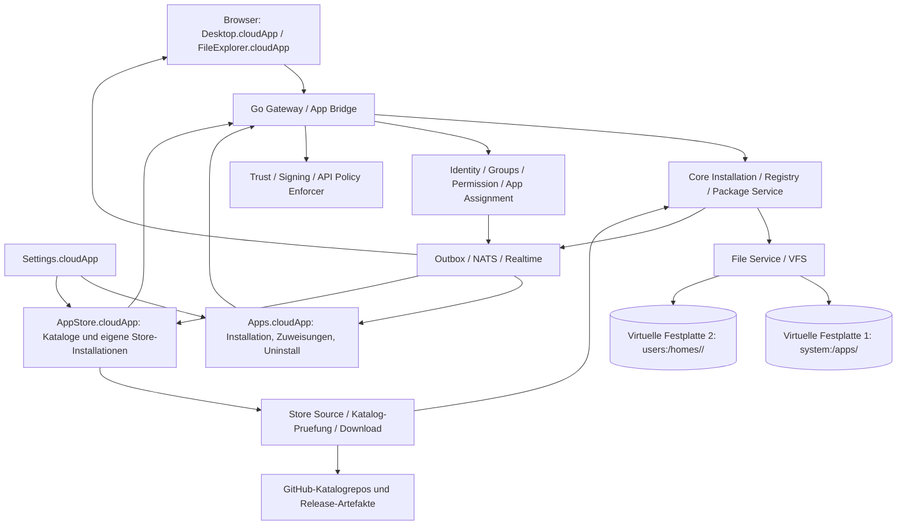
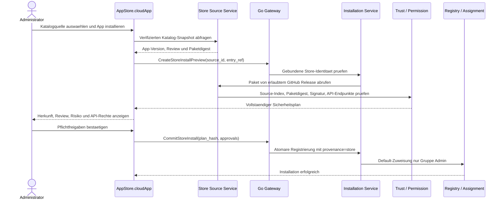
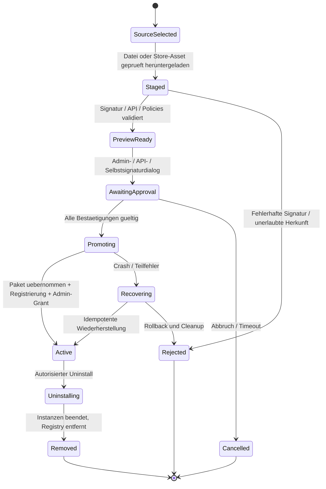

# cloudOS – Apps-Verwaltung, systemweite Installation und moderierter App Store

> **Theming und dynamische Wallpapers v0.13:** [THEMING.md](THEMING.md) – sechs OS-inspirierte Themes und einheitliche Theme-Tokens; [WALLPAPER_ENGINE.md](WALLPAPER_ENGINE.md) – Milky Way, Waves, Hexells, Matrix 2D/3D, Coastal Landscape. Beide Dokumente definieren ausschließlich Konzepte, keine implementierten Dienste.


> **Fachkonzepte v0.12:** [AUTHENTICATION_METHODS.md](AUTHENTICATION_METHODS.md), [LOGGING_OBSERVABILITY.md](LOGGING_OBSERVABILITY.md), [WINDOW_FRAMEWORK.md](WINDOW_FRAMEWORK.md), [CLIENT_DEVICES.md](CLIENT_DEVICES.md). Die vier Dokumente sind führend für die neuen Loginmethoden, Logs.cloudApp, das einheitliche Fensterframework und Client-Gerätefreigaben.

> **Core-Deployment und Kubernetes:** [CORE_DEPLOYMENT_SCALING.md](CORE_DEPLOYMENT_SCALING.md) (verbindlich: ein Core-Container als Standard, separater Split-/Replica-Modus nur opt-in)  

> **Push-/Realtime-Fachvertrag:** [PUSH_REALTIME.md](PUSH_REALTIME.md) (verbindlich fuer SSE-Transport, Events, Replay, sicherheitsgefilterte Zustellung und das Verbot periodischer Client-Statusabfragen)  

> **Datei:** `docs/APP_MANAGEMENT_STORE.md`  
> **Dokumentversion:** 0.12 – Loginmethoden, Logging, Window Framework und Client-Geräte (Core-Deployment bleibt combined)
> **Stand:** 15.11.2026  
> **Repository:** [Drezael/cloudOS](https://github.com/Drezael/cloudOS), Ausgangsbasis `main`, Commit `b44579d5cfa4d85a4cc21e44d12f2003d5a2a6fa`  
> **Fachlich führend für:** Installation und Entfernen von `.cloudApp`, Apps.cloudApp, AppStore.cloudApp, GitHub-Katalogquellen, globale Installationen, Benutzer-/Gruppenzuweisungen und Echtzeit-Widerruf  
> **Referenzen:** [APPLICATION_SYSTEM.md](APPLICATION_SYSTEM.md), [APP_API_ACCESS.md](APP_API_ACCESS.md), [APP_SIGNING.md](APP_SIGNING.md), [VIRTUAL_FILESYSTEM.md](VIRTUAL_FILESYSTEM.md), [AUTHENTICATION_AUTHORIZATION.md](AUTHENTICATION_AUTHORIZATION.md), [DESKTOP_ENVIRONMENT.md](DESKTOP_ENVIRONMENT.md), [SYSTEM_ARCHITECTURE.md](SYSTEM_ARCHITECTURE.md), [CONCEPT.md](CONCEPT.md), [IDENTITY_INTEGRATION.md](IDENTITY_INTEGRATION.md)

## 1. Ziel und verbindliche Anforderungen

cloudOS ist ein **App-first-Betriebssystem-Framework**. Seine Go-Core-Dienste implementieren Systemfunktionen, während jede reguläre Oberfläche als vorinstallierte oder zusätzlich installierte `.cloudApp` ausgeführt wird. Apps werden **immer systemweit** installiert. Die Nutzbarkeit ist davon unabhängig und wird pro Benutzer beziehungsweise Gruppe gesteuert.

Diese Fassung legt verbindlich fest:

1. **Alle installierten `.cloudApp`-Pakete liegen auf der ersten virtuellen Festplatte in `/apps`, also `system:/apps/`.** Es entsteht kein zusätzliches Volume. Eine Paketdatei im Benutzer-Home ist lediglich eine noch nicht installierte Quelldatei.
2. **Kein Kontextmenü-Eintrag „App installieren“.** Ein Rechtsklick auf eine `.cloudApp` darf keine Installationsaktion anbieten oder auslösen. Das gilt für File Explorer, Desktop, Spaces und andere Dateiansichten.
3. **Installieren über `Apps.cloudApp`:** Als Pflicht-Core-App wird `Apps.cloudApp` in der `Settings.cloudApp` auffindbar. Sie ist die vertrauenswürdige Oberfläche für manuelle Installation, Deinstallation, Löschen von Paketartefakten, Updates, Herkunft und App-Zuweisungen.
4. **Doppelklick auf nicht installierte `.cloudApp`:** Der Dateimanager startet bei berechtigten Administratoren unmittelbar `Apps.cloudApp` mit einem opaken, kurzfristigen Handle für genau diese Paketdatei und beginnt die Installations-/Registrierungsprüfung. Eine Ausführung des unregistrierten Pakets findet nie statt; die endgültige Installation bleibt an alle Pflichtdialoge und Administratorfreigaben gebunden.
5. **Moderierter App Store:** Eine separate `AppStore.cloudApp` bietet geprüfte Katalogeinträge, Installation und Entfernung von Apps, die sie **selbst** installiert hat.
6. **GitHub als Store-Quellenmodell:** Der offizielle Katalog wird in einem **separaten GitHub-Repository** verwaltet. Weitere kompatible GitHub-Katalogrepositories können Administratoren hinzufügen, deaktivieren oder entfernen. Quellenvertrauen und Moderation werden getrennt beurteilt.
7. **Globale Installation, private Sicht:** Eine Installation erzeugt genau eine systemweite aktive App-Version für die Installation (MVP); Nutzer sehen und starten die App nur bei einer expliziten, aktuellen Benutzer- oder Gruppenzuweisung.
8. **Defaultgruppe `Admin`:** Nach manueller oder Store-Installation einer zusätzlichen App wird zunächst ausschließlich die vordefinierte lokale Gruppe `Admin` zur Ausführung berechtigt. Weitere Benutzer und Gruppen erhalten erst durch eine ausdrückliche Freigabe Rechte.
9. **Dynamik:** Änderungen an App-Zuweisungen, Gruppenmitgliedschaften, App-Installationsstatus und App-Store-Quellen werden als direkt anwendbare SSE-Deltas ohne Browser-Neuladen in Startmenü, Desktop, Taskleiste, Suche, Dateizuordnungen und Apps-Oberflächen wirksam. Der Core autorisiert jeden Start und jeden API-Aufruf erneut gegen gültige Policies.
10. **Signaturen und API-Endpunkte:** Jede App bleibt nach [APP_SIGNING.md](APP_SIGNING.md) geprüft; `permissions/api-access.json` ist signiert, vollständig anzuzeigen und serverseitig bindend. Ein Store hebt weder das Signaturvertrauen noch die API-Allowlist auf.

**Geltungsbereich:** Diese Anforderungen präzisieren und ersetzen alle früheren Aussagen zur App-Installation per Rechtsklick, zum alten Pfad `system:/applications/packages/` und zur Bezeichnung `AppInstaller.cloudApp` als eigenständige Pflicht-Oberfläche. Der Go-App-Installer-Dienst bleibt als Backendfunktion bestehen; seine reguläre Oberfläche ist nun **`Apps.cloudApp`**.

## 2. Terminologie und klare Zuständigkeiten

| Begriff | Bedeutung | Eigentümer |
|---|---|---|
| `.cloudApp` | Signiertes installierbares Anwendungsarchiv, nicht unmittelbar ausführbar | Package Service / Trust Service |
| `Apps.cloudApp` | Pflicht-Core-App zur systemweiten Appverwaltung und lokalen Paketinstallation | App-Frontend, durch Core-APIs autorisiert |
| `AppStore.cloudApp` | Store-Client für externe moderierte Kataloge und ausschließlich eigene Installationen | Store-Frontend, durch Store Service begrenzt |
| `system:/apps/` | Alle im VFS verwalteten, installierten App-Artefakte der **ersten** Festplatte | File Service plus geschützter Package Service |
| App Registry | Autoritative systemweite Liste installierter App-IDs und aktiver Versionen | App Registry Service |
| Installation | Systemweiter, dauerhaft registrierter Paketzustand | App Installation Service |
| Zuweisung | Recht, eine bestimmte installierte App zu entdecken, zu sehen und zu starten | Permission / App Assignment Service |
| Runtime-Capability | App-Operationen, die **zusätzlich** erlaubt und zur Laufzeit begrenzt sind | Permission / Capability Broker |
| Store-Quelle | Konfiguriertes GitHub-Repository mit signiertem Katalog und Release-Verweisen | App Store Source Service |
| Moderation | Nachvollziehbares Review- und Freigabeergebnis einer konkreten App-Version | Jeweils verifizierte Katalog-Maintainer, Core prüft Signatur |
| Provenienz | Nicht durch App-Inhalte manipulierbare Installationsherkunft (`manual`, `store`, `core_baseline`) | Installation Service |
| Store-Ownership | Bindung einer Installation an ihren tatsächlich auslösenden Store-Manager | Installation Service |
| Launch-Berechtigung | Aktuell wirksame Entscheidung aus Zuweisung, Kontostatus, Gruppen und Appstatus | Core, nicht Browser |

## 3. Logische Gesamtarchitektur



Der Browser darf weder Pakete direkt in den System-Store schreiben noch Benutzer-/Gruppenzuweisungen als lokale Wahrheit verwalten. App Store und Apps-Verwaltung benutzen dasselbe **Core-Installationsbackend**, jedoch mit verschiedenen, vom Core erzwungenen Herkunfts- und Autorisierungsregeln.

### 3.1 Warum Backend und Oberfläche getrennt bleiben

- `Apps.cloudApp` ist nicht der Package Service; eine manipulierte Browser-App kann Installationsprüfungen nicht ausschalten.
- Der `AppStore.cloudApp`-Client besitzt keinen direkten Schreibzugriff auf `system:/apps` und keine allgemeinen `apps.manage.any`-Rechte.
- Die GitHub-Katalogquellen sind nur **Eingangsdaten**; der Go-Core beurteilt Signaturen, Quellidentitäten, Herkunft, Versionswechsel und Freigaben unabhängig.
- `Desktop.cloudApp` präsentiert eine gefilterte Sicht, während `Permission Service` und `App Lifecycle` jede Zugriffsentscheidung erneut erzwingen.
- Der Core-Release-Manager verwaltet notwendige Pflicht-Core-Apps; weder Apps-Verwaltung noch App Store dürfen sie gewöhnlich entfernen.

## 4. Die beiden virtuellen Festplatten und der neue App-Pfad

Es bestehen weiterhin genau zwei virtuelle Festplatten: `system` und `users`. Die **erste** Festplatte hat aus administrativer Sicht den Root `system:/`; der darin enthaltene Ordner `/apps` hat den kanonischen VFS-Pfad **`system:/apps/`**.

```text
system:/                              # Virtuelle Festplatte 1; nur Admins sichtbar
|-- apps/                             # Verbindlicher Installationsort aller Apps
|   |-- packages/                    # Unveränderliche, signierte Originalpakete
|   |   |-- io.cloudos.desktop/
|   |   |   `-- 1.0.0/<digest>.cloudApp
|   |   |-- io.cloudos.apps/
|   |   |   `-- 1.0.0/<digest>.cloudApp
|   |   `-- org.example.editor/
|   |       `-- 1.2.0/<digest>.cloudApp
|   |-- runtime-assets/              # Geprüfte, content-addressierte Web/WASM-Assets
|   `-- release-baseline/            # Ggf. freigegebene, versionierte Baseline-Assets
|-- core/                             # Nicht geheime Core-Konfiguration
|-- themes/
`-- resources/

users:/                               # Virtuelle Festplatte 2
`-- homes/
    `-- <user-uuid>/
        |-- .desktop/
        |-- .taskbar.json
        |-- .config/
        `-- Downloads/
            `-- ExampleEditor-1.2.0.cloudApp # Uninstallierte Quelldatei
```

Die dargestellte Ordnerhierarchie ist **logisch**, nicht zwingend eine physische Eins-zu-eins-Struktur auf dem Docker-Host. `system:/apps/` ist kein frei beschreibbarer Benutzerordner. Unvertrauenswürdige Downloads und Upload-Staging werden vor der vollständigen Prüfung **außerhalb des produktiven, für Apps autoritativen Bereichs** verarbeitet. Der geschützte Installation Service übernimmt erst geprüfte Bytes dorthin.

**Migrationsregel:** Die bisherigen `system:/applications/packages/`, `system:/applications/manifests/` und `system:/applications/assets/` sind überholte Planungsnamen; bestehende Artefakte werden in einer kontrollierten, idempotenten Migration nach `system:/apps/` überführt. Es darf keine zweite aktive App-Registry durch parallele Pfade entstehen.

### 4.1 Unveränderlichkeit und Paketintegrität

- Der Inhalt jeder installierten Paketversion wird über den kryptografischen Digest adressiert; eine vorhandene Version wird nicht in-place editiert.
- Für das MVP gibt es pro App-ID genau **ein aktives Standardrelease für neue App-Starts**. Signierte ältere Artefakte bleiben bei Migration/Rollback inaktiv; bereits laufende, an den bisherigen Digest gebundene Instanzen dürfen während eines genehmigten, begrenzten Übergangsfensters neben neuen Instanzen bestehen, **nur** wenn sie die einzige aktive Core-API-Major, aktuelle Grants und Sicherheitsrichtlinien erfüllen. Eine K9-Sicherheitsquarantäne oder Digest-Sperre beendet diese Ausnahme sofort. Das ist keine zweite aktive Core-API-Major und keine zweite systemweite Standardinstallation (K4/K9).
- App-Metadaten, Freigaben, Herkunft und aktive Version liegen autoritativ in der Datenbank des jeweiligen Core-Owners; Paketspeicher ist kein Ersatz für die Registry.
- Manuelle Änderungen an Paketdateien über File Explorer, VFS-API, Shell oder direkten Hostzugriff werden für reguläre Administratoren abgewiesen beziehungsweise beim Integritätscheck als Manipulation erkannt.
- Dateinamen sind keine Quelle für App-ID oder Version; ausschließlich der geprüfte signierte Manifestinhalt ist maßgeblich.
- Ein Benutzer darf auf freigegebene App-Assets über dedizierte App-Asset-APIs zugreifen, ohne das Systemvolume auflisten zu dürfen.

## 5. Systemweite Installation und Benutzerberechtigungen

**Eine App wird genau einmal für die cloudOS-Instanz installiert.** Mehrere Benutzer starten unabhängige App-Instanzen derselben geprüften Version. Eine persönliche Home-Kopie ist niemals eine zweite Installation.

| Ebene | Beispiel | Auswirkung |
|---|---|---|
| `installed` | `org.example.editor`, Version `1.2.0` | Paket existiert und ist global registriert |
| `active` | `true` | Diese Version ist für erlaubte Starts vorgesehen |
| `principal grant` | Gruppe `Admin` mit `discover` und `launch` | Aktive Gruppenmitglieder dürfen App sehen und starten |
| `principal grant` | Benutzer-UUID B mit `discover` und `launch` | Benutzer B darf App sehen und starten |
| `api approval` | `files.contents.read:user_selected` | Zugelassene Schnittstelle; kein automatischer Dateizugriff |
| `file ACL` | Zugriff auf Datei X | Zusätzliche Datenfreigabe für tatsächlich gewählte Datei |
| `provenance` | `manual`, `store`, `core_baseline` | Herkunft/Managementgrenzen, keine Benutzerfreigabe |

### 5.1 Vordefinierte Gruppe `Admin`

- cloudOS führt eine stabile eingebaute Gruppe mit Anzeigename **`Admin`**. Ihr `group_id` ist unveränderlich, während Anzeigenamen/LDAP-Aliase über die Identitätsverwaltung aufgelöst werden.
- Bestehende Entwürfe verwendeten `cloudos-admins`. Die endgültige Migration vereinigt diese **kontrolliert** mit der reservierten administrativen Gruppe, niemals durch bloßen String-Vergleich beliebiger fremder LDAP-Namen.
- Jeder **zusätzlichen** neu installierten App wird zunächst nur ein `discover`/`launch`-Grant an die **stabile ID** der Gruppe `Admin` zugeordnet. Weder `everyone` noch `authenticated_users` erhalten implizit Rechte.
- `Admin` als App-Zuweisung ist **kein** Ersatz für eine administrative Core-Systemrolle. `apps.install`, `apps.assign`, `apps.remove` und `appstores.sources.manage` erfordern eigene Core-RBAC-Rechte und ggf. Step-up.
- Die für Login und grundlegende Bedienbarkeit notwendigen Pflicht-Core-Apps (`Desktop.cloudApp`, `FileExplorer.cloudApp`, `Settings.cloudApp`, `SystemDialogs.cloudApp` usw.) sind **eng definierte Ausnahmen**: Ihre gesicherten Release-Baseline-Zuweisungen gelten für alle berechtigten lokalen Benutzer, ohne privilegierte Admin-APIs zu öffnen. `Apps.cloudApp` und `AppStore.cloudApp` sind zunächst nur für die Gruppe `Admin` sichtbar, die Backend-Verwaltungsoperationen verlangen zusätzlich RBAC.

### 5.2 Benutzer-/Gruppenzuweisung

`Apps.cloudApp` bietet pro App eine explizite Liste zugewiesener Benutzer und Gruppen. Ein Administrator mit `apps.assign` kann einzelne UUIDs/Gruppen hinzufügen, entfernen oder die jeweilige Operation (`discover`, `launch`) einschränken. Normale Benutzer erhalten keine Schreibrechte auf Zuweisungsdatensätze.

**MVP-Vereinfachung:** `discover` und `launch` werden im Standarddialog gemeinsam vergeben oder entzogen. Gesonderte Operationen bleiben im Modell vorhanden, werden aber nie als heimlicher Sichtbarkeits-Bypass genutzt. Sichtbarkeit bedeutet nicht Installations- oder API-Recht.

Eine App ist für einen Benutzer sichtbar, wenn:

```text
VISIBLE(user, app) = account_active(user)
  AND app.installed AND app.active
  AND (grant_to_user(user, app, discover)
       OR grant_to_any_current_group(user, app, discover)
       OR mandatory_core_baseline_grant(user, app, discover))
  AND NOT app_security_blocked
```

Ein Start erfordert `VISIBLE` **plus** `launch`, gültige Sitzung, kein App-Verbot, gültige Instanzberechtigungen und alle weiteren Core-Richtlinien. Für einen App-API-Aufruf gelten zusätzlich signierte Endpoint-Allowlist, Administratorfreigabe, Capability und Ressourcen-ACL. Eine Standard-Benutzerrolle oder Benutzergruppenzugehörigkeit kann **keine fehlende API-Deklaration ersetzen**.

### 5.3 Verhalten bei Rechtesperren

- Nicht zugewiesene Apps erscheinen nicht in Startmenü, Suche, App-Liste, Taskleiste-Picker, Dateityp-Verknüpfungsmenüs oder App-Asset-Katalogen des betroffenen Benutzers.
- Ein `.cloudlink` auf eine nicht mehr erlaubte App verbleibt ggf. als Datei im privaten `/.desktop/`, wird aber **nicht als ausführbare App-Verknüpfung angezeigt**. Eine Diagnose ist höchstens neutral und ohne private Metadaten möglich.
- Gewöhnliche eigene `.cloudApp`-Quelldateien unter `/Downloads` bleiben normale private Dateien; ihre Sichtbarkeit ist **kein** Recht, die entsprechende installierte App zu sehen oder zu starten.
- Ein direkter Launch-Endpunkt mit bekannter App-ID wird für nicht berechtigte Benutzer nach der einheitlichen Nichtoffenlegungs-Policy mit `404`/`403` beantwortet. Er liefert niemals Paket-, Publisher- oder Versionsdaten.
- Ein gültiger Admin-Grant eines anderen Benutzers erteilt keine Rechte und darf nicht durch die Browser-UI herbeigeführt werden.

## 6. Die Pflicht-Core-App `Apps.cloudApp`

**Zusätzliche Installationsanzeige v0.12:** Die Apps-Verwaltung zeigt für jede `.cloudApp` weiterhin sämtliche signierten API-Endpunkte und das Signatur-/Publisher-Risiko. Neu hinzu kommt die vollständige Liste aller signierten **Client-Device-Capabilities** aus `permissions/device-access.json`, getrennt nach Keyboard-Wedge, WebSerial, WebHID, WebUSB und Dateipickern sowie Lese-/Schreib- und Benutzerauswahlrechten. Eine App darf nur nach den bereits vereinbarten Admin-Bestätigungen und danach je Gerät nach sichtbarer Nutzerfreigabe zugreifen. Gerätezugriffe dürfen beim Update nicht stillschweigend erweitert werden.

**System-Apps:** `Logs.cloudApp` (Administrator-Logansicht) und `AccountSecurity.cloudApp` (Credential-/Sessionverwaltung) werden zu den vorbereiteten, signierten Core-Apps. `Logs.cloudApp` ist standardmäßig nur für `Admin` sichtbar, während `AccountSecurity.cloudApp` eigene Nutzer-Credentials verwalten darf. Beide Apps nutzen das Window Framework und bekommen ihre Endpunkte über die signierte Release-Baseline, nicht über einen unkontrollierten Berechtigungssonderweg.


`Apps.cloudApp` ersetzt die bisher eigenständige Oberfläche `AppInstaller.cloudApp`. Sie ist ab dem ersten unterstützten cloudOS-Release eine **geschützte, signierte, vorinstallierte Core-App** und enthält die zentralen Funktionen für die Appverwaltung.

### 6.1 Einbindung in die Settings-App

Die `Settings.cloudApp` listet einen Bereich **Apps**. Der Eintrag startet `Apps.cloudApp` als eigene App-Instanz im Fensterverwaltungssystem, mit eigener App-ID, signierter API-Allowlist und eigenem Runtime-Kontext. Ein Deep Link aus Settings überträgt niemals automatisch deren API-Rechte.

Vorgeschlagene Register:

1. **Installiert:** App-Name, ID, Version, Status, Typ Core/Drittanbieter, Herkunft, Publisher, Signaturstatus.
2. **App installieren:** `.cloudApp`-Paket per Dateiauswahl; zeigt Vorprüfung, Abhängigkeiten, vollständig aufgelistete API-Zugriffe und Sicherheitsfolgen.
3. **Benutzer und Gruppen:** Berechtigte Accounts/Gruppen pro App zuweisen oder entziehen, sofort wirksam.
4. **Berechtigungen:** Signierte deklarierten Endpunkte, tatsächlich genehmigte Scopes, Capabilities, sichere Diff-Anzeige bei Updates.
5. **Pakete und Speicher:** Aktive/inaktive Pakete, Kapazitätsnutzung, kontrollierte Deinstallation und optionaler Artefakt-Löschvorgang.
6. **Herkunft und Updates:** `manual`, `store` mit eindeutiger Manager-/Source-ID oder `core_baseline`, Paketfingerprint, Update-Kanal, letzter Prüfungslauf.

`Apps.cloudApp` darf keine privilegierte Abkürzung über direkte VFS-Schreiboperationen besitzen. Auch ihre eigenen RPCs unterliegen einer signierten `api-access.json` und serverseitiger RBAC-Prüfung.

### 6.2 Doppelklick auf ein nicht installiertes `.cloudApp`-Paket

**Kein Rechtsklick-Installationspunkt.** Das System registriert in einer vertrauenswürdigen File-Association-Tabelle `.cloudApp` als Installationskandidat und verbindet dessen **Doppelklickaktion** mit dem Intent `apps.install.from-file`.

```mermaid
sequenceDiagram
    actor U as Administrator
    participant F as FileExplorer.cloudApp / Desktop.cloudApp
    participant G as Core Gateway / File Association Router
    participant A as Apps.cloudApp
    participant P as Package / Installation Service
    participant T as Trust / API Policy
    participant V as File / VFS
    participant R as Registry / Permissions
    participant E as Outbox / Realtime
    U->>F: Doppelklick ExampleEditor.cloudApp
    F->>G: OpenFile(node_id, file_revision)
    G->>G: Identitaet, apps.install, Dateirechte und MIME verifizieren
    G->>A: Start App mit gebundenem Installation-Intent
    A->>P: CreateInstallPreview(file_handle, idempotency_key)
    P->>V: Snapshot der Datei in isoliertes Quarantaene-Staging
    P->>T: Signatur, Hashes, API-Allowlist und Herkunft pruefen
    T-->>A: Vollstaendige Preview + signierte Risikoeinstufung
    A-->>U: API-Rechte + ggf. Selbstsignaturwarnung + Bestaetigung
    U->>A: Ausdruecklich Installation und API-Rechte genehmigen
    A->>P: CommitInstallation(preview_id, plan_hash, approvals)
    P->>V: Paket atomar nach system:/apps/packages/ uebernehmen
    P->>R: Installation global registrieren; Admin-Gruppen-Grant
    R->>E: apps.installed + apps.assignments.changed
    E-->>F: Nur berechtigte UI-Inhalte invalidieren
```

**„Sofort starten“ bedeutet:** Der Doppelklick öffnet **unmittelbar** den Installationsdialog und beginnt die technische Vorprüfung ohne einen weiteren manuellen Menüschritt. Er bedeutet **nicht**, dass Signaturwarnungen, Berechtigungsanzeige oder Administratorbestätigung übersprungen werden.

- Für Standardbenutzer ohne `apps.install` öffnet sich keine privilegierte Apps-Verwaltungsinstanz. Die UI kann neutral melden, dass Installation administrative Rechte erfordert.
- Fälschlich benannte, beschädigte oder signaturfehlerhafte Dateien werden nicht ausgeführt.
- Wird eine identische Version mit gleichem Digest erneut doppelt angeklickt, öffnet Apps den bereits registrierten Paketstatus, nicht eine zweite Installation.
- Stimmt die App-ID mit einer vorhandenen Installation überein, führt der Installer einen expliziten Update-/Konfliktworkflow aus; ein Doppelklick darf nicht still überschreiben oder die Installationsherkunft umetikettieren.
- Ändert sich die Home-Datei zwischen Klick und Commit, schlägt die Digest-/Revision-Bindung fehl, statt andere Bytes zu installieren.
- Als manuelle Installation gilt nur eine durch `Apps.cloudApp`/Core registrierte, **nicht** durch den Store gestartete Installation.

### 6.3 Manuelle Installation aus der Apps-App

In `Apps.cloudApp` wählt der Administrator alternativ „Paket auswählen“ und öffnet eine `.cloudApp`-Datei aus dem autorisierten VFS-Bereich. Die identische Preview- und Signaturprüfung wird verwendet. Ein bloßes Hochladen oder Kopieren nach `/Downloads` installiert keine App.

## 7. Paketprüfung, Signaturen und API-Sicherheitsdialoge

Jede Installationsvariante – manuell, Store, Update und Baseline – nutzt dieselben fachlichen Prüfdienste:

1. ZIP-/Archivformat, Pfadnormalisierung, Größe, Anzahl Dateien, Symlink-/Zip-Slip-/Bomb-Schutz.
2. Vollständiges Manifest mit App-ID, Version, Runtime, Kompatibilität, Publisher, Abhängigkeiten, Paketformat.
3. Kryptografisch gebundene SHA-512-Dateiliste und X.509-Herausgebersignatur gemäß `APP_SIGNING.md`.
4. Vollständige `permissions/api-access.json`; Operation-ID, HTTP-Methode, kanonischer Route- und Scope-Abgleich mit dem Core-Katalog.
5. Vertrauensstatus, Widerruf, Katalog-/Store-Metadaten und verbindliche lokale Risikopolicy.
6. Identität des Installationsmanagers, seine Autorisierung und das unverfälschbare Herkunftsetikett.
7. Installationskonflikte, bereits vorhandene App-ID, Paket-/Publisher-Abweichung, abhängige Core-Apps.
8. Verbindlicher **Sicherheitsdialog** mit **allen** beantragten Endpoint-Berechtigungen, Datenkategorien, Risikohinweisen aus dem vertrauenswürdigen Core-Katalog sowie dem beantragten Nutzer-/Gruppenzugriff.
9. Bei gültig selbstsignierten Paketen separate, deutliche Warnung und zusätzliche paketgebundene Administratorbestätigung; bei fehlender/manipulierter/ungültiger Signatur harte Ablehnung.
10. Digest-, Freigabe- und Policy-Revision-Bindung bis zum atomaren Commit; keine TOCTOU-Lücke zwischen Preview und tatsächlicher Installation.

**Moderation ersetzt nicht Code-Signing.** Ein Eintrag „geprüft“ in einem fremden GitHub-Katalog ist kein Sicherheitsbeweis und erteilt keine zusätzlichen cloudOS-Rechte. Moderationsanspruch, Herausgebervertrauen und tatsächlicher Paketdigest werden getrennt angezeigt.

## 8. Deinstallation und Paketdateien löschen

`Apps.cloudApp` erlaubt berechtigten Administratoren, **jede reguläre, nicht Baseline-geschützte** App zu verwalten, unabhängig davon, ob sie manuell oder über einen Store installiert wurde. Der App Store selbst bleibt dagegen auf **eigene Store-Installationen** beschränkt.

### 8.1 Zwei getrennte Aktionen

| Aktion | Ergebnis | Voraussetzungen |
|---|---|---|
| **App deinstallieren** | App aus globaler aktiver Registry entfernen, Launches sperren, aktive Instanzen kontrolliert stoppen, Zuweisungen widerrufen | `apps.remove`, kein Core-Baseline-Schutz, Impact-Vorschau |
| **Installierte Paketdatei löschen** | Inaktive, nicht mehr referenzierte `.cloudApp`-Archivversion aus `system:/apps/` entfernen | `apps.package.delete`, Release-/Rollback-/Backup-Referenzen prüfen, Audit |
| **Deinstallieren und Paketdateien löschen** | Sequenziell beide Aktionen, nur nach sicherem Uninstall und Freigabe der Artefakte | Beide Rechte; nicht atomar über DB und Blob-Storage, nachvollziehbarer Job |
| **Quelldatei aus `/Downloads` löschen** | Normale private VFS-Datei entfernen; betrifft die installierte App nicht | Besitzerrecht und normale File-ACL; niemals implizit |
| **Private App-Daten löschen** | Daten unter Benutzer-Homes nach separater, expliziter und berechtigter Entscheidung | Datenschutz-/Retention-Policy, keine pauschale Admin-Berechtigung für fremde Homes |

**Uninstall ≠ Paketdatei löschen ≠ Benutzerdaten löschen.** Die Appdatei kann für Rollback, Wiederherstellung oder aktive Versionen noch benötigt werden; eine Löschung ist nur nach Referenzprüfung möglich. Ein erzwungenes Entfernen darf keinen laufenden unvertrauenswürdigen Bytecode zurücklassen. Ausstehende Jobs werden beendet oder nach definierter Policy abgeschlossen.

### 8.2 Store-Herkunft und Uninstall-Ownership

- `Apps.cloudApp` verwaltet gemäß Admin-RBAC sämtliche **nicht geschützten** Installationen als zentrale Systemverwaltung; sie darf Provenienzfelder **nicht umschreiben**, um einem Store fremde Rechte zu geben.
- `AppStore.cloudApp` darf per `apps.store.uninstall` ausschließlich eine Installation entfernen, deren `management_owner_app_id` auf **seine eigene unverfälschte Store-App-Identität** verweist.
- Wurde eine App ursprünglich manuell installiert, darf AppStore sie weder deinstallieren noch still in eine Store-Installation umwandeln.
- Mehrere GitHub-Quellen innerhalb derselben AppStore-Instanz erhalten jeweils eine unveränderliche `source_id`. Eine Store-Installation bleibt an die Quelle der ausgewählten Version gebunden. Quellwechsel müssen bewusst genehmigt und auditiert werden.
- Wird die Katalogquelle entfernt, bleibt die App installiert; ihr Update-Kanal ist dann deaktiviert. Die Store-Ownership bleibt bis zu einer dokumentierten Übergabe bestehen; Löschung der Quelle **ändert keine Package-Berechtigungen**.
- Andere eigenständige Store-Apps dürfen keine Installation verwalten, die von `io.cloudos.appstore` angelegt wurde – auch wenn sie denselben GitHub-Katalog referenzieren.
- Ein Wechsel von `manual` zu `store` oder umgekehrt ist nur über einen gesonderten administrativen Übernahmeprozess mit Publisher-/Digest-Prüfung und Audit möglich; im MVP wird diese Übernahme nicht implementiert.

## 9. `AppStore.cloudApp`: Moderierter Katalog und getrennte Vertrauensstufen

Der App Store ist eine eigenständige, signierte `.cloudApp`. Sein UI kann durch cloudOS als vorinstallierte Core-App mitgeliefert werden; tatsächliche Download-, Review- und Installationsfunktionen laufen serverseitig über den Store Source Service und die vorhandene Installation Pipeline.

### 9.1 Sichtbarkeits- und Verwaltungsregeln

- Zu Beginn ist `AppStore.cloudApp` nur für die vordefinierte Gruppe `Admin` freigegeben. Weitere Gruppen können über `Apps.cloudApp` zugewiesen werden; Katalogbrowsing kann später separat von Installation erlaubt werden.
- Ein Benutzer kann über den Store ausschließlich die ihm sichtbaren und von Store-/Core-Policies erlaubten Katalogdaten lesen.
- Store-Installieren bleibt systemweit und setzt administrative Rechte und alle regulären Installationsfreigaben voraus.
- **Store-Deinstallation nur für die vom selben Store-Manager installierten Pakete.** Für manuelle Apps erscheinen keine Store-Verwaltungsaktionen, selbst wenn der Katalog dieselbe App anbietet.
- Der App Store kann administrative Rechte nicht über einen beliebigen `manager_app_id`-Parameter fälschen; diese Identität stammt aus dem signierten, laufenden App-Kontext und wird vom Core verifiziert.
- Wurde eine App über einen Store installiert, gilt auch hier **zunächst nur Gruppe `Admin`** als freigegeben; die Katalogveröffentlichung macht sie nicht für alle Benutzer sichtbar.

### 9.2 Was „moderiert und geprüft“ bedeutet

Ein offizieller Katalogeintrag wird erst nach einem dokumentierten Prüfworkflow veröffentlicht:

1. Einreichung mit App-ID, Version, Publisher, Quellcode-/Releasereferenz, Lizenz und signierter `.cloudApp`.
2. Formale Prüfung: Metadaten, Manifest, Signatur, Paketindex, API-Allowlist, Runtime-Kompatibilität, Herkunft und erforderliche Rechte.
3. Technische Prüfung: automatisierte Static Checks, Abhängigkeits-/Schwachstellenanalyse, reproduzierbare Sandbox-Tests, gezielte Prüfung hochriskanter APIs und Netzwerkverhalten.
4. **Unabhängige Review-Freigabe:** Moderationsakteur, Zeitpunkt, geprüfter Digest, Freigabeentscheid und ggf. Findings; für erhöhte Risikoklassen optional Vier-Augen-Prinzip.
5. Veröffentlichung als **signierter und versionierter Katalog-Snapshot**. Ein Approval gilt für genau den Paketdigest; jede neue Paketversion durchläuft eine erneute Review-Entscheidung.
6. Bei Schwachstellen oder kompromittierter Quelle: `quarantined`/`revoked`, Warnung, Updatesperre und ggf. zentraler Startblock nach definierter Incident-Policy.

Die Kennzeichnung `reviewed` besagt, dass ein bestimmtes Verfahren durchlaufen wurde, nicht dass eine App garantiert fehler- oder schadcodefrei ist. Bewertungen aus **fremden** Katalogen werden nur unter der tatsächlichen, unabhängig verifizierten Identität ihrer Quellbetreiber angezeigt. Ein beliebiges Repository darf sich nicht selbst zu einem offiziellen cloudOS-Katalog erklären.

## 10. Offizielles GitHub-Repository und weitere Quellen

Der offizielle App-Store-Katalog wird in einem **eigenen Repository außerhalb von `Drezael/cloudOS`** verwaltet. Repository-Name, Organization und konkrete URL werden später festgelegt; keine URL wird vorab als existent behauptet.

### 10.1 Quellenliste in AppStore.cloudApp

In den Store-Einstellungen kann ein berechtigter Administrator:

- ein öffentliches GitHub-Katalogrepository über validierten `owner/repo`-Bezeichner **hinzufügen**;
- die Repository-Identität, den Betreiber, die GitHub-Repository-ID, den Katalogsignierer und den letzten vertrauenswürdigen Snapshot prüfen;
- eine Quelle **aktivieren**, vorübergehend **deaktivieren** oder **entfernen**;
- festlegen, ob und unter welchen Bedingungen dieser Quelle vertraut wird; normale GitHub-Erreichbarkeit ist kein automatisch erteiltes Vertrauen;
- den Status und Fehler einer Synchronisation sowie die letzte erfolgreiche Indexversion einsehen;
- pro Quelle Installationskandidaten filtern und die Quelle vor dem Download eindeutig erkennen.

**Zusätzliche GitHub-Repositories mit eigenen Appstores** werden im ersten Schritt als **Katalogquellen nach einem gemeinsamen cloudOS-Schema** eingebunden. Sie liefern Index- und Release-Artefakte, nicht beliebig ausführbares JavaScript für die privilegierte Store-Oberfläche. Eigenständige alternative `.cloudApp`-Store-Clients sind als spätere Erweiterung möglich, erhalten dann einen eigenen `management_owner_app_id` und dieselben strikten Grenzen.

### 10.2 Sicheres Repository-Modell

- Nur die ausdrücklich unterstützte Form `github.com/<owner>/<repo>` bzw. `owner/repo` ist im MVP erlaubt. Nicht vertrauenswürdige URLs werden nie als allgemeiner Server-HTTP-Proxy verwendet.
- Der Source Service benutzt offizielle GitHub-API-Endpunkte, validiert Host, HTTPS, Weiterleitungen, Größenlimits, Media-Type, Release-Asset-ID, Repo-ID und Katalogdigest.
- Der Store-Katalog wird von einem **festen Commit-SHA oder kryptografisch gesicherten Release-Snapshot** gelesen, nicht von einer unbemerkt wandelbaren `main`-Datei zur Installationszeit.
- Bei gleicher `owner/repo`-Bezeichnung mit neuer GitHub-Repository-ID wird kein automatisches Vertrauen übertragen (Schutz vor Repo-Löschung und Übernahme).
- Downloads laufen serverseitig kontrolliert über einen begrenzten Egress-Dienst; Browser-Clients erhalten keine GitHub-Geheimnisse oder beliebigen internen Fetch-URLs.
- Öffentliche Quellen werden zunächst unterstützt. Private Repositories und GitHub-Tokenverwaltung sind optionale Erweiterungen mit gesondertem Secret-Management.
- Conditional Requests mit `ETag`, GitHub-Rate-Limits, `304 Not Modified`, Backoff und Offline-Cache werden als Betriebsanforderung vorgesehen.
- Ein GitHub-Release-Asset ist zunächst nur ein Transportartefakt; vor Installation bleiben **cloudOS-Paketsignatur und Digestprüfung** zwingend.
- GitHub unterstützt unveränderliche Releases und Attestations; sofern verfügbar und korrekt verifiziert, sind sie ein zusätzliches Signal, ersetzen aber nicht cloudOS-eigene Signierung. Siehe GitHub-Dokumentation im Referenzabschnitt.

### 10.3 Beispiel einer Repository-Struktur (Entwurf)

```text
cloudos-app-catalog/                     # Eigenes GitHub-Repository, Name offen
|-- catalog/
|   |-- index.json                       # Moderierter Katalog-Index
|   `-- index.sig                        # Signatur des Index-Snapshots
|-- reviews/
|   `-- org.example.editor/
|       `-- 1.2.0.json                   # Review-Metadaten für konkreten Digest
|-- schemas/
|   `-- catalog.schema.json
|-- policies/
|   `-- moderation.md
`-- README.md

GitHub Release: catalog-v2026.11.15
  catalog-index.json
  catalog-index.sig

Externe App-Release-Artefakte:
  ExampleEditor-1.2.0.cloudApp
```

Ein Katalog kann optional App-Pakete als Releases **desselben** Repositories ausliefern oder kryptografisch gebundene Verweise auf freigegebene Release-Assets anderer GitHub-Repositories enthalten. In beiden Fällen gelten Repo-/Asset-/Digest-Pinning und Domain-Policies.

### 10.4 Katalogmanifest (Schemaentwurf)

```json
{
  "schema_version": "1.0",
  "catalog_id": "org.example.cloudos.catalog",
  "catalog_version": "2026.11.15.1",
  "publisher": "Example Catalog Maintainers",
  "review_policy_version": "1",
  "entries": [
    {
      "app_id": "org.example.editor",
      "version": "1.2.0",
      "display_name": "Example Editor",
      "category": "productivity",
      "description": "Textdateien bearbeiten",
      "package_digest": "sha256:0123456789abcdef0123456789abcdef0123456789abcdef0123456789abcdef",
      "release": {
        "repository_id": 123456789,
        "owner": "example",
        "repo": "editor-releases",
        "asset_id": 987654321,
        "tag": "v1.2.0"
      },
      "moderation": {
        "state": "reviewed",
        "review_record": "reviews/org.example.editor/1.2.0.json",
        "package_digest": "sha256:0123456789abcdef0123456789abcdef0123456789abcdef0123456789abcdef"
      }
    }
  ]
}
```

**Sicherheitshinweis:** Sämtliche IDs, Prüfsummen, Release-Bezeichner und Repository-Namen sind nur **Beispieldaten**. Ein Release-Pinning erfordert zusätzlich den kanonischen signierten Snapshot und den verifizierten Byteinhalt; diese JSON-Struktur ist noch kein abgeschlossenes Schemaset. Im finalen Contract werden unter anderem Signatur-/Schlüsselreferenz, erlaubte Datenfelder, Größenlimits, Schema-Migration und Replay-Schutz festgelegt.

### 10.5 Quellen-Vertrauensstufen

| Herkunft | Sichtbare Kennzeichnung | Installationspolitik |
|---|---|---|
| cloudOS-offizieller, verifizierter Katalog | `Offiziell / moderiert`, nur bei geprüftem Signaturanker | Signatur + Moderation + API-Berechtigungen prüfen |
| Administrativ hinzugefügter externer Katalog mit geprüftem Maintainer-Key | `Externer Katalog – Schlüssel bestätigt` | Weitere lokale Policy; Review-Nachweis separat |
| Externer Katalog ohne bestätigte Moderations-/Herausgeberidentität | `Nicht unabhängig moderiert` | Warnung, keine Behauptung offizieller Prüfung; ggf. Installation nur nach Zusatzfreigabe |
| Quelle mit manipuliertem Index, abgelaufener/ungültiger Signatur oder Entzug | `Blockiert` | Keine neuen Installationen oder Updates |
| Entfernte oder deaktivierte Quelle | `Inaktiv / entfernt` | Bestehende Apps bleiben; keine neuen Installationen/Updates aus Quelle |

Auch ein App-Store-Quellen-Review gilt nicht für andere, in den Katalog hineinkopierte Apps automatisch. `catalog_id`, Signing-Key, GitHub-Repository-ID und Katalog-Snapshot müssen miteinander gebunden sein.

## 11. Store-Installation und Store-Deinstallation



**Store-Deinstallation:** Der Store zeigt ein Deinstallationssymbol nur, wenn `management_owner_app_id` dem vertrauenswürdigen Store-Aufrufer entspricht, die App keine geschützte Core-Baseline ist und die aktuelle Benutzerrolle `apps.store.uninstall` hat. Die Go-API setzt diese Grenze **serverseitig** unabhängig von versteckten Buttons durch. Das Paket kann anschließend durch die zentrale Apps-Verwaltung nach Referenzprüfung gelöscht werden; Store-Clients dürfen keine fremden Paketbytes löschen.

## 12. Installation-Provenienz und Update-Kontrolle

Jede Registrierung speichert mindestens:

```json
{
  "installation_id": "inst-example-uuid",
  "app_id": "org.example.editor",
  "version": "1.2.0",
  "package_digest": "sha256:0123456789abcdef0123456789abcdef0123456789abcdef0123456789abcdef",
  "installation_scope": "system",
  "provenance": "store",
  "management_owner_app_id": "io.cloudos.appstore",
  "catalog_source_id": "src-example-uuid",
  "catalog_snapshot_digest": "sha256:abcdef0123456789abcdef0123456789abcdef0123456789abcdef0123456789",
  "installed_by_user_id": "user-example-uuid",
  "status": "active",
  "assignment_policy_revision": 1
}
```

Eine `manual`-Installation verwendet `management_owner_app_id = null` und keinen Store-Katalog-Snapshot. Eine `core_baseline`-Installation verwendet die geschützte Baseline-Identität und ist nicht normal deinstallierbar. **Der Client darf Provenienzfelder niemals frei befüllen**; der Core bestimmt sie aus einem authentifizierten, zweckgebundenen Installations-Intent.

### 12.1 Updates

- AppStore bietet Updates **nur für eigene aktive Store-Installationen** und nur aus einer erlaubten, verifizierten Katalogquelle an.
- Apps-Verwaltung kann Updates an nicht geschützten Apps manuell über `.cloudApp` prüfen; ein Quellenwechsel wird explizit als Herkunftskonflikt dargestellt und darf Provenienz nicht still umetikettieren.
- Jedes Update wird gegen neue Paketdigest-, Publisher-, Signatur-, API- und Risikodaten geprüft. Neue oder erweiterte API-Endpunkte benötigen eine **erneute sichtbare Freigabe**.
- Die Defaultgruppe `Admin` bleibt für neue zusätzliche Apps Standard. Bei Updates bestehender Apps dürfen vorhandene Benutzer-/Gruppenzuweisungen nur nach dokumentierten Sicherheitsregeln übernommen werden; bei Rechteausweitung wird neu genehmigt.
- Ersetzt ein Update einen laufenden App-Assetstand, müssen laufende Instanzen beendet oder konsistent versionsgebunden weiterbetrieben werden; vermischte Web-/WASM-Dateien sind verboten.
- Rollback bleibt an denselben Publisher-/Paketidentitätsanker gebunden und darf keine entzogenenen API-Rechte wiederherstellen.

## 13. Datenmodell und fachliche Ownership

| Tabelle / Datensatz (Entwurf) | Daten | Owner |
|---|---|---|
| `applications.installed` | `installation_id`, App-ID, aktive Version, Paketdigest, globaler Status, Baseline-Schutz | App Registry |
| `applications.packages` | App-ID, Version, Digest, System-VFS-Node-ID, Size, Trust-State, Referenzzahl | Package Service |
| `applications.installation_provenance` | `provenance`, `management_owner_app_id`, `source_id`, `snapshot_digest`, Installer-Akteur | Installation Service |
| `applications.install_sessions` | File-Handle/Store-Ref, Plan-Hash, Risikostatus, Ablauf, Zustand, idempotency_key | Installation Service |
| `permissions.app_assignments` | App-ID, `principal_type`, `principal_id`, `discover`, `launch`, Revision | Permission Service |
| `permissions.app_api_approvals` | Paketdigest, genehmigte Operationen/Scopes, Administratorentscheidung | Permission Service |
| `appstores.sources` | `source_id`, URL/owner/repo, GitHub-Repo-ID, Catalog-ID, Key, Status, Revision | Store Source Service |
| `appstores.snapshots` | Source-ID, Commit/Release, Catalog-Digest, Prüfstatus, Last-Refresh | Store Source Service |
| `appstores.review_status` | Quellgebundene, verifizierte Moderationsbelege | Store Source Service |
| `audit.entries` | Herkunft, Actor, Plan-/Policy-Revision, erlaubter/abgelehnter Vorgang | Audit Service |

Die dargestellten Tabellenbezeichnungen sind Entwürfe, nicht bereits vorhandene SQL-Schemas. Die App Registry darf nur die Permission-Service-API zur Zuweisungsentscheidung nutzen, nicht fremde Tabellen über geheime Cross-Schema-Joins verändern.

### 13.1 Zustandsmaschinen und Fehlertoleranz



Reale Dateispeicherung und DB-Transaktion sind nicht automatisch gemeinsam atomar. Das System verwendet unveränderliche Staging- und Package-Digests, DB-Outbox, idempotente Kommandos, nachvollziehbare Zustände sowie Reconciliation-/Garbage-Collection-Prozesse. **Keine** halbfertig registrierte App darf sichtbar oder startbar werden.

## 14. API-Verträge (Entwurf)

Die folgenden Routen und Operation-IDs müssen in OpenAPI versioniert und als `app_allowed`, `core_only` oder `internal_only` klassifiziert werden. **Die früheren Beispielrouten** `/api/v1/app-installation-previews` und `/api/v1/app-installations` aus älteren Fachkonzepten sind **Alternativentwürfe**, keine parallel freigegebenen API-Verträge. Vor Implementierung entscheidet ein ADR über einen einzigen kanonischen Routensatz; vorhandene Beispielschnittstellen werden dann entsprechend aktualisiert. `Apps.cloudApp` und `AppStore.cloudApp` erhalten **eigene**, signierte `permissions/api-access.json`-Deklarationen. Ein beispielhafter Client darf niemals andere Routen allein wegen der Administrator-Session aufrufen.

| Methode | Route / Operation | Zweck | Zusätzliche Core-Regel |
|---|---|---|---|
| `GET` | `/api/v1/apps/available` | Für eingeloggten Benutzer sichtbare App-IDs | Immer personalisiert, keine Fremdmetadaten |
| `GET` | `/api/v1/apps/admin/installed` | Systemweite Apps-Verwaltungsübersicht | `apps.manage.read` |
| `POST` | `/api/v1/apps/admin/install-previews` | Manuelles signiertes Paket vorprüfen | `apps.install`, `Apps.cloudApp`-Kontext |
| `POST` | `/api/v1/apps/admin/installations` | Manuelle App systemweit aktivieren | Plan-Hash, Signatur/API-Zustimmungen |
| `DELETE` | `/api/v1/apps/admin/installations/{installation_id}` | Nicht geschützte App global deinstallieren | `apps.remove`, Baseline-Schutz |
| `DELETE` | `/api/v1/apps/admin/packages/{package_id}` | Referenzfreies Paketartefakt löschen | `apps.package.delete` |
| `GET` | `/api/v1/apps/admin/{app_id}/assignments` | Benutzer-/Gruppenzuweisungen | `apps.assign.read` |
| `PUT` | `/api/v1/apps/admin/{app_id}/assignments` | Zuweisungen mit `If-Match` ersetzen | `apps.assign`, Revision, Audit |
| `GET` | `/api/v1/appstores/sources` | Freigegebene Katalogquellen | `appstores.sources.read` |
| `POST` | `/api/v1/appstores/sources` | Externes GitHub-Katalogrepo hinzufügen | `appstores.sources.manage` |
| `PATCH` | `/api/v1/appstores/sources/{source_id}` | Quelle aktivieren/deaktivieren | `appstores.sources.manage`, ETag |
| `DELETE` | `/api/v1/appstores/sources/{source_id}` | Quelle aus Liste entfernen | Keine automatische App-Deinstallation |
| `GET` | `/api/v1/appstores/catalog` | Aktuell sichtbare, geprüfte Katalogeinträge | Source-Policy, Datensparsamkeit |
| `POST` | `/api/v1/appstores/install-previews` | Store-gebundene Installationsvorschau | Authentifizierter Store-Manager, Source-Snapshot |
| `POST` | `/api/v1/appstores/installations` | Store-installierte App aktivieren | `apps.store.install`, Plan-Hash/Grants |
| `DELETE` | `/api/v1/appstores/installations/{installation_id}` | **Nur eigene** Store-Installation entfernen | Ownership + Admin-RBAC + Baseline-Schutz |
| `GET` | `/api/v1/apps/{app_id}` | App-Metadaten für Berechtigte | Keine IDOR durch UUID-Kenntnis |
| `POST` | `/api/v1/apps/{app_id}/launches` | Berechtigte App ausführen | `discover` + `launch` + Laufzeitpolicy |
| `GET` | `/api/v1/apps/events` | Autorisierte Realtime-Subscription | Event-Scopes und Resync |

**Zu vermeiden:** Der Client darf nicht frei `source_url`, Host-IP, `management_owner_app_id`, `installed_by_user_id`, `grant_to_everyone` oder systeminterne File-Nodes angeben und daraus höhere Rechte erhalten. Die API nutzt identitätsgebundene Intents, registrierte Quellen und ETags gegen parallel laufende Adminänderungen.

### 14.1 Beispiel: Rechteänderung für Benutzer und Gruppe

```json
{
  "app_id": "org.example.editor",
  "expected_revision": 7,
  "assignments": [
    {
      "principal_type": "group",
      "principal_id": "built-in-admin-group-uuid",
      "operations": ["discover", "launch"]
    },
    {
      "principal_type": "user",
      "principal_id": "user-uuid-b",
      "operations": ["discover", "launch"]
    }
  ]
}
```

Die tatsächliche Core-API ersetzt den Platzhalter `built-in-admin-group-uuid` durch eine stabile, nicht aus dem Gruppennamen abgeleitete ID. Das Beispiel ist ein gültiges JSON-Objekt, aber noch kein final freigegebenes API-Schema.

## 15. Echtzeit: App-Sichtbarkeit und Berechtigungswiderruf ohne Reload

**Ziel:** Sobald ein Administrator eine App für einen Benutzer oder eine Gruppe freigibt beziehungsweise entzieht, ändern sich alle offenen Sitzungen automatisch. Das gilt auch für später eintreffende Gruppensynchronisationen eines externen LDAP-Servers.

```mermaid
sequenceDiagram
    actor A as Administrator
    participant M as Apps.cloudApp
    participant P as Permission Service
    participant D as PostgreSQL
    participant O as Outbox / NATS / Realtime
    participant W as Desktop.cloudApp / Startmenue
    participant L as App Lifecycle
    A->>M: App fuer Gruppe freigeben oder entziehen
    M->>P: PUT assignments mit If-Match
    P->>D: Autorisierte Transaktion + Revision + Outbox
    D-->>P: Commit, neue Revision
    P-->>M: 200, neue Revision
    P->>O: apps.assignments.changed (ohne fremde Datendetails)
    O-->>W: Scoped SSE applications.available.changed Delta
    W->>W: SSE Delta apply (added/removed; kein GET)
    W->>W: Startmenue/Taskleiste/Suche/Shortcuts aktualisieren
    P->>L: Ausfuehrungsgenehmigungen invalidieren
    L->>L: Entzogene App-Instanzen stoppen, Handles widerrufen
```

### 15.1 Technische Garantien

- Die DB-Transaktion ist die maßgebliche Wahrheit. Realtime-Events enthalten minimale Hinweise, keine autoritative Berechtigungsliste.
- Bei Grant-Änderung werden betroffene User-/Group-/App-Revisionsnummern erhöht. Offene Tabs erhalten **scopegefilterte SSE-Deltas** mit hinzugefuegten/entfernten Apps, aktualisieren unmittelbar die UI und rufen die App-Liste nicht periodisch oder nach jedem Event erneut ab.
- Das Startmenü, angeheftete Taskleistenicons, Desktop-Verknüpfungen und App-Finder verwenden **dieselbe** autorisierte App-Liste. Unzugewiesene Einträge werden entfernt/ausgeblendet, nicht nur ausgegraut.
- Wird ein `launch`-Grant entzogen, verhindert der Server **ab Commit** neue Launches. Laufende Instanzen werden nach definierter Sicherheits-Policy gestoppt und alle weiterhin aktiven API-/Datei-/Realtime-Capabilities unmittelbar entzogen. **UI-Wartezeit darf niemals ein Sicherheitsfenster schaffen.**
- SSE-Ausfall, verpasste Events, Tab-Sleep und Browser-Reconnect loesen einen `Last-Event-ID`-Replay oder bei Cursor-Luecke **einen einmaligen** autorisierten Snapshot aus. Zusätzliche Revisionsprüfung auf jedem sicherheitsrelevanten API-Call verhindert endlos stale Grants.
- Änderungen an der lokalen Gruppe `Admin`, an LDAP-synchronisierten Gruppen und an Benutzer-Deaktivierungen invalidieren dieselben App-Zuweisungen; App-Berechtigungen sind dynamisch aus stabilen Gruppen-IDs abgeleitet.
- Installation und Deinstallation erzeugen entsprechend `apps.installed`, `apps.uninstalled` oder `apps.availability.changed`, ebenfalls ohne private Benutzerdaten an Unberechtigte zu leaken.
- Löschungen oder geänderte Zugriffrechte für `.cloudlink`-Dateien bleiben VFS-Ereignisse; beide Synchronisationswege werden getrennt ausgewertet und am Ende zusammengeführt.

### 15.2 Ein eigenes UI-Berechtigungsmodell reicht nicht aus

`GET /api/v1/apps/available` ist nur ein gefilterter Leseendpunkt. Ein Browsernutzer, der eine App-ID errät, darf weder deren Dateien abrufen noch Launches starten oder einen `runtime-assets`-Pfad herunterladen, falls die App ihm nicht zugewiesen wurde. Das Gateway/Asset Delivery prüft die tatsächliche Installation und die aktuelle Zuweisung. Bereits in einen Browser geladene JS-/WASM-Bytes können nach Widerruf möglicherweise weiter im Browsercache liegen; cloudOS kann deren bereits ausgelieferte Bytes nicht zurückrufen, muss aber **alle zukünftigen Core-Zugriffe und Laufzeitaktionen** zuverlässig sperren.

### 15.3 Push-only bei App-Zuweisungen und App-Store-Aktualisierungen

Die global installierten Apps werden **nicht** durch regelmaessige Browser-Abfragen sichtbar gemacht. Nach jeder erfolgreichen lokalen Installation, Deinstallation, per User/Group bearbeiteten Freigabe oder serverseitigen GitHub-Katalogsynchronisation erzeugt der Owner ein Outbox-Ereignis. Der Projector erstellt den **bereits nach aktuellem Benutzerkontext gefilterten** Delta (`applications.available.changed`, `applications.installation.changed`, `appstores.catalog.changed`) und sendet ihn per SSE an alle berechtigten Tabs. Startmenue, Taskleiste, Suche, `Apps.cloudApp` und `AppStore.cloudApp` uebernehmen diesen Delta unmittelbar. Eine entfernte App verschwindet ohne Reload; neue Launches und API-Aufrufe werden bereits ab Berechtigungs-Commit verweigert. Nur initialer Bootstrap und nachgewiesener Replay-Gap berechtigen zu einem einmaligen erneuten API-Snapshot. Die System-Store-Provenienz wird durch Push nicht veraendert. Siehe [PUSH_REALTIME.md](PUSH_REALTIME.md).

## 16. Security: Bedrohungen und Schutzmaßnahmen

| Angriff / Fehler | Schutz |
|---|---|
| Paketdatei auf `system:/apps` manuell austauschen | Nur Package Service darf produktiv schreiben, immutable Digests, erneute Integritätsprüfung |
| ZIP-Slip, Symlink, Archiv-Bombe | strenger Parser, Limits, keine Host-Pfad-Übernahme, isoliertes Staging |
| Manipulierte GitHub-Metadaten / Fake-Store | Katalogsignatur, Trust Anchor, Repo-ID, feste Snapshot-Digests, keine Selbstdeklaration offizieller Moderation |
| Wechselnde Tags oder ersetzte Release-Assets | Digestpinning, verifizierter unveränderlicher Release-Snapshot; keine unkontrollierte Aktualisierung |
| SSRF über GitHub-Quellen | Repository-URL-Allowlist, HTTPS-Validierung, Redirectkontrolle, Egress-Proxy, keine beliebigen URLs |
| Privilegieneskalation über Store-UI | Manager-Identität wird serverseitig gebunden, nur eigene Provenienz, signierte Store-API-Allowlist |
| Store entzieht selbstsignierter App Warnung | Trust-/API-Approval Core-seitig, Warnung unveränderlich, kein Auto-Commit |
| App übernimmt bekannten Paketnamen | Geprüfte App-ID, Publisher-Key-Fingerprint, Installationskonflikt, kein stilles Namespace-Takeover |
| Grant an `everyone` durch manipuliertes JSON | Authentifizierter `apps.assign`-Caller, Policy-Prüfung, `If-Match`, Audit |
| Versteckte App über direkte URL öffnen | Core Launch-/Asset-/API-Enforcement, Fehlermeldungen ohne Informationsleck |
| Gruppenaustritt nach Start | Revisionserhöhung, Live-Widerruf, sofortiges API-Deny, kontrollierter Instanzstopp |
| Rechte sind in anderem Tab veraltet | Outbox/Events plus autoritative Resync-Revision und serverseitiges Deny |
| Fremder Store deinstalliert manuell installierte App | Vergleiche `management_owner_app_id` aus gebundenem Caller mit immutable Provenienz |
| Admin löscht Paket, das für Rollback nötig ist | Registry-Referenzprüfung, separate Löschberechtigung, Recovery-Status |
| Core-App wird per Uninstall entfernt | Baseline-Schutz vor Verwaltung, signierte Release-/Recovery-Pipeline |
| Externe Repoquelle entfernt, Apps plötzlich weg | Kein Auto-Uninstall; Quelle nur für neue Updates deaktiviert |
| Angreifer mit bloßer `Admin`-Gruppenmitgliedschaft verwaltet User/Apps | Separates administratives RBAC, Step-up für kritische Änderungen |

## 17. Wechselwirkung mit Desktop, Datei-Manager und Settings

- `FileExplorer.cloudApp` und `Desktop.cloudApp` reagieren beim **Doppelklick** auf nicht installierte `.cloudApp` mit dem geschützten Installations-Intent. Das Rechtsklickmenü bietet **keinen** Installationspunkt.
- `Settings.cloudApp` hat einen Bereich **Apps** mit Deep Link zu `Apps.cloudApp`; `AppStore.cloudApp` kann dort zusätzlich erreichbar sein und besitzt einen eigenen signierten App-Kontext.
- Die von `Desktop.cloudApp` dargestellten Startmenüeinträge entstehen ausschließlich aus `GET /api/v1/apps/available`, nicht aus dem Durchsuchen von `system:/apps`.
- Die Taskleisten-Datei `/.taskbar.json` speichert lediglich Referenzen auf registrierte App-IDs; ein Pin ohne aktuelle Benutzerfreigabe wird dynamisch verborgen und kann beim erneuten Grant wieder sichtbar werden.
- Die Dateien/Ordner/Verknüpfungen in `/.desktop/` bleiben die autoritative VFS-Quelle. Eine `.cloudlink` kann bei fehlender App-Zuweisung im Verzeichnis erhalten bleiben, ohne als startbare App sichtbar zu werden.
- Alle konfigurierbaren Oberflächen, Warnungen, Menüs und Store-Ansichten verwenden das cloudOS-Designsystem; Themes dürfen sicherheitskritische Texte und Zustimmungen nicht verstecken.
- Externe LDAP-/IdP-Integration verändert Gruppenmitgliedschaften unter stabilen IDs und löst **dieselbe** dynamische App-Verfügbarkeitsprüfung aus.

## 18. Modulare Core-Dienstgrenzen

| Logischer Go-Dienst | Aufgabe | MVP-Phase |
|---|---|---|
| App Registry | Globale Pakete, aktive Version, Schutzstatus, Abfrage autorisierter App-Metadaten | Basis |
| Package / Installation | Archivvalidierung, Staging, Preview, Commit, Uninstall, Artefakt-Delete, Reconciliation | Basis |
| Trust / Signing | SHA-512-/X.509-Signatur, Publisher und Trust-Revocation | Basis |
| API Policy Enforcer | Signierte Endpoint-Allowlist, genehmigte Scopes und Policy-Revision | Basis |
| App Assignment / Permission | Benutzer-/Gruppen-Grants, Revisionen, Launch-Berechtigungen | Basis |
| Store Source | GitHub-Repository-Quellen, Katalogsignaturen, Cache und Review-Evidenz | Nach manueller Installation |
| Store Installation Facade | Store-Install-Intents und provenancegebundene Delete/Update-Rechte | Mit Store |
| App Lifecycle / Runtime | Startet nur zugewiesene Apps, stoppt widerrufene Instanzen | Basis |
| File / VFS | Installationsartefakte auf `system:/apps/`, User-Paketdateien im `users`-Volume | Basis |
| Realtime / Audit | Autorisierte Invalidierungsereignisse und Nachvollziehbarkeit | Basis |

Mehrere logische Dienste dürfen in den ersten Versionen zusammen in einem Go-Prozess laufen. Die Owner- und Sicherheitsgrenzen dürfen dadurch **nicht** verloren gehen.

## 19. Entwicklungsplan in umsetzbaren Phasen

| Phase | Arbeitsschritt | Reproduzierbare Abnahme |
|---|---|---|
| AM-0 | Verträge/ADRs für Apps.cloudApp, Defaultgruppe, `/apps`, Store-Provenienz | Schemas, Policy und Migrationsentscheid validiert |
| AM-1 | `system:/apps/` als geschützter VFS-Bereich und Package Storage Port | Keine direkte Nutzer-Schreiboperation möglich |
| AM-2 | Registrierungsmodell globaler App-Versionen und Baseline-Schutz | Gleiche App-Version für mehrere User, Baseline unentfernbar |
| AM-3 | Signatur-/API-Permissions-Preflight mit Digestbindung | Manipulationen, fehlende API-Dateien werden abgewiesen |
| AM-4 | `Apps.cloudApp` als signierte Pflicht-Core-App in Settings | Anzeigen, Vorprüfen, Installieren über UI möglich |
| AM-5 | Doppelklick-Intent im Desktop/File Explorer | Installationsdialog startet direkt, Rechtsklick bietet kein Install |
| AM-6 | Installationsfreigaben, manuelles Deinstallieren und Paket-Delete | Sichere Referenzprüfung, idempotente Zustände |
| AM-7 | Gruppen-/Benutzerzuweisungen mit Default nur Gruppe `Admin` | Standardnutzer sieht keine zusätzliche neue App |
| AM-8 | Realtime-Resync, Instanzstop und Permission-Cache-Invalidierung | Gruppenzugriff wird ohne Reload erteilt/entzogen |
| AM-9 | `AppStore.cloudApp` plus separates offizielles Catalog-Repository | Moderierter, gepinnter Katalog installierbar |
| AM-10 | Fremde GitHub-Quellen, Trust-UI, Source-Lifecycle | Hinzufügen/Deaktivieren/Entfernen ohne Datenverlust |
| AM-11 | Store-Provenienz, nur eigene Apps verwalten, Update-Prüfung | Fremde/manual Apps serverseitig nicht vom Store deinstallierbar |
| AM-12 | Security Reviews, Recovery, Migration alter Installer-/Pfadbezeichner | Vollständige Negativtests und Rollback |

Die Schritte werden mit den übergeordneten cloudOS-Phasen synchronisiert. Ungeprüfte Installationen, automatisches Store-Publishing und externe Netzziele bleiben bis zur ausdrücklichen ADR-/Security-Abnahme deaktiviert.

## 20. Test- und Abnahmematrix

| Test | Erwartete Eigenschaft |
|---|---|
| AM-T01 | Installiertes Paket landet auf `system:/apps/`, nicht auf `users:/` |
| AM-T02 | Normaler Benutzer kann `system:/apps` nicht auflisten |
| AM-T03 | Administrator kann aktive Paketdatei nicht per normalem File-Write ersetzen |
| AM-T04 | Doppelklick auf nicht installierte `.cloudApp` startet `Apps.cloudApp`-Intent |
| AM-T05 | Kontextmenü enthält keine Aktion „App installieren“ |
| AM-T06 | Doppelklick startet Vorprüfung ohne weiteres Installationsmenü |
| AM-T07 | Ohne Adminrolle wird kein Installation-Intent mit Schreibrechten ausgeführt |
| AM-T08 | Unerwartetes Dateiformat startet kein App-Payload |
| AM-T09 | Ungültige Signatur blockiert Commit |
| AM-T10 | Selbstsignatur erfordert zweite ausdrückliche Bestätigung |
| AM-T11 | Jede deklarierte API mit Sicherheitswirkung wird angezeigt |
| AM-T12 | Nicht genehmigter Endpoint wird nach Installation mit 403 gesperrt |
| AM-T13 | Paketänderung nach Preview macht Freigabe ungültig |
| AM-T14 | App-Installation ist systemweit nur einmal aktiv |
| AM-T15 | Defaultgruppe `Admin` allein erhält `discover` und `launch` |
| AM-T16 | Normaler Nicht-Admin sieht App nicht in Startmenü |
| AM-T17 | Direkter Start mit bekannter App-ID wird ohne Grant verweigert |
| AM-T18 | Benutzergrant wird ohne Reload wirksam |
| AM-T19 | Gruppengrant wird ohne Reload für alle betroffenen Sessions wirksam |
| AM-T20 | Entzug entfernt Startmenüeintrag ohne Reload |
| AM-T21 | Entzug blockiert neue API-Aufrufe sofort nach Commit |
| AM-T22 | Laufende App-Instanz wird bei `launch`-Entzug nach Policy beendet |
| AM-T23 | Taskleistenpin auf gesperrte App wird nicht als startbare App gezeigt |
| AM-T24 | `.cloudlink` zu gesperrter App wird nicht als ausführbare Verknüpfung gezeigt |
| AM-T25 | LDAP-Änderung von Gruppe führt zur Invalidierung der App-Zuordnung |
| AM-T26 | Baseline-Core-App kann nicht normal deinstalliert werden |
| AM-T27 | `Apps.cloudApp` ist über Settings auffindbar |
| AM-T28 | AppStore hat eigenen App-Kontext und keine fremden Installationsrechte |
| AM-T29 | Store kann manuell installierte App nicht deinstallieren |
| AM-T30 | Store kann eine von ihm installierte App nach RBAC-Prüfung entfernen |
| AM-T31 | Zweite Store-App kann App der ersten Store-App nicht entfernen |
| AM-T32 | Store kann Quelle hinzufügen/entfernen und sauber synchronisieren |
| AM-T33 | Entfernen einer Quelle deinstalliert keine vorhandenen Apps |
| AM-T34 | Eine Quelle mit falscher Repository-ID wird nicht still akzeptiert |
| AM-T35 | Ungültiger Katalog-Signaturstatus sperrt neue Installationen |
| AM-T36 | Nicht offiziell moderierter Katalog darf sich nicht als offiziell ausgeben |
| AM-T37 | GitHub-URL mit Host-IP oder Redirect auf internes Netz wird abgewiesen |
| AM-T38 | Paketdigest stimmt nicht mit gepinntem Katalogeintrag überein: Ablehnung |
| AM-T39 | GitHub-Rate-Limit führt zu kontrolliertem Backoff und kein Fallback auf unvalidierten Index |
| AM-T40 | Bei Offlinezustand kein unbemerktes Installieren aus ungeprüftem Cache |
| AM-T41 | Deinstallation entfernt globalen Startzugriff aller Benutzer |
| AM-T42 | Deinstallation löscht nicht ungefragt private Home-Daten |
| AM-T43 | Manuelles Paketlöschen bei aktiver Referenz wird abgelehnt |
| AM-T44 | Paketlöschung nach sicherem Uninstall bereinigt nur referenzfreie Version |
| AM-T45 | Originaldatei in `/Downloads` bleibt bei Installation standardmäßig bestehen |
| AM-T46 | Originaldatei kann über autorisierte normale VFS-Operation separat gelöscht werden |
| AM-T47 | Zweiter Tab erhält App-Zuweisungsänderung als sofort anwendbaren SSE-Delta |
| AM-T48 | SSE-Ausfall wird per Replay oder einmaligem Recovery-Snapshot mit korrekten Grants aufgeholt |
| AM-T49 | App-Runtime lädt keine nicht zugewiesenen Package-Assets durch direkte URL |
| AM-T50 | Update mit neuer Endpoint-Anforderung braucht neue Genehmigung |
| AM-T51 | Provenienz kann nicht über JSON/Header des Browserclients überschrieben werden |
| AM-T52 | Gleichzeitige Installation derselben App-Version ist idempotent |
| AM-T53 | Fehlgeschlagene Promotion hinterlässt keine halb startbare Installation |
| AM-T54 | Source-Removal + Rollback bewahrt Paket-/App-ID-Schutz |
| AM-T55 | Appstore-Install und manuelle Install-Vorschau zeigen gleiche signierte Risikoinformation |
| AM-T56 | Ein durch Themes geänderter Bestätigungsdialog bleibt barrierefrei und unübersehbar |
| AM-T57 | Core-Administration erfordert RBAC selbst bei Mitgliedschaft in Gruppe `Admin` |
| AM-T58 | Neue Gruppe mit dem Namen `Admin` kann nicht als Admin-Principal missbraucht werden |
| AM-T59 | App-Suche, Dateitypzuordnungen und Launcher haben einheitliche Filterung |
| AM-T60 | Entfernte App wird in keiner autorisierten UI nach Server-Commit weiter angeboten |

**Definition of Done:** Kein App-Management-Feature gilt als fertiggestellt, solange die zugehörigen Negativtests fehlen oder ein nicht zugewiesener Benutzer über einen direkten Request denselben Zugriff wie der Administrator erlangt.

## 21. Offene ADRs und Entscheidungen

Die nachfolgenden IDs sind vorläufige Fortsetzung des cloudOS-ADR-Backlogs (keine bereits akzeptierten Entscheidungen):

| ADR | Thema |
|---|---|
| ADR-061 | `system:/apps/` als kanonischer Paketspeicher und migration alter Pfade |
| ADR-062 | `Apps.cloudApp` als einziges reguläres lokales Installations-UI, Doppelklick-Intent und keine Rechtsklickinstallation |
| ADR-063 | Systemweite Installation und Admin-only-Default für zusätzliche Apps |
| ADR-064 | Immutable App-Registry, Versionierungs-/Rollback-/Package-GC-Regeln |
| ADR-065 | Moderierter GitHub-Katalog, Indexsignaturen und Review-Evidenz |
| ADR-066 | Mehrere GitHub-Katalogquellen und vertrauenswürdige Publisher-/Repo-Identität |
| ADR-067 | Store-Ownership/Installationsprovenienz und restriktive Store-Deinstallation |
| ADR-068 | Dynamische App-Assignment-Invalidierung, Terminierung und Event-Vertrag |
| ADR-069 | Eigenständige Benutzer-/Gruppenzuweisungen versus POSIX-Gruppen-Aliase |
| ADR-070 | Uninstall getrennt von Delete und Retention privater App-Daten |
| ADR-071 | App-Asset-Delivery nach Widerruf und Browsercache-Grenzen |
| ADR-072 | Lokales App-Management, Store-Synchronisation und Egress-Härtung |

## 22. Dokumentabgleich und Verbindlichkeit

- **[APPLICATION_SYSTEM.md](APPLICATION_SYSTEM.md):** Fachlich führend für das `.cloudApp`-Format, Core-/Drittanbieter-Apps, Manifest, Lebenszyklus und Runtime. Diese Datei ist fachlich führend für **Installationsoberfläche, Store, Provenienz und Zuweisungen**.
- **[APP_SIGNING.md](APP_SIGNING.md):** X.509, SHA-512, Herausgebervertrauen, Selbstsignaturwarnung und widerrufene Pakete bleiben Pflicht.
- **[APP_API_ACCESS.md](APP_API_ACCESS.md):** Jede App muss alle gewünschten Core-API-Operationen signiert deklarieren; Apps-Verwaltung und Store sind keine Ausnahmen.
- **[VIRTUAL_FILESYSTEM.md](VIRTUAL_FILESYSTEM.md):** Die zwei virtuellen Festplatten, Home-Root-Grenzen und `system:/apps/` bilden die verbindliche Speichersicht.
- **[AUTHENTICATION_AUTHORIZATION.md](AUTHENTICATION_AUTHORIZATION.md):** Lokale POSIX-artige Gruppe `Admin` und Core-Systemrollen sind logisch getrennt.
- **[DESKTOP_ENVIRONMENT.md](DESKTOP_ENVIRONMENT.md):** Startmenü, Taskleiste und `/.desktop/` verwenden gefilterte Apps und Live-Synchronisation.
- **[IDENTITY_INTEGRATION.md](IDENTITY_INTEGRATION.md):** Extern synchronisierte Gruppen aktualisieren Zuweisungen nach stabilen IDs; externe IdPs sind optional.
- **[SHARING_SPACES.md](SHARING_SPACES.md):** Freigaben und Spaces verleihen nicht automatisch App-Start-/API-Rechte.

**Abgrenzung:** Dieses Dokument beschreibt eine verbindliche Zielarchitektur, nicht bereits ausgeführte Go-Implementierung. GitHub-Repositorien für die geplanten Store-Kataloge werden erst eingerichtet; ihre zukünftige Adresse oder tatsächliche Moderationslage wird nicht vorweggenommen.

## 23. Technische Referenzen

- [GitHub REST API – Release Assets](https://docs.github.com/en/rest/releases/assets) – Abruf und Prüfdaten zu Release-Artefakten.
- [GitHub REST API – Best Practices](https://docs.github.com/en/rest/using-the-rest-api/best-practices-for-using-the-rest-api) – `ETag`, bedingte Anfragen und API-Betrieb.
- [GitHub – Immutable Releases](https://docs.github.com/en/code-security/concepts/supply-chain-security/immutable-releases) – unveränderliche GitHub-Releases, Tags und Attestations als zusätzliche Lieferkettenhärtung.
- [GitHub REST API – Rate Limits](https://docs.github.com/en/rest/using-the-rest-api/rate-limits-for-the-rest-api) – defensive Synchronisation und Backoff.
- Interne Dokumente: [APP_SIGNING.md](APP_SIGNING.md), [APP_API_ACCESS.md](APP_API_ACCESS.md), [APPLICATION_SYSTEM.md](APPLICATION_SYSTEM.md).

## 24. Verbindliche Zusammenfassung

Installierte Apps liegen ausschließlich auf der ersten virtuellen Festplatte unter **`system:/apps/`**. Das reguläre Installations-UI ist **`Apps.cloudApp`** unter **Settings → Apps**; per **Doppelklick** auf eine unregistrierte `.cloudApp` öffnet es sofort den Installationsworkflow, niemals per Rechtsklick. Die Installation ist global, die Nutzbarkeit jedoch benutzer-/gruppenabhängig. Neue zusätzliche Apps sind anfangs nur für die stabile lokale Gruppe **`Admin`** sichtbar und ausführbar. Das UI bietet spätere Benutzer-/Gruppenfreigaben mit sofortiger Realtime-Aktualisierung ohne Reload. Der moderierte **`AppStore.cloudApp`** bezieht Kataloge aus einem separaten offiziellen GitHub-Repository und optional weiteren administrativ konfigurierten GitHub-Quellen; er darf nur **seine eigenen** Store-Installationen verwalten. Jeder Installations-, Update- und Uninstall-Vorgang unterliegt weiterhin serverseitigen Rollen-, Signatur-, API-Allowlist-, Versions-, Provenienz- und Auditprüfungen.

## 25. Core-Deployment, Replica-Sicherheit und Kubernetes-Vorbereitung (v0.11)

**Systemweite Installation statt Pod-spezifischer Kopie:** `Apps.cloudApp` und `AppStore.cloudApp` sprechen den logischen Apps/Store-Owner über die Core-API an. Installierte `.cloudApp`-Pakete liegen für alle Replikate auf `system:/apps/`. Das im ersten Schritt allein gültige Standarddeployment ist **ein gemeinsamer Go-Core-Container**, mit optionalem Kubernetes-Split über getrennte `apps`, `packages` und `appstore`-Pods.

Mehrere Serviceinstanzen dürfen ein Paket nicht gleichzeitig mit widersprüchlichen Provenienz-/Signature-/User-Grants veröffentlichen: Upload-Staging, Paket-Digest, Installations-ID und Quota-Reservierung sind transaktional/idempotent. Store-Provenienz bleibt unveränderlich und global. Freigaben gelten weiterhin standardmäßig nur für Gruppe `Admin`, werden danach gezielt je Benutzer/Gruppe geändert und per autorisiertem SSE-Deltastrom ohne Browser-Reload synchronisiert. Die Store-Quelle darf weder per neuem Pod noch durch Reinstallation die Managementhoheit über fremde Installationen gewinnen.

## Architektur-Ergänzung v0.12 – Gerätebewertung und neue Core-Apps

Installationsherkunft bleibt unverändert: `Apps.cloudApp` verwaltet manuelle Pakete, `AppStore.cloudApp` ausschließlich seine selbst installierten Apps; zusätzliche Logging-/Security-Core-Apps werden ausschließlich über die signierte Systembaseline ausgerollt. Alle App-GUI-Funktionen laufen in Framework-Fenstern; auch ein Installer- oder Gerätedialog wird vom vertrauten Fensterframework gerendert. App-/Benutzerzuweisungen, Window-Running-Status und Device-Grant-Revoke werden per SSE ohne Polling an die berechtigten Clients verteilt.

## Ergänzung v0.13 – Theme- und Wallpaper-Pakete

Die sechs initialen OS-inspirierten Themes (**Northstar, Cedar, Coast, Prism, Slate, RetroGlass**) sowie sechs dynamische Wallpaper-Presets kommen aus der **geprüften und signierten cloudOS-Release-Baseline**. Ein Benutzer wählt sie in `Settings.cloudApp` unter Personalisierung, nicht über einen zweiten App-Store-Installer.

Soll später ein Theme oder Wallpaper als Ressourcenanteil eines Drittanbieter-`.cloudApp`-Pakets verteilt werden, bleiben Installation, Aktualisierung, Rechtefreigabe und Deinstallation **ausschließlich Aufgabe von `Apps.cloudApp` bzw. des originären installierenden App Stores**. Alle ausführbaren App-Pakete liegen weiterhin unter `system:/apps/`, bleiben signiert und deklarieren ihre Endpoint-Rechte. Der Store darf keinerlei fremde Installationen verwalten; Theme-Assets begründen keinen Sonderzugriff.

Ein reines Theme darf keinen ausführbaren, frei vom Browser nachgeladenen Code, kein unkontrolliertes CSS und keine freien externen Asset-URLs enthalten. Der Theme Service referenziert nur geprüfte, versionierte Ressourcen. Siehe [THEMING.md](THEMING.md) und [WALLPAPER_ENGINE.md](WALLPAPER_ENGINE.md).

## Dokumentationsabgleich 16.11.2026 – Conformance und Release-Übergangsregeln (K1/K4/K9)

- `apps` verwaltet pro App-ID exakt **ein aktives Standardrelease** für neue Starts. Ältere, noch laufende Instanzen müssen ihren unveränderlichen Digest samt API-/Grant-Kompatibilität behalten und unterliegen zeitlich begrenzten Übergangsregeln, nicht einem zweiten Installations- oder Core-API-Major-Standard.
- Eine gültige Signatur plus bewusste Self-signed-Herkunftsfreigabe ist **keine** Conformance-Ausnahme. Harte Manifest-/Integritäts-/Security-Gates bleiben vor dem Install-/Update-/Launch-Commit verbindlich.
- K9-Sicherheitsquarantäne wirkt vor neuer Aktivierung, Update, Bridge-Aufruf und Rollback. Gesperrte Digests dürfen im Übergangsfenster niemals wieder als zulässige Version gelten.
- Die technischen Status-Enums, das konkrete Zahlenfenster und die Umsetzung des Release-Revocation-Transports sind im [Testkatalog](app-framework/17-negative-contract-tests.md) als Abnahmegegenstände geführt, nicht schon durch dieses Dokument implementiert.
