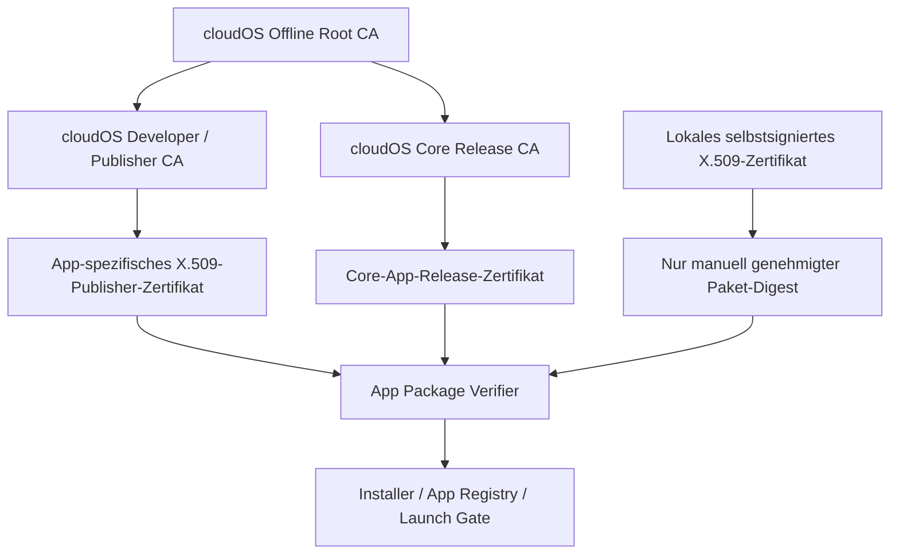

# cloudOS - App-Signierung, Zertifikate und Vertrauensmodell

> **Fachkonzepte v0.12:** [AUTHENTICATION_METHODS.md](AUTHENTICATION_METHODS.md), [LOGGING_OBSERVABILITY.md](LOGGING_OBSERVABILITY.md), [WINDOW_FRAMEWORK.md](WINDOW_FRAMEWORK.md), [CLIENT_DEVICES.md](CLIENT_DEVICES.md). Die vier Dokumente sind führend für die neuen Loginmethoden, Logs.cloudApp, das einheitliche Fensterframework und Client-Gerätefreigaben.

> **Core-Deployment und Kubernetes:** [CORE_DEPLOYMENT_SCALING.md](CORE_DEPLOYMENT_SCALING.md) (verbindlich: ein Core-Container als Standard, separater Split-/Replica-Modus nur opt-in)  

> **Push-/Realtime-Fachvertrag:** [PUSH_REALTIME.md](PUSH_REALTIME.md) (verbindlich fuer SSE-Transport, Events, Replay, sicherheitsgefilterte Zustellung und das Verbot periodischer Client-Statusabfragen)  

> **Pfad:** `docs/APP_SIGNING.md`  
> **Dokumentversion:** 0.12 – Loginmethoden, Logging, Window Framework und Client-Geräte (Core-Deployment bleibt combined)
> **Stand:** 15.11.2026  
> **Projekt:** [Drezael/cloudOS](https://github.com/Drezael/cloudOS)  
> **Basis:** App-first-Architektur v0.4; `.cloudApp`-Paketformat, Go-Core und Zwei-Volume-VFS  
> **Referenzen:** [`APPLICATION_SYSTEM.md`](APPLICATION_SYSTEM.md), [`SYSTEM_ARCHITECTURE.md`](SYSTEM_ARCHITECTURE.md), [`VIRTUAL_FILESYSTEM.md`](VIRTUAL_FILESYSTEM.md), [`CONCEPT.md`](CONCEPT.md), [`APP_API_ACCESS.md`](APP_API_ACCESS.md)

## 1. Ziel, Geltungsbereich und Grundentscheidung

Alle installierten und ausgeführten `.cloudApp`-Pakete müssen vor der Aktivierung kryptografisch geprüft werden. cloudOS verwendet hierzu ein **Nextcloud-inspiriertes X.509-Code-Signing-Modell** mit Herausgeberzertifikaten, die an eine konkrete App-ID gebunden sind, einem vollständigen Hashverzeichnis und einer Signatur über den Paketindex.

Zusätzlich zu regulär aus einer cloudOS-Vertrauenskette signierten Apps sind **selbstsignierte `.cloudApp`-Pakete erlaubt**, sofern eine dafür berechtigte Administration die sicherheitliche Ausnahme nach sichtbarer Warnung explizit bestätigt. Dieser Ausnahmeweg ist keine implizite Aufnahme in die globale Trust-Root-Liste.

Die fachlichen Regeln gelten gleichermaßen für Web-, Rust/WebAssembly-, WASI- und später isolierte native Apps. Die Signatur ersetzt weder die Sandbox noch die Berechtigungs- und Sicherheitsprüfung.

**Entscheidungsstatus:** X.509-basierte App-Signierung, prüfbare signierte Inhalte, App-ID-Bindung, Core-App-Schutz und manuelle Selbstsignaturfreigabe sind verbindliches Ziel. Konkretes JSON-Schema, Key-Usage-Profile, CA-Betrieb und Algorithmusdetails müssen vor Implementierung durch ADR-027 akzeptiert werden. Die nachfolgend gewaehlten Algorithmen bilden einen konkret testbaren v1-Vorschlag.

## 2. Was von Nextcloud übernommen wird - und was nicht

Die Nextcloud-Dokumentation beschreibt eine Code-Signing-Root-Authority, die für eine App-ID gebundene Entwicklerzertifikate ausstellt. Ein Entwickler erzeugt ein Schlüsselpaar und einen CSR, erhaelt ein signiertes Zertifikat und signiert seine Anwendung. Die Datei `appinfo/signature.json` enthaelt Dateipfade und SHA-512-Hashes, Zertifikat und Signatur. Die Integritaetsprüfung erkennt geänderte, fehlende und hinzugefuegte Dateien. Nextcloud unterscheidet zudem App-Releases von der Registrierung bzw. Signierung eines App-Store-Archivdownloads.

| Mechanismus | Nextcloud (Vorbild) | cloudOS (eigene Implementierung) |
|---|---|---|
| Vertrauensanker | Nextcloud-Code-Signing-Root | Eigene cloudOS-Root, nie Nextcloud-Privatschlüssel oder deren Root als automatische Berechtigung |
| Publisherzertifikat | X.509, App-ID im CN | X.509, verbindliche App-ID-Bindung; zusätzlich Scope als URI-SAN vorgesehen |
| Datei-Hashes | SHA-512-Liste in `signature.json` | SHA-512-Liste in `META-INF/package-index.json` |
| Signatur | Signatur über Hashliste | Signatur über kanonischen gesamten Paketindex; Zertifikat in `META-INF/signature.json` |
| Vorgaengige Zertifikatsausstellung | CSR an Nextcloud | CSR an cloudOS-Publisher-CA oder lokales selbstsigniertes Zertifikat |
| Integritaetsprüfung | Fehlende/geänderte/zusätzliche Dateien erkennen | Dieselben Klassen hart ablehnen, inklusive doppelter Archivpfade und gefährlicher ZIP-Eintraege |
| Unsignierte Apps | Je nach Vertriebskanal andere Nextcloud-Regeln | In cloudOS v1 **nicht installierbar**; nur kryptografisch gültig selbstsignierte App als explizite Ausnahme |
| Updates | Signierter Nachfolger, identitaetsbezogene Prüfung | Versions-/Schlüsselkontinuitaet, neue Freigabe bei selbstsigniertem Update |

**Keine Kompatibilitaetsbehauptung:** `.cloudApp` und Nextcloud-App-Pakete sind nicht gegenseitig installierbar. Wir übernehmen das Sicherheitsprinzip, nicht Nextcloud-Dateiformate, Signaturschlüssel oder PHP-Implementierungen.

Quellen: [Nextcloud Developer Manual - Code signing](https://docs.nextcloud.com/server/stable/developer_manual/app_publishing_maintenance/code_signing.html), [Nextcloud Administration Manual - Code signing](https://docs.nextcloud.com/server/stable/admin_manual/issues/code_signing.html), [Nextcloud App Store Developer Guide](https://github.com/nextcloud/appstore/blob/master/docs/developer.rst).

## 3. Zentrale Sicherheitsinvarianten

1. **Keine Ausführung ohne Installation und erfolgreiche Paketprüfung.** Eine `.cloudApp` in einem Home-Verzeichnis wird niemals direkt gestartet.
2. **Keine Installation einer ungültigen oder unsignierten App.** Eine Administratorwarnung darf keine fehlerhaften Hashes oder kryptografisch ungültigen Signaturen übergehen.
3. **Vertrauen ist mehrdimensional:** Gültige Signatur, gültige Zertifikatskette, bestätigte Herausgeberidentitaet, App-ID-Scope und lokale Installationsfreigabe sind verschiedene Prüfungen.
4. **Die Bezeichnung `core` ist privilegiert.** Keine selbstsignierte oder externe App kann dadurch Core-App werden, dass sie bekannte App-IDs oder Rollen eintraegt.
5. **Jede Version besitzt einen unveränderlichen Digest.** Gleiche App-ID/Version mit anderem Digest ist ein Konflikt, keine stille Aktualisierung.
6. **Keine private Signaturschlüssel im Go-Core oder `.cloudApp`-Archiv.** Schlüssel bleiben ausschließlich beim Herausgeber bzw. gesichert im Release-Signing-System.
7. **Schutz auch nach der Installation.** Der unveränderliche Paketstore, Launch-Gates und regelmaessige Integritaetsprüfungen erkennen nachtraegliche Manipulation.
8. **Keine generelle Trust-Root-Aufwertung durch Selbstsignatur.** Die Ausnahme autorisiert einen konkret identifizierten Paket-Digest, nicht alle Programme des Zertifikats oder zukuenftige Apps.
9. **App-Berechtigungen bleiben unabhaengig von der Signatur.** Kryptografisch gültige Apps erhalten nicht automatisch Datei-, Admin- oder Netzwerkrechte.
10. **Fehler fallen geschlossen aus.** Ist die Signatur nicht verifizierbar oder die Policy nicht erreichbar, findet keine neue Aktivierung statt.
11. **API-Deklaration wird immer signiert:** `permissions/api-access.json` gehört zwingend zum vollständigen SHA-512-Paketindex. Änderung oder Fehlen führt zur harten Ablehnung.
12. **Signing ersetzt keine Endpoint-Freigabe:** Kryptografisch gültige und selbstsignierte Pakete müssen vor Installation ihre gesamte beantragte API-Liste samt Risiken offenlegen und administrativ freigeben lassen.

### 3.1 Verpflichtende API-Datei als signierte Payload

Jedes `.cloudApp`-Paket enthält `permissions/api-access.json` und referenziert sie im signierten `cloudos.app.json`. Der SHA-512-Digest der API-Datei ist Bestandteil von `META-INF/package-index.json`; **jede Modifikation der Endpoint-Liste erfordert neues Packaging und erneute Signierung**. `[]` ist eine zulässige leere, aber vorhandene Liste. Ein fehlender oder unbekannter API-Vertrag ist nicht installierbar.

Die Signatur belegt **nicht**, dass eine App die deklarierten Endpunkte sicher nutzt oder niemals weitere Zugriffe versucht. Die wirksame Endpoint-Allowlist wird vielmehr durch den Core zur Laufzeit **bei jedem Aufruf** kontrolliert. Das Signaturmodell verhindert lediglich eine unbemerkte nachträgliche Änderung der **angeforderten** Endpunkte.

Der Installationsdialog unterscheidet zwingend **zwei unabhängige Freigaben**: (1) Genehmigung aller verlangten Core-API-Endpunkte mit konkret beschriebenen Sicherheitsrisiken und (2) bei Selbstsignatur zusätzlich die gesonderte Publisher-/Herkunftsrisikoannahme. Die zweite Entscheidung ersetzt die erste niemals. Details: [`APP_API_ACCESS.md`](APP_API_ACCESS.md).

## 4. Zertifikats- und Schlüsselmodell

### 4.1 Vertrauenskette



Die Root-CA wird offline und mit gesondertem Schlüsselschutz verwaltet. Herausgeberzertifikate werden von einer getrennten Signing-CA ausgestellt. Fuer Core-App-Releases ist ein **separater Vertrauensanker bzw. dediziertes Release-Signing-Profil** verbindlich, damit ein normaler Publisher niemals `Desktop.cloudApp` ersetzen kann.

### 4.2 Scope eines Herausgeberzertifikats

- Das Zertifikat ist X.509 und für digitale Signaturen sowie Code Signing vorgesehen.
- Die **exakte technische App-ID** aus `cloudos.app.json` muss mit dem Zertifikatsscope übereinstimmen.
- Fuer v1 ist `subject.CN == app_id` als Nextcloud-analoges Minimalprofil vorgesehen; vorzugsweise kommt eine maschinenlesbare URI-SAN wie `urn:cloudos:app:org.example.editor` hinzu.
- Der Verifier verlangt das für die jeweilige Ausstellerklasse passende Schlüsselverwendungsprofil und eine kryptografisch gültige Signatur.
- Eine Signatur für App A darf niemals als Signatur für App B akzeptiert werden, selbst bei identischem Inhalt.
- Herausgebernamen aus der Manifestdatei gelten ohne identitaetsgeprüfte Zertifikatsausstellung **nicht** als bestätigt.

### 4.3 Krypto-Profil v1 (Vorschlag)

| Element | Vorgesehene Definition |
|---|---|
| Paket-Hashes | SHA-512 für alle Payload-Dateien |
| Indexformat | RFC 8785 JSON Canonicalization Scheme (JCS), UTF-8, exakt dokumentiert |
| Signatur des Index | RSA-PSS mit SHA-512; für v1 RSA >= 3072 Bit, vorzugsweise 4096 Bit |
| Zertifikate | X.509, erlaubte `keyUsage`/`extendedKeyUsage` für Code Signing |
| CA-Kette | Gegen installierte, versionsgebundene cloudOS-Publisher-Roots validieren |
| Self-signed | Selbstsignatur prüfen, Zertifikat und App-Scope prüfen; **keine** CA-Vertrauensannahme |
| Zertifikatsfingerprint | SHA-256 über Zertifikat-DER für Anzeige und Audit |
| Paketfingerprint | SHA-256 über die exakten `.cloudApp`-Archivbytes für Preview-/Install-Bindung |

Dieses Profil ist nicht byte-kompatibel zur Signaturfunktion von Nextcloud. Die Nutzung von RSA-PSS statt einer pauschal formulierten `RSA/SHA-512`-Variante muss im eigenen Contract fixiert und mit Go-Testvektoren verifiziert werden. Algorithmen werden fest per Allowlist ausgewaehlt; keine Akzeptanz beliebiger ungetesteter `alg`-Angaben aus dem Paket.

### 4.4 Schlüsselerstellung für Entwickler

Der Schlüssel entsteht **auf dem Rechner des Herausgebers**, nicht auf dem cloudOS-Server. Die folgenden OpenSSL-Kommandos sind lediglich ein Beispiel für einen lokal selbstsignierten App-Herausgeber:

```bash
openssl genpkey -algorithm RSA \
  -pkeyopt rsa_keygen_bits:4096 \
  -aes-256-cbc \
  -out example-editor.key

openssl req -new -x509 -sha256 -days 365 \
  -key example-editor.key \
  -out example-editor.crt \
  -subj '/CN=org.example.editor' \
  -addext 'subjectAltName=URI:urn:cloudos:app:org.example.editor' \
  -addext 'keyUsage=digitalSignature' \
  -addext 'extendedKeyUsage=codeSigning'
```

**Sicherheit:** Private Keys sind passwortgeschuetzt, liegen nicht im Repository und werden nicht in das Paket eingebettet. Fuer offizielle Signierung wird statt `-x509` ein CSR erstellt und von der cloudOS-Publisher-CA ausgestellt. Zertifikatslaufzeit, Algorithmus- und Extension-Profil werden von der Implementierung validiert. Ob die obigen Parameter vom gewaehlten OpenSSL-Build exakt unterstuetzt werden, wird in der Toolchain-Prüfung verifiziert.

## 5. `.cloudApp`-Paketstruktur und Signaturdateien

**Sicherheitsrelevante Erweiterung v0.12:** Das signierte `.cloudApp`-Paket muss neben `permissions/api-access.json` auch `permissions/device-access.json` (ggf. mit `"devices": []`) enthalten. Der SHA-512-Paketindex umfasst **beide**. Eine Änderung von Geräteklasse, Transport, Operationen, Device-Filtern oder der Fensterhost-Deklaration verändert den signierten Paketinhalt und erfordert eine erneute Signierung und Risikoprüfung. Ein Installer darf für die Geräteberechtigung nicht nur das Vertrauenslabel der Signatur anzeigen. Selbstsigniert bedeutet weiterhin erkennbar erhöhtes Herausgeberrisiko.


```text
ExampleEditor-1.0.0.cloudApp  # ZIP-Container
|-- cloudos.app.json
|-- permissions/
|   |-- api-access.json         # signierte Endpoint-Allowlist, ggf. leer
|   `-- device-access.json      # signierte Gerätedeklaration, ggf. leer
|-- META-INF/
|   |-- package-index.json      # Hashliste und signierte Identitaet
|   |-- signature.json          # X.509-Zertifikat/-Kette, Signatur
|   `-- publisher.json          # signierte Herausgebermetadaten
|-- web/
|   |-- index.html
|   `-- main.js
|-- wasm/
|   `-- app.wasm
|-- resources/
|   `-- icon.svg
`-- licenses/
    `-- LICENSE.txt
```

Anwendungen müssen nicht alle optionalen Verzeichnisse enthalten. Das Archiv darf keine gefährlichen Pfade, Symlinks oder widerspruechlichen Dateieintraege enthalten. **Eine Datei wird genau einmal aufgelistet.** `package-index.json` und `signature.json` sind per Schema und Verifikationsreihenfolge die einzigen ausgeklammerten Meta-Dateien; alle anderen Archivdateien einschliesslich Manifest und Publisherdatei müssen gehasht sein.

### 5.1 Beispiel `META-INF/package-index.json`

```json
{
  "schema_version": 1,
  "app_id": "org.example.editor",
  "app_version": "1.0.0",
  "package_format_version": "1.0",
  "publisher_id": "org.example",
  "files": {
    "cloudos.app.json": "sha512:EXAMPLE_REPLACED_BY_128_HEX_DIGITS",
    "META-INF/publisher.json": "sha512:EXAMPLE_REPLACED_BY_128_HEX_DIGITS",
    "web/index.html": "sha512:EXAMPLE_REPLACED_BY_128_HEX_DIGITS",
    "web/main.js": "sha512:EXAMPLE_REPLACED_BY_128_HEX_DIGITS"
  }
}
```

**Beispieldaten, keine gültigen Hashes.** In echten Paketen umfasst die Liste **alle** vorhandenen Payload-Dateien. Die gesamte Index-JSON-Datei wird vor dem Signieren und Verifizieren exakt nach JCS normalisiert. Package-Index und Manifest müssen bei App-ID, Version und Herausgeber konsistent sein.

### 5.2 Beispiel `META-INF/signature.json`

```json
{
  "schema_version": 1,
  "hash_algorithm": "SHA-512",
  "signature_algorithm": "RSA-PSS-SHA512",
  "signed_object": "META-INF/package-index.json",
  "certificate_pem": "-----BEGIN CERTIFICATE-----...-----END CERTIFICATE-----",
  "certificate_chain_pem": [],
  "signature_base64": "EXAMPLE_NOT_A_REAL_SIGNATURE"
}
```

**Signierter Gegenstand:** die exakt kanonischen UTF-8-Bytes des `package-index.json`. `signature_base64` signiert nicht die umgebende `signature.json`, wodurch keine kryptografische Selbstreferenz entsteht. Eine manipulierte `signature.json` kann nur dann akzeptiert werden, wenn deren Zertifikat und Signatur **erneut** die signierte, appgebundene Indexdatei erfolgreich verifizieren. Ein Austausch des Zertifikats muss die Trust-Policy und den Signaturtest bestehen.

### 5.3 Signaturprüfung in fester Reihenfolge

1. Paket in einem nicht ausführenden Staging-Bereich als unveränderlichen Snapshot erfassen.
2. Archivgröße, Entpacklimits, Eintragsanzahl, kanonische Pfade, ZIP-Duplikate und unerwartete Dateitypen prüfen.
3. Manifest, `package-index.json` und `signature.json` mit strengen größenbegrenzten JSON-Parsern lesen.
4. Vollständigkeit prüfen: alle Payload-Dateien exakt einmal im Index; **keine** fehlenden, zusätzlichen oder umbenannten Dateien.
5. SHA-512 über jede **dekomprimierte** Payload-Datei berechnen, mit Index vergleichen.
6. Kanonische Indexbytes bestimmen und die digitale Signatur mit dem Schlüssel im X.509-Zertifikat prüfen.
7. App-ID-/Version-/Publisher-Bindung im Index, Manifest und Zertifikat prüfen.
8. Gültigkeit, Schlüsselverwendung, Zertifikatskette und Widerruf gegen die cloudOS-Trust-Policy prüfen; Selbstsignatur als **unvertraut, aber eventuell genehmigungsfaehig** kennzeichnen.
9. Installationspolicy, Core-App-Ausnahme, Runtime, Capabilities, Abhängigkeiten und Kompatibilitaet prüfen.
10. Nur nach kompletter Freigabe in den unveränderlichen Paketstore übernehmen; jede spätere Aktivierung referenziert den exakt geprüften Digest.

**Unbedingt getrennt halten:** `signature_valid=true` ist ein kryptografischer Befund. `trusted_publisher=true` ist ein Vertrauensbefund. `allowed_to_install=true` ist eine dritte, policiespezifische Entscheidung.

## 6. Vertrauensklassen und Installationspolitik

| Klasse | Beweis | Installieren | Nutzbare Rechte |
|---|---|---|---|
| `core_release_trusted` | Signatur, dediziertes Core-Release-Zertifikat, geschuetzte Release-Baseline | Automatischer Release-/Recovery-Pfad | Nur festgelegte Core-App-Capabilities |
| `publisher_verified` | App-ID-spezifische gültige Kette zu anerkannter Publisher-CA | Admin nach Normalprüfung | Nur bewilligte App-Capabilities |
| **`self_signed_local`** | Gültige Selbstsignatur und exakt passender App-ID-Scope; **keine unabhaengige Herausgeberbestätigung** | **Admin nur nach Warnung und separater Risikobestätigung** | Nur bewilligte App-Capabilities; keine Core-App-Rolle |
| `untrusted_chain` | Signatur gültig, aber keine anerkannte Kette, nicht lokal selbstsigniert | Gesperrt bis separater expliziter Zertifikats-/CA-Vertrauensprozess | Keine |
| `unsigned` | Kein gültiger Signaturbeleg | Gesperrt | Keine |
| `invalid` | Fehlerhafte Signatur, Hash, Scope, Zertifikat oder Widerruf | Gesperrt, nicht überstimmbar | Keine |

Eine Self-signed-Genehmigung ist **kein System-CA-Import**. Sie ist an **App-ID, Paketversion, Paketdigest, Zertifikatsfingerprint, Administrator und Zeitpunkt** gebunden. Eine Kopie desselben unveränderten Pakets wird bei erneuter Preview als bereits genehmigte konkrete Version erkannt; neue Versionen oder geänderte Digests brauchen eine neue Warnung und Bestätigung.

Der Systembetreiber kann per Policy die Installation selbstsignierter Apps vollständig deaktivieren; **Standardmodell für cloudOS:** Ein dazu berechtigter Administrator darf nach sichtbarer Warnung explizit genehmigen. Eine Organisation kann diesen Weg für härtere Produktionsvorgaben sperren.

Eine Eigenschaft `publisher_verified` bedeutet **nur verifizierten Signaturschlüssel/Herausgeberstatus, nicht Code-Audit oder Sicherheitsgarantie**.

## 7. Installation einer selbstsignierten `.cloudApp`

### 7.1 User Experience: Doppelklick oder Installation in Apps.cloudApp / AppStore.cloudApp

Die bisherige Installation **per Rechtsklick** ist aufgehoben. Ein berechtigter Administrator kann eine heruntergeladene, noch nicht registrierte `.cloudApp` **doppelklicken**. Die File Association öffnet direkt `Apps.cloudApp` und startet die Vorprüfung. Alternativ wählt der Administrator in **Settings → Apps** das Paket aus. Ein Eintrag eines von `AppStore.cloudApp` abonnierten, moderierten GitHub-Katalogs führt denselben Signatur-/API-/Policy-Workflow aus.

```mermaid
sequenceDiagram
    participant A as Administrator
    participant F as FileExplorer.cloudApp
    participant I as Apps.cloudApp oder AppStore.cloudApp
    participant C as Go Core / Package Verifier
    participant P as Permission + Trust Policy
    participant V as system:/apps
    A->>F: Doppelklick auf Editor.cloudApp
    F->>I: Installation-Intent mit kurzlebigem File-Handle
    I->>C: Signatur- und API-Preview starten
    C->>C: SHA-512-Dateiliste und X.509-Signatur pruefen
    C->>P: Herausgeber- / Endpoint- / Scope-Policy validieren
    P-->>C: self_signed_local mit Risikohinweis
    C-->>I: Gebundene Preview mit Fingerprint und vollstaendiger API-Liste
    I-->>A: Sicherheitswarnung und API-Genehmigung
    A->>I: API-Rechte + Selbstsignatur separat bestaetigen
    I->>C: Digestgebundener Installations-Commit
    C->>V: Gepruefte App-Datei unveraenderlich speichern
    C-->>I: App global registriert; Defaultgrant nur Admin
```

**Wesentlich:** Die Vorprüfung startet unmittelbar nach dem Doppelklick, aber der Commit niemals ohne die erforderlichen Bestätigungen. Eine geprüfte GitHub-Katalogquelle kann die Signatur-, Review- oder Berechtigungsdialoge nicht stillschweigend ersetzen. `AppStore.cloudApp` besitzt keine pauschalen Rechte auf fremde/manuell installierte Apps. Die vollständige Store-/Provenienz- und Defaultgruppenpolitik steht in [APP_MANAGEMENT_STORE.md](APP_MANAGEMENT_STORE.md).

### 7.2 Verpflichtende Warnung im Installer

> **Sicherheitswarnung: Selbstsignierte Anwendung**
>
> Diese App wurde mit einem selbstsignierten Zertifikat signiert. Die Signatur kann die Unverändertheit des Pakets bestätigen, **nicht aber die Identitaet oder Vertrauenswuerdigkeit des Herausgebers**.
>
> Die App kann Sicherheitsluecken oder schaedlichen Code enthalten. Bei der Ausführung gelten die cloudOS-App-Berechtigungen und Sandbox-Regeln, ein Restrisiko bleibt.
>
> **App:** Example Editor (`org.example.editor`)  
> **Version:** `1.0.0`  
> **Zertifikat:** `SHA-256: ...` (voller Fingerprint im Detaildialog)  
> **Angeforderte Berechtigungen:** aufgelistete Capabilities  
>
> **Aktionen:** *Installation abbrechen* (primaer) oder *Risiko akzeptieren und installieren* (nach expliziter Bestätigung).

**UI-Regeln:** deutliche Warnfarbe, keine vorausgewaehlte Zustimmung, keine Verschleierung hinter einer allgemeinen Lizenzcheckbox. Administrativer Step-up bei entsprechender Policy. Die Warnung wird in **Apps.cloudApp** dargestellt, nicht in einer frei gestaltbaren Drittanbieter-App; deren UI kann diese Warnung nicht ersetzen. Bei späterer Anzeige unter den installierten Apps bleibt `Selbstsigniert` sichtbar.

### 7.3 Technische Bestätigung

Der Core nimmt nicht bloss ein Browser-Boolean `acknowledged=true` entgegen. Der Ablauf verwendet einen kurzlebigen, einmaligen **Risk Acceptance Token / Confirmation Intent**, gebunden an:

- authentifizierte Administratorsitzung mit `apps.install.self_signed`;
- `preview_id`, `plan_hash`, unveränderlichen Paket-Digest;
- App-ID, App-Version und Zertifikat-Fingerprint;
- unveränderte Risiko- und Berechtigungsinformation;
- aktuelle Installations- und Security-Policy;
- serverseitiges Ablaufdatum und auditierte explizite Zustimmung.

Die Einwilligung ist **nicht automatisch durch andere Apps wiederverwendbar**. Bei geändertem Zertifikat, Paket, Scope oder Policy wird eine neue Preview und Warnung erzwungen. Eine direkt aufgerufene Installations-API darf keine Umgehung der Risikoentscheidung erlauben.

### 7.4 Signaturfehler sind **nicht** selbstsigniert

| Fehlerbild | Reaktion |
|---|---|
| Selbstsignatur kryptografisch gültig, Fingerprint neu, Scope korrekt | Warnen und Admin-Entscheidung anbieten |
| Hash abweichend (`INVALID_HASH`) | Harte Ablehnung |
| Index-Datei fehlt (`MISSING_FILE`) | Harte Ablehnung |
| Datei nicht im Index (`EXTRA_FILE`) | Harte Ablehnung |
| Signatur passt nicht zum Index (`INVALID_SIGNATURE`) | Harte Ablehnung |
| App-ID passt nicht zum Zertifikat (`APP_SCOPE_MISMATCH`) | Harte Ablehnung |
| Zertifikat ungültig, abgelaufen oder widerrufen (`CERT_INVALID` / `CERT_REVOKED`) | Harte Ablehnung |
| Versuch, `io.cloudos.*` oder Core-Baseline als self-signed zu installieren | Harte Ablehnung |
| Unsigned ZIP mit `.cloudApp`-Endung | Harte Ablehnung |

**Keine Schaltflaeche `Trotzdem installieren` bei Integritaetsfehlern.** Die Ausnahme ist ausschließlich für Pakete mit vollständig korrekter Kryptografie und eigener, unbestätigter Herausgeberidentitaet bestimmt.

## 8. Offizielles Publisher-Onboarding und eigenes Self-Signing

### 8.1 Zertifikat von cloudOS anfordern (Konzept)

1. Herausgeber erzeugt lokal ein RSA-Schlüsselpaar und einen CSR mit der exakten App-ID.
2. Herausgeber beantragt bei der späteren cloudOS-Publisher-CA ein Zertifikat.
3. Der Herausgeber bzw. die App-ID-Zuordnung wird ausserhalb der App-Datei validiert.
4. Die CA stellt ein appgebundenes X.509-Code-Signing-Zertifikat aus.
5. Der Herausgeber signiert für **jede App-Version** einen neuen Paketindex.
6. Der Go-Core kann die Zertifikatskette gegen vertrauenswuerdige cloudOS-Publisher-Roots prüfen.

Die Einrichtung einer öffentlichen CA und eines App Stores ist **keine Voraussetzung für das erste MVP**. Fuer die ersten Releases können intern kontrollierte Publisher- und Release-Zertifikate verwendet werden; ein echter Herausgebernachweis darf dann nur im Umfang der tatsaechlich durchgeführten Prüfung behauptet werden.

### 8.2 Lokal selbst signieren

Mit demselben lokalen Schlüsselpaar kann der Entwickler ein Paket signieren. Ein vorgesehenes, noch **nicht implementiertes** Entwicklerwerkzeug ist:

```bash
cloudos-app package --source ./example-editor --out ./ExampleEditor.cloudApp
cloudos-app sign --package ./ExampleEditor.cloudApp \
  --certificate ./example-editor.crt \
  --private-key ./example-editor.key \
  --out ./ExampleEditor-signed.cloudApp
cloudos-app verify --package ./ExampleEditor-signed.cloudApp
```

Das Werkzeug soll die vollständige SHA-512-Dateiliste erzeugen, das kanonische Index-JSON signieren, die X.509-Daten hinzufügen und das Paket nochmals unabhaengig verifizieren. Es fragt die Passphrase sicher ab und gibt den Schlüssel niemals in Logs, Paketdateien oder API-Requests aus. `verify` zeigt getrennt `signature_valid` und `trust_status=self_signed_local` an.

Selbst signieren erfordert **keine** Bewerbung bei der cloudOS-CA und keine Erlaubnis des Entwicklers. **Installieren auf einem konkreten cloudOS-System** erfordert dagegen die dortige Adminfreigabe.

## 9. Updates, Widerruf und Schlüsselwechsel

- **Regulaere signierte Updates:** Neue Paketversion und Herausgeberidentitaet werden geprüft. Keine zusätzlichen Capabilities ohne neue Freigabe.
- **Selbstsignierte Updates:** Bei **jeder neuen Version oder jedem neuen Digest** eine erneute Warnung und Adminbestätigung. **Kein stilles Auto-Update** selbstsignierter Apps.
- **Schlüsselwechsel:** Zertifikat-Fingerprint ändert sich -> neuer expliziter Sicherheitsentscheid. Die Installation wird nicht automatisch demselben Herausgeber zugerechnet.
- **App-ID-Kontinuitaet:** Eine neue Version darf die belegte App-ID nicht mit fremdem Schlüssel übernehmen, nur weil die App-ID im Manifest identisch ist. Ein Wechsel benötigt gesondert autorisierten Transfer-/Key-Rotation-Prozess.
- **Rollback:** Nur auf noch gültige, kompatible und weiterhin freigegebene Paket-Digests; kein ungeprüfter Downgrade.
- **Widerruf:** Freigegebene CA-/Herausgeberzertifikate können widerrufen werden. Beim nächsten Policy-Abgleich wird eine betroffene Version gesperrt oder quarantinisiert; laufende Instanzen werden policygerecht gestoppt.
- **Self-signed-Ausnahme widerrufen:** Administrator kann die Zustimmung **für eine konkrete Version** entziehen; danach keine neuen Starts. Bei sofortigem Risiko werden laufende Instanzen beendet.
- **Zeitprüfung:** Neue Installation und jedes Update verlangen ein zum Verifikationszeitpunkt gültiges Zertifikat. Die Langzeitprüfung bereits zuvor gültig installierter Versionen benötigt eine eigene Policy für Zertifikatsablauf; ohne vertrauenswuerdigen Timestamp kann ein signiertes Ausstellungsdatum nicht beliebig behauptet werden.
- **Offline-Betrieb:** Bei nicht erreichbarem Widerrufsdienst gilt eine definierte Cache-/Fail-Closed-Policy für **neue** Installationen. Core-App-Recovery darf keine ungeprüften Quellen akzeptieren.

## 10. API-first: REST-Vertraege (Entwurf)

| Methode | Endpunkt | Funktion | Berechtigung |
|---|---|---|---|
| `POST` | `/api/v1/app-installation-previews` | Paket-Snapshot, Hashliste, Signatur, Trust-Klasse und Risiken prüfen | `apps.install` |
| `GET` | `/api/v1/app-installation-previews/{id}` | Gültigen Previewstatus und signierte Vorschau anzeigen | `apps.install` |
| `POST` | `/api/v1/app-installation-previews/{id}/risk-acceptances` | Self-signed-Risiko nach Step-up bewusst anerkennen | `apps.install.self_signed` |
| `POST` | `/api/v1/app-installations` | Geprüften Plan und optionales einmaliges Risk-Token installieren | `apps.install` |
| `GET` | `/api/v1/app-installations/{id}/verification` | Installierten Signatur-/Trust-/Hashstatus anzeigen | `apps.manage` |
| `POST` | `/api/v1/app-installations/{id}/integrity-checks` | Erneute Integritaetsprüfung starten | `apps.manage` |
| `DELETE` | `/api/v1/app-installations/{id}/risk-acceptances/{id}` | Lokale Ausnahme für Paketversion widerrufen | `apps.manage.trust` |
| `GET` | `/api/v1/admin/app-signing/trust-roots` | Öffentliche Vertrauensanker auflisten | `apps.manage.trust` |

Beispiel einer **selbstsignierten** Installationsvorschau:

```json
{
  "preview_id": "prv_example",
  "plan_hash": "sha256:EXAMPLE",
  "package_digest": "sha256:EXAMPLE",
  "expires_at": "2026-11-15T12:00:00Z",
  "app": {
    "id": "org.example.editor",
    "version": "1.0.0",
    "publisher_id": "org.example"
  },
  "verification": {
    "signature_valid": true,
    "file_hashes_valid": true,
    "certificate_scope_valid": true,
    "certificate_chain_trusted": false,
    "trust_class": "self_signed_local",
    "signer_fingerprint_sha256": "EXAMPLE_FINGERPRINT",
    "risk_code": "SELF_SIGNED_PUBLISHER_UNVERIFIED"
  },
  "install_allowed_after_confirmation": true,
  "requires_risk_acceptance": true
}
```

Das Beispiel ist nicht als fertiges JSON-Schema freigegeben. **Ein autorisiertes API-Request kann nur bereits erfolgreich geprüfte Paketdaten genehmigen**, nicht die Kryptografie überspringen. Die Antwort wird vor Anzeige im Installer und vor Commit erneut mit der aktuellen Trust-Policy abgeglichen.

## 11. Interne Go-Core-Dienste

| Dienst | Aufgabe |
|---|---|
| App Package Service | Pakete lesen, Archivlimits, Index, Hashes, Signatur und Zertifikate technisch verifizieren |
| **App Signing / Trust Service** | CloudOS-Root-Store, Publisherzertifikate, App-ID-Bindung, lokale Ausnahmeentscheidungen, Key-Rotation- und Revocation-Policy |
| App Installation Service | Preview/Commit, unveränderlichen Digest, Adminrechte, atomare Aktivierung und Recovery sichern |
| Permission Service | Recht zur Installation und zur getrennten Self-signed-Zustimmung prüfen |
| App Registry Service | Installierte Version, laufzeitrelevanten Trust-Status, Zuweisungen und Updates verwalten |
| Audit Service | Genehmigung, Warnungsbestätigung, Prüfergebnisse und Widerruf protokollieren |
| Realtime Service | Status-/Warnmeldungen an Admin-UI und laufende Sitzungen weitergeben |

Die Dienste duerfen im MVP im selben Go-Core-Prozess laufen, bleiben aber fachlich getrennt. Der `Trust Service` darf nur **öffentliche Zertifikate**, Fingerprints und lokale Vertrauensregeln halten, keine privaten Herausgeber-Keys.

### 11.1 Gering privilegierte Prüfprozesse

Parsing, ZIP-Dekompression und Sicherheitsprüfung erfolgen vor Aktivierung ohne Ausführung von Nutzercode. Eine besonders robuste Implementierung führt diese aufwendigen Schritte in einem begrenzten Worker aus, damit ein Archiv nicht den privilegierten Core blockiert.

## 12. Datenmodell (Entwurf)

| Entitaet | Zweck und wichtige Felder |
|---|---|
| `app_signing_certificates` | `fingerprint_sha256`, `app_id_scope`, `subject`, `issuer`, `not_before`, `not_after`, `key_usage`, `revocation_state` |
| `app_trust_roots` | `root_id`, `issuer_name`, `public_certificate`, `purpose`, `active`, `valid_from`, `valid_to` |
| `app_signatures` | `package_digest`, `package_index_digest`, `certificate_fingerprint`, `signature_algorithm`, `crypto_valid`, `verified_at` |
| `app_signing_policy` | `self_signed_enabled`, `requires_step_up`, `allowed_runtimes`, `accepted_algorithm_profile` |
| `app_risk_acceptances` | `id`, `actor_id`, `app_id`, `app_version`, `package_digest`, `certificate_fingerprint`, `preview_id`, `accepted_at`, `revoked_at`, `policy_revision` |
| `app_revocations` | `id`, `scope`, `target_fingerprint`, `target_app_id`, `reason`, `created_at`, `source` |
| `app_verification_runs` | `id`, `package_digest`, `status`, `errors`, `timestamp`, `trace_id` |

Vorgeschlagene Owner-Schemas: `applications` für Paket- und Signaturmetadaten, `permissions` für lokale Freigaben, `audit` für nachvollziehbare Entscheidungen. Der Trust Service besitzt die Vertrauensbeurteilung, der App Installer setzt sie durch; keine Duplikation von Root-Listen in einzelnen App-Runtimes.

### 12.1 Integrität der API-Grant-Bindung

Die unveränderliche Signaturprüfung erzeugt einen belastbaren `api_declaration_digest`. Dieser wird in Installationsvorschau, genehmigter Endpoint-Liste, App-Registry und Launch-Policy referenziert. Die explizite administrative Genehmigung wird **außerhalb** des App-Archivs gespeichert und darf weder den signierten Paketinhalt überschreiben noch den Vertrauensstatus des Herausgeberzertifikats erhöhen.

Vor jedem Update wird die neue signierte API-Datei geprüft und die vollständige Endpoint-Liste inklusive Änderungen angezeigt. **Jedes** selbstsignierte Update benötigt zusätzlich eine neue gesonderte Risikofreigabe. Widerruf eines Zertifikats und Widerruf einzelner Endpoint-Grants sind voneinander unabhängige Sperrgründe.

## 13. Ereignisse, Audit und Betriebsstatus

Neue Eventtypen (Entwurf):

```text
apps.package.signature_verified
apps.package.signature_rejected
apps.package.self_signed_detected
apps.installation.risk_accepted
apps.installation.risk_rejected
apps.trust.exception_revoked
apps.signer.certificate_revoked
apps.integrity.changed
```

Auditdaten enthalten Administratoridentitaet, App-ID/-Version, Paketdigest, Zertifikatsfingerprint, Signaturstatus, Policyversion, Risikoentscheidung, Zeit und Trace-ID. Sie enthalten weder private Signaturschlüssel noch die vollständigen Paketbytes. Das Sicherheits-Dashboard soll installierte selbstsignierte Apps dauerhaft unterscheidbar anzeigen und die erneute Integritaetsprüfung anstossen können.

## 14. Integration mit den beiden virtuellen Festplatten

- `/Downloads/Editor.cloudApp` ist ein Paket **im Home des Benutzers** (`users`-Volume), kein installierter Programmcode.
- Der Installer liest diese Datei ausschließlich über einen autorisierten, zeitlich begrenzten File-Handle und erstellt vor dem Prüfen einen unveränderlichen Staging-Snapshot.
- Nach erfolgreicher Prüfung und Freigabe liegen versionierte Pakete im geschuetzten `system:/apps/packages/`.
- **Kein selbstsigniertes Paket** darf direkt in die Pfade der Core-Baseline schreiben oder eine `io.cloudos.*`-App ersetzen.
- Installierte Pakete sind unveränderlich. Der normale File Explorer darf auch im Adminmodus keinen Code oder `signature.json` in-place modifizieren.
- Browser und Rust-/WASM-Apps erhalten nur freigegebene Assets über sichere App-Asset-APIs, keinen direkten Mount des Systemvolumes.

Die in `VIRTUAL_FILESYSTEM.md` festgelegten **genau zwei Volumes** und die Home-Root-Bindung `/` gelten unverändert.

## 15. Core-Apps und Baseline-Schutz

- Offizielle Core-Apps werden **zwingend** über die dedizierte cloudOS-Release-Vertrauenskette und die signierte, versionsgebundene Release-Baseline freigegeben.
- Core-App-Status stammt nie aus einer im Paket behaupteten Rolle und nie aus einer lokalen Self-signed-Freigabe.
- Bei defekter Signatur oder ungültigem Core-Paket startet das Recovery nur mit zuvor freigegebenen Release-Artefakten; kein Selbstsignatur-Dialog erlaubt die Ersetzung.
- Die Desktop- und Systemdialog-Apps rendern den Self-signed-Warndialog als vertrauenswuerdige UI mit cloudOS-eigenem Designsystem und kontrollierten Komponenten.
- Kein Entwicklerschlüssel und keine Verifikation fremder Pakete liegt im systemkritischen Root-Signing-Schlüsselbereich.

### 15.1 Signierte Event-Subscriptions und neue Risiken

Ein `.cloudApp`-Paket darf nur die in `permissions/api-access.json` deklarierten und vom Administrator genehmigten Eventtypen/Scopes erhalten. Das neue versionierte Feld `event_subscriptions` wird wie das gesamte Manifest vom Paketindex mit SHA-512-Digests erfasst und X.509-gebunden signiert. Neue oder erweiterte Abonnements bei Updates benoetigen einen **erneuten Berechtigungsdialog** mit Datenkategorien und vom Core verifizierten Risikohinweisen. Ein gueltig selbstsigniertes Paket benoetigt zusaetzlich seine separate Herausgeberwarnung; eine Signatur ersetzt niemals eine Event-/User-ACL. Unerlaubte Abo-Themen bleiben blockiert. Weiterer Vertrag in [APP_API_ACCESS.md](APP_API_ACCESS.md) und [PUSH_REALTIME.md](PUSH_REALTIME.md).

## 16. Automatische und manuelle Integritaetsprüfungen

Der Core prüft Pakete **vor Installation** und **vor Freigabe einer neuen Version**. Der Launch Gate prüft die aktivierte Paketversion, die aktuelle Trust-Policy und den gespeicherten Prüfstatus. Er validiert zusätzlich den auszuliefernden Artefakt-Digest oder nutzt einen verifizierten, manipulationsgeschuetzten unveränderlichen Cache. Periodische Integritaetschecks können Manipulation und Lagerungsfehler erkennen.

Bei `INVALID_HASH`, `MISSING_FILE`, `EXTRA_FILE` oder `INVALID_SIGNATURE` wird die Version quarantinisiert, weitere Starts werden verweigert und die Administration wird benachrichtigt. Eine laufende App kann entsprechend Risikopolicy beendet werden. Wiederherstellung erfolgt nur aus verifizierten Artefakten. Die Option zur Self-signed-Freigabe greift hier **niemals**.

## 17. Test- und Abnahmematrix

| ID | Test | Erwartung |
|---|---|---|
| SIGN-001 | Offiziell von cloudOS signierte Core-App | Baseline akzeptiert, App startet |
| SIGN-002 | Von Publisher-CA signiertes Drittanbieterpaket | Regulaere Admininstallation möglich |
| SIGN-003 | Gültig selbstsignierte App mit passender App-ID | Sichtbare Warnung und gesonderte Adminentscheidung |
| SIGN-004 | Admin bestätigt Risiko mit gültiger Session | Genau der geprüfte Paketdigest wird installiert |
| SIGN-005 | Admin bricht Warnung ab | Keine Installation, keine Zuweisung |
| SIGN-006 | Normaler Benutzer ruft Self-signed-Commit-API auf | `403`, keine Installation |
| SIGN-007 | Normaler Admin ohne `apps.install.self_signed` | `403`, keine Ausnahme |
| SIGN-008 | Selbstsignierte App ohne Adminbestätigung | Nicht installierbar |
| SIGN-009 | Unsigned Paket | Harte Ablehnung, keine Warnungsumgehung |
| SIGN-010 | Nach Signieren geänderte Datei | `INVALID_HASH`, harte Ablehnung |
| SIGN-011 | Fehlender Dateieintrag im Archiv | `MISSING_FILE`, harte Ablehnung |
| SIGN-012 | Zusätzliche Datei im ZIP | `EXTRA_FILE`, harte Ablehnung |
| SIGN-013 | Modifizierte `package-index.json` | `INVALID_SIGNATURE`, harte Ablehnung |
| SIGN-014 | Falscher Zertifikats-CN oder URI-SAN | `APP_SCOPE_MISMATCH`, harte Ablehnung |
| SIGN-015 | Zertifikat abgelaufen | Neue Installation blockiert |
| SIGN-016 | Widerrufenes Publisherzertifikat | Neue Installation blockiert, aktive Version gemaess Policy gesperrt |
| SIGN-017 | Neuer Fingerprint bei gleicher App-ID | Kein stiller Publisherwechsel |
| SIGN-018 | Selbstsigniertes Paket beansprucht Core-App-ID | Immer blockiert |
| SIGN-019 | Self-signed-Update mit gleichem Signer | Erneute Warnung für neue Version/Digest |
| SIGN-020 | Self-signed-Update mit geändertem Signer | Zusätzlicher Publisherwechsel-Hinweis |
| SIGN-021 | Preview nach Datei- oder Policy-Änderung | Bestätigung ungültig, neue Preview erforderlich |
| SIGN-022 | Wiederholter Confirm-Token | Nur einmal verwendbar |
| SIGN-023 | Trust-Ausnahme wird widerrufen | Keine neuen Starts, laufende Instanzen nach Policy |
| SIGN-024 | Self-signed in Policy deaktiviert | Auch Administrator kann nicht installieren |
| SIGN-025 | Kryptografisch gültige App verlangt alle Dateirechte | Rechte nicht automatisch erteilt |
| SIGN-026 | Manipulation des installierten Paketstores | Quarantäne, keine neue Ausführung |
| SIGN-027 | ZIP mit Path Traversal / Duplicate Entry | Ablehnung vor Dateischreibzugriff |
| SIGN-028 | Rust-WASM-App selbstsigniert | Identische Trust-/Warnregeln wie bei Web-Apps |
| SIGN-029 | Server-WASI-App selbstsigniert | Policy muss Runtime zusätzlich freigeben, keine Ausnahmerechte |
| SIGN-030 | Admin liest Signaturstatus einer App | Verifikation und Risiko sichtbar, Audit vorhanden |
| SIGN-031 | Ungültige Signatur trotz Admin-Klick | Installation technisch unmöglich |
| SIGN-032 | Vertrauen zu System-CA wird über Self-signed-UI angefragt | Keine implizite Root-Installation |
| SIGN-033 | Bereits genehmigter exakt gleicher Paketdigest | Erneute Vorschau zeigt Version und bestehende Genehmigung |
| SIGN-034 | Zertifikatsname mit Unicode-/Pfadtricks | Strikte App-ID-Bindung blockiert Umgehung |

## 18. Reihenfolge der Implementierung

1. **Phase 0 / ADR-027:** X.509-Profile, Index-/Signature-Schema, appgebundene Trust-Roots, Self-signed-Policy und Warnsprache finalisieren.
2. **Phase 1 / Contracts:** OpenAPI-Vertraege für Vorschau, Signaturstatus, Admin-Risikoannahme und Installationscommit; interne Go-Schnittstellen und Fehlercodes definieren.
3. **App Package Service:** `package-index.json` und `signature.json` parsieren, SHA-512 und RSA-PSS in Go verifizieren; Testvektoren und Fuzzing.
4. **App Trust Service:** CA-Store, App-ID-Scope, Fingerprints, Ablauf, lokale Self-signed-Ausnahmen und Audit.
5. **Core-App-Baseline:** Release-Signing und getrennte Core-Release-Trust-Policy integrieren.
6. **Apps.cloudApp:** Admin-Warnung, Step-up, ausdrückliche Confirm-Aktion, permanente Self-signed-Kennzeichnung.
7. **Updatepfad:** Neue Bestätigung pro selbstsignierter Version, Widerruf, Schlüsselwechsel und Konflikterkennung.
8. **Operational Hardening:** Integritaetsscans, Monitoring, Quarantäne, Backups und Restore.

**Keine Phase gilt als abgeschlossen**, bevor SIGN-001 bis SIGN-034 für ihren betreffenden Funktionsumfang automatisiert bzw. nachvollziehbar abgenommen sind.

## 19. Architekturentscheidungen

- **ADR-027:** `cloudOS App Signing & Publisher Trust` - X.509-Publisher-CA, App-ID-Bindung, signierter SHA-512-Paketindex und Core-Release-Trust.
- **ADR-035 (neu):** `Self-Signed cloudApp Installation Policy` - Risikoklassen, Warnung, Adminfreigabe, Scope der Ausnahme und Updatepolitik.
- **ADR-036 (neu):** `App Signing Format & Cryptographic Profiles` - verbindliches Schema, JCS, RSA-PSS-SHA512, Zertifikats-/Key-Usage-Profile, Revocation und Verify-Testvektoren.

## 20. Verbindliche Zusammenfassung

**Jede `.cloudApp` muss kryptografisch korrekt signiert sein.** Regulaere Publisher-Releases müssen eine anerkannte cloudOS-Vertrauenskette bestehen. **Selbstsignierte Releases duerfen nach deutlicher Warnung und ausdrücklicher Adminfreigabe installiert werden**, jedoch ausschließlich mit den normalen App-Rechten und für den konkret genehmigten unveränderlichen Paketdigest. **Defekte, unsignierte, manipulierte oder widerrufene Pakete bleiben gesperrt.** Die Release-Baseline der Core-Apps ist niemals durch Self-signed-Ausnahmen ersetzbar.

**Dokumentstatus:** Vollständiger Architekturentwurf. CLI-Befehle, Endpunkte, JSON-Beispiele und Zertifikatsprofile beschreiben Zielverhalten; die cloudOS-Signing-Implementierung existiert noch nicht.

## 21. Integration mit Apps.cloudApp und moderierten GitHub-Quellen v0.9

Signaturprüfung gilt **unverändert** für manuelle Pakete und über `AppStore.cloudApp` abgerufene GitHub-Release-Dateien. Die kanonische Lagerung geprüfter Paketarchive lautet `system:/apps/` auf der **ersten** virtuellen Festplatte. Katalogsignatur und Review-Nachweis dienen als **zusätzliche** Vertrauensebene, aber ersetzen nicht die X.509-Paketsignatur, vollständige Hashprüfung und per Paketdigest genehmigte API-Zugriffsdatei.

`Apps.cloudApp` wird aus **Settings → Apps** oder bei **Doppelklick auf ein nicht installiertes `.cloudApp`-Paket** gestartet. Die technische Vorprüfung beginnt direkt; die Installation wartet auf ausdrückliche API-Genehmigung und ggf. getrennte Self-signed-Risikoannahme. Eine Installation durch den App Store wird mit Store-Manager- und Source-Provenienz registriert; dieser Store darf nur seine eigenen Installationen verwalten. Systemweite zusätzliche Apps erhalten standardmäßig ausschließlich einen `discover`/`launch`-Grant an die vordefinierte Gruppe `Admin`. Siehe [APP_MANAGEMENT_STORE.md](APP_MANAGEMENT_STORE.md).

## 22. Core-Deployment, Replica-Sicherheit und Kubernetes-Vorbereitung (v0.11)

In `combined` und `split` wird **derselbe Signaturcode und derselbe Truststore-/Policy-Vertrag** verwendet. Ein mehrfach replizierter Package Service überprüft Zertifikatspfad, signierte Datei-Digests, App-ID, Publisher, Installationsfreigabe und Paket-Revision mit denselben Regeln. Ein erfolgreicher Check auf Pod A darf nicht als pauschaler Blankoschein auf Pod B gelten. Für gecachte Prüfergebnisse sind unveränderliche Bundle-Digests, Truststore-Version und Widerrufsstatus Bestandteil des Cache-Schlüssels.

Signierte `.cloudApp`-Bundles werden in der gemeinsamen Ablage `system:/apps/` verifiziert publiziert, niemals als nur podlokale Dateien. Parallele Veröffentlichungen müssen atomar und idempotent sein. Privater Signing-Key, X.509-Trust-Anker und Revoke-Listen werden außerhalb der Images/Git verwaltet und sicher an berechtigte Dienste verteilt. Für selbstsignierte Pakete bleiben die zusätzliche Warnung und die getrennte Administratorfreigabe verpflichtend – unabhängig von Pod-/Kubernetes-Topologie.

## Architektur-Ergänzung v0.12 – zusätzliche Vertrauensgrenzen

Eine kryptographisch gültige App-Signatur verleiht weder Geräterecht noch privilegiertes Logging und macht aus einem fremden UI einen Systemdialog. Die vertrauenswürdige Desktop-/Window-Shell prüft die `window.mode=framework`-Deklaration und isoliert den App-Inhalt; die Device-API-Prüfung bindet Paketdigest, Instanz, Benutzer und Browserpermission. `Logs.cloudApp` und `AccountSecurity.cloudApp` werden ausschließlich durch die signierte Core-Baseline aktualisiert. Neue oder erweiterte Geräteberechtigungen erfordern bei jedem Update eine erneute administrative Bewertung.
