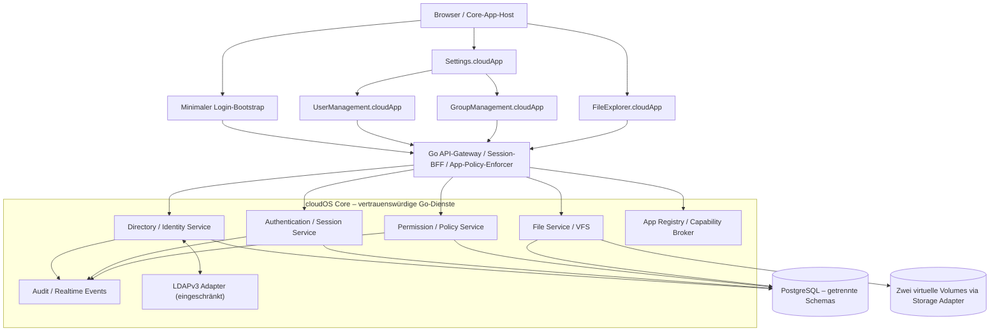
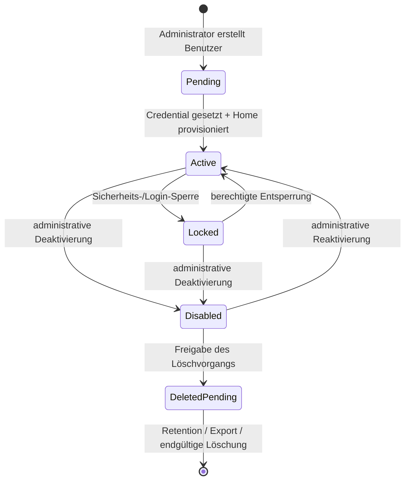
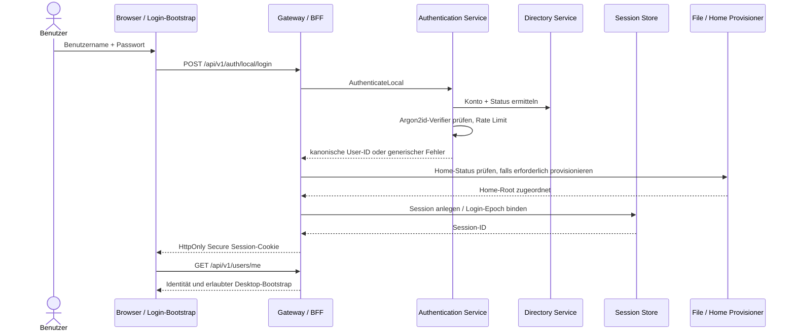
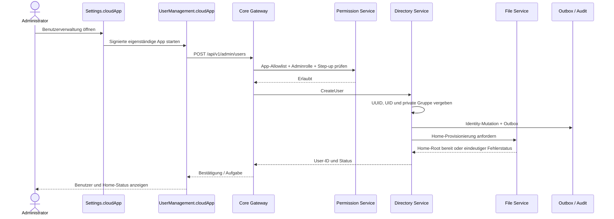

# cloudOS – Authentifizierung, Benutzer, Gruppen und Autorisierung

> **Pfad im Repository:** `docs/AUTHENTICATION_AUTHORIZATION.md`  
> **Dokumentversion:** 0.2 - externe LDAP-/IdP-Optionen, interne Shares und Spaces
> **Stand:** 15.11.2026  
> **Projekt:** [Drezael/cloudOS](https://github.com/Drezael/cloudOS)  
> **Verifizierte Ausgangsbasis:** `main`, Commit `134ed30f78bda748e45a1f8c5c4fe77987e18b18`  
> **Status:** Neue fachliche Anforderungen sind verbindlich; technisch offene Detailentscheidungen sind ausdrücklich gekennzeichnet.  
> **Verwandte Dokumente:** [CONCEPT.md](CONCEPT.md), [SYSTEM_ARCHITECTURE.md](SYSTEM_ARCHITECTURE.md), [VIRTUAL_FILESYSTEM.md](VIRTUAL_FILESYSTEM.md), [APPLICATION_SYSTEM.md](APPLICATION_SYSTEM.md), [APP_SIGNING.md](APP_SIGNING.md), [APP_API_ACCESS.md](APP_API_ACCESS.md), [IDENTITY_INTEGRATION.md](IDENTITY_INTEGRATION.md), [SHARING_SPACES.md](SHARING_SPACES.md).

## 1. Ziel und Grundsatzentscheidung

cloudOS erhält zunächst eine **lokale, vom Go-Core betriebene Identitätsverwaltung** mit einem kleinen, LDAPv3-kompatiblen Verzeichnisdienst. Die fachliche Benutzer- und Gruppenstruktur sowie die grundlegenden Dateirechte orientieren sich an Unix/Linux. Die grafische Administration orientiert sich an vertrauten Benutzer- und Gruppenverwaltungen aus Linux und Windows, wird aber durch separat installierte `.cloudApp`-Core-Apps realisiert.

Die Architektur trennt bewusst fünf Begriffe:

1. **Identität:** Wer ist der Benutzer oder Dienst? Stabile UUID, UID, Gruppen und Kontostatus.
2. **Authentifizierung:** Hat der Akteur seine Identität nachgewiesen? Passwort, Sitzung, später MFA oder externer Identity Provider.
3. **Systemautorisierung:** Darf der Akteur eine administrative oder sonstige cloudOS-Funktion ausführen?
4. **Dateisystemautorisierung:** Darf er auf genau diesen VFS-Knoten mit genau dieser Operation zugreifen? POSIX-Modus, Mount-Sicht und gegebenenfalls ACL.
5. **App-Autorisierung:** Darf die gestartete, signierte `.cloudApp` die betreffende Core-API und den konkreten Ressourcenscope verwenden?

**Jede Ebene ist verbindlich.** Weder ein erfolgreicher Login noch die Mitgliedschaft in einer Administratorgruppe, ein offenes Fenster oder eine gültige App-Signatur ersetzt die jeweils übrigen Prüfungen.

Die hier beschriebenen Benutzer sind zunächst **cloudOS-Benutzer**, keine automatisch auf dem Linux-Host angelegten POSIX-Konten. `uidNumber`, `gidNumber`, `rwx` und `chown` werden im virtuellen System interpretiert. Eine spätere Anbindung an Host-Benutzer, PAM, NSS, Samba oder externe LDAP-Verzeichnisse ist ein eigenes Integrationsprojekt.

### 1.1 Verbindlich festgelegt

- Lokal verwaltete Benutzer und Gruppen im Go-Core als anfängliche Identitätsquelle.
- LDAP-ähnliche Verzeichnisstruktur mit tatsächlich implementierter, begrenzter LDAPv3-Schnittstelle für interne beziehungsweise ausdrücklich freigegebene Clients.
- Stabile UUIDs **und** numerische, eindeutige POSIX-UIDs und POSIX-GIDs.
- Primärgruppe und zusätzliche Gruppenmitgliedschaften je Benutzer.
- Unix-ähnliche Rechte `owner/group/other` und `rwx` als verbindliche Basis der VFS-Autorisierung.
- Zwei virtuelle Laufwerke bleiben unverändert: `system` (nur administrativ sichtbar) und `users` (Benutzerdaten).
- Bei jedem Benutzer ist das sichtbare `/` **sein eigenes Home-Verzeichnis** im `users`-Volume.
- Benutzer- und Gruppenverwaltung erfolgen über eigenständige, signierte `.cloudApp`-Core-Apps, eingebunden in `Settings.cloudApp`.
- Alle Verwaltungs-Apps besitzen eine signierte API-Allowlist und benötigen administrative Freigaben; die Berechtigungsentscheidungen fallen im Core.
- Ein Administrator ist **nicht automatisch** der privilegierte Unix-Root-Benutzer und kann nicht pauschal alle Dateirechte umgehen.
- Sichere Passworthashes und serverseitige Browser-Sitzungen; kein Klartext-Passwortspeicher.

### 1.2 Bewusst noch offen

- Exakte Go-Bibliothek für LDAPv3-BER, Filter und Schema-Verarbeitung.
- Ob der LDAP-Adapter beim ersten MVP bereits als Netzwerklistener aktiviert wird oder zunächst nur im internen Netzwerk für Kompatibilitätstests erreichbar ist.
- Benutzername- und Gruppenname-Zeichensatz; empfohlen ist für die erste Version ein gut eingeschränkter POSIX-kompatibler Zeichensatz.
- Standard-UID/GID-Bereiche und deren Mehrinstanz-/Importstrategie.
- Erweiterte POSIX-ACLs als nächste Ausbaustufe nach den klassischen Modusbits.
- Genaues MFA-Verfahren und mögliche spätere externe OIDC-/LDAP-Föderation.

## 2. Abgrenzung: Cloud-Betriebssystem, nicht Linux-Host

Die sichtbare cloudOS-Shell ist keine allgemeine Linux-Login-Shell. `chmod`, `chown`, `groups`, `id`, `whoami` und ähnliche Befehle können als **virtuelle cloudOS-Systemkommandos** implementiert werden. Sie rufen dieselben Go-Core-APIs auf wie File Explorer und Settings.

- Die virtuelle UID 10001 ist nicht die Linux-UID 10001 eines Container- oder Host-Prozesses.
- Die virtuelle Wurzel `/` ist das dem Benutzer zugeordnete Home, nicht `/` des Hosts und auch nicht `users:/`.
- Ein virtuelles `chmod 777` kann ein fremdes Home nicht außerhalb der gewährten Mount-Sicht sichtbar machen.
- Das virtuelle `x`-Bit für Dateien führt **keine** Linux-ELF-Binärdatei automatisch aus. Startbar sind nur registrierte und installierte `.cloudApp`-Pakete unter den festgelegten Runtime-Regeln.
- Das Linux-Setuid-/Setgid-Verhalten für ausführbare Binärdateien wird **nicht** übernommen. Insbesondere erzeugt ein Setuid-Bit keine Root- oder Core-Privilegien.
- Der Core lässt sich nicht dadurch umgehen, dass ein Client direkt eine bekannte Node-ID, UID, GID oder einen LDAP-DN verwendet.

## 3. Logische Zielarchitektur



Diese Grafik beschreibt **logische Zuständigkeiten**. Für den ersten MVP dürfen Directory, Authentication, Permission und Session in einem gemeinsamen Go-Core-Prozess mit getrennten Packages laufen. Ihre Verträge, Datenbankrechte und Testgrenzen müssen von Beginn an getrennt bleiben. Die LDAPv3-Schnittstelle wird nicht ins Internet veröffentlicht.

## 4. Verantwortlichkeiten der Core-Dienste

| Dienst | Eigentümer von | Erlaubte Kernaufgaben | Nicht zuständig für |
|---|---|---|---|
| Directory / Identity | Benutzer, Gruppen, UID/GID-Zuordnungen, Mitgliedschaften, Kontostatus | Suchen, Anlegen, Ändern, Deaktivieren | Offene Dateiinhalte, App-Installation |
| Authentication | Credentials, Passwortprüfung, MFA (später), Login-Versuche | Nachweis der Identität | Festlegen von Dateirechten |
| Session | Sitzungen, Logout, Widerruf, Session-Version | Sichere Browser-Sitzung und Reauth | App-Paket-Signierung |
| Permission / Policy | Systemrollen, Privilegien, Policy-Entscheidungen, autorisierte Support-Zugriffe | RBAC, POSIX-DAC-Auswertung als geprüfte Policy-Schnittstelle | Dateiinhalte speichern |
| File / VFS | Nodes, Eigentümer-/Gruppenzuordnung an Nodes, `mode`, Mount-Sicht, optional ACL | Pfadauflösung, atomare Dateioperationen, Rechte enforcement | Benutzerpasswörter |
| LDAPv3 Adapter | Kein eigenes dauerhaftes Identitätsverzeichnis | Begrenzte LDAP-Protokollansicht und gesicherter Bind | Eigenständige zweite Accountdatenbank |
| API Gateway / BFF | App-/Request-Kontext und externe API-Grenze | Prüfen von Sessions, App-API-Allowlist, CSRF, Weiterleitung | Ungeprüftes Weiterreichen von Client-UIDs |
| Audit / Realtime | Audit-Ereignisse und zustellbare Statushinweise | Veränderungs- und Widerrufsereignisse | Autoritative Kontodaten |

**Datenhoheit:** Directory ist die einzige fachliche Quelle für Benutzer- und Gruppenzustand. Der File Service speichert referenzierte Eigentümer und Rechte an VFS-Knoten. Keine UI-App und kein fremder Core-Dienst schreibt direkt in die Identity-Tabellen.

## 5. Lokaler Verzeichnisdienst

### 5.1 Ziel und bewusst begrenzter Umfang

Der lokale **Directory Service** wird in Go entwickelt und speichert seine Daten in PostgreSQL. Ein integrierter LDAPv3-Adapter stellt für unterstützte Anwendungen eine standardnahe LDAP-Sicht bereit. Wir bauen **kein vollständiges OpenLDAP, kein Active Directory, keinen Domain Controller und keinen allgemeinen Linux-NSS-/PAM-Server** nach.

LDAP dient der strukturierten Identitätsrepräsentation und optional der kompatiblen Abfrage beziehungsweise Anmeldung. Die cloudOS-REST-/gRPC-API bleibt die **maßgebliche, autorisierte Verwaltungsoberfläche**. Eine zweite, unabhängig beschreibbare LDAP-Datenbank wäre nicht zulässig.

### 5.2 Verzeichnisbaum

Beispiel-DIT mit ausdrücklich nicht produktiv zu verwendender Beispiel-Domäne:

```text
dc=cloudos,dc=example
|-- ou=people
|   |-- uid=alice
|   `-- uid=bob
|-- ou=groups
|   |-- cn=alice
|   |-- cn=editors
|   `-- cn=cloudos-admins
`-- ou=services
    `-- (nur explizit veröffentlichte Service-Identitäten)
```

Der Base-DN ist installierbar konfigurierbar und darf nach produktiver Inbetriebnahme nicht ohne Migrationsplan geändert werden. DN und Anzeigename sind **keine** unveränderlichen Primärschlüssel. Als dauerhafter interner Schlüssel wird eine UUID verwendet.

### 5.3 POSIX-Schema nach RFC 2307

Für Benutzer werden mindestens folgende Attribute fachlich geführt und im LDAP-Adapter entsprechend verfügbar gemacht:

| LDAP-Attribut | Bedeutung | Internes Modell |
|---|---|---|
| `uid` | Loginname | `username` |
| `cn` | Anzeigename | `display_name` |
| `uidNumber` | Numerische POSIX-UID | `uid_number` |
| `gidNumber` | Numerische primäre Gruppen-ID | `primary_gid_number` |
| `homeDirectory` | Synthetischer POSIX-kompatibler Home-Hinweis | Konfigurierbare LDAP-Projektion, **kein Host-Mount** |
| `loginShell` | Synthetischer Shell-Hinweis, falls erforderlich | Virtuelle Shell, **kein Host-Programm** |
| `objectClass` | Beispielsweise `posixAccount` | LDAP-Adapter-Schema |
| `entryUUID` | Stabile Objektkennung | `user_id` oder `group_id` |

Für Gruppen werden `cn`, `gidNumber` und – für RFC-2307-Clients – `memberUid` projektiert. Mitgliedschaften werden intern immer über stabile User-/Group-UUIDs gespeichert. `memberUid` wird zur Ausgabe aus aktuellen Loginnamen erzeugt; eine Umbenennung erzeugt dadurch **keine** verwaisten Einträge.

Die Eigenschaften `uidNumber`, `gidNumber`, `homeDirectory` und `posixAccount` orientieren sich an [RFC 2307](https://www.rfc-editor.org/rfc/rfc2307.html) (Experimental). Eine tatsächliche LDAP-Interoperabilität ist erst nach Protokoll- und Clienttests nachzuweisen.

**Wichtiger Unterschied:** Das cloudOS-Home wird in der Browser-Dateiansicht als `/` gezeigt. Für einen externen POSIX-LDAP-Client kann `homeDirectory` optional einen synthetischen Pfad wie `/home/alice` repräsentieren. Dieses Attribut begründet weder einen Linux-Hostpfad noch verschiebt es den cloudOS-Mount-Root. Die LDAP-Projektion ist konfigurierbar und muss ausdrücklich als solche dokumentiert werden.

### 5.4 LDAP-Protokollumfang für die erste Version

| LDAPv3-Funktion | MVP-Umfang | Einschränkung |
|---|---|---|
| RootDSE / unterstützte Fähigkeiten | Ja | Zeigt **nur tatsächlich implementierte** Fähigkeiten |
| Bind mit Benutzername/Passwort | Ja | Nur über verschlüsselten Transport |
| Search | Ja | Base, One-Level, Subtree mit begrenzter, validierter Filtermenge |
| Compare | Ja | Nur freigegebene Attribute |
| Unbind | Ja | Schließt die Sitzung |
| StartTLS | Vorgesehen und bei TCP-Simple-Bind verpflichtend | Vor Passwort-Bind zu testen; alternativ ausschließlich LDAPS mit eigener überprüfter Sicherheitsentscheidung |
| Add / Modify / Delete / ModifyDN | **Nein, im MVP nicht frei via LDAP** | Alle Änderungen über geschützte Go-Admin-APIs |
| SASL-Mechanismen | Später | Keine ungeprüften Behauptungen im RootDSE |
| LDAP-RFC-Interoperabilität allgemein | Teilmenge | Keine vollständige LDAPv3-Konformität behaupten |

LDAP-Clients, die nicht unterstützte Operationen benötigen, erhalten einen normgerechten Fehler. Eingrenzungen bei Filteroperatoren, Attributprojektionen, Paginierung und Controls werden in einem separaten Protokoll-ADR beschrieben. Für die Implementierung müssen ASN.1/BER-Parser, DN-Escaping, Filter-Tiefe, Antwortgrößen und Timeouts besonders geprüft werden.

### 5.5 LDAP-Netzwerksicherheit

- Der LDAP-Listener ist **standardmäßig nur intern erreichbar**, niemals durch Nginx oder einen öffentlichen Host-Port exponiert.
- Kein Passwort-Bind über ungeschütztes TCP. Bei LDAP Simple Bind wird TLS vorausgesetzt; andernfalls wird abgewiesen.
- Anonyme LDAP-Suche ist für Konten und Gruppen untersagt; allenfalls nicht sensitive RootDSE-Informationen sind sichtbar.
- Ein Bind mit leerem Passwort darf **nicht** als erfolgreiche Benutzeranmeldung fehlinterpretiert werden.
- Keine Passwort-Hashes, Session-Schlüssel, MFA-Secrets oder Tokens in LDAP-Suchantworten; auch kein `userPassword`-Attribut mit internem Credential-Hash.
- Rate Limits, Zeitlimits, Suchlimits, attributbezogene Freigaben und Audit gelten auch für LDAP.
- LDAP-Filter und DN-Parsing werden als nicht vertrauenswürdige Eingaben behandelt.
- Ein LDAP-Bind erzeugt nicht automatisch eine voll privilegierte cloudOS-Browser-Sitzung oder App-API-Berechtigung.

Die Sicherheitsregeln orientieren sich an [RFC 4511](https://www.rfc-editor.org/rfc/rfc4511.html) und [RFC 4513](https://www.rfc-editor.org/rfc/rfc4513.html). Die LDAP-Schnittstelle ist ein Adapter des Directory/Auth-Systems, nicht eine alternative Sicherheitsgrenze ohne cloudOS-Policy.

## 6. Benutzerobjekte und Identifikatoren

### 6.1 Benutzerfelder

| Feld | Typ / Anforderung | Bedeutung |
|---|---|---|
| `user_id` | UUID, unveränderlich | Kanonische Referenz in Core, VFS, Audit und Apps |
| `username` | Eindeutiger, normalisierter String | Lokaler Loginname, änderbar mit Audit |
| `display_name` | String | Anzeigename |
| `uid_number` | Positive, installationsweit eindeutige Zahl | POSIX-UID im virtuellen Dateisystem |
| `primary_group_id` | UUID | Referenz auf primäre Gruppe |
| `primary_gid_number` | Abgeleitete positive Zahl | POSIX-GID-Projektion der Primärgruppe |
| `email` | Optional | Kontakt-/Recovery-Information, nach Privacy-Policy |
| `status` | `pending`, `active`, `locked`, `disabled`, `deleted_pending` | Lebenszyklus |
| `home_root_node_id` | UUID-Referenz, sobald provisioniert | Root des persönlichen VFS-Homes |
| `created_at`, `updated_at` | Zeitstempel | Nachvollziehbarkeit |
| `authz_epoch` | Monoton steigende Revision | Sofortige Invalidierung von gecachten Rechten/Sessions |
| `credential_epoch` | Monoton steigende Revision | Widerruf nach Passwort-/MFA-Wechsel |
| `version` | Revisionsnummer | Optimistische Konkurrenzkontrolle |

Loginname, Anzeigename, E-Mail und LDAP-DN sind **keine** Eigentümer-IDs für VFS-Dateien. Eigentümerreferenzen bleiben bei Umbenennungen stabil.

### 6.2 UID/GID-Vergabe

- UID und GID werden vom Directory Service **transaktional**, atomar und installationsweit eindeutig vergeben.
- Vorschlag: UID/GID `0–9999` für reservierte interne Zwecke; normale Benutzer und Gruppen ab `10000`. Die konkrete Aufteilung wird als ADR festgelegt.
- UID 0 und GID 0 sind reserviert. Daraus entsteht **kein** echter Host-Root-Account.
- UIDs und GIDs werden nach Löschung **nicht automatisch neu vergeben**; Wiederverwendung erfordert eine kontrollierte Retention-/Migration-Policy.
- Jede angelegte Person bekommt im MVP standardmäßig eine **private Primärgruppe** mit zugehöriger GID (User-Private-Group-Prinzip).
- Zusätzliche Gruppenmitgliedschaften werden gesondert gespeichert, nie aus den im Browser sichtbaren Namen abgeleitet.
- Fremd-UIDs, `root` und andere reservierte Systemnamen dürfen nicht zur Privilegieneskalation dienen.

Beispiel:

```text
alice    uid=10001  primary_gid=10001  groups=10001,11020
bob      uid=10002  primary_gid=10002  groups=10002
editors              gid=11020
```

### 6.3 Kontolebenszyklus



**Kernregeln:**

- Benutzeranlage und Home-Provisionierung sind idempotente, protokollierte Schritte; halbfertige Home-Zuordnungen dürfen nicht zur Anmeldung führen.
- Das Deaktivieren eines Kontos widerruft bestehende Sessions, App-Instanz-Grants und API-Berechtigungen des Benutzers gemäß der definierten Widerrufs-SLA.
- Die Mitgliedschaft eines Administrators in kritischen Gruppen kann nicht ohne zusätzliche Bestätigung verändert werden.
- Der letzte funktionsfähige Administrator darf nicht ohne dokumentierten Recovery-Prozess gelöscht, gesperrt oder entprivilegiert werden.
- Eine Kontolöschung bedeutet nicht automatisch eine sofortige unwiderrufliche Löschung aller Dateien. Aufbewahrung, Export, organisatorische Freigaben und endgültige Löschung sind getrennte Arbeitsschritte.
- Gruppenlöschung mit verbleibenden VFS-Referenzen wird abgelehnt oder durch einen expliziten, transaktional abgesicherten Eigentumswechsel vorbereitet.

## 7. Gruppenmodell

### 7.1 Primäre und zusätzliche Gruppen

Jeder aktive Benutzer besitzt **genau eine** primäre POSIX-Gruppe und null oder mehr zusätzliche POSIX-Gruppen. Diese bilden den Gruppen-Satz für die Unix-DAC-Prüfung.

| Typ | Beispiel | Wirkung |
|---|---|---|
| Private Primärgruppe | `alice` / GID 10001 | Standardgruppe neu erstellter Dateien |
| Zusätzliche Gruppe | `editors` / GID 11020 | Zugang zu ausdrücklich gemeinsam nutzbaren Ressourcen |
| Verwaltungsgruppe | `cloudos-admins` | Kann Grundlage für eine gesonderte **RBAC-Rollenzuordnung** sein |
| Service-Gruppe | Intern reserviert | Für kontrollierte Core-Systemressourcen, keine direkte Hostgruppe |

Eine gewöhnliche Gruppe verleiht **keine** Core-Systemrolle. Beispielsweise ist die Mitgliedschaft in `editors` nicht gleichbedeutend mit `apps.install`, `identity.manage` oder `system.volume.write`.

### 7.2 Gruppenregeln

- Gruppen haben `group_id` (UUID), `name`, `gid_number`, `status`, `version` und beschreibende Metadaten.
- Mitglieder werden als stabile User-UUIDs gespeichert. Gruppenumbenennung ändert keine Dateieigentümerreferenzen.
- Im MVP gibt es **keine verschachtelten Gruppen**. Das vermeidet unklare Vererbungs- und Zyklusregeln; spätere Ergänzung nur durch ADR.
- Primärgruppenwechsel prüft bestehende Dateien, voreingestellte Gruppenzuordnungen und Home-Provisionierung.
- Löschen einer Gruppe mit Referenzen auf VFS-Knoten benötigt eine explizite Migrationsentscheidung.
- Gruppenänderungen erzeugen Authz-Invalidierungen für betroffene Sitzungen und Apps.

## 8. Lokale Authentifizierung

### 8.1 Browser-Anmeldung

Die erste Version verwendet den **lokalen Authentication Service**. Der Benutzer meldet sich auf der minimalen, vertrauenswürdigen Login-Oberfläche mit Benutzername und Passwort an. Danach verwaltet der Go-Gateway/BFF eine serverseitig gespeicherte Sitzung.

Dies ist eine **bewusste Änderung** gegenüber der früher geplanten OIDC-Pflicht: Ein externer OIDC-Provider ist für den MVP nicht mehr erforderlich. Der Identity-/Session-Port bleibt so ausgelegt, dass später OIDC als alternativer Authentifizierungsadapter eingebunden werden kann, ohne Benutzer-UUIDs, POSIX-UIDs oder VFS-Eigentümer zu ersetzen.



Der Ablauf ist ein **Entwurf**. Home-Provisionierung darf keine versteckte Privilegieneskalation sein und benötigt klar definierte Idempotenz, Zeitlimits und Fehlerbehandlung. Das Cookie wird nie an isolierte Drittanbieter-App-Origins weitergereicht.

### 8.2 Speicherung von Passwörtern

- Passwortverifier werden ausschließlich im **Auth-Credential-Store** geführt, nie im allgemeinen Directory-Attributspeicher, in App-Paketen oder auf dem durchsuchbaren Systemvolume.
- Empfehlung: **Argon2id** mit individuellem kryptografisch zufälligem Salt und migrationsfähigen Kostenparametern; bei Produktionsübernahme anhand OWASP-Empfehlungen und eigener Benchmarks kalibrieren.
- Die Kostenparameter werden pro Verifier gespeichert; höhere Parameter erlauben späteres Rehashing beim Login.
- Optionaler Server-Pepper liegt außerhalb des Datenbankbackups in einem separaten Secret-Store.
- Kein Klartext-Passwort, kein reversibel verschlüsseltes Passwort, kein MD5/SHA-256 als einfacher Passwort-Hash.
- Passwortreset ist ein eigener privilegierter Vorgang; temporäre Zugangsdaten werden nicht in Logs oder unverschlüsselten Auditdaten gespeichert.
- Rate Limit und exponentielle Verzögerung beziehungsweise abgestufte Sperrpolitik verhindern Online-Raten, ohne einfaches Konto-DoS zu ermöglichen.
- Fehlermeldungen verraten nicht, ob ein Benutzerkonto existiert.
- Ein Passwortwechsel widerruft mindestens betroffene Sessions und verlangt erneute Authentifizierung nach Policy.

Siehe [OWASP Password Storage Cheat Sheet](https://cheatsheetseries.owasp.org/cheatsheets/Password_Storage_Cheat_Sheet.html).

### 8.3 Sitzungen und Browser-Schutz

- Session-Cookie: `Secure`, `HttpOnly`, angemessene `SameSite`-Policy und möglichst `__Host-`-Präfix.
- Server-Session-ID wird zufällig und ausreichend entropiereich generiert, nicht aus UID/Username abgeleitet.
- Session wird bei Login, Passwortwechsel, sensibler Rollenänderung und Step-up rotiert beziehungsweise neu validiert.
- CSRF-Schutz für cookie-authentifizierte Schreibaktionen; WebSockets zusätzlich mit Authentifizierung und strikter Origin-Prüfung.
- Idle-Timeout, absolute Lebensdauer, „von allen Geräten abmelden“ und administrative Sitzungssperre sind als Policies vorgesehen.
- Browser erhält keine langlebigen allgemeinen Access-Tokens; Drittanbieter-Apps bekommen nur instanzgebundene und begrenzte App-Bridge-Berechtigungen.
- Backend-Caches von Gruppen und Rollen werden durch Revisionsprüfung oder explizite Widerrufsereignisse aktuell gehalten; ein Event-Ausfall darf alte Rechte nicht unbegrenzt erhalten.

### 8.4 Mehrfaktor und spätere externe IdPs

MFA (vorzugsweise Passkeys/WebAuthn, alternativ TOTP) ist eine eigene spätere Erweiterung. Bis dahin sind erhöhte Risiken der Passwort-only-Anmeldung zu dokumentieren. Hochriskante Vorgänge wie fremde Homes administrativ öffnen, Sicherheitsrollen ändern oder App-Signaturvertrauen bearbeiten benötigen später zwingend Step-up. Für die erste Phase können solche Funktionen gesperrt bleiben, wenn kein angemessenes Step-up verfügbar ist.

Ein späterer OIDC-Adapter ordnet den fremden `issuer + subject` einer stabilen lokalen `user_id` zu. **Externe Identitätsattribute dürfen lokale UID/GID-, Rollen- oder Datei-Eigentümerschaft nicht ungeprüft überschreiben.** Die lokale Directory-/Policy-Schicht bleibt die authoritative Quelle für cloudOS-Identitäten und VFS-Berechtigungen, sofern eine gesonderte Föderationspolicy nichts anderes festlegt.

## 9. Unix-/Linux-ähnliche Dateirechte

### 9.1 Grundmodell `owner:group:mode`

Jeder VFS-Datei- und Verzeichnisknoten erhält:

- `owner_user_id` (stabile UUID, für POSIX-Ausgabe auf UID projiziert)
- `owner_group_id` (stabile UUID, für POSIX-Ausgabe auf GID projiziert)
- `mode_bits` als Bitmaske mit den klassischen Kategorien `user`, `group`, `other`
- `node_type`: Datei oder Verzeichnis
- `revision` und für spätere ACLs eine eigene `acl_revision`

Die Rechte werden als oktale Bits gespeichert und angezeigt. Beispiel:

```text
-rw-r-----  alice  editors  Document.md   # 0640
 drwxr-x--- alice  editors  Projects/     # 0750
```

**Interpretation für Dateien:**

| Recht | Datei |
|---|---|
| `r` / 4 | Dateiinhalt lesen |
| `w` / 2 | Dateiinhalt ändern oder ersetzen, soweit weitere Policies erlauben |
| `x` / 1 | Klassisches Execute-Flag; **kein automatisches App-Startrecht** |

**Interpretation für Verzeichnisse:**

| Recht | Verzeichnis |
|---|---|
| `r` / 4 | Namen innerhalb des Verzeichnisses auflisten |
| `w` / 2 | Verzeichniseinträge hinzufügen, entfernen oder umbenennen, gewöhnlich zusätzlich `x` erforderlich |
| `x` / 1 | Verzeichnis durchqueren / bekannte Einträge erreichen |

Für jeden aufgelösten Pfad prüft der File Service die Such-/Traverse-Berechtigung der relevanten Vorfahren innerhalb der **bereits gewährten VFS-Mount-Sicht**. Ein lesbarer Dateiknoten allein reicht nicht aus, wenn der Weg zu ihm gesperrt ist. Die POSIX-Semantik orientiert sich an [Linux path_resolution(7)](https://man7.org/linux/man-pages/man7/path_resolution.7.html).

### 9.2 Rechtekategorien

Die einfache POSIX-DAC-Auswertung ist für die erste Version:

1. Ist der effektive Benutzer der Eigentümer, gelten **nur** die `user`-Bits.
2. Andernfalls: Ist die Dateigruppe in der primären oder zusätzlichen Gruppenmenge des Benutzers, gelten **nur** die `group`-Bits.
3. Andernfalls gelten **nur** die `other`-Bits.
4. Danach muss die angeforderte Aktion durch alle weiteren cloudOS-Policies erlaubt sein.

Die Kategorien werden nicht addiert. Insbesondere führen breite `other`-Rechte nicht dazu, dass ein Eigentümer verbotene Aktionen durch die Hintertür ausführen kann, wenn seine `user`-Bits diese Aktion nicht erlauben.

### 9.3 Modusbits in Beispielen

| Modus | Datei / Verzeichnis | Wirkung |
|---|---|---|
| `0600` | Datei | Nur Eigentümer lesen und schreiben |
| `0640` | Datei | Eigentümer `rw`, Gruppe `r`, andere kein Zugriff |
| `0660` | Datei | Eigentümer und Gruppe `rw` |
| `0700` | Verzeichnis | Nur Eigentümer darf auflisten, verändern und betreten |
| `0750` | Verzeichnis | Eigentümer `rwx`, Gruppe `r-x`, andere kein Zugriff |
| `0770` | Verzeichnis | Eigentümer und Gruppe `rwx` |
| `1777` | Gemeinsames Verzeichnis | Schreibbar für alle **in dessen Mount-Sicht**; Sticky-Bit begrenzt Löschen/Umbenennen |

Die Rechte sind **kein Ersatz** für Mount-Sicht, ACL-Policy, App-API-Allowlist oder die konkrete Benutzerrolle. `0777` auf einem privaten Home öffnet dieses Home nicht automatisch für andere Benutzer, deren Mount-Sicht dort nicht hineinführt.

### 9.4 Standardrechte und `umask`

Für eine serverbasierte Mehrbenutzerplattform empfehle ich als sicheren Start:

| Ressource | Empfohlener Anfangswert | Begründung |
|---|---|---|
| Benutzer-Home `/` | `0700` | Standardmäßig vollständig privat |
| Neues Unterverzeichnis | `0700` bei `umask=0077` | Keine unbeabsichtigte Gruppensichtbarkeit |
| Neue Datei | `0600` bei `umask=0077` | Private Datei als Default |
| Explizites Gruppenverzeichnis | Beispiel `2770` | Gemeinsame Gruppe und SGID-Vererbung |

Die Erzeugungsregel lautet für normale Dateien `0666 & ~umask`, für Verzeichnisse `0777 & ~umask`, gegebenenfalls durch explizite gültige Erzeugungsparameter und später Default-ACLs ergänzt. Ausführungsrechte werden auf regulären Uploads nicht automatisch gesetzt. `umask` ist eine **wirksame Core-Policy**, nicht nur eine Darstellung in der Shell.

Der sichere Wert `0077` ist eine **Projektvorgabe dieses Entwurfs**, keine Behauptung, dass dies die Standard-umask jeder Linux-Distribution ist. Andere Standardwerte müssen bewusst und dokumentiert freigeschaltet werden.

### 9.5 `chmod`, `chown`, `chgrp`

- `chmod`: Der Eigentümer darf zulässige Modusbits ändern; privilegierte Ausnahmen benötigen eine ausdrücklich definierte cloudOS-Rolle und Audit. `chmod` kann Mount-Grenzen nicht aufheben.
- `chown`: Eigentümerwechsel ist **nicht** beliebig jedem Dateieigentümer erlaubt. Er benötigt eine hoch privilegierte, eng begrenzte VFS-Verwaltungsoperation.
- `chgrp`: Wechsel auf eine eigene oder sonst ausdrücklich genehmigte Gruppe nach POSIX-ähnlicher Regel; keine freie Zuweisung beliebiger GIDs.
- Änderungen an Besitzer, Gruppe oder Modus erzeugen ein auditierbares Ereignis und machen betroffene Rechte-Caches ungültig.
- API-Aufrufe müssen echte Node-IDs und die serverseitig aufgelösten Identitäten verwenden. Die vom Client gesendete UID/GID ist niemals alleinige Autorität.
- Fremde Home-Verzeichnisse werden durch `chown`, `chmod` oder Gruppentricks nicht automatisch sichtbar.

### 9.6 Setgid auf Verzeichnissen und Sticky-Bit

- Das **SGID-Bit für Verzeichnisse** wird als POSIX-ähnliche Regel unterstützt: neu angelegte Kinder übernehmen die Gruppenzuordnung des Elternverzeichnisses; Unterverzeichnisse erhalten gegebenenfalls ebenfalls SGID. Der konkrete Modus-/umask-Ablauf wird mit Posix-Referenztests fixiert.
- Das **Sticky-Bit für Verzeichnisse** beschränkt das Löschen/Umbenennen von Einträgen in entsprechend markierten, gemeinsam beschreibbaren Verzeichnissen auf den Dateieigentümer, den Verzeichniseigentümer oder eine ausdrücklich autorisierte Verwaltungsoperation.
- **Setuid und SGID auf ausführbaren Dateien** verleihen in cloudOS keine zusätzlichen Laufzeitrechte. Im MVP werden diese Bits für normale Dateien entweder abgelehnt oder als nicht ausführbar/ohne Wirkung behandelt; genaue Verhaltenserwartung im ADR dokumentieren.
- Die Verhaltensregeln müssen unabhängig von Dateimanager, Shell oder SDK gleich sein.

Siehe [GNU/Linux chmod(1)](https://man7.org/linux/man-pages/man1/chmod.1.html).

### 9.7 Erweiterte POSIX-ACLs als Folgestufe

Nach dem klassischen `owner/group/other`-MVP planen wir optionale POSIX-ACL-artige Einträge für spezifische Benutzer und Gruppen sowie Default-ACLs auf Verzeichnissen. Dabei sind **Maskenberechnung, Erbregeln, Anzeige und Wechselwirkungen mit `chmod`** vollständig zu spezifizieren; eine improvisierte ACL-Implementierung wäre nicht mit Linux-Semantik gleichzusetzen.

Für den MVP gilt: **kein implizites Vorhandensein von Named-ACLs**. Bis zu ihrer Implementierung entscheiden Mount-Sicht, Basis-Mode-Bits, System-/App-Policies und die expliziten Dateifreigaben, soweit letztere überhaupt implementiert sind.

### 9.8 Nicht übernommene Linux-Sondersemantik

- Kein Linux-Root mit UID 0 und pauschalem `CAP_DAC_OVERRIDE` für Browserbenutzer.
- Keine SUID-Eskalation, keine Linux-Capabilities durch App-Pakete.
- Keine frei definierbaren Symlinks/Junctions im MVP; später sichere und mount-gebundene Auflösung notwendig.
- Keine direkte POSIX-Verknüpfung zur Dateirechteprüfung des physischen Blob-Stores.
- Keine automatische Ausführung einer Datei nur aufgrund gesetzter `x`-Bits.
- Keine direkten Host-ACLs oder Linux-Gruppen als Autoritätsquelle für cloudOS-API-Clients.

Diese Abweichungen sind **absichtliche cloudOS-Sicherheitsgrenzen** und müssen in Administrations- und Entwicklerdokumentation erkennbar bleiben.

## 10. Zusammenspiel mit dem Zwei-Volume-VFS

### 10.1 Bestehende Volumes unverändert

```text
system:/                       # Nur für berechtigte Administratoren als Laufwerk sichtbar
|-- core/
|-- applications/
|-- themes/
`-- resources/

users:/                        # Zweites und einziges Benutzerdaten-Volume
|-- homes/
|   |-- <user-uuid-alice>/    # In Alice' Sitzung sichtbar als /
|   `-- <user-uuid-bob>/      # In Bobs Sitzung sichtbar als /
`-- shared/                   # Reserviert, separat zu berechtigen
```

Es gibt **weiterhin genau zwei virtuelle Festplatten**. Gruppenfreigaben sind spätere Zugriffsprojektionen innerhalb des `users`-Volumes, keine dritten Laufwerke.

### 10.2 Autorisierungskette

Eine Dateiaktion wird nur erlaubt, wenn die kombinierte Prüfung erfolgreich ist:

```text
ALLOW = authenticated_session
    AND account_active
    AND app_instance_valid_or_trusted_core_operation
    AND endpoint_in_signed_app_allowlist_if_called_by_app
    AND endpoint_administratively_approved_if_called_by_app
    AND requested_action_in_capability_scope
    AND path_inside_granted_mount_root
    AND all_parent_traverse_checks_pass
    AND posix_owner_group_other_mode_allows
    AND optional_acl_allows_if_enabled
    AND system_role_or_resource_policy_allows
    AND quota_and_transaction_constraints_allow
```

Der Eintrag `trusted_core_operation` ist **keine** Umgehung für Drittanbieter-Apps oder normale Benutzer. Er bezeichnet ausschließlich intern autorisierte und nachvollziehbare Systemaktionen mit eigenständiger Service-Identität.

### 10.3 Beispiel: Zwei private Homes

```text
alice  uid=10001, gid=10001, HOME=/  -> users:/homes/<alice-uuid>/
bob    uid=10002, gid=10002, HOME=/  -> users:/homes/<bob-uuid>/

Alice: /Documents/report.md
Bob:   /Documents/report.md
```

Obwohl beide Benutzer denselben Pfad sehen, referenziert dieser unterschiedliche, getrennt autorisierte VFS-Nodes. Selbst wenn Alice auf ihre Datei `0644` setzt, kann Bob dadurch nicht automatisch den privaten Mount von Alice erreichen.

### 10.4 Administratorzugriff

Ein Systemadministrator kann mit entsprechender Rolle die Volumes auflisten und die zulässigen Systemressourcen verwalten. **Die regulären POSIX-Dateirechte fremder Benutzer werden nicht automatisch aufgehoben.** Für fremde Home-Dateiinhalte bleibt ein eigener, befristeter und auditierter Support-/Notfallzugriff gemäß [VIRTUAL_FILESYSTEM.md](VIRTUAL_FILESYSTEM.md) erforderlich.

Das `system`-Volume nutzt neben administrativen Rollen einen streng kontrollierten File-Service-Kontext. Der Browser kann freigegebene Assets über Theme-/App-APIs laden, ohne das Systemvolume allgemein durchsuchen zu dürfen.

## 11. Systemrollen, Gruppen und RBAC

POSIX-Gruppen regeln primär Dateizugriff. **Systemrollen** regeln administrative Core-Funktionen. Um den gewünschten Unix-Stil beizubehalten, können Gruppen auf Rollen abgebildet werden – jedoch nur über eine ausdrücklich verwaltete, auditierbare Policy-Zuordnung.

| Systemrecht / Rolle (Beispiele) | Bedeutung | Nicht automatisch gewährt durch |
|---|---|---|
| `identity.users.manage` | Benutzer erstellen, sperren, Daten administrieren | Besitz einer beliebigen Gruppe |
| `identity.groups.manage` | Gruppen und Mitgliedschaften administrieren | Datei-Mode `0777` |
| `identity.credentials.reset` | Passwortreset durchführen | Lesen des Nutzerprofils |
| `permissions.roles.manage` | Systemrollen und Bindungen verändern | LDAP-Suche |
| `files.permissions.manage` | Ausdrücklich erlaubte Rechteänderungen an Dateien | Kenntnis einer Node-ID |
| `apps.install` | Signierte `.cloudApp` installieren | Datei ins `system`-Volume legen |
| `system.volume.read` | Systemvolume administrativ ansehen | Normale User-Session |
| `system.volume.write` | Kontrollierte Systemänderungen | Automatische Administratoranmeldung |
| `support.access.request` | Support-Zugriff beantragen | Normales Gruppenmitglied |

**Administratoren sind selbst Benutzer mit eigener UID/GID und eigenem Home.** Das klassische Linux-Konzept „Mitglied von `sudo`“ kann sich in der UI als Verwaltungsgruppe zeigen, wird aber als separate RBAC-Berechtigung implementiert. Kein freier LDAP-Gruppeneintrag darf sich selbst eine privilegierte Rolle zuweisen.

### 11.1 Priorität der Richtlinien

- Vorbehaltlos verboten bleiben gesperrte Mounts, nicht deklarierte App-APIs, ungültige Signaturen und interne-only Core-Endpunkte.
- Eine administrative Systemrolle ist nur für dafür definierte Verwaltungsoperationen wirksam.
- POSIX-Modus entscheidet über die reguläre VFS-Dateioperation; ein gesonderter Support-Workflow ist eine **eigene Operation mit eigener Policy**, keine stillschweigende DAC-Umgehung.
- Explizite Sperren (Konto deaktiviert, App gesperrt, widerrufene Session) setzen den Zugriff unabhängig von anderen erlaubenden Einträgen außer Kraft.
- Policy-Änderungen sind versioniert und auditierbar.

## 12. `.cloudApp`-Verwaltungsoberflächen

### 12.1 Vorgesehene Core-Apps

| App-ID (Entwurf) | Paket | Aufgabe | Auslieferung |
|---|---|---|---|
| `io.cloudos.settings` | `Settings.cloudApp` | Einstellungszentrale, Navigation, Theme-Integration | Verpflichtende Core-App |
| `io.cloudos.settings.users` | `UserManagement.cloudApp` | Benutzer, Kontostatus, Profildaten, Passwortreset | Verpflichtende Core-App |
| `io.cloudos.settings.groups` | `GroupManagement.cloudApp` | Gruppen, Mitglieder, Primärgruppenzuordnung | Verpflichtende Core-App |
| `io.cloudos.settings.permissions` | `PermissionManagement.cloudApp` | Rollen, Gruppen-Rollenbindung, sichere Standardwerte | Vorgeschlagene Core-App; MFA/Schutzabhängigkeiten |
| `io.cloudos.fileexplorer` | `FileExplorer.cloudApp` | Eigenschaften, `chmod`/`chgrp` im eigenen erlaubten Bereich | Verpflichtende Core-App |

**Jede separat gestartete Verwaltungsfunktion ist eine eigenständige `.cloudApp`.** `Settings.cloudApp` bietet nur den Host-/Navigationskontext und übergibt an die jeweiligen registrierten Apps. Die Einbettung darf weder App-Identität noch API-Allowlist eines Child-Apps auf die privilegiertere Eltern-App erweitern.

Vorinstallierte Verwaltungs-Apps sind an die signierte cloudOS-Release-Baseline gebunden. Sie erhalten für ihre genaue Version ein signiertes `permissions/api-access.json` und die dazu passende Core-Installationsfreigabe. Ein Installationsname wie „Core App“ reicht für Sonderrechte nicht aus.

### 12.2 UserManagement.cloudApp

Geplante Ansichten/Funktionen:

- Benutzerliste mit Suche, Status, UID, Primärgruppe und optional letzten Anmeldeinformationen, nur bei entsprechender Berechtigung.
- Benutzer anlegen, Benutzernamen ändern, Konten sperren/entsperren, deaktivieren und reaktivieren.
- Private Primärgruppe automatisch anlegen beziehungsweise auswählen.
- Zusätzliche Gruppenzugehörigkeiten verwalten.
- Einmalige Einrichtung des Anfangspassworts; erzwungene Änderung beim ersten Login als Option.
- Passwortreset ohne Sichtbarkeit des bisherigen Passworts.
- Sitzungen eines Benutzers widerrufen.
- Home-Provisionierungsstatus ansehen und kontrolliert erneut ausführen.
- Benutzer- und Dateidaten vor Löschung anzeigen, Retention-/Export-Workflow statt blindem Löschen.

### 12.3 GroupManagement.cloudApp

Geplante Ansichten/Funktionen:

- Gruppenliste mit Name, GID, Status, Mitgliedern und Verwendungszweck.
- Gruppen erstellen und umbenennen.
- Mitglieder hinzufügen/entfernen; aktive Sessions entsprechend aktualisieren/invalidieren.
- Primärgruppen-Einträge mit Abhängigkeiten und Risiken anzeigen.
- Vor Gruppenlöschung relevante Dateiberechtigungen/Owner-Referenzen ermitteln.
- Reservierte und administrative Gruppen gesondert kennzeichnen.
- Rechte-Auswirkung vor einer Änderung anzeigen: Welche Ressourcen und Nutzer können betroffen sein?

### 12.4 PermissionManagement.cloudApp

Optionaler eigener Verwaltungsbildschirm für Systemrollen, App-unabhängige Ressourcenpolitik und sichere Standardwerte (z. B. Home-Mode und umask). Ein Datei-Eigenschaftendialog für normale `chmod`-/`chgrp`-Aktionen bleibt Teil des File Explorers und erhält **nur** dessen signiert deklarierte Datei-APIs.

Eine Verwaltungs-App darf ihre eigenen Rechte nicht ohne unabhängige Core-Policy-Prüfung erhöhen. Besonders kritische Rechteänderungen müssen durch autorisierte Administratoren bestätigt und gegebenenfalls durch Step-up abgesichert werden.

### 12.5 Theming und barrierefreie Bedienung

Alle neuen Verwaltungs-Apps müssen das zentrale cloudOS-Theming unterstützen: Design Tokens, veränderbare Farben und Abstände, Focus-Indikatoren, Tastaturbedienung, Kontrastregeln, adaptive Tabellen und getrennte Rollen-/Risikoanzeigen. Kein statisches CSS mit nicht austauschbaren Werten für sicherheitsrelevante Dialoge.

## 13. API-Kontrakte (Entwurf)

### 13.1 Öffentliche REST-Ressourcen

| Methode | Route | Zweck | Beispielhafte Autorisierung |
|---|---|---|---|
| `POST` | `/api/v1/auth/local/login` | Lokaler Login | Öffentlicher, rate-limitierter Bootstrap, nicht Drittanbieter-App-API |
| `POST` | `/api/v1/auth/logout` | Session beenden | Gültige Session + CSRF |
| `GET` | `/api/v1/auth/session` | Sitzung prüfen | Gültige Session |
| `POST` | `/api/v1/auth/password/change` | Eigenes Passwort ändern | Gültige Session, bisheriges Credential / Step-up |
| `GET` | `/api/v1/users/me` | Eigenes Benutzerprofil | Gültige Session |
| `GET` | `/api/v1/admin/users` | Benutzerliste | `identity.users.read` |
| `POST` | `/api/v1/admin/users` | Benutzer anlegen | `identity.users.manage` |
| `GET` | `/api/v1/admin/users/{id}` | Benutzerinformationen | `identity.users.read` |
| `PATCH` | `/api/v1/admin/users/{id}` | Benutzer bearbeiten/sperren | `identity.users.manage` |
| `POST` | `/api/v1/admin/users/{id}/password-reset` | Passwortreset auslösen | `identity.credentials.reset` |
| `POST` | `/api/v1/admin/users/{id}/sessions/revoke` | Sessions widerrufen | `identity.users.manage` |
| `GET` | `/api/v1/admin/groups` | Gruppenliste | `identity.groups.read` |
| `POST` | `/api/v1/admin/groups` | Gruppe anlegen | `identity.groups.manage` |
| `PATCH` | `/api/v1/admin/groups/{id}` | Gruppe bearbeiten | `identity.groups.manage` |
| `PUT` | `/api/v1/admin/groups/{id}/members/{userId}` | Gruppenmitglied hinzufügen | `identity.groups.manage` |
| `DELETE` | `/api/v1/admin/groups/{id}/members/{userId}` | Gruppenmitglied entfernen | `identity.groups.manage` |
| `GET` | `/api/v1/files/{id}/permissions` | Eigentümer, Gruppe, Modus anzeigen | Sichtbarer Mount + File-Read-Metadata |
| `PATCH` | `/api/v1/files/{id}/permissions` | Zulässiges chmod/chgrp | `files.permissions.modify` + Eigentümer/Policy |
| `GET` | `/api/v1/admin/role-bindings` | Rollenzuordnungen | `permissions.roles.read` |
| `PATCH` | `/api/v1/admin/role-bindings/{id}` | Rollenzuordnung ändern | `permissions.roles.manage` + Step-up |

**Alle Routen und Operation-IDs sind Vertragsentwürfe**, keine bestehende Implementierung. Bei Ausarbeitung der OpenAPI-Schemas sind konsistente Fehlercodes, RFC-9457-Fehlerkörper, ETags, Paginierung, Idempotenz und Datenschutzregeln verbindlich.

### 13.2 Beispiel einer UID/GID-Ausgabe

```json
{
  "id": "f5573b13-4855-4de0-9868-8f6c1a5d1f85",
  "username": "alice",
  "display_name": "Alice",
  "uid_number": 10001,
  "primary_group": {
    "id": "e7430f80-3812-489e-9dae-2e3af426ed73",
    "name": "alice",
    "gid_number": 10001
  },
  "supplementary_groups": [
    { "name": "editors", "gid_number": 11020 }
  ],
  "home_path": "/",
  "status": "active"
}
```

Das Beispiel zeigt eine **bereits gefilterte, erlaubte API-Projektion**, nicht eine generische Antwort für jeden App-Aufrufer. Benutzeridentität wird nicht aus vom Browser übermittelten `uid_number`-Werten abgeleitet.

### 13.3 Beispiel von Dateirechten

```json
{
  "node_id": "dde473e4-f649-445f-89d8-92073d262aad",
  "owner": {
    "user_id": "f5573b13-4855-4de0-9868-8f6c1a5d1f85",
    "uid_number": 10001,
    "name": "alice"
  },
  "group": {
    "gid_number": 11020,
    "name": "editors"
  },
  "mode": "0640",
  "acl_version": 0,
  "revision": 12
}
```

`mode` ist bewusst eine vierstellige oktale **Zeichenfolge**, um zu vermeiden, dass JSON-Zahlen mit führender Null unterschiedlich interpretiert werden. Die Core-Datenbank hält einen validierten numerischen Bitwert.

### 13.4 Beispiel einer `.cloudApp`-API-Allowlist

Jede Verwaltungs-App enthält die signierte Datei `permissions/api-access.json` aus [APP_API_ACCESS.md](APP_API_ACCESS.md). Das folgende Beispiel ist nur für die Benutzerverwaltungs-App gedacht und verlangt eine gesonderte administrative Installations-/Release-Freigabe:

```json
{
  "schema_version": "1.0",
  "api_contract": "cloudos.core.v1",
  "endpoints": [
    {
      "operation_id": "identity.users.list",
      "method": "GET",
      "path": "/api/v1/admin/users",
      "resource_scope": "admin_reviewed",
      "reason": "Benutzer für berechtigte Administratoren anzeigen"
    },
    {
      "operation_id": "identity.users.create",
      "method": "POST",
      "path": "/api/v1/admin/users",
      "resource_scope": "admin_reviewed",
      "reason": "Neue lokale Benutzerkonten anlegen"
    }
  ]
}
```

- Der Core entscheidet anhand einer vertrauenswürdigen Operation-Registry, ob diese IDs überhaupt für eine bestimmte App-Klasse zugelassen sind.
- Die signierte Datei **beantragt** die Operationsrechte; der Core vergibt sie nicht aufgrund der Dateiinhalte allein.
- Erst App-Installationsfreigabe, laufender App-Kontext, Administratorrolle und gegebenenfalls Step-up erlauben den konkreten Vorgang.
- `Settings.cloudApp` erhält durch das Anzeigen einer Unter-App **nicht** automatisch deren API-Rechte.
- Die Verwaltung von Benutzern und Gruppen ist weder durch eine beliebige Drittanbieter-App noch durch eine selbstsignierte App mit beantragtem `admin_reviewed`-Scope automatisch erlaubt.
- Core-Apps verwenden die geschützte signierte Release-Baseline. Bei Updates müssen API-Rechte erneut auf Änderungen geprüft werden.

### 13.5 Interne gRPC-Verträge

Vorgeschlagene Serviceverträge:

```text
DirectoryService:
  CreateUser, UpdateUser, GetUser, ListUsers, DisableUser
  CreateGroup, UpdateGroup, GetGroup, ListGroups
  AddMember, RemoveMember, ResolvePrincipal, GetEffectiveGroups

AuthenticationService:
  AuthenticateLocal, ChangeOwnPassword, RequestPasswordReset
  RevokeCredentials, ValidateStepUp

SessionService:
  CreateSession, ValidateSession, RevokeSession, RevokeUserSessions

PermissionService:
  EvaluateSystemAction, EvaluateVFSAction
  ChangeRoleBinding, InvalidateAuthorizationEpoch

FileService:
  ProvisionHome, GetNodePermissions, SetNodeMode
  SetNodeGroup, RequestOwnerTransfer
```

Die tatsächlichen Protobuf-Nachrichten benötigen typisierte Subject-/Actor-Claims, validierte Dienstidentitäten, Request-IDs, Timeouts, Fehlercodes und erwartete Revisionen. Ein vom Client eingegebener `user_id`-String ist **nie** ein ausreichender Authentifizierungsnachweis.

## 14. Persistenz und PostgreSQL-Schema

### 14.1 Logische Tabellen

| Schema / Tabelle (Entwurf) | Enthält | Eigentümer |
|---|---|---|
| `identity.users` | UUID, Username, UID, primäre Gruppe, Status, Epochs | Directory |
| `identity.groups` | UUID, Name, GID, Status, Metadaten | Directory |
| `identity.group_memberships` | User-ID, Group-ID, Mitgliedschaftstyp | Directory |
| `identity.external_identities` | Fremde IdP-Subjekte, später | Directory |
| `auth.credentials` | Passwortverifier, Salt, KDF-Parameter, Update-Zeitpunkt | Auth |
| `auth.login_attempts` | Sicherheitsrelevante Anmeldeversuche mit Retention | Auth |
| `auth.sessions` | Hash/Verweis auf Session-ID, User, Epoch, Ablauf | Session |
| `permissions.roles` | Systemrollen und Operationen | Permission |
| `permissions.role_bindings` | Benutzer-/Gruppenrollen | Permission |
| `permissions.support_grants` | Befristete Support-/Notfallberechtigungen | Permission |
| `files.nodes` | Owner UUID, Group UUID, Mode, Eltern, Root-Volume | File |
| `files.node_acls` | Erweiterte ACL-Einträge, spätere Version | File |
| `audit.entries` | Änderungen, Security Decisions, Actor/Trace | Audit |

**Jeder Fachkontext ist Eigentümer seiner Tabellen.** Bei anfänglich gemeinsam genutzter PostgreSQL-Instanz werden getrennte DB-Rollen beziehungsweise Schemas mit passenden Privilegien verwendet. Fremde Dienste rufen Owner-APIs auf statt direkte SQL-Joins über Fachgrenzen auszuführen.

### 14.2 Konsistenz, Constraints und Indizes

- Unique: `users.uid_number`, normalisierter `users.username`, `groups.gid_number`, normalisierter `groups.name`.
- `users.primary_group_id` referenziert eine existierende aktive oder dafür vorgesehene Gruppe.
- Mitgliedschafts-Eindeutigkeit `(user_id, group_id)`; Primary Group darf nicht durch ein paralleles Mitgliedschaftsupdate inkonsistent werden.
- Fachliche Revisionen und Outbox-Ereignisse werden in derselben lokalen Transaktion gespeichert.
- Keine dauerhafte Löschung einer UID/GID, während relevante VFS-Eigentümerreferenzen unaufgelöst bleiben.
- Anmeldesitzungen, Gruppenzugehörigkeiten und Berechtigungsprojektionen werden beim Logout/Update kontrolliert invalidiert.

### 14.3 Keine Geheimnisse auf sichtbarem Systemlaufwerk

Passwortverifier, Pepper, LDAP-Service-Credentials, Session-Schlüssel und MFA-Secrets sind **keine** vom VFS anzeigbaren Dateien unter `system:/`. Das Systemlaufwerk darf öffentlich freigegebene App- und Theme-Artefakte enthalten, nicht Credential-Material. Zugriff auf Credentials ist ausschließlich dem Auth-Service-Principal gestattet.

## 15. Ereignisse und Realtime-Invalidierung

Vorgeschlagene, versionierte Ereignisse:

```text
identity.user.created
identity.user.updated
identity.user.disabled
identity.user.deleted_pending
identity.group.created
identity.group.updated
identity.group.membership.changed
identity.user.primary_group.changed
auth.credentials.changed
auth.session.revoked
permissions.role_binding.changed
permissions.vfs_mode.changed
permissions.support_grant.created
permissions.support_grant.revoked
files.home.provisioned
files.home.provisioning_failed
```

Ereignisse werden mittels Transactional Outbox und NATS JetStream zugestellt. Konsumenten arbeiten idempotent. Sicherheit darf aber **nicht allein** von schnell zugestellten Events abhängen: Zugriffsprüfungen müssen eine wirksame Policy-Revision oder einen ausreichend kurzlebigen, serverseitig kontrollierten Cache berücksichtigen.

Wenn eine Gruppe entzogen wird, muss eine App mit bereits geöffnetem Datei-Handle nach Widerruf den Zugriff verlieren. Die präzise maximale Widerrufsverzögerung wird als Abnahmekriterium festgelegt; kritische Systemrechte werden vor jedem sensiblen Schreibvorgang aktuell geprüft.

## 16. Sicherheitsmaßnahmen und Bedrohungsmodell

| Gefahr | Konsequenz | Gegenmaßnahme |
|---|---|---|
| Passwort-Rateversuche | Accountübernahme | Rate-Limits, Argon2id, Monitoring, generische Fehler |
| LDAP-Simple-Bind ohne TLS | Klartext-Credentials im Netz | Verbot/`confidentialityRequired`, TLS erzwingen |
| LDAP-DN-/Filter-Injection | Unbefugte Suchergebnisse | Sicherer Parser, Escaping, kontrollierte Filter, Limits |
| UID/GID-Manipulation | Fremdes Eigentum vortäuschen | Serverseitig aufgelöster Principal, keine Client-Autorität |
| Falsche Gruppen-Caches | Rechte nach Gruppenentzug | Authz-Epoch, Invalidierung, Revalidierung |
| Nicht deklarierte App-API | Privilegieneskalation über Anwendung | Signierte API-Allowlist + Core-Enforcer + App-Bridge |
| Privilegierte Settings-Unter-App | Host-App wird zum Confused Deputy | Getrennte App-Identität und Endpoint-Policy |
| Path Traversal | Andere Homes oder Systemvolume sichtbar | VFS-Mount-Grenze + Vorfahrenchecks + Node-IDs |
| `chmod 777` auf Home | Unerwartete Datenfreigabe | Mount-/Ressourcenpolicy bleibt zwingend |
| Admin-Rolle gleich Linux-Root | Einsicht in alle Daten | Kein impliziter DAC-Bypass, Support-Workflow |
| LDAP-Daten auslesbar | Verzeichnis-Enumeration | Authentifizierte Suchen, Attributfilter, Limits |
| Konto deaktiviert, Session aktiv | Weiterzugriff trotz Sperre | Sofortige serverseitige Widerrufsentscheidung |
| Letzter Admin gelöscht | Administrativer Lockout | Schutzregel + gesicherter Recovery-Prozess |
| App fordert Core-only-API | Systemrechte durch Manifest | Registry-Exposure-Policy und Baseline-Bindung |
| Unsichere Credential-Rotation | Vollständiger Auth-Ausfall | Versionierte Secrets, abgesicherter Rollout, Restore-Test |

### 16.1 Bootstrap des ersten Administrators

Der allererste Admin wird über einen **einmaligen, lokal abgesicherten Setup-/Recovery-Vorgang** provisioniert, der vor Freigabe des normalen Netzbetriebs aktiviert werden muss. Kein festes Standardpasswort, kein vorkonfigurierter universeller Admin und kein ungeprüfter Selbstregistrierungsendpunkt.

Vorgesehener Prozess:

1. Der Installer generiert oder entgegennimmt einen einmaligen Setup-Nachweis über einen lokalen, nicht öffentlich erreichbaren Kanal.
2. Der Setup-Prozess erstellt atomar die erste Benutzeridentität, private Primärgruppe und explizite administrative RBAC-Bindung.
3. Ein Credential wird gesetzt, bevor die Identität als `active` markiert wird.
4. Das Home wird im `users`-Volume angelegt.
5. Der Setup-Nachweis wird widerrufen und darf nicht erneut verwendbar sein.
6. Alle Schritte erzeugen geschützte Audit-Informationen, jedoch **keine** Passwörter oder Tokens im Klartext.

Für verlorene Administrator-Credentials muss ein von der öffentlichen API getrenntes, dokumentiertes Recovery-Verfahren existieren. Es darf keine universell aktivierbare Hintertür sein.

## 17. Beispielabläufe

### 17.1 Benutzer über Settings anlegen



### 17.2 Ein Gruppenmitglied liest eine Datei

1. Alice erstellt im ausdrücklich freigegebenen Gruppenbereich eine Datei mit Gruppe `editors` und Modus `0640`.
2. Bob meldet sich an. Directory meldet seine primäre und ergänzenden Gruppen.
3. File Explorer fordert `GET /api/v1/files/{id}/content` an.
4. Gateway bestätigt gültige App-Instanz und genehmigten Endpoint mit korrektem Scope.
5. VFS bestätigt, dass der Knoten innerhalb der **für Bob sichtbaren Mount-Sicht** liegt.
6. Alle übergeordneten Verzeichnisse erlauben Traverse (`x`); File Service prüft die wirksame Gruppe und deren `r`-Bit.
7. Erst dann wird der Dateiinhalt gestreamt. Ohne freigegebenen Mount oder bei fehlendem `x` erfolgt **kein** Zugriff, auch wenn `0640` am Dateiknoten formal `group r` enthält.

### 17.3 Gruppenrecht wird entzogen

1. Administrator entfernt Bob aus `editors` über `GroupManagement.cloudApp`.
2. Directory schreibt Mitgliedschaftsänderung und erhöht die betroffene Berechtigungsrevision.
3. Event informiert Gateway, File Service und aktive Sitzungen.
4. Der nächste sensible Datei- oder App-API-Zugriff wird gegen aktuelle Rechte geprüft und abgewiesen.
5. Ein bereits geöffneter kurzlebiger Handle darf nach Widerruf nicht weiter verwendbar sein; Cache- und Streaming-Semantik werden separat getestet.

## 18. Test- und Abnahmematrix

Die folgenden Testfälle sind mindestens automatisiert (Unit/Integration/Contract) und teilweise als Browser-E2E abzudecken.

### 18.1 Directory- und Benutzer-Tests

| ID | Testfall | Erwartung |
|---|---|---|
| ID-01 | Benutzer anlegen | Stabile UUID, eindeutige UID, private Primärgruppe |
| ID-02 | Zwei gleichzeitige Benutzeranlagen | Keine UID-Kollision |
| ID-03 | Doppelter Username | Konflikt, keine zweite Identität |
| ID-04 | Benutzer umbenennen | UUID/UID/Home unverändert |
| ID-05 | Primärgruppe wechseln | Eindeutige GID, konsistente Mitgliedschaften |
| ID-06 | Zusatzgruppe hinzufügen | Wirksame Gruppe ohne doppelte Einträge |
| ID-07 | Zusatzgruppe entziehen | Cache/Session-Rechte werden entzogen |
| ID-08 | Gruppe mit VFS-Referenzen löschen | Blockiert bzw. Migrationsworkflow |
| ID-09 | Deaktivierten Benutzer anmelden | Verweigert |
| ID-10 | Home-Provisionierung wiederholen | Idempotent, nur ein Home |
| ID-11 | Letzten Administrator deaktivieren | Blockiert ohne Recovery-Freigabe |
| ID-12 | UID 0 beziehungsweise reservierte Namen vergeben | Verweigert |

### 18.2 Authentifizierungs- und LDAP-Tests

| ID | Testfall | Erwartung |
|---|---|---|
| AUTH-01 | Korrektes lokales Passwort | Server-Session, kein Browser-Langzeittoken |
| AUTH-02 | Falsches Passwort | Generischer Fehler und Rate-Limit-Zählung |
| AUTH-03 | Passwort-Hash in Directory lesen | Keine Ausgabe eines Verifiers |
| AUTH-04 | Passwortwechsel | Alte Sessions nach Policy widerrufen |
| AUTH-05 | CSRF bei Admin-PATCH | Anfrage abgewiesen |
| AUTH-06 | WebSocket mit falscher Origin | Abgewiesen |
| AUTH-07 | LDAP Simple Bind ohne TLS | Abgewiesen |
| AUTH-08 | LDAP Bind mit leerem Passwort | Keine authentifizierte Identität |
| AUTH-09 | LDAP Search ohne Berechtigung | Kein Benutzer-/Gruppendump |
| AUTH-10 | LDAP Filter-/DN-Injection | Sicherer Fehler / kein Scope-Ausbruch |
| AUTH-11 | LDAP RootDSE | Nur tatsächlich implementierte Features |
| AUTH-12 | LDAP-Bind direkt aus Internet | Listener nicht erreichbar |

### 18.3 POSIX/VFS-Berechtigungstests

| ID | Testfall | Erwartung |
|---|---|---|
| POSIX-01 | Eigene private Datei `0600` lesen | Eigentümer erlaubt |
| POSIX-02 | Fremde private Datei `0600` lesen | Verweigert |
| POSIX-03 | Gemeinsame Datei `0640` als Gruppenmitglied lesen | Nur bei erlaubtem Mount und Traverse |
| POSIX-04 | Datei `0640` als fremde Gruppe lesen | Verweigert |
| POSIX-05 | Gruppe hat `r`, aber Elternverzeichnis kein `x` | Verweigert |
| POSIX-06 | Datei `0400` als Eigentümer schreiben | Verweigert |
| POSIX-07 | Datei löschen bei schreibgesperrtem Elternverzeichnis | Verweigert |
| POSIX-08 | `chmod` als fremder Eigentümer | Verweigert |
| POSIX-09 | `chgrp` auf fremde GID | Verweigert |
| POSIX-10 | Neue Datei mit `umask=0077` | Modus `0600` |
| POSIX-11 | Neuer Ordner mit `umask=0077` | Modus `0700` |
| POSIX-12 | Neues Kind im SGID-Gruppenordner | Richtige vererbte Gruppe |
| POSIX-13 | Sticky-Verzeichnis: Fremddatei löschen | Verweigert |
| POSIX-14 | SUID-Dateibit als Startprivileg | Keine Privilegienerhöhung |
| POSIX-15 | `..` aus `/` und fremde Node-ID | Kein Ausbruch aus eigenem Home |
| POSIX-16 | `system:/` als normaler Benutzer | Unsichtbar und serverseitig verweigert |
| POSIX-17 | Admin liest fremdes Home ohne Supportgrant | Verweigert |
| POSIX-18 | Ändert `chmod 777` fremde Mount-Sicht? | Nein |

### 18.4 Core-App- und API-Sicherheitstests

| ID | Testfall | Erwartung |
|---|---|---|
| APP-01 | UserManagement ohne signierte API-Datei | Paket abgewiesen |
| APP-02 | Fremd-App ruft nicht deklarierte Admin-API | `403` |
| APP-03 | Fremd-App deklariert `core_only`-Operation | Installationsprüfung lehnt ab |
| APP-04 | GroupManagement-Endpoint ohne Adminrolle | `403` |
| APP-05 | Child-App in Settings erbt Parent-Grants | Keine Rechtevererbung |
| APP-06 | Selbstsignierte Verwaltungs-App fordert Adminrechte | Warnung und zusätzliche Core-Policy; kein automatischer Zugang |
| APP-07 | Entzogener App-Grant | Nachfolgende API-Anfrage verweigert |
| APP-08 | API-Operation bei Gruppenänderung | Aktuelle Berechtigung statt veralteter Cache |
| APP-09 | Core-App-Update vergrößert Endpunktliste | Signierte Baseline-/Release-Policy prüfen |
| APP-10 | Rechteänderung ohne passende File-API-Allowlist | Verweigert |

### 18.5 Mindest-Definition-of-Done

1. Lokale Benutzer und Gruppen lassen sich über zwei eigenständige signierte Core-Apps verwalten.
2. Login, Logout, Passwortwechsel und Session-Widerruf sind funktionsfähig und getestet.
3. LDAPv3-Adapter erfüllt seinen **dokumentierten Teilumfang** auf geschützter Verbindung und hat keinen ungeschützten öffentlichen Listener.
4. UID/GID-Identität, Primär-/Zusatzgruppen und VFS-Owner sind konsistent und bei Umbenennung stabil.
5. Alle im MVP unterstützten POSIX-Mode-Bits werden vom File Service serverseitig erzwungen.
6. Beide Volumes behalten die bisherigen Sichtbarkeitsregeln; jedes Benutzer-`/` zeigt auf das eigene Home.
7. App-API-Allowlist und Administrationsrolle sind für jede Settings-Unter-App wirksam.
8. Kritische Änderungen erzeugen Audit- und Invalidierungsereignisse.
9. Berechtigungstests gegen Fremd-UIDs, fremde Homes, Gruppenentzug und ACL-/Mode-Umgehung bestehen.
10. Dokumentation und OpenAPI-/gRPC-Verträge sind konsistent und reproduzierbar.

## 19. Umsetzung in Entwicklungsphasen

| Schritt | Paket | Abhängigkeit | Ergebnis |
|---|---|---|---|
| IAM-00 | Architektur-ADRs, Accountnamen, UID/GID-Bereiche und Privilegienmodell | Phase 0 | Entscheidungen freigegeben |
| IAM-01 | Directory-Tabellen und Migrationen | PostgreSQL/Core | Eindeutige Benutzer-/Gruppenobjekte |
| IAM-02 | UID/GID-Vergabe, Gruppenmodell und Home-Provisionierung | Identity + VFS | Zwei Testnutzer mit privaten Homes |
| IAM-03 | Credential-Store, Argon2id, Rate Limits, Login/Logout | Gateway + Auth | Geschützte lokale Sessions |
| IAM-04 | Berechtigungskontext, Role Bindings, Caches und Epochs | Directory + Permission | Wirksame serverseitige RBAC |
| IAM-05 | POSIX-DAC-Engine, umask, chmod/chgrp, Sonderverzeichnisse | VFS + Permission | Linux-ähnliche Dateioperationen |
| IAM-06 | LDAPv3-Adapter und TLS-Konformitätstests | Directory + Auth | Kleiner überprüfbarer LDAP-Endpunkt |
| IAM-07 | UserManagement.cloudApp und API-Allowlist | App Registry/Signing | Benutzer per Settings verwaltbar |
| IAM-08 | GroupManagement.cloudApp und API-Allowlist | App Registry/Signing | Gruppen per Settings verwaltbar |
| IAM-09 | FileExplorer-Eigenschaften und virtuelle POSIX-Shellbefehle | File API | Sichtbare UID/GID/Mode-Verwaltung |
| IAM-10 | Session-Revoke, Audit, Gruppenänderungs-Events und Recovery | NATS/Outbox | Sichere Widerrufs- und Notfallabläufe |
| IAM-11 | E2E-Sicherheitstests, Restore-Test, Dokumentation | Alle | Abnahmefähiger IAM-MVP |
| IAM-12 | Nach MVP: POSIX-ACLs, MFA, OIDC-Föderation, LDAP-Erweiterungen | ADR | Kontrollierter Ausbau |

### 19.1 Einordnung in bestehenden cloudOS-Plan

- **Phase 0:** Neues IAM-Konzept und ADRs vervollständigen; insbesondere bestehende OIDC-Pflicht gegen lokalen Auth-Adapter für MVP abgleichen.
- **Phasen 2–4:** Directory, Credentials, sichere Session, lokale Authentifizierung, Gruppen und RBAC implementieren.
- **Phase 5/9:** Signierte Settings-, UserManagement- und GroupManagement-Core-Apps provisionieren; Bootstrap und App-Rechte berücksichtigen.
- **Phase 6:** File Service um POSIX-DAC, Eigentümer, Gruppe, Mode, umask und Verzeichnissemantik erweitern.
- **Phase 7:** FileExplorer-Rechteanzeige und zulässige Rechteänderung integrieren.
- **Phasen 10+:** Virtuelle Shell-Kommandos, MFA, ACLs und externe Directory-Adapter ausbauen.

**Vorrangregel bei Widerspruch:** Dieses Dokument ist künftig fachlich führend für lokale Identität, Login, UID/GID, Gruppenmodell und POSIX-ähnliche Rechte. `VIRTUAL_FILESYSTEM.md` bleibt fachlich führend für die zwei Volumes, Mount-Sichten und VFS-Pfadoperationen; `APP_API_ACCESS.md` bleibt führend für die signierte Endpoint-Allowlist; `APP_SIGNING.md` für Paketvertrauen. Abweichungen werden vor Implementierung mit einem ADR und durch anschließenden Dokumentabgleich aufgelöst.

## 20. Offene Architekturentscheidungen (ADR-Backlog)

| ADR-Vorschlag | Thema | Entscheidung erforderlich |
|---|---|---|
| IAM-ADR-001 | Lokaler Directory Service statt verpflichtendem OIDC im MVP | Auth-Backend, späterer Adaptervertrag und Migration |
| IAM-ADR-002 | LDAPv3-Protokollsubset, TLS und RootDSE | Verpflichtende Funktionen und Konformitätsmatrix |
| IAM-ADR-003 | UID/GID-Nummernkreise, Reservierungen und Wiederverwendung | Global eindeutige Vergabe |
| IAM-ADR-004 | Lokales Kontoschema, Benutzernamen und Primärgruppen | Kanonische Identität und Naming |
| IAM-ADR-005 | Passwortpolitik, Argon2id-Parameter und Recovery | Kryptografie, Rate Limits und Lebenszyklus |
| IAM-ADR-006 | POSIX-DAC-Modusbits, umask und Sonderbits | Exakte Evaluierungsregeln |
| IAM-ADR-007 | Systemrollen vs. Unix-Gruppen | Explizite Zuordnung ohne root-Bypass |
| IAM-ADR-008 | Unter-Apps im Settings-App-Host | Isolation, SDK, Theme und App-Lifecycle |
| IAM-ADR-009 | Gruppen-/Session-Invalidierung | Maximale Widerrufsverzögerung |
| IAM-ADR-010 | Home-Bereitstellung und Datenlöschung | Idempotenz, Retention, Recovery |
| IAM-ADR-011 | POSIX ACL und Named Grants | Folgestufe und Kompatibilität mit chmod |
| IAM-ADR-012 | Externe OIDC-/LDAP-Integration | Identity Mapping, Attributautorität |

Diese Kennungen sind vorläufige fachliche Platzhalter und werden später in die zentrale, fortlaufende cloudOS-ADR-Nummerierung eingeordnet.

## 21. Geplante Repository-Erweiterungen

Folgende Struktur ergänzt die bestehenden Dokumente und die geplante Core-Aufteilung; die Verzeichnisse werden erst bei tatsächlichem Implementierungsbedarf angelegt:

```text
cloudOS/
`-- docs/
    |-- CONCEPT.md
    |-- SYSTEM_ARCHITECTURE.md
    |-- VIRTUAL_FILESYSTEM.md
    |-- APPLICATION_SYSTEM.md
    |-- APP_SIGNING.md
    |-- APP_API_ACCESS.md
    `-- AUTHENTICATION_AUTHORIZATION.md   # Neu

# Spätere Implementierung (schematisch)
services/core/identity/
services/core/authentication/
services/core/sessions/
services/core/permissions/
services/core/ldap_adapter/
services/core/files/
applications/settings/
applications/user-management/
applications/group-management/
applications/permission-management/
contracts/openapi/v1/identity/
contracts/openapi/v1/auth/
contracts/openapi/v1/permissions/
contracts/protobuf/identity/v1/
contracts/protobuf/permissions/v1/
```

## 22. Konsistenzabgleich mit vorhandenen Dokumenten

Die neue Anforderung ändert wesentliche frühere Vorgaben. **Die bestehenden Dateien werden mit diesem neuen Dokument noch nicht automatisch umgeschrieben**; Änderungen sind vor der ersten Implementierung vorzunehmen:

| Vorhandene Datei | Notwendige Folgeänderung |
|---|---|
| `docs/CONCEPT.md` | Primäres OIDC-MVP durch lokale Authentifizierung ersetzen; UID/GID, POSIX-DAC und separate Verwaltungs-Apps aufnehmen |
| `docs/SYSTEM_ARCHITECTURE.md` | OIDC-only-Sequenz, Core-Servicekatalog, API- und Datenmodelle sowie IAM-Module aktualisieren |
| `docs/VIRTUAL_FILESYSTEM.md` | `owner_user_id`, `owner_group_id`, `mode`, `umask`, `chmod`, `chgrp` und POSIX-Prüfketten ergänzen |
| `docs/APPLICATION_SYSTEM.md` | Neue Pflicht-Core-Apps für User/Group Management und verschachtelte Settings-Ansicht verankern |
| `docs/APP_API_ACCESS.md` | Neue administrative Operation-IDs samt Risiko und `core_only`-Grenzen in Registry definieren |
| `docs/APP_SIGNING.md` | Neue Verwaltungs-Core-Apps in die signierte Release-Baseline aufnehmen |

Die Spezifikation führt **weder eine dritte virtuelle Festplatte noch einen neuen privilegierten Ausführungspfad für `.cloudApp`** ein.

## 23. Quellen und Begriffsreferenzen

Normative und technische Referenzen (für den späteren Implementierungsnachweis separat zu prüfen):

1. [RFC 4511 – Lightweight Directory Access Protocol (LDAP): The Protocol](https://www.rfc-editor.org/rfc/rfc4511.html).
2. [RFC 4513 – LDAP Authentication Methods and Security Mechanisms](https://www.rfc-editor.org/rfc/rfc4513.html).
3. [RFC 2307 – Using LDAP as a Network Information Service](https://www.rfc-editor.org/rfc/rfc2307.html) – POSIX-Attribute (`uidNumber`, `gidNumber`, `posixAccount`, `posixGroup`).
4. [Linux path_resolution(7)](https://man7.org/linux/man-pages/man7/path_resolution.7.html) – Traverse-/Pfadauflösung.
5. [Linux chmod(1)](https://man7.org/linux/man-pages/man1/chmod.1.html) – Mode-Bits, Sticky- und Setgid-Verhalten.
6. [OWASP Password Storage Cheat Sheet](https://cheatsheetseries.owasp.org/cheatsheets/Password_Storage_Cheat_Sheet.html) – Passwortverifier.
7. [RFC 10017 – OAuth 2.0 for Browser-Based Applications](https://www.rfc-editor.org/rfc/rfc10017.html) – für spätere OIDC-/OAuth-Integration und BFF-Abgrenzung.
8. cloudOS interne Quellen: [CONCEPT.md](CONCEPT.md), [SYSTEM_ARCHITECTURE.md](SYSTEM_ARCHITECTURE.md), [VIRTUAL_FILESYSTEM.md](VIRTUAL_FILESYSTEM.md), [APPLICATION_SYSTEM.md](APPLICATION_SYSTEM.md), [APP_API_ACCESS.md](APP_API_ACCESS.md), [APP_SIGNING.md](APP_SIGNING.md).

## 24. Verbindliche Zusammenfassung

1. **cloudOS besitzt einen eigenen lokalen Directory Service** mit LDAPv3-kompatiblem, bewusst eingegrenztem Adapter.
2. **Der lokale Authentication Service ist die erste Login-Quelle.** Externes OIDC bleibt als späterer austauschbarer Adapter vorgesehen.
3. **Benutzer besitzen stabile UUID + UID; Gruppen besitzen UUID + GID; jeder Benutzer hat eine Primärgruppe und kann Zusatzgruppen haben.**
4. **Linux-ähnliche POSIX-Rechte `owner/group/other` und `rwx` werden serverseitig im VFS erzwungen.** Umask, `chmod`, `chgrp`, Verzeichnis-SGID und Sticky-Bit sind Teil des Zielumfangs; komplexe ACLs folgen später.
5. **Jeder Benutzer sieht ausschließlich sein eigenes Home als `/`**. `system:/` ist nur für dazu berechtigte Administratoren sichtbar. Es gibt weiter genau zwei virtuelle Festplatten.
6. **Systemrollen sind getrennt von POSIX-Gruppenrechten.** Es existiert kein automatischer Host-Root-Bypass.
7. **Benutzer- und Gruppenverwaltung sind eigenständige, signierte `.cloudApp`-Core-Apps**, integriert in `Settings.cloudApp`.
8. **Jede App-Verwaltungsaktion benötigt die signierte, genehmigte Endpoint-Allowlist sowie eine aktuelle serverseitige Autorisierung**.
9. **LDAP, Core-API und VFS teilen dieselbe kanonische Identitäts- und Berechtigungsquelle.** Ein zweites unabhängiges Konto- oder Rechteverzeichnis ist nicht vorgesehen.
10. **Sicherheit und Audit sind Voraussetzung für Funktionalität**, nicht nachträgliche Erweiterung.

**Nächster technischer Schritt:** Die zugehörigen IAM-ADRs (insbesondere Auth-Adapter, LDAPv3-Subset und POSIX-DAC) konkretisieren und anschließend die sechs bestehenden cloudOS-Dokumente an diesen neuen Architekturstand angleichen.


---

## 25. Externe LDAP-Verzeichnisse und optionale IdPs

Der lokale Go Directory Service bleibt die **verbindliche MVP-Quelle fuer Benutzer, Gruppen, UID/GID, Home-IDs und POSIX-Rechte**. Spaeter kann ein Administrator optional einen externen LDAP-Server anbinden; ein externer OIDC-IdP kann unabhaengig davon als alternative Authentifizierung konfiguriert werden. LDAP-Synchronisierung ist **nicht automatisch** LDAP- oder OIDC-Login.

- Externe Objekte werden ueber stabile LDAP-Object-IDs mit vorhandenen lokalen `user_id`/`group_id` verknuepft; Benutzername, E-Mail und DN sind keine alleinigen Merge-Schluessel.
- Lokale UUID/UID/GID und VFS-Home-Bindings bleiben nach Umbenennung, Import, IdP-Wechsel und LDAP-Reorganisation stabil.
- Externe Gruppenmitgliedschaften behalten ihre Quellenherkunft; ihr Entzug entzieht gruppenbasierte Dateifreigaben und Space-Zugriffe.
- Externe LDAP-Synchronisation ist zunaechst **read-only, einseitig extern -> cloudOS**. Geheimnisse und Passwoerter werden nicht in den lokalen LDAP-Adapter importiert.
- OIDC-Anmeldung validiert `(issuer, sub)` und bindet dieses Paar sicher an eine bestehende lokale Identitaet. IdP-Gruppenclaims uebertragen keine Systemrollen.
- Bei LDAP-Teilfehlern darf kein Massen-Disable erfolgen; bei IdP-Ausfall darf kein stiller unsicherer Passwort-Fallback entstehen.
- Ein geschuetzter lokaler Recovery-Administrator bleibt fuer Notfaelle vorgesehen.

Die **vollstaendigen** Connector-, Sync-, Konflikt-, OIDC-, Secret- und Testregeln stehen in [IDENTITY_INTEGRATION.md](IDENTITY_INTEGRATION.md). Die bisher beschriebenen lokalen Directory-, Passwort- und POSIX-Regeln bleiben unveraendert gueltig.

## 26. Interne Freigaben und Spaces als zusaetzliche Autorisierungskontexte

Share Grants geben bewusst ausgewaehlten internen Benutzern/Gruppen Zugriff auf bestehende Datei-/Ordner-Nodes. Spaces sind unabhaengige Team-/Projektbereiche mit eigener `space_id`, Datei-Root, Member-Rollen und Quota. Der Space-Root liegt auf dem zweiten Volume unter `users:/shared/spaces/<space_id>`. Fuer jeden Benutzer bleibt `/` sein eigenes Home. `/Shared with me` und `/Spaces` sind **autorisierte virtuelle Mount-Sichten**, keine weiteren Festplatten.

- Share-Rollen: `can_view`, `can_upload` (Ordner), `can_edit`.
- Space-Rollen: `can_view`, `can_edit`, `can_manage`; globale `spaces.admin`-Rolle berechtigt nur zur Meta-Verwaltung, nicht pauschal zum Lesen der Inhalte.
- Eigene Home-Dateien nutzen POSIX-DAC. Share- und Space-Mounts verwenden **explizit autorisierte Grant-Kontexte**. Auch eine Datei mit Mode `0600` kann im engen Share-Kontext lesbar werden, ohne `chmod` auszufuehren.
- Session, Konto-/Gruppenstatus, App-Endpoint-Allowlist, korrekter Mount-Handle, konkrete Share-/Space-Rechte und harte Policies sind bei **jedem** Zugriff zu pruefen.
- Die Teamspeicherdaten werden nicht geloescht, nur weil ein Space-Ersteller oder externes LDAP-Konto entfaellt.
- `Sharing.cloudApp` und `Spaces.cloudApp` werden als eigene signierte, installierte Core-Apps zum jeweiligen Feature ausgeliefert; ihre UI verwendet das cloudOS-Designsystem.

Die verbindliche Fach-/API-/VFS- und Testarchitektur steht in [SHARING_SPACES.md](SHARING_SPACES.md). Eine neue LDAP-Gruppe kann darin nur ueber die stabile lokale Gruppen-UUID referenziert werden, nicht ueber ihren DN.
