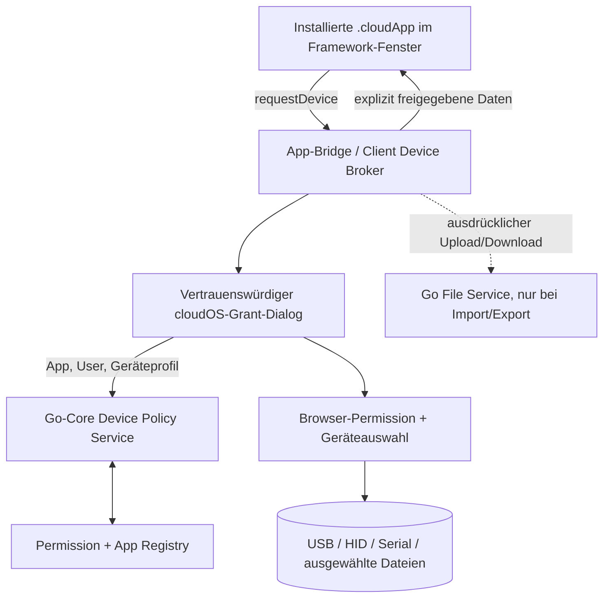
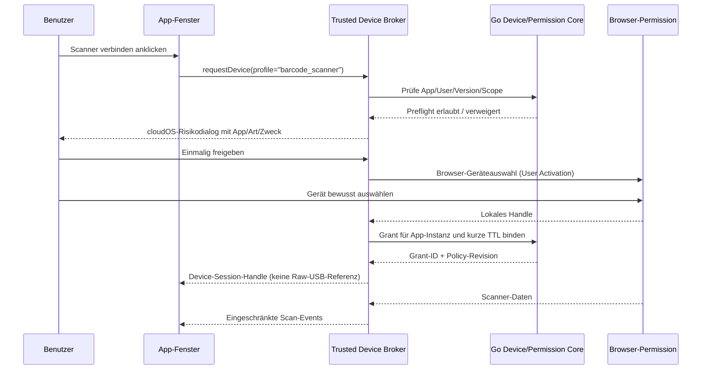

# cloudOS – Client Device Broker, USB- und Peripherie-Zugriff für `.cloudApp`

> **Datei:** `docs/CLIENT_DEVICES.md`  
> **Version:** 0.1 – Architektur für cloudOS 0.12  
> **Stand:** 15.11.2026  
> **Status:** Verbindlicher Sicherheits- und SDK-Entwurf; Gerätebroker und UI noch nicht implementiert.  
> **Core-Deployment:** [CORE_DEPLOYMENT_SCALING.md](CORE_DEPLOYMENT_SCALING.md); Combined bleibt Standard.  
> **Führende Verweise:** [APPLICATION_SYSTEM.md](APPLICATION_SYSTEM.md), [APP_API_ACCESS.md](APP_API_ACCESS.md), [WINDOW_FRAMEWORK.md](WINDOW_FRAMEWORK.md), [VIRTUAL_FILESYSTEM.md](VIRTUAL_FILESYSTEM.md), [AUTHENTICATION_METHODS.md](AUTHENTICATION_METHODS.md), [LOGGING_OBSERVABILITY.md](LOGGING_OBSERVABILITY.md)

## 1. Verbindliches Zielbild

Einer installierten und berechtigten `.cloudApp` soll es **nach ausdrücklicher Freigabe** möglich sein, ein am **Client-PC** angeschlossenes Gerät zu benutzen. Beispiele sind USB-Barcodescanner, ausgewählte Dateien auf einem USB-Stick, USB-Serial-Geräte und über Browser-APIs zugängliche HID-/USB-Peripherie.

**Diese Funktion ist kein Remote-Mount beliebiger Geräte in den Go-Core-Container.** Browser und Betriebssystem vermitteln den realen Gerätezugriff lokal. Ein **Client Device Broker** als vertrauenswürdiger Teil der `Desktop.cloudApp`/App-Host-Framework-Schicht verarbeitet Geräteauswahl, Benutzerzustimmung und die Handles; der Go-Core stellt den autoritativen Device Policy/Grant Service bereit. Kein untrusted Rust-/Web-iframe erhält den kompletten Browser-Navigator oder die Geräteliste.

## 2. Vier verpflichtende Zugriffsprüfungen

Gerätenutzung ist nur zulässig, wenn **alle** Bedingungen gleichzeitig gelten:

1. Die signierte `.cloudApp` enthält eine genau passende Anforderung in `permissions/device-access.json` – einschließlich Gerätetyp, Zugriffsmethode, Filter und Operationen. Die Datei ist Bestandteil des SHA-512-signierten Paketindex.
2. Ein Administrator hat die **Installationsanforderung einschließlich des Gerätrisikos** für diese installierte App-Version genehmigt. Das Gerät darf durch das Update nicht heimlich neu hinzugefügt werden.
3. Ein berechtigter Benutzer **startet eine sichtbare Interaktion** und stimmt für diese App-Instanz und das konkrete Gerät bzw. die Datei zu. Der Browser/OS-Gerätedialog muss ggf. ebenfalls zustimmen; kein automatisches „remember forever“.
4. Der Core validiert Benutzer, aktive App-Zuweisung, Session, unveränderten Paketdigest, Geräte-Capability, Ressourcen-/VFS-ACLs, widerrufsfreien Grant und Risiko-Policy. Der Client-Broker prüft zusätzlich die aktuelle lokale Browserberechtigung und die Bindung an die App-Instanz.

Eine bloße Gruppenmitgliedschaft `Admin` verleiht einer App **keinen** generellen Zugriff auf alle Clientgeräte. Eine erfolgreiche Browser-Permission allein ersetzt die cloudOS-Berechtigung nicht. Eine Signatur allein ersetzt die Zustimmung nicht.

## 3. Technische Grenzen von Browsern

| Gerät / Anforderung | Erster Ansatz | Grenze / Fallback |
|---|---|---|
| Barcode-Scanner als Tastatur („Keyboard Wedge“) | **Fokussiertes Eingabefeld** in App-Fenster; Tastaturereignisse ohne Raw-Gerätegrant | Eingaben nicht zuverlässig von echter Tastatur unterscheidbar; kein globales Abgreifen |
| HID-kompatibler Barcode-Scanner | Geprüfter WebHID-Adapter | Verfügbarkeit eingeschränkt; geschützte HID-Usages (z. B. Tastaturen) nicht beliebig auslesbar |
| Serial-/COM-Barcode-Scanner | Web Serial + Benutzer-`requestPort` | HTTPS, Browserkompatibilität, Geräte-/Treiberfreigabe |
| Spezielles nicht standardisiertes USB-Gerät | WebUSB mit Filtern und ausgewähltem Interface | Begrenzte Browser-Unterstützung; OS-Treiber/Blocklist können Zugriff verhindern |
| USB-Stick: einzelne Dateien | Standard-Dateiauswahldialog (`<input type=file>`), Upload/Download | Keine rohe USB-/Blockdevice-Steuerung nötig |
| USB-Stick: ausgewählter Ordner | File System Access / `showDirectoryPicker` bei unterstützten Browsern | Nicht überall verfügbar; Benutzer muss Ordner explizit auswählen |
| USB-Stick: Export | Browser-Download bzw. `showSaveFilePicker` nach Benutzerentscheidung | Ohne berechtigten Zugriff kein unsichtbares Schreiben auf Stick |
| YubiKey für Login | **WebAuthn/FIDO2** im Auth-Bootstrap | **Nicht** via App-WebUSB/-WebHID; keine geheimen Auth-Credentials als App-Gerät |
| Kamera/Mikrofon (später) | Getrennte `getUserMedia`-Policy | Eigene Privacy-Dialoge/Indikatoren und Browserpermission |
| Native Scanner-Treiber/USB-Mass-Storage | Nicht im Web-MVP | Optionaler, gesondert auditierter lokaler Companion erst nach Sicherheits-ADR |

**USB-Stick:** Ein Browser kann nicht automatisch alle auf dem Rechner angeschlossenen USB-Massenspeicher auflisten, deren Blockgeräte öffnen und sie wie ein Host-Laufwerk mounten. Für cloudOS bedeutet „USB-Stick verwenden“ **bewusst gewählte Dateien/Ordner importieren oder exportieren**, nicht das Hinzufügen einer dritten virtuellen Festplatte. Weiterhin bleiben exakt die beiden bisherigen virtuellen Festplatten `system:/` und `users:/` gültig.

## 4. Architektur und Akteure



**Owner-Regeln:** Der **Go Service `devices`** verwaltet Richtlinien, Installationsfreigaben, Grant-Entscheidungen, Widerruf und Audit. Ein **browserseitiger** Device Broker verwaltet lokale, flüchtige Handles, die im Go-Container niemals erscheinen. Der Device Service kann heute im kombinierten Prozess laufen und später über separate Container/Replica-Pools skaliert werden. Device Handles selbst sind **nicht replizierbare Browserobjekte**.

## 5. App-Paket: deklarierte Device Capabilities

`permissions/device-access.json` ist verpflichtend vorhanden, auch bei Apps ohne Gerätezbedarf (`devices: []`). Die Datei wird **wie `permissions/api-access.json` mit dem Paket signiert** und explizit aus dem App-Manifest referenziert. Änderungen gelten als neue sensible Berechtigungsanforderung.

```json
{
  "schema_version": "1.0",
  "devices": [
    {
      "capability": "devices.serial.read",
      "device_class": "barcode_scanner",
      "transport": "webserial",
      "operations": ["connect", "read"],
      "filters": [{ "usb_vendor_id": 9025 }],
      "scope": "user_selected_device",
      "reason": "Barcodes aus dem ausgewählten Scanner einlesen"
    },
    {
      "capability": "devices.files.import",
      "device_class": "file_picker",
      "transport": "file_picker",
      "operations": ["read_selected_files"],
      "scope": "user_selected_files",
      "reason": "Dokumente von einem ausgewählten USB-Stick importieren"
    }
  ]
}
```

Die Vendor-ID ist ausschließlich **illustrativ**, nicht ein empfohlenes Gerät. Unbeschränkte Wildcards `usb:*`, alle VID/PID, beliebiges `readwrite:any`, freies `native_driver` oder `device.all` sind für normal signierte `.cloudApp`-Pakete verboten. Der Core-Katalog definiert erlaubte Transport-, Klassen-, Operations- und Risikokombinationen. Ein zulässiger Transport darf nicht durch Manifestfälschung einen anderen Transport ermöglichen.

**Dateimodell:** Die Manifestdatei verlangt außerdem einen Eintrag im `META-INF/package-index.json` und der signierten `cloudos.app.json`-Referenz. Die beim Installer genehmigte Gerätemenge wird **außerhalb** des Pakets gespeichert; der Core akzeptiert nie eine zur Laufzeit von der App selbst erweiterte Deklaration.

## 6. Beispiel: Gerätefreigabe in einer laufenden App



**Browser-User-Activation:** Manche APIs erlauben `requestDevice`/`requestPort`/`showDirectoryPicker` nur während einer echten Benutzerinteraktion. Deshalb muss der **vertrauenswürdige Host-Button** die Browser-Auswahl in derselben unmittelbaren Interaktion starten können. Eine verzögerte asynchrone IPC-/Netzwerkantwort kann die Activation verlieren. Der UX-Flow darf nach Core-Preflight daher einen separaten, eindeutig beschrifteten Host-Button **„Jetzt Gerät auswählen“** anzeigen und den Browserpicker synchron auslösen. Technische Nutzerinteraktionsauflagen lassen sich nicht durch einen Servergrant umgehen.

## 7. Granularität von Device Grants

Ein Grant bindet mindestens:

```json
{
  "schema_version": "1.0",
  "grant_id": "device-grant-example",
  "user_id": "user-uuid-example",
  "session_id": "session-opaque-example",
  "app_id": "org.example.inventory",
  "app_instance_id": "app-instance-example",
  "package_digest": "sha512:package-digest-placeholder",
  "device_class": "barcode_scanner",
  "transport": "webserial",
  "operations": ["read"],
  "scope": "one_selected_device",
  "expires_at": "2026-11-15T02:00:00Z",
  "policy_revision": 12
}
```

Die Kennungen sind Platzhalter. Persistiert werden so wenig geräteidentifizierende Merkmale wie möglich. Der Server kann die **Art der Freigabe** kennen, hat aber im Browser **keinen physischen Gerätehandle**. Ein roher Geräteserial-Key wird nicht als dauerhafter, universeller Nutzer-Identifier gespeichert.

Regeln: Kurze TTL und sofortiger Widerruf; pro User/Session/App-Instanz und nur die erlaubten Operationen; kein Übertragen an andere App-Instanzen/Tabs, keine stille Wiederverwendung nach Browserneustart; Browserpermission kann zusätzlich vom User entzogen werden. App-Ende, Logout, Entzug der App-Zuweisung und Disconnect beenden die betroffene Device Session und schließen Handles.

## 8. Browser-SDK und App-Bridge

Eine App nutzt ausschließlich Framework-SDK-Methoden:

```typescript
// Konzeptcode: das SDK ist noch nicht implementiert.
const scanner = await cloudos.devices.request({
  capability: "devices.serial.read",
  deviceClass: "barcode_scanner"
});
for await (const scan of scanner.readScans()) {
  renderBarcode(scan.value);
}
await scanner.close();
```

Die App erhält **kein** `USBDevice`, `HIDDevice`, `SerialPort` oder lokales `FileSystemDirectoryHandle`, sofern der Contract nicht ausdrücklich eine geprüfte, schwach privilegierte Wrapperform für diesen Typ vorsieht. Standard ist ein **opakes Device Session Handle** und typisierte, begrenzte Operationen. Der Host unterbindet direkte Gerätezugriffe aus Sandbox-iframes über Origin, `Permissions-Policy`, `iframe allow` und eigene Zugriffskontrollen. Ein App-Canvas bleibt innerhalb des Framework-Fensters.

## 9. Sicherheitsdialog und Installation

Der Installer (`Apps.cloudApp` und `AppStore.cloudApp`) zeigt **separat**:

1. Alle deklarierten Core-API-Endpunkte mit vertrauenswürdiger Risikobeschreibung.
2. Alle angeforderten Device Capabilities (z. B. Serial lesen, USB-Interface lesen, ausgewählten Ordner schreiben) mit ihren Grenzen.
3. Ob das Paket offiziell/verifiziert oder **selbstsigniert** ist, mit der eigenständigen Signaturwarnung.
4. Ob die Gerätezugriffe nur bei **sichtbarer Nutzeraktion** oder dauerhaft innerhalb der Instanz zulässig sind; der Nutzer muss trotzdem selbst zustimmen.

**Hohe Risiken:** HID-Tastatur-/Sicherheitsgerät-Umgehung, beliebiger USB-Rohzugriff, Schreibzugriff auf Dateien, automatischer Upload von Geräteinhalten, persistentes Seriallesen und nachträgliche Rechteerweiterung. Entsprechende riskante Capabilities sind im MVP entweder untersagt oder benötigen eine überprüfte Spezialfreigabe, eigenen ADR und Testnachweis.

## 10. Barcode-Scanner: konkreter MVP

**Variante A – Keyboard Wedge:** Der Scanner sendet Zeichen wie eine Tastatur. Der Benutzer fokussiert bewusst ein Barcode-Feld in einem autorisierten App-Fenster. Die App kann eine Terminatorfolge (z. B. Enter), Mindest-/Maximallänge und Input-Validierung anwenden. Das ist **kein globaler Gerätezugriff**: Andere Fenster/Tabs bekommen keine Tastaturevents. Die App darf nicht heimlich alle Tasten mitschneiden oder Login-Passwörter erfassen. Ein Wedge-Scanner ist nicht zuverlässig über Events von einer manuellen Tastatureingabe zu unterscheiden.

**Variante B – WebSerial:** Ein Scanner mit unterstütztem seriellen Adapter wird durch Browserauswahl und die Device Broker Policy verbunden. Pro App-Instanz nur freigegebener Port, Leseoperationen und Datenrate. Parser sanitisiert Eingabe, begrenzt maximale Nutzdaten, schützt vor Escape-/Injection-Sequenzen und loggt keine vollständigen Barcodes.

**Variante C – WebHID:** Ein kompatibles HID-Gerät kann über die Browserpermission gewählt werden. Browser-geschützte Tastatur-/Maus-Usages dürfen nicht durch einen angeblich gleichwertigen WebHID-Grant umgangen werden.

## 11. USB-Stick / lokale Dateien

- Import: Benutzer öffnet einen **vertrauenswürdigen** Datei-/Ordnerpicker, wählt bestimmte Dateien und überträgt sie bei Bedarf über die vorhandene File-API in `/` oder einen erlaubten Space.
- Export: App erstellt eine Datei und fragt beim Host einen Download- oder Save-Dialog an; nach Benutzerbestätigung werden Bytes in den ausgewählten lokalen Speicher geschrieben.
- Ordnerzugriff: nur nach `showDirectoryPicker`-Unterstützung und expliziter Auswahl; begrenzte Operationen, keine versteckten rekursiven Uploads, Quotas und Warnung bei vielen Dateien.
- File-Access-Permissions und cloudOS-VFS-Permissions bleiben **verschiedene Berechtigungen**. Ein lokales File Handle ist kein cloudOS-File-Handle. Kopieren zwischen beiden Bereichen benötigt ausdrückliche Operationen.
- Unter keinen Umständen `system:/` von lokalen USB-Inhalten direkt beschreiben, ohne geprüften App-/Admin-Installationsworkflow. Neue Dateien aus USB sind zunächst **unvertraute Daten**, keine automatisch startbaren `.cloudApp`-Pakete.
- Ein USB-Stick erzeugt **kein drittes virtuelles cloudOS-Volume**; das eigene Home bleibt `/`.

## 12. Geräte-Rechte beim Deinstallieren und Updates

- Eine App-Updateversion mit **neuen** Device Capabilities erfordert erneute Admin-Freigabe und nach Bedarf erneute Nutzereinwilligung. Keine stille Übernahme alter Grants auf neue Paketdigests.
- `Apps.cloudApp` verwaltet Capabilities/Zuordnungen, aber Clientgeräte-Handles bleiben beim Browser-Host.
- `AppStore.cloudApp` darf installierte Apps aus anderen Stores oder manuelle Installationen nicht für Device-Policy-Verwaltung übernehmen.
- Bei Deinstallation oder Rechteentzug werden aktive Grants sofort serverseitig abgelehnt und lokale Broker-Sessions beendet; Benutzerdialog zeigt nachvollziehbaren Status.

## 13. REST-/gRPC-Schnittstellen (Entwurf)

| Methode | Route | Zweck |
|---|---|---|
| `GET` | `/api/v1/devices/capabilities` | Erlaubte Device-Profile und ggf. Browserunterstützung; keine Enumeration aller Geräte |
| `POST` | `/api/v1/devices/grants/preflight` | App-/Benutzer-/Geräteprofil prüfen |
| `POST` | `/api/v1/devices/grants` | Einmalige, konkrete Sessionfreigabe dokumentieren |
| `GET` | `/api/v1/devices/grants/active` | Eigene aktive App-/Gerätefreigaben anzeigen |
| `DELETE` | `/api/v1/devices/grants/{id}` | Widerruf durch berechtigten User oder Admin |
| `GET` | `/api/v1/admin/devices/policy` | Administrative Richtlinie lesen |
| `PATCH` | `/api/v1/admin/devices/policy` | Geprüfte Richtlinie ändern, Step-up und Audit |

Die echte Zuordnung von Gerätetypen, Operation-IDs und API-Scopes erfolgt über den vertrauenswürdigen Core-Katalog. Alle App-Aufrufe werden über `permissions/api-access.json` **und** `permissions/device-access.json` eingeschränkt. Kein API-Endpunkt erhält allein durch das Wort „devices“ pauschalen USB-Vollzugriff.

## 14. Logging, Push und Datenschutz

- `devices.grant.created`, `devices.grant.revoked`, `devices.policy.changed`, `devices.session.expired` werden serverseitig an berechtigte Empfänger gepusht; **keine Client-Polling-Schleife**.
- Lokale `connect`/`disconnect`-Browserereignisse müssen **im Browser-Host unmittelbar** verarbeitet werden; sie werden nur dann an den Server berichtet, wenn es für Grant-Status/Audit erforderlich ist.
- Die App bekommt keine Ereignisse von Geräten, die sie nicht verwenden darf. Geräteattribute werden auf das unbedingt nötige Minimum reduziert.
- Aus Datenschutzgründen keine Barcode-Rohwerte, USB-Seriennummern, persönliche Dateinamen, Dateiinhalte oder private Token im Diagnose-Logging.
- Nach einer Verbindungsunterbrechung: **keine automatische stille Wiederaufnahme** eines sicherheitskritischen physischen Gerätes. Revalidierung, Browser-Permission und ggf. erneute Nutzeraktion.

## 15. Multi-Container- und Kubernetes-Modus

Der Go-Service `devices` ist Teil des zunächst einzigen Core-Containers. Für den späteren Splitbetrieb können mehrere zustandsarme `devices`-Replikate die Grant-Policy über gemeinsame Persistenz/Revisionen auswerten. **Keine** Kubernetes-Replikatinstanz benötigt einen USB-Mount des Client-PCs. Die eigentliche Geräteverbindung bleibt an den Browser/Client und an den aktuellen App-Host gebunden. Eine Device-Grants-API muss bei Pod-Wechsel sicher dieselbe Policy liefern; Gerätehandles werden nicht zwischen Pods synchronisiert.

## 16. Ausfall- und Missbrauchsszenarien

| Zustand | Reaktion |
|---|---|
| Browser unterstützt WebUSB nicht | Funktion deaktivieren und unterstützten anderen Transport/Fallback anbieten |
| Browser blockiert `requestDevice` | Verständlicher Dialog, kein serverseitiger Permission-Bypass |
| Nutzer lehnt cloudOS-Freigabe ab | Kein Browser-Picker starten |
| Nutzer lehnt Browser-Permission ab | Grant sicher verwerfen, App informieren |
| App fordert fremde Capability an | Server blockiert, Audit/Rate-Limit |
| Browser-Verbindung zu Device getrennt | Lokales Handle schließen und App benachrichtigen |
| Geräteabfrage nach Logout | Verweigert |
| App-/User-Recht widerrufen | Alle laufenden Sessions für Scope beendet |
| Geräteberechtigung nach App-Update | Neu prüfen, keine stille Grant-Vererbung |
| Drittanbieter-App versucht FIDO-Authenticator raw | Device Broker verweigert Protokoll/geschützte Klasse |
| USB-Stick plötzlich entfernt | Dateiübertragung bricht kontrolliert ab; kein ungesicherter Commit |
| Barcode enthält schädliche Zeichenfolge | Eingabe als Daten, nie als ausführbarer Befehl verarbeiten |

## 17. Testmatrix

| ID | Test | Erwartung |
|---|---|---|
| DEV-001 | App ohne Device-Deklaration | Broker verweigert Gerätezugriff |
| DEV-002 | Device-Deklaration nicht signiert | Paketinstallation verweigert |
| DEV-003 | Admin genehmigt Installation, Nutzer nicht | Zugriff verweigert |
| DEV-004 | Browserpermission fehlt | Zugriff verweigert |
| DEV-005 | Falsche Gerätetransportmethode | Verweigert |
| DEV-006 | Raw-USB-Wildcard | Abgelehnt |
| DEV-007 | App erhält Grant nur für einen Scanner | Zweiter Scanner unzugänglich |
| DEV-008 | App-Instanz A nutzt Grant von B | Verweigert |
| DEV-009 | App läuft nach Logout | Grant ungültig, Host schließt Session |
| DEV-010 | Rechteentzug per Admin | Geräte-Session ohne Reload beendet |
| DEV-011 | Doppelklick auf selbstsignierte App mit USB | Signatur-/API-/Device-Warnungen getrennt |
| DEV-012 | Keyboard-Wedge-Eingabe fokussiert | Nur aktives Eingabefeld erhält Barcode |
| DEV-013 | Keyboard-Wedge ohne Fokus | Keine globale Datensammlung |
| DEV-014 | WebSerial-Verbindung und Trennung | Nur Browsergerät, kein Host-Mount |
| DEV-015 | WebHID geschützte Usages | Kein Umgehen der Browsersperre |
| DEV-016 | WebUSB nicht verfügbar | Sicherer Fallback |
| DEV-017 | USB-Dateiimport | Nur ausgewählte Dateien ins eigene VFS |
| DEV-018 | USB-Export | Nur vom Nutzer bestätigtes lokales Ziel |
| DEV-019 | USB-Stick entfernt | Fehler ohne korruptes VFS Commit |
| DEV-020 | Geräte-Rohwerte in Logs | Nicht vorhanden |
| DEV-021 | App-Update fordert mehr Rechte | Neue explizite Freigabe |
| DEV-022 | Device-Grant abgelaufen | Auch bei bestehendem lokalen Handle blockiert |
| DEV-023 | SSE-Revoke | UI reagiert ohne Polling |
| DEV-024 | Login-YubiKey wird als App-USB angefragt | Verweigert; Login via WebAuthn |
| DEV-025 | Zwei Core-Device-Replikate | Gleicher Grant-Entscheid |
| DEV-026 | Framework-Fenster geschlossen | Device-Session wird bereinigt |
| DEV-027 | Ohne Benutzeraktion `requestPort` | Browser verweigert, Host zeigt UX-Hinweis |
| DEV-028 | Device-Raw-Daten enthalten Script-String | Als Daten escaped, nie HTML/JS |
| DEV-029 | Store-App deinstalliert, fremde Geräte-App | Keine fremden Grants manipuliert |
| DEV-030 | Device-API-Allowlist verändert | Signatur/Installationsdigest verletzt, verweigert |

## 18. Implementierungsabschnitte

| Phase | Arbeit | Gate |
|---|---|---|
| DEV-00 | Gerätetyp-Katalog und signierte Manifest-/SDK-Contracts | Validator/Negativtests |
| DEV-01 | Device Policy Owner im Go-Core und Installationsdialog | User/App/Scope-Entscheidung reproduzierbar |
| DEV-02 | Trusted Device Broker im Desktop-Framework | Kein App-iframe-Rawzugriff |
| DEV-03 | Keyboard-Wedge Scanner im fokussierten Fenster | MVP-Barcodescan |
| DEV-04 | Dateiimport/-export mit Browserpickern | Auswahl und VFS-Quotas stimmen |
| DEV-05 | WebSerial, optional WebHID | Geräte-/Browsermatrix getestet |
| DEV-06 | Optional WebUSB für konkrete Geräteprofile | Signierte, begrenzte VID/PID-Policy |
| DEV-07 | SSE-Revoke, Auditing und K8s-Failover | Kein Grant-Leak nach Widerruf |

## 19. Architekturentscheidungen

| ADR | Gegenstand |
|---|---|
| ADR-114 | Client Device Broker statt direkter App-WebUSB-Zugriffe |
| ADR-115 | Device-Capability-Schema und Installations-Risikoanzeige |
| ADR-116 | Browser-Permission / User-Activation / Grant TTL |
| ADR-117 | USB-Dateiimport und VFS-Isolation |
| ADR-118 | Barcode-Scanner / WebHID / WebSerial / WebUSB-Kompatibilitätsprofile |

## 20. Technische Referenzen

- [MDN WebUSB](https://developer.mozilla.org/en-US/docs/Web/API/WebUSB_API)
- [MDN WebHID](https://developer.mozilla.org/en-US/docs/Web/API/WebHID_API)
- [MDN Web Serial](https://developer.mozilla.org/en-US/docs/Web/API/Web_Serial_API)
- [MDN File System Access](https://developer.mozilla.org/en-US/docs/Web/API/Window/showDirectoryPicker)
- [MDN WebAuthn](https://developer.mozilla.org/en-US/docs/Web/API/Web_Authentication_API)

## 21. Statusabgrenzung

Dieses Dokument ist ein Architekturplan. Der im Paket enthaltene Go-Core-Bootstrap besitzt **noch keinen echten USB-, HID-, WebSerial- oder Dateipicker-Broker**, keine App-GUI und keine implementierten Device-Grants. Die Spezifikation dient als verbindliche Basis für spätere Code- und Browserkompatibilitätstests.
