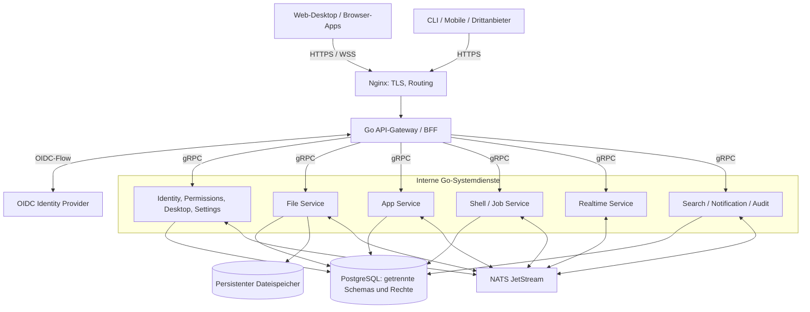

# Go Browser OS – Technisches Gesamtkonzept

> **Dokument:** `CONCEPT.md`  
> **Version:** 0.1 (Konzeptentwurf)  
> **Stand:** 14.11.2026  
> **Projektname:** Go Browser OS (Arbeitstitel)  
> **Architekturvariante:** B – serverbasiert, API-first  
> **Referenzen:** daedalOS (Funktionsumfang und Desktop-Idee), OpenCloud (API- und Service-Architektur)

## 1. Projektvision

Das Go Browser OS ist eine eigenständige, zentral betriebene Desktop-Plattform, die vollständig über einen Webbrowser bedient wird. Die grafische Oberfläche orientiert sich an einem klassischen Desktop-Betriebssystem mit Fenstern, Taskleiste, Startmenü, Dateimanager, Terminal und installierbaren Anwendungen.

Anders als eine überwiegend clientseitige Browser-Desktop-Simulation übernimmt ein **Go-Backend** die dauerhafte Verwaltung der Benutzer, Dateien, Anwendungen, Berechtigungen und Systemdienste. Der Browser übernimmt Darstellung und unmittelbare Interaktionen.

Die Plattform wird **API-first** entwickelt: Systemfunktionen sind über versionierte, dokumentierte Schnittstellen verfügbar. Die mitgelieferten Anwendungen verwenden grundsätzlich dieselben öffentlichen APIs wie spätere Drittanbieter-Clients.

Das Projekt ist **kein neuer Betriebssystemkernel** und kein Ersatz für Linux oder Windows. Es ist eine servergestützte Web-Desktop-Plattform mit einer eigenen, kontrollierten Betriebssystemabstraktion.

## 2. Ziele und Abgrenzung

### 2.1 Projektziele

1. Vollwertig bedienbarer Desktop im Browser mit Fensterverwaltung, Startmenü und Taskleiste.
2. Zentrale, dauerhaft gespeicherte Benutzerprofile, Einstellungen und Desktop-Zustände.
3. Mehrbenutzerbetrieb mit sauberer Trennung persönlicher und gemeinsamer Ressourcen.
4. Virtuelles Dateisystem mit Verzeichnissen, Dateizugriffen, Uploads und Downloads.
5. Modularer Go-Systemkern mit klarer Verantwortlichkeit je Fachmodul.
6. API-first über REST/OpenAPI, interne gRPC-Verträge und asynchrone Ereignisse.
7. Erweiterbares Anwendungssystem mit App-Manifest, SDK und Berechtigungsmodell.
8. Browserbasierte Shell, die auf die System-APIs zugreift.
9. Sichere, reproduzierbare Bereitstellung über Docker Compose.
10. Langfristige Erweiterbarkeit um Speicherintegrationen, Hintergrundjobs, Emulatoren und weitere Anwendungen.

### 2.2 Nichtziele für die erste Version

- Kein eigener Kernel und keine direkte Steuerung von Hardwaretreibern.
- Keine unbeschränkte Ausführung von Linux-Kommandos oder Windows-EXE-Dateien auf dem Host.
- Keine vollständige Windows-/Linux-Emulation als Voraussetzung für das MVP.
- Kein öffentlicher App Store vor Einführung eines belastbaren Prüf- und Signaturmodells.
- Keine zwingende Offline-Nutzbarkeit; Variante B setzt eine Serververbindung voraus.
- Kein Kubernetes- oder Hochverfügbarkeitszwang in der ersten Entwicklungsstufe.

### 2.3 Architekturprinzipien

- **API-first und contract-first:** API-Verträge entstehen vor der jeweiligen Implementierung.
- **Go-first:** Zentrale Geschäfts- und Systemlogik wird in Go implementiert.
- **Klare Servicegrenzen:** Keine direkten Datenbankzugriffe auf fremde Fachmodule.
- **Zentrale Autorisierung:** Der Server prüft jeden relevanten Ressourcen- und App-Zugriff.
- **Clientseitige UI-Reaktivität:** Fensterbewegungen und Animationen erfordern keinen Server-Roundtrip.
- **Austauschbare Infrastruktur:** Storage, Authentifizierung und Hintergrundverarbeitung erhalten definierte Adapter.
- **Sicherer Standard:** Minimale Rechte, explizite Freigaben, nachvollziehbare Aktionen.
- **Schrittweiser Ausbau:** Zunächst logisch getrennte Module; separate Prozesse nur dort, wo sinnvoll.
- **Keine technische Abhängigkeit von daedalOS oder OpenCloud:** Beide dienen als konzeptionelle Referenz.

## 3. Technologieentscheidungen

| Bereich | Vorgesehene Technologie | Zweck |
|---|---|---|
| Backend | Go | Systemdienste, Geschäftslogik und APIs |
| Browseroberfläche | Vue 3, TypeScript, HTML, CSS | Desktop und grafische Anwendungen |
| Frontend-Build | Vite | Entwicklung und Build der Weboberfläche |
| Öffentliche Schnittstellen | REST/JSON, OpenAPI 3.1 | Browser, CLI und Drittanbieter-Clients |
| Interne Dienstkommunikation | gRPC, Protocol Buffers | Typisierte Go-Service-Schnittstellen |
| Ereignissystem | NATS JetStream | Zuverlässige asynchrone Benachrichtigungen |
| Echtzeitkommunikation | WebSocket über HTTPS/WSS | Zustandsänderungen an verbundene Clients |
| Relationale Daten | PostgreSQL | Benutzer, Metadaten, Berechtigungen, Einstellungen |
| Dateiinhalte | Lokaler persistenter Speicher, später S3-kompatibel | Binärdaten unabhängig von Metadaten |
| Authentifizierung | OpenID Connect (OIDC) | Einbindung eines Identity Providers |
| Reverse Proxy | Nginx | TLS-Terminierung, öffentliche Weiterleitung |
| Deployment | Docker Compose | Reproduzierbarer Entwicklungs- und Serverbetrieb |
| Telemetrie | Strukturierte Logs, OpenTelemetry, Prometheus-kompatible Metriken | Betrieb und Fehleranalyse |

**Status:** Servervariante B, Go-Backend und API-first sind festgelegt. Die konkrete Wahl von Vue, NATS, OIDC-Provider, Storage-Implementierung und einzelnen Bibliotheken gilt als technische Empfehlung und wird in Phase 0 verbindlich geprüft.

Go/WebAssembly ist für Variante B **nicht erforderlich**. Für besondere Clientmodule kann es später ergänzend eingesetzt werden.

## 4. Zielarchitektur



Das Diagramm zeigt **fachliche** Komponenten, nicht die zwingende Anzahl von Containern. In der ersten Version dürfen mehrere Fachmodule in einem Go-Prozess laufen. Die API-Verträge und Datenverantwortlichkeiten bleiben dennoch getrennt.

### 4.1 Verantwortung des Browsers

- Desktop, Fenster, Animationen, Taskleiste und Startmenü darstellen.
- Nutzereingaben und lokale UI-Zustände verarbeiten.
- Dateien und Medien in dafür geeigneten Webkomponenten anzeigen.
- APIs über einen generierten TypeScript-Client aufrufen.
- Über WebSocket Änderungen abonnieren und nach Verbindungsverlust resynchronisieren.
- Webanwendungen in kontrollierten, voneinander isolierten Kontexten darstellen.

### 4.2 Verantwortung des Servers

- Identitäten, Berechtigungen, Sitzungen und Benutzerprofile verwalten.
- Dauerhafte Desktop-Konfigurationen speichern.
- Dateisystemoperationen und Speicherzugriffe autorisieren und durchführen.
- Installierte Anwendungen registrieren und Berechtigungen vergeben.
- Hintergrundaufträge steuern und protokollieren.
- Ereignisse erzeugen und an berechtigte Clients verteilen.
- Logs, Audits, Metriken, Backups und Betriebsfunktionen bereitstellen.

## 5. Backend-Module und Dienste

| Dienst | Verantwortung | MVP |
|---|---|---|
| API Gateway / BFF | Öffentlicher Einstiegspunkt, API-Routing, Session-Kontext | Ja |
| Identity Service | Benutzer, Gruppen, Profile, Zuordnung externer Identitäten | Ja |
| Permission Service | Rollen, ACLs, App-Berechtigungen und Entscheidungsprüfung | Ja |
| Desktop Service | Desktops, Fensterzustände, Hintergrundbild, Layout | Ja |
| File Service | Dateien, Ordner, Metadaten, Quotas, Storage-Adapter | Ja |
| App Service | App-Registry, Manifeste, Installation, Zuordnungen | Ja |
| Settings Service | Persönliche und systemweite Einstellungen | Ja |
| Realtime Service | WebSocket-Verbindungen, Event-Weiterleitung, Wiederverbindung | Ja |
| Audit Service | Sicherheitsrelevante Aktionen nachvollziehbar speichern | Ja |
| Shell Service | Virtuelle Befehle, Pipelines, Shell-Sitzungen | Nach MVP |
| Job Service | Asynchrone Aufträge, kontrollierte Laufzeitumgebungen | Nach MVP |
| Search Service | Suche und Indexierung von Dateien und Anwendungen | Nach MVP |
| Notification Service | Systemmeldungen und Benachrichtigungen | Nach MVP |
| Integration Service | WebDAV, S3-Adapter, externe Dienste und Laufwerke | Später |

**Datenhoheit:** Jeder Dienst besitzt seine Daten und definiert den zulässigen Zugriff über APIs. Andere Dienste dürfen diese Geschäftsregeln weder über Tabellenzugriffe noch über direkte Imports umgehen.

## 6. API-Architektur

### 6.1 Öffentliche REST-API

- Basispräfix: `/api/v1/`
- Vertragsformat: OpenAPI 3.1
- Datenformate: JSON für Metadaten, HTTP-Streaming für Dateiinhalte
- Fehlerformat: `application/problem+json` gemäß RFC 9457
- Stabile Ressourcen-IDs, bevorzugt UUIDs
- Cursor-Paginierung und definierte Sortierung
- ETags/Revisionen zur Konflikterkennung
- Idempotenzschlüssel für geeignete schreibende Operationen
- Request-/Trace-IDs, Limits, Timeouts und API-Kompatibilitätstests

Beispiel-Endpunkte (vorläufige API-Skizze):

| Methode | Pfad | Bedeutung |
|---|---|---|
| GET | `/api/v1/system/capabilities` | Verfügbare Systemfunktionen |
| GET | `/api/v1/users/me` | Eigenes Benutzerprofil |
| GET | `/api/v1/desktops/current` | Aktueller Desktop-Zustand |
| PATCH | `/api/v1/desktops/current` | Desktop-Zustand ändern |
| GET | `/api/v1/files/{id}` | Datei-/Ordner-Metadaten |
| GET | `/api/v1/files/{id}/children` | Ordnerinhalt |
| POST | `/api/v1/uploads` | Upload initialisieren |
| GET | `/api/v1/apps` | Verfügbare Anwendungen |
| POST | `/api/v1/apps/{id}/launches` | Anwendungsstart registrieren |
| POST | `/api/v1/shell/executions` | Virtuellen Befehl ausführen (später) |
| GET | `/api/v1/events/ws` | Ereignisverbindung aufbauen |

### 6.2 Interne gRPC-API

Jede fachliche Dienstschnittstelle wird in Protocol Buffers beschrieben. Aus den Verträgen werden Go-Clients und Serverbindungen generiert.

Regeln:

1. Keine direkten Imports fachlicher Implementierungen anderer Dienste.
2. Service-zu-Service-Zugriffe benötigen authentifizierte Identität und eine Berechtigungsprüfung.
3. Timeouts, Abbruch (`context.Context`) und wohldefinierte Fehlercodes sind Pflicht.
4. Große Dateien werden nicht unnötig über mehrere gRPC-Dienste geleitet.
5. Schemaänderungen bleiben innerhalb kompatibler API-Versionen rückwärtskompatibel.

### 6.3 Ereignissystem

NATS JetStream verbindet asynchrone Komponenten. Beispielhafte Eventtypen:

```text
identity.user.created
desktop.layout.updated
files.node.created
files.node.updated
files.node.deleted
applications.installed
jobs.execution.finished
notifications.created
```

Beispiel eines Ereignisses:

```json
{
  "event_id": "1dbd5c0b-91cb-47a1-9f6d-1d836c4b6c8e",
  "event_type": "files.node.created",
  "event_version": 1,
  "occurred_at": "2026-11-14T22:00:00Z",
  "subject": {
    "type": "file",
    "id": "file-12345"
  },
  "data": {
    "parent_id": "folder-987",
    "name": "example.txt"
  }
}
```

JetStream kann Nachrichten erneut zustellen; Verbraucher müssen deshalb **idempotent** arbeiten. Für Änderungen, die gleichzeitig in PostgreSQL gespeichert und als Ereignis veröffentlicht werden müssen, verwenden wir das **Transactional-Outbox-Muster**.

**Wichtig:** NATS ist kein Ersatz für die primäre Datenbank. Bei Verbindungsabbruch oder verpassten UI-Ereignissen wird der autoritative Zustand über REST erneut abgerufen.

## 7. Authentifizierung und Autorisierung

### 7.1 Anmeldung

Primärer Standard ist OpenID Connect. Ein OIDC-Provider, beispielsweise Keycloak, stellt die Benutzeridentität bereit. Für den Browser wird ein Backend-for-Frontend-Ansatz mit serverseitig verwalteten Sitzungen und sicheren Cookies bevorzugt.

- `HttpOnly`, `Secure` und angemessenes `SameSite` für Session-Cookies.
- Keine langlebigen Zugangstokens im Browser-`localStorage`.
- CSRF-Schutz für cookie-authentifizierte Schreibzugriffe.
- Explizite Authentifizierung und Origin-Prüfung für WebSockets.
- Trennung zwischen Authentifizierung, Rollen und Ressourcenberechtigungen.

### 7.2 Berechtigungsmodell

Drei Ebenen:

1. **Systemrechte:** Administration, Benutzerverwaltung, App-Installation.
2. **Ressourcenrechte:** Lesen, Schreiben, Löschen, Teilen von Dateien und Ordnern.
3. **Anwendungsrechte:** Ausgewählte Dateien, Benachrichtigungen oder andere Fähigkeiten nutzen.

Serverseitige Prüfungen sind maßgeblich; ausgeblendete UI-Schaltflächen bieten keine Sicherheitsgarantie. Neu installierte Anwendungen erhalten standardmäßig keine weitreichenden Berechtigungen.

### 7.3 Sicherheitsgrenzen

- Nur Nginx/API-Gateway wird extern veröffentlicht.
- PostgreSQL, NATS, Storage und interne Dienste bleiben in privaten Netzwerken.
- Interne Dienstkommunikation wird authentifiziert; in produktiven Multi-Host-Umgebungen verschlüsselt.
- App-Pakete und Updates unterliegen Integritäts- und Herkunftsprüfungen.
- Web-Apps laufen nicht mit den Privilegien der Desktop-Shell.
- Serverjobs dürfen weder den Docker-Socket noch beliebige Hostpfade erhalten.
- Uploads, Pfade, MIME-Angaben und Eingabedaten werden sicherheitsbewusst behandelt.
- Security-Audits zeichnen Änderungen an Rechten, Sitzungen und administrativen Aktionen auf.

## 8. Virtuelles Dateisystem

Das Virtual File System (VFS) stellt Dateien über eigene Ressourcen-IDs und einen logischen Verzeichnisbaum bereit. Virtuelle Pfade müssen nicht mit Hostpfaden übereinstimmen.

Vorgesehene virtuelle Struktur:

```text
/
├── home/
│   ├── alice/
│   │   ├── Desktop/
│   │   ├── Documents/
│   │   ├── Downloads/
│   │   └── Pictures/
│   └── bob/
├── shared/
├── applications/
└── system/
```

### 8.1 Speicherung

- **PostgreSQL:** Datei-IDs, Ordnerbeziehungen, Besitzer, ACLs, Größen, MIME-Typen, Revisionen.
- **Storage-Adapter:** eigentliche Dateiinhalte; initial lokaler persistenter Speicher.
- **Spätere Adapter:** S3-kompatibler Objektspeicher und externe Speicherdienste.

### 8.2 Mindestfunktionen

- Ordner erstellen, auflisten, umbenennen, verschieben und löschen.
- Datei hochladen, herunterladen, kopieren, verschieben und löschen.
- Konflikterkennung bei konkurrierenden Änderungen.
- Benutzer- und Gruppenrechte, Quotas, Papierkorb.
- Zugriff über Dateimanager, Shell und App-SDK mit denselben Prüfregeln.

### 8.3 Spätere Erweiterungen

Dateiversionen, Freigaben, Vorschauen, Volltextindizierung, große/resumierbare Uploads, externe Laufwerke und gemeinschaftliches Arbeiten.

## 9. Desktop und Frontend

Die grafische Oberfläche besteht aus separat wartbaren Modulen:

- Desktop Renderer (Hintergrund, Icons, Auswahl)
- Window Manager (Fenster, Z-Reihenfolge, Minimieren/Maximieren)
- Taskbar und Startmenü
- Systemdialoge und Benachrichtigungen
- Dateimanager
- App Host für installierte Anwendungen
- API Client und WebSocket-Client
- Clientseitiger UI-State mit serverseitiger Persistenz

**Performance-Regel:** Während ein Fenster gezogen wird, aktualisiert der Browser dessen Position unmittelbar. Das Speichern auf dem Server erfolgt gebündelt oder am Ende der Interaktion. Nicht jede Mausbewegung verursacht eine API-Anfrage.

Nach einem Login lädt der Client den Desktop-Zustand per REST. WebSocket-Ereignisse signalisieren Änderungen; nach einer Unterbrechung erfolgt ein neuer Zustandsabgleich.

## 10. Anwendungssystem

### 10.1 Anwendungskategorien

| Kategorie | Ausführung | Beispiele |
|---|---|---|
| System-Web-App | Browser-UI mit Go-APIs | Dateimanager, Einstellungen |
| Isolierte Web-App | Eigener Browser-Kontext | Texteditor, Bildbearbeitung |
| Server-App/Job | Gesicherte, separate Serverlaufzeit | Medienkonvertierung, Stapelverarbeitung |

### 10.2 App-Manifest

```json
{
  "id": "org.browseros.texteditor",
  "name": "Text Editor",
  "version": "1.0.0",
  "api_version": "1",
  "runtime": "web",
  "entrypoint": "index.html",
  "permissions": [
    "files.read:selected",
    "files.write:selected"
  ],
  "file_associations": [
    "text/plain",
    "text/markdown"
  ]
}
```

Das Manifest beschreibt zunächst **angeforderte** Rechte; es erteilt sie nicht automatisch.

### 10.3 App-SDK und Isolation

Ein TypeScript-SDK kapselt die öffentlichen APIs und stellt Funktionen für Dateiauswahl, Benachrichtigungen, Einstellungen und App-Lebenszyklus bereit. Ein Go-SDK folgt für serverseitige Integrationen.

Fremde Web-Apps werden über isolierte Origins und geeignete Sandbox-Mechanismen eingebunden. Kommunikation mit dem Desktop erfolgt über eine kontrollierte Bridge mit Nachrichtenvalidierung; die Server-API prüft alle Aktionen zusätzlich.

Erweiterungspunkte sind Dateizuordnungen, Kontextmenüs, Startmenüeinträge, Vorschauen und Einstellungsseiten.

Ein öffentlicher App Store wird erst eingeführt, wenn Paketformat, Signaturen, Update-Richtlinien, Berechtigungsdialoge und Sicherheitsprüfung definiert sind.

## 11. Shell, Prozesse und Hintergrundaufträge

### 11.1 Virtuelle Shell

Die erste Shell ist ein Go-Dienst, **keine Shell auf dem Linux-Host**. Vorgesehene Befehle sind unter anderem:

```text
pwd  cd  ls  mkdir  cat  cp  mv  rm  echo  head  grep
```

Unterstützt werden sollen Befehlsverlauf, Autovervollständigung, Pipes sowie Ein- und Ausgabeumleitungen. Dateioperationen nutzen den File Service und dessen Berechtigungsmodell.

### 11.2 Serverseitige Jobs

Ein späterer Job Service bietet asynchrone Ausführung mit Status, Fortschritt, Abbruch, Wiederholungsregeln und Auditierung.

Programme oder Konvertierungsaufgaben laufen nur in ausdrücklich vorgesehenen, isolierten Umgebungen mit Limits für Zeit, CPU, RAM, Netzwerk und Dateizugriffe. Die konkrete Isolierungstechnik wird vor dieser Phase gesondert bewertet.

## 12. Datenhaltung, Konsistenz und Suche

PostgreSQL wird zunächst gemeinsam betrieben, jedoch mit fachlich getrennten Schemas, Eigentümern, Migrationspfaden und Datenbankrechten.

| Schema | Verantwortlicher Dienst |
|---|---|
| `identity` | Identity Service |
| `permissions` | Permission Service |
| `desktop` | Desktop Service |
| `files` | File Service |
| `applications` | App Service |
| `settings` | Settings Service |
| `jobs` | Job Service |
| `audit` | Audit Service |

Andere Dienste beziehen Daten über APIs oder aus eigenen, durch Events aktualisierten Projektionen. Ein Search Service kann beispielsweise einen separaten Suchindex aus Dateiänderungsereignissen aufbauen.

Die Datenbank des zuständigen Dienstes bleibt die maßgebliche Datenquelle. Cache und Suche sind rekonstruierbar. Datenbank- und Storage-Sicherungen werden aufeinander abgestimmt.

## 13. Betrieb und Deployment

### 13.1 Erste Docker-Compose-Umgebung

- `nginx`: einziger öffentlich erreichbarer Einstiegspunkt.
- `web`: statische Desktop-Oberfläche.
- `gateway`: öffentliche Go-API und Browser-Sitzungen.
- `core`: zunächst gebündelte Go-Basismodule.
- `files`: separat betreibbarer File Service.
- `postgres`: Metadatenbank.
- `nats`: Event-Bus mit persistenten JetStream-Daten.
- `identity-provider`: OIDC-Anmeldung, in Entwicklung beispielsweise Keycloak.

Weitere Dienste werden erst bei Bedarf in eigene Container ausgelagert. Container und Netzwerke werden so getrennt, dass interne Komponenten nicht ungeschützt von außen erreichbar sind.

### 13.2 Betriebsanforderungen

- Reproduzierbare Builds und versionierte Konfiguration.
- Health- und Readiness-Checks.
- Strukturierte JSON-Logs mit Request-/Trace-IDs.
- Metriken, Tracing und definierte Alarme.
- Regelmäßige Sicherung von PostgreSQL **und** Dateispeicher.
- Dokumentiertes Restore-Verfahren einschließlich Konsistenzprüfung.
- Migrations-, Upgrade- und Rollback-Strategien.
- Kein Secret im Git-Repository.

## 14. Repository-Struktur

Vorgeschlagene Monorepo-Struktur:

```text
browseros/
├── CONCEPT.md
├── README.md
├── contracts/
│   ├── openapi/v1/
│   ├── protobuf/
│   └── events/v1/
├── services/
│   ├── gateway/
│   ├── identity/
│   ├── permissions/
│   ├── desktop/
│   ├── files/
│   ├── applications/
│   ├── settings/
│   ├── realtime/
│   ├── shell/
│   ├── jobs/
│   ├── search/
│   ├── notifications/
│   └── audit/
├── platform/
│   ├── configuration/
│   ├── logging/
│   ├── telemetry/
│   ├── database/
│   ├── events/
│   └── security/
├── clients/
│   ├── go/
│   └── typescript/
├── web/
│   ├── desktop/
│   ├── components/
│   ├── api/
│   └── state/
├── applications/
│   ├── file-explorer/
│   ├── text-editor/
│   ├── media-player/
│   ├── terminal/
│   └── settings/
├── deploy/
│   ├── compose/
│   ├── nginx/
│   └── configuration/
├── tests/
│   ├── contract/
│   ├── integration/
│   ├── end-to-end/
│   └── security/
├── docs/
│   ├── architecture/
│   ├── api/
│   ├── development/
│   ├── operations/
│   └── decisions/
├── scripts/
└── Makefile
```

Die Ordner sind eine **Zielstruktur**. In frühen Phasen werden nur die tatsächlich benötigten Module angelegt; leere Platzhalterprojekte sind nicht erforderlich.

## 15. Modularer Entwicklungsplan

Die Entwicklung besteht aus **19 Phasen (0–18)**. Jede Phase besitzt dokumentierte Schnittstellen, Tests, Abnahmekriterien und einen nachvollziehbaren Commit-Stand.

### Abschnitt A – Plattform und API-Fundament

| Phase | Arbeitspaket | Ergebnis / Abnahmekriterium |
|---|---|---|
| **0** | Architektur und Standards | Service-Katalog, Datenhoheit, Bedrohungsmodell, ADRs, Technologieentscheidungen und Repository-Grundstruktur dokumentiert |
| **1** | API-Verträge und Codegenerierung | Erste OpenAPI-/Protobuf-/Event-Verträge; Go- und TypeScript-Clients automatisch generierbar; Contract-Tests in CI |
| **2** | Basisinfrastruktur | Nginx, Gateway, PostgreSQL, NATS und erste Go-Laufzeit starten per Compose; Health Checks und Migrationen funktionieren |
| **3** | Authentifizierung und Sitzungen | OIDC-Login/Logout, sichere Sessions, geschützte API-Aufrufe, CSRF- und WebSocket-Schutz getestet |
| **4** | Identitäten und Berechtigungen | Benutzer, Gruppen, Rollen und Ressourcenrechte; Zugriffstrennung zwischen Testbenutzern nachgewiesen |

### Abschnitt B – Funktionierender Desktop

| Phase | Arbeitspaket | Ergebnis / Abnahmekriterium |
|---|---|---|
| **5** | Desktop und Fensterverwaltung | Fenster, Taskleiste, Startmenü, Kontextmenüs; Layout über API dauerhaft speicherbar |
| **6** | Virtual File System | Ordner und Dateien per API erstell-, les-, verschieb- und löschbar; Zugriffsrechte und Persistenz getestet |
| **7** | Dateimanager | Browser-UI für Navigation, Upload, Download, Drag-and-drop, Vorschau und grundlegende Dateioperationen |
| **8** | Echtzeitkommunikation | Datei- und Desktop-Änderungen gelangen via Events/WebSocket an berechtigte Sitzungen; Resync funktioniert |
| **9** | App-System und SDK | Erste eigenständige Web-App installierbar, startbar und mit kontrollierten Dateirechten nutzbar |

**Meilenstein MVP:** Nach Phase 9 existiert ein mehrbenutzerfähiger Browser-Desktop mit Go-Backend, zentralem Dateisystem, Dateimanager, API-Gateway und installierbaren Webanwendungen.

### Abschnitt C – Systemfunktionen und Anwendungen

| Phase | Arbeitspaket | Ergebnis / Abnahmekriterium |
|---|---|---|
| **10** | Shell und Terminal | Virtuelle Shell mit Basisbefehlen, Pipes und Dateisystemzugriffen; Resultate stimmen mit File API überein |
| **11** | Systemanwendungen | Texteditor, Bildbetrachter, Mediaplayer und Einstellungen nutzen dokumentierte APIs |
| **12** | Suche und Indizierung | Dateinamen und Apps durchsuchbar; Index wird aus Änderungsereignissen aktualisiert |
| **13** | Hintergrundaufträge und Laufzeitisolation | Jobs start-, beobacht- und abbrechbar; definierte Limits und Fehlerbehandlung vorhanden |
| **14** | Externe Integrationen | Mindestens ein zusätzlicher Storage-Adapter ohne Umbau der File-API nutzbar |

### Abschnitt D – Sicherheit, Betrieb und Erweiterbarkeit

| Phase | Arbeitspaket | Ergebnis / Abnahmekriterium |
|---|---|---|
| **15** | Security Hardening | Auth-/ACL-/App-/API-Sicherheit geprüft; dokumentierte Negativtests bestanden |
| **16** | Performance und Skalierung | Reproduzierbare Lasttests, Profiling, definierte Latenz- und Ressourcenbudgets erfüllt |
| **17** | Produktiver Betrieb | Installations-, Upgrade-, Backup-, Restore- und Rollback-Verfahren erprobt |
| **18** | Erweiterungsökosystem | Versionierte SDKs und App-Dokumentation; externe Beispiel-App ausschließlich mit öffentlichen APIs lauffähig |

### 15.1 Reihenfolge und Abhängigkeiten

- Die Phasen 0–4 schaffen die Grundlagen; Sicherheitsregeln entstehen **nicht erst** in Phase 15.
- Phase 5 und 6 können nach Abschluss der zentralen API-/Auth-Grundlagen teilweise parallel erfolgen.
- Der Dateimanager (7) benötigt die File API (6).
- Echtzeitkommunikation (8) ergänzt bestehende, funktionierende REST-Operationen.
- Das App-System (9) setzt die grundlegende Identitäts-, Berechtigungs- und Desktop-Architektur voraus.
- Shell und Anwendungen (10–11) nutzen vorhandene APIs, statt Dateiverwaltung doppelt zu implementieren.
- Phasen 15–18 härten und erweitern die fertigen Grundlagen.

### 15.2 Definition of Done pro Phase

Eine Phase gilt erst als abgeschlossen, wenn:

1. Schnittstellen und Entscheidungen dokumentiert sind.
2. Die Implementierung nach den vereinbarten Code- und Sicherheitsstandards erfolgt ist.
3. Unit-, Integrations- und erforderliche Contract-Tests bestehen.
4. Berechtigungen und Fehlerfälle getestet wurden.
5. Ein reproduzierbarer manueller End-to-End-Test dokumentiert ist.
6. Docker-Builds beziehungsweise benötigte Entwickler-Builds erfolgreich sind.
7. Die zugehörige Dokumentation aktualisiert wurde.

## 16. Erster technischer End-to-End-Meilenstein

Vor dem Bau eines umfangreichen Desktops wird folgender vertikaler Durchstich umgesetzt:

1. Benutzer öffnet die Weboberfläche.
2. Anmeldung erfolgt über OIDC.
3. Browser ruft `GET /api/v1/desktops/current` auf.
4. Gateway authentifiziert die Sitzung und ruft die Desktop-Service-API auf.
5. Desktop Service lädt den Zustand aus PostgreSQL.
6. Browser zeichnet den Desktop.
7. Eine Änderung wird gespeichert und als Ereignis veröffentlicht.
8. NATS und Realtime Service melden die Änderung an berechtigte Browser-Sitzungen.
9. Nach Verbindungsabbruch lädt der Browser den aktuellen Zustand erneut.

Dieser Ablauf validiert Authentifizierung, REST, gRPC, Datenbank, Events, WebSocket und UI gemeinsam.

## 17. Qualitäts- und Sicherheitsanforderungen

| Bereich | Mindestanforderung |
|---|---|
| Go | `gofmt`, `go vet`, Unit-Tests; Race Detector für geeignete Tests |
| Frontend | TypeScript-Typprüfung, Komponenten- und End-to-End-Tests |
| APIs | OpenAPI-/Protobuf-Linting, Contract- und Kompatibilitätstests |
| Datenbank | Versionierte Migrationen, dienstspezifische Rollen und Rechte |
| Authentifizierung | OIDC- und Session-Tests, CSRF-/WebSocket-Negativtests |
| Autorisierung | Ressourcenzugriffe explizit geprüft, Tests gegen Rechteausweitung |
| Logging | Strukturierte, datensparsame Logs mit Korrelationskennung |
| Events | Idempotente Handler, Outbox, Retry- und Fehlerkonzept |
| Betrieb | Health Checks, Telemetrie, Backup und erfolgreicher Restore-Test |
| Releases | Reproduzierbarer Build, Versionshinweise und Rollback-Konzept |
| Dokumentation | Architektur-, Betriebs- und API-Dokumente versioniert |

## 18. Risiken und offene Entscheidungen

### 18.1 Technische Risiken

- **Übermäßige Service-Aufteilung:** Zu viele Prozesse verlangsamen den Start; zunächst logische Module gruppieren.
- **Latenz im Desktop:** Häufige UI-Aktionen dürfen nicht von Server-Roundtrips abhängen.
- **Komplexe Dateikonsistenz:** Metadaten, Binärspeicher und Ereignisse benötigen definierte Wiederherstellungsregeln.
- **Unsichere Drittanbieter-Apps:** Installation und Update dürfen keine implizite Privilegienausweitung bewirken.
- **Serverseitige Programmausführung:** Ein Host-Shell-Zugriff wäre ein gravierendes Risiko; isolierte Ausführung getrennt planen.
- **Event-Verlust bzw. Duplikate:** WebSocket ist kein persistenter Wahrheitszustand; REST-Resync und idempotente Verarbeitung vorsehen.
- **Betriebsaufwand:** PostgreSQL, NATS, OIDC und Dateispeicher benötigen gemeinsam getestete Backups.

### 18.2 In Phase 0 verbindlich zu klären

1. Endgültiger Projekt- und Repositoryname.
2. Konkretes Frontend-Framework und UI-Komponentenansatz.
3. OIDC-Provider für Entwicklung und Produktion.
4. Physisches Dateispeicherformat und Storage-Adapter-Schnittstelle.
5. Grenzen zwischen anfänglich gemeinsam betriebenen Go-Modulen.
6. API-Namenskonventionen, Versionierung und Error-Modell.
7. Mindest-Browserunterstützung und Barrierefreiheitsanforderungen.
8. Standardwerte für Quotas, Upload-Limits und Aufbewahrungsfristen.
9. Vertrauens- und Signaturmodell für installierbare Anwendungen.
10. Mindestanforderungen an Hosting, Ressourcen und Datensicherung.

## 19. Arbeitsweise im GitHub-Repository

Dieses Dokument wird als `CONCEPT.md` im Repository-Stamm abgelegt und ist die konzeptionelle Ausgangsbasis.

Vorgeschlagener Workflow:

1. Repository erstellen und `CONCEPT.md` als erste Grundlage committen.
2. Phase 0 beginnen und die Architektur in `docs/architecture/` detaillieren.
3. Wichtige Entscheidungen als Architecture Decision Records (ADR) ablegen.
4. Jede Entwicklungsphase in prüfbare, kleine Implementierungsschritte zerlegen.
5. API-Verträge vor den betroffenen Implementierungen verändern.
6. Änderungen gemeinsam mit Tests und Dokumentation committen.
7. Nach jeder Phase den tatsächlich umgesetzten Repository-Stand verifizieren.
8. Konzeptänderungen bewusst dokumentieren, statt stillschweigend von der Architektur abzuweichen.

**Arbeitsregel für die Zusammenarbeit:** Bei neu erstellten oder geänderten Dateien werden jeweils der Pfad und der vollständige Dateiinhalt ausgegeben, nicht nur isolierte Diffs oder Fragmente.

---

## 20. Zusammenfassung des vereinbarten Zielbilds

Das Go Browser OS wird als **serverbasierte, API-getriebene Web-Desktop-Plattform** entwickelt.

- **Go** bildet den zentralen Systemkern.
- **Browser-Frontend** stellt Desktop und Apps dar.
- **REST/OpenAPI** ermöglicht unabhängige Clients und Erweiterungen.
- **gRPC/Protobuf** verbindet interne Go-Dienste über stabile Verträge.
- **NATS JetStream** unterstützt asynchrone Änderungen und Echtzeitfunktionen.
- **PostgreSQL** verwaltet strukturierte Daten; Dateiinhalte liegen in austauschbaren Storage-Backends.
- **OIDC und feingranulare Rechte** schützen Benutzer und Ressourcen.
- **App Registry, SDK und isolierte Ausführung** schaffen die Grundlage für spätere Erweiterungen.
- **Docker Compose** dient als erste Betriebsplattform.
- **19 Phasen** führen vom Architekturfundament über das MVP bis zur ausbaubaren Produktplattform.

**Nächster Schritt:** GitHub-Repository erstellen, `CONCEPT.md` übernehmen und anschließend **Phase 0 – Architektur und Entwicklungsstandards** anhand des echten Repository-Stands ausarbeiten.
