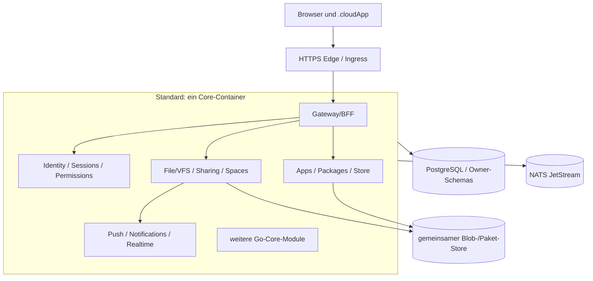
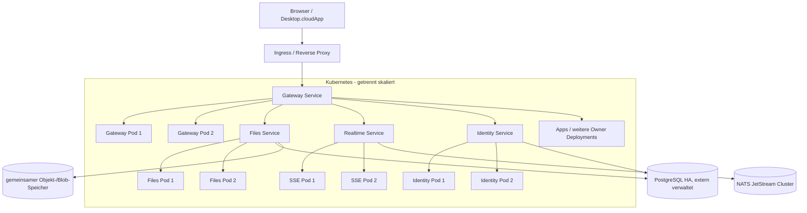
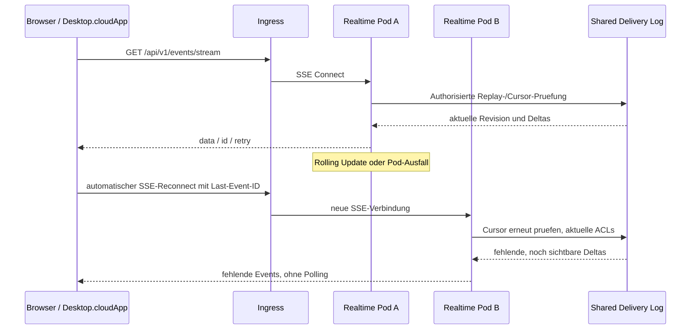

# cloudOS – Core-Deployment, Microservice-Trennung und Kubernetes-Skalierung

> **Dokument:** `docs/CORE_DEPLOYMENT_SCALING.md`  
> **Version:** 0.1 – neues fachlich führendes Deployment-Konzept für cloudOS 0.11  
> **Stand:** 15.11.2026  
> **Repository:** [Drezael/cloudOS](https://github.com/Drezael/cloudOS)  
> **Verifizierte GitHub-Basis:** `main`, Commit `e8c624242845907912ac0ff49969d7e251c51fe3`  
> **Status:** Architektur verbindlich; Go-Deployment-Bootstrap, Docker-Compose-Grundkonfiguration und Kubernetes-Manifeste als ausführbare technische Vorbereitung. Fachliche Core-APIs, Datenhaltung, Authentifizierung und Push-Service noch nicht implementiert.  
> **Führend für:** Betriebsmodi, logische Dienstverteilung, Service Discovery, horizontale Replikation, Kubernetes, HPA, Worker-Koordination, Ressourcenisolation, Rollouts und Skalierungstests.  
> **Referenzen:** [CONCEPT.md](CONCEPT.md), [SYSTEM_ARCHITECTURE.md](SYSTEM_ARCHITECTURE.md), [PUSH_REALTIME.md](PUSH_REALTIME.md), [VIRTUAL_FILESYSTEM.md](VIRTUAL_FILESYSTEM.md), [APPLICATION_SYSTEM.md](APPLICATION_SYSTEM.md), [APP_MANAGEMENT_STORE.md](APP_MANAGEMENT_STORE.md), [APP_API_ACCESS.md](APP_API_ACCESS.md), [APP_SIGNING.md](APP_SIGNING.md), [AUTHENTICATION_AUTHORIZATION.md](AUTHENTICATION_AUTHORIZATION.md), [IDENTITY_INTEGRATION.md](IDENTITY_INTEGRATION.md), [SHARING_SPACES.md](SHARING_SPACES.md), [DESKTOP_ENVIRONMENT.md](DESKTOP_ENVIRONMENT.md)

## 1. Verbindliche Produktentscheidung

Der **cloudOS Core ist eine logische Plattform aus unabhängigen, kooperierenden Go-Fachdiensten**. Jeder Fachdienst muss ab seiner ersten Implementierung eine definierte Schnittstelle, eindeutige Datenhoheit und eine saubere Start-/Stop-Grenze haben. Das Deployment ist austauschbar: dieselbe fachliche Implementierung läuft in einem gemeinsamen Prozess oder später als einzelner Dienst in einem eigenen Container, mehrfach repliziert.

**Standard bis zu einer ausdrücklichen anderen Anweisung:** Sämtliche **Core-Microservices laufen gemeinsam in genau einem Go-Prozess und einem Core-Docker-Container**. Dadurch werden sie nicht zu einem fachlichen Monolithen; nur die Prozessgrenze entfällt. Kubernetes und die verteilte Betriebsart sind bereits in Konfiguration, Quellstruktur und Bereitstellungsartefakten vorzubereiten, aber **nicht standardmäßig zu aktivieren**.

**Nicht mitgemeint:** PostgreSQL, NATS JetStream, Nginx und optionaler Objektspeicher sind eigenständige Infrastruktur. Der Wunsch nach *einem Core-Container* bedeutet nicht, eine Datenbank, einen Event-Bus oder unsichere Drittanbieter-Runtimes in denselben Container zu packen. Nicht vertrauenswürdige WASI- oder native App-Sandboxen werden niemals in den privilegierten Core-Prozess aufgenommen.

### 1.1 Vertragsinvarianten

1. **Ein Go-Codebestand:** Ein Fachmodul wird nicht zweimal in `combined` und `split` implementiert.
2. **Ein fachlicher Owner je Ressource:** Der File Service besitzt Dateimetadaten, der Identity Service die Identitäten, der App Service Installationen und Berechtigungszuweisungen usw.
3. **Deployment-unabhängige Verträge:** Lokale typisierte Ports und entfernte gRPC-Ports besitzen semantisch dieselben DTOs, Fehlercodes, Auth-Kontexte, Deadline- und Transaktionsregeln.
4. **Keine lokalen Wahrheiten:** Benutzer, Sessions, Paketinstallationen, Desktopzustand, Shares, Spaces, Push-Cursor und relevante Konfigurationen dürfen nicht ausschließlich im RAM oder auf dem Dateisystem einer Core-Instanz liegen.
5. **Horizontal skalierbare HTTP-Dienste:** Mehrere identische Replikate verarbeiten gleichzeitig Anfragen, ohne dass der Client eine bestimmte Replik kennen oder dauerhaft verwenden muss.
6. **Koordinierte Hintergrundarbeit:** Jobs, LDAP-Sync, Outbox, Indizierung, Runtime-Leases und Push-Projektionen benötigen beim mehrfachen Start atomare Leases oder durable Workqueues.
7. **Verbindliche Sicherheit:** K8s-Replikate umgehen weder Benutzer-/POSIX-Rechte, noch die installierte `.cloudApp`-Endpoint-Allowlist, die App-Signaturvalidierung oder die Push-Audienzprüfung.
8. **Push statt Browser-Polling:** SSE-Replay nach Reconnect funktioniert auf jeder gesunden Realtime-Replik, auch nach einem Rolling Deployment.
9. **Deployments sind nicht Identitäten:** Service-Accounts/Workload-Identitäten werden pro Dienst vergeben. Containername, Pod-IP und Replikatnummer gelten nicht als Autorisierungsnachweis.
10. **Single-Container zuerst:** Tests und MVP starten mit `CLOUDOS_MODE=combined`; `CLOUDOS_MODE=split` ist ein optionaler Betriebsmodus und darf nicht notwendig sein, um den Desktop zu verwenden.

## 2. Warum die Trennung früh implementiert wird

Die frühen technischen Grenzen ermöglichen Skalierung ohne spätere fachliche Neuimplementierung. Typische Lastverteilungen sind unabhängig: sehr viele SSE-Verbindungen belasten Realtime, große Uploads den File Service, App-Store-Downloads den Package Service und Identity-Anfragen den Auth-Pfad. Ein einzelner großer Core kann kurzfristig über CPU/RAM skaliert werden; unter Kubernetes lassen sich dagegen **nur tatsächlich benötigte** Dienste horizontal vervielfachen. Horizontaler Ausbau soll Verfügbarkeit und Durchsatz verbessern, erzeugt aber zusätzliche Netzwerklatenz und Betriebsaufwand; mehr Container sind kein Selbstzweck.

**Explizite Abgrenzung:** Das bisherige Deploymentkonzept mit getrennten `gateway`, `core` und `files` schon im MVP wird durch den neuen Standard ersetzt. Diese Aufteilung ist nur noch für spätere Split-Deployments vorgesehen.

## 3. Drei Betriebsprofile

| Profil | Zweck | Core-Prozesse / Container | Skalierung | Verbindlichkeit |
|---|---|---|---|---|
| `combined` | Entwicklung, erste Tests, MVP | **1 Go-Prozess in 1 Core-Container** | Zunächst genau 1 Core-Replik; später nur bei gemeinsamem persistentem Zustand skalieren | **Standard** |
| `split` | Gezielte Trennung einzelner Servicegruppen | Pro aktivierter Fachkomponente ein eigener Go-Prozess und Container | Replikation pro Dienst möglich | Opt-in |
| `kubernetes-distributed` | Cluster mit mehreren Nodes, Service-Discovery, HPA | Pro Fachkomponente Deployment + ClusterIP-Service | unabhängige HPA-/KEDA-/Worker-Policies | Späterer Produktionsbetrieb, heute vorbereitet |

Eine Mischform ist später zulässig: beispielsweise `gateway` und `realtime` als eigenständige Deployments, übrige Dienste weiter im gemeinsamen Core. Für diese Mischform ist eine **eindeutige Routing- und Owner-Registry** erforderlich, damit keine zwei gleichzeitig aktiven Instanzen denselben schreibenden Fachkontext doppelt betreiben. Der erste technische Bootstrap liefert kombinierte und vollständig getrennte Betriebsarten; gemischte Topologien sind ein dokumentierter nächster Schritt.

### 3.1 Deployment-Grenze versus Modulgrenze





Die schematischen Pfeile stehen für definierte Contracts. **Kubernetes `Service` verteilt Netzwerkverbindungen** über gesunde Endpunkte; die fachliche Verteilung und Korrektheit entstehen erst durch die zustandsfreie Serviceimplementierung, atomare Owner-Operationen und koordinierte Jobs.

## 4. Servicekatalog als Quelle der Deployment-Generierung

Die Datei `core/internal/platform/services.json` ist die **maschinenlesbare Ausgangsliste des technischen Bootstrap**. Sie deklariert Namen, grobe Rolle, Skalierungsart, Mindest-/Maximalreplikate und CPU-HPA-Eignung. Sie ist noch **keine abschließende vollständige Fachverzeichnis-Spezifikation** und keine Autorisierungs-/App-API-Registry; die detaillierten Owner-Kontexte aus `SYSTEM_ARCHITECTURE.md` bleiben maßgeblich.

| Technischer Core-Service | Aufgabenfeld | Last-/Replikationsstrategie | Anfangsbetrieb |
|---|---|---|---|
| `gateway` | HTTPS/BFF-Eingang und API-Routing | stateless; HPA möglich | kombiniert |
| `identity` | Benutzer, Gruppen, UID/GID-Zuweisung | stateless API, atomare DB-Vergabe | kombiniert |
| `sessions` | authentifizierte Sitzungen | stateless; gemeinsam gespeicherte Sessions | kombiniert |
| `permissions` | POSIX, ACL, Endpoint-Allowlist, Grants | stateless, versionierter Policy-Cache | kombiniert |
| `files` | VFS, Metadaten, Dateioperationen | stateless APIs, gemeinsam konsistenter Storage | kombiniert |
| `apps` | App Registry, Grants und Installationszustand | stateless, serialisierte DB-Änderungen | kombiniert |
| `packages` | Signatur- und Paketprüfung | stateless, immutable Artefakte; Quotas | kombiniert |
| `appstore` | Store-Kataloge, Quelle/Provenienz | stateless, Store-Owner und Upload-Koordination | kombiniert |
| `desktop` | Desktop-/Window-State APIs | stateless, VFS und DB als Wahrheit | kombiniert |
| `settings` | User-/Systemkonfiguration | stateless, DB-/VFS-gebundene Revisionen | kombiniert |
| `themes` | Themes und Aktivierungsbindungen | stateless, versionierte Assets | kombiniert |
| `sharing` | interne Dateifreigaben | stateless, Transaktionen und Events | kombiniert |
| `spaces` | Space-Mitgliedschaften, Rollen, Quotas | stateless, atomare Updates | kombiniert |
| `notifications` | Notification-Inbox | stateless API und dauerhafter Status | kombiniert |
| `realtime` | SSE-Verbindungen, Replay, Backpressure | stream-bewusst, mehrere Replikate, später Custom Metrics | kombiniert |
| `search` | Such-API und autorisierte Abfragen | stateless API, verteilte Search-Worker getrennt | kombiniert |
| `audit` | auditierte Schreib-/Abfrage-API | stateless API, eigener Datenspeicher | kombiniert |
| `push-projector` | user-/app-spezifische Eventprojektion | durable Queue / Consumer Group; dedupliziert | kombiniert |
| `ldap-sync` | externe LDAP-Verzeichnissynchronisation | **eine aktive Lease je LDAP-Quelle** | kombiniert |
| `runtime-controller` | Job- und Runner-Orchestrierung | Work-Instance-Leases, exklusiver Job-Owner | kombiniert |

**Wichtiger Status:** Der Bootstrap kann die genannten Namen in kombiniertem oder getrenntem Modus starten und Health-/Readiness-Endpunkte anbieten. Die genannten Fachfunktionen sind **noch nicht programmiert**. Worker sind daher derzeit keine produktiven LDAP-/JetStream-/Runtime-Worker; die oben genannten Sicherungsregeln beschreiben ihre spätere Umsetzung.

## 5. Umsetzung als Go-Core-Modularchitektur

Das Kernprogramm besitzt einen zentralen Startpunkt `core/cmd/cloudos-core`. Spätere Fachmodule werden so gekapselt, dass sie `Start`, `Stop`, `Health`, `Ready` und ihre typisierten Ports kontrollieren. Die Registrierung erfolgt einmal und wird von den beiden Betriebsmodi auf dieselbe Weise verwendet.

```text
core/
├── go.mod
├── Dockerfile
├── cmd/cloudos-core/main.go
└── internal/platform/
    ├── catalog.go
    ├── server.go
    ├── server_test.go
    └── services.json
```

In der technischen Vorbereitung sind die Namen bereits einlesbar, beide Startmodi validiert und eine Prozess-/Container-Probe verfügbar. **Es gibt noch keine fertig implementierten Fachmodule**; ein Probe-`200` bedeutet ausschließlich, dass der Bootstrap-Prozess läuft, nicht dass Login, Datenbankzugriffe oder die File-API betriebsbereit sind. Die eigentlichen Module und gRPC-Ports werden in den Entwicklungsphasen ergänzt und durch zusätzliche Tests abgesichert.

### 5.1 Konfiguration der Betriebsmodi

**Standard (ein Core-Container):**

```bash
CLOUDOS_MODE=combined CLOUDOS_LISTEN_ADDR=:8080 ./cloudos-core
```

**Getrennter Dienst:**

```bash
CLOUDOS_MODE=split CLOUDOS_SERVICE=files CLOUDOS_LISTEN_ADDR=:8080 ./cloudos-core
```

`CLOUDOS_SERVICE` wird in `combined` nicht gesetzt. Ein unbekannter Dienst oder Modus führt absichtlich zum sofortigen Startfehler (Fail Fast). Beide Modi verwenden denselben signierten Build / dasselbe Docker-Image. Kein privilegierter Admin- oder App-API-Zugriff ist damit bereits implementiert.

### 5.2 Lokale und entfernte Kommunikationsadapter

Das spätere Go-Interface `FilePort.Read(ctx, resource, identity)` muss in beiden Modi identisch funktionieren. Der kombinierte Dienst implementiert den Port durch einen typisierten lokalen Go-Aufruf. Der verteilte Dienst implementiert denselben Port über einen authentifizierten, versionierten gRPC-Aufruf mit Deadline und Dienstidentität. Änderungen am Interface benötigen Vertragsversionen und Kompatibilitätstests; keines der beiden Modelle darf Rechte- oder Audit-Prüfungen überspringen.

**Kein Direktzugriff auf fremde Owner-Tabellen**, auch dann nicht, wenn alle Module im selben Go-Prozess laufen. Das erfordert explizite Paket-/Interface-Grenzen und verbotene Importpfade in CI.

## 6. Service Discovery, DNS und Lastverteilung

Kubernetes erzeugt pro Dienst einen stabilen `ClusterIP`-Service mit DNS-Namen (z. B. `cloudos-files.cloudos.svc.cluster.local`). Clients des Go-Cores verwenden den konfigurierten Dienstnamen, nie die konkrete Pod-IP. Kubernetes verteilt Verbindungen zwischen gesunden Endpoints. **Ein Kubernetes Service garantiert nicht eine identische Anzahl von HTTP-Requests je Pod:** bei langen gRPC-/HTTP/2-/SSE-Verbindungen kann eine einzelne Verbindung über lange Zeit an einer Pod-Replik hängen. Client-seitige Connection-Pools, angemessene Stream-Limits und später Gateway-Metriken sind deshalb relevant.

**Edge-Bereich:** Nur Ingress/Reverse Proxy und Gateway werden zu erreichbaren HTTP-Anwendungen. Interne Core-Service-Endpunkte dürfen keine öffentlichen Kubernetes LoadBalancer oder Ingress-Objekte erhalten. Separate, später deployte WASI-Runner bleiben in einer anderen Sicherheitszone.

### 6.1 Verhalten im kombinierten Modus

Lokale Ports verwenden direkte Funktionsaufrufe, keine Kubernetes-DNS-Auflösung. Das System muss ohne `kubectl`, Kubernetes-API, CoreDNS oder Container-Orchestrator funktionieren. Die Kombination eines Go-Prozesses ist ausdrücklich ein unterstütztes und getestetes Betriebsmodell.

### 6.2 Mischbetrieb und eindeutige Owner-Routen

Für künftigen Mischbetrieb wird im Gateway eine Routingtabelle pro fachlichem Owner eingeführt, etwa `files -> local` oder `files -> cloudos-files:grpc-port`. Jeder Owner hat zur selben Zeit **genau einen gültigen Zuständigkeitsmodus**, selbst wenn intern mehrere Replikate dieselbe Dienstadresse besitzen. Umschalten benötigt kontrollierte Konfiguration, Drain der alten Endpoints, Kompatibilitätsprüfung und Rollback. Der aktuelle technische Bootstrap generiert **keinen** gleichzeitigen Mischbetrieb.

## 7. Shared Nothing bei Compute, Shared Durable State bei Daten

Die idealtypische horizontale HTTP-Replik besitzt keinen fachlich notwendigen lokalen Zustand. Zwischen Pod-Instanzen müssen folgende Daten konsistent verfügbar sein:

| Datenklasse | Autoritative Quelle | Verteilung / Regel |
|---|---|---|
| Benutzer, Gruppen, UID/GID | PostgreSQL Identity-Schema | Unique-Constraints und atomare ID-Vergabe |
| Login, Sessions, Revoke-Revision | serverseitige Session-Datenbank | kein Prozess-RAM als alleinige Wahrheit |
| POSIX-ACLs, App-API-Grants | fachliche Owner-DB | Policy-Revision; keine blind vertrauten Cache-Einträge |
| VFS-Knoten und File-Revisions | PostgreSQL File-Schema | ETag/Revision, DB-Transaktion und Outbox |
| `system:/apps` und Pakete | geteilte, unveränderliche Artefaktablage | keine Pod-lokalen App-Dateien |
| `users:/homes/...`, `/.desktop` | File Service und Blob-Backend | SSE-Delta nach Commit |
| Store-Provenienz, App-Zuweisung | Apps/Store-Owner | atomare Installations-/Uninstall-Operationen |
| Freigaben, Spaces, Gruppen | Owner-Datenmodelle | atomare ACL-/Rollenänderungen |
| Benachrichtigungs-Inbox | Notification-DB | Push als Delivery, nicht als DB-Ersatz |
| SSE Delivery Log / Eventcursor | dauerhafte Realtime-Projektion | instanzübergreifender Replay-Index |
| Jobs, aktive Worker-Leases | DB oder dedizierter koordinierter Owner | Lease, Fencing-Token, Idempotenz |

**Verboten:** Pod-lokale SQLite-Dateien, `emptyDir` für persistente Nutzerdateien, lokale sessionspezifische Map als letzte Wahrheit, unterschiedliche App-Paketstände pro Pod und eine lokale Nummernvergabe ohne Unique-Constraint. Ein optionaler pro-Pod-Cache ist ausschließlich eine abgeleitete, invalidierbare Projektion.

## 8. Datenbank- und Storage-Skalierung

- Jedes fachliche Schema besitzt weiterhin genau einen Owner. Separate Datenbankrollen pro Dienst sind auch im `combined`-Modus als Vertragsziel vorzusehen; die initiale einzelne Prozessidentität ist kein Grund für einen gemeinsamen Superuser im späteren Cluster.
- PostgreSQL wird als **separater, persistent betriebener Infrastrukturservice** konfiguriert. Ein Kubernetes-Cluster darf PostgreSQL über einen Operator oder Managed-Service bereitstellen; ein ungesicherter Datenbank-Deployment-YAML-Block ist keine HA-Lösung.
- Lese-Replikate der Datenbank sind nicht automatisch für autorisierungsrelevante Checks geeignet, da Replikationsverzug neue Rechteentzüge, widerrufene Sessions oder App-Grants übersehen kann. Sicherheitskritische Entscheidungen brauchen konsistente Daten.
- Schreibzugriffe auf dieselbe Datei, App-Installation oder Space-Mitgliedschaft verwenden Revisionen, eindeutige Constraints, Transaktionen und Idempotenzschlüssel. Skalierung darf weder doppelte Pakete noch doppelte Freigaben erzeugen.
- Der erste Storage-Adapter kann lokal persistent sein; für **mehrere File-Pods auf mehreren Nodes** ist jedoch ein geteiltes konsistentes Speicherbackend erforderlich, bevorzugt S3-kompatibel oder eine explizit geprüfte Shared-Filesystem-Lösung. Pod-lokaler Speicher darf diese Anforderung nicht ersetzen.
- Backups umfassen konsistente PostgreSQL-Snapshots/WAL, Blob-Revisionsstände, signierte App-Artefakte und die minimale Wiederherstellung des Eventzustands. Restore wird über mehrere Replikate getestet.

## 9. NATS JetStream, Outbox und skalierbare Worker

- Jede schreibende Fachoperation commitet ihre Mutation und den Outbox-Eintrag **in derselben Owner-Transaktion**. Ein oder mehrere Publisher publizieren mit idempotenter Claim-/Ack-Logik; mehrfach gelieferte Events werden dedupliziert.
- Mehrere `push-projector`-Instanzen sind erst dann sicher, wenn sie einen korrekt koordinierten **durablen Pull-Consumer mit gemeinsamem Consumer-Zustand** nutzen; keine Kopie jeder Aufgabe an jede Pod-Instanz ohne Fachzweck.
- `ldap-sync` besitzt **einen aktiven Lease-Owner je LDAP-Quelle**. Mehrere Synchronisationsreplikate dürfen dieselbe Quelle nicht unkoordiniert parallel importieren. Deprovisioning und Benutzergruppenentzug müssen epoch-/revisionssicher erfolgen.
- `runtime-controller` verwendet pro Job/Instanz Leases mit Fencing-Token und definiertem Abbruch-/Retry-Verhalten. HPA oder Pod-Restart dürfen einen Job nicht unkontrolliert mehrfach starten.
- Bei Consumer-Abstürzen muss die Nachricht erneut verarbeitbar sein; das System setzt grundsätzlich `at-least-once` mit idempotenten Side Effects voraus und verspricht kein unbelegtes globales `exactly once`.
- Periodische **Serverprozesse** wie LDAP-Sync, Outbox-Publisher oder Kubernetes-HPA sind zulässig; verboten ist weiterhin **Client-Polling für UI-Aktualisierungen**.

## 10. SSE-Push im mehrreplikigen Betrieb

Der Realtime-Push-Dienst wird gesondert als streambewusste, horizontal verteilbare Serviceklasse behandelt. Eine SSE-Verbindung bleibt während ihrer Dauer mit einer Realtime-Pod-Replik verbunden; sie muss nach einem Ausfall **an einer anderen Replik** mit dem `Last-Event-ID`-Cursor rekonstruierbar sein.

- `realtime` erhält keine zwingende Sticky Session und keine lokalen Alleinbesitz-Cursor. Das Delivery Log, Abonnement-Audienz und Policy-Revisionen stehen instanzübergreifend zur Verfügung.
- Fachliche Owner-Events laufen über DB/Outbox/NATS an Projector/Delivery, nicht von einzelnen File-Pods direkt zum Browser.
- Ein dauerhafter, geklärter Revoke-/Group-Change-Mechanismus muss alle betroffenen Realtime-Pods rechtzeitig informieren. Jede Event-Auslieferung und jeder Replay prüfen aktuelle Sichtbarkeit, auch wenn ein anderer Pod das Event ursprünglich erzeugt hat.
- Bei Rolling Update setzt die Pod-Readiness vor dem Drain auf „nicht bereit“; bestehende SSE-Streams werden kontrolliert beendet; Cursor und Zustellhistorie bleiben erhalten. Nginx/Ingress puffert keine SSE-Events.
- HPA nur auf CPU kann die SSE-Auslastung schlecht abbilden. Spätere Skalierungsmetriken: `active_sse_streams`, ausgehende Bytes/s, Backpressure, Publish-to-Delivery-p95 und Queue-Lag. Im technischen Scaffold ist für `realtime` **kein CPU-HPA** aktiv.
- Der Browser hält weiterhin seinen einzigen vertrauenswürdigen Push-Stream pro Sitzung/Host-Kontext; `Desktop.cloudApp` und weitere Apps erhalten gefilterte Event-Deltas über die App Bridge. **Niemals Browser-Polling als Failover.**



Das Diagramm beschreibt die **zukünftige Fachimplementierung**. Der neue Go-Deployment-Bootstrap liefert noch keinen SSE-Handler.

## 11. Authentifizierung und serviceübergreifende Autorisierung

Die Sicherheit des Systems darf niemals von der Reihenfolge oder dem Ziel einer Lastverteilung abhängen. Ein fremder Kubernetes-Pod darf nicht durch den bloßen Zugriff auf ein internes ClusterIP automatisch als vertrauenswürdig gelten.

**Mindestanforderungen der Fachimplementierung:**

1. Gateway erstellt nach überprüfter Benutzeranmeldung eine serverseitige Session und führt die BFF-Cookie-/Origin-/CSRF-Regeln aus `AUTHENTICATION_AUTHORIZATION.md` fort.
2. Remote-Service-Calls führen ein **gebundenes, authentifiziertes Service-Prinzipal** und den verifizierten Endbenutzer-/App-Kontext mit; ungeprüfte `X-User-Id`-Header sind wertlos.
3. mTLS bzw. Workload Identity wird vor einem produktiven Split-Cluster festgelegt, einschließlich Schlüsselrotation und Widerruf. Kubernetes-ServiceAccount und NetworkPolicy ersetzen keine gegenseitige Dienstauthentifizierung.
4. Der Permission Owner verifiziert User-/Group-/POSIX-/Share-/Space-ACLs und App-Endpoint-Grants nach aktuellen Versionen. Caches dürfen Rechteentzug nicht zeitlich unbegrenzt verschieben.
5. Jede installierte `.cloudApp` besitzt eine signierte `permissions/api-access.json`; auch in einem skalierten Gateway muss ein nicht gelisteter Endpunkt `403` ergeben.
6. Die App Registry zeigt eine App nur Benutzern/Gruppen, die sie starten dürfen; alle Replikate müssen dieselbe Zuweisung sehen. Default für zusätzliche Apps bleibt Gruppe `Admin`.
7. Der File Service erzwingt die individuellen Home-Root-Sichten sowie `system:/`-Adminregeln. Mehrere File-Replikate erzeugen keinen zusätzlichen Root-Mount und keine dritte Festplatte.

**Technischer Bootstrap-Status:** Noch keine Benutzer-API, App-Bridge, ACL, mTLS oder Autorisierungsimplementierung. Der HTTP-Bootstrap beantwortet öffentliche `/api/*`-Aufrufe explizit mit `501 Not Implemented`, statt irreführende Mock-Daten als echte Fachantworten auszugeben. Diagnoseendpunkte sind per Default abgeschaltet und erfordern bei Aktivierung ein langes internes Secret; sie sind **kein Ersatz** für spätere echte Dienstidentitäten.

## 12. Kubernetes-Deployment-Architektur

Die vorbereiteten Dateien liegen in `deploy/k8s/combined` und `deploy/k8s/distributed`. Beide besitzen eine `kustomization.yaml` und vollständig generierte Kubernetes-Ressourcen. Sie werden **nicht gemeinsam aktiviert**, sonst könnten die kombinierten und getrennten Instanzen denselben fachlichen Owner parallel starten.

### 12.1 Standard-Overlay: `combined`

- Namespace `cloudos`, ein Deployment `cloudos-core`, **replicas: 1**, ein interner ClusterIP-Service.
- Startumgebung `CLOUDOS_MODE=combined`, kein `CLOUDOS_SERVICE`.
- HTTP-Liveness/Startup/Readiness-Probes, Resource Requests/Limits, non-root, schreibgeschütztes Root-Filesystem, keine Linux-Capabilities, seccomp `RuntimeDefault`.
- Kein HPA auf dem gemeinsamen Core im ersten Entwicklungsstand.
- Bereits ein Kubernetes-kompatibles Deployment, aber kein Zwang, Kubernetes für die ersten Tests zu betreiben.

### 12.2 Alternatives Overlay: `distributed`

- **20 eigenständige Core-Service-Deployments** mit je eigenem Kubernetes-ClusterIP-Service und identischem cloudOS-Core-Image.
- Der jeweilige Container startet mit `CLOUDOS_MODE=split`, `CLOUDOS_SERVICE=<name>`.
- **16 HTTP-Dienste** besitzen einen `autoscaling/v2`-HPA-Entwurf mit CPU-Zielauslastung 65 %, Mindest-/Maximal-Replikaten und `PodDisruptionBudget`. Für HPA-gesteuerte Deployments ist `spec.replicas` **absichtlich nicht** im Manifest gesetzt; die HPA verwaltet die Replikatzahl, ohne dass ein erneutes `kubectl apply` sie zurücksetzt.
- Der SSE-Stream-Dienst `realtime` wird mit mehreren Pods bereitgestellt, aber bewusst ohne verfrühten CPU-HPA. Der passende Custom-Metrics-HPA folgt nach Messung der echten Stream-Auslastung.
- `push-projector`, `ldap-sync` und `runtime-controller` starten **zunächst je einmal**, weil die nötigen Queue-/Lease-Implementierungen noch fehlen.
- Topology-Spread-Richtlinie bevorzugt eine Verteilung über Hosts. Ein Cluster mit nur einem Node ist für Entwicklung erlaubt.
- Eine Namespaced `NetworkPolicy` erlaubt interne Core-zu-Core-Verbindungen auf Port 8080; produktive Ingress-/Egress-Policies und Service-mTLS sind zusätzliche Voraussetzungen, nicht durch das Scaffold erledigt.

Die verteilten YAML-Dateien **sind keine Aussage über bereits lauffähige Fachfunktionen oder Produktionsreife**. Kubernetes `Deployment` und HPA skalieren Pods, nicht die noch zu implementierenden Go-Business-APIs. Die Vorlagen verwenden `cloudos-core:dev` als lokal zu bauendes Platzhalter-Image; ein produktives Image muss im Register verfügbar und per unveränderlichem Digest referenziert sein.

### 12.3 Konfigurationsbeispiel für Autoscaling

```yaml
apiVersion: autoscaling/v2
kind: HorizontalPodAutoscaler
metadata:
  name: cloudos-files
  namespace: cloudos
spec:
  scaleTargetRef:
    apiVersion: apps/v1
    kind: Deployment
    name: cloudos-files
  minReplicas: 2
  maxReplicas: 8
  metrics:
    - type: Resource
      resource:
        name: cpu
        target:
          type: Utilization
          averageUtilization: 65
```

CPU-HPA setzt korrekt gesetzte CPU-Requests und eine funktionierende Resource Metrics API, typischerweise **Metrics Server**, voraus. Später werden File-Throughput, Warteschlangenlänge und API-Latenz zur HPA-/KEDA-Planung herangezogen. CPU-Auslastung allein ist kein universelles Modell für optimale Lastverteilung.

### 12.4 Service Discovery und Load Balancing

`cloudos-files` ist das interne Service-Ziel. Kube-EndpointSlices und die verwendete CNI/Service-Proxy-Implementierung sorgen für das Routing zu gesunden Pods. Readiness sorgt dafür, dass noch nicht startbereite oder drainende Instanzen nicht als neue Ziele gewählt werden. **Die K8s-Service-Verteilung ist lastabhängig nicht automatisch optimal**, besonders wenn SSE- oder gRPC-Verbindungen sehr lange offen bleiben. Jede Fachkomponente erhält deshalb spezifische Lastmetriken und einen Load-Test, bevor sie automatisch hochskaliert wird.

### 12.5 Keine Datenbank und kein NATS-Cluster in den vorbereiteten K8s-Overlays

PostgreSQL und NATS werden in den Overlays absichtlich **nicht** als ungesicherte Einzel-Pods installiert. Für Kubernetes müssen deren Betrieb, Persistenz, Verfügbarkeit, Credentials, Backup, Restore und Netzwerksegmentierung separat entschieden werden. Bis dahin ist Kubernetes ein validierbares Deployment-Skelett für Core-Prozesse, nicht das vollständige Produkt. Für lokale Infrastrukturtests kann das separate Compose-`infra`-Profil verwendet werden.

## 13. Docker Compose als primärer Testbetrieb

Die Datei `deploy/compose/compose.yaml` startet standardmäßig genau einen `cloudos-core`-Container. Das Laufzeitprofil `combined` wird explizit gesetzt. Das Image wird aus `core/Dockerfile` gebaut und als unprivilegierter, read-only Container ausgeführt. Host-Port `8080` bindet nur an `127.0.0.1`, damit das unfertige Scaffold nicht versehentlich öffentlich erreichbar wird.

```bash
# Aus dem Repository-Root (Docker/Compose muss vorhanden sein)
docker compose -f deploy/compose/compose.yaml up --build

# Technischer Prozess-/Container-Check
curl -f http://127.0.0.1:8080/readyz
```

PostgreSQL und NATS JetStream sind als **separates, optionales Infrastrukturprofil** vorbereitet. Es bleibt beim einen Core-Container, auch wenn für einen späteren Integrationstest DB und Event-Bus zugeschaltet werden:

```bash
export CLOUDOS_DB_PASSWORD='ein-lokal-sicheres-testpasswort'
docker compose -f deploy/compose/compose.yaml --profile infra up --build
```

**Wichtig:** Das Go-Bootstrap verwendet die Infrastruktur im aktuellen Stand noch nicht; die Datenbanken/NATS sind vorbereitete Container, keine funktionierende Persistenzintegration. Credentials werden nicht ins Repository committed.

**Optionaler Test der getrennten Docker-Container** (nicht Default, gleiche Go-Binärdatei mit verschiedenen Startrollen):

```bash
# Nur für den Test der Deployment-Trennung, nicht für produktive Fachfunktionen:
docker compose -f deploy/compose/compose.split.yaml up --build
```

Dieses alternative Compose startet 20 Core-Container im Modus `split`; nur der Gateway-Testport ist an `127.0.0.1` gebunden. Die übrigen Container sind ausschließlich im Compose-Netz erreichbar. Es darf **nicht gleichzeitig mit `deploy/compose/compose.yaml`** denselben Port nutzen oder parallel als schreibender Core gegen dieselbe Datenbank betrieben werden. Die Datei wird aus dem Servicekatalog mit `scripts/generate_compose_split.py` erzeugt.

## 14. Kubernetes-Kommandos (Opt-in)

```bash
# Root des ausgepackten Repositories; Image muss in Cluster verfuegbar sein.
kubectl apply -k deploy/k8s/combined
kubectl -n cloudos get deployments,services,pods

# Nur nach Entfernen der kombinierten Core-Deployment-/Service-Ressourcen:
# Namespace und andere Infrastruktur dabei NICHT loeschen.
kubectl -n cloudos delete deployment/cloudos-core service/cloudos-core
kubectl apply -k deploy/k8s/distributed
kubectl -n cloudos get hpa,deployments,services,pods
```

**Hinweis:** Die `combined`- und `distributed`-Manifeste enthalten beide eine `Namespace`-Ressource. Der Beispielwechsel löscht deshalb ausdrücklich **nur** das kombinierte Core-Deployment und den dazugehörigen Service, nicht den Namespace. Vor echten Migrations-/Löschkommandos Owner-Zustände und Infrastruktur kontrollieren; die gezeigte Reihenfolge ist ausschließlich für den **leeren Bootstrap-Testcluster** gedacht.

In der realen späteren Migration ist ein verwalteter Cutover mit Stop/Drain, DB-Migration, Routingänderung und Rollback erforderlich. *Nicht* gleichzeitig ein schreibender `combined`- und ein schreibender `split`-Owner derselben Ressource.

## 15. Rolling Updates, Drain und Zero-Downtime-Ziele

- Deployments verwenden für mehrere Pods einen Rolling-Update-Ansatz mit Readiness-Probes. Neue Pod-Instanzen müssen vollständig hochfahren und ihren Owner-Vertrag akzeptieren, bevor Traffic umgestellt wird.
- Die Go-Bootstrap-App verarbeitet `SIGTERM` und führt `http.Server.Shutdown` mit einem Timeout durch. Sie implementiert aber noch **keinen echten SSE-Drain, keine DB-Transaktionsbeendigung und kein Lease-Fencing**. Das wird vor Produktionsbetrieb ergänzt.
- Lang laufende SSE-Streams benötigen ausdrücklich ein Drain-Signal, definierte maximale Stream-Dauer, Replay-Cursor und ein ausreichend langes Shutdown-Budget. Die vorhandene HTTP-Abschaltlogik allein garantiert kein verlustfreies Realtime-Update.
- Versionierte gRPC-/OpenAPI-/Event-Schemas werden mindestens während des Rolling-Update-Fensters rückwärts-/vorwärtskompatibel gehalten oder mit kontrollierter Doppelregistrierung migriert.
- DB-Migrationen folgen **Expand → Migrate → Contract**, damit alte und neue Service-Replikate gleichzeitig gültige Schemata lesen können. Irreversible Schemamigrationen können nicht allein durch Rückrollen eines Container-Images rückgängig gemacht werden.
- Rollout-Fenster, `maxSurge`, `maxUnavailable`, `PodDisruptionBudget` und zulässige Pod-Kapazität werden an der echten Last geprüft.

## 16. Autoscaling-Strategie und Kapazitätsmodelle

| Dienstgruppe | Frühe CPU-basierte HPA | Spätere primäre Skalierungsmetrik | Zusätzliche Grenze |
|---|---|---|---|
| Gateway/Identity/Permission | ja, erst bei echten Diensten | RPS, p95, Auth-Latenz | DB-Pool, Rate Limits |
| File/VFS | ja, nach Shared Storage | Upload-/Download-Bytes/s, p95, Queue | Objektstore-/DB-Bandbreite |
| Apps/Packages/App Store | ja, nach Cache-/Artefaktstrategie | Paketprüfungen/s, Download-Bandbreite | Untrusted Archivprüfung, Signaturkosten |
| Search | ja, nach Search-Owner-Vertrag | Suchanfragen/s, Index-Lag | Suchindex-Cluster |
| Realtime/SSE | **nein im Scaffold** | aktive Streams, Send-Queue, Fanout-Lag | Proxy-Connections, pro-Pod FD-/RAM-Limit |
| Push Projector | **nein im Scaffold** | Consumer-Lag / Jobs pro Sekunde | Durable Queue, Idempotenz |
| LDAP Sync | **nein** | Quellenanzahl (Lease-Partitionierung) | ein aktiver Owner pro Quelle |
| Runtime Controller | **nein im Scaffold** | ausstehende Jobs / Worker-Kapazität | Lease/Fencing, Fair Scheduling |

Eine HPA-Regel erhöht Pod-Anzahl bei Last. Sie garantiert weder, dass der Datenbankserver mithält, noch dass langsame Storage-Backends schneller werden. Globale und per-Benutzer-Quotas sowie Backpressure sind nötig, damit viele Pods eine überlastete Abhängigkeit nicht weiter überfahren.

### 16.1 Skalierungsgrenzen und Schutz

- Pro Dienst feste Ressourcenanforderungen und Limits, keine ungebremste Worker-Goroutine-Explosion.
- Queue-Größe, DB-Verbindungspool und API-Fanout werden global begrenzt und auf Replikatanzahl abgestimmt.
- Autoscaling hat minimale und maximale Pod-Zahl, Scale-up/Scale-down-Stabilisierungszeiten und Monitoring.
- HPA darf **nicht** Worker vervielfachen, bevor deren fachliche Lease-/Queue-Sicherheit implementiert ist.
- Bei langen Streams sind Rebalancing und Connection-Draining wichtiger als reine CPU-Autokorrektur.

## 17. Zustandslose UI und installierte `.cloudApp`-Pakete

Browser-Apps bleiben Client-Runtimes. Die Anzahl der Core-Service-Pods ändert nichts an der Sicherheits- und Speicherarchitektur: alle installierten, signierten `.cloudApp`-Pakete liegen logisch auf **`system:/apps/`** (virtuelle Festplatte 1), und Home-Verzeichnisse liegen auf **Festplatte 2**, sodass jeder Benutzer sein Home als `/` sieht.

Der App-Katalog und die Benutzer-/Gruppenzuweisungen sind serverseitig geteilt, Default für nicht verpflichtende Apps bleibt die Gruppe `Admin`. App-Store-Provenienz wird dauerhaft gespeichert; ein Store verwaltet ausschließlich seine eigenen Installationen. Eine Änderung an App-Zuweisung oder API-Grants wird atomar persistiert, danach über Outbox/NATS/Push an alle Sitzungen zugestellt. Das verhindert unterschiedliche App-Sichtbarkeit auf verschiedenen Gateway-Pods.

**Keine direkte Ausführung von `.cloudApp` durch K8s:** Die `.cloudApp`-Pakete sind ein eigenes, signiertes App-Modell und werden clientseitig ausgeführt. Kubernetes-Deployments sind für Go-Core-Dienste (und später isolierte Worker), nicht für jedes Desktop-App-Fenster gedacht.

## 18. Optionaler LDAP/IdP-Betrieb und Cluster-Identitäten

Der lokale Directory Service bleibt zunächst Standard. Eine spätere externe LDAP-Quelle wird mit eigenem Sync-Adapter und je Quelle exklusivem Lease integriert. Optionale externe IdPs werden mit stabilen internen Benutzer-IDs verknüpft. Ein Gateway-Pod muss nach Login denselben Benutzer und dasselbe Home auflösen wie jedes andere Gateway.

Systeminterne Service-Accounts werden von den interaktiven cloudOS-Benutzer-/Gruppenrollen getrennt. Ein Kubernetes `ServiceAccount` ist keine Linux-UID und keine cloudOS-Benutzerrolle. Ein zentraler Go-Core-Superuser für alle Prozesse ist als späteres Split-Betriebsmodell nicht zulässig.

## 19. Observability und SLOs

Jede Fachimplementierung ergänzt zu `/healthz` und `/readyz` geeignete, korrekt auth-/netzwerkgeschützte Metriken und OpenTelemetry-Traces:

| Signal | Beispiel | Warum relevant |
|---|---|---|
| `service`/`instance`/`mode` | `files / pod-b1 / split` | Replikat- und Routingdiagnose |
| HTTP-/gRPC-Raten | RPS, Fehler 4xx/5xx, p95/p99 | ungleichmäßige Last erkennen |
| DB | aktive Pool-Connections, Lock-Wartezeit, Retry | Backend-Engpässe erkennen |
| Outbox/JetStream | Pending, Consumer-Lag, Redeliveries | Push und Jobs ohne Datenverlust |
| SSE | aktive Streams, Send-Lag, Reconnect, Replay | Skalierung langer Verbindungen |
| App-Grants | Revisionen, verwehrte API-Operationen | keine Sicherheitsdiffusion zwischen Pods |
| Ressourcen | CPU, Memory, Goroutines, offene FDs | HPA und Grenzwerte kalibrieren |
| Kubernetes | Desired/Ready Replicas, Rollout, Restarts | Betriebs- und Deploymentqualität |

Kubernetes-Metrikenlabels dürfen keine Benutzer-IDs, Dateinamen, App-Installationsgeheimnisse oder freie URL-Query-Werte enthalten. Tracing-Kontexte propagieren über Servicegrenzen, ohne sensible Tokens in Spans zu schreiben. **Ein Lastverteilungsversprechen „optimal“ ist nur nach messbaren Benchmark-Kriterien haltbar**; die Architektur schafft die Voraussetzungen, die später empirisch bestätigt werden müssen.

## 20. Ausfallszenarien

| Ausfall | Verhalten im finalen Zielbild | Noch offene Implementierung |
|---|---|---|
| Einzelner File-Pod fällt aus | Kubernetes leitet neue Requests an gesunde Pods; laufende Operationen sind idempotent wiederholbar | File-API, Storage, Idempotenz |
| Gateway-Pod wird ersetzt | Session ist unabhängig gespeichert; neue Anfragen funktionieren auf anderem Pod | Session-Store und Routing |
| Realtime-Pod fällt aus | SSE-Reconnect und Replay auf anderer Instanz, ohne Browser-Polling | Delivery Log, Realtime-Server |
| Job-Worker stirbt nach Commit | Nach Lease-Ablauf korrektes Retry ohne doppelte Mutation | Durable Queue / Fencing |
| LDAP-Sync läuft doppelt an | Exactly-one-active-Lease je Quelle; inaktive Instanz übernimmt | Quelle-Lease und Checkpoints |
| Paket-Upload läuft auf anderem Pod weiter | Staging/Commit im gemeinsamen Storage; keine Pod-Pfade | Geteiltes Staging, Quotas |
| DB nicht erreichbar | Readiness der zuständigen Owner wird rot; keine fiktiven 200-Ergebnisse | DB-Probes und Degraded Modes |
| NATS nicht erreichbar | Outbox persistiert und Replay nach Recovery; kein Polling-Fallback | Outbox-Publisher |
| Node-Ausfall | Workload wird auf gesunde Nodes neu eingeplant; shared state bleibt | Cluster-Infrastruktur, Backups |
| gemischte Schema-Versionen | Verträge bleiben für Rollout-Fenster kompatibel | Kontrakttests und Migrationen |
| unerlaubter App-Endpoint | Jede Gateway-Replik verweigert Zugriff | produktiver Permission/Policy Enforcer |

## 21. Sicherheitsarchitektur des Kubernetes-Clusters

Das Grundgerüst setzt bereits `runAsNonRoot`, feste UID/GID im Container, `allowPrivilegeEscalation: false`, `readOnlyRootFilesystem: true`, `seccompProfile: RuntimeDefault`, `capabilities.drop: [ALL]`, `automountServiceAccountToken: false` und interne `ClusterIP`-Services.

**Vor Produktivbetrieb zusätzlich erforderlich:**

1. TLS am Edge und mTLS oder gleichwertige Workload Identity zwischen getrennten Diensten.
2. Netzwerksegmentierung für Core, Datendienste, Admin und untrusted App-Worker; dedizierte Ingress-/Egress-Policies inklusive DNS und tatsächlich genutzter Backends.
3. Externes Secret-Management mit Rotation; keine privaten Schlüsseldaten in ConfigMaps, Images oder Git.
4. Image-Digests statt beweglicher Tags, Supply-Chain-Attestations, Signaturprüfung, SBOM, Dependency-Scans und definierte Release-Rollbacks.
5. Separate Servicekonten und Schema-Rechte; Migrationsjobs verwenden temporär höhere Berechtigungen, nicht alle API-Pods.
6. Pod Security Admission, Node-Härtung, Quotas, Limits, sichere RuntimeClass/Sandboxen und least-privilege Kubernetes RBAC.
7. Eigener Auditpfad für Hochverfügbarkeit, Scale-Events und verteilte Rechteentzüge.
8. Sicherheitstests bei 2+ Replikaten, einschließlich Caching, Auth-Kontext, Signaturverifikation und Stream-Replay.

Die beiliegende NetworkPolicy ist **nur ein Beispiel für interne Ingress-Isolation** im Test-Namespace; sie kann produktive CNI-, Edge- oder Database-Routen nicht vollständig ersetzen.

## 22. Repository-Struktur der aktuellen Vorbereitung

```text
cloudOS/
├── docs/
│   ├── CORE_DEPLOYMENT_SCALING.md   # dieses Dokument
│   └── ...                           # alle bisherigen Architekturdateien
├── core/
│   ├── go.mod
│   ├── Dockerfile
│   ├── cmd/cloudos-core/main.go
│   └── internal/platform/
│       ├── catalog.go
│       ├── server.go
│       ├── server_test.go
│       └── services.json
├── deploy/
│   ├── README.md
│   ├── compose/
│   │   ├── compose.yaml
│   │   ├── compose.split.yaml   # optional, 20 eigenständige Core-Container
│   │   └── .env.example
│   └── k8s/
│       ├── combined/
│       │   ├── kustomization.yaml
│       │   └── resources.yaml
│       └── distributed/
│           ├── kustomization.yaml
│           └── resources.yaml
└── scripts/
    ├── generate_k8s.py
    ├── generate_compose_split.py
    └── validate_deployment.py
```

Die statischen YAML-Dateien sind bereits aus dem Go-Service-Katalog generiert. Die Reproduzierbarkeit wird durch einen Generator-/Validierungstest geprüft. An der tatsächlichen Fachimplementierung arbeitet später jede zuständige Go-Paketgruppe, ohne die oben definierten Routing-/Lebenszyklusverträge zu ändern.

## 23. Vorgehen für die Implementierung (schrittweise, unverrückbare Reihenfolge)

| Schritt | Maßnahme | Fertig wenn |
|---|---|---|
| D-0 | Service-Katalog, Dual-Mode-Start, sichere Container-Basis, Kubernetes-Manifeste | Go-Tests, Manifest-Validierung bestanden |
| D-1 | Typisierte Module und Ports (`local`, `remote`) pro Owner | Interface- und Contract-Tests in beiden Modi |
| D-2 | Shared PostgreSQL, Owner-Schemas und Versionierung | Zwei Instanzen lesen identische Berechtigungs-/Dateidaten |
| D-3 | Auth-Kontext und Dienstidentitäten (mTLS / Workload ID) | Fremde oder gefälschte interne Calls abgewiesen |
| D-4 | Server-Sessions, Identity/Permission, App-Endpoint-Allowlist | Gleiche Entscheidung auf jeder Gateway-/Permission-Replik |
| D-5 | VFS-Fachkern mit gemeinsamem Storage | Upload/Download und File-Konflikte mit 2 File-Pods |
| D-6 | Transactional Outbox und NATS-Eventtransport | At-least-once, Replay, keine Doppel-Mutationen |
| D-7 | SSE Projector/Delivery Log und Realtime-Drain | Reconnect an andere Pod-Replik ohne Polling |
| D-8 | App Registry, Signing, `system:/apps`, App-Provenienz | Installation/Grant-Änderung atomar und clusterweit sichtbar |
| D-9 | Sharing, Spaces, Home-Root, `/.desktop`, Settings | Multiuser-/Multi-Pod-Sicherheitstests |
| D-10 | LDAP-Sync- und Runtime-Leases / Worker-Consumer | Exklusiver Sync und idempotente Jobverarbeitung |
| D-11 | Observability, HPA, Load-Tests, Chaos und Backup | p95/p99- und Restore-Ziele reproduzierbar erfüllt |
| D-12 | Produktive Clusterhärtung und Migrations-/Rollback-Runbooks | Externe Security-Review und schrittweise Freigabe |

**Zentrale Abnahme:** Ein Feature gilt erst dann als Kubernetes-skalierbar, wenn dieselben Tests mit **mindestens zwei Pod-Replikaten** bestanden wurden. Die statischen K8s-Templates allein erfüllen dieses Kriterium nicht.

## 24. Verbindliche Testmatrix

| ID | Test | Erwartung |
|---|---|---|
| DEP-001 | Go-Dienstkatalog laden | gültiges JSON, eindeutige Service-IDs |
| DEP-002 | `combined` starten | ein Go-Prozess, alle 20 Namen im Katalog |
| DEP-003 | `split` mit `files` starten | nur `files`-Instanz registriert |
| DEP-004 | ungültiger Modus | Start verweigert |
| DEP-005 | unbekannter Service | Start verweigert |
| DEP-006 | `combined` plus `CLOUDOS_SERVICE` | Start verweigert |
| DEP-007 | `/healthz` und `/readyz` | Bootstrap-Status, keine vorgetäuschte Fach-Bereitschaft |
| DEP-008 | nicht implementierte `/api`-Route | `501 Not Implemented` |
| DEP-009 | Diagnoseroute standardmäßig | `404`, nicht erreichbar |
| DEP-010 | Diagnoseroute ohne Token | `403` |
| DEP-011 | Diagnose mit gültigem langem Token | nur aktuelle Modulliste |
| DEP-012 | Go-Testlauf | `go test ./...` erfolgreich |
| DEP-013 | Go-Vet | `go vet ./...` erfolgreich |
| DEP-014 | kombinierter K8s-Modus | genau ein Core-Deployment mit einer Replik |
| DEP-015 | Kubernetes-Service-Selektoren | passen exakt zu Pod-Labels |
| DEP-016 | getrennter K8s-Modus | genau ein Deployment pro Katalogdienst |
| DEP-017 | HPA-Verteilung | nur geeignete HTTP-Owner, keine unkoordinierten Worker |
| DEP-018 | Pod-Rechte | non-root, seccomp, readonly, keine Capabilities |
| DEP-019 | HTTP-Probes | Startup, Readiness, Liveness vorhanden |
| DEP-020 | ClusterIP | kein internes Fachmodul öffentlich per LoadBalancer exponiert |
| DEP-021 | Kustomize-Referenzen | generierte Dateien vorhanden |
| DEP-022 | Generator-Reproduzierbarkeit | YAML wird deterministisch neu generiert |
| DEP-023 | Git-Manifest-Links | alle internen Markdown-Verweise gültig |
| DEP-024 | Docker Compose `combined` | nur ein Core-Container im Standardprofil |
| DEP-025 | Split-Deployment bei echter File-API | zwei gleichzeitige Uploads konsistent |
| DEP-026 | parallele App-Installation | kein doppelter Paketeintrag, Default `Admin` |
| DEP-027 | Replica-Sessionwechsel | Session nach Pod-Wechsel gültig oder widerrufen |
| DEP-028 | App-Policy-Revoke | sofort bei jeder Gateway-Replik verweigert |
| DEP-029 | SSE-Pod-Absturz | Replay nach Reconnect ohne Polling |
| DEP-030 | SSE-Skalierung | keine Cross-User-Events |
| DEP-031 | Push-Projector mit 2 Replikaten | genau ein fachliches Ergebnis trotz Redeliveries |
| DEP-032 | LDAP-Sync bei 2 Workern | nur ein Lease-Owner je Quelle |
| DEP-033 | Runtime-Job-Owner-Wechsel | kein doppelt laufender ungeschützter Job |
| DEP-034 | Upload-Abbruch bei Node-Ausfall | sichere Recovery/GC ohne unsichtbare Leaks |
| DEP-035 | Space-Rechte und Shares in 2 Pods | konsistente ACLs und Quotas |
| DEP-036 | Desktop `/.desktop` bei Multi-Pod | sofortiger Push und persistente Home-Daten |
| DEP-037 | HPA + CPU/Load | Servicezahl skaliert nur innerhalb Limits |
| DEP-038 | SSE-Drain beim Rolling Update | Cursor wiederherstellbar, keine verbotenen Events |
| DEP-039 | DB-Schema-Migration bei Rolling Update | kompatible alte/neue API-Replikate |
| DEP-040 | Backup/Restore | Shared State und Datei-Bytes konsistent |
| DEP-041 | Sidecar/WASI untrusted | keine Core-DB-/Socket-Rechte |
| DEP-042 | internes Request-Spoofing | keine Privilegien aus unvalidiertem Header |
| DEP-043 | K8s NetworkPolicy | Fremd-Namespace erhält keinen beliebigen Core-Zugriff |
| DEP-044 | Lastprofil / Fairness | p95/p99, Failover und pro-User-Quotas messbar |
| DEP-045 | Standalone ohne Kubernetes | Core startet weiter lokal und unter Compose |

**Teststatus:** DEP-001–013, DEP-014–023 können anhand des gelieferten Codes/YAML statisch bzw. lokal geprüft werden. DEP-024 erfordert eine Docker-Umgebung. DEP-025–045 benötigen die späteren Fachimplementierungen und Cluster-Infrastruktur und gelten **noch nicht als bestanden**.

## 25. Architekturentscheidungen und ADR-Backlog

Die bisherigen Entwurfs-ADRs bis einschließlich ADR-082 bleiben bestehen. Neue Themen:

| ADR | Thema | Status |
|---|---|---|
| ADR-083 | Ein Core-Prozess als Default, Split- und K8s-Mode opt-in | Zu beschließen |
| ADR-084 | Gemeinsamer Service-Katalog und identischer Go-Build | Zu beschließen |
| ADR-085 | Lokale Portadapter vs. remote gRPC-Ports | Zu beschließen |
| ADR-086 | Kubernetes-Service-Discovery, DNS, Retry-/Deadline-Budgets | Zu beschließen |
| ADR-087 | Shared State, Owner-Schemas, Pooling und Cache-Revisionen | Zu beschließen |
| ADR-088 | Worker-Queues, Leases, Fencing und Idempotenz | Zu beschließen |
| ADR-089 | SSE-Fanout, Replay, Drain und Stream-Replikation | Zu beschließen |
| ADR-090 | Autoscaling-Strategie CPU / Custom Metrics / KEDA | Zu beschließen |
| ADR-091 | Pod-/Workload-Identität, mTLS, Internal API Boundaries | Zu beschließen |
| ADR-092 | Storage-Backend und systemweite immutable Pakete | Zu beschließen |
| ADR-093 | DB-Migrationsstrategie und Version-Skew bei Rollouts | Zu beschließen |
| ADR-094 | K8s-Produktionshärtung, Secrets und NetworkPolicies | Zu beschließen |
| ADR-095 | Combined-to-Split-Migrationsprotokoll ohne doppelte Owner | Zu beschließen |
| ADR-096 | Health/Readiness-Semantik und Ausfallmodi | Zu beschließen |
| ADR-097 | Service Observability, HPA-SLOs und Load-Test-Budgets | Zu beschließen |
| ADR-098 | Helm/Kustomize/Operator-Tooling für späteren Produktivbetrieb | Zu beschließen |

## 26. Offene Entscheidungen und fachliche Grenzen

- Festgelegt ist **die Fähigkeit**, Dienste getrennt und mehrfach repliziert auszuführen, sowie die Standardwahl `combined`. Noch offen ist, welche Module zuerst real als eigene Deployments ausgelagert werden.
- Die vollständige SQL-/gRPC-/NATS-Integration existiert noch nicht. gRPC-Contracts sind als Architekturziel festgelegt, nicht durch den HTTP-Bootstrap ersetzt.
- Keine PostgreSQL-/NATS-HA-Produktionskonfiguration wird durch die Core-Manifeste impliziert.
- HPA wird für HTTP-Bootstraps **syntaktisch** vorbereitet. Die HPA-Schwellen sind erste Konfigurationswerte, keine gemessenen optimalen Produktionsparameter.
- Service-Pool-Größen, Pod-Topologie, Ingress, TLS, Secret-Provider, NATS-Consumer-Schemata und endgültige Host-/Object-Storage-Adapter werden durch ADRs und Lasttests konkretisiert.
- Es gibt keine neuen privilegierten App-Runtimes im kombinierten Core. Rust-Web-WASM bleibt clientseitig; WASI-/native Worker bleiben isoliert.

## 27. Links zu Kubernetes und Serviceinfrastruktur

- [Kubernetes Deployments](https://kubernetes.io/docs/concepts/workloads/controllers/deployment/)
- [Kubernetes Services und Load Balancing](https://kubernetes.io/docs/concepts/services-networking/service/)
- [Horizontal Pod Autoscaler](https://kubernetes.io/docs/concepts/workloads/autoscaling/horizontal-pod-autoscale/)
- [Kubernetes Workload Autoscaling](https://kubernetes.io/docs/concepts/workloads/autoscaling/)
- [Kubernetes Network Policies](https://kubernetes.io/docs/concepts/services-networking/network-policies/)
- [Kustomize / Declarative Management](https://kubernetes.io/docs/tasks/manage-kubernetes-objects/kustomization/)
- [NATS JetStream Consumers](https://docs.nats.io/nats-concepts/jetstream/consumers)
- [PostgreSQL Documentation](https://www.postgresql.org/docs/)

## 28. Zusammenfassung

**Jetzt vorbereitet und mit ersten echten Tests versehen:** ein gemeinsames Go-Core-Bootstrap, alternativ separat gestartete Go-Serviceprozesse, gemeinsame Servicekatalogquelle, Dockerfile, Compose-Standard mit genau einem Core-Container, zwei getrennte Kubernetes-Deploymentschemata, HPA für geeignete HTTP-Dienste, Sicherheitskontexte und Start-/Stop-Probes.

**Später vollständig zu implementieren:** Go-Fachmodule, gRPC-Portadapter, Authentifizierung, Datenhaltung, echte SSE-Deltas/Replay, Signaturen, .cloudApp-Installation, Benutzer-/Gruppen- und VFS-Rechte, verteilte Worker-Koordination und produktionsreifes Cluster-Deployment. Die Architektur legt fest, wie diese Funktionen ohne erneute Deployment-Neukonstruktion hinzugefügt werden.
