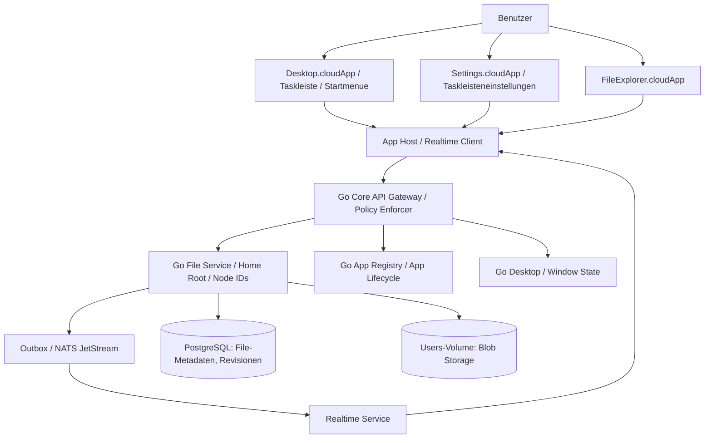
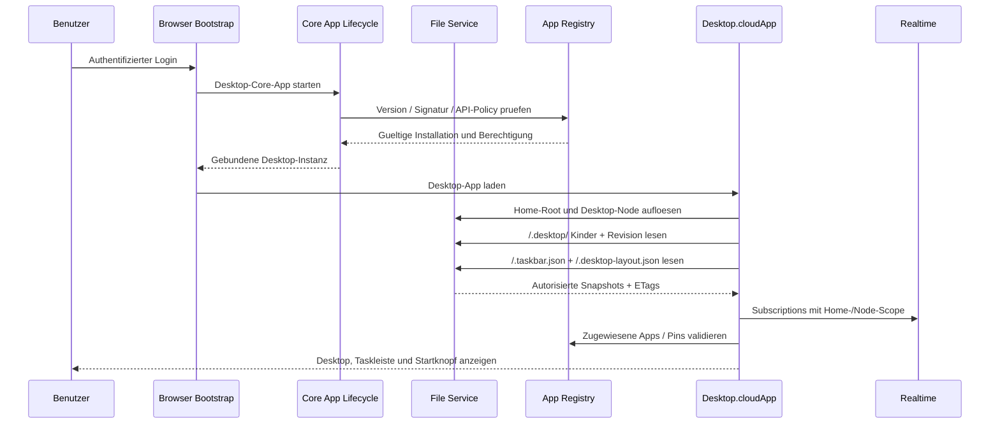
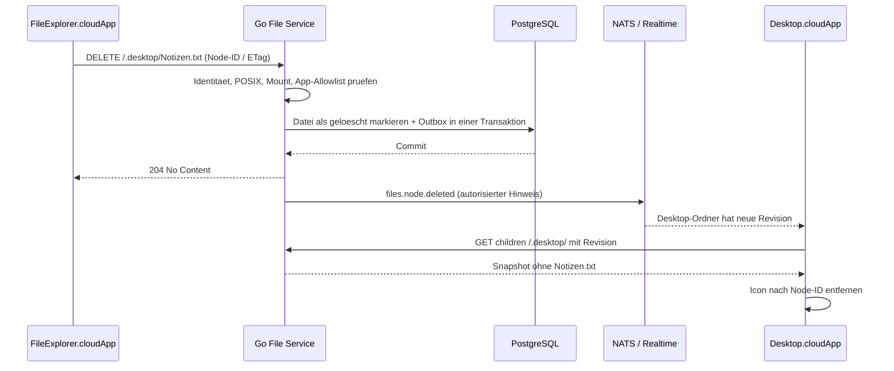

# cloudOS - Desktop, Taskleiste, Startmenue und Live-Dateisystem

> **Pfad:** `docs/DESKTOP_ENVIRONMENT.md`  
> **Dokumentversion:** 0.1 (verbindliches Zielbild, noch nicht implementiert)  
> **Stand:** 15.11.2026  
> **Repository:** [Drezael/cloudOS](https://github.com/Drezael/cloudOS), Branch `main`  
> **Gepruefte Ausgangsbasis:** Commit `4662323f1b2b8f5d262bc3d1f7b8689eccdefdc1`  
> **Fachlich fuehrend fuer:** Desktop-Oberflaeche, Taskleiste, Startmenue, `.desktop`-Inhalte, versteckte Benutzerkonfiguration und Live-Synchronisation  
> **Referenzen:** [CONCEPT.md](CONCEPT.md), [SYSTEM_ARCHITECTURE.md](SYSTEM_ARCHITECTURE.md), [VIRTUAL_FILESYSTEM.md](VIRTUAL_FILESYSTEM.md), [APPLICATION_SYSTEM.md](APPLICATION_SYSTEM.md), [APP_API_ACCESS.md](APP_API_ACCESS.md), [AUTHENTICATION_AUTHORIZATION.md](AUTHENTICATION_AUTHORIZATION.md), [SHARING_SPACES.md](SHARING_SPACES.md)

---

## 1. Produktentscheidung und Geltungsbereich

Der cloudOS-Desktop verhaelt sich in den beschriebenen Kernfunktionen wie ein klassischer Linux-Mint- oder Windows-Desktop, ohne deren Kernel oder Shell zu emulieren. `Desktop.cloudApp` ist eine signierte, mitgelieferte und bei der Anmeldung gestartete **Core-App**. Sie rendert Desktop, Taskleiste, Startknopf, Startmenue, Fensterrahmen, Desktop-Icons und Kontextmenues. Sie enthaelt **nicht** die autoritative Benutzerverwaltung, den VFS-Dateibaum oder eine zweite Dateiablage. Diese Funktionen bleiben Go-Core-Diensten vorbehalten.

Die folgenden Entscheidungen sind **verbindlich**:

1. Eine immer vorhandene Taskleiste besitzt einen sichtbaren **Start-Button**; dieser oeffnet ein vollwertiges Startfenster/Startmenue.
2. Der Benutzer kann die Taskleiste durch seine **Taskleisteneinstellungen** an `top`, `bottom`, `left` oder `right` platzieren. Die Position ist **pro Benutzer**, nicht global.
3. Die persoenlichen Taskleisteneinstellungen werden in einer **versteckten Datei im eigenen Home-Root** gespeichert: `/.taskbar.json` (entspricht `~/.taskbar.json`).
4. Alles, was der Benutzer direkt auf seinem Desktop als **Datei, Ordner oder App-Verknuepfung** sieht, stammt ausschliesslich aus dem VFS-Verzeichnis `/.desktop/` seines Home (entspricht `~/.desktop/`).
5. Aenderungen innerhalb `/.desktop/` wirken **ohne Neu-Laden der Browserseite**: erstellen, loeschen, umbenennen, verschieben, ueberschreiben und Rechteaenderungen.
6. Aenderungen koennen vom Desktop, File Explorer, einer zugelassenen App, der virtuellen Shell oder einem zweiten Browser-Tab kommen. Das gleiche autoritative File-Service-Modell gilt fuer alle.
7. Nur installierte, berechtigte `.cloudApp`-Anwendungen duerfen ueber Startmenue, Taskleiste oder Desktop-Verknuepfung gestartet werden. Eine Verknuepfung ist **kein** installiertes App-Paket.
8. Das Zwei-Volume-Modell bleibt unveraendert. `/` meint weiterhin ausschliesslich das Home des angemeldeten Benutzers; `/.desktop/` ist **kein drittes Laufwerk**.
9. Alle sichtbaren Elemente werden ueber das zentrale cloudOS-Designsystem themable gestaltet, einschliesslich vertikaler Taskleisten und offenem Startmenue.
10. SaaS-/Browser-typische Einschraenkungen, mehrere Tabs und unterbrochene Verbindungen sind in den Fehlermodellen ausdruecklich beruecksichtigt.

**Nichtziel:** Es wird weder eine zweite Dateidatenbank fuer Desktop-Icons noch ein direktes Browser-Mount auf Host-Verzeichnisse eingefuehrt. Ein allgemeines Ausfuehren unregistrierter Apps bleibt verboten.

## 2. Begriffe und Zustandsverantwortung

| Begriff | Bedeutung | Autoritative Stelle |
|---|---|---|
| **Desktop Shell** | Installierte `Desktop.cloudApp` (ID `io.cloudos.desktop`) | App Registry / Lifecycle Service |
| **Desktop-Inhalt** | Direkte Kinder von `/.desktop/`, inklusive Dateien, Ordnern, Verknuepfungen | VFS / File Service |
| **Taskbar Config** | Persoenliche Taskleistenposition, Pins, Verhalten | VFS-Datei `/.taskbar.json` |
| **Icon Layout** | Optionale Positionen, Anordnung und Ansichtseinstellungen pro Node-ID | VFS-Datei `/.desktop-layout.json` |
| **Desktop State** | Laufende Fenster/Instanzen und nicht dateigebundener Zustand | Desktop State / Window State Service |
| **Startmenue** | Interaktive UI der Desktop Shell, die installierte und zugewiesene Apps anzeigt | App Registry + lokaler UI-State |
| **VFS-Ereignis** | Hinweis auf eine autorisierte Datei-/Konfigurationsaenderung | File Service Outbox / NATS / Realtime |
| **Datei-Snapshot** | Aktuell autorisierte Verzeichnisauflistung samt Revision | File Service |
| **Shortcut** | Validierte Verknuepfungsdatei mit Zielreferenz, kein ausführbares Paket | `/.desktop/*.cloudlink` |

**Einzige Datenquelle je Inhalt:** `Desktop State Service` darf Fensterpositionen und laufende Instanzen speichern, aber **nicht** die Liste der Desktop-Dateien als zweites autoritatives Inventar. Der Browser darf einen Cache halten, dieser ist nach VFS-Ereignissen zu invalidieren.

## 3. Architektur und Dienstgrenzen



### 3.1 Aufgaben der `Desktop.cloudApp`

- Darstellung des Desktops und seiner Icons aus dem autorisierten Verzeichnis-Snapshot.
- Startknopf, Startmenue, App-Suche, Liste angehefteter/laufender Apps.
- Orientierung der Taskleiste an vier Bildschirmraendern und dynamisches Re-Layout.
- Desktop-Kontextmenue, Dateityp-Aktionen, Doppelklick und Drag-and-Drop.
- Anzeige des eigenen Home-Inhalts **nur** fuer `/.desktop/`, nicht beliebiger fremder Homes.
- Realtime-Subscription auf das eigene Desktop-Verzeichnis und die zwei Benutzerkonfigurationsdateien.
- Lokales, latenzarmes Rendern; serverseitige Speicherung nur bei Aenderung.

### 3.2 Aufgaben des Core

- File Service: autorisierte Verzeichnisauflistung, Dateimodifikation, Einstellungen-Datei-Lesen/Schreiben, Mount- und POSIX-Pruefung.
- Identity/Permission: Sitzungsidentitaet, Home-Root, ACL/POSIX, VFS-Scope und signierte App-API-Allowlist.
- App Registry: installierte, freigegebene Apps und ihre Metadaten; kein unregistrierter App-Start.
- Lifecycle: kontrollierter Start einer App-Instanz per API.
- Realtime: gefilterte, autorisierte Hinweise auf Datei- und App-Aenderungen, keine pauschalen Event-Broadcasts.
- Desktop/Window State: persistenter Fenstermetadatensatz, nicht der Dateibaum in `/.desktop/`.
- Settings Core Service: andere Nutzer-/Systemeinstellungen; die Taskleisten-Datei bleibt davon unabhaengige, fachlich autoritative VFS-Ressource.

### 3.3 Aufgaben der `Settings.cloudApp`

Ein Rechtsklick auf eine freie Stelle der Taskleiste bietet **Taskleisteneinstellungen** an. Die Desktop Shell startet oder fokussiert dazu `Settings.cloudApp` mit einem erlaubten Deep Link auf den Taskleisten-Abschnitt. Die Settings-App liest und schreibt die persoenliche `/.taskbar.json` **ueber die File-API**. Ein separater gestarteter Settings-Prozess ist eine eigene `.cloudApp`-Instanz mit **eigener** signierter Endpoint-Allowlist. Die Desktop-App darf dessen privilegierte API-Berechtigungen nicht erben.

## 4. Zwei Festplatten, ein persoenliches Home und die Dateipfade

Technisches VFS nach [VIRTUAL_FILESYSTEM.md](VIRTUAL_FILESYSTEM.md):

```text
system:/                                # Nur Administrations-Mount; Core-Pakete, Themes
users:/
|-- homes/
|   |-- <user-uuid-A>/                 # Wird fuer Benutzer A als / angezeigt
|   |   |-- .desktop/                 # AUTORITATIVER Desktop-Inhalt
|   |   |   |-- Example.cloudlink
|   |   |   |-- Notizen.txt
|   |   |   `-- Projekte/
|   |   |-- .taskbar.json             # AUTORITATIVE Taskleisteneinstellungen
|   |   |-- .desktop-layout.json      # Optionale Icon-Anordnung
|   |   |-- Documents/
|   |   |-- Downloads/
|   |   `-- .config/
|   `-- <user-uuid-B>/
|       |-- .desktop/
|       |-- .taskbar.json
|       `-- ...
`-- shared/
    `-- spaces/                        # Bereits spezifizierte Spaces; kein neues Laufwerk
```

Benutzer A sieht bei `pwd`: `/` und erreicht seinen Desktop mit `cd /.desktop`. Bei Benutzer B liefert **derselbe** Pfad einen anderen Root-Knoten. `../`, fremde Node-IDs oder direkter Zugriff auf `users:/homes/...` erlauben keinen Mount-Ausbruch.

### 4.1 Verbindliche Pfade und Unix-Modi

| VFS-Pfad im eigenen Home | Typ | Vorgeschlagener Initialmodus | Zweck |
|---|---|---|---|
| `/` | Home-Root | `0700` | Privater Standard-Root, abweichende Freigaben nur explizit |
| `/.desktop/` | Ordner | `0700` | Einzige Quelle fuer sichtbare Desktop-Inhalte |
| `/.taskbar.json` | Versteckte Datei | `0600` | Position, Pins, Verhalten der Taskleiste |
| `/.desktop-layout.json` | Versteckte Datei | `0600` | Layout pro stabiler Node-ID, keine Desktop-Objekte |

Die Root-Modi sind initiale Defaults; das Identity-/VFS-Modell entscheidet ueber tatsaechliche Rechte. Die **Desktop-Shell** benoetigt dieselben signierten File-API-Berechtigungen und Home-Scopes wie jede andere App. Der Besitz einer Datei im Home ist keine pauschale API-Freigabe fuer fremde `.cloudApp`-Instanzen.

Versteckte Namen beginnen mit `.`. **Versteckt** ist eine Darstellungseigenschaft, keine Sicherheitskontrolle; die wirksame Zugriffssperre entsteht aus POSIX, Home-Mount, App-Scope und Serverautorisierung.

### 4.2 Keine zweite Desktop-Ablage

Das fruehere Verzeichnis `/Desktop/` aus alten Architekturbeispielen ist **nicht mehr kanonisch**. Ab dieser Version gilt ausschliesslich `/.desktop/`. Der File Explorer kann einen Navigationsfavoriten **Desktop** anzeigen, dessen Ziel `/.desktop/` ist. Er darf **keine zweite** Kopie von `/Desktop/` mit anderem Inhalt fuehren.

Ein physischer Linux-Pfad, ein lokaler Browser-Ordner oder `localStorage` duerfen nicht als alternative autoritative Desktop-Quelle verwendet werden.

## 5. Home-Provisionierung und Migration

Bei idempotenter Benutzer-Provisionierung legt der File Service `/.desktop/` sowie die initialen Dateien `/.taskbar.json` und `/.desktop-layout.json` unter der stabilen Home-Root-ID an; der Identity Service stoest den Vorgang nur an.

1. Der Dienst bestimmt den Home-Root ausschliesslich aus der authentifizierten User-ID.
2. Er validiert, dass die reservierten Pfade frei oder bereits gueltig angelegt sind.
3. Er erzeugt fehlende Objekte mit privaten POSIX-Modi.
4. Er schreibt die Konfiguration in versioniertem JSON und haelt ETags/Revisionen vor.
5. Er markiert die Provisionierung erst nach dauerhaftem Commit als bereit.
6. Wiederholungen erzeugen weder doppelte Ordner noch neue Shortcut-Kopien.

**Migration bisheriger `/Desktop/`-Daten:** Eine spaetere Migration erkennt einen vorhandenen alten Desktop-Ordner, transferiert dessen Inhalte kontrolliert in `/.desktop/` und protokolliert Umbenennungs-/Dateinamenkonflikte. Bei Konflikten werden keine Dateien ueberschrieben; Nutzer oder Admin entscheidet. Optional wird fuer eine klar befristete Migration ein **Alias** auf denselben Node eingefuehrt, niemals ein zweiter Dateibaum. Erst nach erfolgreicher Verifikation wird der Altpfad stillgelegt. Fuer den aktuellen Repository-Stand existiert noch keine implementierte Migration.

**Fehlertoleranz:** Wird `/.desktop/` durch defekte Metadaten unlesbar, zeigt der Desktop einen Fehler- und Wiederherstellungszustand, ohne ein fremdes Home anzuzeigen. Der Systemordner selbst ist als reserviertes Home-Objekt vor versehentlichem Umbenennen/Verschieben/Loeschen geschuetzt. Seine **Kinder** bleiben bei ausreichenden Rechten ganz normal loeschbar.

## 6. Desktop-Inhalt aus `/.desktop/`

Alle **direkten Kinder** von `/.desktop/` werden als Icons oder Ordner dargestellt; fuer Unterordner wird die innere Struktur erst beim Oeffnen im File Explorer angezeigt.

| VFS-Kind | Desktop-Darstellung | Aktion |
|---|---|---|
| Gewoehnliche Datei | Dateityp-Icon und Dateiname | Oeffnen mit installierter, berechtigter App |
| Ordner | Ordner-Icon und Name | `FileExplorer.cloudApp` mit diesem Node starten |
| `*.cloudlink` | Shortcut-Icon mit Verknuepfungsmarker | Kontrollierte Zielauflosung und ggf. App-Start |
| `.cloudApp`-Archiv | Paketdatei, **keine** ausfuehrbare App | Admin-Kontextmenue kann Installer starten |
| Unbekannter Typ | Generisches Datei-Icon | Dateitypauswahl oder Eigenschaften |
| Verstecktes Kind `.*` | Standardmaessig nicht gezeichnet | Optionaler Modus 'Versteckte Dateien anzeigen' |

**Dateiname ist nicht Identitaet:** Icons werden nach `node_id` identifiziert. Umbenennen aktualisiert den angezeigten Namen; ein Verschieben aus dem Verzeichnis entfernt das Icon; ein Verschieben hinein erzeugt das Icon. Ein Ordner wird erst angezeigt, wenn sein VFS-Commit abgeschlossen ist.

### 6.1 Desktop-Aktionen

- **Erstellen:** Neue Datei/Ordner werden unter dem Desktop-Root angelegt, ueber normale File-API mit `parent_id`.
- **Loeschen:** Datei/Ordner wird nach der VFS-Loeschregel bzw. Papierkorb verschoben; das Icon verschwindet nach Commit.
- **Umbenennen:** File Service validiert Name, Kollision, Rechte und Revision; UI aktualisiert Icon-Label.
- **Drag-and-Drop:** Quelle/Ziel sind VFS-Node-IDs, Operationen wie `move` oder `copy` werden durch File Service autorisiert.
- **Ablage vom Dateimanager:** Nach einer erfolgreichen Verschiebung nach `/.desktop/` erscheint der Eintrag ohne Browser-Reload.
- **Mehrere Browserfenster:** Ein gemeinsamer VFS-Stand, individuelle lokale UI-Fokuszustaende; Konflikte werden ueber Revisionen behandelt.
- **Papierkorb:** Das Loeschen eines Desktop-Eintrags fuehrt nicht zum automatischen Loeschen referenzierter Share-/Space-Ressourcen, wenn nur eine Verknuepfung entfernt wurde.

### 6.2 Versteckte Inhalte in `/.desktop/`

Per Default blendet die Desktop-Shell Namen mit fuehrendem Punkt aus, weil der Benutzer sie ueblicherweise nicht als normale Icons sehen moechte. Der File Explorer zeigt `/.desktop/` nach seiner eigenen Option fuer versteckte Dateien an. Auch wenn die UI etwas ausblendet, kann der File Service niemals einen unautorisierten Zugriff durchlassen.

## 7. App-Verknuepfungen und das `.cloudlink`-Format

Eine Verknuepfung ist eine **nicht ausfuehrbare Daten-Datei** (Schemaentwurf) im Benutzer-Home. Sie ist weder selbst `.cloudApp` noch ein Weg, ein Paket ohne Installation auszufuehren.

```json
{
  "schema_version": "1.0",
  "kind": "app_shortcut",
  "title": "File Explorer",
  "target": {
    "app_id": "io.cloudos.file-explorer"
  },
  "icon": {
    "kind": "app_default"
  }
}
```

Fuer Datei-/Ordnerverknuepfungen ist ein separater Typ vorgesehen:

```json
{
  "schema_version": "1.0",
  "kind": "vfs_shortcut",
  "title": "Aktueller Projektordner",
  "target": {
    "node_id": "1f8e8ab6-e5e1-4e7e-8fd6-68ca283dc977"
  },
  "icon": {
    "kind": "default"
  }
}
```

- Der File Service prueft Besitz/Leserechte der `.cloudlink`-Datei. Der Shortcut-Resolver prueft erneut das **Ziel** samt Benutzerrecht und App-Zuweisung.
- Das Desktop-Programm darf aus dem `target` keine beliebige URL, Host-Shell, `javascript:`-Adresse oder Storage-Key ausfuehren.
- Der App-Start nutzt den offiziellen App Lifecycle Service und dessen signierte API-Allowlist. Uninstallierte oder gesperrte Apps bleiben als **nicht startbare** Shortcuts mit erklaerbarem Fehler sichtbar.
- Zielreferenzen verwenden stabile IDs statt Namen; Namensaenderungen brechen eine VFS-Verknuepfung nicht.
- Das Loeschen einer `.cloudlink` entfernt **nur die Verknuepfung**, niemals automatisch deren Ziel.
- Verknuepfungen koennen durch eine vertrauenswuerdige UI im File Explorer erstellt werden. Ihre Inhalte sind **nicht** Vertrauensanker oder freigegebene App-Berechtigungen.
- Bytegroesse, JSON-Tiefe, Zeichenlaenge und Felder werden strikt begrenzt; unbekannte kritische Felder fuehren zur Ablehnung der Verknuepfung.
- Ein Shortcut in einen Space oder eine interne Freigabe wird nur gestartet, solange der entsprechende Share-/Space-Mount und die ACL existieren.

**Offen fuer ADR:** Dateiendung `.cloudlink` und JSON-Feldnamen sind Vorschlaege. Die **Trennung zwischen Verknuepfung und installierter `.cloudApp`** ist bereits verbindlich.

## 8. UI-Komponenten der `Desktop.cloudApp`

Die Core-App nutzt das gemeinsame Designsystem und implementiert mindestens:

1. `DesktopRoot` - der visuelle Arbeitsbereich ohne Taskleiste.
2. `DesktopIconGrid` - Darstellung von File-Service-Nodes mit stabilen Schluesseln.
3. `DesktopContextMenu` - neue Datei/Ordner, Einfuegen, Ansicht, Sortieren, Eigenschaften.
4. `Taskbar` - Panel am gewaehlten Bildschirmrand mit Startknopf, Pins, Fensterliste und Statusbereich.
5. `StartButton` - immer erreichbar, ueber Theme-Tokens anpassbar.
6. `StartMenu` - App-Suche, installierte verfuegbare Apps, Kategorien, Aktionen.
7. `TaskbarContextMenu` - Eintrag 'Taskleisteneinstellungen'.
8. `WindowHost` - Darstellung aktiver installierter Apps, Z-Order, Resize und Fokus.
9. `DesktopNotifications` - autorisierte Integration mit Notification Center.
10. `DesktopRealtimeController` - Snapshot-, Watch- und Reconnect-Logik.
11. `DesktopSettingsController` - Lesen/Validieren der versteckten VFS-Dateien.
12. `DesktopRecoveryView` - sichere Wiederherstellung bei fehlenden Konfigurationen.

**Keine starre Fenster-Verschachtelung:** `StartMenu` ist UI-Bestandteil der Desktop-App und wird **nicht** als unabhaengige gestartete App behandelt. `Settings.cloudApp` und `FileExplorer.cloudApp` sind dagegen eigene gestartete App-Instanzen.

## 9. Taskleiste: Platzierung und Layout

### 9.1 Vier verbindliche Positionen

| Position | Panel-Achse | Arbeitsflaeche | Startmenue-Verankerung |
|---|---|---|---|
| `bottom` (Standard) | Horizontal, unterer Rand | Oberhalb der Leiste | Oeffnet nach oben, am Startknopf orientiert |
| `top` | Horizontal, oberer Rand | Unterhalb der Leiste | Oeffnet nach unten |
| `left` | Vertikal, linker Rand | Rechts der Leiste | Oeffnet seitlich nach rechts |
| `right` | Vertikal, rechter Rand | Links der Leiste | Oeffnet seitlich nach links |

Wird die Position geaendert, berechnet der Browser Arbeitsbereich, Fenster-Maximierung, Snap-Zonen, Drag-Grenzen, Tooltips und Startmenue neu. **Alle vier Varianten sind funktional gleichwertig**, nicht nur kosmetisch durch Rotation von Icons.

### 9.2 Pflichtfunktionen

- Startknopf bleibt an einem eindeutig zugaenglichen Panel-Ende, auch wenn vertikale Leisten schmal werden.
- Liste geoeffneter Fenster und laufender App-Instanzen mit Fokus-/Minimieren-/Wiederherstellen.
- Optional angeheftete Apps, getrennt von gerade laufenden Instanzen.
- Statusbereich: Benachrichtigungen, Uhrzeit, Sitzungs-/Netzwerkstatus soweit dafuer Core-APIs vorgesehen und genehmigt sind.
- Kontextmenue: `Taskleisteneinstellungen` und nur die autorisierten lokalen Aktionen.
- Bei zu wenig Platz: Overflow-Bereich, Scrolling oder gepruefte Kompaktansicht ohne Abschneiden kritischer Aktionen.
- Klare Fokusreihenfolge und sichtbarer Tastaturfokus; Tooltip-Positionen aendern sich mit der Kante.
- Responsive Verhalten fuer Desktop-, Tablet- und kleine Browserfenster unter Wahrung der Startfunktion.

### 9.3 Einstellungen und Benutzererlebnis

Der Benutzer kann unter `Settings.cloudApp > Personalisierung > Taskleiste` mindestens auswaehlen:

- Position `top`, `bottom`, `left`, `right`.
- Automatisches Ausblenden `true`/`false` (als vorgesehene Option; MVP kann mit `false` beginnen).
- Panel-Dichte und Groesse im begrenzten Theme-Token-Rahmen.
- Angeheftete Apps (nur installierte/zugewiesene Apps beim Start wirksam).
- Optional Verhalten der Fenstergruppierung und Statussymbole.

**Direktes Verschieben per Drag-and-Drop** des Panels ist spaeter moeglich, aber nicht noetig fuer die erste Abnahme. Die Auswahl aller vier Positionen in den Taskleisteneinstellungen ist Pflicht.

## 10. Taskleisten-Konfigurationsdatei `/.taskbar.json`

Die **versteckte Datei liegt im Benutzer-Home**, nicht in der Systemplatte, nicht im Browser-Storage und nicht in einer Settings-eigenen Datenbank. Das folgende JSON ist ein Schemaentwurf:

```json
{
  "schema_version": "1.0",
  "position": "bottom",
  "auto_hide": false,
  "size": "normal",
  "group_windows": true,
  "show_clock": true,
  "show_notifications": true,
  "pinned_apps": [
    "io.cloudos.file-explorer",
    "io.cloudos.settings"
  ]
}
```

**Normative Regeln:**

- Datei ist UTF-8/JSON; Dateiname exakt `/.taskbar.json` im Benutzer-Mount.
- Bei neuem Benutzer initialer Wert `position=bottom`.
- `position` akzeptiert ausschliesslich `top`, `bottom`, `left`, `right`.
- `size` ist eine definierte Enum; keine frei einspeisbaren CSS-Fragmente, Skripte oder Pfade.
- `pinned_apps` enthaelt registrierte App-IDs. Nicht installierte oder nicht zugewiesene Apps werden **nicht ausgefuehrt**; Anzeige kann deaktiviert bleiben.
- Aenderungen nutzen `If-Match`/ETag oder erwartete Revision, um das gegenseitige Ueberschreiben zweier Tabs zu verhindern.
- Der File Service prueft Dateigroesse, JSON-Schema und Owner/Mount/Rechte. Der zustaendige Config-Adapter validiert zusaetzlich die fachlichen Werte.
- Erfolgreiche Writes werden als Datei-Aenderungen im VFS verbucht und erzeugen die regulaeren File-Service-Ereignisse.
- Die Settings-App darf diese Datei nur mit eigenen signierten Operationen und Benutzerrechten aendern.
- Ist die Datei abwesend, defekt oder nicht verfuegbar, verwendet der Desktop einen sicheren eingebauten Fallback; es wird **keine** fremde Benutzerkonfiguration angezeigt.
- Das Loeschen von `/.taskbar.json` ist als **Zuruecksetzen auf Defaults** interpretierbar. Automatische Neuerzeugung erfolgt durch einen kontrollierten, idempotenten Provisionierungs-/Recovery-Aufruf.
- Ungueltige Inhalte fuehren zu einer sichtbaren Warnung und Fallback, nicht zu Codeausfuehrung oder zum Blockieren des gesamten Logins.

**Verantwortung:** Die vom Core gespeicherten Datei-Bytes sind die Wahrheit. Eine kurzlebige Browser-Kopie ist nur Cache/Preview. Der Settings Service darf diese Werte nicht als zweite dauerhafte Wahrheit fuehren.

## 11. Layoutdatei `/.desktop-layout.json`

Die Reihenfolge/Position von Icons ist von den Icons selbst getrennt. Die Icons sind VFS-Knoten in `/.desktop/`; Layoutdaten enthalten ausschliesslich Darstellungseigenschaften zu **stabilen** `node_id`-Werten.

```json
{
  "schema_version": "1.0",
  "view": "grid",
  "sort": "manual",
  "icon_size": "medium",
  "positions": {
    "1f8e8ab6-e5e1-4e7e-8fd6-68ca283dc977": {
      "column": 0,
      "row": 0
    }
  }
}
```

Ein geloeschter Node bleibt nicht als Phantom-Icon bestehen; der Browser zeigt ausschliesslich tatsaechlich vorhandene und autorisierte Nodes. Verwaiste Positionen koennen spaeter bereinigt werden. Der Layoutparser begrenzt Mapgroesse/Koordinaten und ermoeglicht bei korrupten Daten einen sicheren automatischen Grid-Fallback.

**Keine Inhaltsverdopplung:** Der Desktop darf aus `positions` **keine Dateien erzeugen** und keine dort referenzierten, nicht existierenden Nodes anzeigen.

## 12. Start-Button und Startfenster

Beim Klick auf den Start-Button oeffnet sich ein **Startfenster** in der Orientierung der Taskleiste. Nochmals klicken, `Escape`, ausserhalb klicken oder einen erlaubten Startvorgang abschliessen schliesst es entsprechend dokumentiertem UI-Verhalten.

### 12.1 Inhalte des Startmenues

- Installierte und fuer den Benutzer freigegebene Anwendungen, gelesen aus dem App Registry Service.
- Suchfeld fuer **verfuegbare Apps**; optional spaeter zugelassene Dateisuche im eigenen Home.
- Kategorien, zuletzt verwendete und angeheftete Apps, sofern Datenschutz-/Policy-Regeln dies erlauben.
- Sichtbare Aktionen zu Einstellungen, Abmelden und Sitzungsfunktionen durch getrennte Core-Endpunkte.
- Eintrag `File Explorer` startet die installierte `FileExplorer.cloudApp`.
- Uninstallierte Apps koennen nicht gestartet werden und werden nicht als startbare Ergebnisse angeboten.

### 12.2 Launch-Sicherheit

Ein Startmenue-Klick liefert lediglich eine **App-ID** an den kontrollierten App Lifecycle. Der Go-Core prueft Installation, aktuelle Paketintegritaet, Zuweisung, signierte App-API-Allowlist, Benutzerrolle, App-Instanz und Runtime-Voraussetzungen. `Desktop.cloudApp` darf niemals allein wegen ihrer privilegierten Rolle andere Apps mit zusaetzlichen Rechten starten.

Bei Widerruf einer App-Zuweisung werden Eintraege im Startmenue/Taskbar nach einem Registry-Event invalidiert; bereits laufende Instanzen werden gemaess zentraler Policy behandelt.

### 12.3 Tastatur und Accessibility

- Startknopf als echtes Button-Control mit Accessibility-Name, sichtbarem Fokus und `aria-expanded`-Zustand.
- Startmenue besitzt definierte Fokussteuerung, `Escape`, Pfeiltasten und Enter, ohne globale Tastaturkollisionen mit eingebetteten Apps.
- Fokus kehrt nach Schliessen sinnvoll zum Startknopf oder zur gestarteten App zurueck.
- Theme-Kontrast, Reduced Motion, Skalierung und Touch-Ziele gelten fuer **alle vier Positionen**.

## 13. Ablauf beim Login und Start von `Desktop.cloudApp`



**Datenquelle:** Bootstrap darf einen optimierten, serverseitig autorisierten Sammel-Endpunkt verwenden, aber dieser muss denselben File Service lesen und darf keine parallel gefuehrte Desktop-Inhaltsdatenbank einfuehren. Der Browser zeigt die UI auch bei temporaer unterbrochener Realtime-Verbindung mit den zuletzt erlaubten Snapshots, solange diese nicht widerrufen sind; fuer neue sicherheitskritische Aktionen bleibt die Core-Pruefung unverzichtbar.

## 14. Live-Synchronisation: keine Seitenneuladung

### 14.1 Autorisierte Verzeichnisbeobachtung

Die Desktop-Shell abonniert die **stabile Node-ID** des eigenen `/.desktop/`-Ordners, nicht einen unvalidierten clientseitigen Pfad. Die Konfigurationsdateien werden analog ueber ihre Node-ID oder eine kontrollierte Home-Konfigurations-Subscription beobachtet.

1. **Snapshot laden** (`children`, `revision`, `snapshot_cursor`).
2. **Subscription** mit autorisierter Home-/App-Instanz starten und einen vom Server validierten Cursor uebergeben.
3. **Race vermeiden:** Aenderungen zwischen Snapshot und Subscription duerfen nicht verloren gehen. Die API muss Cursor-/Replay- oder atomare Snapshot-und-Subscribe-Semantik besitzen.
4. Ereignis empfangen: passender File-Knoten/Ordner und gueltige Policy.
5. **Resync:** Autoritative Kinderliste mit ETag oder Cursor erneut abfragen; Node-Diff anhand stabiler IDs berechnen.
6. UI inkrementell aktualisieren, ohne das Browserdokument neu zu laden.
7. Bei Reconnect, Cursor-Luecke, Queue-Overflow oder Policy-Revisionwechsel den autoritativen Snapshot vollstaendig neu laden.

Ein WebSocket-Event ist eine **Invalidierung/Benachrichtigung**, nicht die einzige Wahrheit ueber Dateiinhalt, Berechtigung und Benennung. Das verhindert, dass Duplikate oder vertauschte Zustellungen falsche Icons erzeugen.

### 14.2 Beispiel: Datei wird im File Explorer geloescht



Dasselbe gilt fuer `files.node.created`, `updated`, `moved`, `deleted` sowie fuer `files.permissions.changed`. Bei **Move aus `/.desktop/`** wird ein Entfernen, bei **Move hinein** ein Hinzufuegen erkannt. Aenderungen durch die Shell, ein anderes Tab oder eine berechtigte App funktionieren identisch.

### 14.3 Datei-Aenderung von Taskleisten-Einstellungen

1. Settings-App schreibt einen validierten neuen Inhalt nach `/.taskbar.json` mit `If-Match`.
2. File Service committet Inhalt/Revision und Outbox atomar.
3. Das Realtime-System signalisiert dem Desktop die Aenderung der Konfiguration.
4. Desktop laedt die Datei neu, validiert sie und setzt die neue Panel-Position ohne Browser-Reload um.
5. Jeder weitere angemeldete Tab desselben Benutzers uebernimmt den geaenderten Stand.

### 14.4 Datenfluss und Datenschutz

Events duerfen **nur** an Sessions mit gueltigem Home-Mount, Datei-Listenrecht und App-API-Berechtigung gesendet werden. Es gibt keine globale Topic-Sicht auf andere Home-Verzeichnisse. Bei Entzug von Rechten muss der Client den gesperrten Inhalt aus dem UI entfernen, statt ihn aus einem alten Cache weiter anzuzeigen.

## 15. API-Entwurf, Endpoint-Allowlist und Routing

Die folgenden Endpunkte/Operation-IDs sind **Entwuerfe**. Die finalen OpenAPI-Vertraege werden versioniert; Client-Routen aus einer App-Datei erzeugen keine Berechtigung.

| Methode / Pfad (Entwurf) | Fachlicher Owner | Funktion |
|---|---|---|
| `GET /api/v1/users/me/home` | Identity/VFS | Eigene Home-Root-ID und verfuegbare Standardordner referenzieren |
| `GET /api/v1/files/{id}/children` | File Service | Desktop-Ordner listen, Revision/Cursor erhalten |
| `GET /api/v1/files/{id}` | File Service | Eigene Node-Metadaten |
| `POST /api/v1/files` | File Service | Datei/Ordner unter erlaubter Parent-ID anlegen |
| `PATCH /api/v1/files/{id}` | File Service | Umbenennen/Verschieben mit Rechte-/ETag-Pruefung |
| `DELETE /api/v1/files/{id}` | File Service | Loeschen/Papierkorb gemaess VFS-Policy |
| `GET /api/v1/files/{id}/content` | File Service | Versteckte Konfiguration/Shortcut lesen |
| `PUT /api/v1/files/{id}/content` | File Service | Taskbar-/Layout-Konfiguration atomar ersetzen |
| `GET /api/v1/apps/available` | App Registry | Installierte, zugewiesene Apps fuer Startmenue/Pins |
| `POST /api/v1/apps/{id}/launches` | App Lifecycle | Berechtigte App-Instanz starten |
| `GET /api/v1/events/ws` | Realtime | Autorisierte Datei-/App-Subscriptions und Resync-Hinweise |

Fuer den Spezialfall `/.desktop` kann die File API nach erfolgreicher Home-Aufloesung eine serverseitige **well-known folder**-ID bereitstellen. Das ist kein zweiter Dateibaum und kein pauschaler Zugriff auf `system:/`.

### 15.1 Minimal notwendige `Desktop.cloudApp`-Operationen

- Eigenes Home bzw. autorisierte Well-known-Node-IDs aufloesen.
- Eigene Desktop-Ordnerkinder lesen und eigene Konfigurationen lesen.
- Auf berechtigte File-Service-Aenderungsereignisse subscriben.
- Zugewiesene Apps fuer Startmenue und Pins anzeigen.
- Installierte Apps mit erlaubtem `launch` starten.
- Settings-App mit freigegebenem Intent oeffnen.
- Optional Datei-Aktionen aus Kontextmenues, soweit einzeln in `permissions/api-access.json` signiert und durch Benutzer/Scopes genehmigt.

**Keine stillschweigende Privilegienerweiterung:** Eine Desktop-App darf **nicht** automatisch `users:/`, `system:/`, fremde Homes, App-Installer-Adminoperationen oder alle File-APIs ansprechen. Eine `Settings.cloudApp` benoetigt separat ihre eigene signierte Berechtigung zum Aktualisieren von `/.taskbar.json`.

### 15.2 Beispiel einer signierten `api-access.json`-Teilmenge

```json
{
  "schema_version": "1.0",
  "api_contract": "cloudos.core.v1",
  "endpoints": [
    {
      "operation_id": "files.children.list",
      "method": "GET",
      "path": "/api/v1/files/{id}/children",
      "resource_scope": "own_home",
      "reason": "Desktop-Ordner anzeigen und aktualisieren"
    },
    {
      "operation_id": "files.contents.read",
      "method": "GET",
      "path": "/api/v1/files/{id}/content",
      "resource_scope": "own_home",
      "reason": "Taskleisten- und Layoutkonfiguration lesen"
    },
    {
      "operation_id": "applications.available.list",
      "method": "GET",
      "path": "/api/v1/apps/available",
      "resource_scope": "own_session",
      "reason": "Installierte und freigegebene Startmenue-Apps anzeigen"
    }
  ]
}
```

Dieses Beispiel ist **keine vollstaendige** Desktop-Core-App-Allowlist und muss vor der ersten Signierung gegen die tatsaechliche OpenAPI-Registry validiert werden. Die Strings sind Platzhalter bis zur Contract-Festlegung.

### 15.3 Eigene Konfiguration aendern ohne App-Rechteausweitung

Die Settings-App schreibt die benutzereigene Datei mit File-API und einem **serverseitig auf den registrierten Taskbar-Node gebundenen** Scope. Die effektiven Rechte ergeben sich aus **signierter App-Deklaration UND Installationsfreigabe UND Benutzerrechten UND VFS-Root UND Ressourcenscope**. Aus dem Menueeintrag `Taskleisteneinstellungen` entsteht keine automatische Schreibberechtigung fuer `Desktop.cloudApp`.

## 16. Realtime-Vertrag und interne Core-Dienste

Empfohlene Eventmetadaten:

```json
{
  "event_id": "0a9fe06e-6d48-4ef8-99af-7b67e0920ad7",
  "event_type": "files.node.deleted",
  "event_version": 1,
  "owner_scope": "user_home",
  "affected_parent_id": "77a56104-297c-4c98-a5ca-1568b554e8d5",
  "node_id": "1f8e8ab6-e5e1-4e7e-8fd6-68ca283dc977",
  "revision": 43
}
```

Das Beispiel stellt **keine frei abonnierbaren Roh-NATS-Nachrichten** dar. Das Realtime-Gateway normalisiert und filtert Ereignisse serverseitig und uebergibt nur fuer den Client zulaessige Metadaten. Echte Events erhalten ausserdem Trace-/Zeitfelder nach dem zentralen Event-Vertrag. Fuer Berechtigungsentzug und Sessionwechsel sind gezielte Cache-Invalidierungen vorgesehen.

Core-intern bleiben File Service, App Registry, Desktop/Window State und Realtime getrennte Owner. Bei anfaenglicher Ausfuehrung in einem Go-Prozess gelten dieselben Ports, Berechtigungsgrenzen und Event-Vertraege wie bei spaeteren getrennten Services.

## 17. Parallelzugriffe, Konflikte und Offline-Verhalten

| Szenario | Verpflichtendes Verhalten |
|---|---|
| Zwei Tabs verschieben dieselbe Taskleiste | ETag/Revision verhindert stilles Ueberschreiben; zweite Instanz aktualisiert den Stand |
| Datei wird in Tab A geloescht | Tab B entfernt Icon nach Update ohne Reload |
| Datei wird umbenannt | Node-ID bleibt erhalten, Position bleibt sofern moeglich |
| Datei wird aus Desktop herausverschoben | Icon verschwindet; nur Layoutreferenz darf verwaisen |
| Datei wird auf Desktop verschoben | Icon erscheint nach Commit/Resync |
| Ein Share wird widerrufen | Shortcut bleibt ggf. als nicht nutzbar, aber Zielinhalt ist nicht zugreifbar |
| Ein App-Paket wird entfernt | Startmenue/Pins werden aktualisiert; Shortcut ist nicht startbar |
| WebSocket unterbrochen | UI zeigt sicheren Snapshot, resynchronisiert beim Reconnect |
| Event doppelt geliefert | Node-ID-/Revision-Diff ist idempotent |
| Datei `/.taskbar.json` korrupt | Fallback-Position `bottom`, nachvollziehbarer Fehlerhinweis |
| Ordner `/.desktop/` unerreichbar | Keine Daten aus anderen Roots; wiederholbare Recovery-Funktion |
| Verzeichnisrechte werden entzogen | UI wird invalidiert; unberechtigte Eintraege werden entfernt |
| VFS-Upload bricht ab | Kein halbes Desktop-Icon bis zum erfolgreichen Commit |

Beim Wechsel der Browsergeraetegroesse bleibt die persistente Taskleistenkante dieselbe. Eine temporaere, responsive Ueberlagerungsdarstellung darf die reale Konfiguration nicht ungefragt ueberschreiben.

## 18. Sharing und Spaces im Desktop

`/.desktop/` bleibt ein **persoenlicher Home-Ordner**. Interne Freigaben und Spaces sind weiterhin separate, autorisierte Mount-Ansichten im zweiten `users`-Volume. Ein Benutzer kann auf dem Desktop eine **Verknuepfung** zu einem ihm freigegebenen Ziel erzeugen; das fuehrt weder zu einer Kopie noch zu einem neuen Laufwerk.

- Ein Space-Shortcut oeffnet `Spaces.cloudApp` oder `FileExplorer.cloudApp` mit einer geprueften Space-Referenz.
- Das Loeschen des Desktop-Shortcuts loescht weder den Space noch eine intern geteilte Datei.
- Eine widerrufene Freigabe darf beim Doppelklick nicht aufgrund eines gecachten Handles wieder zugreifbar sein.
- Eine echte Datei, die in `/.desktop/` liegt und explizit geteilt wird, bleibt dort; ihr Teilen wird durch Sharing Service und VFS gesichert.
- Fremde Benutzer koennen das persoenliche `/.desktop/` nicht allein wegen eines Space-Rollenstatus durchsuchen.

Siehe [SHARING_SPACES.md](SHARING_SPACES.md) fuer das massgebliche Share-/Space-Modell.

## 19. Theming und Anpassbarkeit

**Alle** visuellen Desktop-Elemente - Taskleiste, Startbutton, Startfenster, Fensterliste, Statusbereich, Desktop-Icons und Kontextmenues - sind ueber Design-Tokens, Slots und Varianten anpassbar.

Vorgeschlagene, versionierte Tokenfamilien:

```text
panel.position
panel.orientation
panel.thickness
panel.background
panel.blur
panel.item.gap
startButton.icon
startButton.size
startMenu.width
startMenu.surface
startMenu.positioning
startMenu.cornerRadius
desktop.icon.size
desktop.grid.columnGap
desktop.grid.rowGap
desktop.selection.background
```

Die **Persistenz der gewaehlten Position** kommt aus `/.taskbar.json`; ein Theme darf die Farb-/Layoutwerte innerhalb sicherer Varianten beeinflussen, aber nicht ohne Benutzerentscheidung die gespeicherte Kante ueberschreiben. Der Theme Service bleibt fachlich fuer Theme-Pakete und Tokenauflosung fuehrend. Die UI-Policy stellt auch bei hoher Skalierung, hohem Kontrast oder Reduced Motion sichere Bedienbarkeit sicher.

## 20. Sicherheit und Bedrohungsmodell

| Risiko | Schutzmassnahme |
|---|---|
| Fremder Zugriff auf `/.desktop/` | Home-Mount, POSIX/ACL, App-API-Allowlist, File Service |
| Manipuliertes `/.taskbar.json` | Dateibesitz/0600, Schema-/Groessenvalidierung, Fallback |
| Shortcut startet ungeprueften Code | App Registry / Lifecycle prueft installierte `.cloudApp` |
| Shortcut `javascript:`/Host-Pfad | Strikt typisierte Zielreferenzen, keine URL-/Shell-Ausfuehrung |
| Node-ID eines anderen Benutzers | Serverpruefung der Root-Sicht und Berechtigung |
| Event enthaelt fremde Dateinamen | Serverseitige Subscription-Autorisierung, minimale Payload |
| Rechteentzug bei bestehendem Socket | Revalidierung und Cache-Invalidierung |
| Unsignierter Shortcut erschleicht Admin-Rechte | Daten-Datei erzeugt niemals Berechtigungsgrant |
| Config-Datei enthaelt CSS/JS | Typisierte Werte, keine freie HTML-/CSS-/JS-Ausfuehrung |
| Unberechtigte App veraendert Taskbar | App-Instanz/Allowlist/Benutzerrechte werden bei jedem Write geprueft |
| XSS ueber Dateinamen oder Shortcut-Titel | Striktes Escaping, sichere UI-Komponenten, CSP/Trusted Types-Strategie |
| Event-Sturm / DoS | Debounce, Coalescing, per-Session-Budget, Cursor-/Resync-Mechanismus |

**Keine Vertrauenskette ueber Dateinamen:** Die Endung `.cloudApp`, `.cloudlink`, ein Icon oder ein Dateiname genuegen nicht fuer Ausfuehrung, Installation oder Zugriff. Nur Core-APIs treffen diese Entscheidungen.

## 21. Performance-, Stabilitaets- und UX-Ziele

- Die Desktop-App zeigt einen lokalen UI-Zustand sofort; Dragging und Hover erzeugen keinen HTTP-Request pro Frame.
- Unter normalen Laborbedingungen soll eine erfolgreiche Datei- oder Konfigurationsaenderung typischerweise **innerhalb einer Sekunde** auf anderen verbundenen Desktop-Instanzen sichtbar sein. Dieser Wert ist ein **vorlaeufiges Testziel**, kein garantiertes Produkt-SLA.
- Die Startmenuesuche nutzt einen bereits geladenen, autorisierten Registry-Snapshot und wird bei App Registry Events aktualisiert.
- Desktop-Verzeichnislisten sind paginierbar bzw. begrenzt; fuer grosse Icon-Mengen kommen inkrementelle Updates und Virtualisierung in Betracht.
- Realtime-Subscriptions werden bei Sessionende sauber entfernt; offene Browser-Tabs duerfen keinen unbegrenzten Event-Rueckstand erzeugen.
- Aenderungen an Taskleiste/Layouts werden gebuendelt und mit Revision geschrieben, nicht bei jeder Mausbewegung.
- Uploads und grosse Datei-Bytes werden nicht als Teil der Desktop-Verzeichnisereignisse transportiert.

## 22. Verbindliche Abnahmetests

| ID | Testfall | Erfolgskriterium |
|---|---|---|
| DESK-01 | Benutzer meldet sich erstmals an | `/.desktop/`, `/.taskbar.json` und `/.desktop-layout.json` sicher provisioniert |
| DESK-02 | Login startet Desktop | Installierte, signierte `Desktop.cloudApp` geladen |
| DESK-03 | Taskleiste unten | `position=bottom`, Startknopf sichtbar |
| DESK-04 | Taskleiste oben | Panel und Menue korrekt nach unten verankert |
| DESK-05 | Taskleiste links | Vertikale Fensterliste, Menue nach rechts |
| DESK-06 | Taskleiste rechts | Vertikale Fensterliste, Menue nach links |
| DESK-07 | Taskleisteneinstellungen per Rechtsklick | Oeffnet installierte `Settings.cloudApp` im Taskleisten-Abschnitt |
| DESK-08 | Taskbar-Position wird geaendert | `/.taskbar.json` mit ETag aktualisiert |
| DESK-09 | Browser wird neu geladen | Letzte gueltige Position wiederhergestellt |
| DESK-10 | Gleicher User, zweiter Tab | Taskbar-Aenderung ohne Reload sichtbar |
| DESK-11 | Zwei verschiedene Benutzer | Konfigurationen und `/.desktop/` strikt getrennt |
| DESK-12 | Datei wird in `/.desktop/` erzeugt | Neues Icon ohne Reload |
| DESK-13 | Datei wird in `/.desktop/` geloescht | Icon ohne Reload entfernt |
| DESK-14 | Datei wird umbenannt | Label korrekt, `node_id` bleibt gleich |
| DESK-15 | Datei wird aus `/.desktop/` verschoben | Icon entfernt, Datei lebt im Zielordner weiter |
| DESK-16 | Datei wird in `/.desktop/` verschoben | Neues Icon erscheint |
| DESK-17 | Datei via Shell angelegt | Icon erscheint ueber denselben Eventpfad |
| DESK-18 | Datei via anderem Tab geloescht | Icon im ersten Tab entfernt |
| DESK-19 | Datei verschwindet bei Rechteentzug | Keine veraltete, unberechtigte Anzeige |
| DESK-20 | WebSocket faellt aus | Reconnect und REST-Resync korrigieren Icons |
| DESK-21 | Event dupliziert oder vertauscht | Kein Phantom-Icon oder doppelter Eintrag |
| DESK-22 | Snapshot/Subscribe-Race | Keine zwischenzeitliche Aenderung geht verloren |
| DESK-23 | Shortcut auf installierte App | App startet kontrolliert ueber Registry |
| DESK-24 | Shortcut auf unzugewiesene App | Start verweigert |
| DESK-25 | `.cloudApp`-Datei auf Desktop | Keine direkte Ausfuehrung; nur zulassige Installer-Aktion |
| DESK-26 | Shortcut auf geloeschtes Ziel | Sichtbare, sichere Fehlermeldung; kein unerlaubter Zugriff |
| DESK-27 | Shortcut loeschen | Ziel unveraendert |
| DESK-28 | Space-/Share-Shortcut nach Widerruf | Zugriff verweigert |
| DESK-29 | Config fehlt oder ist ungueltig | Safe Fallback ohne Login-Blockade |
| DESK-30 | Zwei Tabs schreiben denselben Config-Stand | Revisionskonflikt statt stiller Ueberschreibung |
| DESK-31 | Ungueltige Position in JSON | Schemafehler/Fallback, keine fehlerhafte UI |
| DESK-32 | Fremder User versucht fremde Node-ID | 403/404 ohne Datenleck |
| DESK-33 | Unberechtigte App schreibt Taskbar-Datei | 403, keine Aenderung |
| DESK-34 | Startmenue nach Deinstallation/Entzug | App kann nicht mehr gestartet werden |
| DESK-35 | Theme-Wechsel bei linker/rechter Taskbar | Alle Elemente weiterhin nutzbar |
| DESK-36 | Keyboard-only Startmenue | Vollstaendige Bedienung mit Fokussteuerung |
| DESK-37 | Touch/mobile Viewport | Startknopf und Taskbar erreichbar |
| DESK-38 | Tausende Desktop-Dateien | Begrenztes Laden und responsiver UI-State |
| DESK-39 | `/.desktop/` selbst loeschen | Core verhindert Zerstoerung des reservierten Home-Roots |
| DESK-40 | Home-Root und zwei VFS-Volumes | Kein Zugriff auf `system:/` fuer Standardbenutzer |

## 23. Umsetzung in Entwicklungsphasen

| Schritt | Arbeitspaket | Erforderliches Ergebnis |
|---|---|---|
| DESK-P0 | Normative Pfade und ADRs | `.desktop`, `.taskbar.json`, Layoutdatei und Namespaces freigegeben |
| DESK-P1 | Home-Provisionierung | Idempotente Erzeugung der reservierten Home-Ressourcen |
| DESK-P2 | VFS-Operationen und ETags | Sicheres Listen, Move/Delete, Konfigurationsdatei lesen/schreiben |
| DESK-P3 | Realtime-Vertrag | Snapshot-/Cursor-/Subscription-Race geloest und getestet |
| DESK-P4 | Desktop Core-App Shell | Signierte, gestartete App mit DesktopRoot/WindowHost |
| DESK-P5 | Taskbar 4 Kanten | Startknopf, Startmenue, Re-Layout, Maximieren |
| DESK-P6 | Taskbar Settings | Settings Deep Link und Schreiben nach `/.taskbar.json` |
| DESK-P7 | Desktop-Inhalte | Live-Grid aus `/.desktop/` und Dateiaktionen |
| DESK-P8 | Shortcuts | `.cloudlink`-Schema und kontrollierter App-/Dateistart |
| DESK-P9 | Multi-Tab und Recovery | Reconnect, Eventluecken, Konflikte, defekte Konfiguration |
| DESK-P10 | Theming/Accessibility | Alle Positionen und Startmenue visuell/mit Tastatur getestet |
| DESK-P11 | Vollstaendiger E2E-Test | Tests DESK-01 bis DESK-40 bestehen |

**Einordnung in den bestehenden Entwicklungsplan:** Pfade/Vertraege werden in Phase 0/1 festgelegt, Home-/VFS-Provisionierung in Phase 3-6, Desktop-Core-App und Taskbar in Phase 5, File Explorer in Phase 7, Events in Phase 8, App-Shortcuts in Phase 9 sowie Hardening spaeter. Realtime muss fuer die abschliessende Desktop-Abnahme bereits belastbar sein; Phasen koennen dazu gezielt iterieren.

## 24. ADR-Backlog

| ADR (Vorschlag) | Entscheidung |
|---|---|
| ADR-051 | `/.desktop/` als einzige autoritative Quelle, Migration des alten `/Desktop/` |
| ADR-052 | `/.taskbar.json` als Home-Konfigurationsdatei, Schema und ETag-Regeln |
| ADR-053 | `/.desktop-layout.json` und per-Node-ID Layoutreferenzen |
| ADR-054 | `.cloudlink`-Shortcut-Datenformat und sichere App-/Datei-Targets |
| ADR-055 | Directory-Realtime: Snapshot-/Subscribe-Cursor, Replay und Rechtewiderruf |
| ADR-056 | Vier-Kanten-Taskbar, Work-Area und Startmenue-Anker |
| ADR-057 | Datei-Endpunkt-Operation-IDs in signierten Core-App-Allowlists |
| ADR-058 | Taskbar-Settings Deep Link, getrennte App-Instanzen/Autorisierung |
| ADR-059 | Ersatz-/Migrationsstrategie fuer aeltere Home-Desktop-Verzeichnisse |
| ADR-060 | UI-Performance/Browser-/Accessibility-Matrix fuer den Desktop |

Die ADR-Nummern sind Vorschlaege. Die zuletzt vorhandenen ADRs der Gesamtarchitektur muessen vor der Vergabe auf Kollisionen geprueft werden; wo notwendig werden eindeutige Nummern vergeben.

## 25. Dokumentuebergreifende Invarianten

- `CONCEPT.md` beschreibt das Zielbild; diese Datei ist fachlich fuehrend fuer Desktop/Taskbar.
- `SYSTEM_ARCHITECTURE.md` beschreibt Go-Core-Besitz, App-/BFF-, Realtime- und Window-Servicegrenzen.
- `VIRTUAL_FILESYSTEM.md` ist fachlich fuehrend fuer Home-Mount, `users`-/`system`-Volumen, POSIX und Storage.
- `APPLICATION_SYSTEM.md` ist fuehrend fuer `.cloudApp`-Pakete, Core-App-Baseline und App Registry.
- `APP_API_ACCESS.md` ist fuehrend fuer signierte Endpoint-Allowlisten und die App-Instanzbindung.
- `APP_SIGNING.md` definiert weiterhin Paketvertrauen; eine `.cloudlink` ist kein signiertes App-Paket.
- `SHARING_SPACES.md` bleibt fuehrend fuer Share-/Space-Rechte; ein Desktop-Shortcut erteilt keine zusaetzlichen Rechte.
- `AUTHENTICATION_AUTHORIZATION.md` bleibt fuehrend fuer lokale Benutzer, Gruppen und POSIX-Rechte.
- Alle APIs, JSON-Schemas, Rust-/Web-Adapter und UI-Elemente sind hier **Architekturentwuerfe**, keine bestehende Implementierung.

## 26. Zusammenfassung

cloudOS stellt seinen Desktop als signierte und installierte `Desktop.cloudApp` bereit. Die Taskleiste besitzt einen Startknopf und ein Startfenster, ist durch den Benutzer an alle vier Bildschirmkanten verschiebbar und speichert ihre Einstellungen in der versteckten Datei `/.taskbar.json` im persoenlichen Home. Die tatsaechlich auf dem Desktop sichtbaren Dateien, Ordner und Verknuepfungen liegen ausschliesslich in `/.desktop/`. Der File Service ist die einzige Quelle fuer diese Inhalte. Realtime-Ereignisse sorgen zusammen mit autoritativen REST-Snapshots dafuer, dass Aenderungen unmittelbar und ohne Browser-Reload sichtbar werden, auch bei mehreren Tabs und unabhaengig davon, welche autorisierte Anwendung die Aenderung vorgenommen hat.
