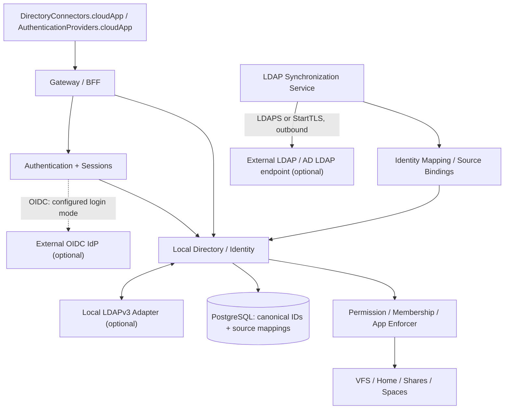
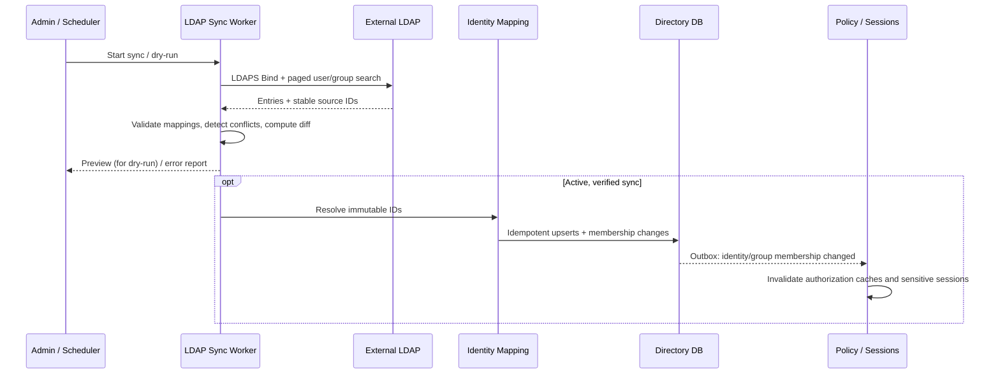

# cloudOS - Externe Verzeichnisse, LDAP-Synchronisation und optionale Identity Provider

> **Repository:** [Drezael/cloudOS](https://github.com/Drezael/cloudOS)  
> **Datei:** `docs/IDENTITY_INTEGRATION.md`  
> **Dokumentversion:** 0.1 (Zielarchitektur, Phase 0)  
> **Stand:** 15.11.2026  
> **Gepruefter Repository-Stand:** `main`, Commit `134ed30f78bda748e45a1f8c5c4fe77987e18b18`  
> **Fachlich fuehrend fuer:** lokale/externe Identitaetsquellen, LDAP-Imports und Synchronisation, IdP-Anbindung, Kontoverknuepfung, Fehler- und Sicherheitsregeln  
> **Abhaengigkeiten:** [AUTHENTICATION_AUTHORIZATION.md](AUTHENTICATION_AUTHORIZATION.md), [SHARING_SPACES.md](SHARING_SPACES.md), [VIRTUAL_FILESYSTEM.md](VIRTUAL_FILESYSTEM.md), [APP_API_ACCESS.md](APP_API_ACCESS.md), [APPLICATION_SYSTEM.md](APPLICATION_SYSTEM.md)

## 1. Produktentscheidung und Umfang

cloudOS nutzt zuerst den eigenen, in Go implementierten Directory Service und eine lokale Anmeldung. **Zusaetzlich wird die Architektur von Anfang an so gestaltet, dass Administratoren spaeter einen externen LDAP-Server optional anbinden und mit cloudOS synchronisieren koennen.** Ein externer Identity Provider (IdP) fuer den Login soll unabhaengig davon optional konfigurierbar sein. Beide Integrationen duerfen gleichzeitig verwendet werden, muessen aber eindeutig verknuepft sein.

Der lokale Directory Service bleibt die **kanonische Identitaets- und Referenzschicht von cloudOS**. Insbesondere bleiben `user_id`, `group_id`, VFS-Home-ID, Space-Mitgliedschaften, Shares, App-Zuweisungen, numerische UID/GID und Audit-Historie intern stabil. Externe Anbieter liefern Identitaetsinformationen oder einen Authentifizierungsnachweis; sie koennen keine lokalen Dateiberechtigungen durch ungepruefte Attribute ersetzen.

**Verbindlich:**

1. Lokale Benutzer/Gruppen funktionieren immer auch ohne externen Verzeichnisdienst.
2. LDAP-Synchronisation ist standardmaessig deaktiviert und wird ausschliesslich durch Administratoren konfiguriert.
3. Externe IdP-Anmeldung ist ebenfalls standardmaessig deaktiviert und eine getrennte Betriebsentscheidung.
4. Ein LDAP-Import erzeugt oder aktualisiert lokale Identitaeten anhand **stabiler Quellkennungen**, nicht allein anhand E-Mail oder Anzeigenamen.
5. Ein externer Entzug von Gruppenmitgliedschaft oder Kontoberechtigung muss lokal wirksam werden; Ausfaelle duerfen Rechte nicht still erweitern.
6. Freigaben, Spaces und Dateibesitz bleiben trotz LDAP-Reorganisation, IdP-Wechsel oder Umbenennung eindeutig zuordenbar.
7. Benutzer-, Gruppen-, LDAP- und IdP-Administrationsoberflaechen sind separat signierte `.cloudApp`-Core-Apps mit expliziten API-Allowlisten.
8. Die lokale Rechte-Policy und der App-API-Enforcer haben Vorrang vor externen Aussagen, die mehr Rechte nahelegen.

**Nicht fuer das MVP:** Vollstaendiger Active-Directory-Domain-Controller, Kerberos, SAMBA-/SMB-Domainintegration, LDAP-Writeback, automatische Vertrauensbeziehungen zu fremden Domains, SCIM-Provisionierung, Mandanten-Foederation. Diese Features benoetigen eigene Entscheidungen.

## 2. Trennung von Identitaet, Authentifizierung und Autorisierung

| Begriff | Quelle bzw. Service | Aussage |
|---|---|---|
| Lokales Verzeichnis | cloudOS Directory Service | Wer existiert, welche stabile ID/UID/GID und welche lokalen Gruppen und Quellbindungen existieren? |
| Externe LDAP-Quelle | Configured LDAP Connector | Welche Accounts, Gruppen und Attribute sind extern vorhanden? |
| Authentifizierung lokal | cloudOS Authentication Service | Ist das lokale Passwort/Passkey fuer diesen Account gueltig? |
| Authentifizierung extern | Optionaler OIDC IdP | Hat der externe Anbieter diesen Akteur authentifiziert? |
| Benutzerautorisierung | cloudOS Permission Service | Ist die konkrete cloudOS-Funktion erlaubt? |
| Dateizugriff | File Service + POSIX/Share/Space Policy | Darf dieser Akteur diese Ressource ueber diese Mount-Sicht lesen oder aendern? |
| App-Zugriff | App Policy Enforcer | Ist die API in genau dieser installierten App-Version signiert deklariert und freigegeben? |

**Ein erfolgreicher OIDC-Login gibt weder Zugriff auf eine fremde Home-Root noch auf beliebige Spaces, Share-Grants oder adminbezogene APIs.**

### 2.1 Architekturskizze

Der lokale LDAPv3-Adapter bietet eine **Ansicht der cloudOS-Daten**, waehrend der externe LDAP-Connector eine **separat konfigurierte Importquelle** ist. Diese Funktionen werden nicht versehentlich als zwei unabhaengige Master-Directorys betrieben.

## 3. Betriebsarten und Kombinationsmatrix

| Modus | Verzeichnisdaten | Login | Zustand |
|---|---|---|---|
| `local` | Lokal in cloudOS | Lokale Anmeldung | **MVP-Standard** |
| `ldap-sync-local-auth` | Lokale Daten + externer LDAP-Sync | Lokal verwaltetes Credential (falls Konto freigeschaltet) | Spaeter optional |
| `ldap-sync-ldap-bind` | Lokale Daten + externer LDAP-Sync | Externer LDAP-Bind fuer zugeordnete Accounts | Spaeter, eigener ADR |
| `local-directory-oidc` | Lokal in cloudOS | Externer OIDC IdP | Spaeter optional |
| `ldap-sync-oidc` | Externe LDAP-Quelle, lokal gespiegelt | Externer OIDC IdP | Spaeter optional, explizite Binding-Policy |

Ein Connector kann im `disabled`, `test`, `active` oder `suspended`-Zustand sein. Es darf nicht moeglich sein, durch unvollstaendige Konfiguration unbemerkt den Login einer gesamten Installation umzuschalten.

**LDAP-Synchronisation ist nicht gleich LDAP-Login.** Ebenso liefert OIDC normalerweise keine verlaessliche POSIX-Gruppen-/Dateirechteverwaltung. Diese Konzepte sind unabhaengig test- und konfigurierbar.

## 4. Kanonisches lokales Identitaetsmodell

### 4.1 Interne stabile Schluessel

Jeder Benutzer besitzt mindestens:

- `user_id`: einmalig vergebene unveraenderliche UUID.
- `uid_number`: eindeutige virtuelle POSIX-UID; bei importierten Accounts standardmaessig von cloudOS verwaltet.
- `username`, `display_name`, optional `email`: aenderbare Attribute mit Validierungsregeln.
- `primary_group_id`: stabile lokale UUID, deren `gid_number` fuer POSIX-Ansichten genutzt wird.
- `account_state`: `provisioning | active | disabled | quarantined | deleted_retained`.
- `home_root_node_id`: Eigentum und VFS-Root dieses Accounts; nur ueber die stabile User-ID zugeordnet.
- `source_type`, `source_binding_id`: `local`, `ldap` oder andere spaetere Adapter.
- `auth_policy_id`: bestimmt erlaubte Authentifizierungsverfahren.

Gruppen haben eine unveraenderliche `group_id`, eine lokale `gid_number`, eine Quellbindung und einen administrativen Status. Direkte und synchronisierte Mitgliedschaften werden mit **Quellherkunft** gespeichert, sodass ein LDAP-Sync nicht versehentlich lokale Gruppenbindungen loescht.

### 4.2 Mapping-Tabelle

| Feld | Bedeutung |
|---|---|
| `source_id` | UUID der konfigurierten LDAP-/OIDC-Quelle |
| `source_object_id` | Unveraenderliche externe Kennung, z. B. LDAP `entryUUID`/`objectGUID` |
| `local_principal_id` | Unveraenderliche lokale `user_id` oder `group_id` |
| `object_kind` | `user` oder `group` |
| `source_dn` | Aenderbarer LDAP-DN, nur Informations-/Suchwert |
| `last_seen_revision` | Letzte konsistente Sync-Version |
| `status` | `linked | missing | conflicted | disabled | tombstoned` |

Eindeutigkeitsbedingungen: `(source_id, object_kind, source_object_id)` ist einzigartig; eine externe Identitaet darf sich nicht auf zwei lokale Principals abbilden. Verknuepfung zweier bestehender Accounts benoetigt einen separaten, auditierbaren Administrationsworkflow.

**E-Mail, `cn`, `uid` und `sAMAccountName` duerfen fuer sich genommen keinen automatischen Account-Merge autorisieren.** Bei Konflikten wird der Datensatz zur manuellen Klaerung gestellt und nicht automatisch privilegiert.

### 4.3 UID/GID und externe POSIX-Attribute

Externe `uidNumber`/`gidNumber` sind fuer den Import **optional**. Als sicherer Default werden lokale eindeutige UIDs/GIDs vergeben und die externen Zahlen als informative Quellattribute gespeichert. Der Import externer Zahlen ist nur nach expliziter Mapping-Policy und Konfliktpruefung moeglich. Keine UID/GID wird nach Loeschung oder Deaktivierung unkontrolliert erneut vergeben, solange Datei- oder Audit-Referenzen existieren.

LDAP-Gruppen vom Typ `posixGroup`, `groupOfNames` oder AD-Gruppen werden ueber konfigurierte Mapping-Regeln in lokale Gruppen uebersetzt; unklare Mitgliedschaften gehen in einen Fehlerbericht, statt neue Rechte zu gewaehren.

## 5. Externer LDAP-Connector

### 5.1 Konfiguration

Ein Connector wird mit den folgenden strukturierten Feldern verwaltet:

| Feld | Typ | Regel |
|---|---|---|
| `id`, `name` | UUID, Anzeigename | Eindeutig innerhalb des Systems |
| `enabled` | bool | Standard `false` |
| `server_urls` | Liste | `ldaps://` oder `ldap://` nur mit erzwungenem StartTLS |
| `tls_trust_store_ref` | Secret-/Zertifikatreferenz | Zertifikatsvalidierung; kein Skip-Verify in Produktion |
| `bind_dn` | DN | Speziell angelegter Read-only-Serviceaccount |
| `bind_secret_ref` | Secret-Store-Referenz | Secret niemals in Markdown, DB-Logs oder App-Paket speichern |
| `users_base_dn`, `groups_base_dn` | DN | Eng begrenzter Suchbereich |
| `user_filter`, `group_filter` | Filtertemplates | Vorab validiert; keine ungeprueften User-Strings |
| `attribute_mapping` | Versionierte Mapping-Regeln | `uid`, stabile Object-ID, Namen, Gruppen |
| `sync_schedule` | Cron/Intervall (Entwurf) | Mindestabstand, Jitter, Backoff, manuelle Ausfuehrung |
| `missing_entry_policy` | Enum | `quarantine` als sichere Ausgangsoption |
| `group_authority` | Enum | `external_membership` oder `manual_overlay` explizit festlegen |
| `outage_policy` | Enum | Definierte Offline-/Stale-Grenzen |

Es werden keine freien Internet-URLs aus `.cloudApp`-Dateien angenommen. Ausgehende LDAP-Verbindungen sind auf administrativ erlaubte Hosts/Ports und sichere Netzwerkwege beschraenkt (SSRF-/Egress-Schutz).

### 5.2 Verbindungspruefung und Vorschau

Vor dem Aktivieren bietet die Verwaltungs-App:

1. TLS-Verifikation und LDAP-Bind mit Read-only-Konto.
2. Probe von Base-DNs und Filter-Syntax.
3. Pruefung der stabilen Objekt-IDs und Eindeutigkeit.
4. Beispielhafte Anzeige der Attribut- und Gruppenabbildung ohne Passwortdaten.
5. **Dry Run** mit Zaehlern fuer `create`, `update`, `disable`, `missing`, `conflict`, `group_membership_changes`.
6. Explizite administrative Bestaetigung der betroffenen Benutzer und Gruppen.

Ein Test darf keine Konten oder Gruppen anlegen, loeschen oder Berechtigungen aendern.

### 5.3 Sync-Prozess und Reihenfolge

- Pro Lauf existiert eine unveraenderliche `sync_run_id` und eine Quellrevision bzw. verifizierter Snapshot.
- Abfragen werden paginiert und mit Timeouts, Limits und Retry-/Rate-Budgets ausgefuehrt.
- Ein unvollstaendiger Lauf darf **keine** globale Loeschung durchfuehren; insbesondere sind `missing`-Entscheidungen nur nach einem vollstaendig erfolgreichen Scan erlaubt.
- Stabile Object-IDs werden vor DN-, Nutzername- und Mailattributen verarbeitet.
- Neue externe Gruppen werden angelegt, bevor referenzierende Mitgliedschaften aktiv werden.
- Benutzer-/Gruppenaenderungen und ihre Outbox-Ereignisse werden in lokalen Eigentuemerkontexten transaktional gespeichert.
- Nach Abbruch werden Staging-Deltas verworfen bzw. idempotent fortgesetzt. Kein halb durchgefuehrter globaler Austausch der Mitgliederlisten.

### 5.4 Konflikte und Loeschung

| Situation | Policy |
|---|---|
| Externer Anzeigename/E-Mail aendert sich | Lokales Profil gemaess Attribut-Herkunft aktualisieren; UUID und Home bleiben stabil |
| Externer DN aendert sich | Quellbindung anhand `source_object_id` aktualisieren |
| Externe UID/GID kollidiert | Konfliktbericht, keine Dateirechte neu zuordnen |
| Importierte Kennung kollidiert mit lokalem Account | Manuelle Identity-Link-Freigabe, keine automatische Fusion |
| LDAP-Eintrag fehlt bei erfolgreichem Scan | Erst Quarantaene/Grace; anschliessend gemaess dokumentierter Policy deaktivieren |
| LDAP-Verbindung faellt aus | Keine globale Benutzerloeschung; stale-Status anzeigen, Rechte nicht ausweiten |
| Externe Gruppe verliert Benutzer | Aktive gruppenbasierte Freigaben und Space-Rechte sofort nach Uebernahme neu berechnen |
| Externe Benutzergruppe wird geloescht | Zugeordnete Rechte sperren; Daten und Referenzen bleiben fuer Wiederherstellung erhalten |
| Wiederauftauchen derselben Quell-ID | Nach validierter Policy reaktivieren, UUID/UID/GID erhalten |

**Kein Loeschungsautomatismus:** Extern geloeschte Konten verlieren gemaess Sicherheits- und Aufbewahrungsrichtlinie die Login-Berechtigung; Home, Inhalte, von ihnen erstellte Freigaben und Space-Daten werden nicht blind vernichtet. Space-Eigentum gehoert dem Space, nicht dem importierten Konto.

### 5.5 Schreibbarkeit und Autoritaet

Die erste externe LDAP-Integration ist **einseitig extern -> cloudOS (read-only)**. Externe Accounts werden nicht ohne Weiteres ueber `UserManagement.cloudApp` ins Quellverzeichnis geschrieben. Die UI kennzeichnet Felder als `external-managed`, `local-overlay` oder `local-only`. Aenderungen an Quellattributen werden im externen System vorgenommen; lokale Rollen, App-Zuweisungen, Share-Grants und Space-Mitgliedschaften behalten ihre jeweiligen cloudOS-Autoritaeten.

**Passwoerter werden nicht synchronisiert.** `userPassword`, NT-Hashes oder andere Verifier werden weder importiert noch in lokal lesbare LDAP-Attribute konvertiert. Optionales LDAP-Bind-Login ist ein anderer, separater Authentifizierungsadapter.

## 6. Optionaler externer Identity Provider (IdP)

### 6.1 Protokoll und Auswahl

Geplant wird **OpenID Connect (OIDC), Authorization Code Flow mit PKCE und serverseitigem BFF** als erste externe Login-Integration. Andere Protokolle wie SAML benoetigen eigene Adapter und ADRs. Ein IdP kann ohne externen LDAP-Connector verwendet werden; externe LDAP-Synchronisation kann ohne IdP aktiviert sein.

Wichtige Konfiguration:

- `issuer_url` muss per TLS validiert und an eine administrativ erlaubte Adresse gebunden sein.
- OIDC Discovery, JWKS, `state`, `nonce`, PKCE, Signatur, `iss`, `aud`, `exp`, `iat`, gegebenenfalls `auth_time` und Schluesselrotation werden validiert.
- `client_id`, Secret-Referenz oder geeignete vertrauliche Client-Authentifizierung werden serverseitig gespeichert.
- `subject` wird immer zusammen mit `issuer` identifiziert: **`(issuer, sub)` ist die externe Login-Identitaet**.
- Browser bekommt nur sichere cloudOS-Session-Cookies, keine langlebigen allgemeinen Identity-Tokens.
- Nur erlaubte Redirect-URIs; keine dynamischen Redirects anhand von App-Eingaben.
- Login-Routing: lokale Authentifizierung, externer IdP oder beides nach expliziter Administrator-Policy; Notfallzugang separat.
- IdP-Gruppenclaims gelten nicht automatisch als lokale Systemrollen oder POSIX-Gruppen.

### 6.2 Verknuepfung mit cloudOS-Benutzern

Nach einem erfolgreichen Login:

1. BFF validiert den externen OIDC-Nachweis.
2. Identity-Mapping sucht eine explizite `(issuer, sub)`-Bindung.
3. Ein bereits gebundener `user_id` wird verwendet, sofern sein Konto aktiv und nicht lokal gesperrt ist.
4. Ohne Bindung wird Login zunaechst verweigert oder - wenn explizit freigeschaltet - ein streng begrenzter Provisioning-Flow gestartet.
5. Bei aktivem LDAP-Sync darf ein OIDC-Benutzer nur durch eine verifizierte, unveraenderliche **gemeinsame Quellkennung** oder explizite Admin-Freigabe gebunden werden.
6. E-Mail-/Benutzernamen-Aehnlichkeit ist **keine** sichere automatische Link-Regel.
7. Die lokale UID/GID, Home-Root und bestehenden VFS-/Space-/Share-Referenzen bleiben unveraendert.
8. Erst nach lokaler Konto-, Session- und Policy-Pruefung wird eine cloudOS-Sitzung erstellt.

Ein versehentliches Umstellen des Login-Providers darf Benutzer nicht mit neuen, leeren Homes statt ihren vorhandenen Daten anmelden lassen. Bindings koennen pruefbar exportiert und migriert werden, enthalten aber keine Secrets.

### 6.3 Fallback, Ausfall und Recovery

- Wenn der IdP nicht erreichbar ist, schlaegt eine neue externe Anmeldung geschlossen fehl. Die Existenz einer gueltigen Session folgt der konfigurierten Session-Policy.
- Lokale Anmeldung ist nur dann als Alternativweg erlaubt, wenn sie fuer den Benutzer/Admin explizit konfiguriert ist; **kein stiller Fallback** nach IdP-Fehler.
- Ein geschuetztes lokales Recovery-/Break-Glass-Admin-Konto ist vorgesehen, getrennt von importierten Gruppen und IdP-Autoritaet, mit besonderem Audit und sicherer Credential-Aufbewahrung.
- Deaktivierte oder gesperrte Benutzer bleiben gesperrt, selbst wenn der IdP gueltige Tokens ausstellt.
- Bei vertrauensrelevanten Gruppen-/Rollenwechseln werden Sessions und App-/File-Handles revalidiert beziehungsweise widerrufen.
- Bei IdP-Schluesselrotation darf die Anwendung nicht alle Signaturalgorithmen akzeptieren; nur festgelegte, sichere Algorithmen sind zulaessig.

## 7. Gruppensynchronisation und Freigaben / Spaces

### 7.1 Gruppenquellen und Mitgliedschaften

Eine lokale Gruppe kann `local` oder `external-managed` sein. **Quellgebundene Mitgliedschaften** werden mit Provenienz persistiert. Lokale Admins duerfen bei einer extern verwalteten Gruppe nicht still den externen Mitgliederbestand ueberschreiben. Eine eigene lokale Overlay-Gruppe kann fuer Sonderberechtigungen verwendet werden.

- Neue externe Gruppen bekommen stabile lokale Gruppen-UUIDs und GIDs.
- Shares an eine Gruppe referenzieren die **lokale `group_id`**, niemals einen veraenderlichen LDAP-DN.
- Space-Mitgliedschaften referenzieren lokale `user_id`/`group_id`.
- Bei entzogenem Gruppenmitgliedschaftsrecht verfallen Share-/Space-Zugriffe bei der naechsten autorisierten Aktion, ohne auf einen neuen Login zu warten.
- LDAP-Nesting ist optional und muss mit Tiefe-/Zykluslimits, einer dokumentierten Flattening-Policy und Tests abgesichert sein. Im MVP der externen Integration kann verschachtelte Gruppenzugehoerigkeit abgelehnt werden.

### 7.2 Spaces, Homes und getrennte Lebenszyklen

Ein externer Benutzer behalt seine cloudOS-Identitaet, UID/GID und das Home auf dem zweiten Volume. Gemeinsame Projekt-Spaces liegen ebenfalls auf dem **zweiten** Volume und haben **keinen persoenlichen Benutzer als Dateisystem-Lebenszykluseigentuemer**. Das Entfernen eines LDAP-Kontos darf keinen Space loeschen, in dem andere Benutzer Mitglied sind.

Auch eine extern synchronisierte Gruppe kann per expliziter Space-Zuordnung eine Rolle erhalten. Der Space Service fuehrt die Rollenentscheidungen aus, nie der LDAP-Connector. Detaillierte Regeln: [SHARING_SPACES.md](SHARING_SPACES.md).

## 8. Core-Dienste und Datenhoheit

| Dienst | Verantwortung | Daten |
|---|---|---|
| Directory / Identity | lokale UUID/UID/GID, Benutzer, Gruppen, Quellbindungen | `identity.*` |
| LDAP Synchronization | Connectoren, Lesejobs, Staging, Mappings und Deltas | `identity.ldap_sources`, `identity.sync_runs` |
| Authentication / Session | lokal oder extern Login-Nachweis, Sitzungspolitik | `auth.*` (Schemaentwurf) |
| OIDC Adapter | IdP-Konfiguration, Tokenvalidierung, `(issuer,sub)`-Bindings | `auth.identity_providers`, `identity.external_bindings` |
| Permission Service | Rollen und Konto-/Gruppenpolicies | `permissions.*` |
| Share Service | interner Empfaenger, Rechte, Widerruf | `sharing.*` |
| Space Service | Projekte, Mitglieder, Rollen, Quotas und Lifecycle | `spaces.*` |
| File Service | Nodes, POSIX-Modes, Root-Views und Inhalt | `files.*` |

Die physische Aufteilung in Prozesse kann in fruehen Phasen kompakt sein. **Datenhoheit und Schnittstellen bleiben getrennt**; ein Connector darf weder File-Tabellen noch Space-Membership-Tabellen direkt umschreiben. Der Ausfall des externen Directorys darf den File Service nicht als unautorisierten Fallback auf fremde Ressourcen veranlassen.

## 9. REST-/gRPC-Schnittstellen (Zielentwurf)

Die folgenden Operationen sind **vorgeschlagen und noch nicht implementiert**. Versionsstabilitaet und genaue Eingabeschemas werden in Phase 1 per OpenAPI/Protobuf festgelegt.

| HTTP | Route | Owner | Zweck | Policy |
|---|---|---|---|---|
| GET | `/api/v1/admin/directory-sources` | Directory Sync | Konfigurierte LDAP-Quellen | `identity.sources.read` |
| POST | `/api/v1/admin/directory-sources` | Directory Sync | Quelle anlegen (deaktiviert) | `identity.sources.manage` |
| PATCH | `/api/v1/admin/directory-sources/{id}` | Directory Sync | Aenderung / Aktivierung | `identity.sources.manage` + Step-up |
| POST | `/api/v1/admin/directory-sources/{id}/test` | Directory Sync | TLS/Bind/Filter testen | `identity.sources.test` |
| POST | `/api/v1/admin/directory-sources/{id}/preview` | Directory Sync | Read-only Dry Run | `identity.sources.preview` |
| POST | `/api/v1/admin/directory-sources/{id}/sync-runs` | Directory Sync | Sync starten | `identity.sources.sync` |
| GET | `/api/v1/admin/directory-sources/{id}/sync-runs` | Directory Sync | Lauf- und Fehlerstatus | `identity.sources.read` |
| GET | `/api/v1/admin/identity-providers` | Authentication | IdPs auflisten, ohne Secrets | `auth.providers.read` |
| POST | `/api/v1/admin/identity-providers` | Authentication | IdP als deaktiviert anlegen | `auth.providers.manage` |
| POST | `/api/v1/admin/identity-providers/{id}/test` | Authentication | Discovery/JWKS/Redirect pruefen | `auth.providers.test` |
| PATCH | `/api/v1/admin/identity-providers/{id}` | Authentication | IdP aktivieren/deaktivieren | `auth.providers.manage` + Step-up |
| POST | `/api/v1/admin/identity-links` | Identity | Identitaeten kontrolliert binden | `identity.links.manage` + Step-up |
| GET | `/api/v1/admin/identity-conflicts` | Identity | Konfliktfaelle ansehen | `identity.links.review` |
| POST | `/api/v1/auth/oidc/{provider_id}/start` | BFF | OIDC-Flow starten | Nur konfigurierter Login-Bootstrap |
| GET | `/api/v1/auth/oidc/{provider_id}/callback` | BFF | Provider-Callback | Nur validierter Flow-State |

**Admin-API-Prinzip:** Alle Verwaltungsoperationen werden vom Core erzwungen und sind fuer `.cloudApp` nur nutzbar, wenn die installierte Version diese Operationen in `permissions/api-access.json` signiert deklariert und die geschuetzte Core-App-Baseline sie freigibt. Geplante Operation-IDs sind stabil zu gestalten; keine URL-Wildcards.

### 9.1 Interne Nachrichten / Ereignisse

| Event | Wirkung |
|---|---|
| `identity.ldap.sync.completed` | Synchronisationsbericht, keine Geheimnisse |
| `identity.ldap.sync.failed` | Administrativer Alarm, definierte Retry-Policy |
| `identity.source.binding.changed` | Authorisierungs-/Session-Cache revalidieren |
| `identity.user.disabled` | Aktive Sessions und Grants widerrufen |
| `identity.group.membership.changed` | Shares, Spaces und VFS-Entscheidungen neu auswerten |
| `auth.provider.changed` | Neue Logins folgen aktualisierter Policy |
| `auth.identity.binding.revoked` | Externe Anmeldungen dieser Bindung stoppen |

Ereignisse werden ueber Transactional Outbox zugestellt. Empfaenger sind idempotent; selbst bei Eventverlust muss eine sicherheitsrelevante Revision/TTL einen weiterhin gueltigen Schutz bieten.

## 10. Verwaltungs-Apps

| `.cloudApp` (vorgeschlagen) | Aufgabe | Auslieferung |
|---|---|---|
| `Settings.cloudApp` | Verwaltungs- und Navigationszentrale | Bereits definierte Pflicht-Core-App |
| `UserManagement.cloudApp` | Lokale/externe Accounts, Quellstatus, read-only Felder | Bereits geplante Core-App |
| `GroupManagement.cloudApp` | Gruppen und synchronisierte Mitgliedschaften | Bereits geplante Core-App |
| `DirectoryConnectors.cloudApp` | LDAP-Quellen, Mapping, Dry Run, Status, Konflikte | Spaetere geschuetzte Core-App |
| `AuthenticationProviders.cloudApp` | OIDC-Provider, Login-Routing, Test, Rollback | Spaetere geschuetzte Core-App |

Alle sind eigenstaendig signierte, installierte Pakete. Keine direkte Kopplung an die DB oder LDAP-Verbindungen aus Browser/WASM. Die UI bietet klare Warnungen vor aenderungsbedingtem Zugriffsverlust, eine explizite Freigabe und sichere Wiederherstellungsoptionen. Secrets werden nicht in Browser-LocalStorage oder App-Logs abgelegt. Die Theme-Faehigkeit jeder sichtbaren Komponente bleibt Pflicht.

## 11. Sicherheitsanforderungen

- Durchgaengig TLS mit Gueltigkeits-/Hostnamepruefung und verwalteten CA-Ketten; fuer LDAP entweder LDAPS oder verpflichtendes StartTLS vor Bind.
- Kein Anonymous-Bind oder unsichere Simple-Binds ueber Klartext im Produktivmodus.
- LDAP-Filter-, DN- und Attribut-Mapping-Eingaben validieren; keine LDAP-Injection.
- Read-only-Servicekonto fuer Synchronisation; Directory-Writeback ist keine Standardfunktion.
- SSRF-Schutz und ausgehende Firewall-Policy fuer LDAP- und IdP-Endpunkte.
- Quell-Identifikatoren signifikant gegen Vertauschung/Replay absichern; niemals aufgrund Namensgleichheit Rechte erteilen.
- Schutz gegen Massenloeschung/Quarantaene bei unvollstaendigem Sync oder falschem Filter.
- LDAP- und OIDC-Secrets ausschliesslich serverseitig mit Lifecycle/Rotation verwalten.
- Admin-Aktionen mit Risikoanzeige, Step-up soweit verfuegbar und revisionssicherem Audit.
- Bestaetigte Aenderungen an Gruppen, Rollen und Auth-Provider-Policies muessen absehbar wirksam werden; Timeouts und fail-closed Verhalten definieren.
- Datenschutzkonformes Logging: keine Passwoerter, Tokens, gesamten LDAP-Attribute oder privaten Verzeichnisinhalte protokollieren.
- Bei Aenderung der Quelle muessen all ihre alten Bindings explizit geprueft werden; keine implizite Umdeutung auf fremden Server.

## 12. Stufenweiser Implementierungsplan

| Schritt | Abhaengigkeit | Ergebnis und Abnahme |
|---|---|---|
| ID-01 | Lokale Identity v0.1 | Stabile `user_id`, `group_id`, UID/GID und Quellfelder |
| ID-02 | ID-01 | Datenbankmodelle fuer externe Bindings und Provenienz |
| ID-03 | ID-02 | Connector-Konfiguration, TLS-Trust und Secret-Referenzen |
| ID-04 | ID-03 | LDAP Read-only-Suche, Paginierung, Mapping und Dry Run |
| ID-05 | ID-04 | Konflikterkennung, stabile Links und idempotenter Upsert |
| ID-06 | ID-05 | Gruppen-/Mitgliedschaftsdelta und Authorization-Revision |
| ID-07 | ID-06 | Grace/Quarantaene statt Datenloeschung, Outage-Policy |
| ID-08 | ID-07 | Settings-/Connector-Admin-App, Audit und Recovery |
| ID-09 | ID-08 oder getrennt | OIDC IdP Discovery, PKCE, Session Mapping (ohne LDAP-Zwang) |
| ID-10 | ID-09 | Multi-Provider-Routing, sichere Bindings, lokale Recovery |
| ID-11 | ID-06 + Share/Space | Live-Gruppenentzug in File Shares und Spaces nachweisen |
| ID-12 | ID-10 | Failover-/Migrations-/Sicherheitstests, Runbooks |

Die Architektur wird bereits jetzt vereinbart, obwohl die echten Connectoren **erst in einer spaeteren Phase** implementiert werden. Lokaler Login und der lokale Directory Service bleiben das erste funktionierende Basissystem.

## 13. Test- und Abnahmematrix

| Test-ID | Fall | Erwartung |
|---|---|---|
| ID-T01 | LDAP-Quelle nicht konfiguriert | Lokalbetrieb funktioniert |
| ID-T02 | LDAP-Verbindung ohne TLS | Produktive Verbindung verweigert |
| ID-T03 | Falsches Zertifikat | Bind verweigert, keine Datenveraenderung |
| ID-T04 | Ungueltiges Read-only-Credential | Klarer Fehler, kein Import |
| ID-T05 | Unvollstaendiger paginierter Scan | Kein Massen-Disable |
| ID-T06 | Wiederholter gleicher Sync | Idempotent, keine doppelten Accounts |
| ID-T07 | Benutzer-DN aendert sich | Gleiche interne UUID/UID/Home |
| ID-T08 | Externe UID/GID kollidiert | Quarantaene, keine Rechteuebernahme |
| ID-T09 | E-Mail doppelt | Kein Auto-Merge |
| ID-T10 | Gruppe verliert Mitglied | Share-/Space-Zugriff entzogen |
| ID-T11 | Gruppe entfaellt | Rechte entzogen, vorhandene Daten erhalten |
| ID-T12 | LDAP-Ausfall | Bestand nicht geloescht, Status sichtbar |
| ID-T13 | Quellobjekt fehlt | Definierte Quarantaene-/Retention-Policy |
| ID-T14 | External managed group UI-Aenderung | Verboten oder gesonderter Overlay-Workflow |
| ID-T15 | IdP nicht konfiguriert | Local Login funktioniert |
| ID-T16 | OIDC invalides `iss` | Login verweigert |
| ID-T17 | OIDC invalides `aud`/Signatur | Login verweigert |
| ID-T18 | OIDC State/Nonce/PKCE fehlerhaft | Login verweigert |
| ID-T19 | `(issuer,sub)` unbekannt | Keine automatische Konto-Uebernahme |
| ID-T20 | Namens-/Mailgleichheit | Keine stille ID-Fusion |
| ID-T21 | Login extern, Konto lokal gesperrt | Login verweigert |
| ID-T22 | Gruppenclaim behauptet Admin | Keine Rolle ohne lokale Policy |
| ID-T23 | IdP-Ausfall | Kein ungewollter Local-Fallback |
| ID-T24 | Break-Glass-Admin | Authentifizierter, auditierter Recovery-Flow |
| ID-T25 | OIDC + LDAP in Kombination | Bindet ausschliesslich verifizierte lokale ID |
| ID-T26 | LDAP-Benutzer deaktiviert | Home und Space-Daten bleiben erhalten |
| ID-T27 | LDAP-Gruppenwechsel mit offener App | Rechte bei Request revalidiert |
| ID-T28 | Nicht deklarierte Verwaltungs-API | `403`, unabhaengig von Admin-Session |
| ID-T29 | Manuelle Provider-Konfigaenderung | Versionierte Policy und Audit |
| ID-T30 | Sync-Statusseite | Keine Secret- oder PII-Leaks |

Ergaenzend verpflichtend: fuzzing von LDAP-Filtern und Identity-Mapping, Lasttests bei grossen Gruppen, Reconnect-/Ausfalltests und Datenschutzpruefung der Logs.

## 14. Offene ADRs

| ADR | Entscheidung |
|---|---|
| ADR-ID-01 | Mapping-/Provenienzschema und externe Attribute-Autoritaet |
| ADR-ID-02 | LDAP-Sync-Intervalle, Paging, Voll- vs Delta-Sync, Massenaenderungs-Schwellen |
| ADR-ID-03 | Missing User, Disable/Retention und Offline-/Stale-Policy |
| ADR-ID-04 | UID/GID-Import oder interne Nummernvergabe |
| ADR-ID-05 | Externe Gruppen, Verschachtelung und lokale Overlay-Gruppen |
| ADR-ID-06 | LDAP-Bind-Login als zusaetzlicher Auth-Adapter |
| ADR-ID-07 | OIDC-Anbieter, Claims, PKCE, Provisionierung und Recovery |
| ADR-ID-08 | Sichere IdP-/LDAP-Accountverknuepfung ohne Namens-Matching |
| ADR-ID-09 | Secret Store und TLS-Zertifikatsverwaltung |

Alle ADRs sind zunaechst Backlog-Eintraege; sie werden nicht durch diese Uebersicht als implementiert behauptet.

## 15. Referenzen und Quellen

- [OpenCloud: IDM Service](https://docs.opencloud.eu/de/docs/next/dev/server/services/idm/information/) - Inspiration fuer bewusst minimalen internen LDAP-Dienst.
- [OpenCloud: Internal and External IdP](https://docs.opencloud.eu/de/docs/admin/configuration/authentication-and-user-management/) - Trennung interner/externer IdP- und Verzeichnisbetriebsarten.
- [OpenCloud: External OIDC IdP](https://docs.opencloud.eu/docs/next/admin/configuration/authentication-and-user-management/external-idp/) - Anforderungen an die IdP-Anbindung.
- [RFC 2307](https://www.rfc-editor.org/rfc/rfc2307) - LDAP-Schema fuer UNIX-Accounts und Gruppen.
- [RFC 4511](https://www.rfc-editor.org/rfc/rfc4511) - LDAPv3.
- [OpenID Connect Core 1.0](https://openid.net/specs/openid-connect-core-1_0.html) - externe Authentifizierungsnachweise.
- [OAuth 2.0 Security Best Current Practice](https://www.rfc-editor.org/rfc/rfc9700) - OAuth-Schutzanforderungen.

## 16. Zusammenfassung

cloudOS kann weiterhin eigenstaendig mit lokalem LDAP-kompatiblem Directory Service, lokalen Accounts und POSIX-artigen Dateirechten betrieben werden. Externe LDAP-Synchronisation und externe OIDC-Anmeldung werden als **unabhaengige, optionale, von Administratoren konfigurierbare** Adapter vorbereitet. Interne Identitaeten, Besitzrechte, Home-Verzeichnisse, Shares und Spaces bleiben langfristig stabil. Externe Quell- und Authentifizierungsdaten werden niemals direkt zu cloudOS-Superuser- oder App-API-Rechten.
