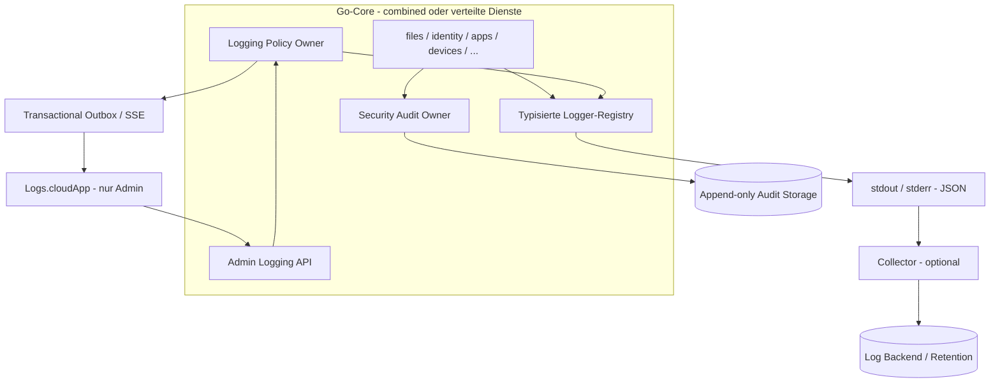

# cloudOS – Feingranulares Logging, Audit und Logs.cloudApp

> **Datei:** `docs/LOGGING_OBSERVABILITY.md`  
> **Version:** 0.1 – Architektur und Go-Bootstrap für cloudOS 0.12  
> **Stand:** 15.11.2026  
> **Führend für:** Log-Levels, Komponentenregeln, strukturierte Datensätze, Viewer/Settings, Security-Audit-Grenzen, Export, Datenschutz, Skalierung und Logging-Tests.  
> **Referenzen:** [SYSTEM_ARCHITECTURE.md](SYSTEM_ARCHITECTURE.md), [AUTHENTICATION_METHODS.md](AUTHENTICATION_METHODS.md), [APP_API_ACCESS.md](APP_API_ACCESS.md), [PUSH_REALTIME.md](PUSH_REALTIME.md), [CORE_DEPLOYMENT_SCALING.md](CORE_DEPLOYMENT_SCALING.md), [APPLICATION_SYSTEM.md](APPLICATION_SYSTEM.md)

## 1. Verbindliches Zielbild

cloudOS besitzt **ein zentral definiertes Logging-Framework** mit einem eigenen, logisch separaten Go-Core-Service `logging` und einer **vorinstallierten `Logs.cloudApp`** für den administrativen Zugriff. Die Fachmodule erzeugen strukturierte, typisierte Ereignisse; die Logging-Policy wählt Loggerkategorien, Stufen, Sampling und erlaubte Ausgabeziele. Der Service ist von der grafischen Oberfläche unabhängig und auch dann verfügbar, wenn die Logs-App nicht gestartet werden kann.

**Jedes Core-Modul** soll sein Logging dynamisch und unabhängig konfigurieren können. Beispielsweise darf `files.upload` für 15 Minuten auf `DEBUG` stehen, während `files.download`, `identity.auth`, `packages.verify` und andere Module weiterhin auf `WARN`/`INFO` stehen. Mehrere Kubernetes-Replikate folgen einer autoritativ gespeicherten Policy-Revision. Das Logging-System ist nicht mit dem **verbindlichen Security Audit** zu verwechseln: Ein Admin darf Diagnoselogs abschalten oder filtern, aber keine verpflichtenden Sicherheitsereignisse unterdrücken.

## 2. Begriffe und Datenströme

| Art | Beispiele | Verantwortlicher Owner | Änderung/Abschaltung |
|---|---|---|---|
| Diagnostisches Log | HTTP-Fehler, Upload-Retries, Queue-Lag, SDK-Fehler | Erzeugender Core-Service + Log Pipeline | Level/Sampling konfigurierbar |
| Sicherheits-Audit | Login-Fehler, Credential-Widerruf, Rechtänderung, System-App-Installation | Audit Owner | Nicht durch Logging-Level abschaltbar |
| App-Diagnostik | Eigene App-Fehler und Leistungsdaten | App + Logging Gateway mit `app_id`-Binding | Nur innerhalb signierter `logs.write`-Berechtigung |
| Betriebstelemetrie | CPU, Latenzen, Trace/Span | Observability/Collector | Getrennte Metrik-/Tracing-Policy |
| Benutzer-Benachrichtigung | Datei geteilt, App-Freigabe geändert | Notification Owner + SSE | Keine Umdeutung zu Audit |

## 3. Logische Architektur



**Default im ersten Test:** Go-Prozess im **einzigen Core-Container**, JSON-Logs nach `stdout`/`stderr`. Eine gesonderte Logging-Datenbank oder ein ELK-/Loki-Cluster ist für den Bootstrap **keine Voraussetzung**. Für eine produktive Logsuche wird ein kontrollierter Aggregations-/Persistenz-Adapter benötigt; Kubernetes speichert langlebige Logs nicht automatisch als fachliche Datenbank.

## 4. Feingranulare Loggernamen

Logger identifizieren eine **Fachquelle**, nicht nur einen Linux-Prozess:

```text
core.bootstrap
core.gateway.http
identity.auth.password
identity.auth.webauthn
identity.auth.ssh
identity.ldap.sync
sessions.lifecycle
permissions.posix
permissions.app
files.upload
files.download
files.vfs
apps.install
apps.runtime
apps.store
windows.lifecycle
windows.taskbar
logging.policy
logging.export
realtime.sse
realtime.projector
devices.broker
devices.usb
devices.serial
devices.keyboardwedge
spaces.membership
sharing.grants
```

**Namenskonvention:** `fachdienst.komponente[.unterkomponente]`; Regex/Schema werden in den Contracts fixiert. Zusätzliche installierte Apps erscheinen nur unter `app.<app_id>` und dürfen sich nicht als `core.*` oder `identity.*` ausgeben. Jeder Logeintrag erhält den aus dem vertrauenswürdigen Kontext ermittelten Dienst, Instanz, Logquelle und ggf. App-Instanz-ID.

## 5. Log-Level und Filterhierarchie

| Level | Anwendungsfall | Grundvorgabe |
|---|---|---|
| `TRACE` | Extrem detaillierte Diagnose nicht geheimer Ablaufmerkmale | Aus, nur kurzzeitig mit strenger Freigabe |
| `DEBUG` | Detaillierte Ablaufdiagnostik | Aus in Produktion, zeitbegrenzt aktivierbar |
| `INFO` | Erfolgreiche Starts, Zustandsübergänge, Deployments | Standard für wichtige Module |
| `WARN` | Unerwartete, aber tolerierte Zustände | Standard für hochfrequente HTTP-Operationen optional |
| `ERROR` | Operation fehlgeschlagen, Ursachekorrelation | Immer protokollieren, soweit verfügbar |
| `OFF` | Keine **diagnostischen** Logs der Quelle | Audit und Sicherheitskontrollen bleiben aktiv |

Aufsteigende Spezifität:

1. Globaler Fallback-Level (z. B. `INFO`).
2. Core-Dienst (z. B. `identity=INFO`).
3. Fachkomponente (`identity.auth=INFO`).
4. Exakte Loggerquelle (`identity.auth.webauthn=DEBUG`).
5. Zeitlich begrenzte Diagnose-Session (`identity.auth.webauthn=TRACE` bis TTL, dann automatisch zurücksetzen).

Logging-Policies haben `revision`, `updated_by`, `scope`, `level`, `expires_at`, `reason`, `sampling`, `sink_policy` und werden vom Policy Owner validiert. Der Client darf keine ungeprüften Level direkt in andere Core-Services schreiben. Die Policy verteilt sich per **SSE-/Core-Ereignis**; der Dienst setzt die Levelvariable ohne Neustart um. Bei einer Replika-Unterbrechung wird der zuletzt validierte Snapshot beibehalten oder auf einen sicheren Default zurückgesetzt; Security Audit bleibt aktiv.

## 6. Minimaler Runtime-Vertrag im Go-Code

Im technischen Bootstrap wird ein **zentrales `log/slog`-basiertes Loggingpaket** bereitgestellt. Es besitzt strukturierte JSON-Ausgabe, eine eigene Levelvariable je Quelle, sichere Basisattribute und eine Testgrundlage für Redaction/Level-Wechsel.

- `CLOUDOS_LOG_LEVEL` – globaler Bootstrap-Level (`TRACE`, `DEBUG`, `INFO`, `WARN`, `ERROR`, `OFF`).
- `CLOUDOS_LOG_LEVEL_OVERRIDES` – kommagetrennte Paare wie `core.bootstrap=DEBUG,files.upload=TRACE` für lokale Tests.
- Ungültige Werte werden **beim Start abgewiesen**, nicht ignoriert.
- `SetLevel` im vertrauenswürdigen Go-Kontext ist die vorbereitete Runtime-Funktion. Ein öffentliches HTTP-Endpoint zum Setzen darf **nicht** ohne vollständige Session-/Role-/Step-up-Autorisierung existieren.
- Zukünftig erhält jedes Modul einen `context.Context` und einen typisierten Logger für Scope/Trace-ID. Der Dienst kann per `logging`-Owner und Push einen Policy-Snapshot anwenden.

**Implementation-Status:** Das beigefügte Go-Paket implementiert **nur die grundlegende Registry und JSON-Redaction**, keine zentrale Persistenz, kein Kubernetes-Collector, keine Logs-UI und keinen Audit-Backend-Writer.

## 7. Strukturierter Datensatz

```json
{
  "timestamp": "2026-11-15T00:00:00Z",
  "severity": "WARN",
  "service": "files",
  "component": "files.upload",
  "instance": "cloudos-core-local",
  "trace_id": "00000000000000000000000000000001",
  "span_id": "0000000000000001",
  "request_id": "req-example-1",
  "actor_user_id": "user-id-pseudonym",
  "app_id": "org.example.editor",
  "event_name": "files.upload.retry",
  "message": "Upload wird erneut versucht",
  "attributes": { "retry_count": 2, "operation": "upload" }
}
```

Dies ist ein **Ziel-Schema**. Das reine Go-`slog`-Bootstrap verwendet standardmäßig dessen native JSON-Feldnamen `time`, `level`, `msg` sowie Zusatzfelder. Spätere Exporter normalisieren es auf OpenTelemetry-Konventionen. Die JSON-Namen im Beispiel werden nicht als bereits implementierte Ausgabe behauptet.

**Pflichtattribute für Diagnose:** UTC-Zeit, Level, Dienst, Instanz/Pod, Komponente, kontrollierter Eventname, Korrelations-ID falls vorhanden. User-ID nur mit Zweckbindung und Pseudonymisierung/Minimierung; keine pauschale Speicherung personenbezogener Dateinamen oder Suchbegriffe.

## 8. Sensible Daten strikt ausschließen

In keinem Logging-Level – auch nicht `TRACE` – erscheinen:

- Passwörter, Passwort-Hashes, OTP-Codes, WebAuthn-Antworten/Assertions/Challenges, SSH-Signaturen oder private Schlüssel.
- Auth-/Session-Cookies, Bearer-/API-Tokens, CSRF-Secrets, LDAP-Bind-Passwörter, interne Service-Credentials.
- Komplette Dateiinhalte, Barcode-Rohdaten, USB-Seriennummern, Dateipfade fremder Benutzer oder hochsensible Metadaten ohne begründeten Bedarf.
- HTTP-Request-Bodies als pauschales Debug-Logging, unredigierte Query-Parameter, `Authorization`-/`Cookie`-Headers.

**Redaction ist Defense-in-depth:** `slog.ReplaceAttr` filtert bekannte Schlüsselbezeichner. Das genügt **nicht**, wenn eine Fachkomponente Geheimnisse in einen allgemeinen `message`-String, ungetypten JSON-Blob oder falsch benannten Feldern platziert. Daher zusätzlich Pflicht zu strukturiertem Logging ohne rohe Eingaben, statische Semantikvalidierung und Negativtests gegen Secret-Leaks.

## 9. Audit ist unverzichtbar

Sicherheitskritische Aktionen werden unabhängig vom diagnostischen Log-Level in eine **append-only** Audit-Schnittstelle geschrieben. Geplant sind transaktionaler Outbox-Zustand, unveränderliche Benutzer-/App-/Geräte-/Rechteverweise, Prüfkette/Exportintegrität und gesonderte Retention. Audit-Ereignisse dürfen nicht durch eine App als Erfolg fingiert werden. Auch ein Administrator darf den fachlichen Audit-Writer nicht mit `OFF` deaktivieren. **Manipulationssicherheit erfordert einen vertrauenswürdigen separaten Speicher/Export**; nur eine PostgreSQL-Tabelle ohne weitere Schutzmaßnahmen ist nicht automatisch unveränderlich.

## 10. `Logs.cloudApp` als geschützte Core-App

- Signiert, in der Core-Baseline vorinstalliert, Bestandteil der **Settings**-Kategorien `System → Protokolle` und optional eigenständig startbar.
- Standardmäßiger App-Start nur für die Gruppe `Admin` plus `logs.view` und spezifische `logs.policy.manage` / `audit.view`-Rechte.
- Typisierte UI, die vollständig über das [WINDOW_FRAMEWORK.md](WINDOW_FRAMEWORK.md) läuft; kein Sonderzugriff auf Serverdateien oder Datenbanken.
- Dynamische Suche/Filter nach Zeit, Dienst, Instanz, Level, Korrelations-ID, Kategorie, App-ID, Ereignistyp, Ergebnis; sichere paginierte Abfrage mit Cursor für historische Daten.
- Live-Ansicht mit begrenzten, serverseitig autorisierten Push-Ereignissen; Überlastschutz und serverseitige Rate-Limits; kein blindes Broadcast an alle User oder Browser.
- Feingranulare Level-Änderung über Settings, Auswahl mehrerer Dienste, TTL und Grund; Vorschau der Sicherheits-/Datenschutzwirkungen vor aktivem `TRACE`.
- Export als revisionsgebundene, datenschutzbereinigte Datei mit Audit der Exportaktion; kein einfacher ungeprüfter Zugriff auf physische Containerlogs.
- Kritische Policies benötigen frische Anmeldung (Step-up) und eine echte Administratorberechtigung.
- Bei fehlendem Log-Backend zeigt die App einen nachvollziehbaren Status; andere Core-Apps und der Login dürfen weiterlaufen.

## 11. API-Entwurf

| Methode | Route | Zweck / Rechte |
|---|---|---|
| `GET` | `/api/v1/admin/logs/query` | Filter-/Cursor-Abfrage; `logs.view` |
| `GET` | `/api/v1/admin/logs/categories` | Kategorien und Konfigurierbarkeit; `logs.view` |
| `GET` | `/api/v1/admin/logs/policies` | Effektive Level und Revision; `logs.policy.view` |
| `PATCH` | `/api/v1/admin/logs/policies` | Revisionierte Änderung mit TTL, `logs.policy.manage` + Step-up |
| `POST` | `/api/v1/admin/logs/export` | Auditiert exportieren; `logs.export` |
| `GET` | `/api/v1/admin/audit/query` | Gesondert, nicht einfach per `logs.view`; `audit.view` |
| `POST` | `/api/v1/app-logs` | Eingeschränkter App-Diagnosekanal; `logs.write:own_app` |

**Wichtig:** `Logs.cloudApp` deklariert sämtliche benötigten Endpunkte in `permissions/api-access.json`. Die Core-Baseline genehmigt ihren spezifischen Admin-Scope; ihre App-ID allein berechtigt nicht. Drittanbieter-Apps dürfen nie `logs.admin.*` deklarieren und die App-eigene Schreib-API akzeptiert keine frei erfundenen `service`, `user_id` oder `severity=security_audit`.

## 12. Beispiel-Policy (Schemaentwurf)

```json
{
  "schema_version": "1.0",
  "revision": 42,
  "default_level": "INFO",
  "overrides": [
    { "category": "files.upload", "level": "DEBUG", "expires_at": "2026-11-15T01:15:00Z", "reason": "Support-Ticket" },
    { "category": "identity.auth.webauthn", "level": "WARN", "expires_at": null, "reason": "Standardbetrieb" }
  ],
  "retention": { "diagnostic_days": 14, "security_audit_days": 90 },
  "export_redaction_policy": "strict"
}
```

Die Tage sind **Illustrationswerte**; tatsächliche Retention/Datenschutzregelung muss vom Betreiber geprüft werden. Ein gleichnamiger JSON-Dateiname im Benutzerdatenspeicher ist **nicht** die maßgebliche globale Policy; diese liegt beim autoritativen Core-Service in PostgreSQL.

## 13. Realtime ohne Polling

`logging.policy.updated`, `logging.source.health.changed`, `logging.export.completed` werden über den Push Service als sichere Deltas verteilt. Eine Logs-Ansicht kann für den aktuellen Browser begrenzte Live-Streams abonnieren, deren Daten **pro Client** autorisiert und nach Rechten gefiltert werden. Ein Rechteentzug beendet diese Subscription sofort auf dem Server. Der Client pollt die Logsuche nicht. Erst beim initialen Öffnen, nach Cursor-Ablauf oder expliziter Benutzerabfrage ist ein REST-Snapshot vorgesehen.

## 14. Mehrere Core-Replikate und Kubernetes

- Jede Go-Replik schreibt strukturierte JSON-Logs nach stdout/stderr; Levelkonfiguration wird vom Logging Owner revisioniert und an alle Replikate verteilt.
- Pod-Namen/Instanzen sind Logfelder. Ein Collector aggregiert im späteren Split-Modus von allen Pods; keine Logs nur auf einer lokalen Platte, die beim Pod-Wechsel verschwinden.
- Kein zentrales, synchrones Netzwerk-Logging im kritischen Request-Pfad. Der Diagnose-Export muss asynchron, gepuffert und unter Last verlust-/retrybewusst sein.
- **Security Audit** wird dauerhaft und gesondert persistiert. Bei schwerem Audit-Fail muss die entsprechende kritische Operation sicher fehlschlagen oder über eine verifizierte transaktionale Warteschlange nachweisbar gesichert sein.
- `logging` ist ein eigener Core-Service im [CORE_DEPLOYMENT_SCALING.md](CORE_DEPLOYMENT_SCALING.md), zunächst im Combined-Modus. Getrennte Instanzen werden über Shared Storage und Logbackend koordiniert, nicht über lokale Logfiles.
- Im Default-Compose sind keine zusätzlichen Collectors oder Logdatenbanken automatisch aktiviert; diese werden später bewusst ergänzt.

## 15. Fehlerverhalten und Datenschutz

| Fehler | Erwartung |
|---|---|
| Logging Collector offline | Core-Dienste arbeiten nach kontrollierter Buffer-/Drop-Policy weiter; Metrik/Alarm |
| Audit-Persistenz ausgefallen | Sicherheitskritische Operationen nicht unbemerkt ohne Nachweis ausführen |
| Diagnose-Queue voll | Präferenziell `DEBUG`/`TRACE` droppen; Warnung/Counter, kein Blockieren kritischer UI |
| App spammt Logs | Quotas, Rate-Limit, Invalid-Drop, App-ID aus Core-Kontext |
| Nicht berechtigter User öffnet Logs-App | App unsichtbar und API `403`/nicht offenlegendes `404` |
| Admin setzt `TRACE` ohne TTL | Policy verweigert oder erzwingt begrenzte Laufzeit |
| Replik hat veraltete Policy | Versionierte Revision / sichere Rückfallpolitik |
| Defekter Logger | Bootstrap-/Diagnostic-Fehler melden; Sicherheitsfunktionen bleiben konsistent |

## 16. Test- und Abnahmematrix

| ID | Test | Erwartung |
|---|---|---|
| LOG-001 | JSON mit Level und Kategorie | Strukturiert, parsebar |
| LOG-002 | Global-Level `INFO` | `DEBUG` ausgefiltert |
| LOG-003 | Kategorie `files.upload=DEBUG` | Nur diese Loggerquelle detaillierter |
| LOG-004 | Subkategorien | Spezifischer Override vor Elternquelle |
| LOG-005 | Laufzeitänderung Level | Ohne Prozessneustart wirksam |
| LOG-006 | Ungültiger Level | Abgelehnt |
| LOG-007 | Ungültige Kategorie | Abgelehnt |
| LOG-008 | `password`, `authorization`, `cookie`, `private_key` | Redigiert |
| LOG-009 | Geheimer Wert in Fehlertext | Fachmodule dürfen ihn nicht schreiben; Negativtest |
| LOG-010 | `TRACE` | Keine Credentials oder Dateiinhalte |
| LOG-011 | `OFF` für Logger | Security Audit wird trotzdem gespeichert |
| LOG-012 | Policy-Änderung | Administrator + Step-up erforderlich |
| LOG-013 | Nicht-Admin Logging API | Verweigert |
| LOG-014 | Logging-Export | Autorisiert, redigiert, auditiert |
| LOG-015 | Replik-A und Replik-B | Gleiche Policy-Revision |
| LOG-016 | Kubernetes-Pod neu gestartet | Verlauf im gemeinsamen Backend erhalten |
| LOG-017 | Core-Container stdout | Strukturierte Zeilen, keine Klartext-Secrets |
| LOG-018 | Unbekannte App schreibt `core.identity` | Dienstspoofing verhindert |
| LOG-019 | Log-Spam einer App | Quota/Rate-Limit greift |
| LOG-020 | Logs.cloudApp Rechte widerrufen | Echtzeit UI entfernen + API sperren |
| LOG-021 | Push-Live-Stream | Nur berechtigte Ereignisse |
| LOG-022 | Severity-Filter | `TRACE/DEBUG/INFO/WARN/ERROR/OFF` korrekt |
| LOG-023 | Eintrag mit Trace-/Span-ID | Cross-Service-Korrelation möglich |
| LOG-024 | Retention erreicht | Löschung/Archivierung nach genehmigter Policy |
| LOG-025 | Audit-Manipulationsversuch | Prüfkette/Schutz erkennen Manipulation |
| LOG-026 | Server unter Last | Diagnosepipeline blockiert nicht kritische Logins |
| LOG-027 | Health-Check der Quelle | Status nur an Admins, keine ungeprüften Hostpfade |
| LOG-028 | Error im Logs-App-UI | Keine Auswirkung auf Log-Writer |
| LOG-029 | Level-Timeout | Rückfall auf vorherige Richtlinie |
| LOG-030 | SSE-Reconnect | Stream wiederhergestellt ohne Polling |

## 17. Entwicklungsabschnitte

| Phase | Umsetzung | Gate |
|---|---|---|
| L-00 | Go `slog`-Registry, stdout-JSON, Tests, `combined` | Unit-/Race-Tests erfolgreich |
| L-01 | Einheitliche Logger-Konvention und OTel-Attribute | Trace-/Event-Korrelation |
| L-02 | Security Audit Owner und Append-only-Writer | Korrekte fachliche Transaktionsgrenzen |
| L-03 | Persistierte Policy, Level-Subscriptions, Revisionen | Laufzeitumschaltung in mehreren Replikaten |
| L-04 | Logs.cloudApp + Settings-Integration | Windows-Framework, Admin-RBAC, API-Allowlist |
| L-05 | Historische Logsuche, Export/Retention | Getrennte Berechtigungen und sichere Daten |
| L-06 | Multi-Pod-Collector und SLOs | Last-, Datenschutz-, Ausfalltests |

## 18. Vorgeschlagene ADRs

| ADR | Inhalt |
|---|---|
| ADR-104 | `slog`-/OTel-Schema und Kategorie-Hierarchie |
| ADR-105 | Policy-Verteilung, TTL, Fallback bei Ausfall |
| ADR-106 | Security Audit gegen unverbindliche Diagnoselogs |
| ADR-107 | Retention, Datenschutz und Exportrechte |
| ADR-108 | Logs.cloudApp als Core-App und RBAC |

## 19. Referenzen

- [OpenTelemetry: Logs Data Model](https://opentelemetry.io/docs/specs/otel/logs/data-model/)
- [OpenTelemetry: Logs Concepts](https://opentelemetry.io/docs/concepts/signals/logs/)
- [Kubernetes: Logging Architecture](https://kubernetes.io/docs/concepts/cluster-administration/logging/)

## 20. Status

Die geplante `Logs.cloudApp`, die Admin-Logging-API, das Audit-Backend und ein verteiltes Log-Backend sind **noch nicht implementiert**. Der im Paket enthaltene Go-Code liefert den überprüfbaren Grundbaustein für strukturierte und feingranular einstellbare Bootstrap-Logs.
