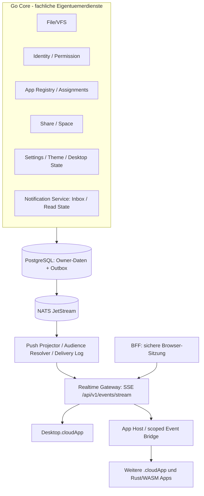
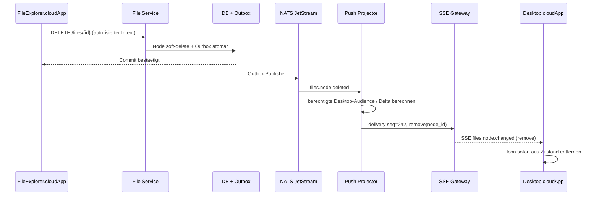

# cloudOS - Push-, Realtime- und Benachrichtigungsarchitektur

> **Datei:** `docs/PUSH_REALTIME.md`  
> **Dokumentversion:** 0.1 (verbindliche Zielarchitektur zu cloudOS v0.10)  
> **Stand:** 15.11.2026  
> **Projekt:** [Drezael/cloudOS](https://github.com/Drezael/cloudOS)  
> **Gepruefte GitHub-Grundlage:** `main` bei Commit `3f8bfd2d8ccce826c587c6c5ebd98609631c90ba`  
> **Fachlich fuehrend fuer:** Client-Push, Event-Stream, Replay, Benachrichtigungen, Subscriptions, Zustands-Deltas, Ereignissicherheit und Wiederverbindung  
> **Verweise:** [CONCEPT.md](CONCEPT.md), [SYSTEM_ARCHITECTURE.md](SYSTEM_ARCHITECTURE.md), [DESKTOP_ENVIRONMENT.md](DESKTOP_ENVIRONMENT.md), [VIRTUAL_FILESYSTEM.md](VIRTUAL_FILESYSTEM.md), [APPLICATION_SYSTEM.md](APPLICATION_SYSTEM.md), [APP_API_ACCESS.md](APP_API_ACCESS.md), [APP_MANAGEMENT_STORE.md](APP_MANAGEMENT_STORE.md), [SHARING_SPACES.md](SHARING_SPACES.md), [AUTHENTICATION_AUTHORIZATION.md](AUTHENTICATION_AUTHORIZATION.md), [IDENTITY_INTEGRATION.md](IDENTITY_INTEGRATION.md), [APP_SIGNING.md](APP_SIGNING.md)

## 1. Verbindliche Produktentscheidung

cloudOS nutzt **server-initiierten Push fuer saemtliche laufenden UI-Zustandsaenderungen und Benutzerbenachrichtigungen**. Ein Browserclient, eine installierte `.cloudApp`, die Desktop-Shell und der App-Host duerfen keine wiederkehrenden REST-, GraphQL-, Dateilisten-, Notification- oder sonstigen Statusabfragen ausfuehren, nur um Aenderungen zu entdecken. **Kein Client-Polling, kein Long-Polling und kein periodisches Refresh.**

1. Primaerer Transport ist **Server-Sent Events (SSE)** ueber eine dauerhafte authentifizierte HTTPS-Verbindung. Das ist eine fuer unidirektionale Core-zu-Client-Ereignisse geeignete Technologie; ownCloud Infinite Scale verwendet ebenfalls einen SSE-Dienst, `clientlog` fuer maschinenlesbare Ereignisse und einen internen Event-Bus.
2. Intern bestehen weiterhin die **Transactional Outbox** der fachlich verantwortlichen Go-Services, **NATS JetStream** als asynchroner Verteiler und eine **persistente, empfaengerspezifische Replay-/Delivery-Schicht**.
3. Der Go-Core erzeugt fuer jede berechtigte Clientansicht **kanonische Ereignisse mit den erforderlichen, bereits autorisierten Zustands-Deltas**, nicht nur unbestimmte Invalidierungshinweise. Clients muessen nicht nach jedem Event denselben Zustand per GET erneut holen.
4. **Einmaliger Bootstrap**, expliziter Benutzeraufruf zum Oeffnen bislang nicht geladener Inhalte und **einmaliger Reconnect-/Gap-Resync** sind keine periodischen Polls und bleiben gestattet.
5. Live-Events und **persistente Benutzerbenachrichtigungen** sind unterschiedliche Fachkonzepte auf demselben Push-Transport. Eine Push-Nachricht ersetzt weder die fachliche Datenbank noch die serverseitige Zugriffspruefung.
6. Ereignisse gelten fuer alle berechtigten Sitzungen, Browser-Tabs und unterstuetzten App-Runtimes. Das System darf nicht voraussetzen, dass der Client durchgehend online bleibt.
7. **Keine Sicherheitsentscheidung beruht auf dem Empfang eines Push-Events.** App-API-Allowlist, Login, Role/Group-Rechte, VFS-ACLs, Sharing- und Space-Rechte werden bei jeder Aktion im Go-Core geprueft.
8. Offline-Browser werden nicht ueber SSE erreicht. Ein spaeterer optionaler **Web-Push-Kanal ueber Service Worker** darf nur nach ausdruecklicher Browserfreigabe aktiv werden und ist ein getrenntes Benachrichtigungs-Feature, kein Ersatz fuer die UI-Replikation.
9. Ein Ausfall des Push-Dienstes darf nicht zum heimlichen Aktivieren eines Polling-Fallbacks fuehren. Der Client meldet einen eingeschraenkten Verbindungszustand, reconnectet mit Backoff und gleicht sich danach einmalig ab.
10. Die Regeln gelten **auch fuer Pflicht-Core-Apps**, einschliesslich `Desktop.cloudApp`, `FileExplorer.cloudApp`, `Apps.cloudApp`, `AppStore.cloudApp`, `Settings.cloudApp`, Sharing, Spaces, Benutzer-/Gruppenverwaltung und Benachrichtigungscenter.

**Begriffliche Praezisierung:** "Push" bezeichnet im Haupt-MVP einen offenen serverseitigen SSE-Stream. SSE ist keine Garantie fuer Echtzeit unter unterbrochenem Netz; solange die Verbindung offen ist, werden relevante Ereignisse unmittelbar nach Commit zugestellt. Ping-/Keepalive-Frames ohne fachliche Abfrage sind **kein Polling**.

## 2. Verhaeltnis zum ownCloud-Vorbild

Die technische Referenz ist **ownCloud Infinite Scale**, nicht die eigene Notification-App des klassischen ownCloud 10.x. Infinite Scale dokumentiert einen `sse`-Service fuer die aktive Zustellung, `clientlog` fuer maschinenlesbare Clientereignisse, `userlog` fuer benutzerbezogene Darstellungen und `eventhistory` als Ereignisarchiv. Der eigene NATS-Service verwendet JetStream. cloudOS uebernimmt das **Entwurfsmuster**, nicht Quellcode, Dateinamen oder undokumentierte Kompatibilitaetsversprechen.

- Eigene Frontend-API und eigenstaendige Go-Dienste, keine Abhaengigkeit zu ownCloud-Services.
- Im Gegensatz zu einem reinen `invalidate-and-fetch`-Modell enthalten cloudOS-Deltas fuer normale UI-Aenderungen eine direkt anwendbare, autorisierte Projektion.
- Der Server darf fuer externe LDAP-Verzeichnisse und GitHub-App-Store-Kataloge intern gesonderte Synchronisationsverfahren einsetzen. Diese **Server-zu-Fremdsystem-Checks** sind keine periodischen Clientanfragen.

**Quellen:**
- [ownCloud Infinite Scale SSE](https://doc.owncloud.com/ocis/8.2/admin/deployment/services/s-list/sse.html)
- [ownCloud Infinite Scale Clientlog](https://doc.owncloud.com/ocis/8.2/admin/deployment/services/s-list/clientlog.html)
- [ownCloud Infinite Scale NATS](https://doc.owncloud.com/ocis/8.2/admin/deployment/services/s-list/nats.html)
- [MDN - Server-sent events](https://developer.mozilla.org/en-US/docs/Web/API/Server-sent_events/Using_server-sent_events)
- [NATS JetStream](https://docs.nats.io/nats-concepts/jetstream)

## 3. Architektur und verantwortliche Dienste



**Zustaendigkeiten:**

| Komponente | Muss leisten | Darf nicht leisten |
|---|---|---|
| Owner Service | Mutation/ACL/Policy in eigener Transaktion und Outbox committen | Direkt an einzelne Browser mit unterstellten Rechten senden |
| Outbox Publisher | Commit-getreue und wiederholbare Publikation an JetStream | Endbenutzer-Events vor dem DB-Commit bestaetigen |
| NATS JetStream | Interne durable Verteilung und Consumer-Replay | Browser direkt verbinden oder als einzige Historie jeder Benutzeransicht dienen |
| Push Projector | Eventinhalt minimieren, Zielaudienz und app-spezifische Views bestimmen | Fremde Benutzerinformationen ungefiltert kopieren |
| Delivery Log | Pro Empfaenger geordnete, persistierte Zustellsequenz und deduplizierbare IDs | Inhalte bei Rechteentzug ungeprueft erneut ausliefern |
| Realtime Gateway | Authentifizierte SSE-Streams, Backpressure, Resume, Keepalive und Revoke | Alle Topics nur aufgrund einer offenen SSE-Verbindung freischalten |
| Notification Service | Dauerhafte Inbox, Lesen/Bestaetigen/Loeschen, Benachrichtigungspraeferenzen | Fach-Events als alleinige Quelle fuer Dateizugriff verwenden |
| Browser App Host | Eine vertrauenswuerdige Verbindung koordinieren; gefilterte Events an App Bridges geben | Fremd-App-Origins den privilegierten Core-Eventstrom ueberlassen |

Die Prozessaufteilung ist logisch. Fuer den MVP koennen Projector, Gateway und Notification Service in wenigen Go-Prozessen gebuendelt werden. Contracts, Owner- und Sicherheitsgrenzen bleiben unabhaengig von der Deployment-Zahl bestehen.

## 4. Transport: SSE als einziger Standard-Updatekanal

**Oeffentlicher Endpunkt (Entwurf):** `GET /api/v1/events/stream` mit `Accept: text/event-stream`, Antwort `Content-Type: text/event-stream`, `Cache-Control: no-store, no-transform`, `X-Accel-Buffering: no`. Nur `https://` in Produktion. Kein proxieseitiges Response-Buffering, angemessene Idle-Timeouts.

- **Auth:** Core-eigene sichere BFF-Sitzung (HttpOnly, Secure, SameSite) ueber Same-Origin; gegen Session, Tenant, Benutzer und aktuelle Sicherheitsrevision gebunden.
- **Origin:** Browser-`Origin` bzw. Fetch-Metadata gemaess strikter Same-Origin-Policy, keine reflektierten `Access-Control-Allow-Origin`-Wildcard-Werte. Authentifizierte fremde Origins sind nicht erlaubt.
- **CSRF:** Der reine SSE-GET ist lesend und veraendert keine Fachwerte. Zustand veraendernde REST-Routen behalten CSRF-Schutz. Replays und Stream-Subskriptionen sind selbst autorisierte Operationen.
- **App-Isolation:** Fremde App-Frames laden keinen allgemeinen `events/stream`; der vertrauenswuerdige Desktop-/App Host leitet nur explizit genehmigte Events ueber die bestehende validierte Bridge weiter.
- **Header/Proxy:** Keine HTTP-Kompression oder aggressives Puffern, das Events zurueckhaelt; Nginx und eventuelle vorgeschaltete Proxys muessen SSE Streaming durchreichen.
- **Skalierung:** Eine Verbindung je Browser-Shell-Sitzung/Tab als MVP; SharedWorker/Leader-Tab-Koordination kann spaeter mehrere Tabs derselben Browserinstanz zusammenlegen, darf aber niemals unterschiedliche Konten oder Sessions vermischen.
- **SSE-Keepalive:** Periodische `: keepalive`-Kommentare erhalten Zwischenproxys offen. Sie stellen keine Statusabfrage dar. Browser-Reconnect nutzt exponential Backoff und zufaelligen Jitter, begrenzte Versuchszahl pro Zeitfenster.
- **SSE-Event-ID:** Jede fachliche Zustellung erhaelt einen pro Benutzer/Audience-Stream streng steigenden, opaken Resume-Cursor. `Last-Event-ID` bzw. das begrenzte Resume-Token darf weder andere Benutzer noch eine neue fremde Sitzung berechtigen.
- **WebSocket:** Kein zweiter paralleler Push-Mechanismus fuer das MVP. Fuer spaetere bidirektionale Interaktionen (z.B. kollaborativer Cursor) kann ein gesonderter WebSocket-Vertrag eingefuehrt werden. Das ist **keine Polling-Fallbackstrecke** und gewaehrt keine zusaetzlichen Abonnements.

### 4.1 EventSource-Beispiel (nur Vertragsillustration)

```typescript
const stream = new EventSource('/api/v1/events/stream', {
  withCredentials: true,
});
stream.addEventListener('files.node.changed', (ev) => {
  const message = JSON.parse((ev as MessageEvent).data);
  applyAuthorizedFileDelta(message);
});
stream.addEventListener('stream.resync_required', () => {
  requestOneTimeSnapshotRecovery(); // Nur bei Cursor-/Replay-Luecke
});
stream.onerror = () => showConnectionDegraded();
// Kein setInterval, keine /notifications-Abfrage in einer Schleife.
```

`applyAuthorizedFileDelta`, `requestOneTimeSnapshotRecovery` und `showConnectionDegraded` sind SDK-Pseudofunktionen, keine bereits implementierten Funktionen. Das Browser-Event-Handling muss Schema, Event-ID, Reihenfolge und Berechtigungsscope validieren.

## 5. Eventklassen und Datenmodell

Drei Klassen teilen sich die **Transporttechnik**, besitzen aber unterschiedliche fachliche Persistenz:

| Klasse | Bedeutung | Persistenz |
|---|---|---|
| `state_delta` | Autorisierter kleiner neuer Zustand bzw. Diff fuer laufendes UI | Owner-DB + begrenzter Delivery Log |
| `user_notification` | Lesen/Bestaetigen/Archivieren moeglicher Inbox-Eintrag | Notification Service dauerhaft gem. Retention |
| `control` | Stream bereit, Pause, Revoke, Cursor-Luecke, Snapshot-Recovery | Transport-/Sessionzustand; ggf. Audit |

**Beispiel eines autorisierten SSE-Deltas (Illustration):**

```text
id: cu_0000000000000421
event: files.node.changed
data: {"schema_version":"1","kind":"state_delta","event_id":"evt-uuid","stream_seq":421,"scope":{"type":"home_desktop","resource_id":"opaque-folder-id"},"resource_revision":16,"action":"remove","node_id":"opaque-node-id","policy_revision":82,"occurred_at":"2026-11-15T00:00:00Z"}

```

**Beispiel eines Inbox-Eintrags (Illustration):**

```json
{
  "schema_version": "1",
  "kind": "user_notification",
  "notification_id": "n-example",
  "type": "sharing.received",
  "title_key": "sharing.new_share",
  "message_args": {"display_name": "Projektbericht"},
  "actor_label": "Kollegin",
  "read": false,
  "created_at": "2026-11-15T00:00:00Z",
  "actions": [{"id": "open_share", "required_operation_id": "sharing.shares.get"}]
}
```

Die Anzeige von `display_name`, Actor oder Space/Node-IDs setzt voraus, dass der empfangende Benutzer sie **zum Zeitpunkt der Zustellung** sehen darf. Fuer nicht mehr berechtigte Audiences wird stattdessen nur ein minimales Entfernen-/Widerrufsignal an bereits autorisierte Sessionbereiche gesendet.

## 6. Serverseitige Delta-Projektion statt Client-Fetch nach jedem Event

Die bisherigen Architekturtexte beschreiben teilweise einen Realtime-Hinweis und anschliessendes `GET` der gesamten Liste. **Dieses Standardverhalten wird aufgehoben.**

- **Desktop `/.desktop/`:** Event enthaelt `add`/`update`/`remove` einschliesslich zulassiger Icon-/Dateimetadaten und stabiler Node-ID; die Desktop-App patcht ihre Liste direkt.
- **Taskleiste:** `desktop.taskbar.changed` liefert die validierte benutzerspezifische Konfiguration bzw. den minimalen Diff von `/.taskbar.json`, keine wiederkehrenden Settings-Reads.
- **Desktop-Layout:** `desktop.layout.changed` liefert Icon-Positionen und Revision von `/.desktop-layout.json`; dieselbe Revision verhindert Ueberschreiben neuer lokaler Bewegungen.
- **Apps:** `applications.assignment.changed`, `applications.installation.changed` und `applications.available.changed` enthalten fuer jeden Empfaenger die neu erlaubten und entfernten App-IDs sowie bereits berechtigte Anzeigeinfos; unberechtigte Apps sind im positiven Payload nicht sichtbar.
- **Shares/Spaces:** `sharing.received`, `sharing.revoked`, `spaces.member.changed`, `spaces.content.changed` aktualisieren die eigene autorisierte Mount-/Space-Projektion ohne jede periodische Enumeration.
- **Benutzer/Gruppen:** `identity.membership.changed` und `identity.session.revoked` aktualisieren erlaubte UI-Bausteine und erzwingen sofortige serverseitige Ablehnung bei entzogenem Recht.
- **Themes:** `themes.active.changed` uebertraegt erlaubte Token-/Variantenprojektion oder einen unveraenderlichen gecachten Asset-Referenzsatz; der Asset-Download kann bei tatsaechlichem Themewechsel einmalig erfolgen.
- **Installation/Store:** `applications.install.progress`, `applications.uninstall.completed` und `appstores.catalog.changed` aktualisieren die aktuell autorisierten Admin-Sichten; externe Katalog-Synchronisation findet ausschliesslich serverseitig statt.
- **Benachrichtigungen:** `notifications.created`, `notifications.updated`, `notifications.read`, `notifications.deleted` enthalten den unmittelbar anwendbaren Inbox-Diff und werden an alle gueltigen Sitzungen des Empfaengers verteilt.

**Ausnahmen:** Unbekannte Schema-Version, zu grosse Payload, ein aus anderen Gruenden neu geoeffneter Ordner oder Eventverlust koennen eine **gezielte einzelne** Status-/Snapshotanfrage erforderlich machen. Diese Aktion wird durch einen konkreten Zustand ausgelost und darf nicht in ein Zeitintervall-Polling uebergehen.

## 7. Konsistente Initialisierung ohne Rennen

Eine neue Client-Sitzung muss die fachliche Datenansicht und den Stream-Cursor atomisch bzw. ueber ein bewiesenes Handshake-Verfahren miteinander verknuepfen.

**Verbindlicher Entwurf fuer den MVP:**

1. Browser authentifiziert sich ueber den BFF und oeffnet **einmal** `GET /api/v1/events/stream`.
2. Der Realtime Gateway authentifiziert, berechnet die fuer Core-App und Sitzung erlaubten Bereiche und bindet ein konsistentes logisches Stream-Epoch.
3. Gateway sendet `stream.ready` mit `epoch`, zuletzt bestaetigtem `cursor` und Revisionen; fachliche Events werden solange geordnet gepuffert.
4. Client ruft ein **einmaliges** autorisiertes Bootstrap-Bundle `GET /api/v1/desktop/bootstrap` (oder einen gleichwertigen spezifischen Snapshot) ab; die Antwort enthaelt einen **vom Server bestimmten Zustands-Cursor/Watermark**, der konsistent mit der Eventhistorie ist.
5. Client installiert den Snapshot und wendet alle empfangenen Events **nach** dem Snapshot-Watermark in der gespeicherten Reihenfolge an. Doppelte Event-IDs werden ignoriert.
6. Beim Wechsel zwischen Benutzerkonten, Sessions und Scopes wird der lokale Cache verworfen und ein neuer sicherer Bootstrap gestartet.

Die Implementation muss beweisen, dass zwischen Snapshot-Lesen und Live-Stream-Start keine Mutation verloren geht. Wenn die Owner-Datenbank und die Delivery-Tabelle unterschiedliche Transaktionen nutzen, duerfen sie **keinen faelschlich gemeinsamen Commit-Watermark** annehmen. Alternativ ist ein serverseitiger `snapshot_and_cursor`-Endpoint mit kurzer Sperre, versionierter Delta-Projektion oder eindeutigem Barrier-Ereignis erlaubt. Details werden als ADR festgelegt und im Parallelmutationstest bestaetigt.

## 8. Replay, `Last-Event-ID` und Wiederverbindung

Beim Reconnect stellt der Browser **eine neue SSE-Verbindung** her. Das ist kein Polling. Der Server verarbeitet den gespeicherten `Last-Event-ID`-Cursor (oder einen sicheren, sessiongebundenen Resume-Mechanismus):

- Stimmt Cursor zu Benutzer, berechtigter Audience, Policy-Epoch und Retentionfenster, werden nicht zugestellte Ereignisse geordnet wiederholt.
- Doppelte Ereignisse werden anhand `event_id` und `stream_seq` idempotent verarbeitet.
- **Bei Rechteentzug vor Replay** wird nicht blind ein altes Event mit vertraulichem Payload zugestellt; Replay verwendet aktuelle Sichtbarkeitspruefung und ggf. ein revidierendes Tombstone-Delta.
- Ist die Historie abgelaufen oder lueckenhaft, sendet der Server `stream.resync_required`, danach fordert der Client **einmalig** einen neuen gefilterten Snapshot an und startet mit neuem Epoch/Watermark.
- Bei Nachrichtenschemawechsel ist die konkrete Migration bzw. Snapshot-Rueckkehr Pflicht; keine Stille bei unbekannten kritischen Versionsfeldern.
- Inaktive Tabs duerfen reconnecten. Wird ein Tab vom Browser schlafen gelegt, erklaert sein erster neuer Stream die Unterbrechung und fuehrt Replay aus.

**Keine Garantie falscher Art:** SSE/HTTP und JetStream bieten keine globale magische Exactly-Once-Zustellung. Das Ziel ist mindestens einmalige interne Zustellung plus **idempotente, pro Audience geordnete Wirkung** und eine explizite, pruefbare Lueckenbehandlung.

## 9. Persistenz und Event-Ordering

### 9.1 Vorgeschlagene PostgreSQL-Entitaeten

| Entitaet | Wesentliche Attribute | Verantwortung |
|---|---|---|
| `realtime.audience_streams` | `audience_id`, `epoch`, `next_sequence`, `retention_state` | Stream-/Cursor-Verwaltung |
| `realtime.deliveries` | `audience_id`, `stream_seq`, `event_id`, `event_type`, `payload_projection`, `policy_revision`, `expires_at` | Replay und Deduplizierung |
| `realtime.subscriptions` | `session_id`, `app_instance_id`, `topic_scope`, `resource_id`, `grant_revision`, `state` | Effektive autorisierte Abonnements |
| `realtime.delivery_checkpoints` | `audience_id`, `last_acknowledged_seq`, `updated_at` | Optionales Resume/GC (kein pauschaler Client-ACK erforderlich) |
| `notifications.items` | `notification_id`, `recipient_user_id`, `type`, `payload`, `read_at`, `created_at`, `retention_until` | Dauerhafte Inbox |
| `notifications.preferences` | `user_id`, `category`, `in_app`, `web_push`, `quiet_hours` | Benutzereinstellungen |

Die Tabellen sind **Designentwuerfe** und keine bereits vorhandene Datenbank. `audience_id` darf nicht unbewusst als Gruppenname, Session-Token oder frei gewaehlte Browser-ID ausgelegt werden.

### 9.2 Ordering und Fanout

- Jedes Owner-Event besitzt eine stabile `event_id`, `owner_id`, `resource_revision` und `outbox_revision`.
- Ein Projektor baut daraus eine **pro User/Audience sequenzierte** Sicht. Bei mehreren Go-Gateways ist ein konsistenter Sequenzvergeber in der Delivery-Datenbank erforderlich.
- Eine `event_id` kann verschiedene, jeweils separat autorisierte Projektionen fuer verschiedene Empfaenger erzeugen.
- Die Reihenfolge gilt **pro Stream**, nicht global zwischen allen Benutzern. Ein Fenster verarbeitet eigene Node-/Policy-Revisionen monoton.
- Gruppen-Shares oder Spaces mit sehr vielen Mitgliedern benoetigen begrenztes Fanout, Queues und Kapazitaetsplanung; die naive synchrone Materialisierung von Millionen Ereignissen innerhalb einer File-Service-Transaktion ist verboten.
- Retention ist konfigurierbar, mindestens die realistisch erwartete Offline-Dauer; bei Ablauf muss ein Snapshotsprung sicher sein.
- Clients bestaetigen nicht die fachliche Mutation; die Mutation bleibt erfolgreich, auch wenn kein Empfaenger erreichbar ist.

## 10. Sicherheit: Empfaenger- und App-spezifisches Push-Enforcement

**Vertrauliche Daten duerfen nicht allein deshalb uebermittelt werden, weil der Benutzer irgendwann einmal Zugriff hatte.**

1. Realtime Gateway authentifiziert Benutzer, Sitzung und Origin, prueft Policy-/Gruppenrevisionen und beendet ungültige Verbindungen.
2. Beim Abonnieren prueft der Core den gegenwaertigen Benutzerkontext, App-Instanz, `permissions/api-access.json`, administrativ genehmigte Endpunkte und das **signierte Event-Topic/Resource-Scope**.
3. Ein normales App-Paket darf kein allgemeines `events.all` beantragen. Die erlaubten Eventtypen und Scopes sind in einem versionierten signierten Manifestabschnitt `event_subscriptions` aufgefuehrt.
4. Auch das native Frontend (z.B. Desktop) erhaelt nur die fuer den Benutzer autorisierten Views. Die Einbindung als Core-App verleiht keinerlei Systemlaufwerk- oder fremdes Home-Recht.
5. Der Server filtert beim Erzeugen der Projektion und **erneut beim Ausliefern/Replaying**; stale Cache-Entscheidungen duerfen keine Zugriffsrechte konservieren.
6. Grant-Entzug muss sofort im Core wirksam werden. Ein bereits verbundener Client erhaelt ein minimales `access.revoked` / `applications.available.changed` ohne geschuetzte alte Details; die App Host Bridge beendet betroffene Subscriptions und erforderlichenfalls App-Instanzen.
7. History/Event-IDs, SSE-Retry und eigene Cookies duerfen nicht als Bearer-Tokens fuer fremde Audiences missbraucht werden.
8. Keine Core-Secrets, kompletten unmaskierten JWTs, Passwort-Hashes, privaten Filepfade, blob-Keys, App-Paketsignaturschluessel oder Gruppenlisten in allgemeine Events.
9. XSS-/HTML-Injection-Schutz auch bei Notification-Titeln, vom Herausgeber gelieferten Begruendungen und im Store uebernommenen Katalogdaten; Felder als Daten, nicht HTML interpretieren.
10. Berechtigungswechsel sind unmittelbar serverseitig bindend. Dass ein bereits gerendertes Label bis zum naechsten Frame sichtbar bleibt, ist kein Widerrufproblem des Servers; der Client hat bei Eingang jedoch sofort zu entfernen.
11. Auch Adminaktionen und automatisch installierte Core-Apps bleiben API-Allowlist-, RBAC- und Audit-pflichtig.
12. Rate Limits und Begrenzung der maximalen gleichzeitigen Verbindungen verhindern Stream-/Abo-Missbrauch.

### 10.1 Signiertes `event_subscriptions`-Schema (Erweiterung)

Die App-Deklaration erhaelt in einer **neuen kompatibilitaetsgeprueften Schema-Version** neben `endpoints` optional `event_subscriptions`. Das Feld ist Teil der unveraenderlichen X.509/SHA-512-signierten `permissions/api-access.json`, wird bei Installation einschliesslich Risiko angezeigt und gegen den vertrauenswuerdigen Core-Eventkatalog geprueft.

```json
{
  "schema_version": "1.1",
  "api_contract": "cloudos.core.v1",
  "endpoints": [
    {"operation_id":"realtime.subscriptions.create","method":"POST","path":"/api/v1/realtime/subscriptions","resource_scope":"own_session","reason":"Live-Updates abonnieren"}
  ],
  "event_subscriptions": [
    {"event_type":"files.node.changed","resource_scope":"user_selected","reason":"Geoeffnete Dateien aktuell halten"},
    {"event_type":"notifications.created","resource_scope":"own_session","reason":"Benachrichtigungen anzeigen"}
  ]
}
```

Eine App mit `event_subscriptions: []` bekommt **keine** fachlichen Events. Der Event-Stream der BFF/Desktop-Shell ist keine unbegrenzte API der App-Origins; ein `realtime.subscriptions.create`-Eintrag ermoeglicht nur ein vom Host vermitteltes, erneut geprueftes Abo. Die Signierung macht die Deklaration unveraenderlich, verleiht aber keine Rechte. Die Zustimmung fuer das **Lesen/Empfangen sensibler Ereignisdaten** muss im Installationsdialog deutlich angezeigt werden.

## 11. Konkrete Push-Flows

### 11.1 Datei auf Desktop geloescht



Kein Client-Intervall, kein browserseitiger Ordner-GET nach jedem Fileevent.

### 11.2 App-Zuweisung entzogen

1. Administrator entfernt eine `Admin`-/User-/Gruppenfreigabe in `Apps.cloudApp`.
2. Permission/App Assignment Service persistiert die neue **Policy-Revision**. Ab diesem Commit sind Start-/API-Pruefungen bereits verweigert.
3. Der Projector sendet `applications.available.changed` mit `removed` und `access.revoked` an alle betroffenen Sitzungen; es werden keine fremden App-Details veroeffentlicht.
4. Desktop entfernt Startmenue-/Taskleisten-/Desktop-Startaktionen, App Host stoppt betroffene laufende Instanzen und ihre Event-Abos.
5. Nach Verlust der SSE-Verbindung gelten die serverseitigen Rechte weiter. Beim Reconnect liefert Replay oder ein einmaliger Snapshot den korrekten Zustand.

### 11.3 Freigabe, Space-Mitgliedschaft und Benachrichtigung

- Ein Share wird serverseitig angelegt: Datei-/Share-ACL bleibt Quelle der Wahrheit; der Empfaenger erhaelt einen `sharing.received`-Delta und optional eine **dauerhafte** `notifications.created`-Inbox-Nachricht.
- Beim Entfernen eines Space-Mitglieds wird der Mount sofort serverseitig unzugaenglich; die UI entfernt den Space ueber `spaces.member.changed`.
- Beim Markieren einer Notification als gelesen schreibt der Notification Service den Read-State und pusht `notifications.read` an die weiteren Sitzungen desselben Benutzers.
- Ein Empfaenger ohne zum Zustellzeitpunkt gueltige Berechtigung erhaelt keine Dateiinhalte aus historischen Events.

### 11.4 Externes LDAP und App-Store-Kataloge

Externe LDAP-Quellen und GitHub-Kataloge duerfen **von Go-Core-Integrationsdiensten** per sicherem Scheduler, Delta-Sync oder Webhook aktualisiert werden. Bei einer Aenderung aktualisiert der fachliche Owner die lokale Datenbank und emittiert ein Event. **Der Browser fragt weder LDAP noch GitHub zyklisch ab**, sondern erhaelt die daraus resultierenden lokalen User-/App-/Store-Deltas ueber SSE. Das Hinzufuegen einer GitHub-Katalogquelle verleiht ihrem Server keinerlei Verbindung zu Browser-Sessions oder NATS.

## 12. Notifications sind persistent, Push ist der Zustellkanal

Eine `Notification.cloudApp` bzw. das Notification-Center ist eine geschuetzte Core-App und nutzt den Notification Service. Fachlich verwaltete Notifikationen werden in einer Inbox persistiert.

- Benutzer koennen `unread`, `read`, `archived`, `dismissed` je nach Notificationtyp verwalten.
- Kategorisiert werden Systemmeldungen, Shares, Spaces, Apps, Rechte, Jobs und Sicherheitsereignisse.
- Berechtigte Systembenachrichtigungen und Aktivitaetslogs duerfen getrennte Aufbewahrungsfristen haben.
- Einzelne Meldungen koennen sichere, katalogisierte Aktionen referenzieren; Ausfuehrung erfolgt ueber **einen neuen autorisierten REST-Request** mit CSRF, App-Allowlist und Benutzerrechten.
- Benutzerpraeferenzen fuer stille Stunden, Desktopbanner, Glocke, akustischen Hinweis und spaeter optional E-Mail/Web Push werden im erlaubten Home-Settings-Modell gespeichert.
- Der Server pusht Inbox-Aenderungen auch dann, wenn ein anderer Tab bereits "gelesen" markiert hat. Der Client muss nicht nach dem Badge-Zaehler pollen.
- Audit-Trails sind nicht dasselbe wie oeffentliche Notifications und duerfen nicht als allgemeine Inbox offengelegt werden.

## 13. Offline-Browser, Service Worker und Web Push (spaeter)

SSE funktioniert nur bei offener, aktiver bzw. wiederverbundener Seite. Fuer geschlossene Browser kann ein spaeterer **separater Web Push** mit Service Worker, Push API, Browser-User-Permission, gueltiger Subscription und serverseitiger Auth-/Logout-Policy vorgesehen werden.

- Keine Push-Abos ohne explizite Benutzerhandlung, keine Umgehung von Browser-Permissions.
- Externe Browser-Push-Services sind eine eigene Datenschutz-/Egress-Entscheidung; niemals Dateiinhalte oder Geheimnisse in Web-Push-Nachrichten.
- Web Push darf z.B. nur sagen "Neue Benachrichtigung vorhanden"; alle Details werden nach erfolgreicher Anmeldung im autorisierten Core-Kontext geladen.
- Eine Offline-Web-Push-Notification kann verloren gehen oder vom Browser gebuendelt werden. Der belastbare Zustand liegt im Notification Service und wird bei neuer SSE-Verbindung via Replay/Snapshot zugestellt.
- Im MVP ist Web Push **nicht Voraussetzung** fuer Echtzeit in geoeffneten cloudOS-Tabs.

## 14. Lifecycle, Ressourcenlimits und Skalierung

- **Verbindungsanzahl:** Pro Benutzer, Tab und Deployment begrenzte Maxima; ressourcenschonende Verbindungsteilung nur, wenn Accounts und Scopes sauber getrennt bleiben.
- **Buffer:** Bounded pro Verbindung. Bei Ueberlast Client als `resync_required` markieren und mit begrenztem Reconnect entkoppeln, statt Speicher unkontrolliert wachsen zu lassen.
- **Projektion:** Kleine Events direkt als Delta, grosse Diffs mit dokumentiertem `snapshot_required`-Typ. Keine stillen Umwandlungen in zeitgesteuertes Polling.
- **Throttling:** UI-Frames duerfen mehrere unmittelbar eintreffende Events in einem Renderdurchlauf anwenden; fachliche Events werden nicht willkuerlich verworfen.
- **Load Balancing:** Mehrere SSE-Gateway-Instanzen hinter Nginx, Konsistenz ueber Delivery Log und JetStream. Sticky Sessions sind keine notwendige Sicherheitsgarantie.
- **Leerlauf:** Keepalive-Kommentare unter der kleinsten Proxy-Idle-Frist, keine sinnlose permanente Benachrichtigungslast.
- **Deploy/Shutdown:** Graceful Drain, Stream-Cursor behalten, `retry`/Backoff, nach Reconnect Replay.
- **Observability:** Aktive Streams, publish-to-deliver p50/p95/p99, Replay-Rate, Cursor-Gaps, backlog, Revoke-Latenz, unautorisierte Abo-Versuche und Ressourcenauslastung. Keine Inhalte in Metrics-Labels.
- **SLO (Ziel, kein Versprechen):** Unter Normalbetrieb soll das p95-Intervall zwischen Owner-Commit und an verbundene, autorisierte Empfaenger versendetem Delta unter 2 s liegen; Lastprofil und tolerierte Abweichungen werden spaeter gemessen.

## 15. Fehler- und Wiederanlaufverhalten

| Fehler | Verbindliche Reaktion |
|---|---|
| Browser offline / Mobilfunkverlust | Kein Polling; UI markiert offline/degraded, SSE-Reconnect nach Wiederkehr, Replay oder einmaliger Bootstrap |
| SSE-Proxy puffert | Konfiguration fehlerhaft; Monitoring/Integrationstest alarmiert, nicht heimlich durch GET-Intervall kaschieren |
| JetStream nicht erreichbar | Owner-Outbox behaelt Commit; Publisher wiederholt; es gibt keine fachlich unberechtigten Daten |
| Delivery Log unvollstaendig | `stream.resync_required` und genau eine autorisierte Snapshot-Recovery |
| SSE-Service abgestuerzt | Reconnect an andere Instanz, `Last-Event-ID` resume; keine Doppelausfuehrung fachlicher Befehle |
| Client mit altem Eventcursor | Begrenztes Replay oder Snapshot, keine historischen Daten nach Revoke |
| Benutzer deaktiviert | Auth-/API-Zugriff serverseitig sofort gesperrt; Stream endet/erhaelt minimales `session.revoked` |
| Gruppe entzogen | App-/Space-/VFS-Berechtigungen sofort wirksam; Events scoped und neue Grants verboten |
| Sehr langsamer Client | Backpressure/abgebrochener Stream mit Resync-Hinweis; begrenzter Speicherbedarf |
| App Host startet neu | Neue SSE-Verbindung und Snapshot; App-Bridge erhaelt nur noch eigene Eventtopics |
| Notification-Eingang verdoppelt | Stable `notification_id` und idempotente Projektion, keine doppelte Inbox-Kachel |
| Sicherheitsrichtlinie aendert sich beim Replay | Auslieferung wird gegen aktuelle Sichtbarkeits-/Policy-Revision neu bewertet |

## 16. App-Integration und Installation

- Jede `.cloudApp` liegt unveraendert unter `system:/apps/`; die Browser-App wird nur nach systemweiter Installation und aktueller User-/Group-Assignment sichtbar und startbar.
- `permissions/api-access.json` listet weiterhin exakt die benoetigten REST-Operationen; das neue `event_subscriptions`-Feld ergaenzt die signierte **Empfangsberechtigung**, nicht die Schreib-/Verwaltungsberechtigung.
- **Installation durch `Apps.cloudApp`** zeigt beide Kategorien: welche Core-Endpoints die App aktiv aufrufen darf und welche Ereignisklassen/Daten sie passiv empfaengt. Beide erhalten vom Core vertrauenswuerdig formulierte Risikoerklaerungen.
- Standardfreigabe nur Gruppe `Admin` fuer neue zusaetzliche Apps. Ein nicht zugewiesener Benutzer bekommt weder App-Assets noch Event-Abos fuer diese App.
- `AppStore.cloudApp` verwaltet nur eigene Installationen. Push-Events verleihen keine Provenienz-Manipulationsrechte und koennen keine fremden Store-Installationen deinstallieren.
- Ein App-Update mit neuen Event-Subscriptions ist ein **Berechtigungsdiff** und benoetigt die festgelegte neue Administratorfreigabe.
- Selbstsignierte Pakete behalten die gesonderte Warnung; ein Event-Abo auf Benutzerdateien ist auch bei vertrauten Publishern ein eigenes, klar angezeigtes Risiko.

## 17. VFS, zwei Volumes, Desktop und Space-Sicht

- Es gibt **genau zwei** logische Festplatten: `system:/` (Admins) und `users:/` (Home-Daten). Der Benutzer sieht `/` als sein eigenes Home.
- `/.desktop/` ist weiterhin die einzige Datenquelle fuer Desktop-Verknuepfungen, Ordner und Dateien. Aenderungen werden als autorisierte `files.node.changed`-Deltas pro User-Home-Root gepusht.
- `/.taskbar.json` und `/.desktop-layout.json` liegen im Home und erhalten eindeutige Revisionen. Eine Aenderung wird als `desktop.taskbar.changed` oder `desktop.layout.changed` aktiv verteilt.
- Die Taskleiste kann `top`, `bottom`, `left`, `right` sein und reagiert auf Server-Deltas ohne Neuinitialisierung der Shell.
- File Explorer, Spaces und Shares erhalten jeweils nur ihre erlaubten Mounts und Inhalte. Die Kenntnis einer fremden Node-ID oder eines Replay-Cursors erteilt keine Rechte.
- Direkt im Hostdateisystem ausserhalb des VFS geaenderte Bytes muessen zuerst als **autorisierter und versionierter File-Service-Commit** in die fachliche Datenhaltung gelangen; nur dann koennen sie garantierbar als fachliches Event erscheinen. Ein unspezifiziertes inotify-Watching ersetzt das nicht.

## 18. API-Katalog und Contract-Entwuerfe

| HTTP-Methode | Endpoint | Rolle |
|---|---|---|
| `GET` | `/api/v1/events/stream` | SSE-Transport nur fuer authentifizierten Core-App-Host / BFF |
| `GET` | `/api/v1/realtime/status` | On-Demand-Verbindungsdiagnose, keine regelmaessige Abfrage |
| `POST` | `/api/v1/realtime/subscriptions` | App Host fordert exakt erlaubtes Eventtopic/Scope an |
| `DELETE` | `/api/v1/realtime/subscriptions/{id}` | Subscriptions entfernen |
| `GET` | `/api/v1/desktop/bootstrap` | Einmaliges, authentifiziertes Desktop-Snapshot-Bundle mit Cursor |
| `GET` | `/api/v1/realtime/snapshots/{scope}` | Gezielte einmalige Recovery nach konkretem Gap |
| `GET` | `/api/v1/notifications` | Einmaliger Inbox-Bootstrap / auf ausdrueckliche Nutzeraktion |
| `POST` | `/api/v1/notifications/{id}/read` | Persistenten Read-State aendern, Delta an andere Clients pushen |
| `POST` | `/api/v1/notifications/{id}/dismiss` | Notification archivieren und Event pushen |

Diese Routen und `operation_id`s sind **API-Entwuerfe**; es existiert noch kein ausgefuehrtes Core-Backend. Ein normaler App-Origin darf nicht direkt `GET /events/stream` mit privilegierter Host-Session ausfuehren; die Core-App-Bridge erzeugt einen validierten Abo-Intent und der Gateway enforcet das Resultat.

### 18.1 Interner gRPC-Vertrag (Konzept)

```proto
syntax = "proto3";
package cloudos.realtime.v1;
service PushProjectionService {
  rpc PublishOwnerEvent(PublishOwnerEventRequest) returns (PublishOwnerEventResponse);
  rpc ResolveAudience(ResolveAudienceRequest) returns (ResolveAudienceResponse);
  rpc RevokeSubscription(RevokeSubscriptionRequest) returns (RevokeSubscriptionResponse);
}
message PublishOwnerEventRequest { string event_id = 1; string owner_service = 2; string resource_id = 3; uint64 resource_revision = 4; }
message PublishOwnerEventResponse { bool accepted = 1; }
message ResolveAudienceRequest { string event_id = 1; }
message ResolveAudienceResponse { repeated string audience_ids = 1; }
message RevokeSubscriptionRequest { string subscription_id = 1; uint64 policy_revision = 2; }
message RevokeSubscriptionResponse { bool revoked = 1; }
```

Dieser Proto dient allein der Servicegrenzen-Illustration. Endgueltige Typen, Serviceauth und Nachrichtenfelder werden in einem eigenen, versionierten `contracts/protobuf/` fixiert. Interne Publish-Aktionen muessen gegen Workload-Identity validiert werden und enthalten nicht ungefiltert Dateien oder Passwoerter.

## 19. Entwicklungsfolge und verbindliche Vertikalschnitte

| Stufe | Umsetzung | Nachweis |
|---|---|---|
| PUSH-0 | ADRs, Push-Security-Contract, OpenAPI-Eventtypen | Keine impliziten Topics oder Fallback-Polls |
| PUSH-1 | File Owner Outbox + NATS JetStream + Event-IDs | Commit und Event lassen sich unter Fehlern konsistent beobachten |
| PUSH-2 | Go Realtime Gateway mit authentifiziertem SSE | Verbundener Browser erhaelt aktiv gesendete Ereignisse |
| PUSH-3 | Empfaenger-/Subscription-Filter, App Bridge | Fremde Nutzer/Apps erhalten keine Ereignisse |
| PUSH-4 | Durable Delivery Log, Cursor, Replay und Snapshot-Barrier | Offline/Reconnect ohne verlorene UI-Aenderung |
| PUSH-5 | `/.desktop/` und Taskbar Deltas | Erstellen/Loeschen/Position ohne Reload/GET-Poll |
| PUSH-6 | App Assignments, Group/LDAP, API-Grant-Widerruf | Sofortiger Entzug, UI-Update, kein API-Bypass |
| PUSH-7 | Shares/Spaces, Theme, Settings, Jobs | Alle sichtbaren Teilbereiche aktiv synchronisiert |
| PUSH-8 | Notification Inbox mit Read-State und App-Notification UI | Mehrere Tabs zeigen gleichen Zustand ohne Polling |
| PUSH-9 | Installer-UI um signierte `event_subscriptions` erweitern | Alle Topics sichtbar, Risiko und Adminfreigabe dokumentiert |
| PUSH-10 | Proxy-/HA-/Lasttests und sicherer Rollout | Replay, Backpressure, Latenz und Fail-Closed stabil |

Die Entwicklung von Push muss **vor** der Freigabe von Desktop-Live-Funktionalitaet und App-Assignment-Echtzeit erfolgen. Ein Zwischenstand mit zeitgesteuertem Polling gilt **nicht** als akzeptierter Ersatz, kann aber in einem gesonderten Entwicklungsadapter zu lokalen Testzwecken existieren, der nicht in Releases gelangt.

## 20. Verbindliche Testmatrix

| Test | Szenario | Erwartung |
|---|---|---|
| PUSH-T01 | Kein SSE nach Login | Client markiert Verbindung als unterbrochen, keine periodischen REST-Aufrufe |
| PUSH-T02 | Eine neue Datei in `/.desktop/` | Neuer Icon-Eintrag erscheint ohne Reload |
| PUSH-T03 | Datei in `/.desktop/` geloescht | Icon verschwindet direkt durch Delta |
| PUSH-T04 | Datei in `/.desktop/` umbenannt | Icon erhaelt neuen Namen, identische Node-ID |
| PUSH-T05 | Datei in `/.desktop/` verschoben | Ursprungs-/Zielprojektionen korrigiert |
| PUSH-T06 | `.taskbar.json` in anderem Tab geaendert | Position/Layout aktualisiert sich sofort |
| PUSH-T07 | `.desktop-layout.json` geaendert | Pinned Iconpositionen sind konsistent |
| PUSH-T08 | App Admin-Gruppe entzogen | App verschwindet in Startmenue, Suche und Taskbar |
| PUSH-T09 | App fuer Benutzer freigegeben | App erscheint nur bei diesem Benutzer |
| PUSH-T10 | App deinstalliert | Alle berechtigten Sitzungen aktualisieren sich |
| PUSH-T11 | Neuer Share fuer Benutzer | Empfaenger erhaelt Mount-Delta und Notification |
| PUSH-T12 | Share widerrufen | File-API sperrt sofort, UI entfernt Mount |
| PUSH-T13 | Space-Mitglied entfernt | Kein Space-API-Zugriff, UI entfernt Space |
| PUSH-T14 | Gruppe aus LDAP synchronisiert | App-/Space-Rechte nach lokalem Commit aktiv gepusht |
| PUSH-T15 | Notification neu | Badge und Inbox ohne GET-Poll aktualisiert |
| PUSH-T16 | Notification in zweitem Tab gelesen | Erster Tab erhaelt Read-State-Delta |
| PUSH-T17 | Theme gewechselt | Eigene Core-App-UI aktualisiert ohne Reload |
| PUSH-T18 | WebSocket-Verbindung fehlt | Kein Bezug zur SSE-Standardstrecke; keine WebSocket-Pflicht |
| PUSH-T19 | SSE-Verbindung unterbrochen | Reconnect mit Backoff und `Last-Event-ID` |
| PUSH-T20 | Mehrere Events im Offline-Fenster | Alle noch gueltigen Events replayen geordnet |
| PUSH-T21 | Replay-Cursor abgelaufen | `resync_required` und genau eine Recovery ohne Polling |
| PUSH-T22 | Doppelte Events | Keine doppelten Icons/Benachrichtigungen |
| PUSH-T23 | Ueberholte Revision | Client verwirft alten Delta-Eintrag |
| PUSH-T24 | Event vor Initialsnapshot | Barrier verhindert Verlust oder Doppelwirkung |
| PUSH-T25 | Rechteentzug zwischen Event und Auslieferung | Sensibler Inhalt wird nicht ausgeliefert |
| PUSH-T26 | Replay nach Rechteentzug | Keine alten vertraulichen Eventpayloads |
| PUSH-T27 | Fremde App fragt allgemeinen SSE-Stream ab | Kein Zugriff auf privileged Core-Stream |
| PUSH-T28 | App ohne `event_subscriptions` | Keine fachlichen App-Events |
| PUSH-T29 | App mit unbekanntem Eventtopic | Installation oder Abo wird verweigert |
| PUSH-T30 | App Eventtopic nicht genehmigt | Subscribe abgelehnt und auditiert |
| PUSH-T31 | Gefaelschter Abo-Scope | Server verweigert |
| PUSH-T32 | Falsche Origin beim SSE-Open | Verbindung abgewiesen |
| PUSH-T33 | Abgelaufene Session | Stream beendet und API gesperrt |
| PUSH-T34 | Beendete App-Instanz | Keine weiteren App-Bridge-Events |
| PUSH-T35 | Unberechtigter Notification-Inhalt | Keine Disclosure in SSE oder Replay |
| PUSH-T36 | NATS-Ausfall | Owner-Outbox behaelt Event ohne Datenverlust |
| PUSH-T37 | Projektor-Neustart | Deduplikation, Reihenfolge und Resume korrekt |
| PUSH-T38 | Zwei Gateway-Instanzen | Gleicher Cursor-/Eventzustand bei Wechsel |
| PUSH-T39 | Ueberlasteter Client | Bounded Buffer und definierter Resync |
| PUSH-T40 | Nginx Buffering/Timeout falsch | Integrationstest detektiert Latenz/Trennung |
| PUSH-T41 | 10 geoeffnete Tabs | Quota, Isolation und Streams stabil |
| PUSH-T42 | Benutzersitzungswechsel im selben Browser | Cache und Events nicht auf anderes Konto uebertragen |
| PUSH-T43 | Client versucht `setInterval`-Refresh | Lint/Netzwerktest erkennt periodische Status-GETs |
| PUSH-T44 | No-Poll-Audit 30 Minuten | Keine wiederkehrenden fachlichen REST-Requests ohne Benutzeraktion |
| PUSH-T45 | Beendete SSE-Verbindung bei Ruhe | Sauberer Backoff/Status, kein Query-Fallback |
| PUSH-T46 | Keepalive bei Proxy-Leerlauf | Kommentarfeld, keine fachliche API-Abfrage |
| PUSH-T47 | Benutzer offline, Notification neu | Persistente Inbox beim Reconnect vorhanden |
| PUSH-T48 | App Update mit neuen Topics | Neue Security-Vorschau und Adminfreigabe |
| PUSH-T49 | Selbstsignierte App mit Eventtopics | Zertifikatswarnung plus Event-Datenrisiko |
| PUSH-T50 | Appstore-Katalog geaendert | Store-Client erhaelt gepushten Katalog-Diff nach serverseitigem Sync |
| PUSH-T51 | Fremde Datei-ID im Event-Filter | Kein Event, auch nicht bei frueherem Grant |
| PUSH-T52 | Anzeige offenes Benutzer-Home | `system:/` taucht nicht in User-Events auf |
| PUSH-T53 | Ereignis hat fehlerhafte JSON-Version | Validierte Fehlerbehandlung und begrenzte Recovery |
| PUSH-T54 | Race zwischen Snapshot und Event | Nachweislich kein verlorener Delta-Stand |
| PUSH-T55 | Immer neue Benachrichtigung | Inbox-Mutation und Event nachhaltig idempotent |
| PUSH-T56 | Entzug von App-Package-Asset | Keine neuen Asset-Zugriffe, UI entfernt Verknuepfung |
| PUSH-T57 | Eventspamming durch App | Rate Limit und begrenzte Audienz, kein Bypass |
| PUSH-T58 | Web Push ohne Einwilligung | Keine Registrierung und keine Zustellung |
| PUSH-T59 | Security-Payload in Event | Keine Secrets oder unberechtigte Namen in Logs/Frames |
| PUSH-T60 | UI funktioniert ohne Push nur eingeschraenkt | Offline-Status statt falschem Aktualitaetsversprechen |

**MVP-Abnahme:** Tests PUSH-T01 bis PUSH-T17, PUSH-T19 bis PUSH-T26, PUSH-T27 bis PUSH-T37, PUSH-T39 bis PUSH-T46, PUSH-T51 bis PUSH-T55 und PUSH-T60 gelten vor der Produktivfreigabe der betroffenen Funktionen als Pflicht. Der Test der Backend- und Browser-Network-Telemetrie muss **ausdruecklich das Nichtvorhandensein zyklischer Statusabfragen** belegen.

## 21. Architekturentscheidungen (ADR-Backlog)

Die nachfolgenden Punkte sind bewusst **vorgeschlagene**, noch nicht akzeptierte ADRs. Fortsetzung des aktuellen globalen Backlogs nach ADR-072:

| ADR | Entscheidung |
|---|---|
| ADR-073 | SSE statt WebSocket als primaerer cloudOS-Server-Push-Transport |
| ADR-074 | Durable Outbox, JetStream, Delivery Log, Stream-Epoch und per-Audience Ordering |
| ADR-075 | Snapshot/Watermark/Barrier und exakt definierter Race-freier Bootstrap |
| ADR-076 | No-Polling-Vertrag, Reconnect/Replay und Snapshot-Recovery |
| ADR-077 | Autorisierte, direkt anwendbare Deltas und fachliche Event-Schemas |
| ADR-078 | Signiertes Event-Subscription-Modell fuer `.cloudApp`-Pakete |
| ADR-079 | Per-User-Notifications, Persistenz, Kategorien, Read-State und Praeferenzen |
| ADR-080 | SSE-Gateway-Sicherheit, Origin/BFF, App Bridge, Revocation und Replay-ACL |
| ADR-081 | Nginx/SSE-Deployment, Multi-Tab-Verhalten und Backpressure |
| ADR-082 | Optionaler Web Push ausserhalb offener Browser-Tabs |

## 22. Migration bestehender Dokumente

Diese Spezifikation ersetzt alle Stellen, die WebSocket als **notwendigen Push-MVP-Transport** bezeichnen oder automatische **Status-REST-Abfragen als Standardreaktion auf jedes Event** fordern. Insbesondere:

- [SYSTEM_ARCHITECTURE.md](SYSTEM_ARCHITECTURE.md): Realtime Service ist ein SSE-Gateway mit Projektion, Delivery und Replay; WebSocket nur optional fuer echte bidirektionale Faelle.
- [DESKTOP_ENVIRONMENT.md](DESKTOP_ENVIRONMENT.md): Aus `/.desktop/`, `/.taskbar.json` und `/.desktop-layout.json` kommen sichtbare Deltas direkt; REST-Snapshot nur Initialisierung oder Gap.
- [APP_MANAGEMENT_STORE.md](APP_MANAGEMENT_STORE.md): User-/Gruppenzuweisungen, Installationen und Store-Kataloge aktualisieren sich per Push ohne zyklisches `GET /apps/available`.
- [APP_API_ACCESS.md](APP_API_ACCESS.md): Signierte `event_subscriptions` und Scope-/Sitzungspruefung ergaenzen die bisherige API-Allowlist.
- [SHARING_SPACES.md](SHARING_SPACES.md): Shares und Spaces erhalten berechtigte Mount-/Rollen-Deltas statt reiner Invalidierung.
- [AUTHENTICATION_AUTHORIZATION.md](AUTHENTICATION_AUTHORIZATION.md) und [IDENTITY_INTEGRATION.md](IDENTITY_INTEGRATION.md): lokale und synchronisierte Aenderungen an Usern/Gruppen werden nach lokalem Core-Commit aktiv gepusht.
- [CONCEPT.md](CONCEPT.md), [APPLICATION_SYSTEM.md](APPLICATION_SYSTEM.md), [VIRTUAL_FILESYSTEM.md](VIRTUAL_FILESYSTEM.md), [APP_SIGNING.md](APP_SIGNING.md): Terminologie, Security- und Lifecycle-Abhaengigkeiten werden konsistent nachgezogen.

## 23. Implementierungsstatus und Nichtziele

Diese Datei ist eine **Architektur- und Implementierungsspezifikation**, nicht die Behauptung, dass SSE-Gateway, Tabellen, APIs oder Go-Services bereits ausgefuehrt wurden. Der gepruefte GitHub-Stand enthaelt bisher Dokumentation, kein lauffaehiges cloudOS-Backend. Die Umsetzung kann erst mit Core-Repository-Struktur, Contracts und wiederholbaren Integrationstests erfolgen.

Nichtziele fuer das erste MVP sind globale Echtzeitgarantien bei offline Clients, unlimitierte Eventaufbewahrung, `exactly once` als Netzwerklieferzusage, pauschaler Web-Push-Zwang bei geschlossenen Browsern und ein allgemeiner bidirektionaler Message-Bus fuer fremde Apps.

**Verbindliches Ergebnis:** Ein offener cloudOS-Client bekommt autorisierte Zustandsaenderungen und Benachrichtigungen aktiv per SSE. Er fragt nicht in festen Abstaenden nach neuen Informationen. Nach Unterbrechung sorgen geordneter Replay-Cursor oder ein einmaliger Snapshot fuer eine vollstaendige, sichere und konsistente Wiederherstellung.
