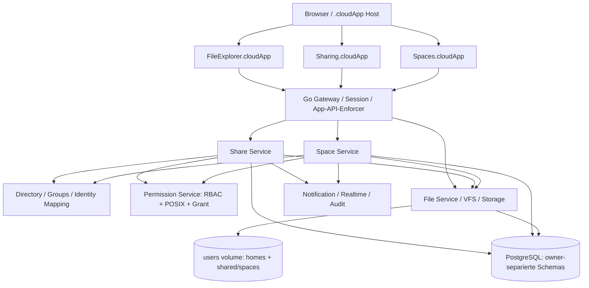
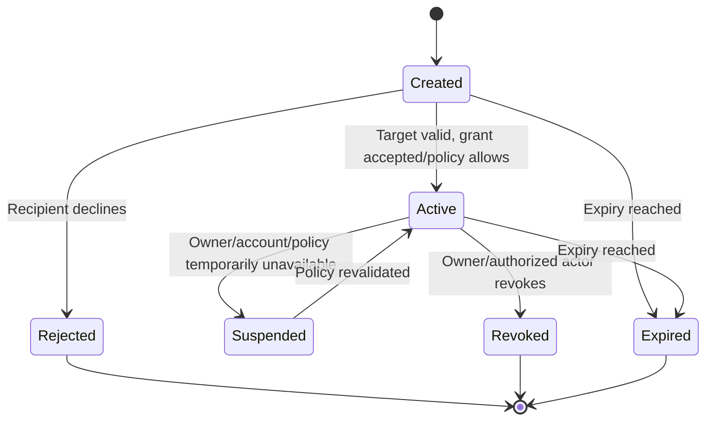
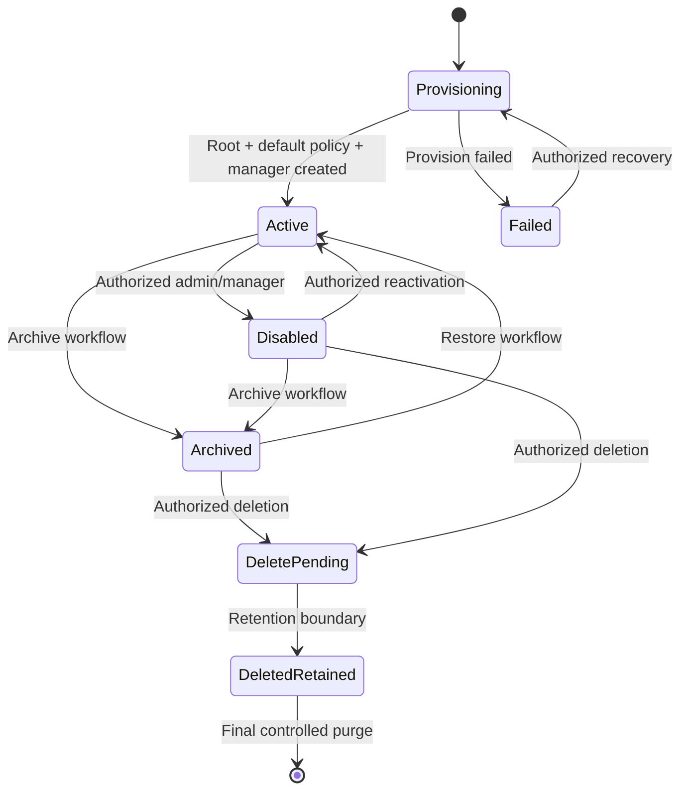
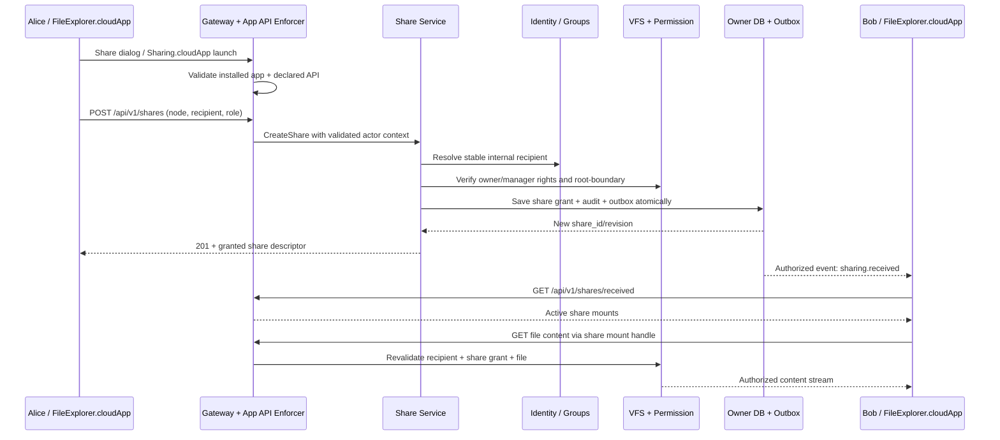

# cloudOS - Interne Dateifreigaben und Spaces

> **Repository:** [Drezael/cloudOS](https://github.com/Drezael/cloudOS)  
> **Datei:** `docs/SHARING_SPACES.md`  
> **Dokumentversion:** 0.1 (verbindliches Fachkonzept, technische Zielarchitektur)  
> **Stand:** 15.11.2026  
> **Gepruefte Basis:** `main`, Commit `134ed30f78bda748e45a1f8c5c4fe77987e18b18`  
> **Fachlich fuehrend fuer:** interne Datei-/Ordnerfreigaben, projektbezogene Spaces, Rollen, Lebenszyklen, Quotas, sichere Mount-Sichten, Schnittstellen und Tests  
> **Abhaengige Dokumente:** [AUTHENTICATION_AUTHORIZATION.md](AUTHENTICATION_AUTHORIZATION.md), [IDENTITY_INTEGRATION.md](IDENTITY_INTEGRATION.md), [VIRTUAL_FILESYSTEM.md](VIRTUAL_FILESYSTEM.md), [APPLICATION_SYSTEM.md](APPLICATION_SYSTEM.md), [APP_API_ACCESS.md](APP_API_ACCESS.md), [SYSTEM_ARCHITECTURE.md](SYSTEM_ARCHITECTURE.md)

## 1. Produktentscheidung und Geltungsbereich

cloudOS erhaelt ein internes Sharing-System und eigenstaendige gemeinsame Arbeitsbereiche (**Spaces**), inspiriert von OpenCloud. Beide verwenden die bereits vereinbarte lokale Identitaets- und Gruppenverwaltung, POSIX-aehnliche VFS-Berechtigungen und die signierten App-API-Allowlisten. **Zunaechst sind ausschliesslich angemeldete, lokal in cloudOS aufloesbare Benutzer und Gruppen berechtigte Empfaenger.**

Ein Share gewaehrt Zugriff auf eine Datei oder einen Ordner, die/der weiter am bisherigen Speicherort verbleibt. Ein Space dagegen ist ein **eigener, vom Benutzerkonto unabhaengiger Arbeitsbereich** mit eigener stabiler ID, Datei-Wurzel, Mitgliedern, Rollen, Quota und eigenem Lebenszyklus.

### 1.1 Unveraenderliche Systemregeln

1. Es gibt weiterhin **genau zwei virtuelle Festplatten**: `system` und `users`.
2. Das sichtbare `/` eines Benutzers bleibt **immer sein persoenliches Home** auf `users`.
3. Shares und Spaces sind kontrollierte virtuelle Einbindungen des zweiten Volumes, keine dritte Festplatte.
4. Jeder Share und jede Space-Mitgliedschaft wird serverseitig autorisiert; ein GUI-Verstecken reicht nicht.
5. Freigaben werden an **stabile lokale User-/Group-IDs** gebunden, nicht an Namen, E-Mail-Adressen oder LDAP-DNs.
6. Standardbenutzer koennen nur auf explizit zugewiesene Inhalte zugreifen; globale Administratoren duerfen Space-Metadaten verwalten, erhalten aber **nicht automatisch Dateiinhalte**.
7. Freigaben uebertragen keine Systemrolle, keine Eigentuemermacht und keine ungefragten App-API-Berechtigungen.
8. Jede sichtbare Start-App, darunter File Explorer, Sharing und Spaces, ist eine signierte und registrierte `.cloudApp`.
9. Nur in `permissions/api-access.json` deklarierte, installativ freigegebene App-API-Operationen sind nutzbar.
10. Internes Sharing und Space-Zugriff bleiben auch nach externem LDAP-Sync oder spaeterem IdP-Wechsel derselben lokalen Identitaet zugeordnet.

### 1.2 Nichtziele fuer die erste Version

- Keine anonymen Links, Public-Link-Freigaben, File Drop, Passwortlinks oder oeffentliche Uploadbereiche.
- Keine externen Gastkonten und keine Foederation mit anderen cloudOS-/OpenCloud-Servern.
- Keine WebDAV-/SMB-/NFS-Freigabe ohne eigenen, spaeteren Schnittstellenvertrag.
- Keine automatische Echtzeit-Kollaboration im selben Dokument; gleichzeitige Aenderungen werden zunaechst per ETag/Revision behandelt.
- Kein Nachbau des OpenCloud-Codes oder seiner internen Datenbank; das Konzept ist fachlich inspiriert, die cloudOS-Vertraege bleiben eigenstaendig.
- Kein Umgehen der lokalen Mount-Sicht durch direkte Linux-/Storage-Pfade.

## 2. Begriffe und Unterschiede

| Begriff | Bedeutung | Speicherort / Sicht |
|---|---|---|
| Home | Privater Root eines Benutzers | `users:/homes/<user_id>/`, angezeigt als `/` |
| Share | Rechteerteilung auf bestehende Datei/Ordner | Original bleibt am Ort, Empfaenger sieht Mount/Verweis |
| Shared With Me | Virtuelle Empfaengeransicht fuer aktive Shares | `/Shared with me/` unter dem Home-Root |
| Space | Projekt-/Teamarbeitsbereich mit eigenem Lebenszyklus | `users:/shared/spaces/<space_id>/` |
| Space-Mount | Virtuelle Einbindung eines berechtigten Space | `/Spaces/<space-name>/` unter dem Home-Root |
| Space-Mitglied | Benutzer oder Gruppe mit Space-Rolle | Stabile lokale `principal_id` |
| Space-Admin | Systemrolle zur Verwaltung von Space-Metadaten | **Kein** automatischer Zugriff auf Datei-Inhalte |
| Space-Manager | Mitglied mit `can_manage`-Rechten | Innerhalb dieses Space verwalten und Inhalte bearbeiten |
| Datei-Share-Rolle | Zugriffsart auf genau eine Ressource | `can_view`, `can_upload`, `can_edit` |
| POSIX-DAC | Datei-Owner, Gruppe und Modebits | Fuer direkt autorisierte VFS-Zugriffe |
| Capability/Grant | Ausdruecklich autorisierter Share-/Space-Zugriff | Zusaetzlicher, ressourcenbezogener Zugangspfad |

Die Begriffe *Share* und *Space* sind nicht austauschbar. Ein Share macht eine vorhandene Ressource fuer einen Empfaenger zugaenglich, ein Space ist selbst ein verwalteter Ressourceneigentuemer.

## 3. Logische Architektur



Alle fachlichen Dienste sind logische Go-Core-Bausteine. Fuer das MVP koennen sie gemeinsam betrieben werden, besitzen aber unterschiedliche Ports, Vertraege, Datenhoheiten und Tests.

### 3.1 Core-Zustaendigkeiten

| Owner | Verantwortung | Was er nicht darf |
|---|---|---|
| Identity | Benutzer-/Gruppenidentitaeten, stabile UUIDs und Mitgliedschaften | Shares direkt an fremden Dateitabellen manipulieren |
| Permission | Systemrechte, POSIX-/Share-/Space-Autorisierungsentscheidungen | Allein aufgrund einer Admin-Rolle fremde Inhalte preisgeben |
| File Service | Nodes, Dateien, Blob-Storage, Mount-Resolver, Revisionen, POSIX-Mode | Share-Rechte eigenmaechtig festlegen |
| Share Service | Share-Registry, Rechte, Empfaenger, Einladungen, Widerruf | Nutzerdaten in eine zweite Dateikopie verlagern |
| Space Service | Space-Metadaten, Mitglieder, Rollen, Quotas, Lebenszyklus | Eigenstaendige dritte virtuelle Festplatte erzeugen |
| App Policy | API-Operation-ID-Allowlist und App-/User-Kontext | Interne Admin-APIs an beliebige Apps durchreichen |
| Notification | Autorisierte Info ueber neue/revozierte Freigaben | Fremde Namen/URLs per Event an Unberechtigte senden |

## 4. Speicher- und Mount-Architektur: weiterhin zwei Laufwerke

### 4.1 Technische VFS-Struktur

```text
system:/
  core/
  applications/
  themes/
  ...                         # Nur administrative VFS-Sicht

users:/
  homes/
    <uuid-alice>/
      Desktop/
      Documents/
      Downloads/
      ...
    <uuid-bob>/
      Desktop/
      Documents/
      ...
  shared/
    spaces/
      <uuid-space-1>/
        Documents/
        Assets/
      <uuid-space-2>/
        ...
```

Die technische Einordnung unter `users:/shared/spaces` nutzt den im bisherigen VFS-Konzept reservierten Bereich `users:/shared`. Er wird bewusst nicht global fuer alle Nutzer auflistbar gemacht. Share-Referenzen auf Dateien in Homes bleiben dort gespeichert; fuer sie gibt es keinen duplizierten Blob-Ordner.

### 4.2 Sicht eines angemeldeten Benutzers

```text
/                              <- users:/homes/<own-user-id>/
  Desktop/
  Documents/
  Downloads/
  Shared with me/               <- virtuelle, durch Share-IDs gesicherte Mounts
    Budget.xlsx                 <- Original liegt z. B. in anderem Home
    Projektplan/                <- Original liegt z. B. in anderem Home
  Spaces/                       <- virtuelle, durch Membership gesicherte Mounts
    Team A/                     <- users:/shared/spaces/<space-id-1>/
    Projekt Orion/              <- users:/shared/spaces/<space-id-2>/
```

**Wichtig:** `/` wird nicht zum technischen `users:/` und nicht zum globalen Speicherverzeichnis. `Shared with me` und `Spaces` sind **vom File-Service bereitgestellte virtuelle Mount-Eintraege im Home-Namespace**, keine echten Host-Symlinks und keine Kopien. Technisch kann die UI sie auch in separaten Navigationsbereichen anzeigen; dieselbe autorisierte Sicht steht Shell und Dateipicker zu.

Die Namen der virtuellen Mount-Eintraege sind reserviert und in andere Sprachen lokalisierbar, ohne die interne Identitaet zu aendern. Namenskollisionen mit echten Ordnern werden bei der Provisionierung verhindert oder ueber feste interne Mount-IDs aufgeloest. Nutzer duerfen keinen echten Ordner anlegen, der den festen Mount-Eintrag ueberlagert.

### 4.3 Path Resolver und sichtbare Pfade

| Pfad | Autorisierungsroute | Antwort |
|---|---|---|
| `/Documents/demo.txt` | Own-home POSIX/ACL | Originale Datei im eigenen Home |
| `/Shared with me/Projektplan/report.txt` | Share-ID + Grant + VFS-Node | Datei beim freigebenden Besitzer |
| `/Spaces/Team A/report.txt` | Space-ID + Membership-Role + VFS-Node | Datei im Space |
| `users:/shared/spaces/<uuid>` als normaler Benutzer | Kein direkter Admin-Mount | Abgewiesen |
| `users:/homes/<foreign-uuid>` | Kein fremder Mount | Abgewiesen |
| `/../../Spaces/Team A` | Root-Sandbox und Canonical Resolver | Kein Ausbruch ueber das Home-Root |
| Direkte unbekannte Node-ID | Gepruefte Scopes/Grants | 404 oder 403 gemaess API-Policy |

Der Resolver benutzt stabile Mount- und Node-IDs, nicht naive `path.Join`-Manipulationen an Host-Verzeichnissen. API-Antworten duerfen keine fremden originalen Home-Pfade oder Storage-Keys verraten. Virtuelle Einbindungen haben eigene `mount_id`s und verweisen auf `source_node_id` bzw. `space_root_node_id`.

## 5. Interne Freigaben: Datei oder Ordner

### 5.1 Empfaenger

Ein Share kann an einen oder mehrere explizit ausgewaehlte **lokal aufgeloeste Benutzer** oder **lokale Gruppen** gerichtet sein. Dabei duerfen Benutzer/Gruppen urspruenglich lokal verwaltet oder spaeter aus einem externen LDAP-Verzeichnis synchronisiert sein: Der Share selbst verweist **immer auf die interne `user_id`/`group_id`**.

- Empfaengerlisten werden serverseitig gesucht, gefiltert und auf Sichtbarkeit geprueft.
- Benutzer mit `disabled`, `quarantined` oder `deleted_retained` erhalten keinen aktiven Dateizugriff.
- Gruppenfreigaben gelten fuer aktuelle, autorisierte Gruppenmitglieder; Entzug wird dynamisch beruecksichtigt.
- Gruppenmitgliedschaften werden nicht im Share als dauerhafte Benutzerliste kopiert.
- Die Standardfreigabe wird **nicht** oeffentlich oder anonym erreichbar.
- Eigene Shares duerfen nach Policy nicht an sich selbst als unnnoetige Duplikate angelegt werden.

### 5.2 Rollen und Rechte

| Share-Rolle | Anzeigen | Herunterladen | Neue Dateien in Ordner | Bearbeiten | Loeschen |
|---|---|---|---|---|---|
| `can_view` | Ja | Ja | Nein | Nein | Nein |
| `can_upload` | Ja | Ja | Ja (nur bei Ordner) | Nein, bestehende Dateien | Nein |
| `can_edit` | Ja | Ja | Ja | Ja | Ja innerhalb des freigegebenen Bereichs |

Die `can_upload`-Rolle ist ausschliesslich fuer Ordner zulaessig; bei Einzeldateien werden unpassende Rechte vor dem Speichern abgewiesen. Feinere Berechtigungen (z. B. kein Download) benoetigen einen spaeteren API-/Policy-Entscheid. Ein Share auf einem Ordner wirkt innerhalb dieses Unterbaums, ohne automatisch uebergeordnete Ordner freizugeben.

### 5.3 Share-Lebenszyklus



Fuer das MVP kann eine interne Freigabe unmittelbar aktiv werden. Der Empfaenger darf sie ausblenden oder ablehnen. Spaetere Einladungs-/Genehmigungsregeln sind erweiterbar. Ablaufdatum, Ablauf-Benachrichtigung und Shared-by-/Shared-with-Ansichten werden von Beginn an im Datenmodell vorgesehen.

**Share erstellen:** Nur der Benutzer mit autorisierter Rechtevergabekompetenz darf einen Share einrichten. Ein Empfaenger erhaelt keinen automatischen Anspruch, Inhalte weiterzuteilen. Resharing wird im MVP standardmaessig verboten.

**Share widerrufen:** Nach Widerruf sind neue Zugriffe und neue Chunk-/Range-Anfragen sofort zu sperren. Bereits heruntergeladene oder ausserhalb von cloudOS kopierte Daten koennen naturgemaess nicht zurueckgerufen werden.

### 5.4 Beispiel: Share-Objekt (Schemaentwurf)

```json
{
  "share_id": "6f04c41b-fc37-4d42-b572-220dff0d6427",
  "owner_user_id": "11111111-1111-4111-8111-111111111111",
  "source_node_id": "55555555-5555-4555-8555-555555555555",
  "recipient": {
    "type": "user",
    "id": "22222222-2222-4222-8222-222222222222"
  },
  "role": "can_view",
  "state": "active",
  "reshare_allowed": false,
  "revision": 1,
  "expires_at": null
}
```

Empfaenger, Quelle, Rolle und Scope sind **autoritative Serverdaten**. Ein Browser darf weder einen abweichenden Owner noch eine fremde Ressource anhand einer erfundenen Node-ID einschleusen.

### 5.5 Konflikte und Spezialfaelle

- Wenn ein freigegebener Node geloescht wird, wird sein Share deaktiviert bzw. widerrufen; Wiederherstellung erfolgt nur nach definierter Policy.
- Umbenennen innerhalb derselben Ressource behaelt die Node-ID; Empfaenger-Pfade verwenden Mount-ID und aktuelle Anzeige.
- Verschieben des Originals darf keinen Umfang der Freigabe erweitern oder die Ressourcen-Sandbox verlassen; Root-Shares und bestehende Grants werden neu validiert.
- Bei Aenderung des Eigentuemerkontos wird die Share-Policy nach Datenlebenszyklus entschieden, niemals still auf einen zufaelligen neuen Benutzer umgebogen.
- Mehrere Freigaben auf dieselbe Datei werden getrennt verwaltet, koennen aber in der Empfaengeransicht dedupliziert werden.
- Kein `share_id` ist ein ersetzbarer Authentifizierungsnachweis; die Session und die berechtigte Membership sind immer noetig.

## 6. Spaces: eigenstaendige gemeinsame Arbeitsbereiche

### 6.1 Space-Eigenschaften

Ein Space wird durch den **Space Service** erstellt und besitzt:

| Feld | Zweck |
|---|---|
| `space_id` | Stabile unveraenderliche UUID |
| `name`, `description`, `avatar_asset_id` | Anzeige, Thema, Projektbeschreibung |
| `root_node_id` | Eindeutiger VFS-Root des Space im `users`-Volume |
| `state` | `provisioning | active | disabled | archived | delete_pending | deleted_retained` |
| `quota_limit_bytes`, `used_bytes`, `reserved_bytes` | Eigene Kapazitaetsverwaltung |
| `created_by`, `created_at`, `updated_at` | Audit-Provenienz, keine Abhaengigkeit vom Erstellerkonto |
| `policy_revision` | Versionskennung fuer Membership-/Rechtepruefung |
| `allow_item_shares` | Policy, ob einzelne Dateien aus Spaces separat freigegeben werden duerfen (MVP: false) |
| `retention_policy_id` | Archivierungs- und Loeschregeln |

Die Dateien gehoeren **fachlich dem Space**, nicht dessen Ersteller. Nach Austritt oder Deaktivierung des Erstellers bleiben Space-ID, Inhalte und Mitgliedschaften erhalten. Physische Dateien sind weiterhin unter einem durch File Service verwalteten Root auf dem zweiten Volume gespeichert.

### 6.2 Rollenmodell

| Space-Rolle | Lesen/Download | Erstellen/Hochladen | Bearbeiten/Loeschen | Mitglieder/Rollen verwalten | Space-Quota / Aktivierung |
|---|---|---|---|---|---|
| `can_view` | Ja | Nein | Nein | Nein | Nein |
| `can_edit` | Ja | Ja | Ja | Nein | Nein |
| `can_manage` | Ja | Ja | Ja | Ja | Ja (nach Policy) |

`can_manage` beinhaltet Inhaltszugriff, waehrend die **globale Systemrolle `spaces.admin`** Meta-Administration (Anlegen, Umbenennen, Deaktivieren, Loeschworkflow, Quotas) ermoeglichen kann, **ohne** Inhalte zu lesen oder Rollen anderer Space-Mitglieder eigenmaechtig auszunutzen. Loeschung eines Space ist standardmaessig kein Recht der `can_manage`-Rolle, sondern benoetigt `spaces.delete`.

Fuer einen neuen Space wird mindestens ein verwaltender Principal gesichert, damit kein unverwaltbarer Bereich entsteht. Administratoren koennen Space-Metadaten reparieren, ohne pauschale Dateirechte. Einen gesonderten, auditierbaren Support-/Recovery-Zugriff auf Inhalte behandeln wir als eigenstaendigen Hochrisiko-Workflow.

### 6.3 Mitgliedschaften von Benutzern und Gruppen

- Members sind `user_id` oder `group_id` mit genau einer effektiven Rolle je Principal-Bindung.
- Effektive Mitgliedschaft ueber eine lokale/LDAP-synchronisierte Gruppe wird bei einem Benutzeraufruf anhand der aktuellen, gueltigen Membership aufgeloest.
- Mehrfachrollen durch direkte und gruppenbezogene Mitgliedschaften werden mittels dokumentierter Policy zusammengefuehrt (empfohlen: hoechstes explizit gueltiges Recht, soweit keine ausdrueckliche Deny-Policy greift).
- Eine direkte Sperre eines Accounts, Space oder Grants hat Vorrang vor einer indirekten Gruppenerlaubnis.
- Space-Mitgliedschaften koennen durch `can_manage` hinzugefuegt/geaendert/entfernt werden; keine normale App darf die Space-Rollen-API ohne signierte Deklaration aufrufen.
- Externe LDAP-Gruppenveraenderungen duerfen nicht auf alte Browser-Session-Caches vertraut bleiben.

### 6.4 Space-Lebenszyklus



- `disabled`: keine regulaeren Inhaltszugriffe; Metadaten bleiben fuer berechtigte Verwaltung sichtbar.
- `archived`: definierter Read-only-/No-Access-Modus nach Policy; keine stillen Schreibrechte.
- `delete_pending`: neue Grants werden verweigert, laufende Jobs revalidiert, Snapshots/Retention werden beruecksichtigt.
- `deleted_retained`: geloeschte Daten sind nicht regulaer sichtbar, koennen innerhalb der Retention per authorisiertem Restore wiederhergestellt werden.
- Space-Loeschung ist getrennt von der Loeschung eines einzelnen Benutzers oder LDAP-Eintrags.

### 6.5 Space-Quota und Speicherabrechnung

Space-Inhalte werden separat gegen **Space-Quota** geprueft und nicht unkontrolliert gegen den privaten Verbrauch eines Mitglieds gebucht. Die Abrechnung ordnet den Blob dem kanonischen Datei-/Space-Eigentuemer zu, nicht jedem Mount-Empfaenger. Deduplication und Reflinks duerfen Quotas nicht aushebeln; Reserve/Commit-/Release-Operationen sind atomar zu planen.

### 6.6 Beispiel: Space-Objekt

```json
{
  "space_id": "aaaaaaaa-aaaa-4aaa-8aaa-aaaaaaaaaaaa",
  "name": "Projekt Orion",
  "description": "Gemeinsame Projektunterlagen",
  "root_node_id": "bbbbbbbb-bbbb-4bbb-8bbb-bbbbbbbbbbbb",
  "state": "active",
  "quota_limit_bytes": 10737418240,
  "policy_revision": 12,
  "allow_item_shares": false,
  "members": [
    {"principal_type": "group", "principal_id": "cccccccc-cccc-4ccc-8ccc-cccccccccccc", "role": "can_edit"},
    {"principal_type": "user", "principal_id": "dddddddd-dddd-4ddd-8ddd-dddddddddddd", "role": "can_manage"}
  ]
}
```

## 7. POSIX-/Linux-Rechte und explizite Share-/Space-Grants

### 7.1 Grundsatz: getrennte Zugriffswege

Die bisherigen Unix-Rechte (UID, GID, owner/group/other, `rwx`, `umask`, spaeter POSIX-ACLs) bleiben fuer direkte Dateioperationen auf dem eigenen Home bzw. im VFS die Ausgangsbasis. **Ein expliziter Share oder eine Space-Membership ist ein separater, begrenzter Zugriffsweg und kein globales `chmod 777`.**

Die Autorisierung darf nicht als unbedingtes `POSIX_ALLOW && SHARE_ALLOW` formuliert werden, denn eine ausdruecklich geteilte private Datei kann `0600` haben. Gleichzeitig darf sie nicht unbedingtes `POSIX_ALLOW || SHARE_ALLOW` sein, weil dadurch gesperrte Mounts oder System-Policies umgangen wuerden.

**Verbindliche Entscheidungsreihenfolge:**

1. Gueltige, nicht gesperrte Benutzer-/App-Instanz und aktuelle Membership/Policy-Revision bestimmen.
2. Endpoint ist in der signierten App-API-Datei deklariert, administrativ freigegeben und fuer diese Version/Instanz gebunden.
3. Gewaehrten Mount-Kontext aus Resolver bestimmen: `own_home`, `share_mount`, `space_mount` oder administrativer Systemzugriff.
4. **Mount-Kontext-spezifische Rechte** pruefen: bei `own_home` POSIX-/ACL-Rechte; bei `share_mount` das effektive, nicht abgelaufene Share-Recht; bei `space_mount` die aktive Space-Rolle und Space-Policy.
5. Die Operation muss innerhalb des gewaehren Root-/Node-Unterbaums bleiben; Eltern ausserhalb des Share-Roots werden dem Empfaenger nicht zugaenglich gemacht.
6. Harte Sicherheitsregeln (Ressourcen-Sperre, Systemvolume, rechtliche Policies, App-Capabilities, Datenklassifizierung, Quotas) muessen weiterhin erfuellt sein.
7. Jeder schreibende Vorgang wird vom File Service unter dem **effektiven Actor und Grant-Kontext** ausgeloest; ein Share ist keine stille Eigentumsuebertragung.

Formel (vereinfacht):

```text
ALLOW = valid_session
    AND valid_app_instance
    AND signed_declared_endpoint
    AND approved_endpoint
    AND valid_mount_scope
    AND scope_specific_rights(own_home | share | space)
    AND resource_policy
    AND required_app_capabilities
    AND quota_and_revision_checks
    AND NOT explicit_deny
```

**Beispiel:** Alice besitzt `/Documents/Geheim.txt` mit Mode `0600`. Gibt Alice genau diese Datei als `can_view` an Bob frei, darf Bob sie im zugewiesenen Share-Kontext lesen, aber nicht per Fremd-Home-Pfad ansprechen, nicht bearbeiten und nicht auf Nachbardateien zugreifen. `Geheim.txt` bleibt Eigentum von Alice und hat weiter Mode `0600`.

### 7.2 POSIX-Metadaten in Spaces

Space-Dateien behalten POSIX-artige Metadaten (Owner-UID, Group-GID, Mode) fuer Kompatibilitaet und interne Defaultwerte. Fuer Zusammenarbeit sind die **Space-Mitgliedschaftsrollen die autoritative delegierte Zugriffsentscheidung**; beliebige POSIX-Modebits duerfen keinen Space-Nichtmitgliedern Zugang erteilen. Owner-, Gruppen- und Modusaenderungen innerhalb eines Space werden nach einer besonderen Space-Policy autorisiert, damit nicht jeder Editor Kollegen aussperren oder umgekehrt globale Rechte vergeben kann. Die konkrete `chmod`-/`chown`-Semantik fuer Space-Dateien wird vor Implementierung gesondert als ADR entschieden.

### 7.3 Keine Umgehung durch Administrationsrollen

- `spaces.admin` darf Space-Stammdaten und den Loeschworkflow bearbeiten, nicht still Dateiinhalte lesen.
- `shares.admin` (falls spaeter benoetigt) darf Verwaltungsmetadaten anzeigen, nicht automatisch fremde Shares als Empfaenger mounten.
- `cloudos-admins` als Linux-aehnliche Gruppe ist eine lokale Rolle/Policy; Mitgliedschaft allein umgeht keine Mount- oder App-Grenze.
- Ein eingeschraenkter Datei-Share kann die Freigaberechte an denselben Space nicht vergroessern, wenn System- oder Space-Policy dies verbietet.

## 8. Interner Sharing-Ablauf



Der Share-Ersteller kann nicht durch Angabe einer fremden `source_node_id` beliebige Dateien freigeben. Der Empfaenger darf auch dann nur innerhalb der freigegebenen Unterstruktur navigieren, wenn er die urspruenglichen Eltern-Node-IDs kennt.

## 9. Core-Apps und Bedienung

| App | Start-/Installationsstatus | UI |
|---|---|---|
| `FileExplorer.cloudApp` | Verpflichtende Core-App | Kontextmenue **Teilen**, Badges, `Shared with me`, `Spaces`-Einbindung |
| `Sharing.cloudApp` | Neu als verpflichtende Core-App fuer Sharing | Eigener App-Kontext, Empfaengerwahl, Rollen, Shares verwalten, Widerruf |
| `Spaces.cloudApp` | Neu als verpflichtende Core-App fuer Spaces | Space-Liste, erstellen nach Policy, Mitglieder, Rollen, Quota, Aktivierung/Archivierung |
| `Settings.cloudApp` | Bereits verpflichtend | Allgemeine Freigabe-/Spaces-Policies und Verweise auf Admin-Apps |
| `GroupManagement.cloudApp` | Bereits geplante Core-App | Gruppen, ggf. externe synchronisierte Memberships anzeigen |

**Jede eigene Sicht, die als App gestartet wird, muss installiert sein.** Beim Aufruf des Share-Dialogs darf der File Explorer nicht einfach dessen privilegierte API-Aufrufe uebernehmen; er startet beziehungsweise bettet die eigenstaendige `Sharing.cloudApp` unter einer eigenen App-Instanz und eigenem, signiertem Endpoint-Contract ein. Desktop und FileExplorer koennen lediglich die fuer sie erlaubten, gesondert deklarierten Integrations-APIs nutzen.

### 9.1 UI-Verhalten

- Kontextmenue `Rechtsklick -> Teilen` fuer berechtigte Dateien/Ordner.
- Empfaenger-Suche mit Vorschlaegen fuer lokale Benutzer/Gruppen, mit Datenschutz- und Paging-Regeln.
- Anzeigen von Rollen und konkreter Sicherheitsauswirkung vor dem Speichern eines Shares.
- Freigaben-Liste `Mit mir geteilt` und `Von mir geteilt`, inklusive Ablauf, Status, Empfaenger, Widerruf.
- Spaces als eigene Navigation mit Info zu Mitgliedschaft, aktueller Rolle, Quota, Aktivierungsstatus.
- Space-Manager-Bildschirm fuer Mitglieder und Rechte, getrennt von globaler Admin-Settings-App.
- Alle visuellen Elemente befolgen das zentrale cloudOS-Designsystem und reagieren auf Themes.

## 10. REST-API-Entwurf (v1, nicht implementiert)

### 10.1 Shares

| Methode | Route | Zweck | Beispielhafte operation_id |
|---|---|---|---|
| `GET` | `/api/v1/shares/received` | Eigene empfangene Shares | `shares.received.list` |
| `GET` | `/api/v1/shares/sent` | Eigene ausgegebene Shares | `shares.sent.list` |
| `POST` | `/api/v1/shares` | Interne Freigabe anlegen | `shares.create` |
| `GET` | `/api/v1/shares/{share_id}` | Eigene Freigabemetadaten | `shares.read` |
| `PATCH` | `/api/v1/shares/{share_id}` | Rolle/Ablauf aendern | `shares.update` |
| `DELETE` | `/api/v1/shares/{share_id}` | Eigene Freigabe widerrufen | `shares.revoke` |
| `POST` | `/api/v1/shares/{share_id}/decline` | Empfangene Freigabe ablehnen | `shares.decline` |
| `GET` | `/api/v1/shares/{share_id}/mount` | Autorisierte, kurzlebige Mount-Referenz | `shares.mount.read` |

### 10.2 Spaces

| Methode | Route | Zweck | Beispielhafte operation_id |
|---|---|---|---|
| `GET` | `/api/v1/spaces` | Eigene/administrativ sichtbare Spaces | `spaces.list` |
| `POST` | `/api/v1/spaces` | Space erstellen | `spaces.create` |
| `GET` | `/api/v1/spaces/{space_id}` | Space-Stammdaten | `spaces.read` |
| `PATCH` | `/api/v1/spaces/{space_id}` | Space-Stammdaten/Policy aendern | `spaces.update` |
| `GET` | `/api/v1/spaces/{space_id}/members` | Mitglieder auflisten | `spaces.members.list` |
| `PUT` | `/api/v1/spaces/{space_id}/members/{principal_id}` | Mitglied samt Rolle setzen | `spaces.members.set` |
| `DELETE` | `/api/v1/spaces/{space_id}/members/{principal_id}` | Mitglied entfernen | `spaces.members.remove` |
| `GET` | `/api/v1/spaces/{space_id}/root` | Berechtigte Root-Referenz | `spaces.root.read` |
| `PATCH` | `/api/v1/spaces/{space_id}/quota` | Space-Quota aendern | `spaces.quota.update` |
| `POST` | `/api/v1/spaces/{space_id}/disable` | Space deaktivieren | `spaces.disable` |
| `POST` | `/api/v1/spaces/{space_id}/activate` | Space aktivieren | `spaces.activate` |
| `POST` | `/api/v1/spaces/{space_id}/archive` | Archivierungsworkflow | `spaces.archive` |
| `DELETE` | `/api/v1/spaces/{space_id}` | Kontrollierte Loeschung | `spaces.delete` |

### 10.3 File API im Share-/Space-Kontext

Die bestehenden Datei-APIs bleiben ressourcenorientiert. Ein Dateizugriff bekommt einen **serverseitig validierten, gebundenen Mount-Kontext** (beispielsweise kurzlebiges Mount-Handle, nicht frei manipulierbarer `owner_id`). Damit kann `GET /api/v1/files/{id}/content` sowohl eine eigene Datei als auch einen erlaubten Share-/Space-Knoten ausliefern, ohne einen zweiten Dateiservice zu bauen. Alle Zugriffe pruefen den zugrunde liegenden Share oder Space erneut.

### 10.4 API-Vertragsprinzipien

- Keine generischen `*`-Endpoint-Freigaben in `.cloudApp`-Paketen.
- Exakte OpenAPI `operation_id`, Methode, Route und Resource-Scope pro App-Version.
- Share- und Space-Rechte koennen die fuer Apps freigegebenen API-Scopes nie erweitern.
- `If-Match`/Revisionen fuer Aenderungen und konkurrierende Mitgliederverwaltung.
- Cursor-Paging, Rate-Limits, sparsame Fehlermeldungen und strikte Authentifizierung.
- Ein Account oder eine App darf keine fremden Share-/Space-Metadaten erraten oder aus Fehlerdetails erschliessen.

## 11. Geplante App-API-Allowlisten

### 11.1 Sharing.cloudApp

```json
{
  "schema_version": "1.0",
  "api_contract": "cloudos.core.v1",
  "endpoints": [
    {"operation_id": "shares.create", "method": "POST", "path": "/api/v1/shares", "resource_scope": "own_home", "reason": "Dateien und Ordner intern freigeben"},
    {"operation_id": "shares.sent.list", "method": "GET", "path": "/api/v1/shares/sent", "resource_scope": "own_session", "reason": "Eigene Freigaben verwalten"},
    {"operation_id": "shares.received.list", "method": "GET", "path": "/api/v1/shares/received", "resource_scope": "own_session", "reason": "Empfangene Freigaben anzeigen"},
    {"operation_id": "shares.revoke", "method": "DELETE", "path": "/api/v1/shares/{share_id}", "resource_scope": "app_owned", "reason": "Eigene Freigaben widerrufen"}
  ]
}
```

Die Beispiel-Allowlist enthaelt nicht alle spaeter benoetigten Operationen. Sie demonstriert nur das exakte deklarative Format. Erst ein vollstaendiger, signierter und gepruefter Release-Contract ist aktivierbar. `resource_scope`-Kombinationen muessen in der Core-API-Registry definiert werden und koennen vor Implementierung angepasst werden (insbesondere fuer `shares.create`).

### 11.2 Spaces.cloudApp

- `spaces.list` und `spaces.read`: verfuegbare/berechtigte Spaces darstellen.
- `spaces.create`: nur soweit lokale Systemrolle die Anlage erlaubt.
- `spaces.members.list`, `spaces.members.set`, `spaces.members.remove`: nur bei `can_manage` und passender Core-Policy.
- `spaces.quota.update`, `spaces.disable`, `spaces.activate`: Policy/Role-Kombination.
- `spaces.root.read`: liefert ausschliesslich das berechtigte Mount-Handle, nicht das globale `users:/shared/spaces`.
- `spaces.delete`: nur besondere Systemrolle und bestaetigter Loeschworkflow.

Rollen sind keine API-Allowlist: Eine App muss die Operation *deklariert* haben **und** der konkrete Benutzer muss sie aufgrund seiner Rolle aktuell ausfuehren duerfen.

## 12. Persistentes Datenmodell und Owner-Grenzen

### 12.1 Share Service Schema (Entwurf)

| Tabelle | Kernfelder |
|---|---|
| `sharing.shares` | `id`, `owner_user_id`, `source_node_id`, `state`, `revision`, `expires_at` |
| `sharing.recipients` | `share_id`, `principal_type`, `principal_id`, `role` |
| `sharing.mounts` | `id`, `share_id`, `recipient_user_id`, `display_name`, `state` |
| `sharing.access_audit` | `share_id`, actor, operation, time, decision (gegebenenfalls Audit Service) |
| `sharing.outbox` | id, event_type, subject, revision, state |

### 12.2 Space Service Schema (Entwurf)

| Tabelle | Kernfelder |
|---|---|
| `spaces.spaces` | `id`, `root_node_id`, `name`, `state`, `quota_limit`, `revision`, `allow_item_shares` |
| `spaces.memberships` | `space_id`, `principal_type`, `principal_id`, `role`, `state` |
| `spaces.quotas` | `space_id`, `used_bytes`, `reserved_bytes`, `limit_bytes` |
| `spaces.lifecycle_jobs` | `id`, `space_id`, `operation`, `state`, `requested_by` |
| `spaces.outbox` | id, event_type, subject, revision, state |

### 12.3 Datei- und Mount-Metadaten

File Service speichert Node-Owner- und Space-Referenzen. Eine Node besitzt eine kanonische `node_id`, genau ein physisches Blob-Backing und ein `volume_id`. Spaces referenzieren eine Root-Node, Shares referenzieren eine bereits vorhandene Node. **Ein Mount verschiebt niemals den kanonischen Parent**; separate View-Datensaetze geben die sichtbare Pfadposition an.

Fremde Go-Dienste greifen nicht direkt auf `files.*` zu. Referentielle Konsistenz ueber Servicegrenzen wird durch Owner-APIs, kontrollierte Projektionen, Ereignisse und Reconciliation gewahrt; ein scheinuebergreifendes Fremdschluessel-Netz ist nicht vorausgesetzt.

### 12.4 Immutability und Audit

- Kritische Membership-/Share-Aenderungen bekommen eine monotone Policy-Revision.
- Zugriff wird mit Actor, App-Instanz und Share-/Space-Kontext auf der Server-Seite entschieden.
- Audit traegt keine Klartext-Inhalte oder versteckte fremde Pfade in allgemeine Logkanaele.
- Bei Gruppenentzug wird der Grant nicht durch einen veralteten Cache aktiv gehalten.

## 13. Ereignisse und Realtime

| Event | Empfaengerfilterung und Zweck |
|---|---|
| `sharing.share.created` | Benachrichtigung fuer berechtigten Empfaenger |
| `sharing.share.revoked` | Mount und offene Handles des Empfaengers revalidieren |
| `sharing.share.updated` | Rolle/Expiry aktualisiert; UI resynchronisieren |
| `spaces.space.created` | Autorisierte Space-Liste aktualisieren |
| `spaces.member.added` | Space-Mount beim neuen Mitglied einblenden |
| `spaces.member.removed` | Space-Mount und API-Grants widerrufen |
| `spaces.role.changed` | Berechtigungsrevision aktualisieren |
| `spaces.space.disabled` | Schreib-/Lesezugriffe gemaess Space-Policy sperren |
| `spaces.quota.updated` | Quota-/Status-UI aktualisieren |

Die Realtime-Events sind **Hinweise**, keine Autorisierungsquelle. Jeder Zugriff fragt die gueltigen Policy-Revisionen ab. Eine WebSocket-Verbindung darf keine Dateien oder Namen preisgeben, die der Empfaenger nicht sehen darf. Idempotente Events und REST-Resync sind Pflicht.

## 14. Transaktionsgrenzen und Konfliktverhalten

### 14.1 Share-Anlage

Der Share Service validiert Benutzer und Quelle, schreibt Grant + Outbox atomar in seinem Schema und bestaetigt erst nach erfolgreichem Commit. Die zugrundeliegende Ressource wird vor und nach jeder relevanten Autorisierungsentscheidung auf Gueltigkeit/Root-Zugehoerigkeit geprueft. Loeschung oder Move kann den Share nachtraeglich invalidieren; ein Reconciling-Worker entdeckt verwaiste Grants.

### 14.2 Space-Erzeugung

Space erzeugen ist ein koordiniertes Verfahren: `provisioning` im Space Service -> Root im File Service -> initiale Manager-Bindung -> `active`. Bei Teilfehler gibt es `failed` und idempotente Recovery. Eine globale atomare Transaktion ueber zwei Services/Storage wird **nicht** vorausgesetzt. Neues Space-Root wird erst nach erfolgreicher Aktivierung sichtbar.

### 14.3 Bearbeitung gemeinsamer Dateien

- Bei gleichzeitigen Schreibzugriffen wird ein ETag/Revision-Check erwartet.
- Ein `412 Precondition Failed` oder `409 Conflict` loest eine sichtbare Konfliktentscheidung aus, kein stilles Ueberschreiben.
- Verlorene oder widerrufene Schreibrechte werden auch kurz vor dem Commit geprueft.
- Copy/Move ueber Home/Share/Space-Grenzen braucht gesonderte Rechte auf Quelle, Ziel und Datenklassifizierung; im MVP koennen Cross-Scope-Moves untersagt und durch sicheren Copy/Import ersetzt werden.

## 15. Sicherheit und Datenschutz

| Risiko | Gegenmassnahme |
|---|---|
| Erratene fremde Node-ID | Alle Resolver-/Node-APIs pruefen Grant-/Space-Kontext |
| Weitergabe eines Share-Links an Fremde | Share-ID ohne Session und Empfaengerbindung nutzlos |
| `chmod 777` innerhalb eines Share | Kein fremder Home-Mount; Shares wirken nur im expliziten Kontext |
| LDAP-Gruppe veraendert sich | Revisionskontrolle, sofortige Entziehung durch aktuelle Membership |
| IdP-Anmeldung mit gleichem E-Mail-Wert | Keine automatische Konto-Fusion oder Share-Uebernahme |
| Space-Admin sieht Inhalte | Trennung Meta-Admin und Mitgliedsrolle; auditiertes Break-Glass separat |
| App-API nicht deklariert | Serverseitiger `403` trotz Share-/Space-Rolle |
| Space-Datei geloescht | Papierkorb, Versionen, Retention und geregelter Restore |
| Freigabe sensibler Systemdatei | `system`-Volume per Policy nicht sharebar im MVP |
| Cross-Space-Move | Quelle und Ziel getrennt autorisieren, keine Scope-Ausweitung |
| Event-Leak | Autorisierte Empfaenger und minimale Event-Payload |
| Veraltete Berechtigung im Cache | Authoritative Revision, kurze TTL, Fail Closed bei Revisionsunsicherheit |
| Aufgehobener Share, laufender Download | Neue Requests/Chunks sperren, bereits kopierte Bytes nicht rueckholbar |
| Weitreichendes `can_edit` | Klare Warnung vor Loeschen/Ueberschreiben bei Vergabe |

Der Core darf keine potentiell gefaehrlichen Verwaltungs-APIs allein deshalb ausfuehren, weil eine App vom Betreiber signiert ist. Signatur, App-API-Freigabe, Benutzerrolle, Ressourcengrant und VFS-Regeln sind getrennte Schranken.

## 16. Backup, Retention und Betrieb

- Backup umfasst File-Metadaten, Blob-Storage, Share-/Space-Schemas, Identity-Bindings und Policy-Revisionen in einem abgestimmten Wiederherstellungspunkt.
- Restore prueft, ob `source_node_id`, Space-Roots und Member-IDs weiterhin aufloesbar sind; nicht aufloesbare Grants werden deaktiviert.
- Benutzerloeschung darf einen Space nicht automatisch loeschen; Restore/Aufbewahrungsfristen sind voneinander getrennt.
- Metrics: aktive Shares, abgelaufene Shares, verwaiste Mounts, Space-Quota, Lifecycle-Failures, Authorization-Denies, Outbox-Lag.
- Warnungen bei massenhaftem Widerruf, Zugriffsfehlern, widerrufenen Gruppen und Space-Quota-Versagen.
- Vor produktiver Nutzung sind ein Backup- und ein tatsaechlicher Restore-Test erforderlich.

## 17. Stufenweiser Entwicklungsplan

| Schritt | Ergebnis | Abnahme |
|---|---|---|
| COL-00 | Share-/Space-Fachvertrag + ADRs | Rollen, Mount und Owner sind eindeutig beschrieben |
| COL-01 | Share-/Space-Schema und Migrationen | Stabile IDs und Revisionen, isolierte Owner-Schemas |
| COL-02 | File-Service-Mount-Resolver | `/` bleibt Home, virtuelle Mount-IDs funktionieren |
| COL-03 | Share Service - interne User Shares | Create/List/Revoke, kein fremder Zugriff |
| COL-04 | Group Shares | Aktuelle Membership, Revoke bei Gruppenwechsel |
| COL-05 | Sharing.cloudApp | Signiert, installiert, Rechteanzeige und Widerruf |
| COL-06 | Space Service - Provisioning/Root | Space-Root auf `users`, kein zusaetzliches Volume |
| COL-07 | Space-Rollen, Members und Quota | Can view/edit/manage und Quota sicher |
| COL-08 | Spaces.cloudApp | Liste/Verwaltung, Theme, Berechtigungen |
| COL-09 | File Explorer Integration | Shared with me und Spaces unter Home-/Dateiansicht |
| COL-10 | LDAP-/IdP-Gruppenintegration | Stabile Local IDs, dynamischer Entzug |
| COL-11 | Realtime, Audit, Konfliktschutz | Revocation, ETag, Eventfilter getestet |
| COL-12 | Restore und Security Release Gate | Wiederherstellung inkl. Shares/Spaces bestanden |

**Priorisierung:** Interne Shares und grundlegende Spaces gehoeren zur fruehen Produktfunktionalitaet nach sicherem VFS, Identity und App-Runtime. LDAP-/IdP-Integrationen sind anschliessend optionale Erweiterungen; der erste Share-/Space-Release darf von externen Identitaetsdiensten nicht abhaengen.

## 18. Teststrategie und Abnahme

| Test-ID | Fall | Erwartung |
|---|---|---|
| COL-T01 | Alice teilt Datei mit Bob | Bob sieht genau diese Datei in der Share-Sicht |
| COL-T02 | Alice teilt Ordner | Bob sieht nur diesen Unterbaum |
| COL-T03 | Alice teilt `0600`-Datei can_view | Bob kann im Share-Kontext lesen, Mode bleibt `0600` |
| COL-T04 | Bob versucht Originalpfad in Alice-Home | Verweigert |
| COL-T05 | Bob versucht fremde Node-ID ohne Share | Verweigert |
| COL-T06 | Share nur can_view | Kein Schreiben, Umbenennen oder Loeschen |
| COL-T07 | Share can_upload | Upload in Ordner, keine Bearbeitung vorhandener Dateien |
| COL-T08 | Share can_edit | Erlaubte Schreiboperationen im Unterbaum |
| COL-T09 | Share entzogen | Weiterer Zugriff sofort gesperrt |
| COL-T10 | Share abgelaufen | Zugriff gesperrt |
| COL-T11 | Benutzer deaktiviert | Shares fuer deaktivierten Account unzugreifbar |
| COL-T12 | Gruppe bekommt Share | Mitglieder koennen je aktueller Membership zugreifen |
| COL-T13 | LDAP-Gruppenmitglied entfernt | Kein Zugriff trotz aktiver Browser-Session |
| COL-T14 | Nur Share-ID bekannt | Ohne Session kein Zugriff |
| COL-T15 | Share Root verschoben | Nicht ohne Scope-/Policy-Neubewertung |
| COL-T16 | Systemvolume share versucht | Gesperrt |
| COL-T17 | Space erzeugt | Eigene Root-Node innerhalb `users` |
| COL-T18 | Space creator geloescht | Space bleibt unveraendert verfuegbar |
| COL-T19 | Space can_view | Nur Lesen/Download |
| COL-T20 | Space can_edit | Schreiben, kein Membership-Management |
| COL-T21 | Space can_manage | Mitglieder verwalten, kein Space-Delete |
| COL-T22 | Globaler Space-Admin nicht Mitglied | Keine Datei-Inhalte |
| COL-T23 | Space deaktiviert | Regulare Inhaltsoperationen verweigert |
| COL-T24 | Space archiviert | Aenderungsaktionen entsprechend Policy blockiert |
| COL-T25 | Space-Quota voll | Upload/Write verweigert, keine falsche Kapazitaetsbuchung |
| COL-T26 | Space-Membership widerrufen | Mount verschwindet, API und Handles gesperrt |
| COL-T27 | Space-Member via lokale/LDAP-Gruppe | Dynamische effektive Rolle |
| COL-T28 | App ohne `shares.create` | HTTP 403 trotz Eigentuemerkonto |
| COL-T29 | App ohne `spaces.members.set` | HTTP 403 trotz `can_manage` des Benutzers |
| COL-T30 | Direkter `users:/shared`-Pfad | Normalnutzer hat keinen Mount |
| COL-T31 | Pfad `..` aus Share/Space | Kein Ausbruch |
| COL-T32 | Originaldatei nicht kopiert | Keine doppelte Datei/Quota durch Mount |
| COL-T33 | Gleichzeitige Bearbeitung | ETag-Konflikt statt stilles Ueberschreiben |
| COL-T34 | Group-/Role-Event verloren | REST-Revision/TTL entzieht trotzdem Rechte |
| COL-T35 | Wiederherstellung nach Backup | Roots, Memberships und Shares stimmen |
| COL-T36 | Mehrfacher Share-Create Retry | Idempotenz/kein unerwarteter Doppelgrant |
| COL-T37 | Dateien mit `0777` im fremden Home | Kein globaler Home-Mount |
| COL-T38 | Fremder Share im Suchindex | Keine unberechtigte Trefferleaks |
| COL-T39 | Theme-Wechsel waehrend Share-Dialog | UI bedienbar und sicherheitsrelevante Hinweise sichtbar |
| COL-T40 | Nicht installierte Sharing-/Spaces-App | Kein Start, keine API-Ausnahme |
| COL-T41 | Nicht signierte oder manipulierte `.cloudApp` | Installation gesperrt |
| COL-T42 | Externe OIDC-Identitaet mit gleichem Namen | Keine fremden Shares ohne korrektes Identity-Binding |
| COL-T43 | Quota bei parallelem Upload | Reservierung korrekt, keine Umgehung |
| COL-T44 | Widerruf bei laufendem Chunk-Upload | Vor Commit erneute Autorisierung |
| COL-T45 | `can_upload` auf Einzeldatei | Unzulaessige Rollen-/Ressourcenkombination abgelehnt |

Die Tests sind bis zu ihrer tatsaechlichen Implementierung **Abnahmeziele, keine bestehenden Testresultate**.

## 19. Entscheidungen, die noch als ADR fixiert werden

| ADR | Thema |
|---|---|
| ADR-COL-01 | Share-Role-Katalog, `can_upload`-Semantik und Revocation |
| ADR-COL-02 | Share-Mount-Einbindung in Home, reservierte Namen und Lokalisierung |
| ADR-COL-03 | Space-Role- und globale Meta-Admin-Policy |
| ADR-COL-04 | Space-Root auf dem zweiten Volume, VFS-Owner/Mode-Semantik |
| ADR-COL-05 | POSIX-DAC und ausdrueckliche Grant-Kontexte bei Share/Space |
| ADR-COL-06 | Gruppenvererbung, Membership-Cache und sichere Entziehung |
| ADR-COL-07 | Share-Expiry, Recipient-Decline, Re-Sharing und Vererbung |
| ADR-COL-08 | Space-Lifecycle, Archivierung, Papierkorb, Quota und Restore |
| ADR-COL-09 | API-Vertraege und App-API-Risikoeinstufungen |
| ADR-COL-10 | Cross-Scope Copy/Move und konfliktfreie Revisionen |

## 20. OpenCloud-Referenzen und Abgrenzung

Diese Ziele orientieren sich fachlich an aktuellen OpenCloud-Konzepten, sind aber keine API-/Code-Kopie:

- [OpenCloud: Internes Teilen](https://docs.opencloud.eu/de/docs/user/sharing/internal/) - Freigaben an interne Personen/Gruppen mit Rollen.
- [OpenCloud: Spaces](https://docs-production.opencloud.eu/de/docs/user/spaces/) - Projekt-/Teamarbeitsraeume und Lebenszyklus.
- [OpenCloud: Space-Rollen](https://docs.opencloud.eu/de/docs/next/user/roles/space-roles/) - Kann ansehen / bearbeiten / verwalten.
- [OpenCloud: Nutzerrollen](https://docs-production.opencloud.eu/docs/user/roles/user-roles/) - Trennung von Systemrollen und Zugriff auf Space-Inhalte.
- [OpenCloud: Featureuebersicht](https://docs-production.opencloud.eu/de/docs/next/admin/features/) - Unabhaengige Shared Drives, interne Freigaben und getrennte Verantwortlichkeiten.

Fuer cloudOS gelten weiterhin die eigenen Regeln: zwei virtuelle Festplatten, persoenliches `/` als Home, virtuelle UID/GID, Go-Core, installierbare `.cloudApp`-Apps, signierte Endpoint-Allowlists und keine externen Freigaben im ersten Release.

## 21. Zusammenfassung

**Interne Freigaben** machen bestehende Dateien/Ordner fuer andere lokale Benutzer oder Gruppen zugaenglich, ohne sie zu kopieren oder die Home-Root-Grenzen aufzuheben. **Spaces** sind unabhaengige gemeinsame Dateibereiche mit stabilen IDs, dedizierten Rollen, Quotas und Lebenszyklus. Beide liegen auf der bereits existierenden zweiten virtuellen Festplatte. Das Root `/` des Benutzers bleibt sein Home; `Shared with me` und `Spaces` sind streng autorisierte Mount-Sichten. POSIX-Rechte, Share-/Space-Rollen, Konto-/Gruppenrichtlinien und signierte App-API-Allowlisten werden im Go-Core gemeinsam und serverseitig erzwungen.
