# cloudOS – Technische Systemarchitektur

> **Verbindlicher Architekturabgleich vom 15.11.2026:** [INFRASTRUCTURE_DECISIONS_2026-11-15.md](INFRASTRUCTURE_DECISIONS_2026-11-15.md). Die dort ausdruecklich bestaetigten neueren Infrastrukturentscheidungen gehen widersprechenden aelteren Entwurfs- und Rollout-Formulierungen vor; dies ist kein Implementierungsnachweis.

> **Theming und dynamische Wallpapers v0.13:** [THEMING.md](THEMING.md) – sechs OS-inspirierte Themes und einheitliche Theme-Tokens; [WALLPAPER_ENGINE.md](WALLPAPER_ENGINE.md) – Milky Way, Waves, Hexells, Matrix 2D/3D, Coastal Landscape. Beide Dokumente definieren ausschließlich Konzepte, keine implementierten Dienste.


> **Fachkonzepte v0.12:** [AUTHENTICATION_METHODS.md](AUTHENTICATION_METHODS.md), [LOGGING_OBSERVABILITY.md](LOGGING_OBSERVABILITY.md), [WINDOW_FRAMEWORK.md](WINDOW_FRAMEWORK.md), [CLIENT_DEVICES.md](CLIENT_DEVICES.md). Die vier Dokumente sind führend für die neuen Loginmethoden, Logs.cloudApp, das einheitliche Fensterframework und Client-Gerätefreigaben.

> **Core-Deployment und Kubernetes:** [CORE_DEPLOYMENT_SCALING.md](CORE_DEPLOYMENT_SCALING.md) (verbindlich: ein Core-Container als Standard, separater Split-/Replica-Modus nur opt-in)  

> **Push-/Realtime-Fachvertrag:** [PUSH_REALTIME.md](PUSH_REALTIME.md) (verbindlich fuer SSE-Transport, Events, Replay, sicherheitsgefilterte Zustellung und das Verbot periodischer Client-Statusabfragen)  

> **Repository:** [Drezael/cloudOS](https://github.com/Drezael/cloudOS)  
> **Zielpfad:** `docs/SYSTEM_ARCHITECTURE.md`  
> **Dokumentversion:** 0.12 – Loginmethoden, Logging, Window Framework und Client-Geräte (Core-Deployment bleibt combined)
> **Stand:** 15.11.2026  
> **Ausgangsbasis:** `main`, Commit `4662323f1b2b8f5d262bc3d1f7b8689eccdefdc1`  
> **Übergeordnetes Dokument:** [`docs/CONCEPT.md`](CONCEPT.md)  

> **API-Enforcement:** [`docs/APP_API_ACCESS.md`](APP_API_ACCESS.md) (signierter App-Endpoint-Contract, Installer-Dialog und serverseitige Allowlist)
> **Projekt:** cloudOS – serverbasiertes, API-getriebenes Browser-Betriebssystem  
> **Änderung 0.2:** Einheitlicher cloudOS Core aus kooperierenden Diensten; Rust-Apps über Browser-WASM, WASI und optional native Isolation
> **Änderung 0.3:** Durchgängig themefähige UI, zentraler Theme Service, Design-Tokens, erweiterbare Komponenten und Theme-Bridge für Rust-/WASM-Apps  
> **Änderung 0.4:** Alle regulaer gestarteten Oberflaechen als installierte `.cloudApp`; geschuetzte Core-App-Baseline und Installation durch Admins per File Explorer  
> **Änderung 0.5:** Nextcloud-inspiriertes X.509-App-Signing; lokal selbstsignierte Pakete nach Admin-Sicherheitswarnung und Digest-Freigabe  
> **Änderung 0.6:** Signierte `permissions/api-access.json`, Endpoint-Allowlist, App-Bridge-Enforcement und verpflichtender Risiko-Dialog für manuelle Installationen  
> **Aenderung 0.7:** Lokaler Identity-Login als MVP, spaeter optionale LDAP-Synchronisierung/IdP-Anbindung sowie interne Shares und Spaces

## 1. Zweck und Geltungsbereich

Dieses Dokument konkretisiert die technische Zielarchitektur aus `docs/CONCEPT.md`. Es dient als verbindliche Arbeitsgrundlage für API-Verträge, Servicegrenzen, Datenmodelle, Sicherheitsentscheidungen und den Aufbau der ersten lauffähigen Plattform.

cloudOS ist **kein eigener Betriebssystemkernel**, sondern eine über den Browser bedienbare **App-first-Desktop-Plattform**. Der Go-Core stellt ausschließlich Systemdienste, APIs und das App-Framework bereit. Alle regulär gestarteten sichtbaren Anwendungen – einschließlich Desktop und File Explorer – sind installierte `.cloudApp`-Pakete. Go implementiert den **cloudOS Core** mit allen Betriebssystemfunktionen; dieser kann aus mehreren eigenständig kommunizierenden Diensten bestehen. Das Web-Frontend stellt Desktop und Fenster dar; installierte Anwendungen laufen je nach Laufzeitprofil als Web-App, Rust/WebAssembly im Browser oder isolierte Serverkomponente. Standardisierte APIs verbinden beide Ebenen und ermöglichen eigenständige Clients und Erweiterungen.

**Fachlich fuehrendes Signing-Konzept:** [`docs/APP_SIGNING.md`](APP_SIGNING.md) (v0.2).  

**Fachlich führendes App-Konzept:** [`docs/APPLICATION_SYSTEM.md`](APPLICATION_SYSTEM.md). Der Installer, die Pakete, die zwingend mitgelieferten Core-Apps und der Startablauf werden dort vollständig spezifiziert.

**Neu in Architektur 0.6:** Reguläre App-Oberflächen liegen als signierte Pakete auf dem Server und laufen clientseitig im Browser; isolierte WASI-/Native-Jobs bleiben eine gesonderte optionale Erweiterung. Alle `.cloudApp`-Pakete enthalten zwingend eine signierte Datei `permissions/api-access.json`. Der Core prüft jede App-API-Operation anhand ihrer installierten und genehmigten Endpoint-Allowlist und verweigert unaufgeführte Operationen unabhängig von Signaturstatus und Benutzerrolle. Die Installer-Core-App zeigt **sämtliche Endpunkte und Sicherheitsauswirkungen** vor jedem Installations- und Updatecommit.

**Status von Aussagen:**

- **Festgelegt:** serverbasierte Variante B, API-first, Go als Sprache des **cloudOS Core**, funktionale Vollständigkeit des Core, versionierte APIs, serverseitige Berechtigungsprüfung, Mehrbenutzerbetrieb, Container-Deployment sowie grundsätzliche Unterstützung von Rust-Anwendungen und durchgängige Themebarkeit aller cloudOS-eigenen UI-Elemente.
- **Architekturvorgabe:** Core als einziger Systemfunktionsanbieter; austauschbare Go-Core-Dienste, die untereinander über definierte Ports, gRPC und Events kommunizieren; **unvertrauenswürdiger App-Code läuft niemals im privilegierten Core-Prozess**. Änderungen erfordern einen ADR.
- **Verbindlich (ADR-002):** Vue 3 und TypeScript für eigene Desktop-, Window-Host-, App-Host- und Core-Oberflächen; Vite bevorzugt. Das öffentliche App-SDK bleibt frameworkneutral. **Weitere technische Prüfprofile:** PostgreSQL, gRPC, NATS JetStream, Nginx, App-Sandbox-Origin und das optionale, erst nach MVP vorgesehene Wasmtime/WASI sind nach ihren fachlich führenden Konzepten und Testplänen zu validieren. Externe OIDC-Provider sind nicht verpflichtend für den MVP. Browserkompatibilität wird gemäß ADR-017/060 nachgewiesen.
- **Teilweise technisch implementiert:** Deployment-Bootstrap mit Go-Startmodi, Service-Katalog, HTTP-Probes, Dockerfile und Kubernetes-/Compose-Manifeste. Die Fach-APIs, Fach-Datenmodelle, Authentifizierung, SSE-Live-Events und gRPC-Verträge bleiben Entwürfe und sind noch nicht implementiert.

Bei Widersprüchen zwischen Dokumenten werden die Abweichung und ihre Auflösung in einem ADR dokumentiert; Änderungen dürfen nicht stillschweigend als implementiert gelten.

## 2. Architekturziele und Grenzen

### 2.1 Funktionale Ziele

1. Ein Desktop im Browser mit Taskleiste, Startmenü und unabhängigen Anwendungsfenstern.
2. Mehrere Benutzer mit getrennten Profilen, Desktops, Dateien und Berechtigungen.
3. Ein virtuelles Dateisystem (VFS) als zentrale Ressource für Apps, Dateimanager und Shell.
4. Installation und Ausführung von Webanwendungen **und Rust-Anwendungen** (primär Browser-WASM; später serverseitiges WASI) über eine gemeinsame App-Schnittstelle.
5. Öffentliche, dokumentierte REST-APIs und interne typisierte Dienstschnittstellen.
6. Ereignisbasierte Aktualisierungen für mehrere gleichzeitig aktive Sitzungen.
7. Standardmäßig ein Go-Core-Container, gleichzeitig von Anfang an separate Container- und Kubernetes-Replikation der logischen Core-Owner vorbereitet.
8. Austauschbare Implementierungen für Dateispeicher und externe Integrationen.
9. Alle cloudOS-Systemfunktionen gehören logisch zum cloudOS Core – auch wenn einzelne Teile in getrennten Go-Prozessen laufen.
10. Eine App kann Core-Funktionen über eine kontrollierte API nutzen, aber niemals privilegierte Core-Implementierungen direkt laden oder überschreiben.

11. Jedes visuelle, von cloudOS kontrollierte Element muss über dokumentierte Design-Tokens, Varianten, Komponenten-Slots oder austauschbare Assets modifizierbar sein, ohne seine Fachlogik zu verändern.
12. Theme-Wechsel sind zur Laufzeit, pro Benutzer und bei Bedarf systemweit möglich; Drittanbieter-Apps erhalten eine optionale versionierte Theme-API.

### 2.2 Nichtziele für MVP und Phase 0

- Kein Linux-/Windows-Kernel und keine Hardwaretreiber.
- Kein unbeschränkter Host-Shell- oder Docker-Socket-Zugriff für Browser-Benutzer und Apps.
- Keine vollständige Windows-/x86-Emulation als Voraussetzung des ersten Releases.
- Keine Garantie, dass **jedes native Rust-Binary** unverändert im Browser läuft: browserfähige WASM-Builds benötigen ihre Web-Assets; native GUI-Programme benötigen ein eigenes Remote-Display-Konzept.
- Kein ungeprüftes Ausführen von `.exe`, Linux-ELF-Dateien oder beliebigen WASI-Modulen auf dem Core-Host.
- Kein öffentlicher App Store ohne Herkunftsprüfung, Signaturmodell und Berechtigungsprüfung.
- Keine Offline-first-Garantie: cloudOS benötigt für Kernoperationen eine Serververbindung.
- Kein Kubernetes-, Cluster- oder High-Availability-Zwang für die erste Installation.
- Kein Versprechen vollständiger OpenCloud-API-Kompatibilität: OpenCloud ist ein Architekturvorbild, kein API-Abhängigkeitsziel.

### 2.3 Qualitätsziele

| Merkmal | Architekturanforderung |
|---|---|
| Sicherheit | Server ist Autorität für Identitäten, Berechtigungen und persistente Zustände; Least Privilege. |
| Erweiterbarkeit | Neue Apps verwenden öffentliche APIs, ohne interne Serviceimplementierungen zu importieren. |
| Rust-Kompatibilität | Verbindliche Runtime-Profile und Adapter für Web-WASM, WASI und optional native Rust-Prozesse. |
| Core-Kohärenz | Jede Systemfunktion hat einen klaren Core-Owner, eindeutige API und zentrale Sicherheitsprüfung. |
| Theming | Vollstaendig themefähiges System-UI mit zentralen Design-Tokens und komponentenbasierten Erweiterungspunkten; Theme-Wechsel ohne Go-Codeaenderung. |
| Wartbarkeit | Fachliche Datenhoheit, klare Module, API-Verträge, reproduzierbare Tests. |
| Zuverlässigkeit | Datenbankzustand ist maßgeblich; Ereignisse dürfen erneut zugestellt werden. |
| Bedienbarkeit | Fensterbewegungen und Animationen laufen lokal im Browser. |
| Portabilität | Container-Betrieb und austauschbare Storage-Adapter. |
| Beobachtbarkeit | Strukturiertes Logging, Korrelation, Traces, Metriken und Health Checks. |
| Datenschutz | Datenminimierung, getrennte Benutzerbereiche und kontrollierte Aufbewahrung. |

Konkrete p95-Latenzziele, Größenlimits, unterstützte Browser und Mindesthardware werden anhand einer Referenzumgebung in Phase 0 festgelegt. Die Architektur definiert noch keine gemessenen Leistungswerte.

## 3. Architekturprinzipien

1. **API-first / Contract-first:** Öffentliche REST-Verträge, interne gRPC-Verträge und Event-Schemas werden vor ihrer Implementierung erstellt und getestet.
2. **Go-first Core, sprachunabhängige Apps:** Fachliche und sicherheitsrelevante Systemlogik liegt in Go; TypeScript bedient das Web-Frontend; Anwendungen dürfen in Rust, TypeScript oder weiteren unterstützten Sprachen entwickelt sein.
3. **Server as Authority:** Browserzustände sind nicht automatisch vertrauenswürdig. Kritische Änderungen werden serverseitig validiert, autorisiert und gespeichert.
4. **Ein Verantwortlicher je Ressource:** Jeder Fachkontext definiert seine eigenen Datenmodelle, Migrationen und Schreibzugriffe.
5. **Keine direkten Querzugriffe:** Andere Fachkontexte nutzen definierte APIs, keine fremden Tabellen oder Implementierungsdetails.
6. **Ein Core, viele Dienste:** Der cloudOS Core ist eine logische Einheit und kann aus mehreren Go-Diensten bestehen; mehrere vertrauenswürdige Module dürfen anfangs in einem Prozess laufen. Er bleibt der alleinige Anbieter der Systemfunktionen.
7. **Sicherer Standard:** Verweigern, wenn keine explizite Berechtigung besteht. Rechte von Apps gelten zusätzlich zu Benutzerrechten.
8. **Asynchron nur wo sinnvoll:** Synchrone Anfragen für notwendige Antworten, Events für Nacharbeiten und Zustandsänderungen.
9. **Daten und Datei-Bytes getrennt:** PostgreSQL hält Metadaten und Zustände; Dateiinhalte liegen über Storage-Adapter.
10. **Keine verteilte ACID-Illusion:** Über Systemgrenzen hinweg werden Wiederholbarkeit, Idempotenz, Zustandsmaschinen und Kompensation verwendet.
11. **Versionierung statt stiller Brüche:** Abwärtskompatible Änderungen innerhalb v1; Breaking Changes nur mit kontrollierter Migration.
12. **Wiederherstellbarer Client:** Nach Verbindungsabbruch lädt der Browser den maßgeblichen Zustand erneut.
13. **Core ist keine App:** Der Desktop darf eine App schließen, ohne Systemdienste oder fremde Anwendungen zu beeinflussen.
14. **Ausführung ist keine Autorisierung:** Eine erfolgreiche WASM-Instanziierung oder Container-Isolation erteilt keinerlei Dateirechte oder andere Befugnisse.
15. **Ein App-Vertrag, mehrere Laufzeiten:** Das App-System besitzt ein gemeinsames Identitäts-, Paket-, Berechtigungs- und Lebenszyklusmodell; konkrete Laufzeitadapter sind getrennt.
16. **Keine Vermischung von Web-WASM und WASI:** Ein Browser-Build mit JavaScript-Bindings ist kein austauschbares WASI-Servermodul.

17. **Themeability by Design:** Jedes cloudOS-eigene visuelle Element nutzt das versionierte Designsystem; Styling ist von Zustand, Interaktion und Fachlogik getrennt.
18. **Kein verstecktes Styling:** Keine nicht dokumentierten festen Farben, Schriften, Masse, Icons oder Effekte in Systemkomponenten; Ausnahme nur für technisch erforderliche, dokumentierte Konstanten.
19. **Theme-Grenze entspricht Vertrauensgrenze:** Theme-Pakete sind deklarative, validierte Daten, keine Quelle für beliebiges privilegiertes CSS oder JavaScript.
20. **Kompatible App-Themes:** Core-Fensterrahmen folgen immer dem cloudOS-Theme. Interne UIs fremder Web-/Rust-Apps folgen nur bei expliziter Theme-Integration; ohne diese bleiben sie isoliert.

## 4. Architekturübersicht: ein Core, viele kooperierende Dienste

### 4.1 Leitbild und Begriffsabgrenzung

**cloudOS Core** bezeichnet **die Gesamtheit aller privilegierten Systemfunktionen**. Der Core ist weder nur ein einzelner Container noch lediglich ein API-Gateway. Er ist eine fachliche, versionierte Plattform, deren Implementierung auf beliebig viele vertrauenswürdige Go-Dienste verteilt werden darf.

- **Core-API:** Die einheitliche, versionierte Schnittstelle zu sämtlichen Systemfunktionen.
- **Core-Dienst:** Fachlich abgegrenzter Go-Baustein innerhalb der Plattform (z. B. File, Desktop oder Application).
- **Core-Runtime-Controller:** Privilegierter Go-Dienst, der Apps und Jobs verwaltet, aber **keinen fremden Code selbst ausführt**.
- **App Runtime / Sandbox Worker:** Separate Ausführungsumgebung für untrusted/teilvertrauenswürdige Programme. Sie gehört zur Infrastruktur, **nicht** zum privilegierten Core-Vertrauensbereich.
- **App Host:** Browser-Komponente, die Webanwendungen einschließlich Rust/WebAssembly in Fenstern anzeigt.
- **System-App:** Vom Projekt ausgelieferte Oberfläche, z. B. Dateimanager. Sie nutzt die Core-API wie andere Apps und definiert keine zweite Datei- oder Benutzerverwaltung.

Der Core ist die **einzige autoritative Implementierung** für Identitäten, Profile, Berechtigungen, Datei- und Speicherdienste, Desktop-/Fensterzustände, Anwendungspakete, Prozess-/Job-Lebenszyklen, Systemkonfiguration, Kommunikation, Suche, Benachrichtigungen, Audit und Administrationsfunktionen.

**Abgrenzung:** Eine App darf fachliche Funktionen bereitstellen, etwa Bildbearbeitung oder CAD. Sie wird dadurch nicht zum Core-Dienst. Eine Bibliothek innerhalb des Core darf intern mehrfach benutzt werden, aber darf keine voneinander abweichenden Zugriffsregeln für denselben Ressourcentyp erzeugen.

### 4.2 Logische Zielarchitektur

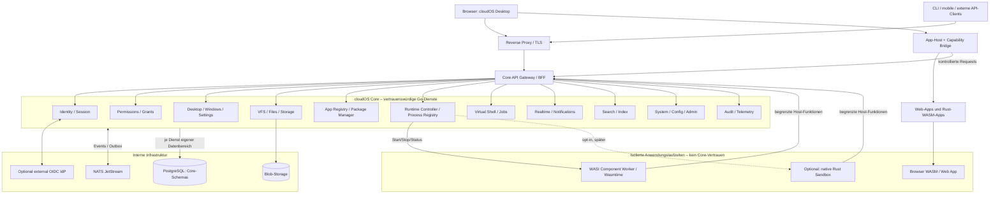

Die Diagrammkanten sind **logische Kommunikationswege**, keine Erlaubnis zu einem willkürlichen Zugriff auf alle Core-Dienste. `CORE --> DB` bedeutet ausschließlich Zugriff auf das jeweilige Fachschema. Zwischen separaten Diensten gelten authentifizierte interne Schnittstellen. Fremde Apps dürfen keine internen gRPC-Ports oder Datenbankverbindungen erreichen.

**Zur Diagrammvereinfachung:** Browser-WASM läuft innerhalb der Browser-Sandbox und erhält Systemzugriffe über die App Bridge; es wird nicht als Server-Prozess gestartet. NATS und PostgreSQL sind Infrastruktur des Core, aber keine anwendungsspezifischen Fachlogik-Owner.

### 4.3 Core-internes Kommunikationsmodell

1. Öffentliche Anfragen erreichen **ausschließlich** die versionierte Core-API am Gateway.
2. Für eine synchrone fachliche Entscheidung ruft der Owner-Dienst andere Owner über definierte gRPC-Verträge auf.
3. Dauerhafte Änderungen werden zunächst im verantwortlichen Dienst committed, einschließlich Outbox-Eintrag.
4. Andere Dienste erhalten asynchrone Änderungsereignisse über NATS JetStream.
5. Mehrschrittige Geschäftsabläufe werden über einen **Workflow-/Orchestrierungsdienst** koordiniert, ohne direkt in fremde Tabellen zu schreiben.
6. Innerhalb eines einzigen Go-Prozesses können typisierte Ports/Interfaces verwendet werden, die dem identischen fachlichen Vertrag entsprechen; ihre lokale Benutzung darf keine andere Semantik erzeugen als der Remote-Aufruf.
7. Verteilte Operationen verwenden Idempotenzschlüssel, Timeouts, Retry-Budgets und wo nötig Kompensationsaktionen.
8. Ein Core-Dienst darf nicht ungeprüft über `localhost`, Shared Memory oder OS-Dateipfade einen vertraglich verbotenen Querzugriff etablieren.

**Regel für Service-Abhängigkeiten:** Ein Owner ist die maßgebliche Datenquelle; andere Dienste erhalten Daten über API oder eigene, aus Events aufgebaute Projektionen. Zyklische synchrone Aufrufketten sind zu vermeiden und werden beim Design geprüft.

### 4.4 Logischer Dienst versus Container – aktualisiertes Standarddeployment

**Verbindliche Änderung 0.11:** Sämtliche logischen Go-Core-Dienste laufen **anfangs gemeinsam in genau einem Core-Prozess und Core-Docker-Container**. Die bisherige frühe technische Aufteilung in eigenständige `gateway`-, `core`- und `files`-Container ist **kein MVP-Standard mehr**, sondern eine optionale spätere Trennung.

| Profil | Prozess-/Container-Grenze | Anzahl laufender Core-Replikate zu Beginn |
|---|---|---|
| `combined` (Standard) | Ein Go-Binary enthält alle registrierten Core-Fachmodule | **1** |
| `split` (optional) | Dasselbe Binary startet nur `CLOUDOS_SERVICE=<name>` | pro Dienst konfigurierbar |
| `kubernetes-distributed` (optional) | Pro Go-Dienst Deployment und `ClusterIP`-Service | 1–N je Dienst, für HTTP-APIs HPA-Template |

Die technische Ausgangsvorbereitung verwendet `core/cmd/cloudos-core` mit einem maschinenlesbaren `services.json`-Katalog und generierten Kustomize-Overlays. Containeraufteilung hat **keinen Einfluss** auf Benutzer-/POSIX-ACLs, App-API-Allowlist, Daten-Owner und SSE-Push-Transport. Kubernetes wird erst bei expliziter Freigabe verwendet; der kombinierte Modus bleibt dauerhaft testbar. Fachliche Go-API-Handler und echte gRPC-Portadapter müssen im Verlauf implementiert werden. Das Deployment-Scaffold erfüllt noch nicht die Anforderungen an den fertigen Core.

**Separat bleibende Infrastruktur:** PostgreSQL, NATS JetStream, Edge/Asset-Origins und isolierte Rust-/WASI-Runner sind nicht Bestandteil des gemeinsamen privilegierten Core-Containers. Für die genauen Skalierungs-, Session-, Lease- und Storage-Regeln ist [CORE_DEPLOYMENT_SCALING.md](CORE_DEPLOYMENT_SCALING.md) fachlich führend.

### 4.5 Vertrauenszonen und Kommunikationsgrenzen

| Zone | Typische Komponenten | Grundsatz |
|---|---|---|
| Z0 – Client | Browser, Desktop-State, Netzwerkrequests | Untrusted, keine Sicherheitsentscheidung allein im Browser |
| Z1 – Edge | Nginx, Gateway/BFF | Öffentlicher Eintritt, Identität, Rate Limits, Session / CSRF |
| Z2 – Core | Verifizierte Go-Systemdienste | Privilegierte Fachlogik und dienstbezogene Identitäten |
| Z3 – Core-Daten | PostgreSQL, Storage, NATS | Nur Owner-/Servicekonten, keine externen Listener |
| Z4 – Browser-App | App-Origin, iframe, Web-WASM, JS-Bindings | Untrusted; keine Core-Cookies, kein direkter gRPC-Zugriff |
| Z5 – Server-App | WASI-Worker / native Sandbox | Untrusted; ausdrücklich erlaubte Host-Funktionen statt Host-Rechten |

`Z4` und `Z5` sind **bewusst nicht** mit `Z2` gleichzusetzen. Dass ein Programm in Rust geschrieben oder zu WebAssembly kompiliert wurde, ist kein Nachweis seiner Vertrauenswürdigkeit.

### 4.6 API-Fassade und Core-Funktionsvollständigkeit

Der Begriff "alle Funktionen im Core" bedeutet:

- Jede Systemfunktion hat genau einen Core-Owner und einen publizierten Contract.
- Core-APIs sind vollständig genug, dass System-App, Drittanbieter-App, Desktop und CLI dieselbe Operation ausführen können.
- GUI-Elemente (Dateiauswahl, Berechtigungsdialog, App-Fenster) sind Oberflächen für Core-Operationen; die Geschäftsregel liegt im Core.
- Anwendungen sind austauschbare Clients des Core und dürfen ihn **erweitern**, aber nicht unkontrolliert ersetzen.
- Ein Ausfall einer App legt niemals den gesamten Core lahm.

**Kein Zwang zu vielen Core-Containern:** Fachliche Core-Dienste werden einzeln modelliert und deren Split-/Replica-Betrieb technisch vorbereitet; **anfangs laufen alle Go-Fachmodule gemeinsam in genau einem Core-Prozess und einem Container**. Eine Auslagerung erfolgt später nur bei begründetem Bedarf oder ausdrücklicher Anweisung.

## 5. cloudOS Core: Fachkontexte, Servicegrenzen und Datenhoheit

**Serviceverzeichnis v0.12:** Das technische Go-Bootstrap enthält nun **22** skalierungsfähige logische Katalogrollen statt 20. Neu sind `logging` (fein konfigurierbare Diagnostik-Policy, kontrollierter Logabruf/Export; Security Audit bleibt ein eigener fachlicher Owner) und `devices` (App-gebundene Gerätepolicy, kurzlebige Grants, Widerruf; **physischer** Gerätezugriff bleibt browserlokal im Framework Device Broker). Die bereits bestehenden `identity`, `sessions`, `permissions` und `desktop` übernehmen Credential-/Window-Ownership; es wird nicht für jede Fensteraktion ein neuer unabhängig schreibender Go-Service erfunden. Im `combined`-Modus laufen alle Rollen weiter **in einem Container**, während Kubernetes `distributed` jetzt 22 Deployments und 18 CPU-HPA-Templates vorbereitet. Das sind Bootstrap-Artefakte, keine fertigen Fachmodule.

**UI-Vertrag:** Jede sichtbare `.cloudApp` wird vom vertrauenswürdigen Window Host gerendert. Taskleiste und Fenster erhalten denselben App-Lifecycle-State einschließlich Rechtsklick → **App beenden**. Der lokale Login-Bootstrap ist ausdrücklich die einzige vorgesehene UI-Ausnahme vor `Desktop.cloudApp`; Background-Jobs besitzen kein eigenes sichtbares Fenster. Die Go-Core-Dienste stellen Fenster-Lifecycle- und Device-Grant-Verträge bereit, ohne selbst Browser-DOM/USB zu kontrollieren.


### 5.1 Vollständiger Core-Servicekatalog

| Core-Dienst | Core-Verantwortung / Besitz | Hauptschnittstellen | Ausbaustufe |
|---|---|---|---|
| **System Service** | Systemversion, Fähigkeiten, Host-/Mandantenkonfiguration, Wartungszustand | System REST / gRPC | MVP |
| **API Gateway / BFF** | REST-Fassade, API-Versionierung, Sessions, CSRF, SSE/Origin-Zugriffssteuerung | REST, SSE, interne gRPC-Clients | MVP |
| **Identity Service** | Lokale Identitaeten, UUID/UID/GID, Profile und Gruppen | Users / Groups | MVP |
| **LDAP/IdP Adapter** | Optionales Directory-Sync und externe Authentifizierung | Identity Connectors | Spaeter |
| **Share Service** | Datei-/Ordner-Grants an interne Benutzer/Gruppen | Shares | Nach VFS |
| **Space Service** | Team-Spaces, Rollen, Mitglieder, Quotas, Lebenszyklus | Spaces | Nach VFS |
| **Session Service** | Sitzungsmetadaten, Geräte, Logout/Widerruf, App-Session-Bindung | Sessions | MVP |
| **Permission Service** | Systemrollen, ACLs, App-Grants, Capability-Entscheidungen | Authorize / Grant / Revoke | MVP |
| **Desktop Service** | Desktops, Icons, Layout, aktive Arbeitsbereiche, persistenter Desktop-State | Desktops | MVP |
| **Window State Service** | Persistente Fenster-Metadaten, App-Instanzreferenzen, Layout-Revisionskonflikte | Windows | MVP |
| **Theme Service** | Theme Registry, Token-Schema, aktive Benutzer-/Systemthemes, Paketfreigabe und Versionskontrolle | Themes / Appearance / Theme Assets | MVP-Grundlage; erweiterter Editor spaeter |
| **Settings Service** | Benutzer-, App- und Systemkonfiguration, Schema-Validierung | Settings | MVP |
| **VFS/File Service** | Dateiknoten, Verzeichnisse, Zugriffe, Quotas, Upload-/Download-Lebenszyklen | Files / Uploads / Downloads | MVP |
| **Storage Service/Adapter** | Blob-Key-Zuordnung, Integrität, GC, physische Speichermedien | Storage-Port nur innerhalb File-Owner | MVP |
| **App Registry Service** | App-IDs, Publisher, App-Versionen, Manifeste, Kompatibilitätsprüfung | Apps / Packages | MVP |
| **Package/Installation Service** | Installation, Updates, Rollback, Signatur-/Hashprüfung, Installation pro Benutzer/Mandant | Installations | MVP |
| **App Lifecycle Service** | App-Instanzen, Start/Stop/Crash, Runtime-Auswahl, Fenster-/Prozessbeziehung | App Instances / Launches | MVP |
| **Capability Broker** | App-Identität, kurzlebige Dateihandles/Grants, Bridge-Sitzungen, Widerruf | App Capabilities / Bridge | MVP |
| **Realtime Service** | SSE-Streams, autorisierte Deltas, per-Audience Delivery Log, Cursor/Replay/Gap-Recovery und Revoke | SSE, App-Host-Bridge | MVP |
| **Audit Service** | Manipulationserschwerende Audit-Trails für privilegierte Aktionen | Audit internal / Admin | MVP |
| **Logging Service** | Strukturierte Diagnoselog-Policy pro Komponente, Datensparsamkeit, autorisierte Logabfrage und Export; keine Abschaltbefugnis für Security Audit | Logs / Logging Policy | Bootstrap Logger, Owner später |
| **Client Device Policy Service** | Installationsfreigaben und Widerruf von Geräte-Capabilities; clientseitige USB-/HID-/Serial-Handles bleiben beim Browser-Device-Broker | Devices / Grants | Policy-Entwurf, Browserintegration später |
| **Notification Service** | Benachrichtigungen und Nutzerpräferenzen | Notifications | Ausbau |
| **Search Service** | Indexierung, Rechtefilterung und Suche | Search | Ausbau |
| **Shell Service** | Virtuelle Shell-Kommandos, Pfad-/Pipe-Semantik, Shell-Sitzungen | Shell Executions | Ausbau |
| **Process Registry** | Logische Prozesse, PID-ähnliche IDs, Besitzer, Status, Signale | Processes | Ausbau; MVP-Minimum für Apps |
| **Job / Task Service** | Asynchrone Tasks, Ressourcenbudgets, Ausführungsprotokolle, Ergebnisse | Jobs | Ausbau |
| **Runtime Controller** | Untrusted-Code-Deployment, Runner-Pools, Start/Stop/Cancel, Sandbox-Policies | Runtimes internal | WASI-Ausbau |
| **Integration Service** | Externe Storage- und Auth-/Provider-Adapter, Fremdschnittstellen | Integrations | Später |
| **Admin / Maintenance Service** | Betriebsrichtlinien, Limits, Wartungsjobs und Gesundheitsübersicht | Admin / System health | Ausbau |

**Owner-Regel:** Jeder Eintrag bezeichnet zunächst einen logischen Go-Dienst. Zusammenschluss in einem Go-Prozess ändert weder Ressourceneigentümer noch Schnittstellen. `Storage Adapter` kann eine interne Unterkomponente des File Service bleiben, weil er keinen unabhängigen fachlichen Dateibaum besitzt.

### 5.2 Core-Servicelayer

Der Core besteht aus vier logischen Ebenen:

1. **Access Layer:** Gateway/BFF, Session, API-Versionierung, Authentifizierung, öffentliche Fehler.
2. **System Layer:** Identity, Permissions, Settings, Desktop, Windows, Files, Apps, Notifications, Search und Shell.
3. **Coordination Layer:** App Lifecycle, Process Registry, Runtime Controller, Job-Orchestrierung, Event-Verarbeitung und Capability Broker.
4. **Infrastructure Layer:** Datenbankadapter, JetStream, Storage, Tracing, Audit-Speicher und Konfiguration.

Jede Ebene nutzt die Dienste der anderen nur über definierte Ports. Die Core-API bildet nach außen eine **einheitliche Plattform**, auch wenn mehrere Backends darin beteiligt sind.

**Theme-Grenze:** Der **Theme Service** ist die fachliche Quelle für Paketversionen, Theme-Praeferenzen und den aufgeloesten Theme-Zustand. Der Settings Service darf Referenzen auf Benutzereinstellungen halten, aber weder eine zweite Theme Registry noch eigene Token-Regeln einfuehren. Das UI-Designsystem und der Theme Resolver im Browser sind technische Clients, keine zweiten autoritativen Services.

### 5.3 Interne Kommunikationsarten

| Kommunikationsbedarf | Mechanismus | Beispiel | Fehlerkonzept |
|---|---|---|---|
| Sofortiges Ergebnis | gRPC / typisierte interne Ports | App Lifecycle prüft App Registry | Deadline, Statuscode, Retry nach Semantik |
| Dauerhafte Änderung | Owner-DB-Transaktion | File Service verschiebt Datei | ETag, ACID lokal, Fehlercode |
| Asynchrone Reaktion | Outbox → NATS JetStream | Dateiänderung aktualisiert Search | mindestens einmal, idempotent |
| Nutzer-Echtzeit | SSE (nur Gateway/BFF) | direkte, autorisierte Zustands-Deltas | bounded Buffer, persistenter Cursor, Replay, einmalige Gap-Recovery |
| Langlaufende Aufgabe | Job Service + Runner | Rust-WASI-Konverter | Statusmaschine, Abbruch, Resource Policy |
| Browser-App → Core | PostMessage/MessageChannel → Bridge/BFF | `files.open` / `files.save` | Capability und Nutzerrechte prüfen |
| WASI-App → Core | explizite Runtime-Host-Funktionen | Lesen eines ausgewählten Dokuments | isoliertes Handle, kein freier Hostpfad |

### 5.4 Verbotene Kopplungen

- Apps dürfen niemals Go-Core-Pakete direkt importieren oder privilegierte Core-Konfiguration verändern.
- Andere Core-Owner dürfen die Tabellen oder Schema-Migrationen fremder Owner nicht direkt schreiben.
- Browser-App-Code darf weder DB-Credentials noch Gateway-Session-Cookies erhalten.
- Ein Server-Runner erhält keine privilegierten Core-Service-Accounts, nur kurzlebige instanzgebundene Rechte.
- Eine App darf nicht unmittelbar die DB oder das interne NATS erreichen; App-Events werden über die Core-API vermittelt.
- Ein `App Registry`-Eintrag führt nicht automatisch zur Ausführung; der Lifecycle-Service entscheidet nach Installation, Policy und Kompatibilität.
- Kein Core-Dienst lässt sich durch ein beliebiges App-Paket überschreiben, selbst wenn es den gleichen Namen trägt.

### 5.5 Beispiel einer Dienstkooperation: Dateibearbeitung

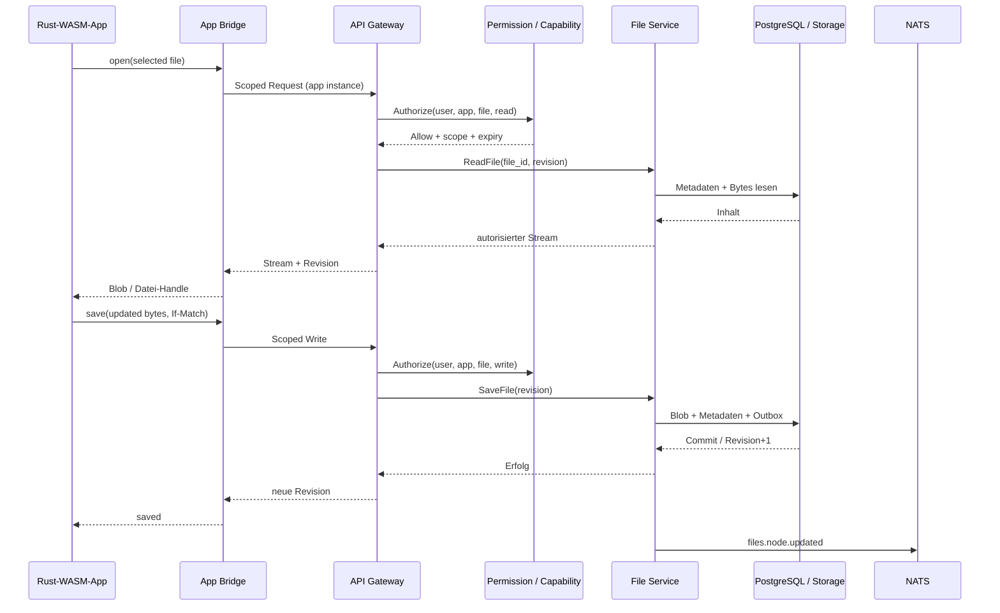

Im gezeigten Ablauf besitzt der File Service das Dateimodell, der Permission Service entscheidet über Rechte, der App Lifecycle hält die App-Instanz und die Bridge vermittelt den Browserzugriff. Kein Modul dupliziert die Dateiverwaltung.

### 5.6 Zuständigkeiten im Fehlerfall

- API Gateway: Anfrage kann nicht autorisiert oder weitergeleitet werden → eindeutiger HTTP-Fehler.
- Owner-Dienst: fachliche Operation gescheitert → transaktionaler Rollback bzw. dokumentierte Kompensation.
- Event-Bus: Eventzustellung verzögert → persistierte Outbox und Reconciliation.
- Runtime Controller: App oder Runner ausgefallen → App-Zustand aktualisiert, Ressourcengrenzen wieder freigegeben.
- Browser-App: Tab/iframe abgestürzt → App-Instanz endet kontrolliert; der Desktop und alle Core-Dienste bleiben erhalten.

## 6. Kommunikationsmodell

### 6.1 Protokollmatrix

| Verbindung | Protokoll | Vertrag | Zweck |
|---|---|---|---|
| Browser → Gateway | HTTPS + JSON | OpenAPI 3.1 | Fachliche API-Operationen |
| Browser → Realtime | WSS | Versioniertes Nachrichtenformat | Zustandsänderungen / Hinweise |
| CLI / Integrationen → Gateway | HTTPS + JSON | OpenAPI 3.1 | Externe Automatisierung |
| Gateway → Backend | gRPC + Protobuf | `.proto` v1 | Synchrone interne Fachoperationen |
| Backend → Backend | gRPC + Protobuf | `.proto` v1 | Ausdrücklich erlaubte Abhängigkeiten |
| Backend → Event-Bus | NATS JetStream | Event-Schema v1 | Asynchrone Nacharbeit |
| Fachservice → Datenbank | PostgreSQL-Protokoll | Versionierte Migration | Eigene Daten und Outbox |
| File Service → Storage | Storage-Interface | Go-Adaptervertrag | Datei-Bytes und Staging |

### 6.2 Aufrufregeln

- Externe Anfragen erhalten einen vollständigen Deadline-/Timeout-Kontext.
- Interne gRPC-Aufrufe geben `context.Context` einschließlich Cancellation und Trace weiter.
- Nur idempotente Operationen dürfen ohne zusätzliche Schutzmechanismen automatisch wiederholt werden.
- Quellcode eines Fachkontexts darf nicht aus dem Implementierungspaket eines anderen Fachkontexts importieren.
- Ein unabhängiger fachlicher Schreibvorgang enthält keinen synchronen, über mehrere Dienste verteilten Datenbank-Commit.
- Fehler werden an den Grenzen in wohldefinierte öffentliche Fehlercodes übersetzt.


### 6.3 App-Runtime-Grenze als zusätzliche Kommunikationsklasse

Der Core besitzt einen Runtime-Controller und die App-Bridge **als Systemdienste**. Externe Rust-Anwendungen sind **keine** Go-Core-Dienste und sprechen nicht ungeprüft direkt gRPC/NATS.

| Aufrufer | Ziel | Erlaubter Transport | Prinzip |
|---|---|---|---|
| Desktop UI | Core | HTTPS REST + WSS | authentifizierte BFF-Sitzung |
| Browser-Rust-App | Core | Bridge-MessagePort → BFF/REST | app_instance_id, Capability und ACL |
| Go-Core-Modul | anderes Core-Modul | lokaler Contract-Port / gRPC | Dienstidentität und autorisierte Operation |
| Go-Core-Dienst | anderer Core-Dienst async | Outbox + JetStream | Eventversion, idempotente Consumer |
| Go Runtime Controller | WASI-Worker | internes gRPC, nur Runner-Control | keine unbeschränkten Ausführungsrechte |
| Rust-WASI-Gast | Core-Funktion | explizite Host-Funktion / Host-API | Host validiert App-Instanz und Ressource |
| Native Sandbox | Core-Funktion | eingeschränkter Broker-Client | Egress und Capability-Limits |

Für einen langfristig stabilen App-SDK-Vertrag werden **fachliche Namen** definiert (`files.open`, `files.save`, `notifications.create`); die Transportunterschiede bleiben hinter SDK-Adaptern verborgen. Eine WASI-App hat beispielsweise kein `window.move`-API, außer sie besitzt eine entsprechende GUI-/Remote-Bridge.

## 7. Öffentliche REST-API

### 7.1 Konventionen

- **Basispräfix:** `/api/v1`.
- **Definition:** OpenAPI 3.1 als führender Vertrag; Generierung typisierter Clients.
- **Transport:** HTTPS; Metadaten in JSON, Inhalte als Streaming-Body.
- **Identifikatoren:** Stabile UUIDs oder opake IDs, niemals Dateipfade als alleinige Sicherheitsreferenz.
- **Zeitstempel:** UTC, RFC 3339.
- **Auflistungen:** Cursor-Pagination mit explizit stabiler Sortierung.
- **Änderungen:** ETag und `If-Match` oder explizite Revisionen gegen Lost Updates.
- **Idempotenz:** `Idempotency-Key` für kritische wiederholbare Erstellungs- und Abschlussoperationen.
- **Fehler:** HTTP-Status + `application/problem+json` nach RFC 9457.
- **Tracing:** `traceparent` / serverseitige Request-ID; keine sensiblen Daten in URLs.
- **Limits:** Konfigurierbare Bodygrößen, Rate Limits, Timeouts und per-User-Quotas.
- **Auth:** Cookie-basierte Browser-Sitzung über BFF; externe API-Clients erhalten einen gesondert spezifizierten Authentifizierungsweg.

### 7.2 Vorgeschlagener API-Katalog v1

| Methode | Pfad | Eigentümer | Funktion |
|---|---|---|---|
| `GET` | `/api/v1/system/capabilities` | Gateway | Aktivierte Systemfähigkeiten |
| `GET` | `/api/v1/users/me` | Identity | Aktueller Benutzer |
| `GET` | `/api/v1/desktops/current` | Desktop | Desktopzustand inklusive Revision |
| `PATCH` | `/api/v1/desktops/current` | Desktop | Autorisierte Zustandsänderung |
| `GET` | `/api/v1/files/{id}` | Files | Dateimetadaten |
| `GET` | `/api/v1/files/{id}/children` | Files | Verzeichnisinhalt |
| `POST` | `/api/v1/files` | Files | Knoten/Ordner anlegen |
| `PATCH` | `/api/v1/files/{id}` | Files | Umbenennen/Verschieben/Metadaten |
| `DELETE` | `/api/v1/files/{id}` | Files | In Papierkorb verschieben |
| `POST` | `/api/v1/uploads` | Files | Upload-Sitzung initialisieren |
| `PUT` | `/api/v1/uploads/{id}/content` | Files | Bytes streamen (MVP: vollständig) |
| `POST` | `/api/v1/uploads/{id}/complete` | Files | Upload verifizieren/committen |
| `GET` | `/api/v1/files/{id}/content` | Files | Dateiinhalte streamen |
| `GET` | `/api/v1/apps` | Applications | Sichtbare Apps auflisten |
| `POST` | `/api/v1/apps/{id}/launches` | Applications | App-Start anfordern |
| `GET` | `/api/v1/settings` | Settings | Eigene Einstellungen |
| `PATCH` | `/api/v1/settings` | Settings | Einstellungen ändern |
| `GET` | `/api/v1/events/stream` | Realtime | Authentifizierter SSE-Stream fuer Push-Deltas und Replay |

Dies ist ein **Vertragsentwurf**. Routen für Administration, Freigaben, App-Installation und Terminal werden vor ihrer jeweiligen Implementierungsphase ergänzt. Die genauen Request-/Response-Schemas sind Gegenstand von `contracts/openapi/v1/`.

**Zusatz: Themen und Appearance (Vertragsentwurf v1)**

| Methode | Pfad | Eigentuemmer | Funktion |
|---|---|---|---|
| `GET` | `/api/v1/themes` | Theme | Sichtbare, zugelassene Themes mit Version und kompatiblem Token-Schema |
| `GET` | `/api/v1/themes/active` | Theme | Effektives Theme, Herkunft, Token-Snapshot und `ETag` |
| `PATCH` | `/api/v1/themes/active` | Theme | Eigene Theme-Auswahl/erlaubte Overrides mit `If-Match` ändern |
| `GET` | `/api/v1/themes/{id}/manifest` | Theme | Unveraenderliches versioniertes Theme-Manifest |
| `GET` | `/api/v1/themes/{id}/assets/{asset}` | Theme | Geprüfte, immutable Assets mit CSP-konformem MIME-Typ |
| `POST` | `/api/v1/themes` | Theme / Admin | Theme-Paket validiert installieren; nur berechtigte Rollen |
| `DELETE` | `/api/v1/themes/{id}` | Theme / Admin | Theme deaktivieren; aktive Nutzer erhalten sicheren Fallback |

Versionsbezogene Assets werden in der Praxis anhand eines stabilen Digests referenziert; die konkreten Upload-/Signaturvertraege werden in einem eigenen ADR definiert. Der Appearance-Pfad ist eine Core-Systemfunktion, keine ungesicherte Frontend-Einstellung.

### 7.3 Fehlerformat (Beispiel)

```json
{
  "type": "https://docs.example.invalid/problems/revision-conflict",
  "title": "Revision conflict",
  "status": 409,
  "detail": "The resource changed since it was read.",
  "instance": "/api/v1/desktops/current",
  "code": "REVISION_CONFLICT",
  "request_id": "req-a82d"
}
```

`docs.example.invalid` ist ein Platzhalter und wird vor Freigabe der API ersetzt. Fehlerantworten dürfen keine Stacktraces, Zugriffstokens oder internen SQL-Informationen offenlegen.

### 7.4 API-Versionierung

- Innerhalb von `v1` dürfen bestehende Felder nicht stillschweigend umgedeutet oder entfernt werden.
- Neue optionale Felder sind möglich; Clients müssen unbekannte JSON-Felder tolerieren.
- gRPC-/Protobuf-Feldnummern dürfen nach Entfernung nicht wiederverwendet werden.
- Breaking Changes erfordern eine neue Major-API-Version sowie dokumentierte Übergangsfristen.
- Contract-Linting und Breaking-Change-Prüfungen sind CI-Pflicht.


### 7.5 Öffentliche App-, Runtime- und Prozessressourcen (Entwurf)

Neue öffentliche API-Ressourcen, welche den Core als einheitliche System-API vollständig machen:

| Methode | Pfad | Besitzer / Wirkung |
|---|---|---|
| GET | `/api/v1/system/capabilities` | Core-Systemfähigkeiten und API-Versionen |
| GET | `/api/v1/apps` | verfügbare/installierte Apps, autorisiert gefiltert |
| GET | `/api/v1/apps/{appId}/versions` | freigegebene App-Releases |
| POST | `/api/v1/app-installations` | geprüfte Installation aus registriertem Paket |
| GET | `/api/v1/app-installations/{id}` | Installationsstatus |
| DELETE | `/api/v1/app-installations/{id}` | Deinstallation nach Policy |
| POST | `/api/v1/apps/{appId}/launches` | App-Instanz anlegen (kein beliebiges Code-Upload) |
| GET | `/api/v1/app-instances/{instanceId}` | Status, Version, Runtime, zulässige Metadaten |
| POST | `/api/v1/app-instances/{instanceId}/stop` | geordnet beenden |
| POST | `/api/v1/app-instances/{instanceId}/terminate` | harte Beendigung, wenn erlaubt |
| GET | `/api/v1/app-instances/{instanceId}/permissions` | aktive App-Scopes |
| POST | `/api/v1/app-instances/{instanceId}/grants` | spezifischen Grant/Consent einleiten |
| DELETE | `/api/v1/app-instances/{instanceId}/grants/{grantId}` | Grant widerrufen |
| POST | `/api/v1/file-selections` | Core-verwalteter File-Picker/Handle-Vertrag |
| GET | `/api/v1/file-handles/{handleId}/content` | autorisierter Datei-Stream |
| PUT | `/api/v1/file-handles/{handleId}/content` | Datei speichern mit If-Match |
| GET | `/api/v1/processes` | sichtbare Prozesse nach Rechten |
| GET | `/api/v1/processes/{id}` | Prozessstatus/Resource-Usage |
| POST | `/api/v1/jobs` | nur registrierte/sichere Job-Typen starten |
| GET | `/api/v1/jobs/{id}` | Fortschritt/Status/Resultat |
| POST | `/api/v1/jobs/{id}/cancel` | Job-Abbruch |

**Schutzregeln:** Core-APIs validieren Nutzer, App-Identität und Ressourcenzugriff. Nur eine registrierte, freigegebene App-Version kann gestartet werden. Kein öffentlicher Endpunkt erlaubt `run arbitrary binary`. Der File-Picker braucht einen echten vertrauenswürdigen Benutzerfluss, keine von einer App frei behauptete Auswahl. Administrative Installations- und Job-APIs sind getrennt von Endnutzerrechten.

### 7.6 Beispiel einer Launch-Antwort

```json
{
  "instance_id": "bdf89a35-ae2b-4555-a002-51f0c018a1c5",
  "app_id": "dev.cloudos.examples.rustpaint",
  "app_version": "0.1.0",
  "runtime": "web-wasm",
  "state": "starting",
  "window_id": "ae98a6b3-65af-425f-a19a-71ce1c6342e3",
  "launch_token_expires_at": "2026-11-14T22:50:00Z",
  "required_user_consent": [],
  "entrypoint_ref": "versioned-app-asset-reference"
}
```

`entrypoint_ref` ist nur eine symbolische Referenz im Entwurf. Der Core stellt daraus einen zugelassenen Assetpfad bereit. Tokens dürfen nicht ungeschützt in dauerhaften URLs, History oder Logs landen.

### 7.7 App-API-Operationen als eigener Berechtigungsvertrag

In der Core-API-Registry erhält jeder geschützte Endpoint eine stabile `operation_id`, exakte HTTP-Methode, kanonische Route, zulässige Ressourcenscopes und eine vertrauenswürdige Risikobeschreibung. Die App deklariert die Operationen in `permissions/api-access.json`, der signierte Paketindex schützt die Datei. Eine App-API-Operation ist nur erlaubt, wenn sie (a) deklariert, (b) in der administrativ freigegebenen Installation enthalten, (c) mit aktivem App-Kontext aufgerufen und (d) durch Benutzerrechte, App-Capabilities und Ressourcenscopes autorisiert ist.

**API-Gateway/BFF dürfen keinen unbeschränkten App-Aufruf mit normalem Browser-Sessioncookie akzeptieren.** App und privilegierter Desktop-Kontext werden über Origins und einen vom Core gebundenen App-Bridge-/Instanzkontext getrennt. Für REST, WebSocket-Subscriptions, WASI-Hostfunktionen und interne Adapter gelten dieselben Default-Deny-Regeln. Der Dateimanager, Desktop und `Apps.cloudApp` als Core-Apps haben **signierte Baseline-Deklarationen**, aber keine unbeschränkten Core-API-Rechte.

Neue administrative Entwurfsendpunkte:

| Methode | Route | Zweck |
|---|---|---|
| `GET` | `/api/v1/app-installation-previews/{id}/api-access` | Sämtliche signierten App-Endpoints mit Risiko aus Core-Katalog anzeigen |
| `POST` | `/api/v1/app-installation-previews/{id}/api-approvals` | Vollständige Endpoint-Liste gesondert bestätigen |
| `GET` | `/api/v1/app-installations/{id}/api-access` | Genehmigte Endpoint-Liste einer Installation prüfen |
| `GET` | `/api/v1/app-instances/{id}/api-access` | Effektive Instanzzugriffe anzeigen |
| `POST` | `/api/v1/app-installations/{id}/api-access/revocations` | Einzelne erlaubte API-Zugriffe widerrufen |

**Fachlich führendes Detailkonzept:** [`APP_API_ACCESS.md`](APP_API_ACCESS.md).

## 8. Interne gRPC-Verträge

Jeder Fachkontext veröffentlicht nur sein erforderliches Serviceinterface unter `contracts/protobuf/cloudos/<domain>/v1/`.

Beispiel für den Desktop Service:

```protobuf
syntax = "proto3";

package cloudos.desktop.v1;

option go_package = "github.com/Drezael/cloudOS/clients/go/gen/desktop/v1;desktopv1";

service DesktopService {
  rpc GetCurrentDesktop(GetCurrentDesktopRequest)
      returns (GetCurrentDesktopResponse);
  rpc UpdateDesktop(UpdateDesktopRequest)
      returns (UpdateDesktopResponse);
}

message GetCurrentDesktopRequest {
  string user_id = 1;
}

message GetCurrentDesktopResponse {
  string desktop_id = 1;
  uint64 revision = 2;
  string layout_json = 3;
}

message UpdateDesktopRequest {
  string user_id = 1;
  uint64 expected_revision = 2;
  string layout_json = 3;
}

message UpdateDesktopResponse {
  uint64 revision = 1;
}
```

Der Vertrag illustriert die Grenze, ist **noch keine fertige Produktionsdefinition**: Ein tatsächliches Schema benötigt typisierte Datenstrukturen, Feldvalidierungen, Autorisierungskontext, wohldefinierte Fehlermodelle und klare Regeln zur Größe des Layouts. Insbesondere darf `user_id` nicht allein aufgrund einer ungeprüften Clientangabe als autorisiert gelten.


### 8.2 Beispiel für einen internen App-Lifecycle-Vertrag

Das folgende Proto dient nur als **Contract-Skizze**; eine echte Implementierung ergänzt Fehlerdetails, Validierungsregeln, Pagination und den vom Gateway geprüften Actor-/Delegation-Kontext.

```protobuf
syntax = "proto3";
package cloudos.applications.v1;
option go_package = "cloudos/gen/applications/v1;applicationsv1";

service AppLifecycleService {
  rpc Launch(LaunchRequest) returns (LaunchResponse);
  rpc Stop(StopRequest) returns (StopResponse);
  rpc GetInstance(GetInstanceRequest) returns (AppInstance);
}
message LaunchRequest {
  string app_id = 1;
  string desktop_id = 2;
  string invocation_id = 3;
}
message LaunchResponse {
  string app_instance_id = 1;
  string runtime_kind = 2;
  string window_id = 3;
}
message StopRequest { string app_instance_id = 1; }
message StopResponse { bool accepted = 1; }
message GetInstanceRequest { string app_instance_id = 1; }
message AppInstance {
  string app_instance_id = 1;
  string app_id = 2;
  string app_version = 3;
  string runtime_kind = 4;
  string state = 5;
}
```

**Authentifizierung:** Der tatsächliche Nutzer-/App-Kontext wird **nicht** aus beliebigen Caller-Feldern vertraut; das Gateway und die Dienstidentität stellen einen authentifizierten, prüfbaren Request-Kontext bereit. Das konkrete Format ist Bestandteil des gRPC-Sicherheits-ADRs.

## 9. Identitaet, Anmeldung und Sitzung

### 9.1 Lokaler Go-Login fuer das MVP

**Verbindliche Korrektur der bisherigen OIDC-Pflicht:** cloudOS beginnt mit lokalem Directory-, Authentication- und Session-Service im Go-Core. Ein begrenzter LDAPv3-Adapter bietet eine standardisierte Ansicht auf lokale Benutzer und Gruppen. Er ist kein externer Identity Provider und kein vollstaendiger Active-Directory-Domain-Controller. Der Browser meldet sich lokal ueber den geschuetzten Login-Bootstrap an und erhaelt ein sicheres BFF-Session-Cookie.

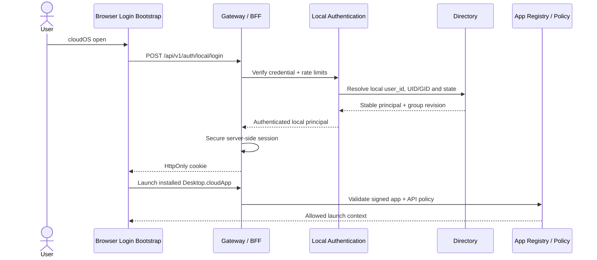

Passwoerter werden verbindlich mit Argon2id gemaess ADR-140 gespeichert; Sessions erhalten kryptografisch zufaellige Kennungen. Das Login-Bootstrap ist eine begrenzte Ausnahme der App-first-Regel, keine zweite Desktop-App.

### 9.2 Optionaler externer LDAP-Connector

Spaeter kann ein Administrator LDAP-Benutzer und -Gruppen ueber read-only LDAPS-/StartTLS-Connectoren **nach cloudOS synchronisieren**. Object-IDs werden gegen stabile lokale `user_id`/`group_id` gebunden; UID/GID, Home-Roots, Shares und Space-Referenzen bleiben stabil. LDAP-Synchronisierung ist **nicht automatisch** LDAP-Login. Dry-Run, Konflikterkennung, Quarantaene, idempotente Deltas und Schutz vor Massenloeschung sind Pflicht.

### 9.3 Optionaler externer IdP

OIDC im BFF (Authorization Code + PKCE) kann unabhaengig von externem LDAP konfiguriert werden. `(issuer, sub)` wird eindeutig auf einen lokalen Principal gebunden. Kein automatisches Merging aufgrund von E-Mail/Benutzername, kein ungeprueftes IdP-Gruppenclaim zu Admin-Rollen und kein unsicherer Login-Fallback bei IdP-Ausfall. Ein lokales Recovery-Konto ist vorgesehen.

### 9.4 Sitzungs- und Dienstsicherheit

- BFF-Cookies `Secure`, `HttpOnly`, geeignete `SameSite`; CSRF-Schutz fuer Mutationen und strikte Same-Origin-/Session-Pruefung am SSE-Stream.
- Rate-Limits, Session-Rotation/Widerruf und lokale Policy-Revisionen bei Gruppen-/Share-/Space-Aenderung.
- LDAP- und OIDC-Secrets ausschliesslich im sicheren serverseitigen Secret Store.
- Workload-Identitaet fuer interne gRPC-/Core-Aufrufe, Timeouts, spaeter mTLS.
- Externe Provider sind im MVP **deaktiviert und nicht erforderlich**.

**Fachlich fuehrend:** [AUTHENTICATION_AUTHORIZATION.md](AUTHENTICATION_AUTHORIZATION.md) und [IDENTITY_INTEGRATION.md](IDENTITY_INTEGRATION.md).

## 10. Autorisierung und Berechtigungsmodell

### 10.1 Drei Ebenen

1. **Systemrollen (RBAC):** z. B. `system.admin`, `user` und technische Dienstrollen.
2. **Ressourcenrechte (ACL):** `read`, `write`, `delete`, `share`, `manage` auf konkreten Dateien, Ordnern oder anderen Ressourcen.
3. **App-Capabilities:** z. B. Zugriff auf ausgewählte Datei-IDs oder das Anzeigen einer Benachrichtigung.

Eine Aktion ist nur erlaubt, wenn **alle** einschlägigen Bedingungen erfüllt sind: aktive Benutzeridentität, Ressourcenrecht, gegebenenfalls App-Grant und gültige Richtlinie.

### 10.2 Beispielentscheidung

```text
request:
  user_id      = U1
  application  = org.cloudos.texteditor
  action       = files.write
  resource_id  = F99

prüfen:
  1. Ist U1 aktiv und angemeldet?
  2. Darf U1 die Datei F99 schreiben?
  3. Besitzt die App einen gültigen Schreib-Grant für F99?
  4. Bestehen Quotas, Sperren oder weitere Einschränkungen?

resultat: ALLOW oder DENY (Default: DENY)
```

### 10.3 Berechtigungsvererbung und Widerruf

- Ordnerberechtigungen können vererbbar sein, wenn dies explizit definiert wird.
- Persönliche Home-Verzeichnisse sind standardmäßig nicht für andere Benutzer zugänglich.
- Gruppenrechte werden lokal verwaltet oder über eine definierte OIDC-Gruppenzuordnung aktualisiert.
- Zugriffsrechte auf eine Datei dürfen nicht allein durch Kenntnis ihrer UUID erlangt werden.
- Rechtänderungen werden protokolliert und zur Cacheinvalidierung veröffentlicht.
- Temporäre App-Grants haben definierten Umfang, Ablauf und Widerrufsmechanismus.


### 10.4 App-Capabilities als Schnittmenge, nicht als Sonderrecht

Formell gilt für eine konkrete App-Operation:

```text
Allow = AuthenticatedUser
    AND UserResourceACL(user, resource, operation)
    AND AppGrant(app_instance, resource, operation)
    AND SystemPolicy(operation, runtime, context)
    AND ResourceStateAllows(operation)
```

Das System verwendet **deny by default**. Ein App-Manifest definiert nur angeforderte Rechte. Ein früherer Grant darf durch Benutzer-Logout, App-Deinstallation, App-Versionwechsel, ACL-Änderung, Dateiverschiebung, Administrationssperre oder Expiry ungültig werden. Cache-Entscheidungen benötigen kurze Gültigkeit oder Revisions-/Invalidierungsmechanismen.

Die App-Bridge ist eine **Kommunikationsgrenze**, aber der eigentliche Datenzugriff wird vom Owner-Dienst beziehungsweise dem Permission-Service beim konkreten Request erneut autorisiert. Insbesondere darf ein altes `handle_id` nicht als unbegrenzt gültiger Besitznachweis behandelt werden.

### 10.5 Strikte App-Endpoint-Allowlist

Für jede durch eine `.cloudApp` ausgelöste Operation erweitert sich die bestehende Rechteprüfung um: signierte API-Deklaration → genehmigter Installationsplan → aktiver App-Instanzkontext → gültiger Ressourcenscope. Fehlt ein Bestandteil, wird die Anfrage **serverseitig verweigert**. Der Core ermittelt die Operation-ID aus der tatsächlich gematchten Methode/Route, niemals aus einem allein vom App-Client gelieferten Header.

Auch ein Administrator kann mit einer eingeschränkten App nicht automatisch administrative APIs erreichen. Eingebaute Core-Apps müssen ihre benötigten Endpunkte ebenfalls in ihrer signierten Baseline deklarieren. Externe Rust-/WASM-Apps bekommen keine allgemeine BFF-Session oder freie Service-Credentials; sie verwenden eine kontrollierte App-Bridge. Details, Proof-of-Concept und Negativtests: [`APP_API_ACCESS.md`](APP_API_ACCESS.md).

## 11. Persistenz und Datenhoheit

### 11.1 PostgreSQL-Aufteilung

Eine PostgreSQL-Instanz reicht zunächst aus. Jeder Fachkontext erhält ein eigenes Schema, eine eigene Migrationsverantwortung und möglichst eine eigene Datenbankrolle.

| Schema | Typische Entitäten | Schreibverantwortung |
|---|---|---|
| `identity` | `users`, `groups`, `group_memberships`, `external_identities` | Identity |
| `permissions` | `roles`, `role_bindings`, `acl_entries`, `app_grants` | Permissions |
| `desktop` | `desktops`, `window_layouts`, `window_restore_state` | Desktop |
| `themes` | `theme_packages`, `theme_versions`, `active_theme_bindings`, `theme_overrides`, `theme_policy` | Theme |
| `settings` | `settings` | Settings |
| `files` | `nodes`, `blobs`, `file_versions`, `uploads`, `quota_usage`, `trash_entries` | Files |
| `applications` | `packages`, `installations`, `associations`, `launches` | Applications |
| `audit` | `audit_records` | Audit |
| `jobs` | `jobs`, `job_attempts` | Jobs (später) |

Ein Dienst darf fremde Tabellen nicht lesen oder schreiben. Fachübergreifende Informationen kommen über APIs oder eigene Projektionen aus Ereignissen.

**Theme-Persistenz:** `themes` enthaelt Theme-ID, Publisher, Paket-Digest, Token-Schema-Version, Aktivierungsstatus, zugelassene Assets, Policy-Geltungsbereich, Benutzer-/Mandanten-Bindung, Änderungsrevision und Audit-Verweis. Verweise auf Bild- und Schriftdateien zeigen auf versionierte, signierte oder anderweitig integritaetsgeprüfte Assets; größere Binardaten liegen nicht in den Theme-Tabellen. Eine Theme-Änderung darf Desktop-Fenster, App-Daten und Datei-Metadaten nicht migrieren oder mutieren.

### 11.2 Datenmodellregeln

- Interne IDs bleiben bei Umbenennung oder Verschiebung unverändert.
- Jede veränderliche Ressource erhält eine `revision` oder ein gleichwertiges Optimistic-Locking-Merkmal.
- Eindeutige Constraints sichern logische Regeln zusätzlich zur Go-Validierung ab.
- Fremdschlüssel gelten innerhalb des verantwortlichen Schemas; schemenübergreifende Integrität erfolgt durch Fach-APIs und Ereignisse.
- Schemaänderungen werden über versionierte Migrationen und bevorzugt Expand-/Contract-Schritte eingeführt.
- Keine personenbezogenen oder vertraulichen Inhalte in Eventnamen, URLs oder Tracing-Labels.
- Physische Löschung, Papierkorb, Aufbewahrung und Wiederherstellung müssen getrennt modelliert werden.

### 11.3 Konsistenzmodell

- **Innerhalb eines Fachkontexts:** PostgreSQL-Transaktionen für zusammengehörige Metadaten und Outbox-Einträge.
- **Zwischen Fachkontexten:** Asynchrone Ereignisse und definierte Zustandsübergänge.
- **Dateiinhalt + Metadaten:** Zweiphasiger Anwendungsablauf mit Staging und Wiederherstellungsjobs statt behaupteter verteilter Transaktion.
- **Browser:** Lokaler optimistischer UI-Zustand mit Serverrevision; bei Konflikt Neuabruf oder ausdrückliche Benutzerentscheidung.


### 11.4 Datenmodell für App-Runtimes (Entwurf)

**Zusätzliche Owner-Datensätze:**

| Tabelle / Objekt | Fachlicher Owner | Wichtigste Felder |
|---|---|---|
| `applications.apps` | App Registry | `app_id`, Publisher, Name, Trust-Level |
| `applications.versions` | App Registry | `app_id`, Version, Manifest-Digest, API-Kompatibilität, Runtime-Matrix |
| `applications.artifacts` | Package Service | Digest, Format, Quelle, Signaturstatus, Asset-Verweise |
| `applications.installations` | Installation Service | Systemweite App-ID, aktive Version, Status, Provenienz, Policy-Revision |
| `applications.instances` | Lifecycle Service | `app_instance_id`, User, Session, Runtime, Status, Window-Referenz |
| `permissions.app_grants` | Permission Service | App-Instanz, Ressource, Operation, Ablauf, Widerruf |
| `applications.app_api_declarations` | App Package Service | Signierter Deklarationsdigest, API-Contract, Operation-IDs, Methoden und Scopes |
| `applications.app_api_installation_approvals` | Installer / Permission Service | Paket-/Deklarationsdigest, Adminfreigabe, Plan-Hash, Katalogrevision |
| `permissions.app_api_grants` | Permission Service | Installation, Operation-ID, Scope, Policy-Revision, Revocation |
| `files.file_handles` | File Service / Broker | Handle, File-ID, gebundene Instanz, Operationsscope, Revision, Expiry |
| `jobs.processes` | Process Registry | Prozess-ID, Owner, Runtime, Status, Exit-Reason |
| `jobs.executions` | Job Service | Job-ID, Worker-Lease, Start/Ende, Limits, Ergebnisreferenz |
| `audit.entries` | Audit Service | Actor, App-ID, Operation, Ressourcenreferenz, Entscheidung, Trace-ID |

**Konzeptuell wichtig:** `file_handles` darf intern auch als Broker-Datensatz mit datenschutzarmem File-Service-Link implementiert werden. Die oben genannten Namen sind keine finalen SQL-Tabellen. Die Datenhoheit des File- und Permission-Owners bleibt erhalten. Fremdschlüssel über getrennte Owner-Schemas werden nur eingeführt, wenn sie nicht zu unkontrollierten direkten Zugriffen führen.

### 11.5 Transaktionsgrenzen beim App-Start

Installation, Instanziierung und Datei-Grants sind getrennte atomare Owner-Operationen. Ein Launch nutzt eine **Zustandsmaschine** und bereinigende Kompensationen; es wird keine globale SQL-Transaktion über Browser-iframe, Gateway und Runtime erzwungen. Ist der Start fehlgeschlagen, dürfen keine dauerhaft privilegierten Grants und `running`-Datensätze zurückbleiben.

## 12. Virtuelles Dateisystem (VFS)

### 12.1 Logisches Modell – genau zwei virtuelle Festplatten

Das fachlich führende Dateisystemkonzept ist [`docs/VIRTUAL_FILESYSTEM.md`](VIRTUAL_FILESYSTEM.md). Die frühere gemeinsame Verzeichnisansicht `/home/alice`, `/home/bob`, `/system` ist **verworfen**. Stattdessen gilt:

```text
system:/                           # nur fuer Administratoren sichtbar
├── core/
├── applications/
│   ├── packages/                 # signierte, installierte .cloudApp-Versionen
│   ├── manifests/
│   └── assets/
└── themes/

users:/
└── homes/
    ├── <user-uuid-A>/            # fuer User A gleich /
    └── <user-uuid-B>/            # fuer User B gleich /
```

Der virtuelle Root-Pfad `/` einer angemeldeten Sitzung zeigt **ausschließlich das eigene Home**. Ein Administrator kann zusätzlich die beiden Volume-Ansichten öffnen; Sichtbarkeit eines Volumes ist nicht mit uneingeschränktem Lesen aller Benutzerdateien gleichzusetzen.

`.cloudApp`-Pakete werden vom Core Package/Installation Service verifiziert und als **unveränderliche installierte Artefakte** im Systemvolume verwaltet. Der Dateimanager darf dort keine direkten manuellen Paketänderungen vornehmen. Ein vom Benutzer heruntergeladenes `.cloudApp` im eigenen Home ist ausschließlich eine normale Quelldatei, kein installierter Programmcode.

Virtuelle Pfade sind eine **Sicht**, keine Host-Dateisystempfade. Alle Operationen arbeiten primär mit Ressourcen-IDs. Das Storage-Backend verwendet intern opake Objektschlüssel, niemals unvalidierte Dateinamen als direkte Hostpfade.

### 12.2 VFS-Entitäten

| Entität | Wesentliche Felder | Zweck |
|---|---|---|
| `node` | `id`, `parent_id`, `owner_id`, `kind`, `name`, `revision`, `state` | Datei- oder Ordnerknoten |
| `blob` | `id`, `storage_key`, `size`, `checksum`, `state` | Physischer Inhalt |
| `file_version` | `node_id`, `version`, `blob_id`, `created_at` | Inhaltsrevisionen (später vollständig) |
| `upload` | `id`, `target_parent_id`, `owner_id`, `state`, `expires_at` | Upload-Lebenszyklus |
| `quota` | `scope_id`, `used_bytes`, `reserved_bytes`, `limit_bytes` | Ressourcenlimit |
| `trash_entry` | `node_id`, `deleted_at`, `original_parent_id` | Wiederherstellung |

**Invarianten:**

1. Keine Zyklusbildung im Ordnerbaum.
2. Kein Zugriff auf fremde Ressourcen durch Änderung von `parent_id` oder `owner_id`.
3. Für Namen in demselben Ordner gelten definierte Normalisierungs- und Eindeutigkeitsregeln.
4. Verschieben über Berechtigungsgrenzen prüft Quelle und Ziel.
5. `storage_key` darf weder mit einem vom Nutzer gewählten Pfad noch mit einem Geheimnis gleichgesetzt werden.
6. Binärdaten und Metadaten dürfen nach Fehlern über einen Reconciliation-Prozess wieder in Einklang gebracht werden.

### 12.3 Storage-Adapter

Die File-Service-Kernlogik spricht ein Go-Interface für die Operationen `PutStaged`, `Commit`, `Open`, `Delete`, `Stat` und optional `Copy`. Die konkrete Signatur wird vor Phase 6 definiert.

Erstes Backend: persistentes lokales Dateisystem mit einem ausschließlich dem File Service zugänglichen Volume. Später: S3-kompatibler Objektspeicher. Apps und Browser erhalten keinen direkten Storage-Mount.

### 12.4 Upload-Zustandsmaschine

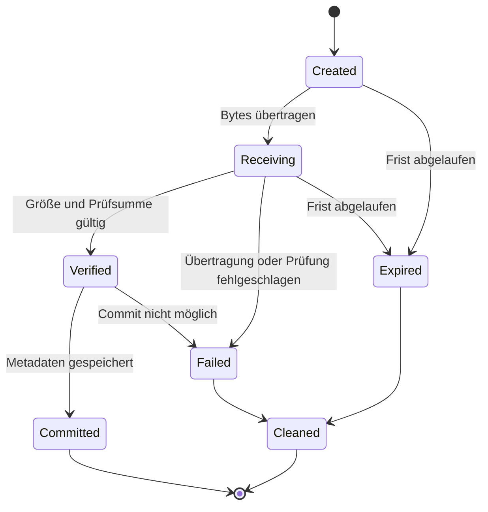

Vorgesehener Ablauf:

1. Client stellt eine autorisierte Anfrage für eine Upload-Sitzung; Quota wird geprüft beziehungsweise reserviert.
2. File Service legt einen zeitlich begrenzten Staging-Eintrag an.
3. Client überträgt Bytes per HTTPS-Streaming an den File-Service-Endpunkt des Gateways.
4. File Service prüft Dateigröße, Prüfsumme, erlaubte Formate und zusätzliche Sicherheitsrichtlinien.
5. Metadaten und Outbox-Ereignis werden in einer DB-Transaktion geschrieben; der Blob wird referenzierbar gemacht.
6. Falls zwischen Blob-Commit und Metadaten-Commit ein Fehler auftritt, erkennt ein Reconciliation-/Cleanup-Prozess verwaiste oder unvollständige Daten.
7. Erst nach vollständigem Commit ist die Datei in API-Auflistungen sichtbar.

Für die MVP-Version genügt zunächst ein vollständiger Streaming-Upload; Resumable Uploads werden später spezifiziert. Die Reihenfolge der Storage- und DB-Teiloperationen muss vor Implementierung mit konkreten Crash-Szenarien getestet und präzisiert werden.

### 12.5 Download, Berechtigungen und Quotas

- Jeder Download prüft Benutzerrechte unmittelbar vor der Ausgabe.
- HTTP-Range-Anfragen werden nach Bedarf unterstützt, jedoch nie ohne Autorisierung.
- `Content-Disposition` und Dateinamen werden gegen Header-Injection abgesichert.
- MIME-Typen werden nicht nur auf Grundlage einer vom Browser gelieferten Dateiendung vertraut.
- Temporäre Dateien, Staging-Inhalte und abgebrochene Uploads werden bereinigt.
- Quotas unterscheiden benutzte und reservierte Kapazität, damit parallele Uploads Limits nicht umgehen.


### 12.6 Dateisystemintegration mit Rust-WebAssembly

Rust-Web-Apps, auch browserfähige ArtCraft-Anwendungen, erhalten **keinen direkten Linux-Mount** und keinen frei konstruierbaren Storage-Key. Der File-Picker liefert einen auf Benutzerwahl und App-Instanz begrenzten Handle.

**Öffnen:** App fordert Dialog → Core-UI lässt Benutzer Datei wählen → Permission Broker erzeugt Scope → File Service streamt Inhalt → Bridge stellt `Blob`/`ArrayBuffer` bereit → Rust-App verarbeitet Daten im Browser.

**Speichern:** Rust-App erzeugt Ergebnis → Bridge prüft erlaubte Aktion → File Service speichert über Streaming/Staging → Revision/ETag wird geprüft → atomarer Commit → Event an andere Fenster. Bei `409 Conflict` bzw. `412 Precondition Failed` bekommt die App eine **sichtbare Konfliktentscheidung**, kein stilles Überschreiben.

**Große Dateien:** Chunk-/Streaming-API, Browser-Speicherverbrauch begrenzen, Download-URLs kurzlebig und instanzgebunden. Für GPU-intensive Bildbearbeitung werden Kopierkosten und Buffer-Freigabe separat getestet.

**Compatibility Adapter für Fremdapps:** Eine externe Anwendung, deren Web-Build ausschließlich lokale Browserdateien erwartet, kann zunächst über importierte `File`-/`Blob`-Objekte versorgt werden. Zurückspeichern in cloudOS erfordert aber einen unterstützten Export-/Save-Hook; das lässt sich nicht durch die iframe-Einbettung allein garantieren.

## 13. Desktopzustand und Fensterverwaltung

### 13.1 Trennung von unmittelbarem und persistentem Zustand

**Browserlokal:** Fenster ziehen, Resize-Vorschau, Hover, Auswahlrahmen, laufende Animationen, Fokus innerhalb einer Tab-Instanz.

**Serverpersistiert:** Fensterzustand und App-Instanzen im Desktop/Window State Service; **Desktop-Dateien/-Ordner/-Verknuepfungen ausschliesslich im File Service unter `/.desktop/`**; Taskleisten-Einstellungen als private Home-Datei `/.taskbar.json`; Icon-Positionen bei Bedarf in `/.desktop-layout.json`. Ein `Desktop State Service` darf keine parallele autoritative Iconliste pflegen.

Beide Ebenen sind nicht identisch: Ein zeitweilig geöffnetes Dialogfenster muss nicht automatisch nach einem erneuten Login erscheinen.

### 13.2 Desktop-Modell

Vorgeschlagene Kerndaten:

```json
{
  "desktop_id": "6e681ab2-3db9-4dc9-8556-fb359995e8ff",
  "revision": 17,
  "wallpaper": { "kind": "builtin", "value": "default" },
  "desktop_content": { "source": "vfs", "well_known": "home.desktop" },
  "taskbar_configuration": { "source": "vfs", "well_known": "home.taskbar" },
  "icon_layout": { "source": "vfs", "well_known": "home.desktop_layout" },
  "windows": []
}
```

Die genauen Typen und die Trennung zwischen per Gerät, per Browser-Tab und global persistierten Fenstern werden in einem ADR entschieden.

### 13.3 Konflikte mehrerer Tabs

1. Browser lädt Desktop mit Revision `17`.
2. Browser nimmt lokale Änderungen vor.
3. Speichern verwendet `If-Match` oder `expected_revision=17`.
4. Hat ein zweiter Tab Revision `18` geschrieben, liefert der Server `409 Conflict` oder `412 Precondition Failed` gemäß festgelegtem Vertrag.
5. Client lädt Revision `18` und führt nur ausdrücklich unterstützte Merge-Regeln aus; andernfalls wird der Konflikt angezeigt.

Nicht jede Mausbewegung erzeugt einen Netzwerkaufruf. Änderungen werden debounced, nach Ende der Interaktion oder bei sinnvoller Sitzungssicherung gespeichert.


### 13.4 Fenster, App-Instanzen und Core-Verantwortung

Der Core speichert **Fenster-Metadaten**, nicht jeden gerenderten Frame einer Rust-App. Ein Fenster referenziert eine `app_instance_id`, welche wiederum auf App-Version und Laufzeit verweist.

- Der Browser Window Manager übernimmt sofortige Bewegungen, Z-Order und Animationen; der Core speichert definierte Revisionen.
- Für Rust-WASM kann der App Host den iframe-/Canvas-Viewport beim Resize informieren. Die App entscheidet selbst über Re-Render und interne Dokument-UI.
- Eine App-Instanz darf mehrere Fenster haben, wenn das Feature später explizit implementiert wird.
- Beendigung eines Fensters beendet die App nur gemäß Lebenszykluspolicy (z. B. letztes Fenster geschlossen); ein verstecktes Fenster ist nicht automatisch ein gestoppter Serverjob.
- Ein nach Login rekonstruiertes Fenster startet gegebenenfalls eine **neue App-Instanz** mit dokumentiertem Restore-State; gespeicherte Desktoppositionen sind keine Prozess-Memory-Snapshots.

### 13.4a Verbindliche Desktop-/Taskbar-Datenquellen und vier Kanten

**Fachlich fuehrend:** [DESKTOP_ENVIRONMENT.md](DESKTOP_ENVIRONMENT.md). Die vorinstallierte `Desktop.cloudApp` ist die UI-Shell mit Start-Button/Startfenster und Taskleiste. Der Benutzer kann die Taskleiste ueber einen Settings-Deep-Link auf `top`, `bottom`, `left` oder `right` stellen. Die Konfiguration ist **privat und dateibasiert**: `/.taskbar.json` im eigenen Home. Die optionalen Icon-Positionen liegen separat in `/.desktop-layout.json`.

Die angezeigten Dateien, Ordner und Verknuepfungen stammen **ausschliesslich** aus dem File-Service-Ordner `/.desktop/`. Der fruehere Home-Pfad `/Desktop/` ist nicht mehr kanonisch. Die Desktop State-/Window-Dienste speichern keine zweite autoritative Shortcut-Liste. `FileExplorer.cloudApp`, virtuelle Shell und berechtigte Apps veraendern diese VFS-Nodes ueber dieselben File-APIs.

Bei jeder Datei-/Konfigurationsaenderung sendet der File Service nach dem DB-Commit ein autorisiertes Outbox-/Realtime-Invalidierungssignal. Die Desktop-App laedt den autoritativen Datei-/Config-Snapshot nach und aktualisiert das UI **ohne Browser-Reload**. Die Subscription muss Snapshot/Cursor-Races, Duplicate Events, Reconnect, mehrere Tabs und Rechteentzug abdecken. Die URL-/Node-Aufloesung findet ausschliesslich im Go File Service statt.

`Settings.cloudApp` ist eine **eigene** gestartete App mit eigener signierter Endpoint-Allowlist. Der Taskleisten-Kontextmenuepunkt startet sie mit einer geprueften Route; er verleiht `Desktop.cloudApp` keine fremden Schreibrechte.

### 13.5 Verbindliche UI- und Theming-Architektur

Theming ist **kein nachträglicher CSS-Aufbau**, sondern eine **querschnittliche Eigenschaft des gesamten cloudOS-Systems**. Der Go-Core verwaltet Theme-Daten, Freigaben, Benutzerwahl und Richtlinien; das Frontend setzt diese mit einem eigenen Designsystem um. Neue Oberflächen müssen vom ersten Implementierungsschritt an themefähig sein. Ohne diese Eigenschaft gelten UI-Komponenten nicht als fertiggestellt.

#### 13.5.1 Anspruch, Geltungsbereich und ehrliche Grenze

- **Verbindlich für cloudOS:** Jedes sichtbare Element, das von cloudOS selbst gerendert oder kontrolliert wird, besitzt eine dokumentierte, stabile Anpassungsschnittstelle. Dazu gehören nicht nur Farben, sondern Typografie, Größen, Abstände, Kanten, Schatten, Icons, Cursor, Animationen, Zustandsdarstellung und - soweit technisch sinnvoll - Layoutvarianten.
- **Nicht an die Fachlogik gebunden:** Visuelle Varianten werden über Tokens, Komponenten-Props, benannte Slots, austauschbare Assets oder versionierte Layout-Presets gewählt. Die Go-APIs und Sicherheitsregeln bleiben identisch.
- **CSS allein reicht nicht:** CSS-Custom-Properties erleichtern Theming, garantieren aber weder vollständig austauschbare Layouts noch automatische Anpassbarkeit von Canvas-Grafiken. Dafür sind strukturierte Komponenten- und Runtime-Adapter notwendig.
- **Externe Web-/Rust-Apps:** cloudOS kann jederzeit seinen eigenen Fensterrahmen themen. Die interne Darstellung einer fremden App ist nur anpassbar, wenn die App das Theme-SDK, ein eigenes konfigurierbares Theme oder einen autorisierten Adapter anbietet. Es wird niemals pauschal CSS in fremde Origins injiziert oder ein Canvas per System-CSS umgestaltet.
- **Barrierefreiheit:** Eine Theme-Auswahl darf Focus-Indikatoren, Tastaturbedienung, Kontrast und andere verbindliche Zugangsanforderungen nicht unbemerkt deaktivieren.

#### 13.5.2 Inventar aller visuellen cloudOS-Elemente

| Bereich | Verpflichtende Theme-Hooks | Austausch- und Layoutoptionen |
|---|---|---|
| Desktop | Hintergrund, Overlay, Raster, Icon-Abstände, Textstil, Auswahl, Drag-Ghost | Wallpaper-Renderer, Icon-Anordnung, Rasterdichte |
| Fenster | Rahmen, Titelleiste, Schaltflächen, Schatten, Resize-Handles, Fokus, aktiv/inaktiv | `window-chrome`-Variante, Button-Positionen, dekorative Slots |
| Taskleiste / Panels | Größe, Farbe, Transparenz, Abstände, aktive Marker, Tray-Icons | Position, Gruppierung, Panel-Layout (über geprüfte Varianten) |
| Startmenü / Launcher | Menu-Hintergrund, Suche, Suchtreffer, App-Icons, Separatoren | Listen-/Rasteransicht, Spalten, Header-/Footer-Slots |
| Dateimanager | Breadcrumbs, Baum, Zeilen, Spalten, Selektionsfarben, Thumbnail-Rahmen | Detail-/Icon-Modus, Anzeige-Dichte, Toolbar-Slots |
| Dialoge / Overlays | Modal, Dateiauswahl, Berechtigungsdialog, Tooltip, Popover, Toast | Geprüfte Größen-/Layoutvarianten |
| Formulare | Buttons, Inputs, Selects, Slider, Checkboxen, Switches, Tabs, Fokus, Error, Disabled | Komponentenvarianten, Dichte, label-/icon-Slots |
| Status / Feedback | Fortschritt, Spinner, Skeleton, Meldungen, Empty-State, Warnung, Erfolg | Animationen, Symbolsets, Zustandsstile |
| Systemoberflächen | Login, Sperrbildschirm, Profil, Einstellungen, Benachrichtigungen, Terminalrahmen | Systemweite Layout-/Branding-Presets |
| Globale Gestaltung | Schriftfamilien/-größen/-gewichte, Abstände, Rundungen, Schatten, Scrollbars, Cursor | Icon-/Font-Pakete, Skalierung, Bewegungs-Presets |
| Reaktionen | Hover, Fokus, Pressed, Dragged, Selected, Loading, Read-only, Disabled | Zustände explizit in Token-/Komponenten-Schema |

Dieses Inventar ist eine **Mindestliste**. Eine neue visuelle Komponente muss ihre Theme-Hooks im Komponentenregister dokumentieren, auch wenn sie nur eine einfache Linie, ein Badge oder einen Resize-Griff zeichnet.

#### 13.5.3 Designsystem mit semantischen und komponentenspezifischen Tokens

Das Frontend erhält ein eigenständiges, versioniertes `cloudOS Design System` mit folgenden Schichten:

1. **Primitive Tokens:** Rohwerte für Farben, Schriftfamilien, Maße, Radien, Schatten, Zeitdauern, Easing und Asset-Referenzen.
2. **Semantische Tokens:** `color.surface`, `color.text.primary`, `color.border.focus`, `color.state.danger`, `space.control`, `motion.standard`, `elevation.overlay` usw. Eine Komponente verwendet vorrangig diese Bedeutungen statt fester Farbwerte.
3. **Komponenten-Tokens:** z. B. `window.titlebar.height`, `taskbar.item.gap`, `menu.item.radius`, `fileExplorer.row.height`. Diese bestimmen gezielt einzelne visuelle Eigenschaften.
4. **Varianten und Slots:** benannte `windowChrome`, `taskbarLayout`, `iconRenderer`, `menuHeader` sowie austauschbare, aber kontrollierte Komponentenvarianten. Ein Theme darf das Aussehen und definierte Layoutvarianten ändern, nicht die Sicherheits- oder API-Semantik ersetzen.
5. **State-Tokens:** Focus, Hover, Pressed, Selected, Disabled, Error, Pending, Dragging; auch High-Contrast- und Reduced-Motion-Varianten.
6. **Responsive Tokens:** Desktop-/Tablet-/Mobil-Abstufungen für Dichte, Größen und Breakpoints; keine feste Pixelannahme an App-Viewports.

**Verbindliche Implementierungsregeln:**

- CloudOS-eigene UI verwendet zentral gepflegte Vue-Komponenten; direkte DOM-/CSS-Sonderlösungen brauchen eine begründete Ausnahme.
- Keine fest einkodierten Farben, `font-family`, Schatten, Icon-SVGs, Timing- oder Abstandsmaße in Feature-Komponenten; Defaultwerte existieren im Designsystem und im Fallback-Theme.
- Theme-Tokens sind typisiert (`color`, `dimension`, `duration`, `font`, `asset`, `enum`) und besitzen Defaults, zulässige Werte sowie Semantik.
- Jede Komponente veröffentlicht Name, Varianten, Slots, erlaubte Token-Keys und Zustände; das ist ein stabiler Frontend-Vertrag.
- Interne CSS-Klassen gelten **nicht** als stabile Theme-API. Oeffentliche Hooks sind deklarierte Tokens, Slots und Varianten.
- CSS Cascade Layers, Namensräume und Scoping schützen cloudOS-Komponenten vor zufaelligen Kollisionen mit App-Styles.
- Themes werden zur Laufzeit gewechselt und können ohne Rebuild von Go-Diensten oder erneutes Login aktiviert werden.
- Komponenten mit Canvas/WebGL-/SVG-Rendering bekommen einen eigenen Token-zu-Renderer-Adapter. SVG-Icons folgen definierten `currentColor`-/Token-Kontrakten; Pixelgrafiken benötigen austauschbare Assets.

**Beispiel: zentrale CSS-Custom-Properties (keine finalen Namen):**

```css
:root {
  --cos-color-surface: #20252e;
  --cos-color-text-primary: #f5f6f7;
  --cos-color-focus: #78aaff;
  --cos-window-titlebar-height: 36px;
  --cos-window-radius: 9px;
  --cos-motion-standard: 160ms;
}

.cos-window__titlebar {
  height: var(--cos-window-titlebar-height);
  color: var(--cos-color-text-primary);
  background: var(--cos-color-surface);
}

.cos-window:focus-within {
  outline: 2px solid var(--cos-color-focus);
}
```

Die festen Werte oben sind ausschliesslich Defaultwerte des Designsystems. Anwendungen verwenden **keine Kopien** dieser Werte; das aktive Theme belegt dieselben Properties neu.

#### 13.5.4 Theme Engine im Browser und Theme Service im Go-Core

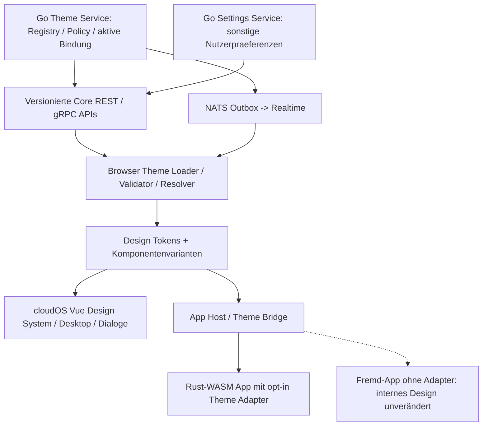

**Theme Service (Core-Owner):** Verwaltung von Theme-IDs, Publishern, Manifestversionen, Freigaben, Themes pro Benutzer/Organisation, Standardtheme, Richtlinien, Aktivierungsrevisionen, erlaubten Overrides, Asset-Digests und Widerrufen. Theme-Daten werden nicht durch direkte App-SQL-Zugriffe geaendert.

**Browser Theme Engine:** Laedt den autoritativen Theme-Snapshot über die Core-API, validiert die Schema-Version, loest Tokens samt Fallbacks auf, setzt CSS-Variablen und Komponentenvarianten atomar und informiert geoeffnete Apps. Sie speichert keine zweite dauerhafte Theme-Wahrheit.

**Theme-Versionierung:** Ein Theme ist ein unveränderliches Paket mit stabiler `theme_id`, `theme_version`, `token_schema_version` und Asset-Digests. Die aktive Bindung referenziert eine konkrete Paketversion. Ein Update wird erst nach Validierung aktiviert; alte kompatible Versionen erlauben Rollback.

#### 13.5.5 Aufloesung, Benutzerrechte und Laufzeitwechsel

Vorgesehene Aufloesungsreihenfolge (aufsteigende Prioritaet, soweit nicht durch Richtlinien gesperrt):

1. Vollstaendiges, versioniertes **Fallback-Theme** des Projekts.
2. Administrativ zugelassenes Standardtheme bzw. Tenant-/Organisationstheme.
3. Individuell gewähltes Benutzer-Theme und zulässige Token-Overrides.
4. Optionales, nur im aktuellen Client aktives **Theme-Preview** (niemals als dauerhafte Berechtigung).
5. **Barrierefreiheits-Overrides** wie Reduced Motion, hoher Kontrast, Text-/UI-Skalierung und Systempraeferenzen, soweit sie nicht schon vom Theme ausreichend erfuellt werden.

Administrativ **gesperrte Eigenschaften** sind während der gesamten Aufloesung gesperrt; diese Sperre wird nicht durch ein Preview oder eine App umgangen. Die genaue Prioritaet wird in ADR-023 fixiert, besonders bei Kontrast, Schriftgröße und administrativem Branding.

Ein Theme-Wechsel läuft nach folgendem Schema:

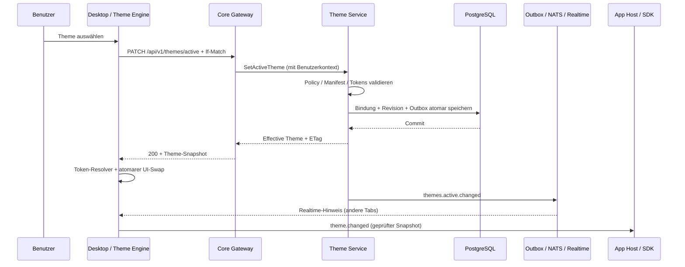

Ein zweiter Tab ruft bei einem passenden `themes.active.changed`-Hinweis den aktuellen Zustand erneut ab; er vertraut nicht auf beliebigen Event-Inhalt. Ein defektes oder nicht erreichbares Theme führt zum letzten bekannten, validierten Snapshot oder zum integrierten Fallback-Theme. Keine Theme-Stoerung darf den Login, das Dateisystem oder die grundlegende Bedienbarkeit des Desktops verhindern.

#### 13.5.6 Deklaratives Theme-Paket und Beispielmanifest

Themes werden in einem streng validierten JSON-Manifest mit zugeordneten unveränderlichen Assets beschrieben. **Sie dürfen keine Go-Funktionen, JavaScript-Dateien, frei ausführbare Skripte oder beliebiges fremdes CSS zur privilegierten Oberfläche hinzufuegen.** Geprüfte Systemthemes können spaeter kontrollierte Component Packs bereitstellen; das ist ein anderer, hoeher privilegierter Release-Typ und keine Eigenschaft gewoehnlicher Themes.

```json
{
  "schema_version": "1.0",
  "theme_id": "dev.cloudos.themes.night",
  "theme_version": "1.0.0",
  "display_name": "Night",
  "token_schema_version": "1",
  "tokens": {
    "color.surface": "#20252e",
    "color.text.primary": "#f5f6f7",
    "color.border.focus": "#78aaff",
    "window.titlebar.height": "36px",
    "window.radius": "9px",
    "space.control": "8px",
    "motion.standard": "160ms"
  },
  "variants": {
    "window.chrome": "classic",
    "taskbar.layout": "bottom-centered",
    "startMenu.layout": "grid"
  },
  "assets": {
    "icon_pack": "icons/default.svgpack",
    "wallpaper": "wallpapers/night.webp"
  }
}
```

Dies ist ein **Schemaentwurf**, noch kein freigegebenes Paketformat. Die zulässigen Namen, Wertebereiche, Assettypen, Signaturen, Lizenzmetadaten und Digest-Eintraege werden über Contracts und ADR-023/024 definiert. Die Theme Engine darf unbekannte kritische Keys nicht stillschweigend ausführen.

#### 13.5.7 App SDK: Reaktivität auch für Rust und WASM

Der Core stellt mit dem App Host eine **nur lesende Theme-Bridge** zur Verfuegung:

- `theme.getCurrent()` liefert einen validierten Snapshot mit `theme_id`, `revision`, `token_schema_version`, Tokens, erlaubten Asset-Referenzen und Accessibility-Flags.
- `theme.subscribe(...)` bzw. `theme.changed` liefert bei Wechsel eine neue Revision; Reihenfolge, Debounce und Wiederverbindung sind definiert.
- Apps können deklarieren `theming.mode: none | sync | advanced`. Ohne Opt-in werden keine internen App-Elemente umgestaltet.
- Der Zugriff auf freigegebene Theme-Tokens erfordert kein Dateisystemrecht; er verleiht auch keine Berechtigung zur Veränderung des globalen Themes.
- App-eigene Branding-Regeln können bestehen bleiben, jedoch müssen verbindliche Core-Systemdialoge (z. B. Datei-/Berechtigungsauswahl) immer im Core-Theme gerendert werden.

**Beispiel für das TypeScript-SDK (Entwurf):**

```typescript
const current = await cloudos.theme.getCurrent();
applyThemeTokens(current.tokens);

const unsubscribe = cloudos.theme.subscribe((nextTheme) => {
  applyThemeTokens(nextTheme.tokens);
});
```

**Rust (egui/eframe, Canvas, WebGL/WebGPU):** Das Rust-Browser-SDK bietet einen Theme-Snapshot und ein Änderungsereignis über dieselbe Bridge an. Ein App-spezifischer Adapter übersetzt semantische Tokens in `egui::Style`/`egui::Visuals` bzw. das eigene Rendering-System. Der Adapter fordert anschließend einen neuen Render-Durchlauf an. Die Core-Theme-Engine verändert weder direkt die Pixel eines Canvas noch führt sie Rust-internen Code aus.

**ArtCraft:** Level A aus Abschnitt 14.11 verlangt lediglich Start und Bedienbarkeit. Ein durchgängig angepasstes internes App-Design erfordert **Level C oder eine bereits vom Upstream angebotene Theme-API**. Für kompatible Releases kann ein cloudOS-Adapter Farben, Dichte und Symbole übersetzen; das ist pro App/Version zu testen und keine pauschale Zusage für jedes ArtCraft-Release.

#### 13.5.8 Sicherheit, Accessibility, Betrieb und Performance

- **Validierung:** CSS-nahe Werte werden typen- und bereichsgeprüft; keine frei wahlbaren `url(...)`, `@import`, Skripte, HTML-Fragmente oder externen Netzwerkziele. Assets stammen aus vertrauenswürdiger, versionierter, CSP-konformer Auslieferung.
- **Supply Chain:** Theme-Herkunft, Version, Digest, Lizenz/Attribution, zulassige Fonts und SVG-Sanitizing werden vor der Installation geprüft; Updates können separat freigegeben werden.
- **Isolation:** Themes dürfen keine Zugriffskontrollen, Dialogtexte für sicherheitskritische Aktionen, App-Origin-Policies, Dateigrants oder Core-Dienstberechtigungen verändern. Visuelle Korrektheit ist keine Sicherheitsentscheidung.
- **Barrierefreiheit:** WCAG-konforme Kontrastziele, sichtbarer Tastaturfokus, Zoom, Textskalierung, Screenreader-Semantik und `prefers-reduced-motion` werden sowohl für Default- als auch installierte Themes verifiziert. Ein Theme darf Warnungen und Permission-Entscheidungen nicht unlesbar machen.
- **Performance:** Tokenwechsel ohne Rebuild, asynchroner Asset-Download, begrenzte Theme-Bundle-Größe, Cache per Digest und atomarer Theme-Swap ohne langes ungeplantes Flackern.
- **Fehlertoleranz:** Schema unbekannt, Asset fehlt, Theme widerrufen oder API nicht erreichbar => letzte validierte Version oder Fallback; keine teilgerenderte, unbedienbare Shell.
- **Audit:** Administrative Theme-Installation, Policy-Wechsel, Sperrung und Widerruf werden auditiert; reine Preview-Aktionen im Browser nicht zwingend.
- **Rechte:** Jeder darf zugelassene Themes für seine eigene Sitzung/sein Profil wählen; systemweite Installation, Theme-Aktivierung für alle Benutzer und gesperrte Vorgaben erfordern Admin-Rechte.

#### 13.5.9 Verbindliche Komponentenabnahme und Ausbaustufen

**Jede neue cloudOS-eigene UI-Komponente ist erst dann fertig, wenn:**

1. Ihre visuellen Eigenschaften über benannte Tokens/Varianten oder explizit begründete feste Invarianten dokumentiert sind.
2. Light, Dark, High Contrast sowie Text-/UI-Skalierung und Reduced Motion getestet sind.
3. Keyboard-/Screenreader-Semantik, Focus-Stile sowie alle interaktiven Zustände in den Themes korrekt sind.
4. Eine Theme-Änderung während geöffneter Fenster ohne Datenverlust, Go-Service-Neustart oder App-Crash funktioniert.
5. Das Element über Snapshot-/Visual-Regression-Tests in den freigegebenen Theme- und Viewport-Matrizen abgedeckt ist.
6. Eine bewusst falsche oder fehlende Token-Angabe reproduzierbar einen sicheren Fallback ergibt.

**Entwicklungsreihenfolge:** Phase 0: Theme-ADR und Designsystem-Vertrag; Phase 1: Theme-/Appearance-API-Schemas; Phase 5: Theme Engine, Kernkomponenten und Live-Wechsel; Phase 9: App-/Rust-Theme-Bridge; Phase 11: Theme-Einstellungen/Preview; Phase 15/16: Sicherheits-, Accessibility- und Visual-Tests; Phase 18: Theme-Paket- und erweiterter Editor-Support. Ein visueller Theme-Editor ist ein Komfortwerkzeug, keine Voraussetzung für die deklarative Theme-Architektur.

### 13.6 Desktop und Systemoberflächen als Core-Apps

Der normale Desktop wird **nicht fest in den Browser-Bootstrap eingebaut**. Die signierte, geschützte `Desktop.cloudApp` liefert die Desktop-Shell mit Taskleiste, Startmenü, Kontextmenüs, Fenster-Chrome und App-Host. File Explorer, Settings, Apps, App Store, System Dialogs und Notification Center sind jeweils eigenständige, vorinstallierte `.cloudApp`-Core-Apps. Der Go-Core besitzt nur ihre Systemfunktionen (Registry, File Service, Fensterzustand, Theme Service, Rechte und Runtime). Eine minimale Authentifizierungs-/Recovery-Oberfläche vor dem Start der Desktop-App ist die eng begrenzte Ausnahme.

Die Core-Apps sind von Anfang an durchgängig themefähig und folgen den in Abschnitt 13.5 beschriebenen Designsystem-Kontrakten. Die Paket-/Baseline- und Core-App-Lifecycle-Regeln stehen in [`docs/APPLICATION_SYSTEM.md`](APPLICATION_SYSTEM.md).

## 14. Anwendungssystem: App-Plattform für Web, Rust/WASM und weitere Laufzeiten

### 14.1 Grundmodell und verbindliche Trennung

cloudOS unterscheidet **Systemfunktionen** und **Anwendungsfunktionen**:

- Der **cloudOS Core** liefert Benutzerverwaltung, Rechte, VFS, Desktop-/Fensterzustände, App-Registry, Installations-/Update-Engine, Laufzeitsteuerung, virtuelle Prozesse, Notifications und systemweite APIs.
- **Anwendungen** liefern Fachlogik und UI (z. B. Texteditor, Fotobearbeitung, CAD, Dateibrowser) und greifen ausschließlich über dokumentierte Core-APIs auf Systemfunktionen zu.
- **App Host** ist die vertrauenswürdige Anzeige-Komponente im Browser. Sie steuert die Einbettung, Fenster und Message Bridge, führt aber keine fachliche Serverberechtigung aus.
- **App Runtime** ist ein austauschbarer, streng isolierter Ausführungsadapter. Unterschiedliche Zielplattformen benötigen unterschiedliche Runtime-Adapter.

Eine einzelne App kann aus mehreren Artefakten bestehen (z. B. Rust-WASM-Frontend, Assets und optional WASI-Verarbeitungsmodul). Jedes Artefakt deklariert **explizit**, in welcher Laufzeit es ausgeführt werden darf. Ein gemischtes Paket besitzt mehrere Artefaktidentitäten und für jeden Teil separate Berechtigungen.

### 14.2 Unterstützte Runtime-Profile

| Profil / `runtime.kind` | Ausführung | Geeignete Rust-Anwendungen | Stufe |
|---|---|---|---|
| `web` | Browser, JavaScript/TypeScript/HTML | UI, die Rust-Komponente optional nachlädt | MVP |
| **`web-wasm`** | **Browser**, `wasm32-unknown-unknown`, JS-Bindings, Canvas/WebGPU | Rust-GUI über egui/eframe, Webeditoren, ArtCraft-Web-Builds | **MVP-Ziel** |
| **`wasi-component`** | **Server**, isolierter Wasmtime-Worker, WASI/WIT | CLI-artige Werkzeuge, Konvertierungen, Datenverarbeitung | Nach MVP, Phase 13 |
| `native-isolated` | Server, spezieller Worker/Container/MicroVM | Native Rust-CLI-/Rechenprogramme | Später / Opt-in |
| `remote-gui` | Server mit isoliertem Display + Streaming | Native GUI-Programme ohne Web-Build | Forschungsoption, nicht MVP |

**Nicht austauschbar:** `web-wasm` basiert auf Browser-Web-APIs und typischerweise `wasm-bindgen`; `wasi-component` benutzt WASI-Interfaces und ggf. das Component Model. Eine native Linux-Binärdatei ist weder ein Browser-WASM-Artefakt noch ein WASI-Modul. Für jedes Profil gibt es eigene Kompatibilitätsprüfungen und Runtime-Adapter.

### 14.3 Browser-Rust als primärer GUI-Pfad

Der priorisierte Weg für interaktive Rust-Anwendungen ist die Auslieferung ihrer **Browser-Version als WebAssembly**:

1. Rust-Quellprojekt wird auf einen Browser-kompatiblen Zieltyp gebaut (`wasm32-unknown-unknown` oder toolchain-spezifisches Äquivalent).
2. Paket enthält `.wasm`, JavaScript-Glue, HTML-/CSS-Assets, Fonts, Shader, Bilder und weitere benötigte Ressourcen.
3. `App Registry` prüft Manifest, Dateiintegrität, Herkunft, deklarierte Browserfähigkeiten und Kompatibilität.
4. `App Host` startet die App in einem **isolierten Browser-Kontext** (bevorzugt eigener App-Origin + sandboxed iframe).
5. App läuft auf dem Client und rendert ihre Oberfläche in einem `canvas` oder über DOM; der Server hält weiterhin den maßgeblichen Desktop- und Dateizustand.
6. Datei-/Systemzugriffe verwenden die `App Bridge`, nicht beliebige HTTP-Requests mit BFF-Cookies.
7. App kann geschlossen, abgestürzt, suspendiert oder neugestartet werden, ohne dass der Core beendet werden muss.

**WebAssembly ist hier eine Ausführungsform, nicht die Sicherheitsentscheidung.** Die App kann je nach Browser zusätzliche JavaScript-APIs verwenden. Daher müssen Origin-Isolation, CSP, Bridge-Prüfung und Serverautorisierung gemeinsam durchgesetzt werden.

### 14.4 GUI-Integration in den Desktop

Die installierte `Desktop.cloudApp` verwaltet das visuelle Fenster-Chrome und die unmittelbaren Interaktionen (Position, Größe, Minimieren, Z-Reihenfolge). Der Go Desktop State Service bleibt Eigentümer der autoritativen, persistierten Fenster-/Sitzungsdaten; die Rust-App ist Eigentümer **ihrer internen UI**.

```text
cloudOS Desktop (Vue/TypeScript)
  └── cloudOS Fensterrahmen / Titlebar
       └── App Host
            └── isolierter iframe / eigener App-Origin
                 ├── start.html / JavaScript-Glue
                 ├── module.wasm (Rust)
                 ├── Canvas / WebGPU / WebGL
                 └── cloudOS-App-Bridge-Adapter
```

Unterstützte Bedienhandlungen: Start, Focus, Resize, Minimize, Maximize, Close, App-Crash, Vollbild gemäß Nutzeraktion, Clipboard nur nach Browser- und Benutzerregeln, Datei-Auswahl/-Speichern, Notifications und App-Einstellungen. Die App darf über eine kontrollierte `requestWindowAction`-Schnittstelle Fensterwünsche melden, aber nicht fremde Fenster direkt manipulieren.

Der App Host behandelt `visibilitychange`, Größenänderungen, Offscreen-/Background-Verhalten und gegebenenfalls einen gezielten Hinweis an die App, die GPU-Last bei minimiertem Fenster zu reduzieren. Vollständiges Throttling ist nicht in jedem Browser erzwingbar.

### 14.5 App-Paketformat – `cloudos.app.json` (Entwurf v1)

```json
{
  "schema_version": "1.0",
  "app_id": "dev.cloudos.examples.rustpaint",
  "display_name": "Rust Paint Demo",
  "publisher": "cloudOS examples",
  "version": "0.1.0",
  "min_core_api": "1.0",
  "app_sdk": "1.x",
  "description": "Beispiel einer isolierten Rust-WebAssembly-App",
  "entrypoints": [
    {
      "id": "gui",
      "runtime": "web-wasm",
      "entry": "web/index.html",
      "wasm": "web/app_bg.wasm",
      "assets": ["web/app.js", "web/styles.css", "web/fonts/"],
      "capabilities": ["canvas", "webgl2"],
      "webgpu": "optional"
    }
  ],
  "requested_permissions": [
    {"name": "files.open:selected", "purpose": "Datei in Editor laden"},
    {"name": "files.save:selected", "purpose": "Bearbeitete Datei speichern"},
    {"name": "notifications.create", "purpose": "Speicherstatus anzeigen"}
  ],
  "file_associations": ["image/png", "image/jpeg"],
  "theming": {"mode": "sync", "theme_protocol": "1"},
  "limits": {"max_bundle_mb": 256},
  "update_policy": "manual"
}
```

**Wichtige Klarstellungen:**

- Dieses JSON ist ein **architektonischer Entwurf**, kein derzeit existentes cloudOS-Format.
- `requested_permissions` sind **Anfragen**, keine erteilten Rechte.
- `webgpu: optional` bedeutet Capability Detection und definierten Fallback; `required` müsste Start bei fehlendem WebGPU verweigern.
- `max_bundle_mb` ist hier ein exemplarischer Wert, noch kein bestätigtes Plattformlimit.
- Hashes, Signaturen, vollständige Asset-Liste und Herkunftsinformationen werden später **als Paketmetadaten und signierte Release-Begleitdaten** verbindlich definiert; der Manifest-Text allein ist kein Integritätsnachweis.
- Für WASI und native Komponenten werden getrennte Runtime-Abschnitte spezifiziert; das Browser-Manifest darf keine privilegierten Laufzeit-Flags enthalten.

### 14.6 App-Lebenszyklus und Core-Eigentümerschaft

| Status | Bedeutung | Verantwortlicher Core-Dienst |
|---|---|---|
| `available` | Katalogeintrag bekannt, nicht installiert | App Registry |
| `verified` | Paket und Herkunft technisch geprüft | Package Service |
| `installed` | App-Version für Benutzer/Mandant freigeschaltet | Installation Service |
| `launch_requested` | Benutzer fordert einen Start an | App Lifecycle |
| `starting` | Runtime wird vorbereitet, Bridge wird eingerichtet | App Lifecycle + Runtime Adapter |
| `running` | App hat Start/Handshake bestätigt | App Lifecycle |
| `suspended` | App pausiert / Fenster inaktiv, sofern unterstützt | Lifecycle / App Host |
| `stopping` | Beendigung eingeleitet | Lifecycle |
| `stopped` | Ressourcen freigegeben | Lifecycle |
| `crashed` | Unerwarteter Fehler / Timeout | Lifecycle |
| `disabled` | Aus Policy-/Sicherheitsgründen gesperrt | Registry/Policy |

App-Version, Installation, App-Instanz und Desktop-Fenster sind **verschiedene Entitäten**. Mehrere Instanzen derselben App können parallel laufen, sofern das Manifest dies gestattet. Eine Instanz erhält eine eindeutige `app_instance_id`, Nutzer-/Session-Bezug, Runtime-Profil und Ablauf-/Widerrufsstatus.

### 14.7 Installation, Updates und Release-Vertrauen

**Installationspipeline:** Quelle auswählen → Paket erhalten → Größenlimits → Archiv-/Pfadprüfung → Metadaten-/Schema-Validierung → Prüfsummen → Signatur/Provenance → Malware-/Abhängigkeitsprüfung nach Policy → Kompatibilitätsprüfung → Genehmigung → atomar aktivierte Installation → Event/Audit.

- App-ID und Publisher-Identität dürfen nicht durch ein Update stillschweigend wechseln.
- Ein Update mit zusätzlichen Berechtigungen erfordert eine neue Genehmigung, bevor diese Rechte wirksam werden.
- Fehlgeschlagenes Update rollt auf eine noch vorhandene geprüfte Version zurück.
- Dateien/Anwendungsdaten dürfen bei einer Deinstallation nicht unbemerkt gelöscht werden; Nutzerpolitik separat.
- Drittanbieterpakete laufen grundsätzlich **nicht im Core-Prozess**, unabhängig von Vertrauensindikatoren.
- Für native Serverausführung gelten strengere Review- und Signaturregeln als für reine Browser-Apps.

### 14.8 App-Bridge und SDK: einheitliche Oberfläche

Die **App Bridge** vermittelt logisch dieselben Core-Funktionen für JavaScript- und Rust-Web-Apps. Ein Rust-Programm kann den vorhandenen JavaScript-Bridge-Client über `wasm-bindgen`/`web-sys` aufrufen; später entwickeln wir einen idiomatischen Rust-Wrapper. Das eigentliche API-Format ist der versionierte Nachrichtenaustausch, nicht Rust- oder TypeScript-spezifischer Code.

```typescript
const file = await cloudos.files.open({
  accept: ["image/png", "image/jpeg"],
  mode: "readwrite"
});
const bytes = await cloudos.files.read(file.handle);
// Verarbeitung in Rust/WASM; danach:
await cloudos.files.save(file.handle, bytes, {
  ifMatch: file.revision
});
```

Der Browser darf dafür keine Zugangstokens frei an das App-Script herausgeben. Die Bridge wird vom privilegierten App Host initialisiert, bestätigt App-ID und Instanz-ID, prüft die Herkunft jedes `postMessage`-Requests sowie Nachrichtenformat, Call-ID, Größe, Timeout und erlaubte Operation. Der Core autorisiert die konkrete Ressource **erneut**, wenn der Request ankommt.

**Thematisierung der App:** Die im Manifest deklarierte `theming.mode` ist eine Kompatibilitaetsangabe, keine Berechtigung. Über `cloudos.theme.getCurrent()`/`subscribe()` empfaengt die App nur freigegebene Tokens. Ein Core-Theme-Wechsel darf keine Berechtigungsanfrage, kein fremdes Fenster und keine App-Daten modifizieren. Nicht integrierte Fremdapps behalten ihre eigene UI; ihre cloudOS-Titelleiste folgt dem aktiven Systemtheme.

### 14.9 Capability-Modell und Dateihandles

Ein Grant ist ein Datensatz bzw. eine sicherheitsgebundene Entscheidung mit mindestens:

```text
(user_id, session_id, app_id, app_instance_id,
 resource_type, resource_id, operations,
 issued_at, expires_at, revoked_at,
 grant_origin, policy_revision)
```

- `files.open:selected` und `files.save:selected` werden an ausdrücklich vom Benutzer gewählte Dateiknoten gebunden.
- Dateihandles enthalten vorzugsweise **undurchsichtige zufällige Handle-IDs**, nicht direkt verwendbare Storage-Pfade.
- Kein Grant darf eine Aktion erlauben, die der Benutzer selbst nicht ausführen dürfte (Schnittmenge aus User-ACL, App-Grant, System-Policy und aktueller Ressourcensituation).
- Grants besitzen Ablauf, Logout-/Deinstallations-/Widerrufs-Semantik und werden auf der **Serverseite** geprüft.
- Ein UI-Einverständnisdialog ist erforderlich, wo die Policy nicht bereits eine engere legitime Berechtigung vorsieht.
- Per-Instanz-Grants werden nicht automatisch an eine andere App-Instanz oder neue Version übertragen.

### 14.10 App-zu-App-Kommunikation

Apps dürfen über einen **Core-vermittelten IPC-Service** kommunizieren, aber nie direkt aufeinander zugreifen:

- Registrierung deklarierter App-Actions und Dateitypen.
- Nachrichten nur an autorisierte, erreichbare App-Instanzen.
- Signierte/prüfbare Sender-/Empfängeridentität, Schema-Version, Größenlimit und Timeout.
- Keine Publikation privater Nutzerdaten über globale NATS-Subjects.
- Nutzer- oder Systemfreigabe bei sensiblen Übergaben, z. B. Weitergabe eines Dateihandles an eine Bildbearbeitungs-App.

Für das MVP genügen Dateizuordnungen, `OpenWith`, `ShareTo` und kontrollierte Nachrichten via `App Host`; eine universelle App-Bus-API kommt nach klaren Sicherheits- und Produktanforderungen.

### 14.11 ArtCraft als Referenz- und Integrationstest

**ArtCraft** bezeichnet eine Familie kreativer, in Rust entwickelter Anwendungen. Das offizielle Angebot umfasst z. B. **PhotoCraft** (Bildbearbeitung), **VectorCraft** (Vektoren) und **CADCraft** (CAD). Für einige Apps stehen dokumentierte **Browser-/WebAssembly-Builds** als statische Websites bereit. Das macht diese Art von Anwendung für cloudOS besonders interessant.

**Die drei Integrationsstufen:**

1. **Level A – Startbar im cloudOS-Fenster:** Einen legitimen, lokal gehosteten Browser-Build über `App Host` in einer isolierten Origin öffnen. Innerhalb der App kann zunächst deren eigener Datei-Öffnen-/Speichern-Dialog benutzt werden. Ergebnis: Rust-App läuft sichtbar in cloudOS, **ohne automatisch mit dem VFS verbunden zu sein**.
2. **Level B – File-Bridge/Benutzerfluss:** Ein vertrauenswürdiger Adapter ermöglicht `OpenWith`, Übergabe eines ausgewählten Dokuments als Blob/Datei und kontrolliertes Zurückspeichern über den File Service. Dafür müssen App-spezifische Import-/Export-Hooks vorhanden sein oder ergänzt werden.
3. **Level C – Tiefe SDK-Integration:** Quellcode-/Adapteranpassungen binden Dateimenü, Notifications, Settings, App-Events und gegebenenfalls automatisierte App-Actions an die cloudOS-API; Änderungen erfolgen lizenz- und wartungsbewusst.

**Nicht versprechen:** Ein externes Rust-Desktop-Binary ohne vorhandenen Browser-Build wird nicht durch das Einbetten in ein iframe lauffähig. Bei ArtCraft-Komponenten sind WebGPU, WebGL, Worker, Fonts, Multi-Threading, unterstützte MIME-Typen und Asset-Pfade **pro konkreter Version** zu verifizieren. Einige komplexe Funktionen können auf bestimmten Geräten oder Browsern nicht zur Verfügung stehen.

**Lizenz und Marken:** Beispielhaft nennt PhotoCraft für seinen Quellcode `MIT OR Apache-2.0`, weist aber auf eigenständige Regeln für Marken-/Branding-Assets sowie separate Asset-Lizenzen hin. cloudOS darf deshalb nicht pauschal annehmen, dass jedes ArtCraft-Paket unverändert umbenannt oder ohne Attributionsprüfung weiterverbreitet werden darf. Für jeden konkreten Integrationsbuild werden Upstream-Lizenz, Assets, Quellen, Signaturen, Marken-/Distributionsregeln und Updates gesondert dokumentiert.

**Referenzmaterial:**

- [ArtCraft – App-Übersicht](https://getartcraft.com/apps)
- [PhotoCraft – Quellcode und Web-Distribution](https://github.com/storytold/photocraft)
- [CADCraft – Quellcode und Web-Build](https://github.com/storytold/cadcraft)
- [eframe – Browser/WASM-Ausführung](https://docs.rs/eframe/latest/eframe/)

### 14.12 Browser-Kompatibilität, GPU und gemeinsame Speicherbereiche

- **WebGPU** benötigt einen unterstützten Browser, HTTPS und geeignete GPU/Treiber. Die App startet nur, wenn alle zwingend verlangten Features/Texture-Limits verfügbar sind.
- **WebGL2** kann für manche Apps als Fallback dienen, aber nur, wenn das konkrete Projekt diese Backend-Implementierung anbietet.
- **WebAssembly Threads** und `SharedArrayBuffer` benötigen Cross-Origin Isolation (COOP/COEP und abgestimmte Ressourcen-Header). Ein `iframe` aus einer isolierten App-Origin kann deshalb zusätzliche Einbettungsanforderungen haben.
- **Isolation und Einbettung müssen zusammen getestet werden:** CORS, COEP, CORP, CSP, `Permissions-Policy`, App-Origin und die benötigten Assets können sich gegenseitig beeinflussen.
- **Browser-Kompatibilitätscheck:** WebGPU-/WebGL2-Fähigkeiten, Threads, WASM-Speichergrenzen, verfügbare RAM-Klasse, Storage-Zugriff und Rendering testen, bevor eine App-Instanz als `running` gilt.
- **Keine uneingeschränkte Kompatibilität:** GPU-intensives Photo-/CAD-Programm läuft nicht garantiert auf jedem mobilen Gerät.

### 14.13 Datenschutz und Datenfluss von Rust-Web-Apps

Ein selbstgehosteter Browser-WASM-Build kann Bild-/Dokumentdaten lokal im Browser verarbeiten. Solange die App nur die cloudOS-Bridge verwendet, werden nur die vom Nutzer ausgewählten Daten und Ergebnisse an den Core übertragen. Der Core kontrolliert jedoch **nicht allein durch die WASM-Form**, ob eine App zusätzliche Netzwerkzugriffe versucht. Deshalb ist eine restriktive CSP / `connect-src`, App-Origin-Kontrolle und ein nachvollziehbarer Datenschutz-/Netzwerk-Grant erforderlich.

**Datenhoheit:** Speichert eine ArtCraft-App die Arbeit nur im lokalen Browser, ist das kein cloudOS-VFS-Commit. Erst eine erfolgreiche Datei-API-Operation mit neuer Serverrevision bedeutet eine persistierte cloudOS-Datei. Die UI muss diesen Unterschied klar anzeigen.

### 14.14 Verpflichtendes `.cloudApp`-Paket und Installationsgrenze

**Verbindliche Ergänzung v0.4:** Jede reguläre, sichtbare Benutzeranwendung wird als `.cloudApp`-Paket ausgeliefert, vor Benutzung installiert und durch die App Registry zur Ausführung freigegeben. Das gilt gleichermaßen für Desktop, File Explorer, Settings, Apps, App Store, System Dialogs, Notification Center und Drittanbieter-Apps. Ein bloßes `.cloudApp`-Archiv im VFS ist **nicht ausführbar**.

Das ZIP-basierte Paketformat v1 enthält ein `cloudos.app.json`, einen signierten Paketindex, geprüfte Publisher-Informationen sowie Web-/Rust-WASM- oder optionale serverseitige Runtime-Artefakte. Alle Dateiinhalte werden vor Installation in einer isolierten Staging-Umgebung validiert; keine ZIP-Inhalte oder dynamischen Einstiegspunkte dürfen ohne Prüfung gestartet werden. Bestehende Manifest-Skizzen in Abschnitt 14.5 sind **Teilentwürfe** und werden durch das konkrete Paketformat in [`docs/APPLICATION_SYSTEM.md`](APPLICATION_SYSTEM.md) präzisiert.

### 14.15 Core-Apps, Baseline und Recovery

Pflicht-Core-Apps werden bei der Systeminitialisierung aus einer geschützten, signierten und versionsgebundenen cloudOS-Baseline automatisch installiert. Die Desktop-Core-App startet nach Login als Shell-App; andere Core-Apps werden bei Bedarf als eigene App-Instanzen gestartet. Die Kern-Dienste sind Infrastruktur, keine `.cloudApp`-Anwendungen. Normale Deinstallations-/Disable-Requests für Pflicht-Core-Apps werden auch für Administratoren verweigert; Änderungen erfolgen ausschließlich durch kontrollierte Release-/Recovery-Verfahren.

### 14.16 Installation über Apps.cloudApp, Doppelklick und getrennte Berechtigungen

Die bisherige Rechtsklickinstallation ist **aufgehoben**. Jede zusätzliche `.cloudApp` wird systemweit unter **`system:/apps/`** auf Festplatte 1 installiert. Die signierte Pflicht-Core-App **`Apps.cloudApp`** ist unter **Settings → Apps** erreichbar und bietet manuelle Paketinstallation, Deinstallation, kontrolliertes Löschen referenzfreier Pakete sowie Benutzer-/Gruppenzuweisung. Ein Doppelklick auf ein unregistriertes `.cloudApp`-Archiv startet bei berechtigten Administratoren sofort die Apps-Installation samt Signatur-/API-Preflight, jedoch keinen Installations-Commit ohne ausdrückliche Pflichtfreigaben.

Die systemweite Installation wird von der Sichtbarkeit und Startberechtigung getrennt. **Neue Zusatz-Apps erhalten standardmäßig nur einen Grant an die eingebaute Gruppe `Admin`.** Der Permission Service verwaltet weitere Gruppen- und Benutzerzuweisungen, der Lifecycle Service verweigert Starts für Unberechtigte und beendet entprivilegierte Instanzen. Realtime-Hinweise plus autoritativer Resync aktualisieren Startmenü, Taskbar, Desktop und Suche ohne Browser-Reload. Core-App-Baseline-Installationen bleiben mit spezifischen Berechtigungen für alle berechtigten Benutzer geschützt.

Die separate `AppStore.cloudApp` bedient moderierte, signierte GitHub-Kataloge aus einem eigenen Repository und optional weitere durch Administratoren konfigurierte Quellen. Der Store darf **nur seine eigenen** installierten Apps verwalten. Die unveränderliche Provenienz und Manager-ID werden durch den Go-Core festgelegt, nicht vom Browser geliefert. Ausführliche Referenz: [APP_MANAGEMENT_STORE.md](APP_MANAGEMENT_STORE.md).

### 14.17 Runtime- und Theme-Vertrag für `.cloudApp`

Web-, Rust-WASM-, spätere Server-WASI- und `native-isolated`-Apps nutzen **dasselbe Paket-/Installer-/Launch-Modell**, aber runtime-spezifische Build-Artefakte und Capability-Grenzen. CloudOS-eigene Core-Apps müssen alle Design-Tokens und Theme-Slots unterstützen. Drittanbieter-Apps können ihre intern gerenderte UI nur mit einem passenden Theme-Adapter anpassen; ihr cloudOS-Fensterrahmen bleibt systemweit themebar. Ein ArtCraft-Webbuild wird daher erst nach Paketierung und Prüfung zur cloudOS-App.

### 14.18 X.509-Signierung, vertrauenswuerdige Publisher und Self-signed-Ausnahmen

Der Go-Core implementiert einen fachlich eigenen **App Signing / Trust Service**. Analog zu Nextcloud werden Herausgeberzertifikate per X.509 an eine bestimmte technische App-ID gebunden. `.cloudApp`-Pakete enthalten einen SHA-512-Index aller Nutzdateien (`META-INF/package-index.json`) und einen abgekoppelten kryptografischen Beleg in `META-INF/signature.json`. Der Index wird nach einem verbindlich festgelegten kanonischen JSON-Format signiert. Das vorgesehenen v1-Profil ist RSA-PSS/SHA-512 mit appgebundenem Code-Signing-Zertifikat.

Der Package Service prueft Integritaet und Kryptografie; der Trust Service beurteilt Kette, App-ID-Scope, Gueltigkeit, lokale Ausnahmen und Widerruf. Der Installer haelt die **drei** Urteile getrennt: `signature_valid`, `trust_class` und `install_allowed`.

- **Core-App-Releases:** Nur dedizierte signierte cloudOS-Release-Baseline. Kein Self-signed-Paket darf bekannte Core-App-IDs ersetzen oder Core-Rechte erhalten.
- **Publisher-verifiziert:** CA-Kette gueltig und App-ID korrekt. Normale administrative Installation moeglich.
- **Gueltig selbstsigniert:** Kryptografie, Hashes und App-ID korrekt; Herausgeberidentitaet nicht unabhaengig bestaetigt. Installation **nur** nach deutlicher Warnung, `apps.install.self_signed` und einmaliger, an App, Version, Zertifikatsfingerprint und Paketdigest gebundener Admin-Risikoannahme.
- **Unsigniert, manipuliert, abgelaufen, widerrufen oder falsche App-ID:** Installation hart abgelehnt; kein Admin-Bypass.
- **Updates:** Jede neue selbstsignierte Paketversion/Digest benoetigt erneute bewusste Zustimmung. Kein stilles Auto-Update oder implizite Aufnahme des Self-signed-Zertifikats als CA-Root.

Alle von cloudOS gerenderten Warnungen sind themefaehig, bleiben jedoch als vertrauenswuerdige Apps.cloudApp-/SystemDialog-UI klar von der fremden App getrennt. Nutzer-/Dateirechte werden trotz Signatur nur im Permission Service erteilt.

Die vollstaendige Spezifikation inklusive Paketformat, Revocation, Risk-Confirmation-Flow, signierter Indexstruktur, Fehlercodes und Signaturtestmatrix ist in [`APP_SIGNING.md`](APP_SIGNING.md) dokumentiert.

### 14.19 Signierte API-Berechtigungsdatei und obligatorische Endpoint-Freigabe

Jede `.cloudApp` enthält zusätzlich zum `cloudos.app.json` die Datei **`permissions/api-access.json`**, die durch `api_access.file` referenziert und im SHA-512-Paketindex signiert ist. Die Datei führt **jede** benötigte cloudOS-Core-API-Operation mit stabiler `operation_id`, HTTP-Methode, kanonischem Pfad und maximalem Ressourcenscope auf. Auch eine leere Liste muss vorhanden sein.

Der App Package Service validiert die Datei, der Core API Contract Registry/Permission Service bewertet die Route und der Core Installation Service erstellt eine gebundene Vorschau aller Endpunkte samt verständlicher Sicherheitsrisiken. Ein Administrator muss diese Endpoint-Liste vor **jeder** Installation oder Aktualisierung vollständig sehen und genehmigen. Bei gültiger Selbstsignatur ist **zusätzlich** die eigenständige Signaturwarnung zu bestätigen. Neu verlangte oder erweiterte Rechte dürfen nie stillschweigend hinzugefügt werden.

**Sicherheitsregel:** Die laufende App nutzt ausschließlich die wirksam genehmigten Endpunkte. Ein nicht deklarierter App-Aufruf wird am Go-Core serverseitig mit `403` verweigert; von der App veranlasste Zugriffe dürfen nicht über privilegierte Core-Apps oder eine gemeinsame Browser-Cookie-Session eskalieren. Dasselbe gilt für Rust-Browser-WASM, WASI und spätere native Runner. Für WebSockets wird jede Subscription separat geprüft. Die Unterscheidung zwischen API-Freigabe und Ressourcen-ACL bleibt bestehen.

Das vollständige Modell mit Schema, Bridge-Architektur, Risk-Preview, API-Diffs, Events, Audit und 41 Tests steht in [`APP_API_ACCESS.md`](APP_API_ACCESS.md).

## 15. Ausführung: virtuelle Prozesse, Browser-WASM, Server-WASI und native Rust-Sandboxes

### 15.1 Einheitliches Prozess- und Ausführungsmodell

Der Core modelliert eine **logische Prozessinstanz**, ohne zu behaupten, der Browser besitze Linux-PIDs für jede App.

```text
ProcessInstance
  id, kind, owner_user_id, app_id, app_version, runtime_kind,
  session_id, desktop_id, parent_process_id,
  state, created_at, started_at, stopped_at,
  exit_reason, resource_policy_id, revision
```

**Prozesstypen:** `web_application`, `browser_wasm`, `wasi_component`, `native_isolated`, `virtual_shell`, `core_job`. Ein Core-Dienst ist kein normaler Nutzerprozess und wird über ein separates Betriebs- und Service-Lifecycle-Modell geführt.

| Aktion | Bedeutung | Systemwirkung |
|---|---|---|
| `launch` | Neues App- oder Job-Objekt anfordern | Berechtigungs- und Runtime-Prüfung |
| `stop` | Geordnetes Beenden | App-Event / Shutdown-Deadline |
| `terminate` | Harte Beendigung | iframe entladen bzw. Worker/Sandbox beenden |
| `suspend` | Arbeits-/Renderingzustand pausieren, falls unterstützt | Keine implizite Haltbarkeitsgarantie |
| `resume` | Fortsetzen | Runtime-Check / Resume Event |
| `inspect` | Status und erlaubte Metriken anzeigen | Owner-/Admin-Berechtigung erforderlich |

**Grenze:** Browser-WASM-JavaScript kann keine vom Go-Server kontrollierte OS-Prozessisolation erhalten. Der Core kann App-Instanz, Fenster und Berechtigungen beenden sowie den iframe entfernen; harte RAM-/CPU-Grenzen sind im Browser nur eingeschränkt vorgebbar.

### 15.2 Runtime-Auswahl und Startentscheidung

Der **App Lifecycle Service** wählt nach Manifest und Policy genau ein kompatibles `entrypoint`:

```text
App start requested
  -> Benutzer-/Sessionprüfung
  -> App installiert, Version freigegeben?
  -> Runtime vorhanden und mit Client/Server kompatibel?
  -> benötigte Berechtigungen bereits erteilt?
  -> fehlende Berechtigungen einzeln anfordern
  -> Runtime-spezifische Policy und Ressourcenbudget prüfen
  -> AppInstance anlegen
  -> App Host oder Runner starten
  -> Handshake mit App-ID / Instanz-ID / Version
  -> running; Events, Fenster und Grants aktivieren
```

**Bei Startabbruch:** Keine verbleibenden geheimen Tokens, keine halbfertigen Grants, kein irreführend sichtbarer `running`-Zustand; temporäre Ressourcen werden nach Timeout aufgeräumt.

### 15.3 Browser-WASM-Runtime: Rust-GUI im cloudOS-Fenster

Die Web-Runtime führt vom Core freigegebene statische Assets im Browser aus:

- Eingangsformat: `index.html`, JS-/wasm-bindgen-Glue, `.wasm`, Fonts, Grafiken, CSS, optionale Worker und Shader.
- Bevorzugte Isolationsform: separate App-Origin (z. B. `apps.example.invalid` in der Dokumentation) mit versionsgebundenen Pfaden, eingeschränkter `Content-Security-Policy` und minimalen iframe-Flags.
- Kommunikationsweg: vertrauenswürdiger App Host → `postMessage`/`MessageChannel` → Bridge/BFF → Core-Dienst.
- Dateioperationen: temporär über Blob/ArrayBuffer, für große Dateien chunked Streaming/Handles mit Backpressure.
- App-Initialisierung: `bridge.hello` → `bridge.ready` mit API- und Manifestversion; optional capability negotiation.
- Crash-/Timeout-Verhalten: Fenster kann beendet oder neu gestartet werden, ohne privilegierte Core-Services zu beeinflussen.

**Beispiel einer Bridge-Nachricht (Entwurf):**

```json
{
  "protocol": "cloudos.app-bridge.v1",
  "request_id": "73c49825-fd12-425b-b448-dd90d50efc24",
  "app_instance_id": "bdf89a35-ae2b-4555-a002-51f0c018a1c5",
  "method": "files.openDialog",
  "params": {
    "accept": ["image/png", "image/jpeg"],
    "mode": "readwrite"
  }
}
```

`app_instance_id` in der Nachricht ist **nicht beweiskräftig**: Der Host koppelt jede Bridge-Verbindung an den bereits authentifizierten iframe-/MessagePort-Kontext und die serverseitig erzeugte App-Instanz. Formatvalidierung, Origin-Kontrolle und Replay-/Timeout-Schutz sind obligatorisch.

### 15.4 Beispiel: Rust-GUI mit egui/eframe

Rust-Anwendungen, die `egui`/`eframe` für ihre Oberflächen verwenden, können bei passender Projektstruktur als Browser-Anwendung gebaut werden. Ein mögliches Build-Profil (projektspezifische Abhängigkeiten und Web-Entrypoint vorausgesetzt):

```bash
rustup target add wasm32-unknown-unknown
cargo build --release --target wasm32-unknown-unknown
# Anschließend: benötigte JS-/WASM-Bindings und Web-Assets
# mit dem konkret eingesetzten Buildwerkzeug erzeugen.
```

Dieser Befehl allein erzeugt **noch keine vollständig lauffähige Web-Distribution**. Je nach Projekt sind `wasm-bindgen`, `trunk`, zusätzliche Asset-Pipelines und ein geeigneter Web-Entrypoint erforderlich. Für ArtCraft wird zuerst eine von Upstream bereitgestellte oder dokumentiert baubare Web-Version verwendet.

### 15.5 Server-WASI-Runtime: Rust als kontrollierte Core-Erweiterung

Serverseitige Rust-Verarbeitungsmodule laufen **außerhalb** des privilegierten Go-Core-Prozesses. Vorgesehen ist eine eigenständige Runtime mit Wasmtime und WASI-Component-Model/WIT. Der Go-Core ruft einen Worker über gRPC auf; der Worker bietet dem Gast ausschließlich eng definierte Host-Funktionen.

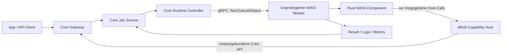

**WASI-Policy – Minimalprinzip:**

- **Kein** standardmäßiger Zugriff auf Hostpfade, Netzwerk, Umgebungsvariablen oder Secrets.
- Gäste erhalten bei Bedarf ein **temporäres, begrenztes virtuelles Dateihandle** (z. B. Eingabe-Blob und Ausgabe-Blob), nicht den Host-Datenbank- oder Storage-Pfad.
- HTTP-/Netzwerkfunktionen werden nur ausdrücklich für bestimmte erlaubte Ziele freigeschaltet; DNS-/Redirect-/SSRF-Schutz ist Pflicht.
- CPU-Zeit/Fuel oder Epoch-Interruption, RAM-/Speicherlimits, Instanzzahl, Ausführungszeit, Ausgabemengen und parallele Jobs werden begrenzt.
- App-Absturz führt zu einem kontrollierten Jobstatus, nicht zum Core-Absturz.
- Runner-Identität, Capabilities, Eingabeversion und Ausgabeartefakte werden auditierbar erfasst.
- Der Worker benutzt ein eigenes, minimal berechtigtes Betriebssystemkonto; keine Core-Datenbank-Credentials.

WASI-Interfaces und Component-Model-Versionen werden im Contract deklariert. Ein `wasm32-wasip2`-Build bzw. ein komponentenfähiges Paket unterscheidet sich von Browser-`wasm32-unknown-unknown`; kein automatisches Ausführen fremder Web-GUI-WASM-Dateien im WASI-Worker.

**WIT-Beispiel (Illustration, kein finaler Vertrag):**

```wit
package cloudos:jobs@1.0.0;

interface files {
    read: func(handle: string) -> result<list<u8>, string>;
    write-result: func(data: list<u8>, media-type: string) -> result<string, string>;
}

world conversion-job {
    import files;
    export run: func(input-handle: string) -> result<string, string>;
}
```

Die endgültige WIT-Schnittstelle wird nach Testen von Component-Model- und Toolchainversionen festgelegt. Für große Datenmengen sind Streaming-/Ressourcen-Handles statt unbeschränkter `list<u8>` erforderlich.

### 15.6 Native Rust auf dem Server: bewusst spätere Erweiterung

Wenn ein Rust-Programm keinen Browser- oder WASI-Build besitzt, **kann** es später als natives Linux-Programm gestartet werden – aber niemals als regulärer Go-Core-Prozess.

**Pflichtanforderungen an `native-isolated`:** unprivilegierte Ausführung, eigener User-/Mount-/PID-/Netzwerk-Namespace, enges seccomp-/AppArmor-Profil, cgroups v2, readonly Root-Dateisystem, nur explizite scratch-Volumes, streng kontrollierter Egress, keine Linux-Capabilities, keine Host-Sockets und kein Docker-Socket. Ein dedizierter Runner-Node oder eine microVM kann zusätzliche Isolation liefern.

**Wichtig:** Container sind keine vollständige Sicherheitssandbox für feindlichen Code. Die endgültige technische Isolationswahl setzt Bedrohungsmodell und Penetrationstests voraus. Für mehrbenutzerfähige Installationen sollte ein stärkerer Isolationsgrad als ein gewöhnlicher Compose-Container erwogen werden.

Eine *native GUI*-App wird dadurch **nicht** automatisch im Browser sichtbar. Für das spätere Profil `remote-gui` wären ein separater Wayland-/Headless-Display-Server pro App, Eingabeumleitung, Video-Streaming (z. B. WebRTC), Grafik-/GPU-Isolation und getrennte Benutzerkanäle erforderlich. Diese Option ist ausdrücklich **kein Bestandteil des MVP**.

### 15.7 Virtuelle Shell und Systemkommandos

Die erste Shell ist ein Go-Core-Dienst mit Befehlen wie `ls`, `cd`, `mkdir`, `cat`, `cp`, `mv` und `rm`. Sie spricht die File-API und läuft **nicht als Login-Shell auf dem Linux-Host**. Shell-Ausführungen sind Prozessentitäten mit Besitzer, korrekter Autorisierung, Pipes, Umleitungen, Limits, Exitcodes und nachvollziehbarem Status.

Später lassen sich erlaubte WASI-CLI-Programme als Subcommands registrieren. Ihr Dateizugriff wird über explizite Capabilities übersetzt, sodass `cat` und `image-convert` nicht zwei verschiedene Zugriffsmodelle benutzen.

### 15.8 Ressourcenverwaltung und Fairness

| Ressource | Browser-WASM | WASI-Worker | Native Sandbox |
|---|---|---|---|
| CPU | Browser-Scheduling, ggf. Worker/Visibility; keine harte Garantie | Fuel/Epoch + Host-Limits | cgroups CPU-Quota |
| RAM | Browser- und WebAssembly-Grenzen; nur heuristische Prävention | linear-memory-Limit + Worker-Limit | cgroups Memory |
| GPU | WebGPU-/WebGL-Kontrolle des Browsers | Nur bei expliziter späterer GPU-Erweiterung | Geteilte GPU sehr komplex; zunächst kein genereller Zugriff |
| Zeit | Init-/Heartbeat-/UI-Timeouts | harter Deadline-Abbruch | Prozess-Timeout / Kill |
| Netzwerk | CSP, App-Origin, CORS/Permissions Policy | standardmäßig blockiert, allowlist | Network Namespace + Egress-Filter |
| Dateien | CloudOS-VFS über Bridge | Input-/Output-Handles via Host | isolierte Scratch-/Staging-Dateien |
| Quotas | Paketgrößen und Clientwarnungen | Nutzer-/App-/Job-Budget | Prozess- und Volume-Limits |

**Fairness:** Ein einzelner Benutzer darf nicht über zahlreiche gleichzeitig gestartete Apps oder Jobs die Ressourcen aller anderen Benutzer verbrauchen. Budgets gelten mindestens pro Benutzer, App-Instanz und Gesamtinstallation. Konkrete Zahlen werden im Lasttest/ADR festgelegt.

### 15.9 Lebenszyklusdiagramm für Rust-WASM-App

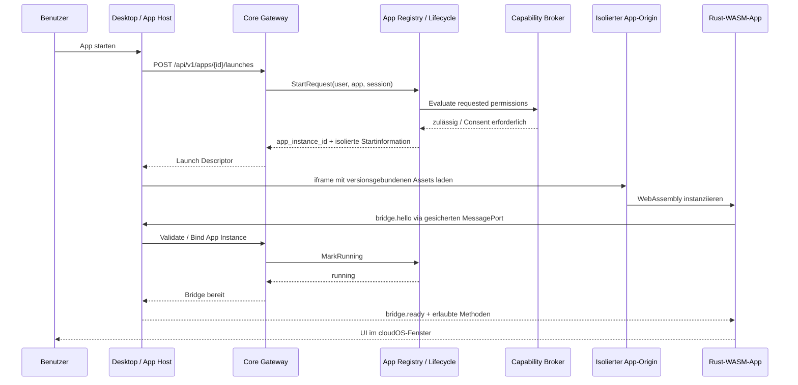

### 15.10 Bereitstellungs- und Kompatibilitätsmatrix

| Artefakt | Browser-WASM | Server-WASI | Native Sandbox |
|---|---|---|---|
| Rust `wasm32-unknown-unknown` + JS Glue | Ja, wenn Web-/Browser-APIs passen | Nein | Nein |
| Rust `wasm32-wasip2` + kompatible WASI-Interfaces | Nicht direkt als GUI-App | Ja, wenn WIT/WASI-Version passt | Nicht nötig |
| Linux ELF (Rust) | Nein | Nein | Optional, nur zugelassene Sandbox |
| ArtCraft-Web-Distribution (HTML/JS/WASM/Assets) | Prinzipiell ja, nach Packaging-/Embedding-Test | Nein | Nicht erforderlich |
| ArtCraft native Linux GUI | Nein | Nein | Nur mit gesondertem Remote-GUI-System sichtbar |
| Reines JavaScript-/HTML-Paket | Ja über `web` | Nein | Nicht erforderlich |

**Akzeptanzregel:** Eine App gilt nur dann als cloudOS-kompatibel, wenn ihr **konkretes Release-Artefakt** den passenden Start-, Fenster-, Berechtigungs- und Speicherfluss unter unterstützten Browsern erfolgreich durchläuft.

## 16. Ereignissystem und Echtzeitkommunikation

### 16.1 Event-Vertrag

```json
{
  "event_id": "24f28d40-e6b0-4771-a34e-aa83dfe2e1a2",
  "event_type": "files.node.created",
  "event_version": 1,
  "occurred_at": "2026-11-14T22:00:00Z",
  "producer": "files",
  "subject": {
    "type": "file",
    "id": "6a70e105-21c1-4258-8f18-2d6f4af0b5fd"
  },
  "data": {
    "parent_id": "fa2c1d56-a7a1-48bf-87b8-85ce0a477986"
  }
}
```

Der Event-Envelope enthält eine stabile ID, ein versioniertes Ereignis, einen UTC-Zeitstempel, einen Erzeuger und eine Ressourcenreferenz. Es werden nur fachlich notwendige Daten veröffentlicht.

### 16.2 Zustellung und Outbox

- Für persistente fachliche Ereignisse wird NATS **JetStream** verwendet, nicht nur flüchtiges Core-NATS-Publish/Subscribe.
- JetStream liefert im Standardfall mindestens einmal; doppelte Zustellungen sind möglich.
- Jeder Consumer verarbeitet Nachrichten deshalb idempotent, z. B. über eine persistierte `event_id`.
- DB-Schreibvorgang und Outbox-Eintrag liegen in derselben Datenbanktransaktion.
- Ein Outbox-Publisher veröffentlicht nach Commit und markiert die erfolgreiche Übergabe. Ein Neustart darf zu erneutem Publish führen, jedoch nicht zu einem inkonsistenten Endzustand.
- Wiederholungen, Backoff, Maximalversuche und Umgang mit nicht verarbeitbaren Ereignissen werden pro Consumer definiert.
- Keine globale, dienstübergreifende Ereignisreihenfolge annehmen; bei Bedarf Revision pro Ressource vergleichen.

### 16.3 Browser-Ereignisse und SSE-Push

Der Standardtransport fuer **alle** laufenden Browser- und App-Host-Aktualisierungen ist `GET /api/v1/events/stream` per authentifiziertem SSE (Server-Sent Events). Der Go-Core sendet **direkt anwendbare, nach Empfaenger und App-Berechtigung gefilterte Deltas**, z.B. `files.node.changed`, `desktop.taskbar.changed`, `applications.available.changed`, `notifications.created`, `sharing.received` und `spaces.member.changed`. **Keine periodischen Client-Statusabfragen und kein Long-Polling.**

- Owner Services schreiben Daten und Transactional Outbox atomar; NATS JetStream verteilt intern; der Push Projector erstellt pro Empfaenger eine sichere und geordnete Zustellung mit persistentem Delivery Log.
- Die `Desktop.cloudApp` / der privilegierte App Host besitzt die Core-SSE-Verbindung. Fremde `.cloudApp`-Frames und Rust/WASM-Apps erhalten **nur** die in ihrer signierten `permissions/api-access.json` deklarierten `event_subscriptions` ueber eine scopegepruefte App Bridge.
- `Last-Event-ID` und per-Audience/Policy-Epoch gebundene Cursor ermoeglichen Replay nach Verbindungsunterbrechungen. Nach einem Replay-Gap darf genau **ein** autorisierter Snapshot geladen werden; dies ist kein Polling.
- Der Browser aktualisiert seine Views direkt aus den empfangenen Deltas. Ein REST-GET nach jedem Event ist nicht mehr Standard und darf nicht durch einen Timer ersetzt werden.
- Beim ersten Login verknuepft ein Snapshot/Stream-Barrier-Protokoll Revisionen und Cursor, damit Aenderungen zwischen Verbindungsaufbau und UI-Bootstrap nicht verloren gehen.
- Connection-Keepalives sind SSE-Kommentare, keine Client-Datenabfragen. Verbindungsabbruch fuehrt zu degradiertem Status, begrenztem Reconnect und Wiederherstellung, niemals zu regelmaessigen Status-GETs.
- Alle API-/File-/App-/Space-Berechtigungen werden bei der eigentlichen Aktion erneut serverseitig geprueft. Ereignisse selbst verleihen keine Rechte und werden beim Replay erneut autorisiert.

Das fachlich massgebliche Dokument ist [PUSH_REALTIME.md](PUSH_REALTIME.md). Die genauen Event-Schemas, Subscribe-Policy, Delivery-Log-Retention, Backpressure und Security-Tests werden dort definiert.

### 16.4 Beispiel: Datei erscheint in zweitem Browser

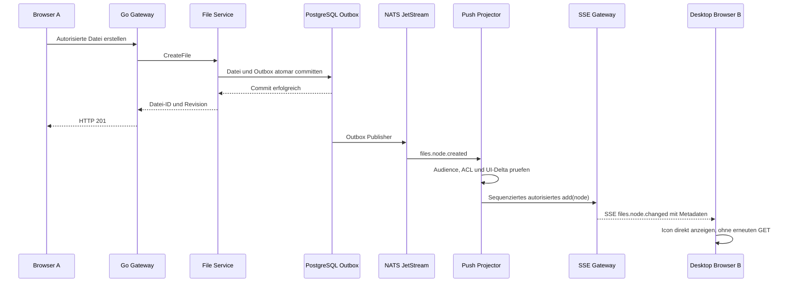

**Themes und Einstellungen** verwenden dieselbe SSE-Push-Strecke. Es werden nur autorisierte Theme-Tokens oder sichere, unveraenderliche Assetreferenzen gesendet; keine nicht geprueften externen Skripte und keine sensiblen Metadaten.

### 16.5 Neue Core- und App-Ereignisse

```text
applications.package.verified
applications.installation.created
applications.installation.updated
applications.instance.starting
applications.instance.running
applications.instance.crashed
applications.instance.stopped
applications.permission.granted
applications.permission.revoked
processes.instance.terminated
jobs.execution.started
jobs.execution.finished
jobs.execution.failed
runtime.worker.unavailable
```

Die internen Subjects folgen den definierten JetStream-Namenskonventionen; obige Werte sind **logische Ereignistypen**. Events enthalten nur notwendige Referenzen und dürfen keine Dateiinhalte, Zugangstokens oder ungekürzten Crash-Dumps publizieren. Browserclients erhalten gefilterte Hinweise, keine unkontrollierte Spiegelung interner Topics.

### 16.6 Push-Deployment und Notification Inbox

Die logischen Komponenten `Notification Service`, `Push Projector`, `Realtime Gateway`, `Delivery Log`, `App Host Event Bridge` und `NATS JetStream` sind getrennte Sicherheitsrollen, koennen anfangs aber in wenigen Prozessen ausgefuehrt werden. Die persistenten Notification-Items leben in der Notification-Datenhaltung; das Delivery Log ist ein begrenztes Replaysystem und keine zweite Notification-Inbox. Nginx muss `text/event-stream` ohne Buffering uebertragen (`X-Accel-Buffering: no`, keine manipulative Kompression), Idle-Timeout und SSE-Keepalive muessen abgestimmt sein. Fremde App-Origins duerfen den privilegierten Core-SSE-Stream nicht direkt lesen. WebSocket bleibt allenfalls eine spaetere, separat genehmigte bidirektionale Erweiterung.

## 17. Deployment und Infrastruktur für Core und App Runtimes

### 17.1 Netzwerk- und Origin-Topologie

**Grundprinzip:** Nur der Edge-Reverse-Proxy besitzt veröffentlichte Ports. Core-Dienste kommunizieren auf privaten internen Netzen; Drittanbieter-Apps haben eine **eigene Browser-Origin** und keine Netzwerkerreichbarkeit zu PostgreSQL/NATS/gRPC.

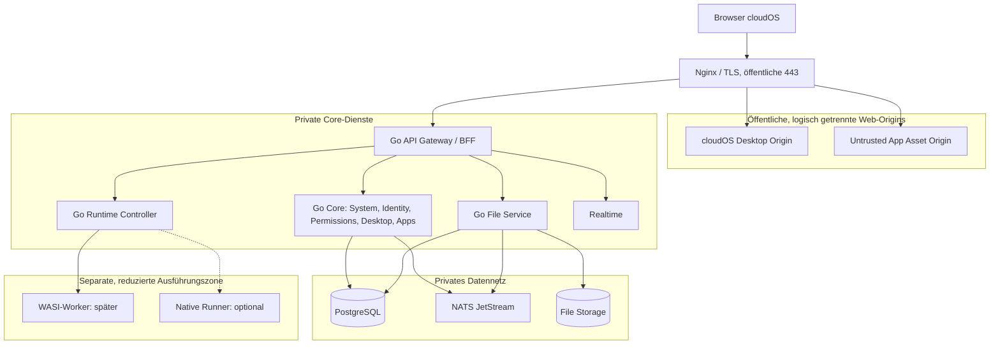

`AppAssets` darf statisch aus einem vom System kontrollierten Repository ausgeliefert werden; es darf **keine Core-Cookies** setzen oder mitbringen. Ein geeigneter Hostname und die konkrete Cookie-/Origin-Struktur sind Bestandteil eines Security-ADRs. Der Reverse-Proxy kann dieselbe öffentliche IP verwenden, aber die **Origins** müssen browserseitig unterscheidbar sein. Das Diagramm ist eine **logische Zieltopologie für Split-Betrieb**; im ersten Betriebsmodus laufen `Gateway`, `Core`, `Files`, `Ctrl` und `Realtime` gemeinsam in einem einzigen Go-Core-Container, nicht in getrennten Prozessen.

### 17.2 Browser-App-Origins und Sicherheitsheader

Für Drittanbieter-Apps wird eine separate Origin empfohlen (schematisch `https://apps.example.invalid`). Die produktive Domain wird erst im Deployment festgelegt. Je nach Vertrauensklasse sind **per-App-Subdomains** oder ein gleichwertig isolierendes Modell zu wählen, damit verschiedene Apps nicht ohne Weiteres dieselbe Origin und denselben Storage teilen.

Pflichten:

1. App-Assets unveränderlich und versioniert ausliefern, z. B. pro `app_id`/Version/Hash.
2. `Content-Security-Policy` pro App-Profil: nur notwendige Skript-/WASM-/Worker-Quellen, `connect-src` restriktiv, `frame-ancestors` nur cloudOS, `form-action` / Navigation begrenzen.
3. HTML-iframe `sandbox` minimal konfigurieren; `allow-scripts` nur bei Apps, die Skripte benötigen (Web-WASM faktisch immer).
4. **Nie `allow-scripts` + `allow-same-origin` auf einer App mit derselben Origin wie der privilegierte Desktop verwenden.** Separate Origins sind die Standardvoraussetzung.
5. BFF-Session-Cookies werden nicht für App-Origins freigegeben; Cookie-Scope und `SameSite` bewusst definieren.
6. COOP/COEP/CORP, CORS und Permissions Policy müssen mit WebAssembly-Threads/WebGPU-/Audio-Funktionen **konkret getestet** werden. Cross-Origin Isolation ist keine pauschal risikolose Konfiguration.
7. `postMessage` nur mit genauem `targetOrigin`, Empfänger-Origin- und MessagePort-Prüfung, Replay-/Schema-Schutz.
8. Wenn eine App in einem neuen Tab geöffnet werden kann, gelten dieselben Origin-/CSP-Grenzen; die iframe-Sandbox allein genügt nicht.
9. Apps duerfen keinen allgemeinen Zugriff auf den privilegierten SSE-Eventstrom erhalten; nur signierte, genehmigte Event-Subscriptions gelangen durch die App-Host-Bridge.

### 17.3 Docker-Compose-Standard und Kubernetes-Vorbereitung (v0.11)

| Container / Komponente | Standardbetrieb | Hinweis |
|---|---|---|
| **`cloudos-core`** | **ein Core-Container**, alle Go-Fachmodule gemeinsam | `CLOUDOS_MODE=combined`, keine zweite Core-Replik im MVP |
| `postgres` | separate Infrastruktur, optionales Compose-`infra`-Profil | spätere Owner-Schemas und Session-Persistenz |
| `nats` | separate Infrastruktur, optionales Compose-`infra`-Profil | später JetStream/Outbox |
| Edge/Web/App-Assets | nach eigener Implementierungsphase separat | Browser-Origins und TLS, keine unsichere Kopplung mit Core-Container |
| externer IdP / LDAP | später optional | kein Zwang für lokale Benutzerverwaltung |
| WASI/native Runner | später separat isoliert | niemals zusammen mit privilegiertem Core |

**Technisch vorbereitet:** `core/Dockerfile`, `deploy/compose/compose.yaml`, `deploy/k8s/combined`, `deploy/k8s/distributed`, generierter Service-Katalog, Health-/Readiness-Handler und SIGTERM-Behandlung. Der Bootstrap implementiert noch **keine** Fach-APIs, VFS-Persistenz, Anmeldung, SSE oder echte gRPC-Services. `kubectl apply -k` wird nur auf Wunsch verwendet. Die getrennte Variante erzeugt 22 Deployments und 18 CPU-HPA-Templates; ein Go-Binary erlaubt je Dienst eine einzige logische Startrolle.

**Infrastrukturgrenze:** Es bleibt bei **einem Core-Container**, selbst wenn externe PostgreSQL-/NATS-/Nginx-Komponenten als eigene Container laufen. Die manuelle Aufteilung von `gateway`, `files`, `realtime` usw. ist kein notwendiger Bestandteil der ersten Entwicklungs- und Testphasen. Weitere Details: [CORE_DEPLOYMENT_SCALING.md](CORE_DEPLOYMENT_SCALING.md).

### 17.4 Zugriffstrennung

- PostgreSQL-Rollen und Migrationsrechte pro Schema; andere Dienste dürfen nicht in fremde Owner-Schemas schreiben.
- Nur File Service/Storage-Adapter erhalten Zugriff auf Blob-Volumes.
- Runtime Controller darf Sandboxen starten/stoppen, aber keine Host-Docker-API ungeschützt annehmen. Ein dedizierter Runner-Agent mit beschränkter Steuer-API ist gegenüber freiem Docker-Socket-Zugriff vorzuziehen.
- WASI-/native Runner haben keine Core-Datenbank-Secrets und keine implizite Verbindung zu internen Netzen.
- Ausgehender Netzwerkzugriff der Runner ist standardmäßig gesperrt; explizite, protokollierte egress-Policies für zugelassene Integrationen.

### 17.5 Konfiguration und Secrets

- Konfiguration wird über versionierte Schemas, geschützte Runtime-Umgebung und dokumentierte Overrides bereitgestellt.
- Keine API-Tokens, Service-Secrets, Signaturschlüssel, Private Keys oder OIDC-Credentials in Git oder App-Paketen.
- Separate Schlüssel für App-Signaturen, Core-Sessions, interne Dienstkommunikation und optionale Runner-Capability-Tokens.
- Schlüsselrotation, Widerruf, Audit und Kompromittierungsverfahren vor Produktivbetrieb.
- Build-Artefakte reproduzierbar und mit Versions-/Git-SHA-/Checksum-Metadaten versehen.

### 17.6 Horizontale Skalierung, Lastverteilung und Service-Ownership

**Kubernetes-Skalierung ist ab dem ersten Core-Bootstrap vorbereitet, wird aber erst später aktiv verwendet.** Für mehrere identische Go-Serviceinstanzen sind `ClusterIP`, DNS/Service-Discovery, Deployment-Replikate, Readiness-Probes, Pod-Resources und HPA-Templates definiert. Der Go-Service-Katalog ist für den Generator verbindlich. Die Fach-APIs müssen eigene gemeinsame Datenhaltung, revisionssichere Berechtigungen und lokal/remote identische Contracts erhalten.

- **Stateless HTTP-Dienste** (`gateway`, `files`, `identity`, `apps`, `sharing`, `spaces` usw.): mehrere Pods; gemeinsamer PostgreSQL-Owner-State und konsistenter Blob-Speicher statt lokaler Session-/Dateidaten.
- **SSE/Realtime:** multiple Pods hinter einem Service; dauerhafter Replay-/Delivery-Log, Auth-Revisionen und Stream-Drain. **Kein Browser-Polling** und keine verpflichtenden Sticky Sessions.
- **Outbox-/JetStream-Worker:** nur kontrolliert vervielfachen, wenn durable Queue-/Consumer-Group und Idempotenz validiert sind.
- **LDAP-Sync und Runtime Controller:** Lease-/Fencing-/Ownership-Koordination; im Bootstrap zunächst eine Replik ohne HPA.
- **CPU-HPA:** für 16 HTTP-Dienstklassen als YAML vorbereitet, aber Produktionswerte sind vorab zu messen; Realtime benötigt spätere Stream-/Backpressure-Metriken.
- **Zuverlässigkeit:** Rolling Upgrades, Drain, Schema-Version-Skew, DB-/Storage-HA und sichere Compensations sind separat zu testen.

Die Kubernetes-Manifeste sind **keine** Behauptung, dass Fachlogik bereits horizontal skaliert. Maßgeblich sind [CORE_DEPLOYMENT_SCALING.md](CORE_DEPLOYMENT_SCALING.md), Vertrags-/Mehr-Pod-Tests und eine ausdrückliche Freigabe des Split-Modus.

### 17.7 Backup, Migration und Wiederanlauf

Zu sichern sind PostgreSQL-Fachdaten (einschließlich App-Installationen, Grants, App-Metadaten, Prozessen und Outbox), Blob-Speicher und versionsgebundene App-Release-Artefakte. Laufende Browser-WASM-Instanzen oder untrusted Worker-Arbeitsspeicher werden **nicht** als dauerhaft wiederherstellbarer Zustand angenommen. Wiederanlauf bedeutet: Nutzer-/App-Zustände rekonstruieren, ausstehende Jobs anhand ihrer Idempotenz- und Wiederaufnahmepolicy behandeln, aktive App-Instanzen kontrolliert neu erzeugen.

## 18. Betrieb, Observability und Wiederherstellung

### 18.1 Health Checks

- **Liveness:** Prozess reagiert; kein erzwungener Neustart bei bloßer kurzer Datenbankstörung.
- **Readiness:** Prozess kann seine notwendigen Aufgaben tatsächlich erfüllen.
- **Startup:** Erlaubt längere Initialisierung und Migrationen ohne verfrühte Neustarts.
- Externe Endpunkte geben nur unkritische Statusinformationen aus; detaillierte Diagnose bleibt intern.

### 18.2 Logging und Tracing

- Strukturierte JSON-Logs mit Timestamp, Dienst, Version, Schwere, Request-ID und Trace-ID.
- Keine Tokens, Passwörter, Session-Cookies oder vollständigen sensiblen Dateiinhalte loggen.
- OpenTelemetry für verteilte Traces, Prometheus-kompatible Metriken für Ressourcen und Latenzen.
- Relevante Kennzahlen: HTTP/gRPC-Fehlerrate, p95-Latenz, DB-Pool, Uploadabbrüche, Outbox-Rückstand, JetStream-Consumer-Lag, aktive SSE-Streams, Delivery-Backlog, Replay-Gaps, Revoke-Latenz und Storage-Auslastung.

### 18.3 Backup und Restore

1. PostgreSQL und Dateiinhalte werden als zusammengehöriger Wiederherstellungspunkt behandelt.
2. Backup-Verfahren dokumentiert konsistente Reihenfolge oder Snapshot-/WAL-Strategie.
3. NATS-Persistenz wird entsprechend Wiederaufbau- und Retention-Konzept gesichert oder bewusst als rekonstruierbar eingestuft.
4. Ein Restore-Test prüft Datenbank, Storage-Referenzen, Benutzerrechte und repräsentative Dateien.
5. Restore eines einzelnen Artefakts und vollständiger Disaster-Recovery-Lauf werden getrennt betrachtet.

Die konkrete Backup-Technik, Intervalle, RPO und RTO sind offene Betriebsentscheidungen.


### 18.4 Laufzeit- und App-Observability

Zusätzlich werden über den Core erfasst: App-Version, Runtime-Profil, Start-/Crashrate, Launch-Latenz, Browser-Fähigkeitsfehler, Paketprüfungen, Grant-/Revoke-Ereignisse, WASI-Worker-Auslastung, Job-Dauer, unterbrochene Ausführungen und Fehlertypen. Browser-Metriken werden nur datensparsam und gemäß Datenschutz-Policy erhoben; kein pauschales Sammeln von Dokumentinhalten, Mausklicks oder App-Canvas-Daten.

Runtime-Logs sind strikt nach App-Instanz, Nutzer und Trace-ID gefiltert. Admin-Einsichten erhalten eigene Rollen. Wiederanlauf-Tests prüfen, ob der Core nach einem Worker-/App-Absturz korrekt weiterarbeitet.

## 19. Verhalten bei Ausfällen

| Störung | Erwartete Reaktion |
|---|---|
| OIDC Provider nicht erreichbar | Bestehende gültige Sessions funktionieren gemäß definierter Policy weiter; neue Logins ggf. nicht. |
| PostgreSQL nicht verfügbar | Schreibende Operationen schlagen kontrolliert fehl; keine stillschweigenden lokalen Ersatzdaten. |
| Dateispeicher nicht verfügbar | Dateiinhalt-Zugriffe kontrolliert fehlerhaft; Metadaten allein beweisen keinen erfolgreichen Upload. |
| NATS nicht verfügbar | Fachliche DB-Transaktion und Outbox können weiterlaufen, solange das definierte Rückstands-/Kapazitätsbudget reicht. |
| SSE getrennt | Client zeigt Verbindungsstatus, reconnectet mit `Last-Event-ID`; bei Gap einmaliger Snapshot statt Polling. |
| Gateway-Neustart | Persistente Sessions werden wieder geprüft; temporäre Verbindungen neu aufgebaut. |
| App reagiert nicht | App-Host kann das Fenster beenden, ohne Desktop oder andere Apps zu blockieren. |
| Upload abgebrochen | Upload bleibt vorübergehend im Staging, wird abgebrochen oder bereinigt; kein halber sichtbarer Dateiinhalt. |

Jeder Dienst muss Timeouts, Backpressure, begrenzte Retry-Zahlen und definierte Fehlerantworten besitzen. Circuit Breaker werden nur dort eingeführt, wo Lasttests oder tatsächliche Fehlerbilder sie rechtfertigen.


### 19.1 Zusätzliche Rust-/Core-Fehlerfälle

| Fehler | Erwartetes Verhalten |
|---|---|
| Browser hat kein erforderliches WebGPU | App-Launch liefert verständlichen Kompatibilitätsfehler oder geprüften Fallback; Core läuft weiter |
| Web-WASM-Bundle ist beschädigt | Installation/Launch wird vor Ausführung gesperrt; Audit-/Diagnoseereignis |
| JS-Glue passt nicht zum WASM-Release | Start schlägt fehl und ändert keine Systemdateien; vorherige App-Version kann weiter angeboten werden |
| App fordert nicht genehmigte Datei | Grant wird verweigert; Serverautorisierung verhindert Zugriff |
| App-Origin oder iframe wird kompromittiert | Keine Core-Cookies; serverseitige Grants begrenzen die Auswirkungen |
| WASI-Gast hängt in Endlosschleife | Fuel-/Epoch-/Timeout-Abbruch; Job als gescheitert, Core bleibt verfügbar |
| WASI-Worker fällt aus | Jobstatus über Lease/Heartbeat korrigieren; nur bei idempotenten Jobs retry |
| Native Sandbox überschreitet RAM | cgroup beendet Prozess; Core protokolliert OOM, keine stillen Host-Fehler |
| App-Update fordert mehr Rechte | Neue Rechte werden **nicht** automatisch gewährt, Nutzer-/Adminentscheidung nötig |
| App-Asset-Origin ist nicht erreichbar | Desktop bleibt benutzbar, App-Start wird kontrolliert abgelehnt |

**Theme-Fehlerfaelle:** Bei fehlendem Token, inkompatiblem Schema oder fehlerhaftem Asset wird ein validiertes Fallback-Theme geladen. Theme-Paketwiderrufe können per Event zu erneutem API-Abruf und sicherem Wechsel fuehren. Fehlschlagende Theme-Anfragen blockieren weder Anmeldung noch System-API-Aufrufe.

### 19.2 API-Policy-Ausfälle und Pflichtverweigerung

Bei nicht erreichbarem API-Katalog, fehlender signierter API-Deklaration, ungültiger App-Kontextbindung oder nicht sicher prüfbarer Policy wird jeder neue geschützte App-Aufruf **verweigert**. Ein Cache darf keine dauerhaft ungültigen Freigaben weiterreichen. Bereits laufende Instanzen werden nach einem Widerruf neu bewertet oder isoliert beendet. Eine defekte Core-App erhält keine unbeschränkten Ersatzrechte; die signierte Release-Baseline und die minimale Recovery-Funktion bleiben maßgeblich.

## 20. Sicherheitsarchitektur und Bedrohungsmodell

| Bedrohung | Entwurfsmaßnahme |
|---|---|
| XSS im Desktop oder in Apps | Kontextgerechtes Escaping, CSP, getrennte Origins, keine ungeprüften HTML-Fragmente. |
| CSRF gegen Cookie-APIs | CSRF-Token, SameSite, Origin-/Referer-Prüfung nach Sicherheitsmodell. |
| Rechteausweitung über Datei-IDs | Objektbezogene Berechtigungsprüfung bei jeder Operation. |
| Path Traversal | VFS-IDs statt Hostpfade, sichere Storage-Key-Erzeugung, Inputvalidierung. |
| Manipulierte Uploads / Archivbomben | Limits, Streaming, Formatprüfung, isolierte Verarbeitung, spätere Malware-Prüfoption. |
| SSRF über Integration oder Vorschau | Egress-Policies, Zielvalidierung, Blockierung interner/Metadaten-Netze. |
| Unsichere App-Updates | Signatur-/Hashprüfung, Herausgeberbindung, Freigaben und Update-Policy. |
| Session-Diebstahl | HttpOnly/Secure-Cookies, kurze angemessene Sessionlaufzeit, Widerruf, Session-Rotation. |
| SSE-Informationsleck | Same-Origin/BFF, Sitzungs- und App-Subscriptionpruefung, Auslieferungs- und Replay-ACL; Revoke-Handling. |
| Interne Dienst-Impersonation | Dienstidentität, Autorisierung, TLS/mTLS-Konzept. |
| Host-Kompromittierung durch Job | Separate Sandbox, keine privilegierten Container und keine Host-Mounts. |
| Datenverlust / Ransomware | Getrennte Berechtigungen, Versionen/Papierkorb und getestete Backups. |

Sicherheitsmaßnahmen sind **durchgängige Entwicklungsanforderungen** und werden nicht auf Phase 15 verschoben. Phase 15 dient zusätzlicher Prüfung und Härtung.


### 20.1 Zusätzliche Bedrohungen durch Anwendungen und Rust

| Bedrohung | Sicherheitsmaßnahme und Test |
|---|---|
| Schadhafte Browser-WASM-/JS-App | Eigene App-Origin, CSP, iframe-Sandbox, Bridge-Schema-/Originprüfung, serverseitige ACLs |
| CSP-Umgehung über externe Assets | Signierte/manifeste Asset-Allowlist, sichere `connect-src`, kein unsicherer Wildcard-Fallback |
| App-Impersonation über gefälschte `app_instance_id` | MessagePort-Bindung an geprüften App Host, serverseitige Instanzzuordnung |
| App verlangt überbreite Dateirechte | Datei-Auswahl mit Benutzeraktion, per-Ressource-Grant, überprüfter Scope, Expiry |
| Privilegieneskalation durch Manifest-Update | Rechte-Diff, erneute Freigabe und Publisher-Bindung |
| Supply-Chain-Angriff auf Rust-Crates / JS-Build | Lockfiles, reproduzierbare Builds, SBOM, Signaturen, Herkunft, Prüfungen |
| WASI-Gast missbraucht Host-Funktionen | Host-API-Allowlist, Limits, keinen pauschalen WASI-Network-/FS-Zugriff |
| Host-Escape aus nativer Sandbox | starker Isolationsansatz, Kernel-/Runtime-Härtung, negative Tests, keine privilegierten Host-Mounts |
| Cross-Origin Isolation unvollständig | browserübergreifende Integrationstests mit COOP/COEP/CORP und App-Origins |
| GPU-/RAM-Erschöpfung durch App | Geräte-/Feature-Erkennung, Laufzeitbudgets, App-Stop, Monitoring |
| Vertrauliche Daten in Logs | automatische Redaktion, begrenzte Retention, App-Logs nicht ungeprüft an Admins geben |

Eine native oder in WASI ausgeführte Rust-Anwendung ist **nicht automatisch sicherer**, nur weil Rust Speichersicherheit unterstützt. Die Host-API, Paketquelle, Systemcalls, Laufzeitrechte und Infrastrukturgrenzen bleiben sicherheitskritisch.

## 21. Teststrategie und Entwicklungsstandards

### 21.1 Testebenen

| Ebene | Testziel |
|---|---|
| Unit | Regeln eines Go-Fachmoduls unabhängig von Netz und DB |
| Contract | OpenAPI-/Protobuf-Vertrag und generierte Clients |
| Integration | Go-Service mit echter PostgreSQL-/NATS-Testumgebung |
| End-to-End | Browser → Gateway → Dienst → Datenbank und zurück |
| Security | IDOR, ACL, CSRF, Auth-/Session-Fehler, Upload- und App-Isolation |
| Failure | Neustarts, Ausfälle, doppelte Events, konkurrierende Änderungen |
| Performance | Last auf Datei-Listen, Uploads, SSE-Streaming, Fanout, Delivery Log und Reconnect |
| Restore | Wiederherstellung konsistenter Daten aus Backup |

### 21.2 CI-Anforderungen

- Go: `gofmt`, `go vet`, Unit-/Integrationstests, Race Detector für geeignete Pakete.
- Frontend: TypeScript-Prüfung, Linting, Komponenten- und Browser-E2E-Tests.
- Verträge: OpenAPI-Validierung, Proto-Linting, Breaking-Change-Prüfungen und Client-Generierung.
- Datenbank: Migration-up-/Migration-down-Strategie und Schema-Berechtigungsprüfung.
- Sicherheitsprüfung: Abhängigkeitsprüfung, Container- und Secret-Scanning.
- Veröffentlichung: Reproduzierbare Images und Versionszuordnung zur Git-Revision.

### 21.3 Definition of Done

Ein Feature ist erst abgeschlossen, wenn API-Vertrag, Implementierung, Fehlerfälle, Rechteprüfung, Tests, Dokumentation und der reproduzierbare Integrationsablauf vorliegen.


### 21.4 Rust- und App-Kompatibilitätstests

**Automatisierte Tests zusätzlich zu den bestehenden Ebenen:**

1. **Rust-Toolchain:** `cargo fmt --check`, `cargo clippy`, Unit-Tests, mindestens ein reproduzierbarer Browser-WASM-Build, später WASI-Build.
2. **Paketvertrauen:** absichtlich verändertes `.wasm` oder JS-Glue wird per Digest abgelehnt; ungültige Signatur und Publisher-Wechsel werden getestet.
3. **Browser-Sandbox:** Cross-Origin-Script-/Cookie-Zugriff scheitert; Bridge verwirft ungültige Origins, Methodennamen, IDs und wiederholte Requests.
4. **Permissions:** Ein Nutzer erhält nur ausgewählte Dateihandles; ein Widerruf während einer offenen App-Instanz wird wirksam.
5. **WASM-Kompatibilität:** Browsermatrix mit/ohne WebGPU/WebGL2, großen Assets, WebWorker/Threads, COOP/COEP und Größenänderung.
6. **WASI-Host:** Programm kann ohne Grant weder Netzwerk noch fremde Dateien lesen; Fuel-/Timeout-/RAM-Grenzen werden erzwungen.
7. **Systemstabilität:** Crash von App oder Worker beendet keine Core-Dienste und blockiert keine anderen Benutzer.
8. **Dateiintegrität:** App-Speichervorgang mit konkurrierenden Revisionen erzeugt einen nachvollziehbaren Konflikt und keinen Datenverlust.
9. **ArtCraft-Integrationsprobe:** Ein konkret versionierter Web-Build wird unter den cloudOS-Headern gestartet, Canvas gerendert, Open/Save-Vorgang dokumentiert, Assetlizenzen geprüft.
10. **Multiuser:** App eines Benutzers kann keinen anderen App-State, File-Handle, Session-Token oder Jobstatus lesen.

### 21.5 Release-Matrix für App-Runtimes

Für jeden veröffentlichten Runtime-Adapter werden festgehalten: unterstützte Browser/Versionen, WASM-Target, Rust-Toolchainversion, SDK-/Bridge-Version, WebGPU-/Threads-Anforderungen, Maximalgrößen, isolierte Origin, getestete Eingabe-/Ausgabeformate und unterstützte Fehlerszenarien.

### 21.6 Theming-, Accessibility- und Visual-Regression-Tests

Die CI prüft die **Theme-Konformitaet jedes cloudOS-eigenen UI-Elements**. Dazu gehoeren Token-Manifest-/Schema-Validierung, Lint-Regeln gegen hartkodierte Feature-Styles, dokumentierte Komponentenvarianten, Visual-Regression-Screenshots in Light/Dark/High Contrast, Keyboard-/Fokus-/Screenreader-Tests, Responsive-/Dichte-Tests und Runtime-Wechsel bei geoeffneten Fenstern.

**Pflichttestmatrix:**

| ID | Test | Erwartung |
|---|---|---|
| TH-001 | Light-Theme wird aktiviert | Alle Core-UI-Komponenten verwenden neue Tokens, ohne Reload |
| TH-002 | Dark-Theme wird aktiviert | Kontrast, Fokus, Statusfarben und Icons bleiben korrekt |
| TH-003 | High Contrast / Reduced Motion | Erforderliche Zugänglichkeit bleibt gewahrt |
| TH-004 | Fenster bewegen/resize waehrend Theme-Wechsel | Kein App-Absturz, kein Verlust der Desktop-Revision |
| TH-005 | Theme ohne Pflicht-Token oder mit ungueltiger CSS-Eingabe | Validierung lehnt ab oder sicherer Default wird aktiviert |
| TH-006 | Theme enthaelt externes Asset oder Skript | Installationsprüfung verweigert |
| TH-007 | Zwei Benutzer waehlen verschiedene Themes | Keine gegenseitige Darstellungsaenderung |
| TH-008 | Administrator sperrt ein bestimmtes Token | Benutzer-Override und Preview umgehen Policy nicht |
| TH-009 | Rust-WASM-App deklariert `theming.mode=sync` | App erhaelt nur freigegebene Tokens und re-rendered |
| TH-010 | Fremd-App ohne Theme-Unterstuetzung | Fensterrahmen folgt Theme, innere App bleibt unverändert |
| TH-011 | Theme-Service temporar nicht erreichbar | Vorherige validierte Darstellung oder Fallback bleibt bedienbar |
| TH-012 | Theme-Event doppelt / veraltet | Idempotenter, revisionsgeprüfter Zustand ohne Flackern |

Visual-Regression-Baselines werden versioniert und bewusst reviewed; ein geaenderter Screenshot allein bedeutet nicht automatisch eine Fehlfunktion oder eine erwuenschte Designaenderung.

### 21.7 API-Allowlist-/App-Bridge-Abnahmetests

Zusätzlich zu den bestehenden Tests sind verpflichtend: Ablehnung einer fehlenden/manipulierten `api-access.json`, unbekannte Operation-IDs, verbotene Methoden, nicht deklarierte Aufrufe, Umgehung durch Raw HTTP/Sessioncookie, Rust-WASM-/WASI-Aufrufe, Admin-Rolle ohne App-Grant, vollständige Endpoint-Risikoanzeige, selbstsignierte Doppelbestätigung, Update-Rechte-Diff, Widerruf und Core-App-Baseline-Verifikation. Die fachlich führende Matrix `API-001` bis `API-041` steht in [`APP_API_ACCESS.md`](APP_API_ACCESS.md).

## 22. Vorgesehene Repository-Struktur und Core-Grenzen

**Monorepo:** Der vollständige cloudOS Core ist im selben Repository versioniert, enthält aber fachlich getrennte Go-Module/Packages. Rust-Anwendungen und WebAssembly-Beispiele liegen unter `applications/`; sie werden **nicht** in den privilegierten Core gelinkt.

```text
cloudOS/
├── README.md
├── docs/
│   ├── CONCEPT.md
│   ├── SYSTEM_ARCHITECTURE.md
│   ├── VIRTUAL_FILESYSTEM.md
│   ├── APPLICATION_SYSTEM.md
│   ├── CORE_DEPLOYMENT_SCALING.md
│   ├── decisions/
│   ├── api/
│   ├── applications/
│   ├── security/
│   ├── development/
│   └── operations/
├── contracts/
│   ├── openapi/v1/
│   ├── protobuf/cloudos/
│   │   ├── system/v1/
│   │   ├── desktop/v1/
│   │   ├── files/v1/
│   │   ├── applications/v1/
│   │   ├── permissions/v1/
│   │   ├── runtime/v1/
│   │   └── jobs/v1/
│   ├── events/v1/
│   ├── app-bridge/v1/
│   ├── themes/v1/
│   ├── manifests/v1/
│   └── wit/cloudos/
├── core/
│   ├── go.mod
│   ├── Dockerfile
│   ├── cmd/
│   │   └── cloudos-core/           # gemeinsames Go-Binary, combined/split per env
│   ├── internal/
│   │   ├── platform/              # Service-Katalog, Deployment-Bootstrap
│   │   │   ├── services.json
│   │   │   ├── catalog.go
│   │   │   └── server.go
│   │   ├── system/
│   │   ├── identity/
│   │   ├── sessions/
│   │   ├── permissions/
│   │   ├── desktop/
│   │   ├── windows/
│   │   ├── settings/
│   │   ├── themes/
│   │   ├── files/
│   │   ├── storage/
│   │   ├── applications/
│   │   ├── packages/
│   │   ├── lifecycle/
│   │   ├── capabilities/
│   │   ├── processes/
│   │   ├── shell/
│   │   ├── jobs/
│   │   ├── search/
│   │   ├── notifications/
│   │   ├── realtime/
│   │   ├── audit/
│   │   └── administration/
│   └── pkg/
│       ├── contracts/
│       └── client/
├── platform/
│   ├── database/
│   ├── events/
│   ├── configuration/
│   ├── logging/
│   ├── telemetry/
│   └── security/
├── runtimes/
│   ├── browser-wasm/
│   ├── wasi-worker/
│   ├── native-runner/
│   └── compatibility/
├── sdk/
│   ├── typescript/
│   ├── rust-browser/
│   ├── rust-wasi/
│   └── go/
├── web/
│   ├── bootstrap/
│   ├── window-manager/
│   ├── app-host/
│   ├── app-bridge/
│   ├── design-system/
│   ├── theme-engine/
│   ├── components/
│   └── state/
├── themes/
│   ├── default/
│   └── examples/
├── applications/
│   ├── core/
│   │   ├── desktop/
│   │   ├── file-explorer/
│   │   ├── settings/
│   │   ├── apps-management/
│   │   ├── system-dialogs/
│   │   └── notifications/
│   ├── bundled/
│   │   └── terminal/
│   └── examples/
│       ├── rust-wasm-hello/
│       ├── rust-wasm-file-editor/
│       └── rust-wasi-converter/
├── deploy/
│   ├── compose/                  # Standard ein Core-Container, Split optional
│   ├── k8s/                      # combined und distributed Kustomize
│   ├── nginx/
│   ├── app-origins/
│   └── policies/
├── tests/
│   ├── contract/
│   ├── integration/
│   ├── end-to-end/
│   ├── rust-compatibility/
│   ├── visual-regression/
│   ├── isolation/
│   ├── performance/
│   └── security/
├── tools/
│   ├── cloudapp-packager/
│   └── cloudapp-validator/
├── scripts/
└── Makefile
```

Dies ist eine **Zielstruktur, kein Ist-Inventar**. Als Grundlage für die Architektur v0.9 wurde GitHub `Drezael/cloudOS`, Branch `main`, Commit `b44579d5cfa4d85a4cc21e44d12f2003d5a2a6fa` am 15.11.2026 geprüft. Dort liegen die bisherigen Fachkonzepte einschließlich `docs/DESKTOP_ENVIRONMENT.md`; die in diesem Paket überarbeiteten Dateien sind als neue Versionen zur Übernahme vorbereitet. Unbenutzte Verzeichnisse werden nicht als leere Platzhalter erzeugt.

**Go-Packageregel:** In `core/internal/<fachkontext>` liegen die Implementierungen hinter Ports/Interfaces. Nur ausdrücklich freigegebene, versionierte Contract-/Client-Pakete dürfen von anderen Fachkontexten importiert werden. Eine Umstrukturierung in einzelne Deployments erfordert dadurch keinen Wechsel der öffentlichen API.

**Rust-SDK-Regel:** `sdk/rust-browser` kapselt die Browser-App-Bridge, `sdk/rust-wasi` die WIT-/WASI-Host-Funktionen. Beide implementieren die **gleiche fachliche Core-API-Semantik**, aber nicht notwendigerweise denselben binären ABI- oder Transportvertrag.

## 23. Vertikale Integrationsmeilensteine und aktualisierter Entwicklungsablauf

### 23.1 Meilenstein A – funktionsfähiger cloudOS Core (frühe Phasen)

**Ziel:** Eine Ende-zu-Ende-Kette aus Browser, Gateway, Core-Diensten, PostgreSQL und Events – ohne große App-UI.

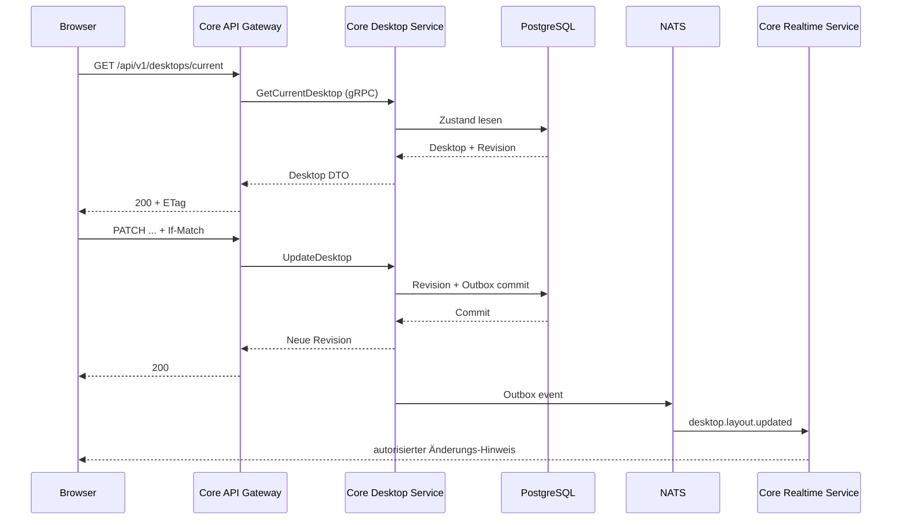

**Abnahme:** Sichere OIDC-Session; Core-API liefert und speichert Desktopzustand; getrennte Nutzer sehen keine fremden Zustände; Änderungen zwischen zwei Tabs synchronisieren; Tests für fehlerhafte Revisionen und Reconnect bestehen.

### 23.2 Meilenstein B – erste Rust-WebAssembly-App im Desktop

**Ziel:** Eine eigene, kleine Rust/WASM-App mit Canvas/DOM lässt sich als geprüftes Paket installieren und in einem normalen cloudOS-Fenster starten.

**Minimaler vertikaler Ablauf:**

1. Rust-Beispiel liefert einen reproduzierbaren `wasm32-unknown-unknown`-Browser-Build samt Web-Assets.
2. Manifest (`web-wasm`) wird gegen Schema validiert; Paketprüfung ermittelt verifizierten Hash.
3. App Registry registriert das Paket, Package Service installiert es für den Testnutzer.
4. Desktop zeigt das Startmenü-Icon anhand der Core-API.
5. Nutzer startet App; Core erzeugt `app_instance_id` und `ProcessInstance`.
6. App Host öffnet den Web-Build auf getrennter Origin in einem Desktop-Fenster.
7. Bridge-Handshake bestätigt App, Instanz und SDK-Version.
8. Rust-App fordert eine Datei-Auswahl an, erhält ausschließlich ein ausgewähltes Dateihandle und zeigt ihren Inhalt.
9. App speichert eine bearbeitete Datei über File Service mit Revision/ETag zurück; andere Sitzung erhält ein Änderungsereignis.
10. Ein Rechtewiderruf verhindert folgenden Zugriff; App-Schließen beendet Instanz und Grant.

**Abnahme:** Getestete Start-/Stop-/Crash-/Revoke-Flows, App- und Nutzerisolation, keine Core-Cookies im App-Kontext, erfolgreicher File-Roundtrip und dokumentierte Browserkompatibilität.

### 23.3 Meilenstein C – ArtCraft-Kompatibilitätsnachweis

**Ziel:** Ein **konkretes** browserfähiges ArtCraft-Release, vorzugsweise PhotoCraft oder CADCraft, wird als Fremdanwendung eingebettet und mit cloudOS-Dateien getestet.

- **Schritt 1:** Offizielle Web-Distribution / Release-Version, Lizenz- und Assetprüfung dokumentieren.
- **Schritt 2:** App ohne Core-Rechte isoliert hosten, Fensterstart und Rendering testen (ArtCraft Level A).
- **Schritt 3:** Browserfeatures (WebGPU/WebGL2, Threads, COOP/COEP, Fonts, Assetpfade, Clipboard, Pointer Lock) prüfen.
- **Schritt 4:** Falls geeignete Import-/Export-Hooks existieren, `OpenWith`/`SaveAs` über einen Adapter anbinden (Level B).
- **Schritt 5:** Wenn Änderungen am Upstream-Quellcode erforderlich sind, eigenen Adapter/Fork samt Update- und Lizenzstrategie als ADR dokumentieren (Level C).

**Abnahmekriterium:** Das Ergebnis nennt explizit **welche** Funktionen getestet funktionieren und welche nicht. Ein reiner Start im iframe wird nicht als vollständige VFS-Integration bezeichnet.

### 23.4 Meilenstein D – Rust-WASI-Job (nach MVP)

**Ziel:** Ein unvertrauenswürdiges Rust-WASI-Konvertierungsmodul kann über die Core-Job-API mit ausgewählten VFS-Input-/Output-Handles kontrolliert ausgeführt werden.

**Abnahme:** CPU-/RAM-/Zeitlimits greifen; kein unberechtigter Host-Datei- oder Netzwerkzugriff; erfolgreiches Konvertierungsergebnis ist im VFS gespeichert; Abbruch, Absturz und doppelte Ausführung werden korrekt behandelt.

### 23.5 Einfluss auf den bisherigen Entwicklungsplan (Phasen 0–18)

| Phase | Änderung durch Core-/Rust-Architektur | Zusätzliches Ergebnis |
|---|---|---|
| **0** | Core-Begriff, Servicegrenzen, Runtime-Matrix, ArtCraft-Ziel und Sandbox-Policies als ADRs festlegen | Security-/Runtime-ADR und Testmatrix |
| **1** | App-Manifest, `app-bridge.v1`, App-Lifecycle- und Capability-Verträge spezifizieren | Generierbare Schema- und SDK-Prototypen |
| **2** | Core-Prozessgruppen sowie getrennte App-Asset-Origin planen | Sichere Entwicklungs-Origin / Compose-Grundlage |
| **3–4** | Instanzgebundene Grants, App-Sitzungen und Widerruf integrieren | Negative Auth-/Berechtigungstests |
| **5** | App Host, Fensterlebenszyklus und Core-Fensterzustände vorbereiten | Fenster-/App-Grenze getestet |
| **6–7** | VFS-Dateihandles, Datei-Auswahldialog und `OpenWith` vorbereiten | API für nicht privilegierte Apps |
| **8** | Core-App-Events und Reconnect-Zustand ergänzen | App-/Datei-Events isoliert pro Benutzer |
| **9** | **Rust-WebAssembly-MVP** in App Registry / App Host / SDK integrieren | Meilenstein B, danach C |
| **10** | Virtuelle Shell und Process Registry gehören eindeutig zum Core | Keine Host-Shell-Ausführung |
| **11–12** | System-Apps verwenden Core-APIs; Suche verarbeitet App-Daten nur nach Rechten | Einheitliche App-Verträge |
| **13** | WASI-/Wasmtime-Worker und Job-Service getrennt vom Core implementieren | Meilenstein D |
| **14** | Adapter für externen Dateispeicher auch in Rust-App-Files nutzen | Keine VFS-Duplikate |
| **15** | App-/Sandbox-/Supply-Chain-Security testen | Mehrbenutzer-Isolationsnachweis |
| **16** | WebGPU-/WASM-/Runner-Performance untersuchen | Kompatibilitäts-/Ressourcenbudget |
| **17** | App-Artefakt-Backups, Runner-Betrieb und Restore ergänzen | Operativer Wiederanlauf |
| **18** | Externes App-Ökosystem, Rust SDK, vertrauenswürdige Signaturen | Drittanbieter-App vollständig dokumentiert |

Die Anzahl **19 Phasen** bleibt erhalten. Die zusätzlichen Rust-Meilensteine sind **konkretere Abnahmeziele innerhalb** dieser Phasen, keine stillschweigende Neunummerierung des Projektplans.

### 23.6 Theming-Meilensteine als Erweiterung der Phasen 0-18

Die Theming-Arbeit ist ein fester Bestandteil der bestehenden 19 Entwicklungsphasen und wird nicht als unverbindliches Zusatzprojekt nachgelagert:

| Phase | Umsetzung | Abnahmekriterium |
|---|---|---|
| **0** | ADR-023/024; Komponentenvertrag, Token-Typen, Theme-Owner und Fallback definieren | Themeability als verbindliche Architekturregel dokumentiert |
| **1** | Theme-/Appearance-API, Manifest-/Event-Schema und TS-SDK-Vertraege | Contract-Linting und Schema-Validierung bestanden |
| **2-4** | Theme-Service-Skelett, DB-Schema, Benutzerbindung, Autorisierung und Policy | Ein Benutzer kann ausschliesslich seine erlaubten Themen aktivieren |
| **5** | Zentrales Designsystem, Window Chrome, Desktop, Taskbar, Startmenue, Dialoge | Live-Wechsel über zwei Themes ohne Neuaufbau von Backenddiensten |
| **6-8** | Dateimanager-, Realtime- und Desktop-Token-Integration | Neue Komponenten themefähig; Mehrtab-Synchronisierung |
| **9** | Theme-Bridge in Browser-App-Host und Rust-SDK | Integrierte Rust-Testapp übernimmt Runtime-Themewechsel |
| **10-12** | Terminalrahmen, Settings-App, Theme-Auswahl und Preview | Benutzer kann Theme wechseln und sicher zurücksetzen |
| **13-14** | Styling-Abgrenzung für WASI-/Native-Apps und externe Integrationen | Kein Theme kann Sandbox- oder API-Rechte beeinflussen |
| **15-17** | Accessibility, Visual Regression, Integritaet, Deployment/Restore | Release-Testmatrix mit dokumentiertem Fallback bestanden |
| **18** | Theme-Pakete/Registry, erweiterter Theme-Editor, Kompatibilitaetsregeln | Ein externes Theme ist ohne Core-Codeaenderung installierbar |

### 23.7 Verbindlicher App-first-Vertikalschnitt (Ergänzung v0.4)

1. Der Go-Core initialisiert das Systemvolume und gleicht die signierte Baseline der Pflicht-Core-Apps ab.
2. Der Browser authentifiziert den Benutzer und fragt den erlaubten Desktop-Launch über die Core Registry ab.
3. `Desktop.cloudApp` startet als autorisierte Shell-App; `FileExplorer.cloudApp` startet separat aus der App Registry.
4. Der Administrator **doppelklickt** auf ein `.cloudApp`-Paket im eigenen Home; `Apps.cloudApp` öffnet sich sofort und startet den Signatur-/API-Preflight.
5. Der Core validiert Archiv, Publisher, Signatur, Abhängigkeiten und beantragte Capabilities; der Administrator bestätigt den Installationsplan.
6. Das Paket wird unveränderlich auf `system:/` installiert und ausgewählten Benutzern/Gruppen zugewiesen.
7. Der zugewiesene Nutzer kann es aus dem Desktop starten; nicht zugewiesene Nutzer können es weder auflisten noch starten.
8. Ein Update, eine fehlende Core-App oder ein defektes Paket führt zu sicherem Rollback bzw. Recovery ohne Core-Kompromittierung.

Die Phasen 0–9 müssen ihre Aufgaben so ordnen, dass Baseline, minimale Registry und Launcher **vor** dem interaktiven Desktop verfügbar sind. Das Paketformat und die vollständigen Abnahmekriterien stehen in [`docs/APPLICATION_SYSTEM.md`](APPLICATION_SYSTEM.md).

## 24. Offene Architekturentscheidungen (aktualisierter ADR-Backlog)

| Kennung | Entscheidung | Priorität / Termin |
|---|---|---|
| ADR-001 | **Core-Begriff:** Ownership aller Systemfunktionen, logische vs. physische Dienste, interne Interfaces | P0 / Phase 0 |
| ADR-002 | Vue 3/Vite und Desktop-/App-Host-Rendering | P0 / Phase 0 |
| ADR-003 | OIDC, BFF, sichere Sessions und IdP-Provisionierung | P0 / Phase 0–3 |
| ADR-004 | Dienstidentität, gRPC-Auth, TLS/mTLS, Netzgrenzen | P0 / Phase 0–2 |
| ADR-005 | PostgreSQL-Schemas, Owner-Rollen und Migrationen | P0 / Phase 0–2 |
| ADR-006 | OpenAPI, Protobuf, App Bridge, API-Versionierung und Client-Generierung | P0 / Phase 0–1 |
| ADR-007 | NATS JetStream, Event-Namen, Outbox und Retention | P0 / Phase 0–2 |
| ADR-008 | Blob-Speicher, Commit/Crash-Recovery und Backup-Konsistenz | Vor Phase 6 |
| ADR-009 | VFS-IDs, ACL-Vererbung, App-Dateihandles, Quotas | Vor Phase 6 |
| ADR-010 | Desktop-/Fensterzustand über Geräte, Tabs und App-Instanzen | Vor Phase 5 |
| ADR-011 | **Separate App-Origins**, iframe-Sandbox, CSP, COOP/COEP, WebGPU/Threads | P0 / vor Phase 9 |
| ADR-012 | Backup-RPO/RTO, Browser-Support, Speicher-/GPU-Budgets | Phase 0 / vor Release |
| ADR-013 | Externe API-Clients und OAuth-/Grant-Strategie | Vor externer Clientfreigabe |
| ADR-014 | **Runtime-Profile:** `web-wasm`, `wasi-component`, `native-isolated`, `remote-gui` | P0 / Phase 0 |
| ADR-015 | App-Manifest, Paketvertrauen, signierte Releases, Publisher-Identität, Updates | P0 / vor Phase 9 |
| ADR-016 | **Capability Broker:** per-Instanz-Rechte, File-Bridge, Consent und Widerruf | P0 / Phase 1–4 |
| ADR-017 | Rust-Web-Toolchain, App-Bundle und Web-GPU-Kompatibilitätsmatrix | Phase 0 / vor Phase 9 |
| ADR-018 | Wasmtime/WASI-Component-Versionen, WIT, Limits und Host-Funktionen | Vor Phase 13 |
| ADR-019 | Worker-/native Sandbox, Host-Isolation, Egress und Runner-Steuerung | Vor Phase 13 / Native später |
| ADR-020 | ArtCraft-PoC: konkretes Release, Lizenz-/Markenprüfung, Integrationslevel | Vor Meilenstein C |
| ADR-021 | Core-IPC / App-to-App-Bridge, Message-Schemas, Datenteilung | Vor fortgeschrittenen Apps |
| ADR-022 | Service-Discovery, horizontale Skalierung und Runtime-Leases | Vor Cluster-/HA-Betrieb |
| ADR-023 | **Designsystem und Theme-Resolver:** Token-Schema, Komponenten-Slots, Vererbungsmodell, Accessibility und Live-Switching | P0 / Phase 0-1 |
| ADR-024 | **Theme-Pakete und Sicherheitsmodell:** Assets, Lizenzen, CSP, Signaturen, App-Theme-Bridge, Rust-Adapter | P0 / Phase 0; Integration vor Phase 9 |
| ADR-025 | **App-first:** Core-/Core-App-Grenzen und Pflicht zur installierten `.cloudApp` | P0 / Phase 0 |
| ADR-026 | `.cloudApp` v1: Paketstruktur, Signaturdateien und Manifest-Schema | P0 / Phase 0–1 |
| ADR-027 | X.509-Publisher-Vertrauen, signierte SHA-512-Dateiindizes und Schluesselrotation | P0 / vor Installer-MVP |
| ADR-028 | Geschützte Core-App-Baseline und Recovery ohne vollständigen Desktop | P0 / vor Phase 5 |
| ADR-029 | Admin-Installation aus File Explorer über Preview/Confirm | Vor Phase 7–9 |
| ADR-030 | Installation, Freigabe, App-Grant und Launch als getrennte Schritte | P0 / Phase 1–4 |
| ADR-031 | App-Sandbox/Origin/Bridge und authentifizierter App Host | P0 / vor Phase 5/9 |
| ADR-032 | Unveränderliche Paketversionen, Update und Rollback | Vor Phase 9 |
| ADR-033 | Core-App-Theming, UI-Vertrauen und Systemdialoge | Vor Phase 5 |
| ADR-034 | Rust-/WASM-/WASI-Paketvarianten und Kompatibilitätsmatrix | Vor Rust-MVP |
| ADR-035 | Selbstsignierte Apps, Warnungsdialog, Risk-Acceptance und Updatefreigabe | P0 / vor Installer-MVP |
| ADR-036 | Code-Signing-Format: X.509, JCS, SHA-512, RSA-PSS, App-ID-Scope | P0 / vor Installer-MVP |

**ADR-Format:** Kontext, Entscheidungsstatus, Entscheidung, Alternativen, Konsequenzen, Sicherheitsauswirkung, Kompatibilität/Migration, Testplan, Datum und Verantwortliche. Nicht akzeptierte ADRs sind ausdrücklich **offen**, selbst wenn ein Implementierungsentwurf eine bevorzugte Richtung nennt.

### 24.1 Weitere ADRs: App-API-Scopes und Installationsrisiken

- **ADR-037:** Signierter `permissions/api-access.json`-Contract, Core-API-Katalog und Operation-ID-Versionierung.
- **ADR-038:** Default-Deny-Enforcement an App-Bridge, REST, gRPC, SSE-Subscriptions und WASI-Grenzen.
- **ADR-039:** Risikomodell und vollständiger Sicherheitsdialog für alle Endpoint-Zugriffe.
- **ADR-040:** Freigabe-/Widerrufs-/Update-Diff-Modell und Policy-Caches.
- **ADR-041:** Separates App-Egress-/externes Netzwerkberechtigungsmodell.

Diese Punkte müssen vor der produktiven Freigabe beliebiger Drittanbieter-Apps entschieden und getestet werden.

## 25. Definition eines belastbaren Architekturstands

Phase 0 ist erst abgeschlossen, wenn mindestens folgende Ergebnisse vorliegen:

- Geprüfte und abgenommene Systemarchitektur mit klaren logischen und physischen Servicegrenzen.
- Verbindliche Auswahl der ersten Laufzeitkomponenten und Frontend-Technologien.
- Erste ADRs zu Authentifizierung, Dienstidentität, Datenbank, Event-Bus und APIs.
- Ein Servicekatalog mit Verantwortlichkeit und Datenhoheit.
- Dokumentierte Authentifizierungs-/Autorisierungsflüsse und das VFS-Sicherheitsmodell.
- Abgestimmtes OpenAPI-, Protobuf- und Event-Namensschema.
- Geplante Integrations- und Sicherheitsprüfungen für den ersten Durchstich.
- Abgleich mit `docs/CONCEPT.md`; erkannte Widersprüche sind beseitigt oder als ADR dokumentiert.


### 25.1 Phase-0-Abnahmekriterien nach Architekturversion 0.2

- Der Begriff **cloudOS Core** ist in Repository und API-Dokumentation einheitlich definiert.
- Für **jede** cloudOS-Systemfunktion ist ein Core-Owner benannt; Apps ersetzen keine Owner-Logik.
- Erste **fachliche** Grenzen von Gateway, Identity, File, Apps, Realtime und weiteren Ownern sind entschieden; physisch läuft der Go-Core initial in einem Prozess/Container. Die separate Ausführung bleibt als Deployment-Alternative vorbereitet.
- `web-wasm` ist das priorisierte GUI-Runtime-Profil; Server-WASI und native Ausführung sind **separat** bewertet.
- Ein App-Manifest-Schema und ein Bridge-v1-Protokollentwurf liegen vor.
- Sicherheitsgrenzen, Origin-/CSP-Policy und Berechtigungsfluss besitzen testbare Negativfälle.
- Ein konkretes ArtCraft-Beispiel (Release / Browser-Build) wird für die spätere Kompatibilitätsprobe ausgewählt.
- Die Architektur lässt die spätere Aufteilung des Go-Core in mehrere Prozesse zu, ohne öffentliche Verträge zu ändern.
- Die Abweichungen zur ursprünglichen `docs/CONCEPT.md` sind erfasst; beide Dokumente werden vor Implementierungsbeginn über ADRs synchronisiert.

### 25.2 Zusätzliche Phase-0-Abnahmekriterien nach Architekturversion 0.3

- Theme Service ist als Core-Owner für Theme Registry, Policy und Benutzerzuordnung festgelegt.
- Ein versioniertes Design-Token-Schema mit Primitive-, Semantic-, Component-, State- und Responsive-Tokens ist beschrieben.
- Alle cloudOS-eigenen UI-Elemente sind verbindlich über Tokens, Varianten und Komponenten-Slots anpassbar.
- Das Fallback-Theme sowie Light/Dark/High-Contrast-Varianten sind als Testziele festgelegt.
- API-Vertraege für Theme-Auswahl und den App-Theme-Snapshot sind entworfen.
- Die Rust-/WASM-App-Bridge unterscheidet Theme-Fähigkeiten vom Dateizugriff und erlaubt keine Rechteerhoehung.
- ADR-023/ADR-024 und die Theme-/Visual-Testmatrix sind vor Umsetzung der ersten Desktop-UI priorisiert.
- `docs/CONCEPT.md` wird beim nächsten Konzeptabgleich um die Themeability-Pflicht erweitert.

## 26. Referenzen und Begriffe

### 26.1 Interne Referenzen

- [`docs/CONCEPT.md`](CONCEPT.md) – Projektvision und Entwicklungsphasen 0–18.
- [`docs/VIRTUAL_FILESYSTEM.md`](VIRTUAL_FILESYSTEM.md) – Zwei-Volume-VFS.
- [`docs/APPLICATION_SYSTEM.md`](APPLICATION_SYSTEM.md) – `.cloudApp`, Core-Apps und Installer.
- [`Drezael/cloudOS`](https://github.com/Drezael/cloudOS) – verbindliches Quellrepository.

### 26.2 Technische Referenzen

- [OpenCloud-Dokumentation](https://docs.opencloud.eu/) – konzeptionelle Referenz für Go-Dienste und API-Trennung.
- [NATS JetStream](https://docs.nats.io/concepts/jetstream) – persistente Streams und Zustellsemantik.
- [RFC 10017 – OAuth 2.0 for Browser-Based Applications](https://www.rfc-editor.org/rfc/rfc10017.html) – BFF-Muster und Browser-Authentifizierung.
- [OpenAPI Specification](https://spec.openapis.org/oas/latest.html) – öffentliche HTTP-Verträge.
- [RFC 9457 – Problem Details for HTTP APIs](https://www.rfc-editor.org/rfc/rfc9457.html) – standardisierte Fehlerantworten.
- [Protocol Buffers](https://protobuf.dev/) – interne Nachrichtenschemas.

### 26.3 Glossar

| Begriff | Bedeutung |
|---|---|
| **API-first** | Schnittstellen werden vor der Implementierung definiert. |
| **BFF** | Backend for Frontend: Browser-spezifische serverseitige Auth-/API-Schicht. |
| **Contract** | Maschinenlesbarer, versionierter Schnittstellenvertrag. |
| **Domain Event** | Fachliche Mitteilung über eine bereits erfolgte Zustandsänderung. |
| **Outbox** | In der Fachtransaktion gespeicherter, später zu veröffentlichender Eventeintrag. |
| **VFS** | Virtuelles Dateisystem mit eigenen IDs und unabhängigem Storage-Backend. |
| **ACL** | Zugriffsregeln für eine konkrete Ressource. |
| **Capability** | Eingeschränkte Berechtigung einer App für eine konkrete Aktion/Ressource. |
| **ADR** | Architecture Decision Record: dokumentierte technische Entscheidung. |

---

**Nächster Umsetzungsschritt:** ADR-001 (Core-Grenze), ADR-011 (App-Origins), ADR-014 (Runtime-Profile), ADR-015 (Package-Security) und ADR-016 (Capability Broker) priorisiert klären; parallel den ersten Core-API-Vertrag und das Rust-WASM-Beispiel vorbereiten. Änderungen am System werden von diesem Zeitpunkt an gegen dieses Dokument und den realen GitHub-Stand geprüft.


## Anhang A – Verbindliche Kerninvarianten

Diese Regeln gelten unabhängig von Framework, Laufzeit oder späteren Implementierungsdetails:

1. **Core-Owner:** Jeder privilegierte Systemzustand besitzt genau einen fachlichen Core-Owner.
2. **Eine Core-API:** Jede Systemoperation besitzt einen dokumentierten API-Contract und ein eindeutig versioniertes Fehlerverhalten.
3. **Keine App im Core:** Fremdcode läuft niemals im privilegierten Go-Core-Prozess.
4. **Keine Host-Privilegien für Web-Apps:** Rust-/JS-Web-Apps erhalten nur Browser-APIs und explizite cloudOS-Bridge-Capabilities.
5. **Kein freies `exec`:** Benutzer-/App-Requests lösen keine beliebigen Linux-Kommandos auf dem Host aus.
6. **Runtime ist nicht Permission:** Die Laufzeitinstanziierung gewährt keine Rechte.
7. **BFF-Session bleibt privat:** Untrusted App-Origins erhalten keine langlebigen Core-Zugangsgeheimnisse.
8. **VFS ist die Wahrheit:** cloudOS-Dateien sind nach erfolgreichem File-Service-Commit gespeichert; Browser-Caches sind nicht maßgeblich.
9. **WASM ist nicht WASI:** Browser-Rust, WASI-Rust und Native-Rust besitzen getrennte ABI-/Runtime-Verträge.
10. **Dienstidentität ist erforderlich:** Auch Go-Core-Dienste dürfen keine fremden Ressourcen ohne Authentifizierung/Autorisierung verändern.
11. **Events sind wiederholbar:** Fachereignisse werden versioniert, nachvollziehbar und idempotent verarbeitet.
12. **Eine App bleibt austauschbar:** Installation, Update, Absturz und Deinstallation dürfen das cloudOS-Basissystem nicht beschädigen.
13. **Versionierte Releases:** Installationen referenzieren unveränderliche Paketversionen und Prüfsummen.
14. **Sicherheitsregeln sind Serverregeln:** Eine deaktivierte UI-Schaltfläche stellt keine Autorisierung dar.
15. **Unterstützung ist nachgewiesen:** ArtCraft-Kompatibilität wird pro App/Release anhand reproduzierbarer Tests dokumentiert.

16. **Jedes cloudOS-Element ist themefähig:** Alle visuellen Komponenten besitzen dokumentierte, versionierte Theme-Hooks, Varianten oder austauschbare Assets.
17. **Themes sind Daten, keine Privilegien:** Kein Theme kann Core-APIs, Sicherheitsentscheidungen oder App-Isolation verändern.
18. **Fremd-App-Grenze respektieren:** Rust-/WASM-/Fremd-App-Oberflächen sind nur per SDK/Adapter themefähig, nicht durch unkontrollierte Style-Injektion.

## Anhang B – Minimaler Integrations-Testfall für Rust-WebAssembly

### B.1 Ziel

Eine selbst entwickelte Rust-App wird in cloudOS installiert, gestartet und geöffnet; sie lädt eine ausgewählte Text- oder Bilddatei aus dem VFS, bearbeitet den Inhalt und speichert ihn unter derselben oder einer neuen File-ID. Ein zweiter Benutzer darf weder den Inhalt lesen noch die laufende Instanz steuern.

### B.2 Pflichttests

| Kennung | Test | Erwartetes Ergebnis |
|---|---|---|
| RW-001 | Versionierter Browser-Build aus Rust starten | iframe/App Host wird `running` und rendert |
| RW-002 | App startet ohne Grant | Kein Dateizugriff möglich |
| RW-003 | Datei über Benutzer-Dialog auswählen | Scoped Handle nur für diese Datei |
| RW-004 | Datei lesen und lokal verarbeiten | App erhält die freigegebenen Bytes |
| RW-005 | Datei speichern mit gültiger Revision | Neuer Inhalt in Core-VFS persistent |
| RW-006 | Speichern mit veralteter Revision | `409`/`412`, kein stilles Überschreiben |
| RW-007 | Grant widerrufen | Folgender Aufruf scheitert |
| RW-008 | App-iframe abstürzen lassen | Core / andere Fenster bleiben verfügbar |
| RW-009 | Browser neu laden | Neue Instanz, erneute Rechteprüfung, persistente Datei vorhanden |
| RW-010 | Andere Nutzeridentität verwenden | Kein Zugriff auf erste Nutzerinstanz oder -datei |
| RW-011 | Manifest oder WASM manipulieren | Installations-/Launchprüfung verweigert |
| RW-012 | WebGPU absichtlich nicht verfügbar | Korrekte App-Kompatibilitätsmeldung oder Fallback |

### B.3 ArtCraft-spezifische Akzeptanz

Ein ArtCraft-Web-Build ist zunächst nur dann ein **erfolgreicher Level-A-Test**, wenn er aus einer überprüften Quelle stammt, seine Assets vollständig lädt und eine repräsentative Editoraktion im cloudOS-Fenster gelingt. Ein **Level-B-Test** erfordert den kompletten Datei-Roundtrip über cloudOS-VFS. **Level C** verlangt eine dokumentierte Integration über eigene SDK-Funktionen und ein Update-/Lizenzkonzept.

### B.4 Theme-Kompatibilitaetsnachweis für Browser-Rust

Eine Rust-Testanwendung mit Theme-Adapter wird zweimal gestartet (Light und Dark) und erhaelt anschließend einen Live-Wechsel ohne Neustart. Der App-Host prüft die Bridge-Origin und übersetzt nur freigegebene Tokens. Bei einer nicht integrierten ArtCraft-Version ist allein die anpassbare cloudOS-Fensterumgebung garantiert; intern gezeichnete Canvas-Pixel bleiben unangetastet.

## Anhang C – Quellen und Dokumentbezüge

**Verbindliche Projektgrundlage:** `docs/CONCEPT.md` aus [`Drezael/cloudOS`](https://github.com/Drezael/cloudOS). Diese Architekturversion 0.6 baut auf dem mit `3846c80af27a8dcf4b9029dec8fee4f3859a769c` verifizierten Stand auf. Sie wird als **vollständige neue Version** von `docs/SYSTEM_ARCHITECTURE.md` bereitgestellt und ändert das GitHub-Repository nicht automatisch. Der Endpoint-Contract ist ergänzend in [`APP_API_ACCESS.md`](APP_API_ACCESS.md) fachlich führend.

**Ergaenzung 0.3:** Die Theme-Architektur ist eine neue Projektvorgabe auf Basis des Nutzerwunsches; externe Quellen zu React/Vue-Styling sind für diese verbindliche Entwurfsentscheidung nicht erforderlich. Grundlagendokumente werden beim nächsten Abgleich synchronisiert.

**Externe technische Quellen (Abruf/Stand November 2026):**

- [ArtCraft / Crafting Apps](https://getartcraft.com/apps) – Rust-Anwendungen und Browser-WebAssembly-Angebote.
- [PhotoCraft auf GitHub](https://github.com/storytold/photocraft) – konkrete Web-Distribution, Lizenz- und Asset-Hinweise.
- [CADCraft auf GitHub](https://github.com/storytold/cadcraft) – Rust-WASM-Web-Build und browserbasierte CAD-App.
- [eframe-Dokumentation](https://docs.rs/eframe/latest/eframe/) – Desktop- und Browser-Framework für Rust/egui.
- [WebAssembly Component Model / Rust](https://component-model.bytecodealliance.org/language-support/creating-runnable-components/rust.html) – WASI-Ziele und Component-Model-Einstieg.
- [Wasmtime Component API](https://docs.wasmtime.dev/api/wasmtime/component/index.html) – isolierte serverseitige WASM-Komponenten.
- [Wasmtime Execution Interruption](https://docs.wasmtime.dev/examples-interrupting-wasm.html) – Fuel/Epoch-Unterbrechung.
- [MDN: iframe Sandbox](https://developer.mozilla.org/en-US/docs/Web/HTML/Reference/Elements/iframe) – Browser-Sandbox und Origin-Grenzen.
- [MDN: COEP](https://developer.mozilla.org/en-US/docs/Web/HTTP/Reference/Headers/Cross-Origin-Embedder-Policy) – Cross-Origin Isolation und SharedArrayBuffer.
- [MDN: WebGPU](https://developer.mozilla.org/en-US/docs/Web/API/WebGPU_API) – Browser-Unterstützung und sichere Kontexte.
- [OpenAPI](https://spec.openapis.org/oas/latest.html) – HTTP-Vertragsformat.
- [Protocol Buffers](https://protobuf.dev/) – interne Go-Dienstverträge.
- [NATS JetStream](https://docs.nats.io/concepts/jetstream) – asynchroner Eventtransport.

**Dokumentationsregel:** Technische Beispiele sind Designentwürfe, keine Behauptung eines funktionierenden cloudOS-Core. Verbindliche Toolchain-, Browser-, ABI- und Sicherheitsentscheidungen werden erst durch akzeptierte ADRs und reproduzierbare Tests fixiert.


---

**Änderungsvermerk 0.4 (15.11.2026):** Das bisherige App-Konzept wurde durch eine zwingende `.cloudApp`-Paket-/Installationsarchitektur ergänzt. Desktop und sämtliche weiteren sichtbaren Systemfunktionen sind installierte Core-Apps. Der frühere **Admin-Rechtsklick** wurde in v0.9 durch den **Doppelklick-Preflight** ersetzt. Details zu Paketformat, Pflicht-Core-Apps, Zuweisung, Installer-Transaktionen, Rust-Laufzeiten und Recovery stehen verbindlich in [`docs/APPLICATION_SYSTEM.md`](APPLICATION_SYSTEM.md). Das VFS verwendet nach [`docs/VIRTUAL_FILESYSTEM.md`](VIRTUAL_FILESYSTEM.md) genau zwei virtuelle Volumes.


---

## 27. Erweiterung: internes Sharing, Spaces und Identity-Foederation

### 27.1 Neue Fachkontexte im Go-Core

`Share Service` ist fachlicher Owner der internen Datei-/Ordnerfreigaben und ihrer Empfaenger, Rollen und Widerrufe. `Space Service` ist Owner gemeinsamer Arbeitsbereiche mit eigener Root-Node, Membership, Rollen, Quotas und Lifecycle. Beide kommunizieren mit Directory, Permission und File Service ueber definierte Ports/gRPC und Transactional-Outbox-Ereignisse. Sie schreiben niemals direkt in fremde Owner-Schemas.

### 27.2 VFS- und Rechtevertraege

Die zwei virtuellen Festplatten bleiben: `system` fuer administrativ sichtbare Systemressourcen, `users` fuer Homes und `users:/shared/spaces/<id>` als Space-Datenbereich. Das sichtbare `/` ist weiterhin das Home des angemeldeten Benutzers. Empfangene Datei-Shares und Space-Memberships werden als streng autorisierte virtuelle Mounts unter `/Shared with me` und `/Spaces` projiziert.

Bei direktem Home-Zugriff gelten POSIX-UID/GID- und `rwx`-Rechte; bei einem Share gelten die expliziten Empfaengerrechte (`can_view`, `can_upload`, `can_edit`), bei einem Space die Mitgliedsrollen (`can_view`, `can_edit`, `can_manage`). Jeder Zugriff muss zusaetzlich die signierte `.cloudApp`-Endpoint-Allowlist, die aktuellen Benutzer-/Gruppenrechte und systemweite Sperren bestehen. Ein Admin darf Space-Metadaten ohne automatische Inhalteberechtigung verwalten.

### 27.3 Identitaetskontinuitaet

Lokaler Directory-/Session-Betrieb ist der MVP-Standard. Externe LDAP-Synchronisation und externe OIDC-IdPs sind spaetere, **unabhaengige optionale** Adapter. Alle externen Bindings referenzieren stabile lokale UUIDs, sodass Datei-Owner, Shares und Spaces auch bei Umbenennungen und Provider-Wechseln stabil bleiben. Gruppenaenderungen aus externen LDAP-Quellen muessen beim Share-/Space-Policy-Enforcer wirksam werden.

### 27.4 UI, App-API-Policy und Release-Abnahme

Sharing und Spaces werden ueber eigene, signierte `Sharing.cloudApp`/`Spaces.cloudApp` bereitgestellt. Settings kann separate Administrator-Apps fuer externe LDAP-Connectoren und OIDC-Provider starten. Kein eingebetteter Dialog erbt automatisch die Endpoint-Allowlist des Aufrufers. Alle neuen Apps sind themefaehig. Ihre neuen Operationen benoetigen eine im Core-Release definierte Risikoklassifikation, ausdrueckliche administrative Freigabe und passende Benutzer-/Space-Rolle.

Fachliche Spezifikationen und Abnahmematrizen: [SHARING_SPACES.md](SHARING_SPACES.md), [IDENTITY_INTEGRATION.md](IDENTITY_INTEGRATION.md), [APP_API_ACCESS.md](APP_API_ACCESS.md). Interne Shares und ein funktionierender Basis-Space folgen auf den sicheren VFS; externe Verzeichnis-/Login-Adapter koennen spaeter kommen. **Diese Version ist ein Entwurf und beschreibt keine bereits implementierten Go-Endpunkte oder .cloudApp-Pakete.**


---

## 28. Desktop-/Taskbar-Vertraege und Realtime als VFS-Projektion

Die detaillierten Endpunkte, JSON-Schemas, Event-Flows, Sicherheitsfaelle und Abnahmetests stehen in [DESKTOP_ENVIRONMENT.md](DESKTOP_ENVIRONMENT.md). Auf Core-Ebene ist eine strikte Trennung Pflicht: **File Service** besitzt `/.desktop/`, `/.taskbar.json` und `/.desktop-layout.json`; **App Registry/Lifecycle** besitzt installierte und startberechtigte Anwendungen; **Desktop/Window State** besitzt laufende Fenster-/UI-Zustandsdaten; **Realtime** uebermittelt autorisierte Invalidierungen und Cursor-/Reconnect-Hinweise. Eine App darf diese Grenzen weder durch einen Browser-Cache noch durch direkten Speicherzugriff umgehen.

## 29. Systemweite App-Pakete, Apps.cloudApp und modularer GitHub-App-Store (v0.9)

Dieses Kapitel ergänzt und ersetzt ältere Pfad-/Installations- und Sichtbarkeitsregeln. Die Datei **[APP_MANAGEMENT_STORE.md](APP_MANAGEMENT_STORE.md)** ist fachlich führend.

- **Dateisystem:** Die erste virtuelle Festplatte `system` enthält alle installierten Paketdateien unter **`system:/apps/`**. Die zweite virtuelle Festplatte `users` bleibt ausschließlich für Home-Daten; ein dort abgelegtes `.cloudApp`-Archiv ist nicht installiert. Der Package Service ist einziger geschützter Schreib-Owner der produktiven Pakete.
- **Frontend:** Unter **Settings → Apps** startet die eigene, geschützte `Apps.cloudApp`. Sie verwaltet manuelle Installationen, Updates, globale Deinstallation, separates Paket-Delete und Nutzer-/Gruppenzuweisungen. Ein **Doppelklick** auf eine nicht installierte `.cloudApp` startet sofort den signierten Installations-Preflight in Apps. **Rechtsklickinstallation entfällt vollständig.**
- **App Store:** `AppStore.cloudApp` liefert nachweisbar moderierte Kataloge aus einem separaten GitHub-Repository und erlaubt zusätzliche explizit konfigurierte GitHub-Katalogquellen. Der Store darf ausschließlich durch seine eigene vertrauenswürdige Manager-Identität installierte Apps aktualisieren/deinstallieren; keine Übernahme manueller oder fremder Store-Installationen. Katalogsignatur/Review sind zusätzlich zu App-Signatur und vollständig genehmigter Endpoint-Allowlist zu prüfen.
- **Berechtigung:** App-Installation ist **global**, `discover`/`launch` aber getrennt. Für zusätzliche Apps erhält zunächst ausschließlich der stabile POSIX-artige Gruppen-Principal **`Admin`** die Start-/Sichtberechtigung. Die eigentlichen Core-RBAC-Administrationsrechte und Berechtigungen der App-APIs werden davon nicht implizit abgeleitet. Notwendige Baseline-Core-Apps sind über einen kontrollierten Release-Ausnahmeweg allen berechtigten Benutzern verfügbar.
- **Dynamik:** Der Permission/Assignment Service erhöht jede relevante Policy-Revision und publiziert per DB-Outbox autorisierte App-Invalidierungen. `Desktop.cloudApp`, Startmenü, Taskbar, Dateiverknüpfungen und alle offenen Sessions laden die gefilterte App-Liste erneut, **ohne Reload**. Neue Launches sowie alte App-Capabilities werden **sofort serverseitig** gegen den revidierten Status geprüft; widerrufene Instanzen werden kontrolliert beendet.
- **Lifecycle:** Die Registry speichert immutable Paketdigest, aktive Version, `provenance`, `management_owner_app_id`, ggf. `catalog_source_id` und Default-/wirksame Grants. Deinstallation ist von Paketartefaktlöschung und privaten Home-Daten zu trennen. Die Entfernung einer Katalogquelle löscht keine installierten Apps.

Im Core-Servicekatalog sind hierfür `App Assignment`/`Permission`, `Package/Installation`, `App Registry`, `Store Source`, `Trust/Signing`, `API Policy`, `File/VFS`, `Realtime` und `Audit` als logische Owner-/Portgrenzen zu spezifizieren. Ein eigener Prozess für jeden Dienst ist nicht erforderlich. Neue Betriebssystem-Routen und Store-Operationen werden erst nach ADR und OpenAPI-/gRPC-Vertrag implementiert.

## 30. Core-Deployment, Replica-Sicherheit und Kubernetes-Vorbereitung (v0.11)

**Initial:** alle Core-Module gemeinsam in einem Go-Container; später split-/Kubernetes-fähig. Siehe [CORE_DEPLOYMENT_SCALING.md](CORE_DEPLOYMENT_SCALING.md).

## Architektur-Ergänzung v0.12 – Auth, Logs, Fenster und Geräte

- **Authentication:** Passwort per Benutzername/verifizierter E-Mail, WebAuthn-Passkey, YubiKey als FIDO2-Sicherheitsschlüssel, SSH-Key via `sshsig` + kontrolliertem lokalem Companion; Sessionrotation, frische Step-up-Policies, persistierte Challenges und integrierte Local-/LDAP-/IdP-Identität.
- **Logging:** `logging` Core-Rolle, pro Dienst/Untermodul live konfigurierbares `TRACE/DEBUG/INFO/WARN/ERROR/OFF`, strukturierte Logs, Datenschutz-Redaction, separater unverzichtbarer Audit Owner, vorinstallierte Admin-`Logs.cloudApp` in Settings.
- **Window Host:** Alle GUI-Anwendungen laufen in signierten Framework-Fenstern; Trusted Chrome, Fokus/Z-Order, Min/Max/Snap, Taskleisten-Gruppierung, Rechtsklick-Fenster schließen/App beenden, Graceful Close, Unsaved/ForceStop und SSE-State-Updates.
- **Clientgeräte:** Zusätzlich zu `permissions/api-access.json` wird `permissions/device-access.json` signiert und bei Installation mit Risiken angezeigt; nach lokalem User-/Browsergrant vermitteln WebSerial/WebHID/WebUSB oder File Picker die jeweilige Nutzung. Keine Client-Gerätemounts im Core/Kubernetes.
- **Code:** Ein tatsächlicher, getesteter Go-Logging-Bootstrap mit benannten Loggern, Level-Overrides und Redaction ist enthalten; Authentifizierung, Gerätezugriffe und die grafische Fensterschale selbst sind noch nicht implementiert. `CLOUDOS_MODE=combined` bleibt voreingestellt.

Die fachlich führenden Verträge sind [AUTHENTICATION_METHODS.md](AUTHENTICATION_METHODS.md), [LOGGING_OBSERVABILITY.md](LOGGING_OBSERVABILITY.md), [WINDOW_FRAMEWORK.md](WINDOW_FRAMEWORK.md) und [CLIENT_DEVICES.md](CLIENT_DEVICES.md).

## Ergänzung v0.13 – Theme-Presets und Wallpaper-Engine

Das bisherige Theme-Service-/Designsystem-Konzept bleibt fachlich und technisch maßgeblich. Die ergänzenden Konzepte [THEMING.md](THEMING.md) und [WALLPAPER_ENGINE.md](WALLPAPER_ENGINE.md) legen nun sechs konkrete OS-inspirierte Core-Themes und sechs dynamische Hintergründe als verbindliches MVP-Ziel fest. Es wird **kein zweiter Theme Service** eingeführt.

| Ebene | Owner / Zuständigkeit | Skalierungsregel |
|---|---|---|
| Theme Registry / Policies / Tokenversionsbindung | Go Theme Service | Zunächst Combined-Core; später replizierbar mit gemeinsamer Datenbasis |
| Benutzer-Theme/-Wallpaper-Präferenz | Theme Service mit Home-Backing `/.config/cloudos/appearance.json` | Validierte, revisionsgebundene Policy, keine pro-Pod-Wahrheit |
| Individuelle Taskbar | File Service, `/.taskbar.json` | Theme-Vorschläge dürfen Position nicht überschreiben |
| Wallpaper-VFS-Handles | File Service / Permission Enforcer | Keine fremden Homes und kein allgemeines System-Volume-Listing |
| Browser Theme Resolver / Design System | Desktop-/App Host | Clientseitig, ohne zweite Persistenzautorität |
| Wallpaper Controller / Renderer | `Desktop.cloudApp` | Nur clientseitige Frames, Worker/OffscreenCanvas bevorzugt |
| Realtime-Zustellung | SSE Push Service | `themes.active.changed`, `wallpapers.preference.changed`, `wallpapers.catalog.changed` mit Autorisierungsfilter und Replay |

Die sechs Themes sind **Northstar, Cedar, Coast, Prism, Slate und RetroGlass**. Sie gestalten alle CloudOS-Core-Oberflächen einschließlich des systemeigenen Fensterrahmens über Tokens und geprüfte Varianten. Eingebettete Drittanbieter-Apps verwenden ihre eigenen Oberflächen; ein optionaler Theme-Bridge-Adapter ermöglicht dort zusätzliche Integration, darf jedoch keine App-/API-Rechte ausweiten.

Die Presets **Milky Way, Waves, Hexells, Matrix 2D, Matrix 3D und Coastal Landscape** werden ausschließlich über autorisierte Systemassets und originale, geprüfte Grafiken realisiert. Fallback und Reduced Motion sind verpflichtend. Der Server sendet **niemals Animationsframes** über den Push-Kanal. Ein Theme-Preset darf das vom Benutzer gewählte Wallpaper oder die Taskleistenposition nicht überschreiben.

Die Theme-Auslieferung verwendet `system:/themes/builtin/` und kontrollierte Asset-APIs; eventuelle `.cloudApp`-Theme-Resource-Pakete werden später ausschließlich über `Apps.cloudApp` und dessen Signatur-/Endpoint-Allowlist-Pipeline installiert. Der normale Benutzer erhält keinen freien Zugriff auf `system:/`.

**Konzeptstatus:** Alle beschriebenen Renderer, APIs, Schemata und Events sind Zielverträge, nicht bereits implementierte Produktfunktionen.

## 29. Verbindliche Infrastruktur-Architektur und Betriebsprofile (15.11.2026)

Die am 15.11.2026 ausdruecklich bestaetigten Entscheidungen sind in [INFRASTRUCTURE_DECISIONS_2026-11-15.md](INFRASTRUCTURE_DECISIONS_2026-11-15.md) fachlich fuehrend dokumentiert und in [ADR_REGISTER.md](ADR_REGISTER.md) referenziert.

### 29.1 Betriebs- und Sicherheitsgrenzen

- Ein Go-Core-Container mit allen logischen Ownern bleibt der Standard. PostgreSQL, NATS JetStream und Edge laufen weiterhin ausserhalb dieses Containers. Split/Kubernetes bleiben opt-in und nur nach nachweisbarem Vorteil zulaessig.
- Logische fachliche Owner-Grenzen gelten unabhaengig von der Zahl der Core-Prozesse. Jeder fachliche Zustand besitzt einen eindeutigen schreibenden Owner; fremde Owner duerfen dessen SQL-Schema nicht direkt beschreiben.
- Produktive Core-Releases und Topologiewechsel verwenden einen vollstaendigen Core-Wartungsstopp, kontrollierte Migrationen, Integritaets-/Securitytests und ausdrueckliche administrative Wiederfreigabe. Weder Pod-Readiness noch ein Helm-Upgrade duerfen den Wartungsmodus eigenstaendig beenden.
- Ein normales Infrastruktur-Failover innerhalb einer autorisierten HA-Domaene ist vom manuellen, separaten Disaster-Recovery-Verfahren abzugrenzen. Automatisches globales DR-Fencing und DR-Failback sind nicht Bestandteil der Architektur.
- Kustomize ist die verbindliche Kubernetes-Referenz, Helm darf nur bei nachgewiesener semantischer Gleichwertigkeit optional eingesetzt werden. Ein Operator benoetigt eine eigene Sicherheitsentscheidung und hat keine pauschalen Core-Release-, DBA- oder Schluesselrechte.

### 29.2 Daten- und Event-Infrastruktur

PostgreSQL/JetStream-HA wird infrastrukturseitig verwaltet. Fachliche Owner committen Mutation und Outbox atomar. JetStream-Streams werden nach Fach- und Schutzklasse getrennt und Consumer mit langlebigen eigenen Zustaenden sowie begrenzten Wiederholungsbudgets betrieben. Nach Retention-Luecken werden abgeleitete Projektionen nur ueber konsistente Snapshot-/Revisionsbarrieren repariert. Unklare irreversible Seiteneffekte werden angehalten und geprueft. Die Sicherheits- und Audit-Persistenz ist eigenstaendig.

### 29.3 Storage, Secrets und Edge

Lokale persistente Storage-Adapter sind fuer den Combined-Start zulaessig; mehrere File-Replikate benoetigen nachweisbar gemeinsamen konsistenten Speicher. Ein Wechsel zwischen Storage-Backends ist ein expliziter Offline-Migrationsvorgang mit Vollstopp, konsistentem PostgreSQL-/Blob-/Key-Stand und vollstaendiger Verifikation. Betriebs-Secrets kommen aus providerunabhaengig angebundenen, geschuetzten Quellen mit kontrollierter Rotation. Nginx ist der Compose-Standard; externe Enterprise-Proxys und Kubernetes-Ingress-Controller sind nur bei identischen TLS-, Trusted-Proxy-, App-Origin-, SSE- und Wartungsgarantien zulaessig.

### 29.4 Verbindliche Abnahmen

Release- und K8s-Produktionsreife benoetigen erfolgreiche Durchgaengigkeitstests fuer TLS/mTLS, Rechteentzug, Publish-Ack, Reconciliation, Event-Gaps, Fileintegritaet, Ausfall von PostgreSQL/NATS/Storage, Recovery, Lastprofile und die manuelle Wartungsfreigabe. Eine vorhandene YAML-Datei oder ein Go-Bootstrap-Endpunkt ist kein Fachimplementierungsnachweis.

## Architekturabgleich 16.11.2026 – Frontend, Laufzeiten, Qualität und Recovery

**Verbindliche Beschlüsse:** [ADR-002, ADR-012, ADR-017](ADR_REGISTER.md) sowie [ADR-060, ADR-136](ADR_REGISTER.md) (vollständige Historie: [Architekturentscheidungen 16.11.2026](ARCHITECTURE_DECISIONS_2026-11-16.md)).

- Die eigenen Desktop-, Window-Host-, App-Host- und Core-Oberflächen verwenden **Vue 3 und TypeScript**; **Vite** ist die bevorzugte Build-Umgebung. Die bereitgestellten SDK-/App-Schnittstellen bleiben frameworkneutral. Fremd-Apps dürfen unabhängig von Vue in anderen Frameworks oder Rust/WASM entwickelt werden.
- Das Rust-Browserprofil liefert ein signiertes `wasm32-unknown-unknown`-Artefakt samt kompatiblem JS-Glue/Assets. Die Referenztoolchain ist Rust Stable, Cargo, wasm-bindgen und Vite; andere kompatible Builds sind zulässig. Für das Rust/WASM-MVP-Runtimeprofil gelten WebGPU, WASM-Multithreading und strikte Cross-Origin-Isolation einschließlich `COEP: require-corp` als Startvoraussetzungen; keine stille automatische Downgrade-Ausführung.
- Chrome, Edge, Firefox und Safari werden in einer fähigkeitsbasierten Testmatrix geprüft. Das Desktop-Basisprofil und das anspruchsvolle WASM-Profil haben getrennte Freigabematrizen; eine nicht erfüllte Runtime-Voraussetzung wird transparent als inkompatibel gemeldet.
- RPO, RTO, p95-/Ressourcen-/GPU-Budgets und Browseranforderungen sind mess- und dokumentationspflichtige Freigabekriterien. Ohne nachgewiesene Referenzmessung und fachliche Freigabe existieren **keine zugesagten Zahlenwerte**. Der MVP verpflichtet nicht zum HA-/Clusterbetrieb.
- VFS-Backups koordinieren PostgreSQL-Metadaten, referenzierte Blobs, ACLs, Shares/Spaces und Schlüsselgenerationen in konsistenten, versionierten Restore-Punkten; Wiederherstellungen werden isoliert geprüft. Die Datenhoheit der einzelnen Core-Services bleibt unverändert.

Ältere Darstellungen von Vue/Vite, Rust-Toolchains oder Performancewerten als lediglich unverbindliche Grundsatzvorschläge sind durch diese Beschlüsse überholt; konkrete Implementierungsstände bleiben gesondert nachzuweisen.
