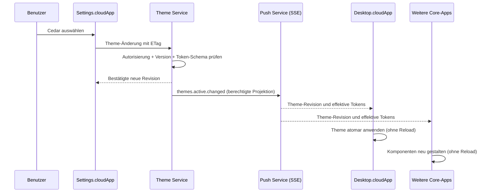
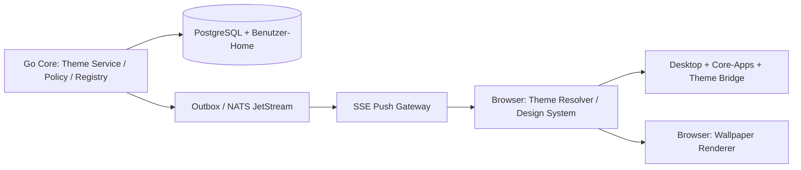

# cloudOS – Betriebssystem-inspirierte Themes und systemweites Designsystem

> **Datei:** `docs/THEMING.md`  
> **Dokumentversion:** 0.1 – fachlich führendes Konzept für die Theme-Presets von cloudOS v0.13  
> **Stand:** 15.11.2026  
> **Status:** Konzept und verbindliches Zielbild; keine Produktimplementierung  
> **Basis:** `Drezael/cloudOS`, Branch `main`, Commit `0e375a92dbc7feb57d78542bbc54d07db307c844`  
> **Weitere Grundlagen:** [SYSTEM_ARCHITECTURE.md](SYSTEM_ARCHITECTURE.md), [WINDOW_FRAMEWORK.md](WINDOW_FRAMEWORK.md), [DESKTOP_ENVIRONMENT.md](DESKTOP_ENVIRONMENT.md), [APPLICATION_SYSTEM.md](APPLICATION_SYSTEM.md), [VIRTUAL_FILESYSTEM.md](VIRTUAL_FILESYSTEM.md), [APP_API_ACCESS.md](APP_API_ACCESS.md), [PUSH_REALTIME.md](PUSH_REALTIME.md), [WALLPAPER_ENGINE.md](WALLPAPER_ENGINE.md).

## 1. Zielbild

cloudOS soll sich mit wenigen Handgriffen wie unterschiedliche vertraute Desktop-Betriebssysteme anfühlen, ohne deren Markenidentitäten, geschützte Grafiken oder Quellcode zu übernehmen. Für den Beginn werden **sechs systemeigene Themes** konzipiert, die sich an modernen und klassischen Desktop-Paradigmen orientieren. Der Benutzer kann sie über `Settings.cloudApp` auswählen, vorab anzeigen und ohne Neuladen wechseln.

Jede einzelne **cloudOS-eigene** visuelle Oberfläche muss das zentrale Theme-System verwenden: Desktop, Fenster, Taskleiste, Startmenü, Dateimanager, Settings, Apps-Verwaltung, App Store, Sharing, Spaces, Kontoverwaltung, Logs, Systemdialoge und Benachrichtigungen. Die eigenständigen `.cloudApp`-Pakete bleiben technisch separat; sie erhalten dieselbe verifizierte Theme-Projektion.

Die Themenauswahl und Wallpaper-Auswahl sind **zwei getrennte Einstellungen**. Ein Theme besitzt einen empfohlenen Standardhintergrund, darf ein bewusst ausgewähltes Wallpaper aber niemals ungefragt ersetzen.

## 2. Verbindliche Regeln

1. Die Go-Core-Dienste stellen Theme-Registry, Berechtigungen, Policy, Versionsbindung und Asset-Auslieferung bereit. Sichtbare Funktionen sind weiterhin installierte `.cloudApp`-Anwendungen.
2. Der **Theme Service** bleibt die einzige fachliche Autorität für erlaubte Theme-Pakete und den aufgelösten, wirksamen Theme-Zustand; es entsteht kein zweiter Theme Service in Settings oder Desktop.
3. Das cloudOS Design System stellt zentrale, versionierte Tokens, geprüfte Layoutvarianten, Slots, Assets, Zustände und Barrierefreiheit bereit. Ein Theme tauscht nur **Darstellung**, niemals Authentifizierung, Datenzugriff, API-Rechte oder App-Identität.
4. Der Fensterrahmen jeder App wird ausschließlich vom cloudOS Window Framework dargestellt. Ein Theme kann seine Gestaltung, Schaltflächenposition oder Abstände ändern, aber das Framework nicht ersetzen.
5. Die Taskleiste lässt sich in **jedem** Theme an alle vier Ränder verschieben: `top`, `bottom`, `left`, `right`. Die Benutzerposition in `/.taskbar.json` hat Vorrang vor dem Theme-Preset.
6. Der **Startbutton und das Startmenü** bleiben in sämtlichen Themes verfügbar. Ein macOS- oder GNOME-inspiriertes Theme darf andere Optik und Anordnung bieten, jedoch keine benötigten Funktionen entfernen.
7. Apps, die der Benutzer nicht verwenden darf, bleiben auch bei Theme-Wechsel im Startmenü, Dock, Taskleistenvorschlägen und Launcher unsichtbar.
8. Live-Wechsel werden per SSE-Push für andere autorisierte Sitzungen desselben Benutzers synchronisiert, ohne Client-Polling oder kompletten Seiten-Reload.
9. System- und Sicherheitsdialoge bleiben eindeutig als cloudOS-Systemdialoge erkennbar und für Theme-Pakete nicht mit beliebigen Texten oder irreführenden Bestätigungsschaltflächen ersetzbar.
10. Nicht unterstützte, beschädigte oder zurückgezogene Themes lösen einen sicheren Rückfall auf das integrierte, gut lesbare Standard-Theme aus.
11. Alle sechs Presets gehören zur **signierten Release-Baseline**, nicht zu externen App-Store-Katalogen. Für die erste Version ist keine Installation externer Theme-Pakete erforderlich.
12. Die Entwicklung bleibt bis zur gesonderten Freigabe reine **Konzeption**; sämtliche unten gezeigten JSON-Werte, IDs und Pfade sind Zielverträge, keine bereits existierenden Laufzeitdateien.

## 3. Die sechs integrierten Themes

| ID | Name | Gestalterische Referenz | Schwerpunkt | Empfohlenes Wallpaper |
|---|---|---|---|---|
| `io.cloudos.theme.northstar` | **Northstar** | Windows-11-ähnliche Desktopgestaltung | Abgerundete Fenster, durchscheinende Oberflächen, zentrierbare Taskbar-Icons, kompaktes Startpanel | `milky-way` |
| `io.cloudos.theme.cedar` | **Cedar** | Linux Mint / Cinnamon | Klassischer Startbutton, Kategorienmenü, dichte Taskbar, klare grüne Akzente | `coastal-landscape` |
| `io.cloudos.theme.coast` | **Coast** | macOS | Zurückhaltende Toolbar, Dock-ähnliches Panel, linke Fensterknöpfe, hochwertige transparente Oberflächen | `waves` |
| `io.cloudos.theme.prism` | **Prism** | KDE Plasma | Modular wirkende Panels, optional schwebende Taskbar, detailreich konfigurierbare Oberflächen, klare blaue Akzente | `hexells` |
| `io.cloudos.theme.slate` | **Slate** | GNOME / Adwaita | Ruhiges, großzügiges Design, eindeutige Navigation, starke Tastaturbedienbarkeit | `coastal-landscape` |
| `io.cloudos.theme.retroglass` | **RetroGlass** | Windows 7 Aero | Glasartige Fensterränder, deutlich sichtbare Fensterschatten, traditionelle Startmenüstruktur | `matrix-2d` |

**Lizenz- und Markenregel:** Windows, macOS, Linux Mint, KDE und GNOME sind hier **nur Inspirationsquellen**. cloudOS übernimmt weder Markenlogos noch proprietäre Icons, originalgetreue Screenshots, Schriftdateien, geschützte Hintergrundbilder, UI-Assets oder geschützten Programmcode. Alle ausgelieferten Assets sind eigenständig erstellt oder nachweislich geeignet lizenziert. Namen und Details der fertigen cloudOS-Themes sind unabhängig.

### 3.1 Northstar – modern und reduziert

- Standard: Taskleiste unten, Icons zentriert (die Starttaste bleibt erreichbar); alternative linke Ausrichtung per Nutzereinstellung.
- Schmale, leicht transparente Taskbar; abgerundete Fenster mit subtilen Schatten; ausgewogene Abstände.
- Startmenü als schwebendes, durchsuchbares Panel mit angehefteten und zuletzt benutzten, **autorisierten** Apps.
- Fensterknöpfe rechts; aktive Fenster durch Akzent und Rahmen erkennbar; Snap-Layouts als Framework-Funktion.
- Helle und dunkle Varianten; dezente Animationen mit Reduced-Motion-Alternative.
- An jedem Bildschirmrand wird das Panel responsiv angepasst; die Taskbar ist **nicht** auf unten beschränkt.

### 3.2 Cedar – klassischer Linux-Desktop

- Standard: Taskleiste unten, Startbutton links, gruppierte offene Fenster und Tray rechts.
- Kategorienorientiertes Startmenü mit Suche und Favoriten; gut erkennbare App-Namen.
- Weniger Transparenz, kompakte Controls, klare Rahmen und grüne Akzentfarbe.
- Tastaturbedienung, klassische Kontextmenüs und Mehrfachfenster priorisiert.
- Auch links/rechts platzierte Taskleisten zeigen Startbutton, laufende Apps, Uhr und Benachrichtigungen funktionsfähig an.

### 3.3 Coast – Dock und ruhige Fensteroptik

- Standard: Dock-ähnliche Taskleiste unten mit größeren Icons, Trennmarkern und App-Indikatoren.
- Fenster-Aktionsknöpfe links, getrennt von der Titelzeile/Toolbar; alternative Anordnung für Barrierefreiheit möglich.
- Helle Oberflächen, kontrollierte Transparenz und großzügige Weißräume; kein Nachbau einer globalen macOS-Menüleiste als Pflicht.
- Startbutton ist als eindeutig sichtbare Launcher-Aktion im Dock eingebunden, unabhängig von dessen Position.
- Ein vertikales Dock links oder rechts verwendet sinnvolle Icongrößen und Overflow-Verhalten, nicht abgeschnittene horizontale Layouts.

### 3.4 Prism – konfigurierbares Panel-Paradigma

- Standard: Taskleiste unten, optional „floating panel“ mit Abstand zum Rand.
- Klare, blaue Akzente, komponentenorientierte Controls und definierte Fensterdekoration.
- Konfigurierbares Widget-/Slot-Raster innerhalb des geprüften cloudOS-Designsystems – nicht beliebige Erweiterung durch Skripte.
- Menü kann zwischen Kacheln und Kategorien wechseln. System- und Sicherheitsaktionen bleiben semantisch identisch.
- Vertikale Panels und mehrere Fenstergruppen müssen vollwertig unterstützt werden.

### 3.5 Slate – minimalistische Bedienoberfläche

- Standard: kompakteres oberes Panel oder Taskleiste unten; Benutzerentscheidung hat Vorrang.
- Suche und Startmenü sind zentral, aber Startbutton und sichtbare laufende Apps bleiben zugänglich.
- Große, eindeutige Eingabefelder, klare Hierarchie und hoher Fokuskontrast.
- Wenige dekorative Schatten, reduzierte Bewegung und ressourcenschonende Übergänge.
- Funktioniert besonders gut mit Tastatur, Screenreader und Vergrößerung.

### 3.6 RetroGlass – klassischer Desktop

- Standard: Taskleiste unten mit Startbutton links, App-Gruppen und klassischer Statusregion.
- Glasartige Titelzeilen und transparente Ränder nur soweit Kontrast und Lesbarkeit erhalten bleiben.
- Zweispaltiges Startmenü: Anwendungen und erlaubte Systemaktionen; keine nicht autorisierten Einträge.
- Deutliche Fenster- und Taskleisten-Highlights, klassische Symbole aus **eigenen** Assets.
- Reduced Transparency entfernt Glas-/Blur-Effekte vollständig und erhält die Bedienbarkeit.

## 4. Theme-Preset versus Benutzereinstellung

Ein Theme definiert Vorschläge; die persönliche Konfiguration bestimmt das wirksame Verhalten. Verbindliche Priorität (höchste zuerst):

1. Sicherheit, Barrierefreiheit und administrativ gesetzte Policy-Grenzen.
2. Explizite Benutzerwahl: Taskleistenposition, Icon-Ausrichtung, Fensterverhalten, Theme-Variante, Wallpaper und reduzierte Bewegung.
3. Theme-Preset für **nicht** vom Benutzer übersteuerte Eigenschaften.
4. Versionierte Defaults des cloudOS Design Systems.
5. Sichere Fallbackwerte.

Das System unterscheidet `unset` (Preset verwenden) von `explicit` (Benutzerwahl behalten). Ein Wechsel von Northstar zu Coast darf daher eine zuvor rechts positionierte Taskleiste nicht wieder nach unten verschieben.

| Einstellung | Persistenz/Owner | Regeln |
|---|---|---|
| Theme-ID, Variante und erlaubte persönliche Overrides | Theme Service; persönliches Home-Backing `/.config/cloudos/appearance.json` | Nur selbst berechtigter Benutzer oder Administrator nach Policy; Core validiert |
| Taskleistenposition, Pins, Gruppierung | File Service `/.taskbar.json` | Niemals vom Theme überschreiben |
| Desktop-Inhalt | File Service `/.desktop/` | Theme ersetzt keine Dateien oder Shortcuts |
| Icon-Positionen | File Service `/.desktop-layout.json` | Über Theme-Wechsel unverändert |
| Wallpaper-ID, Typ, Parameter | Wallpaper-Teilmodell des Theme Service; `/.config/cloudos/appearance.json` | Vom Theme unabhängig, außer wenn `wallpaper.selection=inherit` |
| Systemweit zugelassene Themes | Theme Service Registry/Policy | Nur Admin-/Release-Verfahren |

**Keine zwei Wahrheiten:** Die Home-Datei ist das autorisierte Speicher-Backing für persönliche Einstellungen; der Theme Service validiert und publiziert daraus die wirksame Projektion samt Revision. Caches in Settings, Desktop und Browser sind nicht autoritativ. Wenn sich die Datei über einen anderen autorisierten Pfad ändert, erfolgt die Validierung durch den Theme Service und eine Push-Projektion; fehlerhafte Inhalte werden nicht ungeprüft aktiviert.

## 5. Ordner und Ressourcen im Zwei-Volume-VFS

```text
system:/
  themes/
    builtin/
      northstar/
      cedar/
      coast/
      prism/
      slate/
      retroglass/
    assets/
      shared/
      wallpapers/
users:/
  homes/<user-uuid>/
    .config/cloudos/appearance.json
    .taskbar.json
    .desktop-layout.json
    .desktop/
    Pictures/Wallpapers/      # optionale eigene Bilder/Videos
```

Die physische Ordnerstruktur ist nicht zwingend mit den logischen VFS-Nodes identisch. Das Systemlaufwerk bleibt normalen Benutzern verborgen; Theme-Assets werden **nur** über explizit berechtigte Asset-Endpunkte ausgeliefert. Eigene Bilder/Videos stammen aus dem persönlichen Home und werden über sichere VFS-Handles referenziert.

## 6. Theme-Datenvertrag (Entwurf)

```json
{
  "schema_version": "1.0",
  "theme_id": "io.cloudos.theme.cedar",
  "version": "1.0.0",
  "name": "Cedar",
  "reference_style": "classic-desktop",
  "token_schema_version": "1.0",
  "variants": ["light", "dark", "high-contrast"],
  "defaults": {
    "taskbar": { "position": "bottom", "alignment": "start", "layout": "classic-panel" },
    "window_chrome": "classic",
    "start_menu": "categories",
    "recommended_wallpaper": "coastal-landscape"
  },
  "assets": { "icons": "icons/cedar.svg", "wallpaper_fallback": "wallpapers/cedar-fallback.webp" }
}
```

- Felder sind Zielverträge und vor endgültiger Umsetzung mit einem maschinenlesbaren JSON-Schema zu fixieren.
- Alle externen Zeichenketten werden validiert; keine Theme-Manifeste dürfen JavaScript, HTML, CSS `@import`, `url(javascript:...)`, externe Tracking-Pixel, freie Netzwerkhosts oder Sandbox-Bypässe einbringen.
- Zulässig sind geprüfte Farben, Maße, Variants, referenzierte Assets und whitelisted Tokens. CSS Custom Properties sind **Renderausgabe**, nicht ein frei durch Benutzer hochgeladenes Stylesheet.
- Theme-Assets erhalten Digests, Größenlimits, MIME-Sniffing und signierte Freigabe. SVG muss desinfiziert oder in sichere Bilder gerendert werden.

## 7. Semantische Token-Bereiche

| Bereich | Beispielhafte Token-IDs | Theme-Wirkung |
|---|---|---|
| Farben | `color.surface`, `color.text`, `color.accent`, `color.focus`, `color.warning` | Palette, Kontrast, Zustandsfarben |
| Schrift | `font.ui.family`, `font.ui.size`, `font.monospace` | Lizenziert bereitgestellte Fonts oder sichere System-Fallbacks |
| Größe/Dichte | `density.default`, `space.*`, `control.height`, `icon.size` | Kompakt bis großzügig |
| Fenster | `window.chrome`, `window.radius`, `window.border`, `window.shadow`, `window.buttons.position` | Rahmen, Dekoration, Knöpfe |
| Taskleiste | `taskbar.layout`, `taskbar.height`, `taskbar.icon.style`, `taskbar.transparency` | Panel, Dock oder klassisch |
| Launcher | `startmenu.layout`, `startmenu.width`, `startmenu.groups` | Kategorien, Raster oder schwebendes Panel |
| Systemdialoge | `dialog.surface`, `dialog.focus`, `dialog.danger` | Konsistente Bestätigungen und Fehlermeldungen |
| Assets | `icons.pack`, `cursor.theme`, `wallpaper.recommended` | Eigene Symbol- und Hintergrundsets |
| Bewegung | `motion.duration`, `motion.easing`, `motion.reduce` | Theme-Übergänge und Zurückhaltung |
| Transparenz | `blur.enabled`, `transparency.surface` | Glas-/Acryloptik mit barrierefreiem Fallback |

Ein Theme darf **nicht** die Namen oder Bedeutung von API-Rechten ändern, Berechtigungen verbergen, einen echten Sicherheitsdialog als harmloses Fenster erscheinen lassen oder für kritische Zustände Kontrast-/Fokusindikatoren abschalten.

## 8. Komponentenabdeckung und Vollständigkeit

**Jeder** neue sichtbare Core-Baustein wird anhand einer Abdeckungsmatrix geprüft:

| Gruppe | Pflichtkomponenten |
|---|---|
| Desktop | Icons, Auswahl, Drag-Ghost, Hintergrund, Desktop-Kontextmenü, Tooltip |
| Fenster | Titelleiste, Buttons, Resize, Snap-Vorschau, aktiv/inaktiv, Fenstervorschau |
| Taskleiste | Startbutton, App-Buttons, Badge, Fokus-Indikator, Tray, Uhr, Kontextmenü |
| Startmenü | Suche, Kategorien, Gruppen, Suchtreffer, Favoriten, Trennlinien |
| Dateimanager | Baum, List- und Rasteransicht, Breadcrumb, Toolbar, Fortschritt |
| Settings | Sidebar, Formular, Eingabevalidierung, Auswahl, Theme-Vorschau |
| Apps/Store | Paketliste, Reviewstatus, Rechte-Vorschau, Trust-/Risikoanzeige |
| Benutzer/Sicherheit | Login, Passkey-Dialog, Konto, Gruppe, Rechte, Gerätefreigabe |
| Sharing/Spaces | Mitgliederliste, Freigaberollen, Berechtigungsdialog, Dateien |
| Logs/Benachrichtigungen | Tabellen, Filter, Severity, Toast, Notification Center |
| Framework | Systemdialogs, File Picker, Permission Prompt, Error/Loading, Recovery |

**Externe Anwendungen:** Der vom Core gezeichnete Fensterrahmen wird immer angepasst. Ihre interne UI übernimmt Theme-Tokens nur bei expliziter SDK-/Theme-Bridge-Integration. Insbesondere Rust-WASM-Apps mit eigenem Canvas werden nicht zwangsweise durch CSS verändert. Fehlende Integration darf keinen Sicherheits- oder Darstellungsfehler verursachen.

## 9. Fenster- und Taskleistenverhalten

- Alle sechs Theme-Presets verwenden dieselben `window_id`, `app_instance_id`, Zustandsregeln und UI-Aktionen des `WINDOW_FRAMEWORK.md`.
- Minimieren, Wiederherstellen, Maximieren, Verschieben, Snap, Fokus, mehrere Fenster und „App beenden“ im Taskleisten-Kontextmenü sind identisch funktionsfähig.
- Ein Dock-Layout darf ein gruppiertes App-Icon zeigen; der Rechtsklick zeigt dann weiterhin einzelne Fenster und die Aktion **„App beenden“**.
- Mit `left`/`right` wird die Taskbar vertikal. Overflow und mehrzeilige App-Namen werden berücksichtigt; Startbutton und Systemstatus bleiben erreichbar.
- Das Startmenü zeigt ausschließlich vom Go-App-Service für diesen Benutzer freigegebene installierte Apps. `themes.active.changed` ändert nur die Darstellung; `apps.assignment.changed` aktualisiert die tatsächliche Liste über Push.
- Die Zeilen/Spalten einer Anwendungsoberfläche werden nicht durch ein Wallpaper oder durch Window-Chrome-Optik geändert, wenn dies die Funktionstüchtigkeit gefährdet.

## 10. Einstellungen über die Core-Apps

**Settings → Personalisierung → Designs:** Theme-Karten mit Name, Beschreibung, hellem/dunklem Vorschaubild, Farbakzenten und Hinweis auf reduzierte Bewegung. Vorschau darf abgebrochen werden; automatische Rücknahme nach Zeitüberschreitung erfolgt nur, wenn Benutzer dies als Preview startet. „Anwenden“ speichert die explizite Auswahl.

**Settings → Personalisierung → Hintergrund:** Dynamische Presets, statische Bilder, lokale Videos, Bildergalerien sowie Geschwindigkeit, Qualität, Lautlosigkeit, Parallax, Bewegungsreduktion und Fallback. Siehe [`WALLPAPER_ENGINE.md`](WALLPAPER_ENGINE.md).

**Settings → Taskleiste:** Position, Größe, Icon-Ausrichtung, automatisches Ausblenden, App-Gruppierung und Pins bleiben ausschließlich durch die Settings-App bzw. die dafür vorgesehene Taskleisten-Policy verwaltet. Diese Einstellungen müssen im persönlichen `/.taskbar.json` gespeichert werden und bleiben von Theme-Preset-Wechseln unberührt.

## 11. Aktualisierung ohne Reload



Der Push-Kanal liefert die effektive, autorisierte Darstellung oder unveränderliche versionierte Asset-Referenzen. Der Client **pollt nicht**. Ein Initial-Snapshot nach Login, gezielter Asset-Download bei Paketwechsel und Recovery-Snapshot bei Replay-Lücke sind zulässig. Sie ersetzen keinen regelmäßigen Client-Poll.

## 12. Architektur und Deployment



Der Theme Service wird als eigenständiges Go-Fachmodul konzipiert, das anfangs im **gemeinsamen Core-Container** läuft. Für spätere getrennte Kubernetes-Deployments werden identische Verträge, versionierte Registry, zentraler persistenter Zustand, Replikation und Push-Revisionen verwendet. Es sind **keine** dauerhaft nur lokal in einem Pod gespeicherten Theme-Einstellungen erlaubt.

## 13. Benutzerkonfigurationsdatei (Entwurf)

Die persönliche Datei liegt unter `/.config/cloudos/appearance.json` im sichtbaren Benutzer-Home; sie wird mit `0600` angelegt. Der Dateiname ist eine neue konzeptionelle Vereinbarung, keine bereits auf GitHub vorhandene Runtime-Datei.

```json
{
  "schema_version": "1.0",
  "revision": 7,
  "theme": {
    "id": "io.cloudos.theme.cedar",
    "variant": "dark",
    "selection": "explicit",
    "overrides": { "accent": "#5E9D62", "density": "compact" }
  },
  "wallpaper": {
    "selection": "explicit",
    "type": "animated",
    "id": "milky-way",
    "quality": "auto",
    "speed": 0.6,
    "parallax": false
  },
  "accessibility": {
    "reduced_motion": "system",
    "high_contrast": "system",
    "reduced_transparency": "system"
  }
}
```

- Nicht jeder Benutzer darf alle Tokens frei verändern; zulässige Overrides werden vom Theme Service geprüft.
- `revision` bzw. ETag verhindert das unbemerkte Überschreiben paralleler Änderungen. Ungültige JSON-Inhalte oder nicht erlaubte Theme-IDs führen zum validierten letzten Zustand/Fallback, nicht zu einer ungeschützten Aktivierung.
- `wallpaper.selection=inherit` erlaubt das vorgeschlagene Wallpaper eines Themes. `explicit` schützt die Benutzerwahl selbst bei einem Theme-Wechsel.
- Die persönlichen Wallpaper-Einstellungen werden detailliert in `WALLPAPER_ENGINE.md` beschrieben. Für Einstellungen, die bereits vom Settings-/Theme-Service in einer Datenbank als Cache gehalten werden, darf daraus keine zweite Schreibautorität entstehen.

## 14. Erweiterbarkeit und Vertrauenskette

Für den MVP sind sechs fest eingebaute, signierte Themes vorgesehen. Später können weitere **datenbasierte** Theme-Pakete bereitgestellt werden, jedoch nur nach Prüfung, Authentizität, Größen-/Inhaltstests und administrativer Freigabe. Sie dürfen keine frei ausgeführten Skripte enthalten.

Ein künftiges `.cloudApp`-Paket, das ein Theme als Ressourcenanteil mitbringt, durchläuft **denselben** regulären `Apps.cloudApp`-Installationsweg, Signaturprüfung und die zentralen API-Berechtigungen; es entsteht keine Rechtsklick-Installation oder privilegierte Nebentür. Die App-Pakete bleiben unter `system:/apps/`; der Theme Service referenziert ihre geprüften Assets über eine kontrollierte Registry. Freigegebene reine Systemthemes können unter `system:/themes/` liegen.

„Theme downloaden“ ist keine Ausführungserlaubnis. „App darf eigenes internes Theme anzeigen“ ist keine Erlaubnis, Desktop, Systemdialoge oder andere Apps global zu verändern.

## 15. Sicherheit und Datenschutz

- Die Themes dürfen keine API-/Session-Tokens oder vertraulichen Benutzerdaten als Asset-Parameter erhalten.
- CSS-/SVG-/Font-Assets werden vor Auslieferung auf sichere Typen und exakte Digests geprüft; Remote-Fonts und externe HTTP-Ressourcen sind standardmäßig verboten.
- Benutzer dürfen nur administrativ erlaubte Theme-Pakete verwenden.
- Berechtigungs- und Sicherheitsdialoge behalten klar definierte Warnfarben, Focus-Reihenfolge und vertrauenswürdige Herkunft.
- Ein Theme-Wechsel darf weder einen fremden Home-Mount öffnen noch Dateirechte, Space-Mitgliedschaften, App-Sichtbarkeit oder Gerätegrants verändern.
- Die Auditspur erfasst administrative Theme-Freigaben und Sicherheitsfehler; normale Benutzer-Theme-Wechsel sind als datensparsame Zustandsereignisse zu behandeln.
- System-Dark-Mode, reduzierte Bewegung, erhöhten Kontrast und reduzierte Transparenz berücksichtigt cloudOS, ohne aus diesen Einstellungen auf vertrauliche Eigenschaften zu schließen.

## 16. Barrierefreiheit und Performance

- Für alle Themes: WCAG-orientierter Fokuskontrast, vollständig per Tastatur bedienbare Menüs, zugängliche Fenstertitel, aussagekräftige Labels, durch Screenreader erreichbare Statusmeldungen.
- `prefers-reduced-motion` und `prefers-contrast` bzw. explizite Benutzeroptionen beeinflussen die resultierenden Tokens.
- Ein hochtransparentes Theme wird bei `reduced_transparency` und hohem Kontrast solide; kritische Textflächen bleiben stets lesbar.
- Ein langsamer Client soll nie wegen aktiver Glas-/Blur-Effekte unbenutzbar werden: stufenweiser Qualitätsabfall und schnelle Deaktivierung sind verpflichtend.
- Wallpaper-Animation und Fenstereffekte müssen getrennte Performance-Budgets haben. Ein im Hintergrund laufendes Wallpaper darf Fokus, Dragging oder Texteingabe nicht ausbremsen.

## 17. Technische APIs und Ereignisse – Vertragsentwürfe

| Vorgeschlagene Operation | Richtung | Zweck | Sicherheit |
|---|---|---|---|
| `themes.catalog.list` | GET | Nur freigegebene Theme-Presets | Angemeldeter Benutzer |
| `themes.active.read` | GET | Effektiven Theme-Snapshot lesen | Eigener Benutzerkontext |
| `themes.active.update` | PATCH | Theme und Variante ändern | Benutzerrecht + ETag + Policy |
| `themes.preview.resolve` | POST | Temporäre geprüfte Vorschau | Nur eigene Sitzung, kein globaler Grant |
| `themes.assets.read` | GET | Versionierte Theme-Assets | Nur freigegebene Asset-Referenzen |
| `wallpapers.catalog.list` | GET | Verfügbare Hintergrund-Presets | Angemeldeter Benutzer |
| `wallpapers.preference.update` | PATCH | Eigenes Wallpaper ändern | Eigener Benutzerkontext + ETag |

Alle Operationskennungen sind **Beispiele**, noch kein implementierter OpenAPI-Vertrag. `Desktop.cloudApp`, `Settings.cloudApp` und weitere Core-Apps deklarieren alle benötigten Operationen in ihrer signierten `permissions/api-access.json`; keine Theme-Funktion ist von der App-Allowlist ausgenommen.

**Ereignisse:** `themes.active.changed`, `themes.registry.changed`, `wallpapers.preference.changed`, `wallpapers.catalog.changed` (nur berechtigte Empfänger; vollständige oder minimal nötige effektive Zustandsprojektion). Änderungen werden einmalig serverseitig gepusht und ggf. nach Reconnect replayed, siehe `PUSH_REALTIME.md`.

## 18. Implementierungsplan für die spätere Entwicklungsphase (nur Konzept)

1. Theme-Token-Registry, Schema und Komponenteninventar spezifizieren.
2. Sichere Primitive-Token-/Komponentenzuordnung samt High-Contrast-Fallback festlegen.
3. Theme Service und Asset-Registry im Combined-Go-Core entwerfen.
4. `Settings.cloudApp` für Katalog, Vorschau und wirksame Präferenzen planen.
5. Sechs signierte Original-Presets mit eigenständigen Assets konzipieren und Lizenzen prüfen.
6. Desktop-/Window-/Taskbar-/Startmenü-Komponenten in allen sechs Presets abnehmen.
7. Theme Bridge für Standard-Core-Apps und optionale Rust-WASM-Adapter festlegen.
8. Wallpaper Engine gemäß `WALLPAPER_ENGINE.md` integrieren.
9. SSE-Push, parallele Tabs, Reconnect und Recovery spezifizieren.
10. Barrierefreiheit, Performanceprofile und alle Testfälle durchspielen.

**Diese Reihenfolge ist ein Entwicklungsplan. Es werden in dieser Konzeptphase keinerlei Go-/Docker-/Kubernetes-/Frontend-Dateien implementiert.**

## 19. Abnahmetests (Konzept)

| Test-ID | Erwartung |
|---|---|
| THP-01 | Alle sechs integrierten Themes erscheinen in Settings → Personalisierung. |
| THP-02 | Jedes Theme verwendet ausschließlich eigene/lizenzierte Assets. |
| THP-03 | Northstar und Cedar unterscheiden sich in Startmenü, Taskbar und Fenster-Chrome. |
| THP-04 | Coast zeigt links positionierte Window-Buttons, ohne „Fenster schließen“ zu verlieren. |
| THP-05 | Prism stellt eine geprüfte Panel-Variante dar, ohne Skriptausführung. |
| THP-06 | Slate bleibt tastatur- und screenreadertauglich. |
| THP-07 | RetroGlass fällt bei reduzierter Transparenz auf ein lesbares Design zurück. |
| THP-08 | Für jedes Theme funktionieren Taskbar `top`, `bottom`, `left`, `right`. |
| THP-09 | Ein Benutzer mit rechter Taskbar behält diese nach jedem Theme-Wechsel. |
| THP-10 | Startbutton und Startmenü bleiben in allen Themes nutzbar. |
| THP-11 | Rechtsklick auf Taskbar-App zeigt „Fenster schließen“ / „App beenden“ weiterhin. |
| THP-12 | Nicht zugewiesene Apps erscheinen in keinem Theme im Startmenü. |
| THP-13 | Sichere App-Permission-Dialoge bleiben erkennbar und zugänglich. |
| THP-14 | Theme-Wechsel ändert keine Apps, API-Grants, Datei-ACLs oder Space-Mitgliedschaften. |
| THP-15 | Ein gesetztes Wallpaper bleibt über Theme-Wechsel hinweg erhalten. |
| THP-16 | Ohne eigene Wallpaperwahl nutzt das Theme das empfohlene Preset. |
| THP-17 | Theme-Wechsel verteilt sich per SSE ohne Client-Polling auf zwei Tabs. |
| THP-18 | Gültige Push-Replays erhalten den zuletzt freigegebenen Theme-Zustand. |
| THP-19 | Kaputtes Theme erzeugt lesbares, integriertes Fallback. |
| THP-20 | Theme-Service-Ausfall sperrt weder Login noch Dateizugriff. |
| THP-21 | Fremde Web-/WASM-App behält ihre interne Darstellung ohne Theme-Bridge. |
| THP-22 | Fensterrahmen einer Fremd-App folgt trotzdem dem cloudOS Theme. |
| THP-23 | Externe SVG-/Font-/CSS-Referenzen laden keine Tracking-Hosts. |
| THP-24 | Theme kann System-Sicherheitswarnung nicht verschleiern. |
| THP-25 | Alle Core-Apps bestehen die Komponentenabdeckungsmatrix. |
| THP-26 | Erhöhte Textskalierung zerstört keine vertikale Taskbar. |
| THP-27 | Admin-Policy begrenzt erlaubte Themen und Overrides. |
| THP-28 | Kein Nutzer kann `system:/themes` durchsuchen, nur Assets autorisiert abrufen. |
| THP-29 | `/.desktop/`-Inhalte bleiben bei allen Theme-Wechseln unverändert. |
| THP-30 | Ungültige `appearance.json` erhält funktionsfähigen Default, ohne fremde Daten. |

## 20. Geplante ADRs und offene Fragen

- **ADR-119:** Sechs integrierte OS-inspirierte, eigenständige Theme-Presets.
- **ADR-120:** Benutzer-Overrides haben Vorrang vor Theme-Defaults, insbesondere Taskbar und Wallpaper.
- **ADR-121:** Theme Service bleibt fachlich führend; Browser löst kontrollierte Tokens auf.
- **ADR-122:** Theme-Asset-Sandbox und sichere Paketfreigabe.
- **ADR-123:** Barrierefreiheit und Systemdialog-Schutz gelten für alle Themes.
- **ADR-124:** Live-Theming via autorisiertem SSE-Push.

Die ADR-Nummern sind **vorgeschlagen** und vor endgültiger Nummernvergabe mit dem Repository abzugleichen. Frühere Theme-ADRs 023/024 bleiben erhalten; dieses Dokument erweitert sie, statt ihre Aussagen zurückzunehmen.

## 21. Begrenzung und Dokumenthoheit

Dieses Dokument ist fachlich führend für die sechs integrierten OS-inspirierten Themes, ihre Varianten, Tokens und Benutzerpräferenzen. Die Render-/Leistungsspezifikation animierter Hintergründe steht in [`WALLPAPER_ENGINE.md`](WALLPAPER_ENGINE.md). Die allgemeine Theme-Service-Architektur bleibt in `SYSTEM_ARCHITECTURE.md`, das Fensterverhalten in `WINDOW_FRAMEWORK.md`, Desktop-Dateien und Taskbar-Persistenz in `DESKTOP_ENVIRONMENT.md`, der Push-Kanal in `PUSH_REALTIME.md` und die VFS-Zugriffe in `VIRTUAL_FILESYSTEM.md` definiert.
