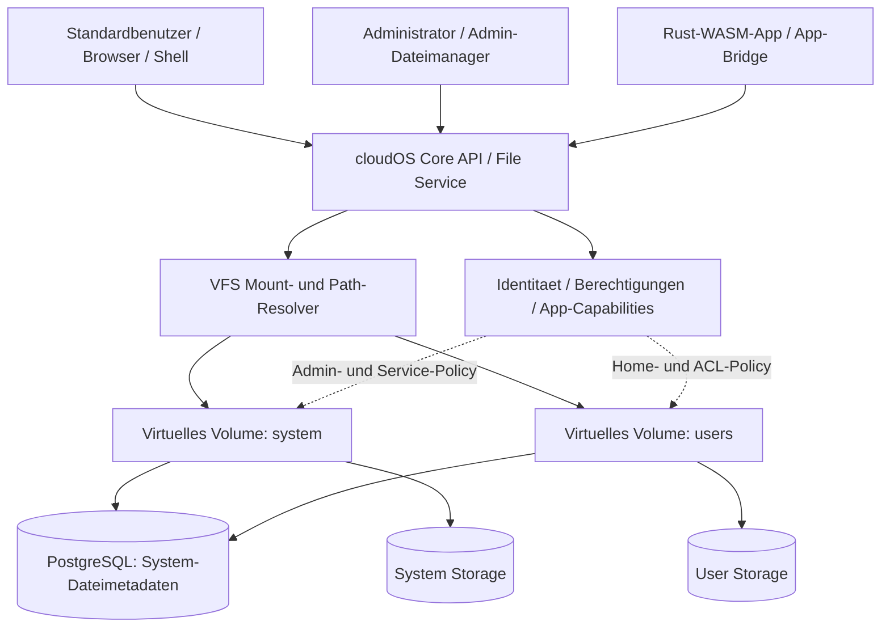
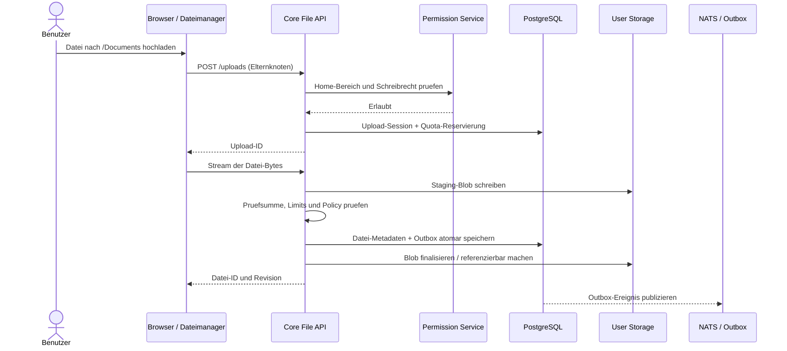
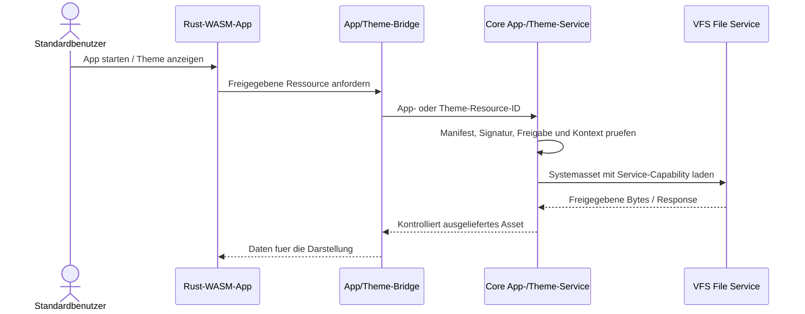

# cloudOS - Architektur des virtuellen Dateisystems (VFS)

> **Repository:** [Drezael/cloudOS](https://github.com/Drezael/cloudOS)  
> **Zielpfad:** `docs/VIRTUAL_FILESYSTEM.md`  
> **Dokumentversion:** 0.3 (X.509-Signing und Self-signed-Freigabe fuer App-Installationen)  
> **Stand:** 15.11.2026  
> **Geprüfte Grundlage:** `main`, Commit `efa3c237d07f6acf0b0358f999e3bfe76b21b116`  
> **Referenzen:** `docs/CONCEPT.md`, `docs/SYSTEM_ARCHITECTURE.md` (v0.5) und `docs/APPLICATION_SYSTEM.md` (v0.2) und `docs/APP_SIGNING.md` (v0.1)  
> **Status:** Neue Anforderungen verbindlich; genaue Implementierungsdetails werden in Phase 0/6 entschieden.

## 1. Zweck und Zielbild

Dieses Dokument definiert das virtuelle Dateisystem von cloudOS als eigenständiges Teilkonzept des Go-basierten cloudOS Core. Es präzisiert das bisher in den übergeordneten Dokumenten allgemein beschriebene VFS.

Das Dateisystem besitzt **genau zwei logische virtuelle Festplatten**:

1. **Systemlaufwerk** (`system`): Enthält cloudOS-eigene Systemdaten, systemweit bereitgestellte Anwendungen, Themes, Ressourcen, Vorlagen und kontrollierte Systemkonfiguration. Das Laufwerk ist **ausschließlich für Administratoren sichtbar und auflistbar**. Verwaltungszugriffe erfordern separate Berechtigungen.
2. **Benutzerdatenlaufwerk** (`users`): Enthält die persönlichen Daten aller Benutzer und gegebenenfalls später explizit freigegebene Bereiche. **Das für jeden Benutzer sichtbare Root-Verzeichnis `/` ist genau sein eigenes Home-Verzeichnis** auf diesem Laufwerk.

Ein normaler Benutzer erhält weder eine Anzeige noch einen durchsuchbaren Pfad zum Systemlaufwerk. Er sieht auch nicht die Home-Verzeichnisse anderer Benutzer. Das Verbergen in der Oberfläche ist lediglich ein Komfortaspekt: Die eigentliche Trennung wird bei **jeder** serverseitigen Operation durchgesetzt.

**Wichtige Begriffsabgrenzung:** Eine virtuelle Festplatte ist hier eine logisch isolierte Speicher- und Namensraumdomäne. Zwei virtuelle Festplatten bedeuten **nicht zwingend zwei physische Datenträger**. Für eine physische Trennung können zwei separate Persistent Volumes, Dateisysteme oder Storage-Backends konfiguriert werden.

### 1.1 Verbindlich festgelegt

- Es existieren genau zwei VFS-Volumes: `system` und `users`.
- Der **File/VFS Service im cloudOS Core** ist die einzige fachlich zuständige Stelle für Dateiknoten, Pfadauflösung und Dateioperationen.
- Das Systemvolume ist **nur Administratoren als Laufwerk sichtbar**; seine Dateien sind nicht über allgemeine Benutzer-Datei-APIs auflistbar.
- Benutzer erhalten einen eigenen, stabilen Home-Root-Knoten im Benutzerdatenvolume.
- Für einen angemeldeten Benutzer wird `/` auf **genau diesen Home-Root** abgebildet.
- Pfade, Ressourcen-IDs und App-Handles dürfen keinen Zugriff auf andere Home-Verzeichnisse oder das Systemvolume ermöglichen.
- Browser, Dateimanager, Shell und Rust-/WASM-Anwendungen verwenden dieselben autorisierten Core-APIs.
- Das physische Storage-Layout ist nicht Bestandteil der öffentlichen Pfadsemantik.

### 1.2 Bewusst noch nicht festgelegt

- Ob beide Volumes auf zwei physisch getrennten Datenträgern liegen.
- Endgültige Quota-Werte und Aufbewahrungsfristen.
- Das finale Schema für Administrations- und Supportzugriffe auf fremde Home-Verzeichnisse.
- Die exakte Implementierung der Storage-Adapter und der App-Kompatibilitätsschicht.

## 2. Fachliche Begriffe

| Begriff | Definition |
|---|---|
| `Volume` | Einer der beiden logischen, dauerhaft konfigurierten VFS-Speicherbereiche. |
| `Volume Root` | Technischer oberster Knoten eines Volumes; für Benutzer nicht automatisch sichtbar. |
| `Home Root` | Root-Knoten eines einzelnen Benutzerkontos innerhalb des `users`-Volumes. |
| `Session Root` | Der Knoten, der für eine bestimmte Sitzung als `/` dargestellt wird. |
| `Mount View` | Die dem Akteur zugewiesene, autorisierte Sicht auf Volumes und Pfade. |
| `Node` | Datei-, Verzeichnis- oder später spezieller virtueller Knoten mit stabiler ID. |
| `Blob` | Unveränderlicher oder versionierter Dateiinhalt im darunterliegenden Storage. |
| `Capability` | Eng begrenzte Berechtigung für einen Akteur oder eine App-Instanz. |
| `System Principal` | Authentifizierte Identität eines cloudOS-Core-Dienstes, nicht identisch mit einer Administratorsitzung. |
| `File Handle` | Opaker, kurzlebiger Zugriffstitel für eine autorisierte Dateioperation. |

## 3. Logische Architektur



**Vertrauensgrenze:** Das Diagramm zeigt logische Beziehungen. Frontend und Anwendungen erhalten niemals direkte Datenbankzugriffe, Host-Pfade oder Storage-Credentials. Sie besitzen nur die erforderlichen API- und Capability-Rechte.

### 3.1 Zuständige Core-Dienste

| Core-Komponente | Verantwortung |
|---|---|
| Identity Service | Stabiler Benutzer-Identifikator; Lebenszyklus von Identitäten. |
| Permission Service | Rollen, Ressourcen-ACL, App-Capabilities, erhöhte Admin- und Supportrechte. |
| VFS/File Service | Volumes, Home-Roots, Knoten, Pfadauflösung, Dateioperationen, Quotas, Papierkorb. |
| Storage Adapter | Speicher der Datei-Bytes getrennt nach Volume und konfigurierter physischer Ablage. |
| App Service / Capability Broker | Datei-Dialoge, opake Handles, Zugriff im Kontext konkreter App-Instanzen. |
| Desktop Service | Darstellung der Laufwerke und des Benutzers als Home-Verzeichnis; keine eigene Datei-ACL. |
| Realtime Service | Autorisierte Dateiereignisse und Client-Resynchronisierung. |
| Audit Service | Nachweis von Admin-/Supportzugriffen sowie Änderungen am Systemvolume. |
| Search Service (später) | Suche nur innerhalb des vom File Service autorisierten Bereichs. |

**Eigentümerregel:** Kein anderer Core-Dienst schreibt direkt in Tabellen oder Blob-Verzeichnisse des File Service, auch dann nicht, wenn mehrere logische Dienste anfangs im selben Go-Prozess laufen.

## 4. Die zwei virtuellen Festplatten

### 4.1 Festplatte 1: `system` - cloudOS-Systemdaten

**Laufwerkskennung:** `system` (stabile technische ID)  
**Bezeichnung im Administrations-UI:** `cloudOS System`  
**Administrativer Pfadpräfix:** `system:/`  
**Sichtbarkeit:** ausschließlich Administratoren  
**Standardzugriff:** lesen, soweit die jeweilige Admin-Rolle dazu berechtigt ist; Schreiben separat geschützt

```text
system:/
|-- core/
|   |-- config/                  # Versionierte, nicht geheime Systemkonfiguration
|   |-- defaults/                # Systemweite Voreinstellungen
|   `-- policies/                # Nicht geheime Policy-/Regelressourcen
|-- applications/
|   |-- packages/                # Unveraenderliche, signierte installierte .cloudApp-Versionen
|   |-- manifests/               # Systemweite App-Manifeste
|   `-- assets/                  # Gemeinsame App-Ressourcen
|-- themes/
|   |-- builtin/                 # Integrierte Themes
|   `-- installed/               # Vom Admin freigegebene Themes
|-- desktop/
|   |-- icons/                   # Icons
|   |-- wallpapers/              # Standard-Hintergruende
|   `-- templates/               # Standard-Desktop-Vorlagen
|-- resources/                   # Weitere systemweite, verwaltete Assets
`-- updates/                     # Gepruefte Update-/Release-Metadaten
```

Die Struktur ist ein **logisches Zielbild**, keine zwingende Abbildung von Container- oder Linux-Pfaden.

Das Systemvolume darf weder Benutzer-Home-Daten noch ungeprüfte temporäre Uploads enthalten. Geheimnisse, private Schlüssel und Zugangstokens werden **nicht als durch Admin-Dateibrowsing lesbare Systemdateien** gespeichert; dafür ist ein separater Secret-Mechanismus vorgesehen. Systemlogs und Audit-Trails liegen in ihren fachlichen Datenhaltungen und müssen nicht als normale Systemdateien verfügbar sein.

Die aus Docker-Images geladenen Go-Binaries sind ebenfalls **nicht automatisch** Dateien im virtuellen Systemvolume. Das Volume enthält die durch das VFS verwalteten cloudOS-Ressourcen, nicht zwangsläufig jedes physische Deployment-Artefakt.

**Verbindliche Ergänzung für Apps:** Alle regulären Benutzeranwendungen einschließlich `Desktop.cloudApp` und `FileExplorer.cloudApp` werden zuerst als `.cloudApp` installiert. Pflicht-Core-Apps werden durch eine signierte Release-Baseline automatisch provisioniert. **Normale VFS-Schreibrechte eines Administrators erlauben keine direkte Manipulation bereits installierter Paket-Artefakte.** Paketstaging, Paketpromotion, Versionsaktivierung und Removal erfolgen ausschließlich über den geprüften App Installer-/Release-Workflow. Die genaue Spezifikation steht in [`docs/APPLICATION_SYSTEM.md`](APPLICATION_SYSTEM.md).

**Wichtig für Themes und Apps:** Ein normaler Benutzer darf ein vom System freigegebenes Theme anwenden oder ein App-Bundle im Browser laden, ohne das Systemvolume durchsuchen zu können. Der Zugriff erfolgt über **gesonderte, explizit freigegebene Theme-/Asset-/App-APIs**, niemals durch ein allgemeines `list system:/`. Statisch an Browser ausgelieferte Assets sind naturgemäß für berechtigte Clients abrufbar und deshalb keine Geheimnisse.

### 4.2 Festplatte 2: `users` - Benutzerdaten

**Laufwerkskennung:** `users`  
**Bezeichnung im normalen UI:** `Home`  
**Technische Administrationssicht:** `users:/`  
**Benutzersicht:** `/` ist **immer** das persönliche Home-Verzeichnis

Die technische Struktur des zweiten Volumes lautet:

```text
users:/
|-- homes/
|   |-- <user-uuid-A>/
|   |   |-- Desktop/
|   |   |-- Documents/
|   |   |-- Downloads/
|   |   |-- Pictures/
|   |   |-- Music/
|   |   |-- Videos/
|   |   |-- .config/
|   |   `-- .local/
|   `-- <user-uuid-B>/
|       |-- Desktop/
|       |-- Documents/
|       `-- ...
`-- shared/                       # Reservierter gemeinsamer Bereich, spaeter optional
```

Für Benutzer A wird aus der internen Struktur ausschließlich Folgendes sichtbar:

```text
/
|-- Desktop/
|-- Documents/
|-- Downloads/
|-- Pictures/
|-- Music/
|-- Videos/
|-- .config/
`-- .local/
```

Für Benutzer B sieht `/` ebenfalls genauso aus, bezeichnet jedoch **einen anderen Knoten**. Interne Benutzer-UUIDs müssen nicht Bestandteil des sichtbaren Pfads sein.

`.config/` und `.local/` können beispielsweise `.config/cloudos/apps/<app-id>/` und `.local/share/cloudos/apps/<app-id>/` für private App-Einstellungen und Daten enthalten. Eine heruntergeladene `*.cloudApp` unter `/Downloads/` ist nur eine Quelldatei und wird durch das Vorhandensein im Home nicht installiert.

`.config/` und `.local/` sind **normale Benutzerdaten innerhalb des eigenen Home-Verzeichnisses**, keine weitere virtuelle Festplatte. Versteckte Dateien sind über die UI-Einstellung ein- oder ausblendbar, unterliegen aber unverändert derselben Rechteprüfung.

Der Bereich `users:/shared/` ist nur ein reservierter Bestandteil **derselben zweiten Festplatte**, kein drittes Volume. Er wird im MVP nicht automatisch sichtbar oder global lesbar gemacht. Eine spätere Freigabe benötigt definierte ACLs und eine explizite Einbindung in das Home des jeweiligen berechtigten Benutzers.

### 4.3 Erzeugung eines Home-Verzeichnisses

Bei erstmaliger Bereitstellung einer Benutzeridentität wird im `users`-Volume genau ein Home-Root erzeugt und der stabilen Benutzer-ID zugeordnet.

- Es wird **nicht** der veränderliche Anzeigename oder Login-Name für den internen Pfad verwendet.
- Ein Benutzername kann geändert werden, ohne Home-IDs, Dateilinks oder Berechtigungen zu verlieren.
- Die Erstellung ist idempotent: Wiederholte Provisionierung erzeugt kein zweites Home.
- Vorlagen für Desktop-/Dokumentenverzeichnisse kommen kontrolliert aus Systemressourcen.
- Bei einem Fehler wird ein halbfertiges Home entweder vollständig fertiggestellt oder eindeutig als nicht bereit gemeldet.
- Die Löschung eines Benutzerkontos löscht Daten nicht stillschweigend: Sperrung, Aufbewahrung, Export und endgültige Entfernung erhalten getrennte Lebenszyklen.

## 5. Sichtbarkeit, Root-Verzeichnis und Mount-Sichten

### 5.1 Mount-Sicht eines normalen Benutzers

Ein Standardbenutzer erhält eine **einzige Dateisystemsicht**:

| Eingabe/Aktion | Serverauflösung | Ergebnis |
|---|---|---|
| `pwd` nach Login | Home-Root des angemeldeten Benutzers | `/` |
| `ls /` | Inhalte des eigenen Home-Roots | Erlaubt |
| `cat /Documents/a.txt` | Node unter dem eigenen Home-Root | Bei ACL erlaubt |
| `cd ..` aus `/` | Root bleibt Home-Root | Kein Ausbruch |
| `cd /../../` | Normalisierung zu `/`, kein Ausbruch | Kein Ausbruch |
| `list volumes` | Nur das eigene Home als `users`-Sicht | Kein Systemvolume |
| `system:/` | Kein gewährter Volume-Mount | Verweigert |
| `users:/homes/<andere-uuid>` | Kein Admin-Mount vorhanden | Verweigert |
| Direkter Aufruf fremder Node-ID | Ressource außerhalb der Session-/Capability-Sicht | Verweigert |

Die Pfadauflösung findet **serverseitig** statt. Es reicht nicht, im Dateimanager einen Pfad aus der Navigation zu entfernen.

### 5.2 Mount-Sicht eines Administrators

Ein Administrator besitzt neben seinem eigenen `/`-Home einen separaten Laufwerkswähler:

```text
Verfuegbare Laufwerke (Administrator)
|-- cloudOS System         -> system:/
`-- Benutzerdaten          -> users:/

Normales Arbeitsverzeichnis des Administrators
`-- /                      -> users:/homes/<admin-user-uuid>/
```

Damit existieren weiterhin **nur zwei virtuelle Festplatten**. Das persönliche Home ist ein **Mount-/Pfad-Alias** innerhalb der zweiten Festplatte, kein zusätzliches Volume.

Ein Administrator kann das Systemvolume sehen, muss aber für bestimmte Dateioperationen **zusätzliche Rechte** besitzen. Ebenso bedeutet die Anzeige des `users`-Volumes **nicht automatisch**, dass Administratoren alle privaten Dateien anderer Benutzer lesen dürfen.

**Vorgeschlagene Standardpolitik:**

- Admins sehen beide Laufwerke und deren allgemeine Volume-Metadaten.
- Admins dürfen das Systemvolume gemäß ihren Systemrechten lesen; Systemänderungen sind gesondert privilegiert.
- Für andere Home-Verzeichnisse sehen Admins nur die verwaltungsrelevanten Identifikatoren und Kapazitätsdaten.
- Das Lesen fremder Datei-Inhalte erfordert eine ausdrückliche, zeitlich begrenzte Support-/Notfallberechtigung mit Begründung, erneuter Bestätigung und Audit.

Die letztgenannte Support-Policy ist eine Sicherheitsvorgabe dieses Entwurfs, deren Details als ADR zu bestätigen sind. Sie erlaubt, die zweite virtuelle Festplatte administrativ zu verwalten, ohne Benutzerprivatsphäre unnötig aufzugeben.

### 5.3 Beispiel der identitätsabhängigen Pfadauflösung

```text
Anmeldung: alice
Identitaet: user-uuid-A
Session-Root: node-home-A

"/Documents/plan.md"
  -> volume users
  -> root node-home-A
  -> child Documents
  -> child plan.md

Anmeldung: bob
Identitaet: user-uuid-B
Session-Root: node-home-B

"/Documents/plan.md"
  -> volume users
  -> root node-home-B
  -> child Documents
  -> child plan.md

Admin-Volume-Ansicht:
"system:/themes/builtin/default"
  -> volume system
  -> system-volume-root
  -> themes/builtin/default
```

Die beiden `plan.md`-Dateien können denselben Namen besitzen, sind aber unterschiedliche Node-IDs und Eigentümer. **Nur die Kombination aus Identität, Berechtigung, Mount-Sicht und Ressource bestimmt den Zugriff.**

### 5.4 Pfadformat und Aliase

- `/` ist in einer Benutzersitzung immer relativ zum **eigenen Home-Root**.
- `system:/` und `users:/` sind **administrative Anzeigen- und Shell-Notation**, keine direkt vertrauenswürdigen HTTP-URLs.
- Die API verwendet in erster Linie stabile IDs: `volume_id`, `node_id`, `home_root_id`.
- Ein Pfad darf den gewährten Root-Knoten nicht durch `..`, URL-Encoding, Unicode-Tricks, Symlinks oder manipulierte Eltern-IDs verlassen.
- Root-Aliase dürfen nicht durch vom Benutzer angelegte Verzeichnisse mit ähnlichen Namen überschrieben werden.
- Im MVP sind frei definierbare Symlinks, Junctions und fremde Mounts **nicht unterstützt**. Vor einer späteren Einführung sind eigene Sicherheitsregeln erforderlich.

## 6. Sicherheits- und Berechtigungsmodell

### 6.1 Berechtigungsdimensionen

Dateizugriff erfordert die Schnittmenge aus:

1. **Authentifizierte Identität:** Benutzer, Systemdienst oder autorisierte App-Instanz.
2. **Sichtbarer Mount-Bereich:** Home-Root bzw. berechtigt geöffnete administrative Volume-Sicht.
3. **Ressourcen-ACL:** Rechte am konkreten Node und ggf. seinen Vorfahren.
4. **Operation:** Lesen, Auflisten, Schreiben, Erstellen, Löschen, Verschieben, Administration.
5. **App-Capability:** Für Drittanbieter-Anwendungen der ausdrücklich zugewiesene, zeitlich begrenzte Umfang.

Weder ein vom Client übermittelter `owner_id` noch die Kenntnis einer Node-ID ersetzt diese Prüfungen.

### 6.2 Rechte-Matrix

| Aktion | Standardbenutzer | Administrator | Core-Systemdienst |
|---|---|---|---|
| Eigenes Home anzeigen/lesen | Ja, soweit ACL | Ja, eigenes Home | Nur bei explizitem Servicebedarf |
| Eigenes Home schreiben | Ja, soweit ACL und Quota | Ja, eigenes Home | Nur bei explizitem Servicebedarf |
| Andere Homes auflisten | Nein | Nur Verwaltungssicht | Gemäß Dienstberechtigung |
| Andere Home-Inhalte lesen | Nein | Nur mit zusätzlicher, auditierter Freigabe | Nur eng begrenzte Dienstaktion |
| `system`-Volume sehen | Nein | Ja | Nicht als UI, sondern interne Dienstrechte |
| Systemressourcen auflisten | Nein | Mit `system.volume.read` | Gemäß Service-ACL |
| Systemressourcen ändern | Nein | Nur mit `system.volume.write`/Freigabe | Nur kontrollierte Verwaltungsoperation |
| Freigegebenes Theme verwenden | Über Theme API | Über Theme API | Theme Service |
| App-Paket laden | Über App API | Über App API | App Service |
| Blob-Storage direkt mounten | Nein | Nein | Nur File-/Storage-Service |

**Nur Administratoren sichtbar** bedeutet somit: Das Laufwerk erscheint nicht in Benutzer-APIs, Laufwerkslisten oder Dateidialogen. Allgemein nutzbare, veröffentlichte Assets dürfen dennoch über dedizierte APIs geladen werden. Die internen Dienstberechtigungen sind davon getrennt.

### 6.3 Service-Identitäten

Go-Core-Dienste nutzen authentifizierte Service-Principals mit eng begrenzten Scopes. Ein App Service kann beispielsweise ein freigegebenes Paket aus dem Systemvolume ausliefern, ohne beliebig alle Systemdateien auslesen zu dürfen.

- Keine pauschalen `superuser`-Rechte für alle Core-Dienste.
- Keine direkten DB- oder Dateisystem-Credentials an Browser oder Rust-/WASM-Apps.
- Dienstzugriffe werden mit Akteur, Zweck und Trace-ID nachvollziehbar.
- Administrationsfunktionen sind von normalen Nutzer- und App-APIs logisch getrennt.
- Für besonders schützenswerte Aktionen sind Step-up-Authentifizierung und Vier-Augen-Freigaben optional vorzusehen.

### 6.4 Schutz vor indirekten Datenlecks

Zugriffssperren gelten auch für Nebenkanäle:

- Suche darf fremde oder Systemdateien nicht durch Treffer, Dateinamen oder Snippets verraten.
- Dateivorschauen, Thumbnails, Indexe und Caches beachten dieselben Scopes wie Originaldateien.
- WebSocket-Events dürfen keine fremden Dateinamen, Node-IDs oder Metadaten offenlegen.
- Audit-/Fehlermeldungen für nicht berechtigte Clients enthalten keine internen Pfade.
- `404 Not Found` kann für nicht sichtbare Ressourcen verwendet werden; die konkrete einheitliche Fehlerpolitik wird dokumentiert.
- Quota- und Kapazitätsendpunkte dürfen nicht ungefragt fremde Benutzerstatistiken preisgeben.
- Datei-Handles können nach Rechteentzug oder Ablauf nicht weiterverwendet werden.

## 7. Datenmodell

Die folgenden Tabellen sind ein fachlicher Entwurf für das PostgreSQL-Schema `files`. Die implementierte SQL-Struktur wird in Phase 6 präzisiert.

### 7.1 Entitäten

| Entität | Wichtige Felder | Zweck |
|---|---|---|
| `volumes` | `id`, `kind`, `root_node_id`, `state`, `storage_backend` | Exakt `system` und `users`. |
| `nodes` | `id`, `volume_id`, `parent_id`, `kind`, `name`, `normalized_name`, `owner_id`, `revision`, `state` | Virtueller Verzeichnisbaum. |
| `homes` | `user_id`, `volume_id`, `root_node_id`, `provisioning_state` | Stabile Zuordnung eines Benutzers zu seinem Root. |
| `blobs` | `id`, `volume_id`, `storage_key`, `checksum`, `size`, `state` | Physische Dateiinhalte. |
| `node_versions` | `node_id`, `revision`, `blob_id`, `created_at` | Inhaltsrevisionen. |
| `resource_acl` | `node_id`, `principal_id`, `permission`, `effect`, `inheritance` | Ressourcenzugriffsregeln. |
| `file_handles` | `id`, `node_id`, `session_id`, `app_instance_id`, `operations`, `expires_at`, `revoked_at` | App- und Sitzungs-Capabilities. |
| `quotas` | `scope`, `scope_id`, `used_bytes`, `reserved_bytes`, `limit_bytes` | Volume-/Benutzerkontingente. |
| `uploads` | `id`, `volume_id`, `parent_node_id`, `actor_id`, `state`, `expires_at` | Temporärer Upload-Lebenszyklus. |
| `trash_entries` | `node_id`, `owner_id`, `old_parent_id`, `deleted_at` | Papierkorb und Wiederherstellung. |
| `outbox` | `event_id`, `event_type`, `payload`, `published_at` | Zuverlässige Ereignisverteilung. |
| `access_grants` | `grant_id`, `actor_id`, `reason`, `scope`, `expires_at`, `approved_by` | Begrenzte Admin-/Supportfreigaben. |

`volume_id` ist für Node und Blob grundsätzlich unveränderlich. Ein Übertrag zwischen Volumes wird als **autorisierte Kopie mit anschließender kontrollierter Löschung**, nicht als bloße Änderung einer Spalte behandelt.

### 7.2 Zentrale Invarianten

1. Die `volumes`-Menge enthält exakt die vordefinierten IDs `system` und `users`; normale API-Clients können keine neuen Volumes erstellen.
2. Jeder Benutzer besitzt höchstens ein aktives Home im `users`-Volume.
3. Ein Home-Root hat eine stabile, eindeutige Zuordnung zur Benutzer-ID.
4. Jeder Node hat genau ein Volume. Eltern- und Kindknoten liegen im selben Volume.
5. Ein Home-Root kann weder in einen anderen Benutzerbaum verschoben noch durch normale Nutzer gelöscht werden.
6. Verzeichnisbäume enthalten keine Zyklen.
7. Knotennamen sind pro Elternverzeichnis nach der festgelegten Normalisierung eindeutig.
8. `..` ist kein frei auflösbarer Node; der Resolver begrenzt Pfade auf den zulässigen Root.
9. Blob-Schlüssel werden serverseitig erzeugt und sind vom sichtbaren Dateinamen entkoppelt.
10. Referenzen auf fremde Node-IDs führen nie zu Zugriffsrechten.
11. Dateiveränderungen erhöhen eine Revision; konkurrierende Änderungen werden erkannt.
12. Gelöschte oder abgelaufene Berechtigungen dürfen von Caches nicht als gültig übernommen werden.

### 7.3 Beispiel für die logische Zuordnung

```json
{
  "volumes": [
    { "id": "system", "root_node_id": "node-system-root" },
    { "id": "users", "root_node_id": "node-users-root" }
  ],
  "homes": [
    { "user_id": "user-alice", "volume_id": "users", "root_node_id": "node-home-alice" },
    { "user_id": "user-bob", "volume_id": "users", "root_node_id": "node-home-bob" }
  ]
}
```

Die Beispielkennungen sind Platzhalter. Produktiv werden unveränderliche, eindeutig generierte IDs verwendet.

## 8. Path Resolver und Mount-Implementierung

### 8.1 Auflösungsalgorithmus

1. Die Session bzw. die authentifizierte Service-Identität wird serverseitig bestimmt.
2. Der Server stellt die zulässige Mount-Sicht einschließlich ihrer Root-Knoten zusammen.
3. Der angeforderte Pfad wird syntaktisch und semantisch normalisiert.
4. Die Auflösung startet am **zugeordneten Root-Node**, nie an einem beliebigen Hostpfad.
5. Für jedes Pfadsegment wird ein Child-Node **unterhalb des berechtigten Verzeichnisses** gesucht.
6. ACLs, Traversal-Rechte und ggf. App-Capability werden geprüft.
7. Die resultierende Node-ID wird gemeinsam mit den zulässigen Aktionen zurückgegeben.
8. Dateiinhalt wird erst danach über den zugeordneten Storage-Adapter geladen.

**Kritisch:** Die Sicherheitsprüfung erfolgt nicht nur bei Pfadaufrufen. Auch `GET /files/{id}`, Downloads, Suchergebnisse, Clipboard-Aktionen, Kopien, Umbenennen und Realtime-Subskriptionen verwenden dieselbe Autorisierungslogik.

### 8.2 Vorgeschlagene Go-Ports

```go
// Fachliche Schnittstellen, kein fertig implementierter Produktivcode.
type MountView struct {
    SessionRootID string
    AllowedVolumeIDs []string
    IsAdministrative bool
}

type ResolveRequest struct {
    ActorID string
    SessionID string
    MountView MountView
    Path string
    Action string
}

type ResolvedNode struct {
    NodeID string
    VolumeID string
    Revision uint64
}

type PathResolver interface {
    Resolve(ctx context.Context, req ResolveRequest) (ResolvedNode, error)
}

type StorageAdapter interface {
    PutStaged(ctx context.Context, volumeID string, reader io.Reader) (string, error)
    Open(ctx context.Context, volumeID, storageKey string) (io.ReadCloser, error)
    Delete(ctx context.Context, volumeID, storageKey string) error
}
```

Die Schnittstellen zeigen die Trennung der Zuständigkeiten. Authentifizierte Identität und `MountView` müssen im produktiven Code von einer **vertrauenswürdigen Core-Komponente** kommen, nicht ungeprüft aus JSON-Feldern eines Clients. Die Schnittstellen werden bei Implementierung mit typisierten IDs, Statuscodes und Berechtigungsentscheidungen präzisiert.

### 8.3 Keine direkten Host-Pfade

Der sichtbare Pfad `/Documents/plan.md` darf niemals einfach an einen Linux-Pfad angehängt werden. Die Auflösung erfolgt ausschließlich über Node-IDs und validierte Elternbeziehungen; der Storage-Adapter erhält nur opake, vom Server erzeugte Schlüssel.

## 9. Öffentliche REST-API (Entwurf v1)

Die neuen Endpunkte passen zum bestehenden API-Präfix `/api/v1`. Vor der Implementierung wird ein OpenAPI-3.1-Vertrag erstellt.

| Methode | Endpunkt | Berechtigung / Zweck |
|---|---|---|
| `GET` | `/api/v1/volumes` | Listet nur die in der Session sichtbaren Laufwerksansichten. |
| `GET` | `/api/v1/files/root` | Liefert den Home-Root der angemeldeten Person als `/`. |
| `GET` | `/api/v1/files/resolve?path=...` | Löst einen Pfad relativ zum eigenen Home auf. |
| `GET` | `/api/v1/files/{id}` | Metadaten nach Node- und Bereichsprüfung. |
| `GET` | `/api/v1/files/{id}/children` | Autorisierte Verzeichnisliste. |
| `POST` | `/api/v1/files/{id}/directories` | Erstellt ein Unterverzeichnis. |
| `PATCH` | `/api/v1/files/{id}` | Benennt um oder aktualisiert Metadaten mit Revision. |
| `POST` | `/api/v1/files/{id}/moves` | Verschiebt einen Node kontrolliert. |
| `DELETE` | `/api/v1/files/{id}` | Löschen/Papierkorb nach Policy. |
| `POST` | `/api/v1/uploads` | Startet autorisierten Streaming-Upload. |
| `GET` | `/api/v1/files/{id}/content` | Autorisierter Download/Streaming. |
| `GET` | `/api/v1/volumes/{id}/root` | Nur adminberechtigte Volume-Root-Sicht. |
| `GET` | `/api/v1/volumes/{id}/resolve?path=...` | Nur adminberechtigte Auflösung im ausgewählten Volume. |
| `GET` | `/api/v1/admin/homes` | Verwaltungsmetadaten, keine fremden Datei-Inhalte. |
| `POST` | `/api/v1/admin/access-grants` | Begrenzte und auditierte Zugriffsfreigabe. |

Für `system` setzt die Volume-Root-API mindestens `system.volume.read` voraus. Eine Rolle allein ersetzt keine Authorisierungsentscheidung. Ein Standardbenutzer kann durch Einsetzen von `system` in der URL nichts freischalten.

### 9.1 Standardbenutzer: Laufwerksliste

```json
{
  "volumes": [
    {
      "id": "users",
      "label": "Home",
      "mount_path": "/",
      "root_node_id": "node-home-current-user",
      "available_actions": ["list", "read", "create", "write"]
    }
  ]
}
```

**Das Systemvolume fehlt vollständig.** `available_actions` sind Hinweise für die Darstellung; der Server prüft jede Aktion erneut und die effektiven Rechte können pro Datei unterschiedlich sein.

### 9.2 Administrator: Laufwerksliste

```json
{
  "volumes": [
    {
      "id": "system",
      "label": "cloudOS System",
      "mount_path": "system:/",
      "available_actions": ["list", "read"]
    },
    {
      "id": "users",
      "label": "Benutzerdaten",
      "mount_path": "users:/",
      "available_actions": ["list_metadata"]
    }
  ],
  "home_mount": "/"
}
```

Das Beispiel demonstriert **zwei Volumes plus einen Home-Alias**. Es bedeutet nicht, dass ein Administrator von sich aus fremde Benutzerdaten lesen darf.

### 9.3 Pfad- und Rechtefehler

| Fall | Geplantes Verhalten |
|---|---|
| Benutzer ruft `/files/root` auf | Root des eigenen Homes, nicht des Volume-Roots. |
| Benutzer setzt `/system` oder `system:/` ein | Kein zulässiger Mount; kein Systemverzeichnis ausgeben. |
| Benutzer errät eine fremde `node_id` | Zugriff abgelehnt, keine sensiblen Metadaten. |
| Nicht-admin ruft `/volumes/system/root` auf | Abgelehnt, unabhängig von Client-UI. |
| Datei ist inzwischen aktualisiert | ETag-/Revisionskonflikt (`412`), kein stilles Überschreiben. |
| Schreibkontingent erschöpft | Definierter Quota-Fehler, keine teilweise sichtbare Datei. |
| Adminzugriffsfreigabe abgelaufen | Zukünftige Requests werden verweigert, Handles widerrufen. |

Für API-Fehler wird das im Gesamtkonzept festgelegte Problem-Details-Format verwendet. Statuscodes für Unsichtbarkeit und Zugriffsverweigerung werden vertraglich vereinheitlicht, um Informationslecks zu vermeiden.

## 10. Interne gRPC- und Event-Verträge

### 10.1 Interne gRPC-Kommandos (Zielentwurf)

- `GetSessionRoot(principal, session)` liefert den Home-Root.
- `ListAuthorizedMounts(principal)` liefert die erlaubten Volume-Sichten.
- `ResolvePath(principal, mount, path, action)` liefert einen autorisierten Node.
- `GetNode(principal, node_id, action)` prüft Ressourcenzugriff bei ID-Aufrufen.
- `ProvisionHome(user_id)` erzeugt das Home idempotent.
- `ListChildren(node_id, page_token)` liefert nur sichtbare Knoten.
- `CreateUpload(...)`, `CommitUpload(...)`, `AbortUpload(...)` verwalten Dateieingänge.
- `IssueFileHandle(...)` begrenzt eine App auf ausgewählte Ressourcen.
- `RequestElevatedAccess(...)` verwaltet explizite Admin-/Supportausnahmen.

Die konkreten Protobuf-Nachrichten verwenden typisierte IDs, strukturierte Fehler und `context.Context`-Timeouts. Benutzer-, Session- und App-Kontexte werden über authentifizierte Server-Metadaten propagiert; keine Selbstdeklaration durch Clients.

### 10.2 Ereignisse

| Event | Bedeutung | Empfänger |
|---|---|---|
| `files.home.provisioned` | Home wurde erstellt. | Desktop, Audit, Verwaltung. |
| `files.node.created` | Datei oder Verzeichnis erstellt. | Berechtigte Clients, Suche. |
| `files.node.updated` | Inhalt/Metadaten geändert. | Berechtigte Clients, Suche. |
| `files.node.deleted` | Datei/Verzeichnis entfernt. | Berechtigte Clients, Suche. |
| `files.node.moved` | Autorisierte Verschiebung. | Berechtigte Clients, Suche. |
| `files.quota.changed` | Quota geändert. | Berechtigte Verwaltung/Benutzer. |
| `files.system.updated` | Systemressource geändert. | Berechtigte Systemdienste. |
| `files.access_grant.revoked` | Temporäre Freigabe widerrufen. | Broker, Audit. |

Events sind versioniert und enthalten keine unnötigen persönlichen Pfade. Der Realtime Service prüft Empfängerberechtigungen. Nach Verbindungsabbruch erfolgt REST-Resynchronisierung; NATS-Events sind nicht die maßgebliche Datenspeicherung.

## 11. Dateioperationen und Transaktionen

### 11.1 Dateiupload in das eigene Home



Das Diagramm ist eine vereinfachte fachliche Sequenz. Die konkrete Reihenfolge von finaler Blob-Ablage und Datenbank-Commit wird mit einem Wiederherstellungsprotokoll definiert, damit Abstürze nicht zu sichtbaren, fehlenden Blobs führen. Erst **vollständig erfolgreich** abgeschlossene Dateien erscheinen in Verzeichnislisten.

### 11.2 Lesen einer Systemressource durch eine Anwendung



Es erfolgt **kein** generelles Leserecht für `system:/`. Die App erhält ausschließlich die explizit publizierte Ressource.

### 11.3 Umbenennen und Verschieben

- Operationen sind innerhalb eines Volumes transaktional abgesichert.
- Für Quelle, Zielverzeichnis und effektive ACL werden Berechtigungen geprüft.
- Zyklen und Konflikte bei identischen Namen sind ausgeschlossen.
- Ein Home-Root kann weder umbenannt noch außerhalb des Home-Bereichs verschoben werden.
- Ein Verschieben zwischen `users` und `system` ist keine normale Nutzeroperation.
- Administrativer Cross-Volume-Transfer erfordert einen expliziten Import-/Export-Workflow mit Prüfung, Nachvollziehbarkeit und gegebenenfalls Freigabe.

### 11.4 Papierkorb und Versionen

Ein gelöschter Node verbleibt entsprechend der Aufbewahrungspolitik im Papierkorb desselben Volumes und derselben Berechtigungsdomäne. Die Wiederherstellung darf weder fremde Homes noch das Systemvolume überschreiben. Systemdateien werden vorzugsweise durch signierte Release-/Paketwechsel aktualisiert, nicht durch unbegrenzte UI-Löschoperationen.

## 12. Storage-Backend, Datentrennung und Betrieb

### 12.1 Vorgeschlagenes physisches Mapping

Für einen ersten Docker-Compose-Betrieb können die beiden logischen Volumes auf zwei getrennte persistente Mounts gelegt werden:

```text
Host / Docker Persistent Volumes
|-- cloudos-system-data/          -> VFS volume system
`-- cloudos-user-data/            -> VFS volume users

PostgreSQL (getrennte Datenhaltung, nicht ein drittes VFS-Laufwerk)
`-- files.* Metadaten, ACL, Homes, Quotas, Outbox
```

Die Zuordnung ist konfigurierbar. Der `File Service` verwaltet beide Volumes über **getrennte Storage-Namespaces** beziehungsweise Adapter-Instanzen. Es darf keine gemeinsame, über Benutzerpfade frei konstruierbare Hostpfadwurzel entstehen.

**Sicherheitsklarstellung:** Getrennte virtuelle Volumes auf demselben unverschlüsselten Hostdatenträger bieten keine physische Isolation. Datenbank, Speichermounts, Backups und Betriebssystem müssen zusätzlich abgesichert werden.

### 12.2 Storage-Adapter-Regeln

1. `system`- und `users`-Blobs verwenden getrennte Namespaces/Roots.
2. Ein Storage-Schlüssel ist undurchsichtig, servergeneriert und vom Anzeigenamen unabhängig.
3. Der Storage-Adapter prüft seine Volume-Zuordnung zusätzlich zum File Service.
4. Eine App erhält niemals Host-Mounts oder Storage-Schlüssel für die beiden Volumes.
5. Schreibvorgänge benutzen Staging, Prüfsummen, Commit-Zustände und verwaiste-Blobs-Bereinigung.
6. Symlink-/Hardlink-Ausbrüche im physischen Speicherlayout werden durch sichere APIs, Mount-Optionen und Dateisystembehandlung verhindert.
7. Verschlüsselung bei Transport und optional pro Volume im Ruhezustand wird unterstützt.
8. Backups berücksichtigen die Konsistenz zwischen SQL-Metadaten und Datei-Bytes.

### 12.3 Quotas und Reservierung

- Systemvolume: globales Betriebs-/Paketbudget mit Admin-Warnschwellen.
- Benutzerdatenvolume: globales Limit plus benutzerspezifische Home-Quotas.
- Vor einem Upload wird Speicher reserviert, nach Commit bilanziert.
- Abgebrochene Uploads geben Reservierungen frei.
- Löschung/Papierkorb und Versionierung benötigen eine dokumentierte Abrechnungspolitik.
- Der Browser darf nicht allein über verbleibenden Speicher entscheiden.

### 12.4 Backup und Restore

- Systemvolume, Benutzerdatenvolume und PostgreSQL werden **koordiniert** gesichert.
- Ein System-Restore darf nicht ungefragt aktuelle Benutzerdaten zurücksetzen.
- Ein Benutzer-Restore darf kein Systempaket oder globale Policy verändern.
- Punktuelle Benutzerwiederherstellung benötigt eine konsistente Home-/Blob-/ACL-Zuordnung.
- Backup-Dateien sind nicht über normale VFS-APIs sichtbar.
- Wiederherstellungstests enthalten mindestens eine komplette Instanz, ein Home und eine einzelne Datei.
- Für produktiven Betrieb sind Restore-Prioritäten, Versionskompatibilität und Wiederanlauf dokumentiert.

## 13. Desktop, Shell und Dateimanager

### 13.1 Dateimanager

**Standardbenutzer:**

- Startansicht `Home (/)`, kein zweites Laufwerk, keine Liste fremder Homes.
- Breadcrumbs beginnen mit `/`, nicht mit `users:/homes/<uuid>`.
- Versteckte Dateien und Ordner sind optional einblendbar.
- Dateiaktionen verwenden die vom Core ermittelten erlaubten Operationen.

**Administrator:**

- Laufwerksauswahl enthält `cloudOS System` und `Benutzerdaten`.
- Systemvolume wird visuell als besonders geschützt gekennzeichnet.
- Schreiboperationen im Systemvolume benötigen entsprechende Rechte und eine explizite Bestätigung.
- Administrative Benutzerdatensicht zeigt ohne Supportfreigabe keine privaten Datei-Inhalte.

### 13.2 Terminal und virtuelle Shell

```text
alice@cloudos:/$ pwd
/
alice@cloudos:/$ ls
Desktop  Documents  Downloads  Music  Pictures  Videos
alice@cloudos:/$ cd ..
alice@cloudos:/$ pwd
/

admin@cloudos:/$ drives
system   cloudOS System
users    Benutzerdaten
admin@cloudos:/$ cd system:/themes
admin@cloudos:system:/themes$ pwd
system:/themes
```

Dies sind **geplante Shell-Semantiken**, keine bereits implementierten Befehle. Die Shell bezieht Identität, Volume-Sicht und Dateirechte vom Go-Core. Sie ist keine unbeschränkte Linux-Host-Shell.

### 13.3 Theme- und App-Integration

- Systemweite Themes und App-Pakete liegen logisch auf `system`.
- Persönliche Theme-Auswahl, Benutzerprofile und App-Dokumente gehören zum Benutzerkontext und liegen logisch auf `users` beziehungsweise in dessen fachlich zugeordneten Daten.
- Systemweite Assets werden von App-/Theme-Diensten über kontrollierte Ressourcen-APIs bereitgestellt.
- Jede cloudOS-eigene UI-Komponente bleibt gemäß dem Architekturkonzept v0.3 themefähig; Dateimanager und Laufwerksdarstellungen verwenden dieselben Design-Tokens.
- Themes dürfen Farben, Icons und Layout-Elemente modifizieren, **nicht** Rechte, Laufwerks-IDs oder Pfadauflösung.

### 13.4 File Explorer und `.cloudApp`-Installationsworkflow

Der File Explorer ist selbst eine verpflichtend installierte `FileExplorer.cloudApp` und **kein hartcodiertes Modul im Browser-Bootstrap**. Er nutzt VFS-APIs und den zentralen Dateityp-/Kontextaktionskatalog. Erkennt er ein valides `.cloudApp`-Paket im eigenen Home eines Administrators, bietet er **App installieren** an. Die Aktion startet `AppInstaller.cloudApp` mit einem opaken, kurzlebigen File-Handle.

- **Paketquelle:** z. B. `/Downloads/ExampleEditor-1.0.0.cloudApp` im *eigenen* Home des angemeldeten Admins.
- **Vorschau:** Der Go-Core liest einen unveränderlichen Snapshot, prüft Format, Signatur, Publisher-Vertrauen, Runtime, Abhängigkeiten und Paketdigest.
- **Bestätigung:** Nur mit `apps.install` und digestgebundenem Preview-Plan.
- **Ablage:** Der App Installer übernimmt die geprüften, unveränderlichen Paketdaten nach `system:/applications/packages/` und registriert die Version im fachlichen App-Register.
- **Zuweisung:** Benutzer-/Gruppenfreigabe erfolgt getrennt von der Installation; ohne Zuweisung kein Nutzer-Launch.
- **Nutzung:** Berechtigte Benutzer laden App-Assets über App-/Asset-APIs, ohne das Systemvolume als Laufwerk zu sehen.
- **Schutz:** Dateioperationen im File Explorer dürfen installierte Paketdateien nicht unkontrolliert überschreiben, löschen oder umbenennen.

Doppelklick auf ein noch nicht installiertes `.cloudApp`-Paket führt höchstens zur Paketinformation bzw. für Administratoren zum Installer, **niemals** zur direkten Code-Ausführung. Normale Benutzer können Pakete speichern, aber im MVP nicht installieren. Der volle Ablauf und die Paketformat-Verträge stehen in [`docs/APPLICATION_SYSTEM.md`](APPLICATION_SYSTEM.md).

### 13.5 Core-App-Daten im Home

Desktop-Layouts, Fensterzustände, Theme-Auswahl, App-Berechtigungen und Installationsmetadaten gehören fachlich zu den zuständigen Go-Core-Diensten. Private App-Dateien können innerhalb von `.config/cloudos/apps/<app-id>/` oder `.local/share/cloudos/apps/<app-id>/` im Home liegen; eine App erhält nur ihren freigegebenen Bereich und explizit ausgewählte Datei-Handles, **nicht** pauschal das Home-Root. Durch Benutzerauswahl erlaubte Dokumentzugriffe bleiben in der VFS-ACL-/Capability-Kette.

### 13.6 Signaturgepruefte `.cloudApp`-Pakete im VFS

Der `FileExplorer.cloudApp` darf beliebige noch **nicht installierte** `.cloudApp`-Pakete im jeweiligen Benutzer-Home anzeigen. Die Dateiendung oder ein Metadateneintrag im VFS bedeutet **keine** Installationserlaubnis. Admins koennen bei Rechtsklick einen signaturgeprueften Preview-Workflow starten.

Vor dem Uebergang aus dem `users`-Volume nach `system:/applications/packages/` prueft der Go App Package Service einen unveraenderlichen Snapshot: SHA-512-Dateiliste, kryptografische X.509-Signatur, App-ID-Scope, Zertifikatsstatus und Paketdigest. **Gueltig selbstsignierte Pakete** erfordern eine deutliche Warnung und eine separate, digestgebundene Administratorbestaetigung; dies erteilt **keine** Schreibrechte auf andere Pfade und hebt die zwei-Volume-Isolation nicht auf.

`INVALID_HASH`, `MISSING_FILE`, `EXTRA_FILE`, `INVALID_SIGNATURE`, falsche App-ID und Widerruf sind **harte Installationsfehler**. Eine Systemvolume-Berechtigung erlaubt keine manuelle Umgehung dieser Pruefung oder das Editieren aktivierter App-Artefakte. Der Paketstore bleibt unveraenderlich und wird bei Integritaetsfehlern quarantinisiert. Stille Updates selbstsignierter Pakete sind ausgeschlossen.

Die fachlich fuehrende Spezifikation steht in [`APP_SIGNING.md`](APP_SIGNING.md), Paket- und Installervertraege in [`APPLICATION_SYSTEM.md`](APPLICATION_SYSTEM.md).

## 14. Rust-/WASM- und weitere Anwendungsruntimes

### 14.1 Rust-WebAssembly im Browser

Browser-Rust-Anwendungen, zum Beispiel Bildbearbeitungsprogramme aus der ArtCraft-Familie, greifen auf cloudOS-Dateien über das App-SDK und den File Capability Broker zu.

- Für `Open` wird ein vom Benutzer ausgewählter Home-Node als opaker Handle bereitgestellt.
- Für `Save` wird ein Ziel im eigenen Home autorisiert und gegebenenfalls ein ETag verlangt.
- Eine App kann keine `system:/`-Verzeichnisse durchsuchen.
- Systemweite App-Assets werden nur aus signierten/freigegebenen App-Paketen geladen.
- App-Handles sind an Benutzer, App-Instanz, erlaubte Operationen und Ablauf gebunden.
- Browser-Dateien und cloudOS-Dateien sind nicht identisch: Ein Adapter muss Import, Edit und Export ausdrücklich verbinden.

### 14.2 Serverseitige WASI- oder native Jobs

Serverseitige Anwendungen erhalten nur **stark beschränkte Fähigkeiten**:

- Standard: keine direkten Mounts der virtuellen Volumes.
- Eingaben über zeitlich begrenzte Read-Handles oder kontrollierte Staging-Kopien.
- Ausgaben über autorisierten File-Service-Commit.
- Keine unkontrollierten Lesezugriffe auf andere Benutzer oder das Systemvolume.
- Sandboxes besitzen eigene temporäre Arbeitsbereiche, CPU-/RAM-/Laufzeitlimits und definierte Netzwerkregeln.

Ein virtueller Pfad `/` in einer Rust-App ist nicht automatisch der Host-Pfad `/` und verleiht keine Dateisystemrechte. Eine ggf. angebotene virtuelle POSIX-/WASI-Filesystem-Ansicht wird **pro App-Instanz** auf erlaubte Handles beschränkt.

## 15. Multiuser-Szenarien und Lebenszyklus

### 15.1 Zwei gleichzeitig angemeldete Benutzer

- Alice und Bob öffnen beide `/Documents/plan.md`.
- Der Core löst ihre `/`-Pfade in unterschiedliche Home-Roots auf.
- Suche, Dateiliste, Vorschau und Benachrichtigungen bleiben in der jeweiligen Benutzergrenze.
- Es gibt keine automatische Sichtbarkeit zwischen den beiden Homes.

### 15.2 Benutzer wird umbenannt

- Das Home bleibt an die unveränderliche `user_id` gebunden.
- Keine Pfad- oder Blob-Migration allein wegen eines neuen Anzeigenamens.
- Desktop-Verknüpfungen mit Node-IDs bleiben erhalten.

### 15.3 Benutzer wird deaktiviert

- Aktive Sitzungen und Datei-Handles werden gemäß Sicherheitsrichtlinie gesperrt bzw. widerrufen.
- Das Home wird nicht ohne explizite Aufbewahrungsentscheidung gelöscht.
- Wiederaktivierung kann dasselbe Home erneut zuordnen.

### 15.4 Administrator bearbeitet Systemdaten

- Zugriff auf `system` nur nach adminseitiger Autorisierung.
- Kritische Änderungen über definierte Verwaltungsoperationen oder signierte Pakete.
- Audit erfasst Akteur, Zeit, betroffene Ressource, Ergebnis und Korrelation.
- Ein fehlerhaftes Systemtheme darf nicht den Zugriff auf den Core oder Datei-Restore blockieren.

### 15.5 Spätere Freigaben

Ein freigegebener Ordner wird **nicht** dadurch öffentlich, dass sein Pfad innerhalb des gemeinsamen `users`-Volumes bekannt ist. Ein Share ist eine explizite, widerrufbare Zugriffsbeziehung. Eine spätere Einbindung kann dem Benutzer einen virtuellen Unterordner im eigenen Home zeigen, ohne die Grundregel `/ = eigenes Home` aufzuheben.

## 16. Teststrategie und Abnahmekriterien

### 16.1 Pflicht-Testmatrix

| ID | Test | Erwartetes Ergebnis |
|---|---|---|
| VFS-001 | Standardbenutzer öffnet `/` | Eigenes Home, nie Volume-Root. |
| VFS-002 | Zwei Benutzer öffnen denselben sichtbaren Pfad | Unterschiedliche Home-Root-IDs. |
| VFS-003 | Standardbenutzer listet Laufwerke | Nur eigene `users`-Home-Sicht. |
| VFS-004 | Standardbenutzer adressiert `system:/` | Kein Zugriff/keine Auflistung. |
| VFS-005 | Standardbenutzer nutzt `/../../` | Root bleibt eigenes Home. |
| VFS-006 | Standardbenutzer adressiert fremde Node-ID | Kein Metadaten-/Inhaltsleck. |
| VFS-007 | API mit URL-kodiertem `..`, Slash, Backslash oder Unicode | Keine Umgehung der Mount-Grenze. |
| VFS-008 | Administrator ruft Laufwerksliste ab | Genau `system` und `users`. |
| VFS-009 | Administrator liest Systemvolume mit Recht | Erlaubt und nachvollziehbar. |
| VFS-010 | Administrator ohne Schreibrecht ändert Systemdatei | Abgelehnt. |
| VFS-011 | Administrator liest fremdes Home ohne Supportgrant | Abgelehnt. |
| VFS-012 | Zeitlich begrenzter Supportgrant läuft ab | Jeder neue Zugriff abgelehnt. |
| VFS-013 | Benutzer erstellt zwei Dateien mit gleichem normalisierten Namen | Definierter Konflikt. |
| VFS-014 | Nutzer verschiebt Home-Root oder erstellt Zyklus | Abgelehnt. |
| VFS-015 | Nutzer versucht Cross-Volume-Move | Abgelehnt. |
| VFS-016 | Upload überschreitet Quota | Keine sichtbare Teil-Datei, Reservierung frei. |
| VFS-017 | Dienst stirbt beim Upload/Commit | Reconciliation stellt konsistenten Zustand her. |
| VFS-018 | Rust-WASM-App öffnet ausgewählte Home-Datei | Nur autorisierter Handle nutzbar. |
| VFS-019 | Rust-App versucht andere User-ID/System-Node | Abgelehnt. |
| VFS-020 | App-Capability wird widerrufen | Weitere Dateioperationen scheitern. |
| VFS-021 | Suche/Thumbnail/Event zu fremder Datei | Keine unerlaubte Offenlegung. |
| VFS-022 | Theme wechselt | VFS-Rechte unverändert. |
| VFS-023 | User-Home-Restore | Fremde Homes und Systemvolume unverändert. |
| VFS-024 | System-Restore | Benutzerdateien bleiben unberührt. |
| VFS-025 | Benutzerumbenennung | Home-Zuordnung und IDs bleiben stabil. |
| VFS-026 | Benutzerdeaktivierung | Alte Sessions/Handles verlieren Rechte. |

### 16.2 Definition of Done für die VFS-MVP-Stufe

Die VFS-MVP-Stufe gilt als fertig, wenn:

1. Die genau zwei Volumes persistiert und nach Neustart reproduzierbar verfügbar sind.
2. Ein Home pro Benutzer automatisch und idempotent erzeugt werden kann.
3. Für Standardbenutzer `/` ausschließlich auf das eigene Home zeigt.
4. Das Systemvolume in normalen Laufwerkslisten/Dateidialogen nicht auftaucht und alle direkten Zugriffsversuche serverseitig scheitern.
5. Admins die zwei Volumes in einer geschützten Verwaltungsansicht sehen können.
6. Der Zugriff auf fremde Homes gemäß least privilege getrennt geregelt ist.
7. Dateien per REST-API angelegt, gelistet, hochgeladen, heruntergeladen, umbenannt und gelöscht werden können.
8. Dieselben Rechte für GUI, Shell und App-Bridge gelten.
9. Upload- und Reconciliation-Fehler geprüft wurden.
10. Alle VFS-001 bis VFS-017 einschließlich Negativtests bestehen; Rust-Tests folgen bei Einführung der App-Runtime.
11. API-, Datenmodell- und Betriebsdokumentation aktualisiert ist.
12. Ein Restore-Test sowohl System- als auch Benutzerdatenkonsistenz bestätigt.

## 17. Entwicklungsplan und Abhängigkeiten

| Schritt | Inhalt | Voraussetzung | Ergebnis |
|---|---|---|---|
| VFS-0 | Volumes, Mount-Policy, IDs, Namenskonventionen als ADR festlegen | Architekturphase 0 | Verbindliches VFS-Design |
| VFS-1 | PostgreSQL-Modelle, Migrationen, Volume-/Home-Root-Invarianten | Datenbank- und Core-Basis | Persistente Metadaten |
| VFS-2 | Identity-Integration und idempotente Home-Provisionierung | Identity Service | Benutzer-Root bereit |
| VFS-3 | Autorisierung und Path Resolver | Permission Service | Sichere Mount-Views |
| VFS-4 | Getrennte System-/User-Storage-Adapter | Docker Storage | Isolierter Byte-Zugriff |
| VFS-5 | REST-/gRPC-API für Volumes, Nodes und Verzeichnisse | Contracts | End-to-End-Zugriff |
| VFS-6 | Upload, Download, Quotas, Staging und Outbox | VFS-1 bis VFS-5 | Sichere Dateioperationen |
| VFS-7 | Dateimanager mit Home-Root und Admin-Laufwerksansicht | Desktop UI | Bedienbare Dateioberfläche |
| VFS-8 | Echtzeit, Papierkorb, Recovery und Restore-Tests | Event-Infrastruktur | Betriebsfähigkeit |
| VFS-9 | File-Handles für Apps / Rust-WASM | App Service, Capability Broker | App-Integration |
| VFS-10 | Freigaben, externe Storage-Adapter, umfangreiche Dateiversionen | MVP stabil | Erweiterte Dateifunktionen |

**Einordnung in den Gesamtplan:** Die Festlegung von Volumes und Mount-Policies erfolgt in **Phase 0**; die VFS-Implementierung in **Phase 6**, der Dateimanager in **Phase 7**, die Realtime-Integration in **Phase 8** und App-/Rust-Dateizugriffe in **Phase 9 bzw. nachfolgende Runtime-Meilensteine**.

## 18. Konflikte und Abgleich zu bestehenden Dokumenten

Die aktuelle Datei `docs/CONCEPT.md` und Abschnitt 12 in `docs/SYSTEM_ARCHITECTURE.md` zeigen noch den bisherigen gemeinsamen Dateibaum:

```text
/home/alice
/home/bob
/shared
/applications
/system
```

Dieser Baum ist mit der neuen Vorgabe **nicht mehr die Benutzer-Pfadsicht**. Der neue Dateisystemvertrag hat folgende Semantik:

```text
system:/             # Erstes Volume, Adminsicht
users:/              # Zweites Volume, Verwaltungssicht
/                    # Pro angemeldetem Benutzer: eigenes Home im zweiten Volume
```

**Verbindlicher Abgleich:** Sobald dieses neue VFS-Konzept angenommen ist, werden die übergeordneten Dokumente gezielt angepasst. Insbesondere müssen sie die zwei Volumes, die Admin-Sichtbarkeit und die Home-Root-Mount-Semantik übernehmen. Die bestehende `docs/SYSTEM_ARCHITECTURE.md` liegt auf dem geprüften GitHub-Stand unter `docs/`, nicht unter `docs/architecture/`.

Der Dateisystementwurf wird nicht stillschweigend als bereits implementiert betrachtet. Bei technischen Konflikten wird ein ADR erstellt und explizit beschlossen.

## 19. Offene Entscheidungen (ADR-Backlog)

| ADR-Kandidat | Thema | Vorläufige Empfehlung |
|---|---|---|
| VFS-ADR-001 | Volume-/Mount-Namensraum | Genau `system` und `users`; Benutzer-`/` = eigenes Home. |
| VFS-ADR-002 | Administrator- und Supportrechte | System sichtbar, fremde Homes nur bei gesonderter Freigabe. |
| VFS-ADR-003 | Physische Trennung | Zwei getrennte persistente Storage-Mounts. |
| VFS-ADR-004 | Namen und Normalisierung | Unicode-Normalisierung, definierte Case-Policy, keine reservierten Namen. |
| VFS-ADR-005 | Standard-Home-Struktur | Kleine feste Ordnerliste; Erweiterungen optional. |
| VFS-ADR-006 | Home-Provisionierung | Idempotent über Benutzer-ID, mit Recovery. |
| VFS-ADR-007 | Cross-Volume-Operationen | Keine direkten Moves; nur kontrollierter Import/Export. |
| VFS-ADR-008 | Quotas und Papierkorb | Pro Home + global; Versionen sauber abrechnen. |
| VFS-ADR-009 | Backup und Wiederherstellung | Getrennte Restores bei konsistenten Metadaten. |
| VFS-ADR-010 | App-Dateizugriffe | Capability Broker + instanzgebundene Handles. |

## 20. Zusammenfassung der verbindlichen Regeln

1. **cloudOS hat zwei und nur zwei virtuelle Festplatten.**
2. **`system` enthält cloudOS-Systemdaten und ist nur für Administratoren als Laufwerk sichtbar.**
3. **`users` enthält die persönlichen Benutzerdaten.**
4. **Für jeden Benutzer ist `/` sein eigenes Home-Verzeichnis im `users`-Volume.**
5. **Andere Home-Verzeichnisse und das Systemvolume sind für normale Benutzer weder sichtbar noch direkt erreichbar.**
6. **Admins sehen beide Laufwerke, erhalten aber für Systemschreibzugriffe und fremde Homes zusätzliche, getrennte Rechte.**
7. **Go-Core-Dateidienste verwalten Pfade, IDs, Berechtigungen und Dateiinhalte serverseitig.**
8. **Alle Apps, einschließlich Rust/WASM, verwenden autorisierte APIs und Handles statt direkter Mounts.**
9. **Systemressourcen für Themes und Apps werden über kontrollierte APIs veröffentlicht, ohne das Systemlaufwerk freizugeben.**
10. **Logische Volumes, Datenbankmetadaten und physische Speichermedien sind getrennte Ebenen.**

**Nächster Umsetzungsschritt:** Dieses Dokument im Repository als `docs/VIRTUAL_FILESYSTEM.md` aufnehmen. Danach die beiden übergeordneten Konzepte konsistent auf die neue Volume-/Root-Semantik umstellen und die ersten VFS-ADRs entscheiden.


---

**Änderungsvermerk 0.2 (15.11.2026):** Die Zwei-Volume-/Home-Root-Architektur bleibt vollständig erhalten. Ergänzt wurden der unveränderliche `.cloudApp`-Paketstore auf `system:/`, die Admininstallation über `FileExplorer.cloudApp` und `AppInstaller.cloudApp`, der Schutz vor direkter Ausführung aus dem Home sowie private App-Daten unter dem persönlichen `/`. Der Core stellt die APIs bereit; die sichtbare Bedienung erfolgt ausschließlich über installierte Core-Apps und weitere zugewiesene Anwendungen.
