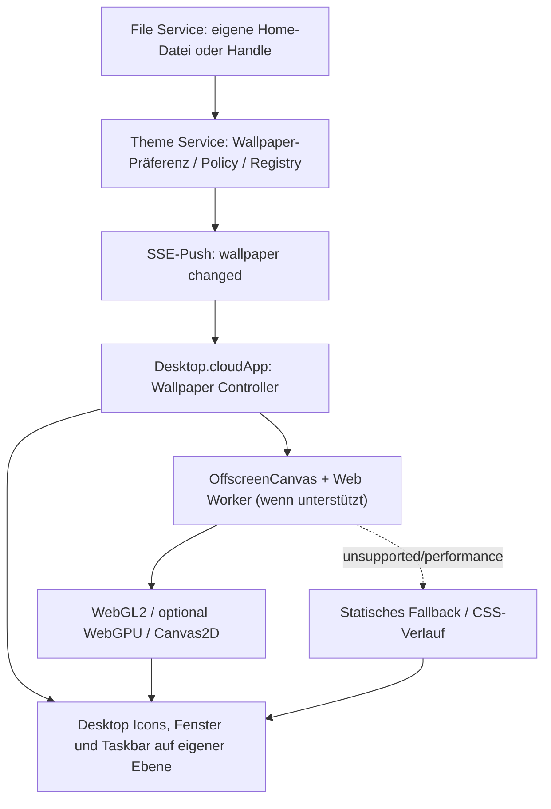

# cloudOS – Dynamische Wallpapers und clientseitige Wallpaper Engine

> **Datei:** `docs/WALLPAPER_ENGINE.md`  
> **Dokumentversion:** 0.1 – Wallpaper-Konzept für cloudOS v0.13  
> **Stand:** 15.11.2026  
> **Status:** Verbindliches Zielbild, noch nicht implementiert  
> **Basis:** `Drezael/cloudOS`, Branch `main`, Commit `0e375a92dbc7feb57d78542bbc54d07db307c844`  
> **Fachliche Referenz:** [daedalOS-Projekt von Dustin Brett](https://github.com/DustinBrett/daedalOS) – dort dokumentierte dynamische Wallpaper (`Milky Way`, `Vanta Waves`, `Hexells`, `Matrix 2D/3D`, `Coastal Landscape`) mit OffscreenCanvas/Web-Worker-Architektur  
> **Abhängigkeiten:** [THEMING.md](THEMING.md), [DESKTOP_ENVIRONMENT.md](DESKTOP_ENVIRONMENT.md), [SYSTEM_ARCHITECTURE.md](SYSTEM_ARCHITECTURE.md), [PUSH_REALTIME.md](PUSH_REALTIME.md), [VIRTUAL_FILESYSTEM.md](VIRTUAL_FILESYSTEM.md), [APP_API_ACCESS.md](APP_API_ACCESS.md), [WINDOW_FRAMEWORK.md](WINDOW_FRAMEWORK.md).

## 1. Ziel und Abgrenzung

Das cloudOS-Desktop soll **dynamische Hintergründe wie im ursprünglich referenzierten daedalOS-Projekt** unterstützen. Statt dessen Quellcode oder Grafikassets ungeprüft zu kopieren, werden für cloudOS eigenständige Effekte mit ähnlichem Charakter spezifiziert. Die visuelle Referenz ist kein Implementierungspaket und keine Aussage darüber, dass cloudOS bereits über diese Renderer verfügt.

Die Animation wird **im Client** unterhalb der Desktop-Icons und Fenster gerendert. Der Go-Core verwaltet nur die erlaubten Wallpaper-Pakete, Benutzerpräferenzen, versionierte Assets, Policies und Push-Ereignisse. Einzelne Animationsframes werden **niemals** über den Server oder SSE übertragen.

Der Wallpaper-Service ist eine fachliche Funktion des bereits vorgesehenen Theme Service; die Wallpaper-Engine im Browser ist ein Renderer der installierten `Desktop.cloudApp`, **keine zweite frei installierte App** und kein zusätzlicher Core-Microservice für das MVP.

## 2. Verbindliche Grundregeln

1. **Keine Polling-Schleifen:** Ein Client muss Änderungen an aktiver Wallpaperwahl oder Settings per **SSE-Push** erhalten. Eine lokale Render-Schleife für Animationen ist **kein Server-Polling**.
2. Alle Wallpaper sind **optional**; ein statischer Hintergrund muss jederzeit möglich sein.
3. Der Benutzer kann das Wallpaper unabhängig vom aktiven Theme wählen. Ein Theme bietet nur ein Default-Preset bei `selection=inherit` an.
4. Die Einstellungen gehören dem Benutzer und werden in `/.config/cloudos/appearance.json` innerhalb des eigenen Homes gespeichert; kein fremdes Home und kein drittes virtuelles Laufwerk.
5. Die Engine darf keine undeklarierten Core-APIs, Client-Geräte, Kamera, Mikrofon oder Netzwerkanfragen verwenden.
6. Vollbildanimationen müssen Fokus, Fenster-Dragging, App-Ausführung und Eingabereaktion unter Last priorisieren. Bei Überlast wird die Qualität reduziert oder der statische Fallback verwendet.
7. `prefers-reduced-motion` bzw. eine explizite reduzierte Bewegung setzen Animation vollständig aus, sofern der Benutzer diese nicht in einer nachweislich zugänglichen separaten Einstellung zulässig übersteuern darf; sichere Voreinstellung ist **keine Bewegung**.
8. In einem nicht sichtbaren Tab, bei gesperrter Sitzung oder im Energiesparmodus wird das Rendering ausgesetzt. Auf Wiederaufnahme muss es neu synchronisiert werden, ohne ständige Netzabrufe.
9. Systemweite Wallpaper-Pakete sind geprüft, versioniert und digest-gebunden. Eigene Bilder/Videos aus dem Home werden nur über VFS-Rechte und explizite Datei-Handles gelesen.
10. Browser-Unterschiede benötigen deterministische Fallbacks; WebGPU darf nicht vorausgesetzt werden.
11. Bei Deaktivierung, Geräteverlust, Tab-Schließung oder Wallpaperwechsel werden Worker, GPU-Kontexte, Media-Streams und temporäre Ressourcen freigegeben.
12. Das Wallpaper darf keine unsichtbaren Interaktionslayer aufbauen: Maus-/Touch-Events gehen an Desktop-Icons, Taskleiste und Fenster durch.

## 3. Die sechs dynamischen Presets

| ID | Name | Visuelle Idee | Primär-Technik | Besonderheit |
|---|---|---|---|---|
| `milky-way` | **Milky Way** | Sternfeld mit galaktischen Spiralarmen, ruhigem Tiefeneindruck | Canvas 2D / WebGL2 | Optionale, ausdrücklich erlaubte Parallax-Neigung |
| `waves` | **Waves** | Abstrakte, flüssige dreidimensionale Wellen mit sanftem Lichtspiel | WebGL2 / Canvas-Fallback | Ruhige Bewegung, Parameter für Wellenhöhe und Geschwindigkeit |
| `hexells` | **Hexells** | Reagierendes Hexagon-/Wabengitter mit Licht- und Farbimpulsen | Canvas 2D / WebGL2 | Partikeldichte und Pulsintensität begrenzbar |
| `matrix-2d` | **Matrix 2D** | Fallende Zeichenbahnen in flacher Matrix-Anmutung | Canvas 2D | Zeichensatz, Spaltendichte und Geschwindigkeit |
| `matrix-3d` | **Matrix 3D** | Zeichen- und Partikelströme mit perspektivischer Tiefe | WebGL2, optional WebGPU | Nur bei ausreichender Grafikleistung; statische Alternative |
| `coastal-landscape` | **Coastal Landscape** | Eigenständige Küstenlandschaft mit bewegtem Himmel/Wasser | Layered Canvas 2D / WebGL2 | Tagesphasen und subtile Bewegung, ohne externen Wetterdienst |

Die Benennungen entsprechen der **Art** der ursprünglich gezeigten daedalOS-Effekte. Die konkrete cloudOS-Umsetzung muss unabhängig gestaltet und unter einer eigenen visuellen Identität veröffentlicht werden. `Vanta Waves` ist eine Referenz aus der daedalOS-Dokumentation, keine Verpflichtung, das gleichnamige Drittanbieterprodukt zu verwenden.

### 3.1 Milky Way

- Mehrere Tiefenlagen: Hintergrundsterne, Milchstraßenband, heller galaktischer Kern, dezentes Nebellicht.
- Langsame Differenzbewegungen der Sterne für Tiefenwirkung. Optionale Parallax auf Pointer-Bewegung oder Geräteorientierung **nur nach Browserfreigabe**, niemals ohne Zustimmung.
- Maximaldichte adaptiv; bei verringerter Bewegung ein unbewegtes Sternbild.
- Kein Echtzeit-Zugriff auf Astronomiedaten, keine Tracking-/Standortabfrage erforderlich.
- Bei hohem Kontrast wird die Lichtintensität hinter Symboltext reduziert und die Kontrastmaske verbessert.

### 3.2 Waves

- Geschwungene, durch Licht und Farbverlauf strukturierte Wellenlandschaft, keine zwingende Fotorealistik.
- Steuerbar: Geschwindigkeit, Intensität, Farbraum, Kameratempo, Qualität.
- WebGL-/Canvas-Fallback; bei fehlender GPU-Beschleunigung ein statisches Wave-Bild.
- Nicht die Rendering-Performance der Fenster-/Taskleistenanimationen beeinträchtigen.

### 3.3 Hexells

- Wiederkehrende Hexagonflächen, die durch Leuchtpunkte, Farbwellen oder lokale Pulse aktiviert werden.
- Bei höheren Auflösungen adaptives Gitter, ohne unkontrolliertes Anwachsen der Zellenzahl.
- Optional reagiert der Effekt auf **lokale, aggregierte** Mausbewegungen, nie auf Tastatureingaben, Texte oder Inhalte geöffneter Fenster.
- Im Energiesparprofil werden Pulsrate und Zeichenzahl begrenzt.

### 3.4 Matrix 2D

- Vertikale, unterschiedlich lange Zeichenströme mit kontrollierten Aufhell-/Ausblendzeiten.
- Eigene lizenzierte Glyphen/Fonts, kein Kopieren proprietärer Grafikpakete.
- Benutzerparameter: Farben (z. B. Grün, Blau, Monochrom), Geschwindigkeit, Dichte, Schriftgröße.
- Keine Auswertung der tatsächlich getippten Zeichen; die Matrix-Glyphen sind rein generativ.
- Bei `reduced_motion`: statische, kontrastarme Zeichenlandschaft.

### 3.5 Matrix 3D

- Perspektivische Ströme in unterschiedlichen Tiefen, Kamerabewegungen mit Obergrenzen.
- Abgeschwächte Animation bei kleinen Viewports oder leistungsschwachen Geräten.
- Bei fehlendem WebGL2/WebGPU: transparenter Fallback auf `matrix-2d` oder statischen Screenshot des Presets, ohne Browserabsturz.
- Kein Flashing und keine hellen Vollbild-Blitze; Frequenz/Intensität streng begrenzen.

### 3.6 Coastal Landscape

- Originalgestaltete Küstenansicht mit Wolken, Wasser, Lichtreflexen, ggf. langsamem Tag-/Nachtzyklus.
- Das Preset basiert auf **gebündelten, lizenzierten Assets** oder prozedural generierten Details; keine ungefragten externen Bilder.
- Optionaler, lokaler Tageszeitenmodus darf nur die Client-Zeit verwenden; kein Standort erforderlich.
- Keine Soundkulisse ohne separaten, ausdrücklichen Opt-in und Browser-Medienfreigabe; MVP bleibt stumm.
- Bei geringer Leistung feste Landschaft mit reduzierter Schichtanzahl.

## 4. Weitere Wallpaper-Typen

| Typ | Anforderungen | Sicherheitsgrenze |
|---|---|---|
| `static` | Bilder aus Core-Baseline oder eigenem Home, `fill`, `fit`, `stretch`, `tile`, `center` | Autorisierter Asset-Endpunkt oder VFS-Handle |
| `animated` | Die sechs vorinstallierten Presets, clientseitig berechnet | Keine freien Skripte/Hosts |
| `video` | Lokale Video-Dateien oder geprüft bereitgestellte System-Videos, stumm, Loop nach Wahl | Browser-Autoplay-Beschränkung und MIME/Codec-Prüfung |
| `slideshow` | Mehrere ausgewählte Bilder, Intervalle und Übergänge | Kein periodischer Server-Poll; Bilder nur bei tatsächlichem Wechsel über autorisierte Handles laden |
| `color` | Vollton/Verlauf als extrem ressourcensparender Fallback | Keine Netzwerkdaten |

Eine Bildergalerie kann später von externen Quellen ergänzt werden, aber **nur über eine separate, ausdrücklich bestätigte Connector-/Netzwerkpolicy**. Sie gehört nicht zum MVP und darf kein heimliches regelmäßiges Auslesen fremder Server verursachen.

## 5. Rendering-Architektur



**Z-Order / Hit-Testing:** Der Wallpaper-Layer befindet sich als rein dekorative Zeichenebene unter Desktop-Icons und Widgets. `pointer-events: none` ist der Standard. Interaktive Konfigurationsdialoge werden ausschließlich durch `Settings.cloudApp` und vertrauenswürdige Framework-Elemente dargestellt, nicht durch das Wallpaper.

### 5.1 Renderer-Wahl

1. `OffscreenCanvas` plus Worker, falls verfügbar und stabil.
2. `Canvas 2D` im Worker oder kontrollierter Fallback auf dem UI-Thread.
3. `WebGL2` für anspruchsvolle Effekte; Kontextverlust und Wiederaufnahme abfangen.
4. `WebGPU` als optionale spätere Optimierung, niemals als einzige Laufzeit.
5. Ein statischer, sicherer Bild-/Farb-Fallback ist bei allen Stufen verpflichtend.

Der Renderer darf keinen unkontrollierten Render-Zyklus im UI-Hauptthread erzeugen. Insbesondere sind Worker-Fehler und fehlende GPU-Beschleunigung normale, getestete Situationen.

### 5.2 Steuerung und Ereignisse

- Der Desktop lädt beim Start einen **autorisierten Initial-Snapshot** seiner Wallpaper-Konfiguration.
- Beim Wechsel sendet der Core `wallpapers.preference.changed` über die vorhandene SSE-Session an **alle berechtigten Tabs dieses Benutzers**.
- Der Push enthält die wirksame Konfiguration oder unveränderliche Asset-/Revision-Referenzen. Der Client aktualisiert sofort und startet/stoppt den entsprechenden Renderer.
- Nach kurzer Netzunterbrechung verwendet der Browser den letzten sicheren Zustand; SSE-Replay oder gezielter Recovery-Snapshot korrigiert eventuelle Abweichungen.
- Ein anderer Benutzer empfängt keine privaten Wallpaper-Einstellungen oder Asset-Handles.
- Renderframes, FPS-Statistiken und Pointerpositionen verbleiben lokal; sie sind **keine** Push-Ereignisse.

## 6. Qualitätsprofile und Ressourcenbudgets

Die folgenden Zahlen sind **vorgeschlagene Startwerte für spätere Messungen**, keine garantierten Laufzeitgrenzen:

| Profil | Zielbild | Vorschlag für FPS-Obergrenze | Auflösung/Dichte | Aktivierung |
|---|---|---:|---|---|
| `eco` | Minimaler Verbrauch | 15 | niedrig | Batterie, reduzierte Leistung |
| `balanced` | Ruhige Bewegung | 30 | mittel | Standard für animierte Presets |
| `high` | Hohe visuelle Qualität | 60 | bis zur Displayauflösung | Nur auf leistungsfähigem Gerät |
| `static` | Keine Bewegung | 0 | natives Standbild | Reduced Motion, Sperre, unsichtbarer Tab |

- Die Qualität richtet sich an gemessener Renderdauer, Speicherbudget, `devicePixelRatio`, Viewport und Browserfähigkeit aus. Sie verwendet **keine** intrusive Fingerprinting-Profilierung.
- Ziel: Über mehrere Sekunden liegt die Wallpaper-Rechenzeit deutlich unter dem für flüssige UI-Interaktion verfügbaren Framebudget; der konkrete Grenzwert wird anhand realer Geräte in Phase 0 bestimmt.
- Bei anhaltenden Frame-Drops wird Qualität schrittweise reduziert (`high → balanced → eco → static`).
- WebGL-/GPU-Kontextverlust führt zum Fallback, nicht zur Endlosschleife.
- Wird der Tab verdeckt, die Sitzung gesperrt oder der Browser in den Hintergrund versetzt, werden Animationen pausiert statt im Hintergrund weiterzurechnen.
- Explizite Energiesparoption und `prefers-reduced-motion` haben immer Vorrang vor der visuellen Theme-Empfehlung.
- Sobald ein Animationspreset deaktiviert ist, müssen Worker und zugehörige GPU-Ressourcen freigegeben werden.

## 7. Einstellungen und Bedienkonzept

**Settings.cloudApp → Personalisierung → Hintergrund** enthält:

1. Kategorien: Dynamisch, Bilder, Videos, Slideshow, Farben.
2. Für jedes Preset eine **statische Vorschau** und eine nur bei Benutzerinteraktion laufende, zeitlich begrenzte Live-Vorschau.
3. Deutlich sichtbare Auswahl und Rücksetzung auf das Theme-Default-Wallpaper.
4. Geschwindigkeit, Intensität, Dichte, Farben, Qualität (`auto`/`eco`/`balanced`/`high`), Parallax aktivieren, Reduced Motion, Video-Stummschaltung.
5. Statusanzeige bei nicht unterstützten APIs, Browserbeschränkungen, Zugriffsverlust auf eigene Dateien oder performancebedingtem Fallback.
6. Unterstützung für unterschiedliche Displaygrößen und Taskleistenpositionen; keine aufgezwungenen Bildzuschnitte, die Desktop-Icons unlesbar machen.

### 7.1 Datenmodell (Beispiel)

`/.config/cloudos/appearance.json` wird gemeinsam mit dem Theme in `THEMING.md` definiert; dieser Auszug stellt nur den Wallpaper-Teil dar:

```json
{
  "selection": "explicit",
  "type": "animated",
  "id": "matrix-3d",
  "quality": "auto",
  "speed": 0.75,
  "density": 0.55,
  "intensity": 0.45,
  "parallax": false,
  "muted": true,
  "fallback_id": "matrix-2d"
}
```

- Werte werden serverseitig auf erlaubte Typen und Grenzen geprüft. Ein eigenes Bild wird über eine **opake, benutzerspezifische File-Handle-Referenz** statt über eine frei konstruierte `system:/`- oder Host-Pfadangabe eingebunden.
- Ein Wallpaper-Preset darf keine veränderlichen oder externen Netzwerkadressen selbst laden; alle verwalteten Assets besitzen Digest/Version und sichere MIME-Auslieferung.
- Die persönlichen VFS-Dateirechte sind unabhängig von einem Theme-Wechsel.

## 8. Sicherheit, Content Security Policy und Datenschutz

- Keine freie JavaScript-Ausführung durch Wallpaper-Bundles; vordefinierte Rendererprofile und geprüfte Datenparameter.
- Kein direktes `system:/`-Listing. Ausgelieferte integrierte Assets sind grundsätzlich für berechtigte Clients abrufbar und daher **keine vertraulichen Daten**.
- Keine dynamischen Wallpaper-Dateien als allgemeine App-Installationsquelle. Manuell heruntergeladene `.cloudApp`-Pakete werden ausschließlich über `Apps.cloudApp` installiert; Wallpaper sind keine Hintertür.
- Keine unsichtbaren Browserberechtigungsdialoge, auf denen eine Animation eine Zustimmung erschleicht. Geräteorientierung erfordert Benutzergeste und Browserfreigabe, wenn verfügbar.
- Kein Öffnen von WebUSB, WebHID, WebSerial oder Browser-Dateisystem-Handles aus einem Wallpaper-Preset; solche Berechtigungen sind ausschließlich über den getrennten Client Device Broker vorgesehen.
- Verdeckte Daten in Dateinamen, Ordnern, offenen Apps, Dokumenten oder Nutzerprofilen dürfen nicht als Shader-/Animationseingabe verwendet werden.
- Falls sich Nutzer für ein Bild aus ihrem Home entscheiden, erteilt die Dateiauswahl nur den benötigten Lesescope; Widerruf beendet den Zugriff und führt zum Fallback.
- Sicherheitsrelevante Wallpaper-Fehler und fehlgeschlagene Asset-Prüfungen werden über das Core-Logging erfasst, ohne Bild-/Dateiinhalte zu protokollieren.

## 9. Systemthemes und Wallpaper-Presets

| Theme | Empfohlenes Default-Wallpaper | Dark/Light-Integration |
|---|---|---|
| Northstar | Milky Way | Helligkeit und Sternendichte adaptiv |
| Cedar | Coastal Landscape | Warmes/gedämpftes Tageslicht |
| Coast | Waves | Weiches Licht und dezente Wellen |
| Prism | Hexells | Akzentfarbe übernimmt Theme-Farbe |
| Slate | Coastal Landscape | Wenig Bewegung und gute Lesbarkeit |
| RetroGlass | Matrix 2D | Klassische Akzent- und Kontrastwahl |

Diese Tabelle gilt **nur** für die allererste Anwendung eines Themes oder bei `wallpaper.selection=inherit`. Ein zuvor von Hand ausgewähltes `matrix-3d` bleibt beim Wechsel von Northstar nach Cedar erhalten. Der Benutzer kann das Theme-Default jederzeit über einen expliziten Button wiederherstellen.

## 10. Komponenten- und Laufzeitabgrenzung

- `Theme Service`: Eigentümer von Registry/Policy/Präferenzvalidierung und Wallpaper-Katalog.
- `File Service`: Eigentümer der Home-Dateien, ACLs und Datei-Handles.
- `Settings.cloudApp`: UI für Auswahl, Vorschau, Speichern, Nutzerwarnungen.
- `Desktop.cloudApp`: vertrauter Wallpaper Controller, Worker-/Renderer-Lifecycle und reine Anzeigeebene.
- `Push Service`: Verteilung validierter Änderungen an berechtigte Sitzungen, **keine** Bild-/Animationsframe-Übertragung.
- `Window Framework`: Darstellungs-/Fokusschichten oberhalb des Wallpaper; Wallpaper darf keine Fensteroperation beeinflussen.
- `Apps.cloudApp`: verwaltet später eventuelle signierte Theme-Resource-Pakete, sofern diese Teil eines `.cloudApp`-Pakets sind; reine Built-ins kommen aus der Release-Baseline.

Der Go-Core läuft zu Entwicklungsbeginn im **Combined-Modus in einem Container**; das ändert nichts an diesen fachlichen Grenzen. Für spätere verteilte Deployments sind gemeinsame persistente Einstellungen, versionsgebundene Asset-Referenzen und zentraler Push erforderlich.

## 11. Ereignisse und API-Verträge (Entwurf)

| Ereignis | Inhalt | Empfänger |
|---|---|---|
| `wallpapers.preference.changed` | Autorisierte Benutzer-ID, Revision, wirksame Wallpaper-Projektion | Eigene Sitzungen |
| `wallpapers.catalog.changed` | Neu freigegebene/gesperrte Systempresets | Betroffene Nutzer |
| `themes.active.changed` | Themepaket/Tokenprojektion; Wallpaper nur bei `inherit` neu auflösen | Eigene Sitzungen |
| `files.permissions.changed` | Vorhandener eigener Wallpaper-Handle ggf. widerrufen | Betroffene Sitzung |
| `session.locked` | Wallpaper-Rendern sofort pausieren | Eigene Sitzung |

Alle genannten Eventnamen sind Vorschläge zur späteren Vertragsstabilisierung. Die serverseitige Zugriffskontrolle und der **signierte API-/Event-Grant-Vertrag** aller `.cloudApp`-Clients bleibt verbindlich. Das Wallpaper darf keine globalen „subscribe-all“-Rechte erhalten.

## 12. OffscreenCanvas, Web Worker und GPU-Fallback

- Für jeden Presettyp wird ein klarer `start`, `pause`, `resume`, `resize`, `settingsChanged`, `dispose`-Lifecycle spezifiziert.
- `requestAnimationFrame` wird nur verwendet, wenn es in der jeweiligen Worker-/Browserumgebung unterstützt wird. Andernfalls wählt der Renderer eine kontrollierte Scheduling-Strategie, ohne ein regelmäßiges **Netzwerk**-Polling daraus abzuleiten.
- Fällt OffscreenCanvas aus, wird Canvas2D im UI-Thread mit abgesenktem Budget oder ein statisches Bild gewählt.
- Der Renderer verarbeitet ausschließlich sichere, validierte Presetparameter; Benutzertexte werden nicht in Shadercode oder `eval` übernommen.
- Video-Decoder und GPU-Ressourcen dürfen beim Profilwechsel nicht hängen bleiben.
- Ein selbstsigniertes Drittanbieter-App-Paket kann keine Wallpaper-Worker mit Systemrechten installieren, nur weil es erfolgreich als App installiert wurde.

## 13. Barrierefreiheit und Wohlbefinden

- Bei stark bewegten oder blinkenden Presets gibt es klare Begrenzungen für Helligkeitssprünge, Blinken und Kontrastspitzen.
- `reduced_motion` deaktiviert dynamische Effekte ohne Verzögerung; die Alternative ist ein aussagekräftiges Standbild.
- Die Desktop-Icons bleiben durch Kontrastoverlay, Textschatten oder leicht abgedunkelten Bereich lesbar; das Wallpaper darf nicht die Textfarbe einer Sicherheitswarnung vorgeben.
- Die Settings-Vorschau ist pausierbar und startet nicht unbegrenzt automatisch.
- Eine Animationsoption wird nicht allein aufgrund von Hintergrundmusik/Sound „interaktiv“; Ton bleibt getrennt und standardmäßig aus.

## 14. Teststrategie

| ID | Erwartetes Ergebnis |
|---|---|
| WP-01 | Alle sechs dynamischen Presets erscheinen im Wallpaper-Katalog. |
| WP-02 | Milky Way hat eigenständige Assets und einen statischen Fallback. |
| WP-03 | Waves läuft ohne WebGPU. |
| WP-04 | Hexells passt seine Rasterdichte an kleine/große Viewports an. |
| WP-05 | Matrix 2D verwendet keine tatsächlich getippten Zeichen. |
| WP-06 | Matrix 3D fällt ohne WebGL2 kontrolliert zurück. |
| WP-07 | Coastal Landscape benötigt keine Standort-/Wetterberechtigung. |
| WP-08 | Ein statisches Bild kann jederzeit statt Animation gewählt werden. |
| WP-09 | Eine Bildergalerie löst keinen permanenten Server-Poll aus. |
| WP-10 | Lokale Video-Wallpaper sind stumm und folgen Browser-Autoplay-Policy. |
| WP-11 | Jeder Presettyp unterstützt Start/Pause/Resume/Dispose. |
| WP-12 | Verdeckter Browser-Tab pausiert den Renderer. |
| WP-13 | Sitzungssperre pausiert den Renderer. |
| WP-14 | Reduced Motion aktiviert unmittelbar ein Standbild. |
| WP-15 | Energiesparprofil reduziert FPS/Qualität. |
| WP-16 | GPU-Kontextverlust führt zum Fallback ohne Endlosschleife. |
| WP-17 | Wiederaufnahme erzeugt keine doppelten Worker. |
| WP-18 | Wallpaper-Wechsel gibt ungenutzte Grafikressourcen frei. |
| WP-19 | Mehrere Tabs erhalten Wallpaperänderungen per SSE ohne Polling. |
| WP-20 | Push-Replay rekonstruiert den letzten erlaubten Zustand. |
| WP-21 | Fremde Benutzer erhalten keine privaten Wallpaper-Handles. |
| WP-22 | Theme-Wechsel lässt explizit gewähltes Wallpaper bestehen. |
| WP-23 | Bei `selection=inherit` wird neues Theme-Default korrekt angewandt. |
| WP-24 | Taskleistenposition und Desktop-Icons ändern sich nicht durch ein Wallpaper. |
| WP-25 | Wallpaper-Layer fängt keine Klicks auf Desktop-Icons ab. |
| WP-26 | Home-Bilder werden nur über geprüfte Handles geladen. |
| WP-27 | Entzug des Datei-Rechts führt zum Fallback ohne Datenleck. |
| WP-28 | Wallpaper darf keine Client-Geräte-API aufrufen. |
| WP-29 | Wallpaper kann keine freie Remote-Netzwerk-URL laden. |
| WP-30 | Ein fehlerhaftes Preset legt nicht den Desktop oder Login lahm. |
| WP-31 | App-Kontext-/API-Allowlist wird für Wallpaper-Einstellungen eingehalten. |
| WP-32 | Systemwallpaper-Assets können nicht durch Nutzerdateien überschrieben werden. |
| WP-33 | Live-Vorschau endet bei Abbruch vollständig. |
| WP-34 | Desktoptexte bleiben auf hellen/dunklen Hintergründen lesbar. |
| WP-35 | Nach Theme-Update bleiben Benutzerpräferenzen versionskompatibel. |
| WP-36 | Benchmark-Test nach späterem Browser-/GPU-Matrix-Plan besteht. |

## 15. Geplanter Entwicklungsablauf – ohne Implementation jetzt

1. Wallpaper-Asset-Registry mit eindeutigen Preset-IDs/Versionen entwerfen.
2. Originalgrafik- und Asset-Lizenzen dokumentieren.
3. Preset-Parameter, Limits und Validierung spezifizieren.
4. Für jedes der sechs Presets Standbild/Fallback konzipieren.
5. OffscreenCanvas-/Worker-Profil inklusive Canvas2D-/WebGL2-Fallback definieren.
6. Theme-Service-Integration und VFS-Backing festlegen.
7. `Settings.cloudApp` mit Vorschau und Nutzereinstellungen detaillieren.
8. SSE-/Replay- und Mehrfach-Tab-Verhalten dokumentieren.
9. Sicherheits-, Accessibility- und Browserkompatibilitätstests vorbereiten.
10. Später anhand realer Browser Benchmarks Qualität/FPS-Limits final festsetzen.

## 16. Geplante ADRs

- **ADR-125:** Wallpaper-Rendering ausschließlich clientseitig, keine Frame-Streams vom Core.
- **ADR-126:** Sechs eigenständig entwickelte animierte Wallpaper-Presets nach daedalOS-Referenz.
- **ADR-127:** Wallpaper-Präferenz als eigene Auswahl, unabhängig vom Theme-Preset.
- **ADR-128:** Worker-/OffscreenCanvas-first und verpflichtende statische Fallbacks.
- **ADR-129:** Leistung, Reduced Motion und Tab-Pause sind harte Anforderungen.
- **ADR-130:** Wallpaper-Änderungen über SSE, niemals periodisches Browser-Polling.

Diese ADRs ergänzen die älteren Theme- und Realtime-Entscheidungen. Die Nummerierung ist bis zur separaten ADR-Datei als vorgeschlagen zu behandeln.

## 17. Referenz und Verantwortung

Das Vorbild [daedalOS](https://github.com/DustinBrett/daedalOS) beschreibt Milky Way, Vanta Waves, Hexells, Matrix 2D/3D und Coastal Landscape sowie OffscreenCanvas/Web Worker. cloudOS übernimmt **die funktionale Produktidee**, entwickelt aber ein eigenes Rendering-/Asset-System. Quellen, Drittanbieter-Lizenzen und ggf. geschützte Markennamen müssen vor Auslieferung separat geprüft werden.

Dieses Dokument ist **fachlich führend für Wallpaper-Typen, Render-Lifecycle, Leistung, Fallbacks und Sicherheitsgrenzen**. Für Theme-Presets, Token-Design und die Benutzerpräferenzhoheit gilt [`THEMING.md`](THEMING.md). Für den restlichen Desktop gilt `DESKTOP_ENVIRONMENT.md`.
