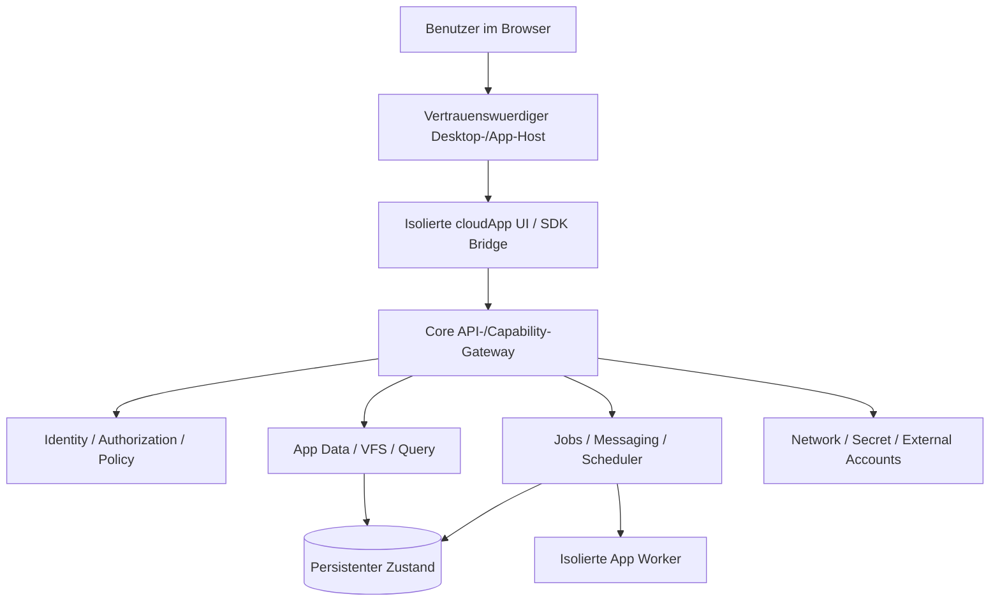

# Architecture Baseline – cloudOS App Framework SDK

> **Stand:** 15.11.2026 · **Status:** konzeptioneller Baseline-Entwurf, **nicht freigegeben**.  
> **Leitdokument:** [APP_FRAMEWORK_SDK.md](../APP_FRAMEWORK_SDK.md)

## 1. Systemkontext und Grenzen

cloudOS stellt eine browserbasierte Desktop-Umgebung bereit. Fachliche Systemfunktionen werden im **Go-Core** implementiert; sichtbare Apps, einschliesslich Core-Apps, sind installierbare `.cloudApp`-Pakete. Standardbetrieb: **ein Core-Container** mit logischer Modularisierung; abgetrennte Services und Kubernetes bleiben opt-in und muessen identische API- und Sicherheitssemantik erhalten. Die Browser-Shell vermittelt Darstellung und App-Host-Funktionen, besitzt aber keine fachliche Autoritaet, die serverseitige Berechtigungspruefung zu umgehen.

## 2. Unveraenderliche Sicherheitsinvarianten

1. **Default Deny** bei App-API-Aufrufen: wirksame Benutzerrechte, App-Zuweisung, signierte Endpoint-Deklaration, genehmigte App-Rechte und Resource Scope.
2. **Ein autoritativer Owner pro Daten-/Ressourcentyp**; keine direkten Datenbankmutationen durch fremde Dienste oder Apps.
3. **Signatur und Laufzeitintegritaet** sind notwendig, aber nicht hinreichend fuer Vertrauen oder Freigabe.
4. **Strikte App-Isolation**; unvertrauenswuerdiger Code wird nie im privilegierten Go-Core ausgefuehrt.
5. **Secret-Broker-Vermittlung** fuer externe Credentials; keine langfristigen Secrets im Browser-Storage.
6. **Berechtigungswiderruf** muss bei jeder kritischen Ausfuehrungsgrenze wirken; kein alter Cache / Event / Genehmigungsnachweis erweitert Rechte.
7. **Sicherheit fail closed**, funktionale Teilausfaelle degradiert, soweit sicher moeglich.
8. **Keine garantierte Exactly-once-Ausfuehrung** ueber Dienst-/Providergrenzen; Idempotenz + Outbox/Inbox + Sagas.
9. **Keine nicht autorisierten dynamischen Codeimporte**; Lazy Loading ausschliesslich verifizierter Release-Module.
10. **Keine impliziten SDK-Plugins, App-Suchanbieter, Gastlinks oder Clipboard-Synchronisation**.

## 3. Laufzeitprofile und Funktionen

| Kontext | Verantwortung | Sicherheitsgrenze |
|---|---|---|
| Browser-Shell | Desktop, Fenster, Core-Dialoge, Navigation | Kein fachlicher Autorisierungsersatz |
| App-Browser-Runtime | Signierte UI-Module, isolierte Fremdinhaltsdarstellung | Eigene Origin/Sandbox und SDK-Bridge |
| App-Server-Worker | Autorisierte Jobs, Domain Operations, Integrationen | Signierte Module, isolierte Worker, kurzlebige Identity |
| Go-Core | Autoritative Systemfunktionen, Validierung, Persistenz | Policy Enforcement und Ressourcenzuordnung |
| Externe Provider | OAuth/OIDC, Webhooks, APIs | Unvertrauenswuerdige Netzwerkgrenze |

**Offener Abgleich:** Altbestand nennt optionale Native-/WASI-Jobs. Q113 begrenzt SDK-Ausfuehrungsformate auf JS/TS und WASM, ohne beliebigen nativen App-Code. Der Scope der historischen optionalen Native-Ausnahme ist in [09-risk-register.md](09-risk-register.md) zu klaeren.

## 4. Grundlegende Dienste und Fachvertraege

- **Identity/Authorization**: Sitzungen, Auth, Step-Up, Capability-/Endpoint-Enforcement, Widerruf.
- **App Registry/Release**: Paketformat, Signaturen, Freigabe, Konformitaet, Versionsuebergaenge.
- **App Runtime**: App-Instanzen, Window Manager, Browser- und Worker-Lifecycle.
- **Data/VFS**: Owner-Ressourcen, Revisionspruefung, Dateien, Query und Constraints.
- **Messaging/Workflows**: At-least-once, Replay, Outbox/Inbox, Sagas, menschliche Entscheidungen.
- **Integration**: Network Gateway, Credential Store, Secret Broker, OAuth-Konten, Webhook-Abonnements.
- **UX**: Dialoge, Benachrichtigungen, Accessibility, i18n, File Picker und Navigation.
- **Operations**: Health, Readiness, Ressourcen-Accounting, Logging, Audit, Diagnostics.

## 5. Datenfluss- und Konsistenzprinzipien

Ein Schreibvorgang wird vom verantwortlichen Owner autorisiert und validiert; sein Datenbank-Commit ist seine lokale atomare Grenze. Outbox-Ereignisse werden im selben Commit registriert. Zustellungen koennen wiederholt stattfinden; eine Inbox verhindert innerhalb ihrer Transaktionsgrenze doppelte Verarbeitung. Sagas verwalten irreversible, dienstuebergreifende Seiteneffekte explizit. Historische Events/Replays sind niemals historische Berechtigungsnachweise.

## 6. Zeit, Fehler und Resilienz

- Zeitpunkte serverseitig UTC, Nutzerdarstellung ueber IANA-Zonen; DST und Catch-up werden explizit behandelt.
- Aufrufe besitzen Korrelations- und Operationskennungen, Cancellation, Deadlines; unklarer Commit ergibt `OUTCOME_UNKNOWN`.
- Apps besitzen definierte Readiness-, Degradations- und Recovery-Zustaende; sicherheitskritische Abhaengigkeiten bleiben fail closed.
- Browser/Service Worker koennen jederzeit beendet werden; persistente Workflows duerfen keinen offenen Tab voraussetzen.

## 7. Verbindliche Abgrenzungen

- Keine geographische Datenresidenz-Regel im SDK (Q130); Betreiberregelungen ausserhalb.
- Keine App-zu-App-Erweiterungspunkte (Q52), keine app-eigenen globalen Suchanbieter (Q36/Q67), keine externen Gastlinks (Q75).
- Kein SDK-Simulator (Q105): Integrationstests gegen echte cloudOS-Instanzen.
- Browser-Push: regulaerer Push-Transport **SSE**, nicht pauschal WebSocket; Q35 betrifft externe SDK-Verbindungen nach gesondertem Netzvertrag.
- Keine implizite Aufhebung der bestehenden Self-Signing-/Admin-Ausnahmen durch das Conformance-Gate; Konflikt Q154 vs. `APP_SIGNING.md` wird geprueft.

## 8. Architecture Baseline – Freigabebedingungen

Eine formelle Baseline-Freigabe setzt den Vollabgleich der Repository-Dokumente, die Rekonstruktion fehlender Entscheidungsnachweise, die Klaerung aller `BLOCKER` sowie die Abnahme der Service-Owner-, API-, Sicherheits- und Datenvertraege voraus. **Diese Bedingungen sind noch nicht nachgewiesen.**

## 9. Verbindliche Baseline-Präzisierungen aus K1–K9

Die vollständigen Beschlüsse stehen in [11-architecture-decisions-K1-K9.md](11-architecture-decisions-K1-K9.md). Diese Kurzfassung präzisiert die Systemgrenzen und erzeugt keine neuen Service-Owner.

- **Paket und Release (K1/K9):** Eine Self-signed-Herkunftsfreigabe übersteuert keine technische Conformance-Prüfung. Release-/Digest-Widerruf hat Vorrang vor Übergangsfenstern; Rollback nur auf nicht gesperrte, kompatible Pakete.
- **Runtime (K2):** Browser JS/TS/WASM als reguläres sichtbares Profil, WASI serverseitig isoliert nach MVP, Native nur später nach eigener Freigabe; keine beliebige native Ausführung im Core.
- **Browser Security (K3):** Unterschiedliche Apps verwenden getrennte Origins und kontrollierte iFrames; der Core setzt App-Bridge-, Service-Worker- und Speichergrenzen verbindlich durch.
- **Kompatibilität (K4):** Eine aktive Core-API-Major; parallele App-Releases nur bei gültiger Kompatibilität, Grant- und Datenmigration.
- **Kommunikation (K5):** Core zu Desktop über SSE, Drittanbieter-Provider-SSE/WS über Network Broker, Web Push als optionale Notification Delivery.
- **Daten (K6/K7):** KMS-verschlüsselte Serverdaten und echte optionale E2EE sind getrennte Fähigkeiten. Event-Klassen besitzen separate Retention; Replay autorisiert aktuelle Rechte erneut.
- **Workflows (K8):** Widerruf stoppt neue normale Schritte. Kompensation benötigt eine neue zweckgebundene Recovery-Autorisierung.

**Nicht abgenommen:** konkrete Origins/Hostnames, Release-Kill-Switch-Ausführung, E2EE-Recovery, Runtime-Sandbox, API-Schemas und Repo-weite Core-Owner-Zuordnung.
