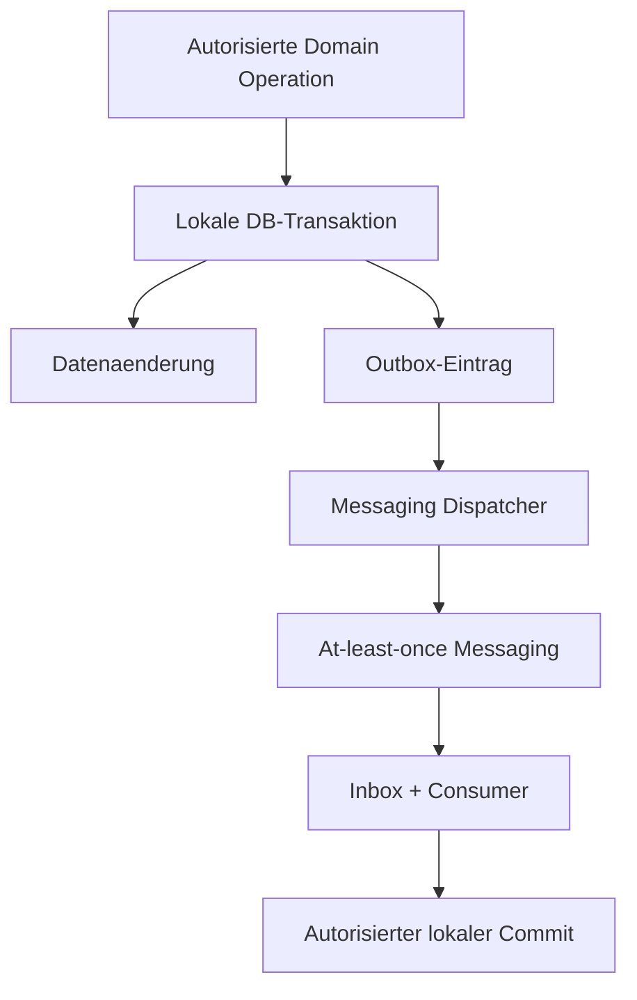

# Data & Consistency Model – App Framework SDK

> **Status:** Ziel-Semantik; konkrete Tabellen, Migrationsskripte und physische DB-Schemas sind **nicht** Teil dieses Konzepts.

## 1. Fachliche Datenhoheit

Der App Data Service kontrolliert Anwendungsdaten, Ressourcenzuordnung (User/Group/Workspace/Tenant), Versionierung, Retention und autorisierte Mutation. VFS-Dateidaten bleiben unter dem VFS-Owner. Shared Resource IDs und Revisionen verbinden Referenzen, ohne eine fremde Owner-Datenbank direkt zu mutieren.

## 2. Persistente Konsistenzgrenzen

| Operation | Garantie | Kein Versprechen |
|---|---|---|
| Einfache App-Datenmutation | Lokale ACID-Transaktion | Globale ACID ueber externe APIs |
| Fachliche Domain Operation | Constraints + Revision + geschuetzter Commit | Freie Apps duerfen Datenbank direkt aendern |
| Daten + Outbox | Atomarer lokaler Commit | Genau eine spaetere Zustellung |
| Inbox + fachlicher Commit | Einmalige lokale Wirkung bei geeignetem DB-Owner | Externer Effekt genau einmal |
| Mehrdienstlicher Prozess | Versionierte Saga mit Retry/Kompensation | Perfektes Zurueckrollen aller Schritte |
| Event Replay | Autorisiertes Nachlesen innerhalb Retention | Unbegrenzte Archivierung / alte Rechte |
| Browser-/Offline-Sync | Revision-/Konfliktpolitik, ggf. CRDT fuer explizite Modelle | Automatische Konfliktfreiheit |

## 3. Datenintegritaet

Grundconstraints: Typen, Pflichtfelder, Eindeutigkeit, gueltige Referenzen, Wertebereiche und definierte Relationen. Fachliche Domain Operations verifizieren Statusuebergaenge und Business Rules innerhalb sicherer Worker-Grenzen. Regeln und Datenmigrationen sind versioniert. Ein Client-Validator ist nur UX-Vorpruefung; die serverseitige Commit-Pruefung ist autoritativ.

## 4. Outbox-/Inbox-Semantik

Das Ereignis traegt eine stabile ID, Schema-Version, Owner-/Ressourcenrevision und nur erforderliche Payload. Dispatcher duerfen nach einem Crash doppelt senden; Empfaenger duerfen doppelte Operationen nicht ungeprueft ausfuehren. Inbox-Entscheidungen werden soweit moeglich mit der lokalen Fachmutation atomar gespeichert.

## 5. Retention, Replay und Wiederaufbau

Persistente Consumer-Cursors sind an Consumer/Stream/Sicherheitskontext gebunden. Replay ist nur innerhalb der aufbewahrten Fristen autorisiert. Abgelaufene Ereignisse erfordern Resynchronisation aus autoritativer Quelle oder einem zulaessigen Snapshot. Loesch- und Widerrufsregeln duerfen nicht durch alte Replay-Payloads umgangen werden. Audit-Log ist getrennt von Geschaeftsevents und besitzt eigene Aufbewahrung.

## 6. Saga- und Genehmigungskonsistenz

Versionierte Workflow-Schritte speichern Fortschritt, Retry-Zustand und Kompensationsmoeglichkeit. Eine menschliche Freigabe bindet an Ressource und Revision, genehmigenden Benutzer und den aktuellen Berechtigungskontext; bei wesentlicher Ressourcenaenderung ist Neufreigabe zu pruefen. Kein genehmigter Schritt kann aktuelle Berechtigungspruefung ueberspringen.

## 7. Synchronisation und Offline-Grenzen

Der Server ist autoritative Instanz fuer serververwaltete Daten; offline verfasste Aenderungen sind vorlaeufig bis zum akzeptierten Server-Commit. Revisionsfehler und Konflikte muessen sichtbar und loesbar sein. Nur explizite CRDT-faehige Datenmodelle duerfen automatische Merge-Semantik versprechen. E2EE kann serverseitige Volltextsuche, Preview und servergestuetzte Merge-Logik einschraenken.

## 8. Migration und Mehrversionsbetrieb

Expand-and-Contract wo moeglich, versionierte Constraints, getrennte Workflow-/Event-Schemas. Eine App-Rollback-Entscheidung garantiert keinen Daten-Rollback. Alte Releases duerfen neuere Daten nicht unkontrolliert ueberschreiben. **API-Major-Parallelbetrieb ist nicht aus App-Release-Parallelbetrieb abzuleiten.**

## 9. Zu spezifizierende Abnahmedetails

Isolation Levels, atomare Owner-Grenzen, Schema-Versionen, Stream-/Cursor-Format, Dedupe-Retention, DLQ-Redrive, konkrete Kompensationsautorisierung, Migration-Backfills, RPO/RTO und E2EE-Abhaengigkeiten sind vor der jeweiligen Implementierung festzulegen.
