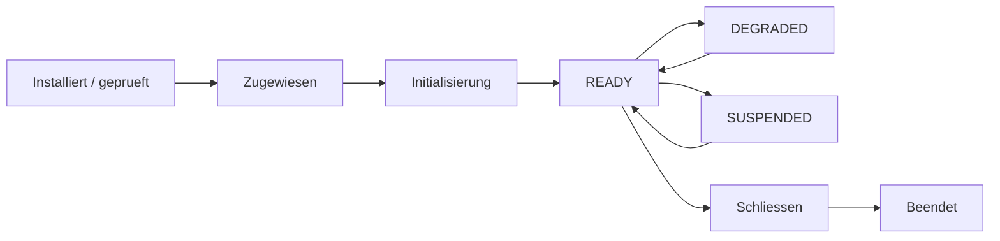

# Runtime & Lifecycle Contracts – App Framework SDK

> **Status:** Ziel-Laufzeitvertraege; keine Implementierung oder Browsergarantie.

## 1. App-Lifecycle

Installiert bedeutet nicht aktiv, zugewiesen bedeutet nicht privilegiert und gestartet bedeutet nicht READY. Core-App-Baseline-Schutz, Zuweisung und Signing sind vor Aktivierung zu pruefen. Nach Widerruf keine weiteren geschuetzten Operationen.

## 2. Fenster, Unsaved Work und Zustand

Fenster erhalten eigene Instanz-/Fensteridentitaet. Beim Schliessen beruecksichtigt der Host `CLEAN`, `DIRTY`, `SAVING`, `SAVE_FAILED`, `CONFLICT`. Ein privilegierter Core-Dialog kann vor drohendem Datenverlust warnen; Sicherheitswiderruf darf dadurch nicht blockiert werden. Persistente Snapshots sind versioniert, Berechtigungen nicht dauerhaft lokal gecacht.

## 3. Browser-Background und Tabs

Service Worker sind Core-verwaltet; Origins und Service-Worker-Scopes bleiben technisch getrennt. Browser-Lifecycle ist nicht verlässlich planbar. App-UIs dürfen kurze Aufrufe abbrechen; lang laufende Arbeit wird als persistenter Serverjob definiert. Tab-Leader-Leases sind auf eine Aufgabe begrenzt und nutzen Fencing; sie ersetzen keine serverseitige Autorisierung.

## 4. Worker- und Job-Lifecycle

Worker erhalten signierten/verifizierten Code und kurzlebige gebundene Execution Identity. Start -> autorisierter Schritt -> Commit/Fehler -> Retry/Compensation/Completion. Jeder Schritt beachtet Quotas, Deadlines und gueltige Rechte. Permanente Hintergrundverbindungen aus externen SSE/WebSockets sind lifecycle-gesteuert und nicht identisch zum regulaeren cloudOS-Browser-Push ueber SSE.

## 5. SDK-Aufrufkontext

Normativer Zusammenhang: `operation_id`, `correlation_id`, `deadline`, Cancellation, Owner-/Tenant-/User-/App-/Release-Kontext, Resource Scope. Kein freies Client-Claim wird zum Autorisierungsnachweis. Fehler: `CANCELLED`, `DEADLINE_EXCEEDED`, `OUTCOME_UNKNOWN`, Konflikt, Forbidden, Unavailable, Validation. Bei unbekanntem Commit: Statusaufklaerung/Idempotenz statt blindem Retry.

## 6. Browser-Benachrichtigung

Notification Service ist Owner; Web Push wird nur bei expliziter Benutzer- und Browserfreigabe verwendet. Push darf vertrauliche Inhalte nicht unnoetig offenlegen. Klicks fuehren ueber autorisierte Deep Links, nicht direkt auf priviligierte Daten. Keine garantierte Browserzustellung.

## 7. Release-Lifecycle

Paket verifiziert -> Konformitaetspruefung -> Policy-/Risikoentscheidung -> aktiviert -> versionsgebundene Instanzen -> Update-/Uebergangsphase -> alte Instanz beendet. Sicherheitssperren haben Vorrang vor komfortabler Mehrversionsphase. Bestehende selbstsignierte Admin-Freigaben sind nur mit explizit abgestimmtem Conformance-Vertrag zu interpretieren.

## 8. Runtime-Degradation

| Zustand | Trigger | Erlaubtes Verhalten |
|---|---|---|
| READY | Alle zwingenden Dependencies gueltig | Normalbetrieb |
| DEGRADED | Optionale Dependency fehlt | Eingeschraenkte sichere Funktion |
| READ_ONLY | Geschuetzte Schreibfunktion nicht verfuegbar | Nur nachweislich autorisierte Leseoperationen |
| UNAVAILABLE | Sicherheitskritischer Owner fehlt | Betroffene Operationen fail closed |
| RECOVERING | Dienst wieder erreichbar, Konsistenz ungeprueft | Kontrollierte Reinitialisierung/Resync |

## 9. Diagnostik und Support

Versionierte Diagnosetests `PASS`, `WARN`, `FAIL`, `SKIPPED`, `UNAVAILABLE` unter eingeschraenkter Ausfuehrung. Supportexporte enthalten nur autorisierte und redigierte technische Daten, niemals Secrets oder ungefilterte Nutzerdokumente. Eine Diagnose ist keine Reparaturberechtigung.

## 10. Ausfalltestmatrix

Mindestens: Tab-Absturz, Service-Worker-Ende, Worker-Crash, Berechtigungswiderruf waehrend Auftrag, Netzwerkunterbruch nach Datenbank-Commit, abgeschalteter Provider, inkompatibles Alt-Release, nicht verfuegbarer Auditpfad und teilweise restaurierter Datenbestand. Weitere Details erst nach Repo-Abgleich und konkreten API-Vertraegen.

## 11. Release-, Runtime- und Recovery-Lifecycle K1–K9

| Anlass | Sicherheits-/Lifecycle-Reaktion | Beschluss |
|---|---|---|
| Selbstsignierte App installieren/aktualisieren | Technische Pflichtprüfungen durchlaufen; separate Herkunftsrisiko- und Endpoint-/Device-Freigaben | K1 |
| Server-WASI-/Native-Worker starten | Profil-/Signatur-/Grant-Gate, getrennte Isolation und Laufzeitbudgets | K2 |
| Browser-Tab/Service Worker startet | Host-validierte App-Origin, geprüfte Instanz, kontrollierte SW-Scope-/Asset-Policy | K3 |
| Alte und neue App-Version parallel | Nur bei aktiver API-Major und gültiger Daten-/Capability-Kompatibilität; Übergangsfrist begrenzt | K4 |
| Provider- oder Notification-Verbindung | Network- oder Notification-Owner kontrolliert Reconnect, Consent, Suspend und Revoke | K5 |
| E2EE-Ressource geöffnet | Klartextnur lokal auf befugtem Client; serverseitige Content-Funktionen nicht verfügbar | K6 |
| Browser nach Unterbrechung reconnectet | Nur aktuelle autorisierte Eventprojektion; Gap führt zu gezieltem Snapshot | K7 |
| Saga verliert notwendige Rechte | Normale Schritte stoppen; nur gesondert autorisierte Kompensation/Recovery | K8 |
| Release-Digest wird gesperrt | Neue Starts/Bridge-Operationen blockieren, betroffene Instanzen/Worker stoppen, Cache-/SW-Reaktivierung verhindern | K9 |

**Präzisierung:** Aufruf-Cancellation, Sicherheitswiderruf und Saga-Kompensation sind unterschiedliche Vorgänge. Ein abgeschlossener Commit wird nicht durch das Beenden eines Tabs rückgängig gemacht. Vor einem Release-Rollback sind Policy, API-Major, Datenschema und in-flight Jobs zu prüfen. Echte technische Browser-/Recovery-/Runtime-Tests sind noch offen. Vollständiger Nachweis: [K1–K9](11-architecture-decisions-K1-K9.md).
