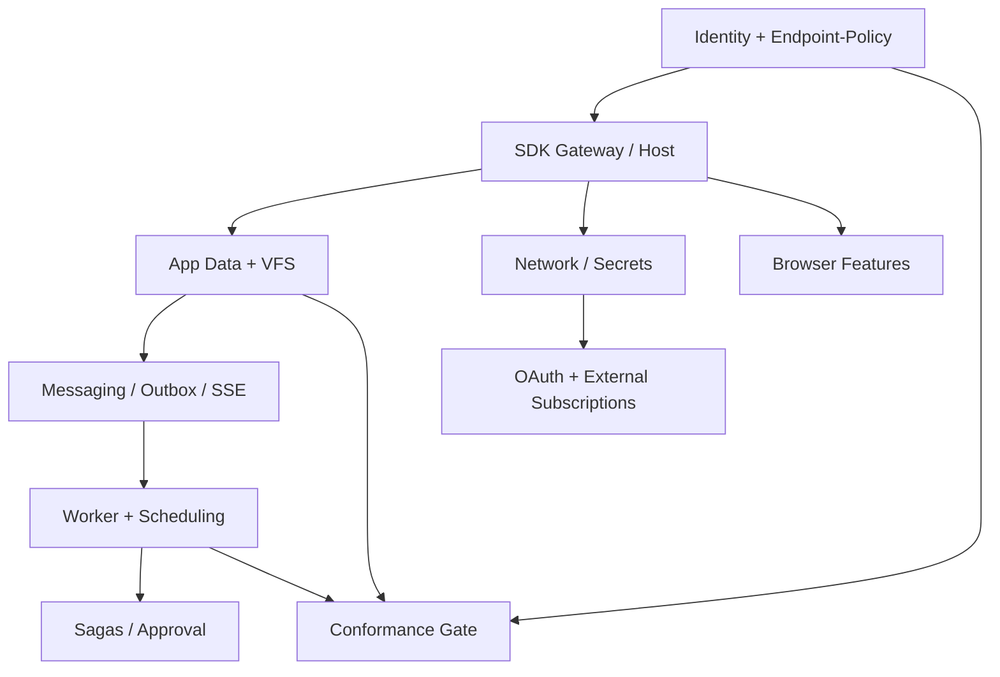

# Dependency Matrix & Implementation Order – App Framework SDK

> **Status:** vorlaeufige logische Abhaengigkeiten; kein genehmigter Sprint- oder Implementierungsplan.

## 1. Dependency Matrix

| Komponente | Benoetigt zwingend | Kann spaeter ergaenzt werden | Besonderer Blocker |
|---|---|---|---|
| Policy/Identity Core | Auth/Session, user/tenant/resource ownership | Step-Up, Consent | Authoritative AuthZ-Pfad |
| Package Registry | App-ID, X.509/Trust, Endpoint-Katalog | Mehrere Quellen, staged rollout | Self-signed Ausnahmen vs. Release Gate |
| App Host / SDK Bridge | Origin-Isolation, installierter Grant, API-Contracts | Multi-Tab, Push UI | Sandbox-Technik nachweisen |
| App Data Service | AuthZ, Owner, Schema, Transaktion | Reactive Query, Snapshots, E2EE | Persistenter Owner und Constraints |
| VFS | AuthZ, Ressourcenmodell, File Ownership | Preview, Transfer Scheduler | VFS-Fachdokument respektieren |
| Messaging | Persistenter Event-State, AuthZ, Schema | Inbox, Replay, SSE-Fanout | SSE-only-Push vs. externe WebSockets trennen |
| Worker Runtime | Signierte Artefakte, Isolation, Execution Identity | Pooling, lange Workflows | WASI/native Scope festlegen |
| Job/Saga Service | Worker, Messaging, Datastore, Scheduling | Human Approvals | Fencing / Schritt-Autorisierung |
| Secret/External Account | KMS, AuthZ, Network Gateway | OAuth, Webhook-Lifecycle | Keine Tokenexposition |
| Browser Background | Origin/Scope, App Host, Capability Gateway | Web Push, Leader-Election | Browserfaehigkeiten / Lifetime |
| Diagnostics | Supervisor, Observability, Audit | Supportexport | Redaction / Datenfreigabe |
| Conformance Gate | Signing, Manifest, API-Schemas, Testinstanz | Risikobasiertes Review | Policy-Abgleich |

## 2. Empfohlene konzeptionelle Implementierungsfolge

1. **F0: Baseline und Entscheidungsklaerung** – Originaldokumente/Decision Register verifizieren, Blocker klaeren, ADRs festhalten.
2. **F1: Identity, Trust, Package und Capability** – Autorisierungsdurchsetzung, signierte Berechtigungskataloge, Trusted App Host.
3. **F2: App-Instanz/SDK-Bridge und Core-Daten/VFS** – lifecycle, Resource Ownership, Revisionen, Constraints.
4. **F3: Messaging/SSE und Idempotenz** – At-least-once, Resource Watch, Outbox/Inbox, Recovery.
5. **F4: Worker/Scheduling/Workflows** – signierter Runtime, delegierte Auth, Saga/Human Approvals.
6. **F5: Integrationen/Browserzusatzfunktionen** – Network Broker, OAuth, Secret Broker, Webhooks, Offline/Web Push.
7. **F6: Release/Operations/Developer Experience** – App Registry, Conformance, Diagnostik, versionierte Dokumentation.

**Wichtig:** Das ist eine Abhaengigkeitsreihenfolge, keine Zusage, alle Funktionen fuer ein MVP zu implementieren. Die tatsaechlichen Dienstgrenzen sind im Combined-Go-Core zu verifizieren.

## 3. Kritische Abhaengigkeitsketten

## 4. Geplante technische Nachweise

- Existenz und Owner der Core-Dienste gegen `SYSTEM_ARCHITECTURE.md` und `CORE_DEPLOYMENT_SCALING.md` abgleichen.
- Vor Ablaufdefinition: persistente Tabellen/Transaktionen, Replay/Retention, Recovery und DB-Isolation festlegen.
- Vor SDK-Release: echte cloudOS-Testinstanz statt Simulator, feste Testvektoren und Konformitaetsberichte.
- Vor Implementierung: offene `BLOCKER` aus [09-risk-register.md](09-risk-register.md) schliessen; sonst nur unabhaengige, implementierungsreife Komponenten zulassen.

## 5. Entscheidungsgates aus K1–K9

| Implementierungsbereich | Vorbedingungen aus Konfliktbeschlüssen | Noch benötigter Nachweis |
|---|---|---|
| Package/Signing | K1, K9 | Conformance ohne Bypass, Publisher Trust, Kill-Switch-Sperrklassen |
| App Host/SDK | K3, K4, K5 | Origin/SW-Topologie, Bridge-Policy, eine API-Major, SSE-Event-Grants |
| WASI/Native Runtime | K2, K9 | Signierte Profile, Host-Binding- und Runner-Isolation, Stopp nach Revoke |
| App Data/VFS | K6, K7 | E2EE-Capability-Matrix, Index-/Preview-Abgrenzung, Lösch-/Event-Owner |
| Jobs/Sagas | K7, K8 | Dedupe/Checkpoint/Recovery-Identität, Human Approval und Rollback |
| Release/Operations | K1, K4, K9 | Upgrade-Readiness, App-Parallelversionen, Quarantäne/Audit |

R-008 ist **fachlich entschieden**: logisch getrennter App-Data-Owner im Combined-Go-Core (Option C), keine zusätzliche Bootstrap-Rolle. Das [Owner-Mapping](14-owner-mapping.md) ordnet die SDK-Komponenten den dokumentierten technischen Rollen zu. Die tatsächliche `services.json`-Quellvalidierung und pro-Owner-Schema-/API-Detailprüfung stehen weiterhin aus; ohne diese Nachweise darf kein widersprüchlicher zweiter Dienst eingeführt werden. Referenz: [K1–K9](11-architecture-decisions-K1-K9.md).
